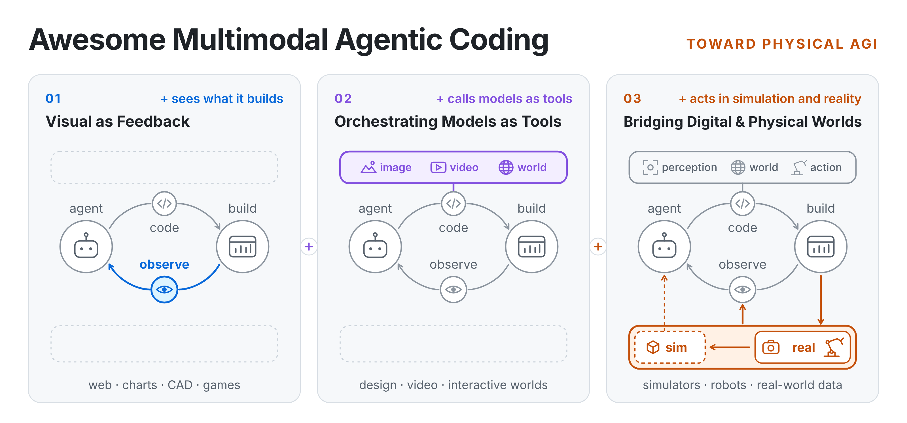

<!-- Generated by scripts/build_readme.py from data/*.yaml — edit the data, not this file. -->

<div align="center">

# Awesome Multimodal Agentic Coding

<picture>
  <source media="(prefers-color-scheme: dark)" srcset="assets/hero/hero-dark.png">
  
</picture>

マルチモーダルエージェントがコードを書き、その結果を観察し、改善していく研究のマップ——画面の中から物理世界まで。

[](https://awesome.re) [](#contents) [](https://github.com/jiangjin1999/awesome-multimodal-agentic-coding/commits/main) [](./LICENSE)

[English](./README.md) · [简体中文](./README.zh-CN.md) · **日本語**

</div>

> [!NOTE]
> この日本語版は機械支援翻訳です。論文タイトルは原文のままです。誤りを見つけた場合は Issue でお知らせください。

## ビジョン

私たちはマルチモーダル・エージェンティック・コーディングを**拡張し続ける一つのループ**として捉えます。エージェントはコードを書き、成果物を構築し、結果を観察して修正します。各段階はこのループを保ったまま一つの要素を加えます——**01** 自分が作ったものを*見る*、**02** 他のモデルを*ツールとして呼び出す*、**03** シミュレーションと現実世界で*行動する*。

**収録基準.** 収録の基準は、一つのエージェント軌跡の中で、**コードが成果物や世界の状態を構築・変更し、エージェントが実行後の証拠（視覚・時間・空間・インタラクション・身体性）を得て、その証拠が後のコードやツール操作を変えること**です。ツール、呼び出し可能なモデル、デモは、このループを支える場合に掲載します。各研究は一度だけ掲載し、関連する箇所は「関連」で示します。

<a id="contents"></a>

## 目次

- [Stage 1 · フィードバックとしての視覚](#stage-1)
  - [1.1 Web・UI・アプリケーション](#s1-1) (44)
  - [1.2 GUI・ソフトウェア学習環境](#s1-2) (7)
  - [1.3 チャート・科学可視化・編集可能なグラフィックス](#s1-3) (44)
  - [1.4 文書・スライド・ポスター・コード駆動メディア](#s1-4) (30)
  - [1.5 3D と CAD](#s1-5) (67)
  - [1.6 ゲームと実行可能なゲーム世界](#s1-6) (36)
  - [1.7 タスク横断：視覚評価器・経験・学習](#s1-7) (9)
- [Stage 2 · モデルをツールとして編成する](#stage-2)
  - [2.1 画像生成モデル × 画像・ビジュアルデザイン](#s2-1) (2)
  - [2.2 動画生成モデル × 動画制作・編集](#s2-2) (7)
  - [2.3 3D 生成モデル × 3D アセット・シーン](#s2-3) (3)
  - [2.4 生成的世界モデル × インタラクティブ環境](#s2-4) (9)
  - [2.5 知覚モデル × シーン理解・再構成](#s2-5) (5)
  - [2.6 行動モデル × ロボット操作](#s2-6) (9)
- [Stage 3 · デジタルと物理世界の架け橋](#stage-3)
  - [3.1 身体性ハーネス](#s3-1) (81)
  - [3.2 シミュレータ構築](#s3-2) (65)
  - [3.3 シミュレータ品質評価](#s3-3) (22)
  - [3.4 データ](#s3-4) (13)
  - [3.5 学習と能力向上](#s3-5) (71)
  - [3.6 物理応用と実験](#s3-6) (36)
- [サーベイと関連コレクション](#related)
- [連絡とコントリビュート](#contact) · [引用](#citation)

<a id="stage-1"></a>

## Stage 1 · フィードバックとしての視覚

エージェントはコードを書き、作ったものをレンダリングまたは実行し、**結果を見て**、見たものから次の修正を決めます。視覚は入力であるだけでなくフィードバックです。本段階は構築する対象（タスク）ごとに整理しています。

**まず読む:** [Programming with Pixels](#paper-2502-18525) · [CAD-Assistant](#paper-2412-13810) · [Procedura](#paper-2608-26238) · [GUI Agents for Continual Game Generation](#paper-2605-28258) · [Text-to-CAD Evaluation with CADTests](#paper-2605-07807)

<a id="s1-1"></a>

### 1.1 Web・UI・アプリケーション

*主な実行環境:* [HTML](https://developer.mozilla.org/en-US/docs/Web/HTML) · [Three.js](https://threejs.org/docs/)

#### 手法

- <a id="paper-2611-12112"></a>`2026.11` **[LiveWorkspace: Externalizing Visual Understanding as Persistent Shared State for Screenshot-to-Code Agents](https://arxiv.org/abs/2611.12112)**
  > Maintains target and executed interfaces in a shared visual state, using measured geometry/style differences and source bindings to guide repeated code repair and localized edits.
- <a id="paper-2610-04981"></a>`2026.10` **[TeleGen: Improving LLM-Based Web Application Generation via Runtime Telemetry](https://arxiv.org/abs/2610.04981)**
  > Repairs generated web applications with compressed runtime telemetry and task feedback, combining screenshot-based WebVoyager judgments with code revision in its WebGen-Bench configuration.
- <a id="paper-2610-23104"></a>`2026.10` **[WebCoder: Scaling General Frontend Development with Artifact-Grounded Agentic Reinforcement Learning](https://arxiv.org/abs/2610.23104)**
  > Trains a frontend builder with artifact-grounded reinforcement learning, using rendered feedback to revise a persistent application and assigning long-horizon credit through changes in requirement satisfaction.
- <a id="paper-2610-02617"></a>`2026.10` **[WebUIProof: Benchmarking WebUI Code Generators with UI-Agent Execution Harness](https://arxiv.org/abs/2610.02617)**
  > Evaluates generated Web/3D interfaces with structured interaction tests and visual UI agents, using outcome-level rewards to train generators rather than visually repair the current artifact.
- <a id="paper-2609-15078"></a>`2026.09` **[Enabling Creative Exploration for Vibe Design Agents](https://arxiv.org/abs/2609.15078)**
  > Samples structured theme and asset directions before fixed-setting UI code generation, measuring rendered diversity, model-judge preference, and deployed user behavior as separate outcomes.
- <a id="paper-2609-18805"></a>`2026.09` **[ProgramDistill: From Interactive Web Apps to Verifiable Reference-Guided SWE Tasks](https://arxiv.org/abs/2609.18805)**
  > Turns working web applications into replay-verifiable reconstruction tasks, studying observe–edit–validate behavior through structured text-based browser observations rather than screenshot inputs.
- <a id="paper-2609-22000"></a>`2026.09` **[RecreationWorld: Scalable and Verifiable Environments for Hybrid Computer-Use Agents](https://arxiv.org/abs/2609.22000)**
  > Recreates applications across desktop, Android, and Web by interleaving reference exploration, source implementation, execution, and visual checks, and trains hybrid agents on verified reconstruction trajectories.
- <a id="paper-2609-02088"></a>`2026.09` **[Rendering-in-the-Loop: An Execution-Driven Agent for Interactive Web Development](https://arxiv.org/abs/2609.02088)**
  > Replays reference interactions in a real browser, scores both behavior and rendering, and turns multimodal runtime evidence into repeated tool-assisted code repairs.
- <a id="paper-2608-24138"></a>`2026.08` **[Rubrics as Visual-Repair Context for Self-Evolving UI-to-Code Generation](https://arxiv.org/abs/2608.24138)**
  > Uses persistent visual-repair rubrics to select scoped edits and reduce regression across repeated UI refinement rounds.
- <a id="paper-2608-30530"></a>`2026.08` **[WebWorld: The Browser as a World Model for Self-Improving Web Code](https://arxiv.org/abs/2608.30530)**
  > Turns screenshot-grounded critiques into scoped HTML repairs and replayable browser contracts, retaining only transitions that improve the target without regressing previously verified behavior.
- <a id="paper-2607-14075"></a>`2026.07` **[VisualRepair: Dynamic Tool Calling and Region Focusing for Visual Software Issue Repair](https://arxiv.org/abs/2607.14075)**
  > Dynamically selects visual tools and zooms into suspicious regions while iteratively repairing screenshot-grounded software issues.
- <a id="paper-2604-19742"></a>`2026.04` **[PlayCoder: Making LLM-Generated GUI Code Playable](https://arxiv.org/abs/2604.19742)**
  > Automatically runs and operates generated GUIs, then converts interaction failures into subsequent code repairs.
- <a id="paper-2604-05839"></a>`2026.04` **[Vision-Guided Iterative Refinement for Frontend Code Generation](https://arxiv.org/abs/2604.05839)**
  > Feeds rendered frontend differences back into repeated code revisions rather than stopping after initial generation.
- <a id="paper-2604-19750"></a>`2026.03` **[Coding with Eyes: Visual Feedback Unlocks Reliable GUI Code Generating and Debugging](https://arxiv.org/abs/2604.19750)**
  > Coordinates visual understanding, GUI interaction, code generation, and refactoring in an execution-grounded debugging loop.
- <a id="paper-2603-17826"></a>`2026.03` **[FailureMem: A Failure-Aware Multimodal Framework for Autonomous Software Repair](https://arxiv.org/abs/2603.17826)**
  > Retrieves prior multimodal failure trajectories to guide diagnosis and subsequent repository-level repair actions.
- <a id="paper-2602-06090"></a>`2026.02` **[SVRepair: Structured Visual Reasoning for Automated Program Repair](https://arxiv.org/abs/2602.06090)**
  > Structures screenshots into localized visual evidence and iterates between scene understanding, code localization, and patching.
- <a id="paper-2602-05998"></a>`2026.02` **[VisRefiner: Learning from Visual Differences for Screenshot-to-Code Generation](https://arxiv.org/abs/2602.05998)**
  > Learns from target-versus-render visual differences and applies the resulting evidence to iterative code refinement.
- <a id="paper-2601-04203"></a>`2025.12` **[FronTalk: Benchmarking Front-End Development as Conversational Code Generation with Multi-Modal Feedback](https://arxiv.org/abs/2601.04203)**
  > Introduces multi-turn visual front-end conversations and AceCoder, which interacts with rendered sites, critiques failures, and regenerates improved code.
- <a id="paper-2511-08195"></a>`2025.11` **[UI2Code^N: UI-to-Code Generation as Interactive Visual Optimization](https://arxiv.org/abs/2511.08195)**
  > Recasts UI-to-code as execution, visual inspection, and repeated refinement optimized with relative visual feedback.
- <a id="paper-2511-06251"></a>`2025.11` **[WebVIA: A Web-based Vision-Language Agentic Framework for Interactive and Verifiable UI-to-Code Generation](https://arxiv.org/abs/2511.06251)** [[demo]](https://zheny2751-dotcom.github.io/webvia.github.io/)
  > Explores source interfaces through repeated perception-action-verification, synthesizes executable interactive code, and validates recovered behaviors.
- <a id="paper-2510-11498"></a>`2025.10` **[ReLook: Vision-Grounded RL with a Multimodal LLM Critic for Agentic Web Coding](https://arxiv.org/abs/2510.11498)**
  > Feeds screenshot-grounded MLLM critiques into subsequent code revisions during training rollouts and critic-assisted use; its fast inference variant omits the external critic.
- <a id="paper-2509-22644"></a>`2025.09` **[WebGen-Agent: Enhancing Interactive Website Generation with Multi-Level Feedback and Step-Level Reinforcement Learning](https://arxiv.org/abs/2509.22644)**
  > Uses screenshots, GUI-agent testing, backtracking, and step-level rewards to iteratively improve website codebases.
- <a id="paper-2507-20766"></a>`2025.07` **[Learning Only with Images: Visual Reinforcement Learning with Reasoning, Rendering, and Visual Feedback](https://arxiv.org/abs/2507.20766)**
  > Runs generated chart and web code, turns target-versus-render discrepancies into visual feedback, and uses it to guide the next code-generation turn.
- <a id="paper-2506-13663"></a>`2025.06` **[DesignCoder: Hierarchy-Aware and Self-Correcting UI Code Generation with Large Language Models](https://arxiv.org/abs/2506.13663)**
  > Captures rendered mobile UIs, compares component-level visual evidence, and iteratively applies localized code repairs.
- <a id="paper-2506-16136"></a>`2025.06` **[Seeing is Fixing: Cross-Modal Reasoning with Multimodal LLMs for Visual Software Issue Fixing](https://arxiv.org/abs/2506.16136)**
  > Combines image-to-code understanding with code-to-image validation to close the loop on visual software issue repair.
- <a id="paper-2411-01606"></a>`2024.11` **[DesignRepair: Dual-Stream Design Guideline-Aware Frontend Repair with Large Language Models](https://arxiv.org/abs/2411.01606)**
  > Jointly reasons over frontend source code and rendered views, using design guidelines to guide iterative visual repair.

#### 評価とデータ

- <a id="paper-2610-35138"></a>`2026.10` **[Co-Design Bench: Multimodal Collaborative Coding Evaluation for Agentic Models](https://arxiv.org/abs/2610.35138)**
  > Evaluates edits to existing applications against hidden requirements using source, rendered interfaces, and interaction evidence, with an independent refutation stage that challenges positive judgments.
- <a id="paper-2610-29014"></a>`2026.10` **[GenXR-Bench: Benchmarking Coding Agents for Interactive XR Development](https://arxiv.org/abs/2610.29014)**
  > Evaluates XR feature implementation, bug repair, and app generation using simulated hand and environment inputs with held-out programmatic and visual tests, validated against expert reviews on XR hardware.
- <a id="paper-2610-10374"></a>`2026.10` **[TaoD2C-Bench: Benchmarking MLLMs for Industrial UI Code Generation Beyond Visual Fidelity](https://arxiv.org/abs/2610.10374)**
  > Separates industrial UI requirement inference from code realization, evaluating generated component and layout constraints through source/runtime evidence alongside final rendered fidelity.
- <a id="paper-2610-33149"></a>`2026.10` **[WebUniverse: Scaling Verified Training Data for Agentic Web Development](https://arxiv.org/abs/2610.33149)**
  > Builds paired web-development environments and verified trajectories, combining functional and visual checks with independent attempts and failure continuations for supervised agent training.
- <a id="paper-2609-32600"></a>`2026.09` **[CUA-SWE: When Computer-Use Agents Meet Visual Software Engineering](https://arxiv.org/abs/2609.32600)**
  > Unifies source editing and screenshot-based computer use across web, game, mobile, and DevOps repairs, with visual runtime evidence guiding further edits and independent tests checking behavior and regressions.
- <a id="paper-2609-15387"></a>`2026.09` **[IWC-Bench: Evaluating Web Application Generation from a Software Testing Perspective](https://arxiv.org/abs/2609.15387)**
  > Uses runtime code coverage to guide exploration of generated web applications, then judges screenshots and interaction evidence for aesthetics, usability, and requirement alignment without feeding those scores into code revision.
- <a id="paper-2608-03474"></a>`2026.08` **[MT-Web2Code: Benchmarking Coding Agents on Multi-Turn Regional Reconstruction and Localized Modification](https://arxiv.org/abs/2608.03474)**
  > Benchmarks multi-turn agents on localized web reconstruction and modification instead of one-shot screenshot imitation.
- <a id="paper-2604-27419"></a>`2026.04` **[InteractWeb-Bench: Can Multimodal Agent Escape Blind Execution in Interactive Website Generation?](https://arxiv.org/abs/2604.27419)**
  > Evaluates a Clarify–Implement–Verify–Submit loop in which browser inspection returns failure screenshots and grounded diagnostics for the agent's next code revision.
- <a id="paper-2604-18224"></a>`2026.04` **[WebCompass: Towards Multimodal Web Coding Evaluation for Code Language Models](https://arxiv.org/abs/2604.18224)**
  > Covers web generation, editing, and repair with visual and interactive evaluation, but does not require a same-agent render-observe-recode trajectory.
- <a id="paper-2602-18548"></a>`2026.02` **[1D-Bench: A Benchmark for Iterative UI Code Generation with Visual Feedback in Real-World](https://arxiv.org/abs/2602.18548)**
  > Measures real-world UI coding performance over multiple visual-feedback rounds and localized code updates.
- <a id="paper-2507-04952"></a>`2025.07` **[ArtifactsBench: Bridging the Visual-Interactive Gap in LLM Code Generation Evaluation](https://arxiv.org/abs/2507.04952)**
  > Evaluates completed interactive artifacts through rendered visuals and runtime behavior, without returning the resulting feedback to a later coding action.
- <a id="paper-2502-18525"></a>`2025.02` **[Programming with Pixels: Can Computer-Use Agents do Software Engineering?](https://arxiv.org/abs/2502.18525)** [[demo]](https://programmingwithpixels.com/)
  > Evaluates coding agents that must observe and operate a visual IDE rather than relying on direct text-only tool access.

#### ツールとリソース

- <a id="paper-res-agent-visual-diff"></a>**[agent-visual-diff](https://github.com/lbframe/agent-visual-diff)**
  > Compares two PNGs and returns bounding boxes ranked by changed-pixel count in JSON. Optional shift detection flags content that moved together so an agent can inspect the layout and compare again after a fix.
- <a id="paper-res-applitools-eyes-mcp"></a>**[Applitools Eyes MCP](https://support.applitools.com/solutions/agentic-testing/)**
  > Returns visual-diff regions, cropped images, and focused DOM context to coding agents, with explicit human authorization for saving baseline changes.
- <a id="paper-demo-autoclaw-design"></a>**[AutoClaw Design](https://autoclaw.z.ai/blog/product/product-brief-to-ui-design-with-autoclaw/)**
  > Combines reference-guided drafts, conversational or canvas edits, device previews and HTML/project exports; users review interactions and request corrections.
- <a id="paper-res-figma-mcp-server"></a>**[Figma MCP server](https://developers.figma.com/docs/figma-mcp-server/)** [[demo]](https://www.figma.com/blog/the-figma-canvas-is-now-open-to-agents/)
  > Lets an agent inspect design context, generate implementation code, and create or update native Figma content.
- <a id="paper-res-playwright-mcp"></a>**[Playwright MCP](https://github.com/microsoft/playwright-mcp)**
  > Exposes accessibility structure, screenshots, interaction, console and network evidence, and performance traces.
- <a id="paper-res-reprosight"></a>**[ReproSight](https://github.com/tungcorn/ReproSight)**
  > Gives an external coding agent browser geometry, screenshots, CSS source candidates, isolated workspaces, and target/regression checks before human review; its flagship demo uses a deterministic mock provider, not a real-model accuracy benchmark.

<a id="s1-2"></a>

### 1.2 GUI・ソフトウェア学習環境

#### 手法

- <a id="paper-2611-03634"></a>`2026.11` **[WebHarbor: Docking Real Websites for Evolving GUI Agent Environments](https://arxiv.org/abs/2611.03634)**
  > Builds resettable full-stack website environments through task-scoped coding and human visual/workflow audits, supporting reproducible GUI evaluation and operator training.
- <a id="paper-2610-26828"></a>`2026.10` **[Agent World Model in the Wild: Computer-Use Agent Environment Synthesis](https://arxiv.org/abs/2610.26828)**
  > Synthesizes replayable personal-computer worlds spanning GUI, MCP, and CLI, using heterogeneous rollouts and verifier-consistency gates to produce environment–task packages for computer-use training.
- <a id="paper-2610-37567"></a>`2026.10` **[Gym-Anything-RT: Scaling Real-Time Environments for Vision-Language Agents](https://arxiv.org/abs/2610.37567)**
  > Builds real-time visual minigames through creator–auditor code revisions grounded in screenshots and recordings, then controls the environment clock to isolate latency from task capability.
- <a id="paper-2610-12611"></a>`2026.10` **[SoftwareGym: Scaling Computer-Use Agent Training with Diverse Synthesized Software Environments](https://arxiv.org/abs/2610.12611)**
  > Synthesizes native Avalonia applications, using screenshot-grounded GUI test trajectories to repair their source across fixed-case rounds before collecting computer-use training data.
- <a id="paper-2610-30792"></a>`2026.10` **[Trace2World: Reconstructing App Worlds from Real Interaction Traces for Scalable GUI Agent Training](https://arxiv.org/abs/2610.30792)**
  > Reconciles real interaction traces into a fixed app-behavior model, then uses independent screenshot-grounded replay to guide bounded package repair before synthesizing GUI-agent training tasks.
- <a id="paper-2610-37786"></a>`2026.10` **[WebAnything: From the Wild Web to Scalable Agent Environments](https://arxiv.org/abs/2610.37786)**
  > Reconstructs resettable web-agent environments from source-site observations, using independent visual and interaction checks to drive code repair or targeted recapture before producing operator-training tasks.
- <a id="paper-2605-25624"></a>`2026.05` **[CUA-Gym: Scaling Verifiable Training Environments and Tasks for Computer-Use Agents](https://arxiv.org/abs/2605.25624)**
  > Co-generates resettable software states, tasks, and executable rewards, returning disagreements between rollout screenshots and programmatic scores to the reward-writing agent for revision and another rollout.

<a id="s1-3"></a>

### 1.3 チャート・科学可視化・編集可能なグラフィックス

*主な実行環境:* [D3](https://d3js.org/) · [Mermaid](https://mermaid.js.org/)

#### 手法

- <a id="paper-2611-10840"></a>`2026.11` **[Simple Test-Time Refinement for Plot-to-Code Generation via Visual-Code Diagnostics](https://arxiv.org/abs/2611.10840)**
  > Trains a compact verifier to localize discrepancies between reference and rendered charts in their plotting code, then guides patch-based refinement across repeated renders.
- <a id="paper-2610-08106"></a>`2026.10` **[ChartBmkAgent: Harness-Governed Multi-Agent Construction of Chart QA Benchmarks from Sparse Error-Taxonomy Specifications](https://arxiv.org/abs/2610.08106)**
  > Constructs diagnostic chart-QA samples from sparse error descriptions, using evidence-gated multimodal critique to revise plotting programs while preserving frozen data and the intended error mechanism.
- <a id="paper-2610-28282"></a>`2026.10` **[ChartEvo: Self-Evolving Agent Harnesses for Long-Tail Chart Reasoning](https://arxiv.org/abs/2610.28282)**
  > Evolves chart-specific skills, executable visual/numerical tools, and reusable toolchains using supervised task feedback, then reuses them for long-tail chart reasoning.
- <a id="paper-2610-06852"></a>`2026.10` **[One Figure, Every Canvas: Editable Flowchart Relayout via Agentic Pipeline](https://arxiv.org/abs/2610.06852)**
  > Relayouts raster flowcharts into editable draw.io XML for new aspect ratios, combining graph and layout constraints with rendered visual critiques to correct parsing, styling, and placement.
- <a id="paper-2610-41260"></a>`2026.10` **[SketchDirector: Complex Scene Sketching via Agentic Layout Reasoning and Detail Refinement](https://arxiv.org/abs/2610.41260)**
  > Builds editable scene sketches through object-level SVG programs, revises layouts using geometric and visual-semantic feedback with reusable memory, and then refines curves with diffusion priors.
- <a id="paper-2610-13502"></a>`2026.10` **[Stride: Scale-Aware Multi-Agent Evolutionary Refinement for Infographic Generation](https://arxiv.org/abs/2610.13502)**
  > Routes infographic failures between frozen-generator redraws and localized text/formula repairs using separate rubric verification and visual grounding, retaining only candidates with improved internal scores.
- <a id="paper-2609-16598"></a>`2026.09` **[CATVis: A Collaborative Multi-Agent Workflow for Turbomachinery Simulation Data Visualization](https://arxiv.org/abs/2609.16598)**
  > Converts turbomachinery analysis requests into executable visualization DAGs through staged planning and error-aware refinement, leaving visual camera and workflow adjustments to an interactive human review step.
- <a id="paper-2609-32413"></a>`2026.09` **[IChart2Code: Benchmarking Multimodal Large Language Models for Interactive Chart Code Generation](https://arxiv.org/abs/2609.32413)**
  > Benchmarks chart appearance, data fidelity, and interactive state changes, with TRAIL using browser-observed trajectories to diagnose failures and revise HTML/JavaScript.
- <a id="paper-2609-14874"></a>`2026.09` **[MedVA: An End-to-End Neuro-Symbolic Agentic System for Medical Volume Visualization](https://arxiv.org/abs/2609.14874)**
  > Builds structured JSON visualization specifications and refines ROI opacity using renderer-computed full-scene versus isolated visibility, combining anatomical ontology checks with multi-model segmentation.
- <a id="paper-2609-33386"></a>`2026.09` **[SIVIA-RSI: Source-Grounded Adaptation of Diagramming Skills](https://arxiv.org/abs/2609.33386)**
  > Adapts reusable raster-diagram instructions from source-linked visual critiques and evaluates every proposed skill on fresh diagrams, separating selection preference from cross-paper relation fidelity.
- <a id="paper-2609-15182"></a>`2026.09` **[VisInteract: Towards Dynamic Interactive Text-to-Visualization under Imperfect Queries](https://arxiv.org/abs/2609.15182)**
  > Executes Altair programs and uses a simulated user's rendered-chart critiques and textual clarifications to steer subsequent code search toward underspecified visualization intent.
- <a id="paper-2608-00548"></a>`2026.08` **[DrawAI: Agentic Benchmark and Workflow for Making Raster Images Editable](https://arxiv.org/abs/2608.00548)** [[demo]](https://github.com/Renaissance-Mind/DrawAI)
  > Turns raster references into editable structured graphics through an agentic generation, rendering, and correction workflow.
- <a id="paper-2609-16014"></a>`2026.08` **[ViCo: Visual-oriented Coding with Self-Reflection for Chart Replication](https://arxiv.org/abs/2609.16014)**
  > Trains chart-coding agents to compare their previous render with a reference, turn discrepancies into explicit reflections, and implement those reflections through counterfactual-credit-guided code refinement.
- <a id="paper-2608-10408"></a>`2026.08` **[VisEditBench: Can Vision-Language Models Edit Visualization Code from Multimodal Feedback?](https://arxiv.org/abs/2608.10408)**
  > Introduces chart-repair and restyling tasks plus VisEditAgent, whose execution and visual-validation loop refines candidate code while preserving data semantics.
- <a id="paper-2607-09839"></a>`2026.07` **[Exploring Agentic Workflows for Generating High Quality Math Visual Aids](https://arxiv.org/abs/2607.09839)**
  > Generates TikZ diagrams, asks QA questions about the rendered image, and feeds unsatisfied visual checks into subsequent code regeneration.
- <a id="paper-2607-28073"></a>`2026.07` **[GVR-Coder: A Visual-Feedback Framework for Structured SVG Generation in Complex Document and Meeting Scenarios](https://arxiv.org/abs/2607.28073)**
  > Implements a generate-visualize-refine loop for structured SVG programs under complex document requirements.
- <a id="paper-2607-27699"></a>`2026.07` **[RefineSVG: Visual Feedback-Driven Reinforcement Learning for Image-to-SVG Generation](https://arxiv.org/abs/2607.27699)**
  > Renders an initial SVG, converts target-versus-render residuals into correction signals, and trains a draft-then-refine policy.
- <a id="paper-2605-23527"></a>`2026.05` **[LiveFigure: Generating Editable Scientific Illustration with VLM Agents](https://arxiv.org/abs/2605.23527)**
  > Generates editable scientific figures as executable artifacts and uses visual feedback to diagnose and revise them.
- <a id="paper-2605-21825"></a>`2026.05` **[Toward AI VIS Co-Scientists: A General and End-to-End Agent Harness for Solving Complex Data Visualization Tasks](https://arxiv.org/abs/2605.21825)**
  > Provides an end-to-end harness for planning, executing, observing, and revising complex visualization workflows.
- <a id="paper-2604-01600"></a>`2026.04` **[MM-ReCoder: Advancing Chart-to-Code Generation with Reinforcement Learning and Self-Correction](https://arxiv.org/abs/2604.01600)**
  > Combines multimodal reinforcement learning with rendered-chart self-correction for iterative chart-code improvement.
- <a id="paper-2604-05514"></a>`2026.04` **[OmniDiagram: Advancing Unified Diagram Code Generation via Visual Interrogation Reward](https://arxiv.org/abs/2604.05514)**
  > Uses rendered-diagram questions as training and data-filtering signals for unified LaTeX, Mermaid, and PlantUML policies rather than as an inference-time repair turn.
- <a id="paper-2603-12597"></a>`2026.03` **[Feynman: Knowledge-Infused Diagramming Agent for Scalable Visual Designs](https://arxiv.org/abs/2603.12597)**
  > Combines domain knowledge with iterative diagram construction and visual inspection for scalable editable designs.
- <a id="paper-2603-09312"></a>`2026.03` **[IntroSVG: Learning from Rendering Feedback for Text-to-SVG Generation via an Introspective Generator-Critic Framework](https://arxiv.org/abs/2603.09312)**
  > Uses a generator-critic loop in which rendered SVG outputs are inspected and translated into subsequent program revisions.
- <a id="paper-2602-17690"></a>`2026.02` **[DesignAsCode: Bridging Structural Editability and Visual Fidelity in Graphic Design Generation](https://arxiv.org/abs/2602.17690)**
  > Uses a Plan-Implement-Reflect pipeline and visual-aware reflection to repair rendering artifacts in executable HTML/CSS designs.
- <a id="paper-2511-02778"></a>`2025.11` **[VCode: a Multimodal Coding Benchmark with SVG as Symbolic Visual Representation](https://arxiv.org/abs/2511.02778)**
  > Evaluates and supports iterative generation of executable, editable SVG code as a symbolic visual representation.
- <a id="paper-2510-23642"></a>`2025.10` **[VisCoder2: Building Multi-Language Visualization Coding Agents](https://arxiv.org/abs/2510.23642)** [[demo]](https://tiger-ai-lab.github.io/VisCoder2/)
  > Builds visualization coding agents across programming languages with executable feedback and repair-oriented data.
- <a id="paper-2509-14778"></a>`2025.09` **[OpenLens AI: Fully Autonomous Research Agent for Health Infomatics](https://arxiv.org/abs/2509.14778)**
  > Generates health-informatics analysis code and LaTeX manuscripts, using VLM feedback on plots and compiled pages to route subsequent code fixes and polishing.
- <a id="paper-2508-15222"></a>`2025.08` **[See it. Say it. Sorted: Agentic System for Compositional Diagram Generation](https://arxiv.org/abs/2508.15222)**
  > Coordinates visual understanding and code-based SVG construction to iteratively turn sketches into compositional diagrams.
- <a id="paper-2506-14837"></a>`2025.06` **[Improved Iterative Refinement for Chart-to-Code Generation via Structured Instruction](https://arxiv.org/abs/2506.14837)**
  > Structures visual discrepancy feedback into actionable instructions for repeated chart-code revisions.
- <a id="paper-2502-11140"></a>`2025.02` **[Automated Visualization Code Synthesis via Multi-Path Reasoning and Feedback-Driven Optimization](https://arxiv.org/abs/2502.11140)**
  > Executes multiple candidate visualization programs, assesses their rendered outputs, and aggregates targeted feedback into a revised solution.
- <a id="paper-2502-17651"></a>`2025.02` **[METAL: A Multi-Agent Framework for Chart Generation with Test-Time Scaling](https://arxiv.org/abs/2502.17651)**
  > Scales test-time chart generation through cooperating generation, visual inspection, and revision agents.
- <a id="paper-2502-00988"></a>`2025.02` **[PlotGen: Multi-Agent LLM-based Scientific Data Visualization via Multimodal Feedback](https://arxiv.org/abs/2502.00988)**
  > Coordinates code generation with numeric, lexical, and visual feedback agents that iteratively refine scientific plots.
- <a id="paper-2402-11453"></a>`2024.02` **[MatPlotAgent: Method and Evaluation for LLM-Based Agentic Scientific Data Visualization](https://arxiv.org/abs/2402.11453)**
  > Plans and executes scientific plotting code, then uses multimodal feedback to refine the generated visualization.

#### 評価とデータ

- <a id="paper-2610-19337"></a>`2026.10` **[Beyond Initial Creation: Two Decades of Community-based Chart Revisions from Wikimedia Commons](https://arxiv.org/abs/2610.19337)**
  > Releases longitudinal metadata and edit labels for 7,786 revisions of 1,664 Wikimedia charts, providing human revision histories for studying changes beyond initial chart creation.
- <a id="paper-2610-02399"></a>`2026.10` **[VisAudit: Evaluating Multimodal Agents for Visual Diagnosis and Repair](https://arxiv.org/abs/2610.02399)**
  > Diagnoses and revises visualization code through execution and rendered-chart feedback, separating defect recovery, preservation, and the decision to leave already-correct charts unchanged.
- <a id="paper-2609-38642"></a>`2026.09` **[ChartRevise: A Dataset and Evaluation Protocol for Exact Chart Editing via Code](https://arxiv.org/abs/2609.38642)**
  > Builds program-grounded chart edits through before/after rendering and judge-guided repair, then measures exactness by separating explicit requirements, coupled updates, and unrelated changes.
- <a id="paper-2607-10301"></a>`2026.07` **[ChartSync: A Benchmark for Visuo-Logical Cascading Chart Editing](https://arxiv.org/abs/2607.10301)**
  > Tests whether chart-image edits propagate changed values into the corresponding geometry while preserving unrelated content, using program-rendered, expert-curated targets and independent visual evaluation.
- <a id="paper-2603-25804"></a>`2026.03` **[RealChart2Code: Advancing Chart-to-Code Generation with Real Data and Multi-Task Evaluation](https://arxiv.org/abs/2603.25804)**
  > Uses real charts and underlying data to evaluate generation, editing, and iterative chart-code refinement.
- <a id="paper-2603-29139"></a>`2026.03` **[SciVisAgentBench: A Benchmark for Evaluating Scientific Data Analysis and Visualization Agents](https://arxiv.org/abs/2603.29139)**
  > Provides a rigorous multimodal, outcome-centric benchmark for scientific visualization agents without requiring a closed code-repair trajectory.
- <a id="paper-2602-15758"></a>`2026.02` **[ChartEditBench: Evaluating Grounded Multi-Turn Chart Editing in Multimodal Language Models](https://arxiv.org/abs/2602.15758)**
  > Benchmarks grounded multi-turn edits in which each visual instruction must be reflected in an updated chart artifact.
- <a id="paper-2510-09724"></a>`2025.10` **[InteractScience: Programmatic and Visually-Grounded Evaluation of Interactive Scientific Demonstration Code Generation](https://arxiv.org/abs/2510.09724)**
  > Combines programmatic interaction tests with visual comparison for generated scientific demonstrations, but stops at evaluation.

#### ツールとリソース

- <a id="paper-2606-05525"></a>`2026.06` **[SciVisAgentSkills: Design and Evaluation of Agent Skills for Scientific Data Analysis and Visualization](https://arxiv.org/abs/2606.05525)**
  > Packages expert procedural knowledge for ParaView, napari, VMD, and TTK and evaluates long-horizon SciVis outcomes without requiring render-inspect-repair in the same episode.
- <a id="paper-res-align"></a>**[ALIGN](https://github.com/wanshuiyin/ALIGN-Agentic-Loop-Image-GeneratioN)** [[demo]](https://github.com/wanshuiyin/ALIGN-Agentic-Loop-Image-GeneratioN)
  > Packages reference-art and method-figure workflows for Codex and Claude Code: write p5.js, render, obtain an independent pixel-grounded review, revise the program, and retain the decisions and versions.
- <a id="paper-res-mermaid-mcp-server"></a>**[Mermaid MCP server](https://mermaid.ai/docs/ai/mcp-server)**
  > Validates diagram syntax and returns SVG/PNG renders that can be inspected and repaired.

<a id="s1-4"></a>

### 1.4 文書・スライド・ポスター・コード駆動メディア

*主な実行環境:* [Manim](https://docs.manim.community/)

#### 手法

- <a id="paper-2611-08294"></a>`2026.11` **[ManimCode: Learning Visual Self-Correction for Educational Animation](https://arxiv.org/abs/2611.08294)**
  > Trains one 4B model to write, visually review and revise Manim programs using render–critique–repair trajectories and reinforcement learning on its own failures.
- <a id="paper-2609-22086"></a>`2026.09` **[Designer-RSI: Evolving Procedural Memory from User Traffic for Agentic Graphic Design](https://arxiv.org/abs/2609.22086)**
  > Builds editable graphic designs through tool operations and intermediate visual inspection, while evolving reusable skills from graded histories through a context-matched replay gate.
- <a id="paper-2609-04034"></a>`2026.09` **[Editable Visual Design](https://arxiv.org/abs/2609.04034)**
  > Combines image-model visual simulation with native HTML/CSS/SVG construction, then renders, visually reviews, and locally patches editable layered designs.
- <a id="paper-2609-03445"></a>`2026.09` **[OCR-EDR: Rendering-Aware Diagnosis and Repair for Closed-Loop OCR Improvement](https://arxiv.org/abs/2609.03445)**
  > Maintains OCR text or formula markup as editable state, rerenders every proposed correction, and uses the updated image to decide whether to edit again or stop.
- <a id="paper-2609-03109"></a>`2026.09` **[SlideForge: An LLM Agent for Controllable Editing of Slides as Structured Artifacts](https://arxiv.org/abs/2609.03109)**
  > Links rendered components to native PPTX objects through a Deck State Graph, then maps visual verification failures back to graph nodes for localized slide repair.
- <a id="paper-2609-31451"></a>`2026.09` **[TemplateCraft: Agentic Visual Template Generation](https://arxiv.org/abs/2609.31451)**
  > Builds reusable, client-executable image and video templates, using multimodal trial-output evaluation to roll back and revise plans, materials, or effect workflows before recompilation.
- <a id="paper-2608-13560"></a>`2026.08` **[AutoDesign: Meta-Harness Optimization for Long-Horizon Agentic Design](https://arxiv.org/abs/2608.13560)** [[demo]](https://autodesign.designanything.ai/)
  > Meta-optimizes an executable design harness whose inner loop renders editable posters and uses rule-based and visual critics for localized revision.
- <a id="paper-2608-02218"></a>`2026.08` **[PosterMELD: Multi-Agent Paper-to-Poster Generation for Controllable Design Diversity with Editable Print-Ready Outputs](https://arxiv.org/abs/2608.02218)**
  > Coordinates paper understanding, layout planning, rendering, and visual revision to produce editable print-ready posters.
- <a id="paper-2609-00194"></a>`2026.08` **[ReDeck: Step-Level Render-Grounded Refinement for Document-to-Slide Generation](https://arxiv.org/abs/2609.00194)**
  > Combines renderer-derived geometry after each source edit with a turn-level critic that inspects rendered slides, maintaining localized issues and a submission gate against regressions.
- <a id="paper-2608-03298"></a>`2026.08` **[SeaSlides: Semantic Abstraction Layer for Agentic Slide Generation](https://arxiv.org/abs/2608.03298)**
  > Authors HTML or Typst slides and stages build diagnostics, scripted checks, and rendered visual review before repairing and exporting them.
- <a id="paper-2606-02915"></a>`2026.06` **[Any2Poster: Any-Source Poster Generation Across Modalities and Domains](https://arxiv.org/abs/2606.02915)**
  > Transforms heterogeneous source material into code-rendered posters and uses multimodal review to repair visual defects.
- <a id="paper-2606-30296"></a>`2026.06` **[ManimAgent: Self-Evolving Multimodal Agents for Visual Education](https://arxiv.org/abs/2606.30296)**
  > Plans educational animations, executes Manim code, inspects rendered frames, and self-corrects across repeated rounds.
- <a id="paper-2605-15585"></a>`2026.05` **[See Before You Code: Learning Visual Priors for Spatially Aware Educational Animation Generation](https://arxiv.org/abs/2605.15585)**
  > Learns visual planning priors before generating Manim code and uses rendered structure to improve spatial revisions.
- <a id="paper-2604-18364"></a>`2026.04` **[Training and Agentic Inference Strategies for LLM-based Manim Animation Generation](https://arxiv.org/abs/2604.18364)**
  > Studies training and test-time agent loops that execute, inspect, and revise generated Manim animations.
- <a id="paper-2603-22187"></a>`2026.03` **[Seeing is Improving: Visual Feedback for Iterative Text Layout Refinement](https://arxiv.org/abs/2603.22187)**
  > Adaptively renders, visually reflects on, and revises text-layout code until a satisfactory structured design is reached.
- <a id="paper-2602-22839"></a>`2026.02` **[DeepPresenter: Environment-Grounded Reflection for Agentic Presentation Generation](https://arxiv.org/abs/2602.22839)**
  > Lets presentation agents inspect rendered slide pixels, reflect on post-render defects, and plan targeted HTML revisions.
- <a id="paper-2512-03042"></a>`2025.12` **[PPTArena: A Benchmark for PowerPoint Editing](https://arxiv.org/abs/2512.03042)**
  > Introduces real-deck editing tasks and PPTPilot, which verifies PowerPoint edits in an iterative plan-edit-check loop.
- <a id="paper-2510-05571"></a>`2025.10` **[Presenting a Paper is an Art: Self-Improvement Aesthetic Agents for Academic Presentations](https://arxiv.org/abs/2510.05571)**
  > Generates HTML presentations and iterates with an aesthetic checker that scores visual design and returns targeted adjustments.
- <a id="paper-2505-17104"></a>`2025.05` **[P2P: Automated Paper-to-Poster Generation and Fine-Grained Benchmark](https://arxiv.org/abs/2505.17104)**
  > Generates HTML-rendered posters with specialized checker modules for iterative refinement and releases P2PInstruct and P2PEval.
- <a id="paper-2505-21497"></a>`2025.05` **[Paper2Poster: Towards Multimodal Poster Automation from Scientific Papers](https://arxiv.org/abs/2505.21497)**
  > Uses cooperating agents for scientific content selection, layout construction, rendering, and visual poster refinement.
- <a id="paper-2505-21660"></a>`2025.05` **[PreGenie: An Agentic Framework for High-quality Visual Presentation Generation](https://arxiv.org/abs/2505.21660)**
  > Organizes presentation planning, executable slide construction, rendering, and multimodal quality refinement as an agent workflow.
- <a id="paper-2502-15412"></a>`2025.02` **[Textual-to-Visual Iterative Self-Verification for Slide Generation](https://arxiv.org/abs/2502.15412)**
  > Alternates textual planning with rendered-slide verification and revision to improve visual presentation quality.

#### 評価とデータ

- <a id="paper-2611-10592"></a>`2026.11` **[MotionGraphicsBench: Evaluating Motion Graphics Generation with Programmatic Verification](https://arxiv.org/abs/2611.10592)**
  > Pairs 100 static-SVG motion-editing tasks with deterministic verification programs that check spatial, appearance and temporal requirements while accepting multiple valid animations.
- <a id="paper-2610-37341"></a>`2026.10` **[CodeCap-Bench: Can Code Serve as a Good Video Caption?](https://arxiv.org/abs/2610.37341)**
  > Evaluates executable code as a representation of structured video, with agentic configurations comparing timestamp-aligned browser renders to reference frames before refining the reconstruction.
- <a id="paper-2610-35864"></a>`2026.10` **[VibeVideoBench: Evaluating Multimodal Agents on Code-Driven Video Generation](https://arxiv.org/abs/2610.35864)**
  > Evaluates code-rendered audiovisual videos through delivery checks, task-grounded rubrics, and multimodal quality judgments, separating self-inspection statistics from independently measured output quality.
- <a id="paper-2606-28593"></a>`2026.06` **[Animation2Code: Evaluating Temporal Visual Reasoning in Video-to-Code Generation](https://arxiv.org/abs/2606.28593)**
  > Evaluates temporal understanding and iterative refinement when reconstructing executable animations from video.

#### ツールとリソース

- <a id="paper-res-diffusion-studio"></a>**[Diffusion Studio](https://github.com/diffusionstudio/editor)**
  > Keeps editable SolidJS/TSX compositions synchronized with the canvas and timeline, connecting footage analysis, media generation, source edits, and rendering; agent workflows require the desktop app, and model-backed actions may use paid credits.
- <a id="paper-res-manim-mcp"></a>**[Manim MCP](https://github.com/paulnegz/manim-mcp)**
  > Connects text, generated Manim code, rendered video, and subsequent correction in one workflow.
- <a id="paper-res-manim-video-lab"></a>**[Manim Video Lab](https://github.com/ApliroAI/manim-video-lab)**
  > Uses a Docker-backed Manim/FFmpeg pipeline with explicit storyboard contracts, video or sampled-frame review, timestamped code fixes, and bounded rerender-and-review passes.
- <a id="paper-res-remotion"></a>**[Remotion](https://github.com/remotion-dev/remotion)**
  > Turns React code into inspectable frames and videos, enabling frame-level rendering and iterative correction.

<a id="s1-5"></a>

### 1.5 3D と CAD

*主な実行環境:* [Blender Python API](https://docs.blender.org/api/current/) · [OpenSCAD](https://openscad.org/documentation.html)

#### 手法

- <a id="paper-2611-10768"></a>`2026.11` **[BlenderFORGE: Framework for Optimizing Reactive 3D-Graphics Editing Ability of MLLMs](https://arxiv.org/abs/2611.10768)**
  > Trains an open-weight coding agent to revise explicit Blender scenes using executable edits and rendered feedback.
- <a id="paper-2611-09894"></a>`2026.11` **[Video-Coder: Reinforcing Agentic Coding for Video Generation](https://arxiv.org/abs/2611.09894)**
  > Trains a Blender coding agent to revise dynamic scene programs using rendered-frame feedback, then conditions a fixed downstream video generator on the resulting structural draft.
- <a id="paper-2610-22341"></a>`2026.10` **[3DCodeVerse: Exploring 3D Worlds as Code](https://arxiv.org/abs/2610.22341)**
  > Couples a multi-runtime 3D program corpus with a DAG-based coding harness that converts geometric measurements and multiview visual critiques into targeted, file-scoped program revisions.
- <a id="paper-2610-09127"></a>`2026.10` **[CADFather: Autonomous CAD Reconstruction through Coordinated Tool Use](https://arxiv.org/abs/2610.09127)**
  > Reconstructs meshes as CadQuery-based programs by inspecting target and candidate renders, coordinating learned proposals, geometric construction, and parameter optimization across a persistent candidate pool.
- <a id="paper-2610-04262"></a>`2026.10` **[CADForge: Agentic Single-View CAD Reconstruction with Explicit Geometry Reasoning](https://arxiv.org/abs/2610.04262)**
  > Reconstructs single-view objects as component-wise CadQuery programs, using explicit geometry calculations and highlighted multi-view reviews to route corrections back to parameter reasoning or code synthesis.
- <a id="paper-2610-11215"></a>`2026.10` **[GATOR: Generative and Agentic 3D Object Reconstruction From Casual Images](https://arxiv.org/abs/2610.11215)**
  > Initializes a Blender edit–render–review loop with a pose-aware generative reconstruction, using input images and matched candidate renders to retain or revert local geometry and appearance repairs.
- <a id="paper-2610-23121"></a>`2026.10` **[Scene-Designer: Learning Design Intelligence for Agentic 3D Scene Generation](https://arxiv.org/abs/2610.23121)**
  > Learns scene construction and critique from consolidated editing trajectories and ranked scene perturbations, using rendered observations and critic-guided executable edits to improve indoor layouts.
- <a id="paper-2610-09116"></a>`2026.10` **[SPLATIFY: Reproduce, Discover, Innovate! From Papers and Ideas to Trainable 3DGS Code](https://arxiv.org/abs/2610.09116)**
  > Turns 3D Gaussian Splatting papers and ideas into trainable plugins, repairing code through rendered-image critique, cross-view Gaussian diagnostics, and training-curve feedback.
- <a id="paper-2610-03799"></a>`2026.10` **[StepCAD: Mesh-to-CAD Code Generation via LLM Policy and Geometry-Guided Search](https://arxiv.org/abs/2610.03799)**
  > Alternates CadQuery action generation with execution and intermediate point-cloud conditioning, then refines the resulting program through geometry-guided parameter and structural search.
- <a id="paper-2610-02021"></a>`2026.10` **[Task-Adaptive Grounded 3D-Programmers Using 2D VLMs](https://arxiv.org/abs/2610.02021)**
  > 3D-Prog grounds Python/OpenUSD edits in canonical multiview coordinates, returning task-specific diagnostic visualizations and judge critiques for subsequent asset-generation and editing rounds.
- <a id="paper-2609-07434"></a>`2026.09` **[CIT-CAD: Constraint Intent Tree-based CAD Code Generation and Verification](https://arxiv.org/abs/2609.07434)**
  > Repairs CadQuery programs against a constraint-intent tree using code analysis and post-execution spatial relations, accepting only revisions that reduce violations without breaking satisfied constraints.
- <a id="paper-2609-34494"></a>`2026.09` **[ConCAD: Constraint-Aware Image-to-CAD Generation with Dual-Granularity Rewards](https://arxiv.org/abs/2609.34494)**
  > Trains image-to-CadQuery generation with code-constraint and executed-geometry rewards, evaluating relational design intent on B-reps rather than iteratively repairing the current artifact from visual feedback.
- <a id="paper-2609-26793"></a>`2026.09` **[HARMONY: Hierarchical Agentic Reasoning for MONocular Image-to-Scene Synthesis](https://arxiv.org/abs/2609.26793)**
  > Combines VLM spatial reasoning with image, 3D, and geometry tools, revising renderer-consumed room, placement, and lighting specifications through staged reference–render critique.
- <a id="paper-2609-36380"></a>`2026.09` **[LEGO-Anything: Coding Agents for 3D Scene Reconstruction](https://arxiv.org/abs/2609.36380)**
  > Reconstructs scenes as executable Blender programs and grounds iterative refinement in rendered views, reference-derived geometric residuals, and version control, separately evaluating artifact validity, geometry, and appearance.
- <a id="paper-2609-11499"></a>`2026.09` **[Recursive Code World Models: Building Complex Worlds through Recursive Scene Programs](https://arxiv.org/abs/2609.11499)**
  > Builds complex Three.js worlds as recursive scene programs: each subworld receives its own render-observe-edit loop, then returned code is re-rendered and jointly repaired in the parent context.
- <a id="paper-2609-22325"></a>`2026.09` **[ReliCAD: From Uncertain LLM Generation to Reliable Parametric CAD Modeling](https://arxiv.org/abs/2609.22325)**
  > Generates kernel-executed parametric instructions from explicit design intent, then combines runtime evidence with rendered-view validation to route repairs to specifications, plans, or local modeling operations.
- <a id="paper-2609-03811"></a>`2026.09` **[VisCAD: A Foundation Model Suite with Multimodal Industrial CAD Intelligence](https://arxiv.org/abs/2609.03811)**
  > Generates executable FreeCAD programs and evaluates a sequential variant that revises the program after inspecting six-view renders; the reported sequential loop does not improve quality, while parallel visual reranking does.
- <a id="paper-2609-22688"></a>`2026.09` **[Vision2CAD: A Visual Agent Harness for Explicit Geometry Referencing and Localization in Parametric CAD Modeling](https://arxiv.org/abs/2609.22688)**
  > Generates FreeCAD operations through ID-tagged geometry views and a sketch-coordinate bridge, then feeds rejected modeling previews back into command selection while preserving parametric references.
- <a id="paper-2608-17975"></a>`2026.08` **[aDSL: Agentic 3D Creation via Joint Agent-Program Design](https://arxiv.org/abs/2608.17975)**
  > Jointly designs the agent workflow and a domain-specific program representation for iterative 3D creation.
- <a id="paper-2608-24020"></a>`2026.08` **[IterCAD: Iterative Program Repair for CAD Code Generation from Orthographic Views](https://arxiv.org/abs/2608.24020)**
  > Repairs CAD programs over multiple render-and-compare rounds using orthographic-view evidence.
- <a id="paper-2608-26238"></a>`2026.08` **[Procedura: Agentic 3D Modeling with Procedural Control](https://arxiv.org/abs/2608.26238)**
  > Builds editable 3D assembly programs part by part with typed mates, then uses a separate visual critic to gate each code revision against fresh renders.
- <a id="paper-2608-05714"></a>`2026.08` **[RA-CAD: Learning Post-Execution Critique for State-Aware Text-to-CAD Generation](https://arxiv.org/abs/2608.05714)**
  > Jointly learns CAD proposal, textual post-execution critique, and rewriting from complete trajectories, using executor diagnostics for repair and terminal geometry rewards for policy optimization.
- <a id="paper-2608-24169"></a>`2026.08` **[ViSculpt: Visual-Centric Agentic Geometry Editing](https://arxiv.org/abs/2608.24169)**
  > Edits existing meshes through Blender GUI brush actions and before/after visual critique, complementing programmatic 3D creation with localized sculpting that preserves untouched regions.
- <a id="paper-2608-05248"></a>`2026.08` **[WorldClaw: Agentic 3D Open-World Generation at Scale](https://arxiv.org/abs/2608.05248)**
  > Builds large 3D worlds through repeated code generation, rendering, visual auditing, and scene correction.
- <a id="paper-2608-00084"></a>`2026.07` **[From Pixels to PCells: A Neurosymbolic Approach to Photonic Component Creation](https://arxiv.org/abs/2608.00084)**
  > Uses a parametric photonics DSL and deterministic visual verifier to drive repeated program revision and verifier-guided training.
- <a id="paper-2606-31252"></a>`2026.06` **[Embodied CAD: Solver-Grounded LLM Agents for Parametric B-Rep Assembly Modeling](https://arxiv.org/abs/2606.31252)**
  > Builds editable B-Rep assemblies through typed CAD skills and returns solver diagnostics, volumes, bounding boxes, and topology—rather than rendered perceptual feedback—to the planner.
- <a id="paper-2606-13368"></a>`2026.06` **[IterCAD: An Iterative Multimodal Agent for Visually-Grounded CAD Generation and Editing](https://arxiv.org/abs/2606.13368)**
  > Places a multimodal agent inside a CAD sandbox for repeated execution, visual inspection, editing, and recovery.
- <a id="paper-2606-02580"></a>`2026.06` **[Thinking in Blender: Staged Executable Inverse Graphics with Vision-Language Models](https://arxiv.org/abs/2606.02580)**
  > Stages inverse-graphics reasoning as executable Blender programs whose renders reveal errors for later revisions.
- <a id="paper-2604-15184"></a>`2026.04` **[Agent-Aided Design for Dynamic CAD Models](https://arxiv.org/abs/2604.15184)**
  > Supports iterative construction and revision of dynamic CAD programs through agent-guided execution feedback.
- <a id="paper-2603-26512"></a>`2026.03` **[CADSmith: Multi-Agent CAD Generation with Programmatic Geometric Validation](https://arxiv.org/abs/2603.26512)**
  > Combines CAD code generation with deterministic geometric validation and visual review in a repair loop.
- <a id="paper-2603-12238"></a>`2026.03` **[SceneAssistant: A Visual Feedback Agent for Open-Vocabulary 3D Scene Generation](https://arxiv.org/abs/2603.12238)**
  > Inspects rendered 3D scenes and translates detected object, layout, and appearance errors into further scene edits.
- <a id="paper-2603-29847"></a>`2026.02` **[CADReasoner: Iterative Program Editing for CAD Reverse Engineering](https://arxiv.org/abs/2603.29847)**
  > Rewrites runnable CadQuery programs using discrepancies between the target and the current reconstruction, combining multi-view renders with point-cloud feedback at each step.
- <a id="paper-2603-00805"></a>`2026.02` **[NERFIFY: A Multi-Agent Framework for Turning NeRF Papers into Code](https://arxiv.org/abs/2603.00805)**
  > Builds trainable Nerfstudio implementations from papers and uses render diagnostics and VLM-guided patches to refine their code.
- <a id="paper-2601-11109"></a>`2026.01` **[Vision-as-Inverse-Graphics Agent via Interleaved Multimodal Reasoning](https://arxiv.org/abs/2601.11109)**
  > Interleaves code generation, rendering, and multimodal reasoning to refine executable inverse-graphics hypotheses.
- <a id="paper-2508-01031"></a>`2025.08` **[CADDesigner: Conceptual CAD Model Generation with a General-Purpose Agent](https://arxiv.org/abs/2508.01031)**
  > Generates conceptual CAD programs from text or sketches and improves them through iterative visual feedback and accumulated design knowledge.
- <a id="paper-2508-08228"></a>`2025.08` **[LL3M: Large Language 3D Modelers](https://arxiv.org/abs/2508.08228)**
  > Writes modular Blender Python, then uses a rendered-asset critic and a verification agent to drive targeted automatic code refinements before optional user edits.
- <a id="paper-2412-13810"></a>`2024.12` **[CAD-Assistant: Tool-Augmented VLLMs as Generic CAD Task Solvers](https://arxiv.org/abs/2412.13810)** [[demo]](https://cadassistant.github.io/)
  > Generates FreeCAD code actions, executes them, inspects the evolving multimodal CAD state, and adapts subsequent actions.
- <a id="paper-2410-05340"></a>`2024.10` **[Generating CAD Code with Vision-Language Models for 3D Designs](https://arxiv.org/abs/2410.05340)**
  > Studies visually grounded CAD code generation with executable feedback and iterative design correction.
- <a id="paper-2407-17572"></a>`2024.07` **[CityX: Controllable Procedural Content Generation for Unbounded 3D Cities](https://arxiv.org/abs/2407.17572)**
  > Converts multimodal city specifications into procedural Blender programs and returns rendered geometry/material discrepancies to the planner for another construction step.
- <a id="paper-2404-01063"></a>`2024.04` **[Chat Modeling: Natural Language-based Procedural Modeling of Biological Structures without Training](https://arxiv.org/abs/2404.01063)**
  > Translates biological modeling requests into interpreted procedural recipes, with user inspection and interactive revision of the resulting 3D structures.
- <a id="paper-2403-01248"></a>`2024.03` **[SceneCraft: An LLM Agent for Synthesizing 3D Scene as Blender Code](https://arxiv.org/abs/2403.01248)**
  > Generates Blender scripts from scene graphs and repeatedly uses rendered-image critiques to revise layout constraints and reusable scene-construction functions.
- <a id="paper-app-craftbot"></a>**[CraftBot](https://github.com/lukapiskorec/craftbot)**
  > Writes Blender Python from architectural references, renders each version, and uses visual inspection reports alongside geometry checks to revise the building program.

#### 評価とデータ

- <a id="paper-2611-09017"></a>`2026.11` **[Frontier3DBench: Benchmarking Coding Agents for 3D Creation across Objects, Scenes, and Interactive Open Worlds](https://arxiv.org/abs/2611.09017)**
  > Evaluates code-authored objects, scenes and interactive worlds across Blender and Unreal Engine.
- <a id="paper-2610-38231"></a>`2026.10` **[3DCodeEdit: Benchmarking Instruction-Guided 3D Program Editing](https://arxiv.org/abs/2610.38231)**
  > Benchmarks instruction-guided Blender program editing with multi-view checks and a multi-turn study in which independent visual reviews guide code revisions beyond executable-but-geometrically-wrong outputs.
- <a id="paper-2610-03715"></a>`2026.10` **[4DCodeBench: Benchmarking Agents on Inverse Graphics of Dynamic Scenes](https://arxiv.org/abs/2610.03715)**
  > Measures inverse graphics of dynamic videos through executable scene programs.
- <a id="paper-system-blenderworld"></a>`2026.10` **[BlenderWorld: Benchmarking Visual Agents for 3D Creation from Real-World References](https://arxiv.org/abs/2610.23986)**
  > Evaluates reusable Blender creations produced from real-world references and specifications.
- <a id="paper-2610-12452"></a>`2026.10` **[BrickBench: Evaluating Agentic Brick Design](https://arxiv.org/abs/2610.12452)**
  > Benchmarks programmatic brick assemblies under size and inventory constraints, separately assessing collision/stability validity, multiview semantic alignment, and human-validated design preference.
- <a id="paper-2610-16577"></a>`2026.10` **[CineRecon: Benchmarking Frontier Models for Agentic Cinematic Reconstruction](https://arxiv.org/abs/2610.16577)**
  > Benchmarks agents that revise Blender Python scenes from time-aligned render–reference comparisons, separating camera, static, and dynamic fidelity across three appearance-detail settings.
- <a id="paper-2610-04292"></a>`2026.10` **[LMBuild: Evaluating LLM Agents for Generating Buildable and Functional Structures](https://arxiv.org/abs/2610.04292)**
  > Builds part-based structures with executable CSG and assembly operations, feeding rendered views and diagnostics into later review rounds while evaluating soundness, affordance, design, and physical realization.
- <a id="paper-2609-40353"></a>`2026.09` **[AssemblyWorld: Rethinking 3D Assembly with General-Purpose Agents](https://arxiv.org/abs/2609.40353)**
  > Studies agents that inspect rendered views and revise fixed-part poses through MCP tools rather than authoring construction programs, exposing the gap between approximate assembly and geometric precision.
- <a id="paper-2609-15478"></a>`2026.09` **[BVB: Benchmarking Agentic Video Understanding via Programmatic Reconstruction in Blender](https://arxiv.org/abs/2609.15478)**
  > Uses programmatic Blender reconstruction to test agentic video understanding.
- <a id="paper-2609-16251"></a>`2026.09` **[CADWorld: Computer-Use Benchmark for Long-Horizon Computer-Aided Design](https://arxiv.org/abs/2609.16251)**
  > Evaluates screenshot-guided GUI workflows in FreeCAD through executable checks on persistent native CAD artifacts, complementing code-driven generation with engineering-process and constraint validation.
- <a id="paper-2609-36777"></a>`2026.09` **[Code4Scene: Benchmarking Coding Agents for Constructing and Editing 3D Scenes](https://arxiv.org/abs/2609.36777)**
  > Tests scene construction and precise editing through a shared Unreal Engine interface.
- <a id="paper-2609-37686"></a>`2026.09` **[EngiWorld: What Can Frontier Agents Deliver in Professional Engineering Environments?](https://arxiv.org/abs/2609.37686)**
  > Evaluates GUI- and CLI-based engineering workflows across six domains and 26 software platforms through artifact-level geometric, physical, and cross-tool consistency checks, including runtime-image-access ablations.
- <a id="paper-2611-02659"></a>`2026.09` **[Parametric CAD Bench v3: Evaluating Agentic Parametric CAD Authoring from Text and Engineering Drawings](https://arxiv.org/abs/2611.02659)**
  > Tests native parametric CAD authoring from text, create-and-edit requests and engineering drawings.
- <a id="paper-2608-05539"></a>`2026.08` **[OmniMech: All-in-one Multimodal Mechanical Benchmark for 3D Reconstruction](https://arxiv.org/abs/2608.05539)**
  > Benchmarks executable, editable 3D CAD reconstruction from 251K dimensioned mechanical drawings, including a tool-augmented track that iterates through rendering, measurement, CAD execution, and verification.
- <a id="paper-2606-01057"></a>`2026.05` **[3DCodeBench: Benchmarking Agentic Procedural 3D Modeling Via Code](https://arxiv.org/abs/2606.01057)** [[demo]](https://www.3dcodebench.com/)
  > Benchmarks coding agents on procedural 3D modeling with executable programs and rendered output evaluation.
- <a id="paper-2605-07807"></a>`2026.05` **[Text-to-CAD Evaluation with CADTests](https://arxiv.org/abs/2605.07807)**
  > Evaluates CAD generation with executable geometry and topology tests, comparing test-driven repair with a four-view visual ReAct baseline; added visual feedback does not improve performance in this study.
- <a id="paper-2506-23329"></a>`2025.06` **[IR3D-Bench: Evaluating Vision-Language Model Scene Understanding as Agentic Inverse Rendering](https://arxiv.org/abs/2506.23329)**
  > Uses agentic inverse rendering to test whether visual understanding can produce an executable scene.
- <a id="paper-2504-01786"></a>`2025.04` **[BlenderGym: Benchmarking Foundational Model Systems for Graphics Editing](https://arxiv.org/abs/2504.01786)**
  > Benchmarks programmatic graphics edits and allocation of generation and verification compute.

#### ツールとリソース

- <a id="paper-res-blender-lab-mcp-server"></a>**[Blender Lab MCP Server](https://www.blender.org/lab/mcp-server/)** [[demo]](https://github.com/ahujasid/blender-mcp)
  > Gives agents scene inspection and Python operations inside Blender; community demos show reference-image-to-scene and Blender-to-Three.js workflows.
- <a id="paper-res-cadquery-mcp-server"></a>**[CadQuery MCP server](https://github.com/CadQuery/cadquery-contrib/tree/master/mcp-server)**
  > Executes CadQuery, renders multiple SVG views, inspects topology and physical properties, and exports manufacturing formats.
- <a id="paper-res-claude-blender"></a>**[Claude Blender](https://github.com/minihellboy/claude-blender)**
  > Executes Blender Python and returns viewport/render images, multi-view contact sheets, and scene diffs to an external agent; these interfaces support inspection and revision but are not an autonomous-repair benchmark.
- <a id="paper-app-mcp-slicer"></a>**[MCP-Slicer](https://github.com/zhaoyouj/mcp-slicer)**
  > Couples Python execution in 3D Slicer with screenshots of slice and 3D views, enabling agents to inspect and revise code-created medical scenes.
- <a id="paper-res-trueform"></a>**[trueform](https://github.com/shidenkai0/trueform)**
  > Matches reference cameras, renders silhouette and surface diagnostics, rejects revisions that regress any required view, and guides the agent's next geometry edits.
- <a id="paper-res-usd-content-agents"></a>**[USD Content Agents](https://github.com/NVIDIA-Omniverse/usd-content-agents)**
  > Supports programmatic USD edits, rendered material review, physics tuning, and evidence-based validation through an interactive coding agent; individual capabilities have different maturity levels.
- <a id="paper-res-zoo-developer-tools"></a>**[Zoo developer tools](https://docs.zoo.dev/docs)**
  > Connects language-driven KCL workflows to geometric execution, snapshots, inspection, and debugging.

<a id="s1-6"></a>

### 1.6 ゲームと実行可能なゲーム世界

*主な実行環境:* [PixiJS](https://pixijs.com/) · [Godot](https://docs.godotengine.org/en/stable/)

#### 手法

- <a id="paper-2610-12374"></a>`2026.10` **[AgentGarten: Code Worlds for Evolving Agents](https://arxiv.org/abs/2610.12374)**
  > Separates executable world state and rules from a shared neural renderer, with coding agents using model tools and multi-camera rollout checks to repair scene programs before deployed agents evolve their playbooks.
- <a id="paper-2610-05033"></a>`2026.10` **[Code2Games: Enabling Coding Agents for Gaming World Generation](https://arxiv.org/abs/2610.05033)**
  > Connects Blender scene structure, visually guided gameplay placement, and Unreal Engine logic through persistent element identities, repairing engine adaptation with compilation diagnostics and scripted gameplay tests.
- <a id="paper-2610-16776"></a>`2026.10` **[Game-Creation-Agents: Autonomous Game Production](https://arxiv.org/abs/2610.16776)**
  > Coordinates Phaser code and model-generated assets through a multimodal design document, routing build-linked playtesting and visual-critic findings back to artifact owners for repair.
- <a id="paper-2610-06910"></a>`2026.10` **[GAMEGO: Training Game-Dev Agents with Synthetic Trajectories Anchored in Real-World Assets](https://arxiv.org/abs/2610.06910)** [[demo]](https://haoyue-yang.github.io/GameGo/games/)
  > Turns game seeds into compact, asset-grounded requirements and executable React development trajectories for training, with separate multimodal play-and-quality evaluation of completed games.
- <a id="paper-2610-08621"></a>`2026.10` **[Recursive Game Creator: An Agentic Product-Level Experience-Oriented Game Harness](https://arxiv.org/abs/2610.08621)**
  > Separates policy-driven gameplay collection from visual experience review, using version-linked trajectories, screenshots, and user preferences to guide repeated game-code revisions and checkpoint retention.
- <a id="paper-system-3agamefactory"></a>`2026.09` **[3AGameFactory: Open-Source 3A Game Generation Skills and Asset Framework](https://github.com/OpenDCAI/GameFactory-3A)**
  > Uses a coding agent to assemble editable assets, gameplay, UI, and engine code across UE5, Unity, Godot, Blender, and Three.js; rendered asset sheets and in-engine captures expose visual defects for regeneration or targeted repair.
- <a id="paper-2609-39045"></a>`2026.09` **[RSIGame: Autonomous Agentic Game Development with Recursive Self-improvement](https://arxiv.org/abs/2609.39045)**
  > Improves Godot and Phaser projects through evidence-grounded playtest–edit–verify loops, using an evolving checklist and replay-based checkpoint comparison to preserve progress before distilling successful development experience.
- <a id="paper-2608-25518"></a>`2026.08` **[Agentic Game Development as a Verifiable Trajectory Data Engine for Scaling World Models](https://arxiv.org/abs/2608.25518)**
  > Introduces AWoMo and RLHEV, recording rendered evidence, engine checks, human review, and repair actions as multimodal trajectories for iterative world building and post-training.
- <a id="paper-2608-25927"></a>`2026.08` **[Code World Model: Coding Agent as World Brain](https://arxiv.org/abs/2608.25927)**
  > Makes persistent, revisable code the world brain, compiles state into visual proxies, and returns execution results, tests, and world feedback to later agent decisions.
- <a id="paper-2608-14490"></a>`2026.08` **[Twin: Playing an Unknown Game with a Test-Time Digital Twin](https://arxiv.org/abs/2608.14490)** [[demo]](https://arc-agi-3-twin.vercel.app/)
  > Learns an executable digital twin from interaction counterexamples, validates past transitions, and plans inside the repaired model.
- <a id="paper-2607-28287"></a>`2026.07` **[Tycho: Active Abstraction with Programmatic World Models for ARC-AGI-3](https://arxiv.org/abs/2607.28287)**
  > Builds, tests, repairs, uses, or bypasses executable game hypotheses as new rendered interaction evidence arrives.
- <a id="paper-2605-05138"></a>`2026.05` **[Executable World Models for ARC-AGI-3 in the Era of Coding Agents](https://arxiv.org/abs/2605.05138)**
  > Maintains, validates, and refactors a Python world model as new game observations arrive, then uses it for planning.
- <a id="paper-2605-28258"></a>`2026.05` **[GUI Agents for Continual Game Generation](https://arxiv.org/abs/2605.28258)** [[demo]](https://continual-game-generation.vercel.app/)
  > Couples a game-coding agent with a GUI-playing agent whose experience reports drive continued code changes.
- <a id="paper-2604-18394"></a>`2026.04` **[OpenGame: Open Agentic Coding for Games](https://arxiv.org/abs/2604.18394)**
  > Provides an open agentic workflow and evaluation setting for creating, running, and iteratively improving games.
- <a id="paper-system-vibegame"></a>**[VibeGame: Prompt-to-Game Development with AI-Native Engine and Self-Evolving Adversarial Agent Team](https://arxiv.org/abs/2610.33106)**
  > Builds editable 2D games with an AI-native Phaser engine whose frame-synchronous play-testing and adversarial runtime verification route observed failures back into code, asset, and configuration revisions.

#### 評価とデータ

- <a id="paper-2610-26098"></a>`2026.10` **[From Code to Playable Systems: CEGame-Bench for Long-Horizon Game Creation Agents](https://arxiv.org/abs/2610.26098)**
  > Evaluates complete-game creation across five engines and introduces Game Completion Boost, which links input-driven visual observations to project revisions, targeted repairs, regression replay, and rollback.
- <a id="paper-2610-02563"></a>`2026.10` **[OpenGameEval: Benchmarking Agentic Programming and Exploration in a Stateful Game Engine](https://arxiv.org/abs/2610.02563)**
  > Measures Roblox scene/script authoring through state-reading and editing tools, separating pre-edit dependency exploration from final scene and simulated client–server gameplay verification.
- <a id="paper-2610-04253"></a>`2026.10` **[Spec2Game: Can LLMs Generate Complete Playable Games from Detailed Specifications?](https://arxiv.org/abs/2610.04253)**
  > Evaluates staged Pygame generation on controlled specification variants using source, runtime, and visual evidence, separating executability, requirement realization, code quality, and user-facing quality without feedback-driven repair.
- <a id="paper-2610-35980"></a>`2026.10` **[UnityBench-Mini3D: Evaluating LLM Agents for 3D Game Development in Unity](https://arxiv.org/abs/2610.35980)**
  > Evaluates complete Unity projects with hidden in-engine milestone tests, including an Excavator trajectory where scene-image diagnosis guides motion-path and carry-angle repairs.
- <a id="paper-2610-02331"></a>`2026.10` **[World Editing: Intervening on Executable Worlds at Increasing Depth](https://arxiv.org/abs/2610.02331)**
  > Benchmarks modifications to Minecraft and Terraria across increasing intervention depth, checking native builds, in-game behavior, targeted regressions, and semantic/style consistency of introduced assets.
- <a id="paper-2609-39564"></a>`2026.09` **[A2Z GameSpec-Bench: How Faithfully Can Coding Agents Generate Games from Game Design Specifications?](https://arxiv.org/abs/2609.39564)**
  > Evaluates games against fixed dependency-aware contracts from long-form design documents, feeding requirement-linked source, replay-frame, and adaptive-playtest evidence into subsequent revisions.
- <a id="paper-2609-23142"></a>`2026.09` **[CraftBench-UE: Deterministic Evaluation for Coding Agents in Unreal Engine](https://arxiv.org/abs/2609.23142)**
  > Reconstructs saved Unreal Engine submissions in clean projects and deterministically checks builds, native assets, and gameplay, contrasting matched C++ and Blueprint implementations with observed authoring workflows.
- <a id="paper-2609-21562"></a>`2026.09` **[GameLogicBench: Evaluating Coding Agents on Runtime Game Logic with Tick-Level State Assertions](https://arxiv.org/abs/2609.21562)**
  > Tests Godot gameplay code with deterministic tick-level state assertions across evaluator-selected scenarios, calibrating judges against correct implementations and mutants to expose transient rule violations.
- <a id="paper-2609-22308"></a>`2026.09` **[GameReplica: A Benchmark for Black-Box Visual Game Replication by Vision-Language Agents](https://arxiv.org/abs/2609.22308)**
  > Tests black-box game replication from screenshot-only exploration, then has agents run, visually inspect, and revise their HTML replicas before separate implementation, rule-consistency, and appearance evaluation.
- <a id="paper-2609-33678"></a>`2026.09` **[SWE-Game: Can Coding Agents Build the Games We Want?](https://arxiv.org/abs/2609.33678)**
  > Evaluates construction, repair, completion, and Godot-to-Unity porting from executable reference games, combining final state/replay checks with a separate visual rubric and matched no-input controls.
- <a id="paper-2608-21833"></a>`2026.08` **[GameXpert-Bench: How Far Are Coding Agents from Expert Game Development?](https://arxiv.org/abs/2608.21833)**
  > Rigorously evaluates generation, deterministic game repair, and human-requested multi-turn optimization, but does not make a same-trajectory multimodal feedback loop a benchmark requirement.
- <a id="paper-2606-17861"></a>`2026.06` **[GameCraft-Bench: Can Agents Build Playable Games End-to-End in a Real Game Engine?](https://arxiv.org/abs/2606.17861)**
  > Benchmarks complete Godot games and documents screenshot-guided project repair in its Kimi-K2.6 rollouts, distinct from final replay-based judging.
- <a id="paper-2602-11103"></a>`2026.02` **[GameDevBench: Evaluating Agentic Capabilities Through Game Development](https://arxiv.org/abs/2602.11103)**
  > Evaluates coding agents on real game-engine projects requiring multimodal specifications, assets, execution, and debugging.
- <a id="paper-2602-10814"></a>`2026.02` **[See, Plan, Snap: Evaluating Multimodal GUI Agents in Scratch](https://arxiv.org/abs/2602.10814)**
  > Benchmarks agents that visually operate Scratch to create, execute, inspect, and debug programs through the GUI.

#### ツールとリソース

- <a id="paper-res-agentic-gamedev-skills"></a>**[Agentic Gamedev Skills](https://github.com/abagames/agentic-gamedev-skills)**
  > Documents staged prototype refinement, screen-readability checks, deterministic replay and repair validation for browser and Godot workflows; reusable procedures, not a benchmarked autonomous system.
- <a id="paper-res-game-playtest"></a>**[Game Playtest](https://github.com/openai/plugins/blob/main/plugins/game-studio/skills/game-playtest/SKILL.md)**
  > Organizes input and scene-transition tests, screenshot-based canvas/WebGL review, HUD and camera checks, and reproducible issue reports for the next repair pass.
- <a id="paper-res-godot-agent-loop"></a>**[Godot Agent Loop](https://github.com/beremaran/godot-agent-loop)**
  > Returns runtime PNGs as MCP image content, with bounded input scenarios, tests, and independent verification; its skills distinguish saved project edits from ephemeral playtest state. Screenshots require a headed Godot 4.7+ runtime.
- <a id="paper-demo-gpt-6-astra-playco-playbot"></a>**[GPT-6 Astra × Playco Playbot](https://openai.com/index/playco-game-prototyping-with-astra/)**
  > Playbot connects Unity and Godot; Astra edits scenes, plays and tests the game, validates changes, finds bugs, and improves the playable artifact. OpenAI reports a customer-observed 50% reduction in manual fixes.
- <a id="paper-demo-speedrun-your-game-port-with-agentic-cod"></a>**[Speedrun your game port with agentic coding](https://developer.apple.com/videos/play/wwdc2026/357/)**
  > The agent ports MiniEngine, captures and inspects GPU traces, fixes visibly incorrect lighting and textures, and validates the corrected render against reference captures.
- <a id="paper-res-unity-agent-skills"></a>**[Unity Agent Skills](https://github.com/Unity-Technologies/skills)**
  > Covers project setup, packages, UI, shaders, validation, and repeatable editor/build operations.
- <a id="paper-res-ziva-playtesting-workflow"></a>**[Ziva playtesting workflow](https://ziva.sh/blogs/ai-agent-playtest-godot-game)**
  > The full playtest agent inspects live state and screenshots, returning verdicts, reproduction steps, and replay evidence; it does not edit the project, so repairs must be handed back to the development agent. Vendor demonstrations are not independent benchmark evidence.

<a id="s1-7"></a>

### 1.7 タスク横断：視覚評価器・経験・学習

#### 手法

- <a id="paper-2610-38568"></a>`2026.10` **[A-RSI: Adaptive Task Refresh for Zero-Data Multimodal Self-Improvement](https://arxiv.org/abs/2610.38568)**
  > Uses a fixed library of model-authored rendering programs to produce independently checkable visual tasks, refreshing the solver’s training pool when logged learning signals weaken rather than rewriting generators online.
- <a id="paper-2610-34921"></a>`2026.10` **[PhysEvolve: Verifier-grounded Self-evolution for Physical Reasoning with Executable Worlds](https://arxiv.org/abs/2610.34921)**
  > Co-trains a world-program proposer and visual solver through deterministic counterfactual simulations and exact answer-bound rewards, improving physical reasoning through policy updates across rounds.
- <a id="paper-2610-36077"></a>`2026.10` **[The Trinity: Capability-Driven Recursive Self-Improvement for Multimodal Agents](https://arxiv.org/abs/2610.36077)**
  > Couples verifiable world generation with capability-organized Harness evolution and routing, transferring selected Harness–skill configurations across heterogeneous tasks and two embodied settings.

#### 評価とデータ

- <a id="paper-2610-22355"></a>`2026.10` **[OmniVerifier-C1: Decomposed Graded Verifier for Rule-Governed Generative World Modeling](https://arxiv.org/abs/2610.22355)**
  > Decomposes visual requirements into graded checks for training image generators, using ground-truth reference images to reduce target-state reasoning errors in rule-governed visual tasks.
- <a id="paper-2610-15924"></a>`2026.10` **[Scalable Weak-to-Strong Verifier Hardening for Agent Environments](https://arxiv.org/abs/2610.15924)**
  > Iteratively audits and repairs sandboxed agent-environment verifiers with weaker models, checking retained legitimate solutions and fresh solver attempts before accepting each repair.
- <a id="paper-2610-10622"></a>`2026.10` **[WorldBench: Evaluating LLMs on Three.js Voxel World Generation](https://arxiv.org/abs/2610.10622)**
  > The judge changes the viewpoint and clock in a running Three.js voxel world and checks code, rendered evidence, and feature-removal tests. During repair the generator receives only parser or console errors.
- <a id="paper-2606-15693"></a>`2026.04` **[Imperfect Visual Verification for Code Edition: A Case Study on TikZ](https://arxiv.org/abs/2606.15693)**
  > Studies how imperfect visual verifiers score rendered TikZ edits and whether their feedback helps generators produce better code over multiple refinement steps.
- <a id="paper-2604-18164"></a>`2026.04` **[MM-JudgeBias: A Benchmark for Evaluating Compositional Biases in MLLM-as-a-Judge](https://arxiv.org/abs/2604.18164)**
  > Tests whether multimodal judges use the full query–image–response evidence through nine controlled perturbations, separating sensitivity to missing or mismatched evidence from stability under irrelevant changes.
- <a id="paper-2511-15567"></a>`2025.11` **[Computer-Use Agents as Judges for Generative User Interface](https://arxiv.org/abs/2511.15567)**
  > Pairs a coding model with a computer-use agent that tests generated interfaces and returns visual interaction histories for redesign.

<a id="stage-2"></a>

## Stage 2 · モデルをツールとして編成する

エージェントは**コードを通じて他のモデルを呼び出し**（画像・動画・世界の生成モデル、知覚モデル、行動モデル）、それらをワークフローに組み合わせ、フィードバックに基づいてワークフローを修正します。主な貢献が「モデルの選び方と組み合わせ方」にある研究をここに置きます。本段階は「モデルの種類 × タスク」で整理しています。

**まず読む:** [VideoGen-Agent](#paper-2609-24997) · [Any Time, Any Space](#paper-2610-20571) · [State World Models](#paper-2610-26811) · [Route Anything](#paper-2611-05275)

<a id="s2-1"></a>

### 2.1 画像生成モデル × 画像・ビジュアルデザイン

- <a id="paper-2610-32120"></a>`2026.10` **[ImageRSI: Verification-Driven Recursive Self-Improvement for Agentic Image Generation](https://arxiv.org/abs/2610.32120)**
  > Repairs images with multimodal verification, admits reusable strategies through paired validation, and trains the judge offline while keeping the image generator frozen.
- <a id="paper-2610-07250"></a>`2026.10` **[Internalizing Agent Experience into Diffusion Model Weights via On-Policy Context Distillation](https://arxiv.org/abs/2610.07250)**
  > Uses image-verification feedback to refine diffusion prompts and evolve textual skills, then distills part of that prompt-mediated experience into the generator before renewing harness adaptation.

*関連:* [Stride](#paper-2610-13502) · [Editable Visual Design](#paper-2609-04034)

<a id="s2-2"></a>

### 2.2 動画生成モデル × 動画制作・編集

- <a id="paper-2611-06518"></a>`2026.11` **[EmoReward: Self-Evolving Reward Calibration for Emotional Video Generation RL](https://arxiv.org/abs/2611.06518)**
  > Calibrates heterogeneous emotion-reward providers using current-video validity gates and a frozen table derived from earlier training traces, supplying better-grounded rewards for video-generator training.
- <a id="paper-2611-04418"></a>`2026.11` **[VidUEU-Agent: A Data-Curation Agent for Multimodal Understanding, Editing, and Unified Tasks](https://arxiv.org/abs/2611.04418)**
  > Coordinates visual tools and VLM checks to curate 100K traceable understanding/editing/unified instructions from videos, then adjusts sampling and routing from downstream training feedback.
- <a id="paper-2610-20571"></a>`2026.10` **[Any Time, Any Space: A World-State-Centric Framework for Agentic Video Generation](https://arxiv.org/abs/2610.20571)**
  > ATAS compiles screenplays into scene-, camera-, and time-grounded requests, conditioning later shots on registered scene/event memories while separating film acceptance from admission of generated observations to memory.
- <a id="paper-2610-38352"></a>`2026.10` **[WeVisCut: The Whole Editing Room in One Agent From Narration to Long-Form Video](https://arxiv.org/abs/2610.38352)**
  > Trains a shared editing policy to construct executable shot plans, orchestrate narration and media tools, and revise template content and timelines from render-grounded production feedback.
- <a id="paper-2609-24997"></a>`2026.09` **[VideoGen-Agent: Reinforcing Video Generation Agents](https://arxiv.org/abs/2609.24997)**
  > Trains a multimodal policy to compose retrieval, simulation, video-generation, and visual-verification tools, using intermediate observations to choose subsequent calls or regenerate rather than rewrite the underlying tools.
- <a id="paper-2607-16355"></a>`2026.07` **[PhysAgent: Reflective Agentic Physics Control for Physically Plausible Video Generation](https://arxiv.org/abs/2607.16355)**
  > Closes the loop among executable physical-program generation, simulation, stage-specific visual verification, and targeted program repair.

#### 呼び出し可能なモデル

- <a id="paper-res-bernini"></a>**[Bernini: Latent Semantic Planning for Video Diffusion](https://github.com/bytedance/Bernini)**
  > Connects a Qwen2.5-VL semantic planner to a Wan2.2 diffusion renderer through a shared task interface; released full-pipeline and renderer-only variants provide reusable media tools.

<a id="s2-3"></a>

### 2.3 3D 生成モデル × 3D アセット・シーン

#### 呼び出し可能なモデル

- <a id="paper-res-supra-tex"></a>**[SUPRA-Tex](https://arxiv.org/abs/2610.22352)** [[demo]](https://huggingface.co/spaces/UniLat3D/Supra-Tex)
  > Preserves reference text, logos, and patterns while completing unseen surfaces with albedo, metallic, and roughness properties. Geometry is supplied or generated upstream by Pixal3D; edited 2D views can update materials on the same mesh, providing an appearance-generation step for 3D asset workflows.
- <a id="paper-res-texgaussian"></a>**[TexGaussian](https://arxiv.org/abs/2411.19654)**
  > Predicts octree-aligned Gaussian material channels and bakes their views into UV maps, supplying relightable surface appearance for downstream rendering; distinct from physical-dynamics modeling or agentic repair.
- <a id="paper-res-ultratex-2k-multi-view-diffusion"></a>**[UltraTex (2K Multi-View Diffusion)](https://arxiv.org/abs/2609.23169)**
  > Supplies a surface-appearance module through high-resolution multi-view diffusion and texture baking; code and a G-buffer data release accompany the paper.

*関連:* [SceneBloom](#paper-2610-32978) · [SAGE](#paper-2602-10116) · [Gen2Sim](#paper-2310-18308) · [PhysX-Omni](#paper-2605-21572) · [HARMONY](#paper-2609-26793) · [GATOR](#paper-2610-11215) · [3AGameFactory](#paper-system-3agamefactory) · [Lucida](#paper-2608-30821)

<a id="s2-4"></a>

### 2.4 生成的世界モデル × インタラクティブ環境

- <a id="paper-2611-02341"></a>`2026.11` **[AgiWorld: An Agentic Video World Model for Building Persistent Worlds](https://arxiv.org/abs/2611.02341)**
  > Directs a video world model with metric camera paths and structured prompts, then reviews sampled frames and geometry to revise the layout, replan a route, or regenerate a chunk.
- <a id="paper-2611-04870"></a>`2026.11` **[PrimeSim: A Generalist World Model Simulator from Large-Scale Cross-Embodiment Demonstrations](https://arxiv.org/abs/2611.04870)**
  > Uses an action-conditioned multiview video model as a closed-loop policy simulator and tests whether policy rankings and short-budget RL gains transfer back to the LIBERO physics simulator.
- <a id="paper-2610-01215"></a>`2026.10` **[AutoGUIWorld: Image Generators as Visual World Models for GUI Agent](https://arxiv.org/abs/2610.01215)**
  > Synthesizes action-conditioned GUI screenshot trajectories with a planner and image generator, repairing target annotations and filtering inconsistent transitions before operator training without running the depicted applications.
- <a id="paper-2610-36371"></a>`2026.10` **[BoxWorld: Let World Engines Control and Video Generators Render](https://arxiv.org/abs/2610.36371)**
  > Separates agent-authored interaction rules from generative appearance through an object-centric state interface, streaming executable world-engine states into a causal video renderer.
- <a id="paper-2610-21910"></a>`2026.10` **[CoWorld Reasoner: Agentic Multimodal Reasoning with the Evolving Video World Model-Driven Harness](https://arxiv.org/abs/2610.21910)**
  > Lets a VLM choose video-world-model operations for visual reasoning, with development-set feedback revising tools, skills, and harness code before fixed-harness evaluation.
- <a id="paper-2610-26811"></a>`2026.10` **[State World Models: Execute the Rules, Generate the Pixels](https://arxiv.org/abs/2610.26811)**
  > Separates coding-agent-authored rules from frozen video rendering, compiling settled events into visual instructions and admitting rule-compatible video observations into subsequent world state.
- <a id="paper-2610-40339"></a>`2026.10` **[Wizard: Manipulate Any World in Real Time via Agentic Control](https://arxiv.org/abs/2610.40339)**
  > Orchestrates geometry, skeleton, motion and video-generation tools around explicit game state, using agent-controlled visual proxies to render interactive worlds while keeping mechanics outside the diffusion model.

#### 呼び出し可能なモデル

- <a id="paper-res-cosmos3-nano-sim-auto"></a>**[Cosmos3-Nano-Sim-Auto](https://huggingface.co/nvidia/Cosmos3-Nano-Sim-Auto)**
  > A causal world-model tool with released weights and Cosmos Framework inference/adaptation skills; generated sensor feedback supports policy evaluation, with camera-rig and sim-to-real validity requiring separate checks.
- <a id="paper-res-worldfoundry"></a>**[WorldFoundry](https://arxiv.org/abs/2611.10771)**
  > Connects model-specific inputs, runtime requirements and output artifacts to common inference and evaluation workflows, with explicit readiness and eligibility states.

<a id="s2-5"></a>

### 2.5 知覚モデル × シーン理解・再構成

- <a id="paper-2610-06955"></a>`2026.10` **[ROMA: LLM System for Real-World Object-Centric Multi-Sensory Active Perception](https://arxiv.org/abs/2610.06955)**
  > Selects objects, physical interactions, and sensory modalities to acquire missing evidence through a grasping interface, updating subsequent perception decisions without rewriting policy code.
- <a id="paper-2610-28354"></a>`2026.10` **[S-Agent 2.0: Spatial Reasoning with a General Coding Agent](https://arxiv.org/abs/2610.28354)**
  > Equips general coding agents with frozen perception tools, editable scene memory, and geometry-grounded readouts so they can inspect and correct evidence before answering spatial questions.

#### 呼び出し可能なモデル

- <a id="paper-res-gen4p"></a>**[Gen4P](https://arxiv.org/abs/2610.22371)**
  > Adapts a video generator with single-pass encoding and on-demand decoding, optionally reusing a frozen depth adapter; supplies scene measurements rather than an autonomous action loop. Installation and usage remain work in progress.
- <a id="paper-res-mjev-spatial"></a>**[MJev-Spatial](https://arxiv.org/abs/2610.22276)**
  > Uses native attention matching instead of answer-token generation; each decision is one pass, while scalar/point refinement can require multiple stages. A perception component evaluated offline, not evidence of robot execution.
- <a id="paper-res-youtu-parsing-omni"></a>**[Youtu-Parsing-Omni: One Encoder, One Schema, All Modalities](https://arxiv.org/abs/2610.39301)**
  > Uses a shared encoder and OmniSchema to expose source-grounded content across ten parsing tasks, supporting agent perception and inspection; dense autoregressive decoding remains a throughput limitation.

*関連:* [GRASE](#paper-2610-21498) · [SceneAgent](#paper-2610-34745) · [Real2Gym](#paper-2609-37089) · [LiteReality-Agent](#paper-2610-01863) · [Instruct2Act](#paper-2305-11176) · [Plumb](#paper-system-plumb)

<a id="s2-6"></a>

### 2.6 行動モデル × ロボット操作

- <a id="paper-2611-05275"></a>`2026.11` **[Route Anything: A Study of Model and Policy Routing for General-Purpose AI Systems](https://arxiv.org/abs/2611.05275)**
  > Studies routing among heterogeneous models and robot policies under matched quality–cost comparisons; scene-conditioned selection saves policy time without editing the selected policies.
- <a id="paper-2610-19677"></a>`2026.10` **[ACRO: Actor–Critic Rollout Orchestration](https://arxiv.org/abs/2610.19677)**
  > Wraps a frozen VLA with a learned critic and trajectory-retraction actor that physically returns the robot to a promising visited state before resuming from a fresh observation, rather than rewriting control code.
- <a id="paper-2509-19571"></a>`2025.09` **[Agentic Scene Policies: Unifying Space, Semantics, and Affordances for Robot Action](https://arxiv.org/abs/2509.19571)**
  > Composes scene grounding, spatial queries, and vision-based affordance tools with existing motion-planning skills, refreshing object maps and retrying tool actions after failures.

#### 呼び出し可能なモデル

- <a id="paper-res-alpajudge"></a>**[AlpaJudge](https://huggingface.co/nvidia/alpajudge)**
  > Provides separate reference-based and visual reference-free checkpoints for data selection and reasoning rewards; rationale quality complements trajectory and collision metrics rather than certifying driving behavior.
- <a id="paper-res-alpamayo-2-edge"></a>**[Alpamayo 2 Edge](https://huggingface.co/nvidia/Alpamayo2-Edge)**
  > Combines a VLM backbone with a diffusion action expert; released weights and inference code support trajectory generation and simulation evaluation. Deployment latency and partner vehicle demonstrations have separate evidence from simulation scores.
- <a id="paper-res-bridgewam"></a>**[BridgeWAM](https://arxiv.org/abs/2610.14746)**
  > Compresses video-expert features into latent bridge queries for a lightweight action expert; the default inference path skips future-video generation. Evaluated in simulation and real manipulation, as a reusable model capability rather than LLM-led code repair.
- <a id="paper-res-gemini-robotics-2-5"></a>**[Gemini Robotics 2.5](https://deepmind.google/blog/gemini-robotics-2-5-accelerates-real-world-physical-intelligence/)**
  > Google reports ER/action-model coordination in an Apollo 2 factory pilot and Argon-assisted simulation/data development. Access is rolling out to partners; vendor hardware results and development claims are distinct from open, independently reproduced evaluations.
- <a id="paper-res-pi-api-beta"></a>**[Pi API beta](https://www.pi.website/blog/api-beta)**
  > Lets developers adapt and deploy action models, then use real-robot failures to choose the next data collection round; this is a developer-led workflow with beta access, not an autonomous LLM repair claim.
- <a id="paper-res-vla-corrector"></a>**[VLA-Corrector: Lightweight Detect-and-Correct Inference for Adaptive Action Horizon](https://arxiv.org/abs/2607.01804)**
  > A reusable ~40M external corrector for action-chunked VLAs; evaluated in simulation and on AgileX PiPER. Code is available; trained corrector weights and demonstration data are not included.

*関連:* [REA](#paper-2610-42053) · [Harness VLA](#paper-2607-08448) · [The Harness](#paper-system-the-harness-corl2026) · [CarryOn](#paper-2610-21453) · [Seeing Through the Illusion](#paper-2611-03585)

<a id="stage-3"></a>

## Stage 3 · デジタルと物理世界の架け橋

ループはシミュレーションと現実へ広がります。エージェントは**現実世界で行動し観察し**、実観測からシミュレータを構築し、シミュレーションで練習して強くなります——Real2Sim2Real です。本段階は研究課題ごとに整理しており、検証可能な環境を構築 → インタラクション経験を収集 → エージェントを改善、という流れです。

**まず読む:** [Code as Policies](#paper-2209-07753) · [Democratizing Robot-Use Agents](#paper-2611-01560) · [Real2Gym](#paper-2609-37089) · [Agentic RSR](#paper-2610-10479) · [Eureka](#paper-2310-12931)

<a id="s3-1"></a>

### 3.1 身体性ハーネス

#### ツールと制御インターフェース

- <a id="paper-2611-01560"></a>`2026.11` **[Democratizing Robot-Use Agents: A Unified Harness with Open Models](https://arxiv.org/abs/2611.01560)**
  > Connects Qwen3.8-Flash-Next and GPT-6 Astra to shared perception and motion tools so agents can run geometric checks, inspect action outcomes, and adjust their next move.
- <a id="paper-2611-01112"></a>`2026.10` **[Auriga Technical Report: A Task-Agnostic Agent Harness for Zero-Shot Embodied Manipulation](https://arxiv.org/abs/2611.01112)**
  > Coordinates perception tools, generated programs and staged robot actions through one preview-and-execution gateway, using fresh images and measured discrepancies to revise operations within a single simulation episode.
- <a id="paper-2610-13862"></a>`2026.10` **[BT-Agent: Deploying Onboard Robot Agents with Behavior Trees and Multi-Fidelity Evaluation](https://arxiv.org/abs/2610.13862)**
  > Composes perception and physical-action tools through fixed behavior-tree skills, using structured failures to retry or change task decisions while local guards supervise operator-approved onboard motion.
- <a id="paper-2610-29702"></a>`2026.10` **[CausGround: Causal Interaction Grounding for Adaptive Embodied Planning](https://arxiv.org/abs/2610.29702)**
  > Grounds RGB observations in object-level causal mechanisms and retrieves action preconditions and effects to guide a frozen planner’s skill selection, with simulation, recorded-skill replay, and qualitative robot demonstrations.
- <a id="paper-2610-01939"></a>`2026.10` **[Fewer Tokens, Better Action: GPT-6 Astra Robot Agents with 14% Higher Success Rate but 65% Fewer Tokens](https://arxiv.org/abs/2610.01939)**
  > Batches robot primitives, computation, conditions and local retries inside Python cells, returning selected outputs to the model.
- <a id="paper-2610-23479"></a>`2026.10` **[HexaShell: A Universal Harness for Robot Coding Agents in Simulation and the Real World](https://arxiv.org/abs/2610.23479)**
  > Lets a robot coding agent write a Python cell each turn against shared motion, perception and state tools, with optional task skills drafted from earlier runs.
- <a id="paper-2610-02459"></a>`2026.10` **[OpenRUA: Robot-Use Agents Are Zero-Shot Visuomotor Policies](https://arxiv.org/abs/2610.02459)**
  > Gives an existing coding agent a terminal, ROS 2 documentation and a robot workspace for writing perception and motion programs.
- <a id="paper-2610-06843"></a>`2026.10` **[Recursive Video In-Context Learning for Agentic Robot](https://arxiv.org/abs/2610.06843)**
  > Lets robot agents query a hierarchical demonstration on demand and compare it with live camera views to adapt frozen VLA and analytic primitive calls, while retaining the underlying execution harness.
- <a id="paper-2610-04929"></a>`2026.10` **[RobotUse: Allocating Computation, Context, and Decisions](https://arxiv.org/abs/2610.04929)**
  > Allocates physical task decisions and detailed interactions to subagents while the parent receives compact results and constraints.
- <a id="paper-2610-12457"></a>`2026.10` **[SpatialHarness: Test-Time Spatial Scaffolding for Fine Robotic Manipulation](https://arxiv.org/abs/2610.12457)**
  > Maintains a simulation scene synchronized with real execution and renders task-specific auxiliary viewpoints.
- <a id="paper-2610-30043"></a>`2026.10` **[TARSphere: A Robot-Oriented Full-Stack Framework for Long-Horizon Embodied Agents in Evolving Physical and Social Environments](https://arxiv.org/abs/2610.30043)**
  > Organizes long-horizon robot action using hierarchical executable skills, task memory and execution feedback around a frozen model.
- <a id="paper-2609-12541"></a>`2026.09` **[Agent as Policy for Robotic Manipulation](https://arxiv.org/abs/2609.12541)**
  > Lets a general agent inspect visual evidence, write programs and issue motion requests throughout a manipulation episode.
- <a id="paper-2609-20822"></a>`2026.09` **[Coding Agents with an Obstacle-Aware Harness for Safe Robot Manipulation](https://arxiv.org/abs/2609.20822)**
  > Equips code-as-policy agents with visually grounded route checks and contact constraints, replanning from the observed stopped pose when execution encounters an obstacle or an unmodeled physical constraint.
- <a id="paper-2609-38078"></a>`2026.09` **[MotorMind: Scaffolding General Vision Language Models for Zero-Shot Robot Manipulation](https://arxiv.org/abs/2609.38078)**
  > Combines mid-level parameterized actions, deterministic control and asynchronous monitoring around a frozen VLM.
- <a id="paper-2609-29389"></a>`2026.09` **[Robo-Harness K1: Harnessing Robot-Use Agents via Perception Augmentation](https://arxiv.org/abs/2609.29389)**
  > Provides depth, spatial measurement and grasp-candidate tools to a robot-use agent without retraining its visual encoder.
- <a id="paper-2610-14018"></a>`2026.09` **[RoboHarness: A Simple Harness Outperforms VLA and World Action Models](https://arxiv.org/abs/2610.14018)**
  > Gives an LLM a visual-geometric control panel for zero-shot manipulation using existing robot tools.
- <a id="paper-2609-10522"></a>`2026.09` **[Show-Harness: Just a VLM Agent Can Play Robots](https://arxiv.org/abs/2609.10522)**
  > Connects a general VLM to a robot interpreter through a compact semantic action interface.
- <a id="paper-2609-29964"></a>`2026.09` **[World Action Agent: Harnessing VLMs for Robot Manipulation via World Action Rehearsal](https://arxiv.org/abs/2609.29964)**
  > Gives VLMs interaction-centered views, editable action rehearsals, and demonstration-derived skills to revise manipulation decisions through numerical planning tools without generating policy code.
- <a id="paper-chemautoagent"></a>`2026.08` **[ChemAutoAgent: A Multi-Agent System for Evidence-Controlled Laboratory Instrument Driver Generation from Text-Based Manuals](https://www.mdpi.com/2076-3417/16/16/8291)**
  > Builds instrument drivers from source-linked manuals within deterministic protocol scaffolds, repairing them through hardware tests.
- <a id="paper-2608-03924"></a>`2026.08` **[ETA: A New Agentic Paradigm for Embodied Tasks](https://arxiv.org/abs/2608.03924)**
  > Connects digital agents to observation, target marking and motion through a lightweight embodied interface.
- <a id="paper-2607-05369"></a>`2026.07` **[GaP: A Graph-as-Policy Multi-Agent Self-Learning Harness For Variational Automation Tasks](https://arxiv.org/abs/2607.05369)**
  > Builds typed computation graphs connecting perception, planning and control skills, then rehearses and revises the graph in simulation.
- <a id="paper-2607-16636"></a>`2026.07` **[PhyAgentOS: A Self-Evolving Operating System for Embodied Agents with Decoupled Cognitive Planning and Physical Execution](https://arxiv.org/abs/2607.16636)**
  > Separates cognitive planning from physical execution through file-based state contracts, tools and persistent execution records.
- <a id="paper-2605-26637"></a>`2026.05` **[Enabling Extensible Embodied Capabilities with Tools](https://arxiv.org/abs/2605.26637)**
  > Defines an Embodied Tool Protocol for registering, discovering and invoking perception, reasoning and execution capabilities.
- <a id="paper-2511-00917"></a>`2025.11` **[MAESTRO: Orchestrating Robotics Modules with Coding Agents for Zero-Shot Generalist Robots](https://arxiv.org/abs/2511.00917)**
  > Orchestrates perception, planning and control modules through generated programs, checking visual and execution feedback for recovery.
- <a id="paper-2510-21302"></a>`2025.10` **[Towards Reliable Code-as-Policies: A Neuro-Symbolic Framework for Embodied Task Planning](https://arxiv.org/abs/2510.21302)**
  > Combines code-policy generation with symbolic verification and exploratory programs that obtain missing observations.
- <a id="paper-2505-07532"></a>`2025.05` **[RAI: Flexible Agent Framework for Embodied AI](https://arxiv.org/abs/2505.07532)**
  > Connects language models, agents, ROS and simulators through modular tools and reusable robot runtime components.
- <a id="paper-2503-21969"></a>`2025.03` **[Robotic Long-Horizon Manipulation with Progressive In-Context Code Generation and Episodic Feedback](https://arxiv.org/abs/2503.21969)**
  > Uses progressive in-context examples to generate robot programs, then a visual reporter summarizes each episode for replanning.
- <a id="paper-2412-04455"></a>`2024.12` **[Code-as-Monitor: Constraint-aware Visual Programming for Reactive and Proactive Robotic Failure Detection](https://arxiv.org/abs/2412.04455)**
  > Generates executable spatial and temporal constraint monitors, using visual tracking to detect failures or impending violations.
- <a id="paper-2410-06472"></a>`2024.10` **[Enabling Novel Mission Operations and Interactions with ROSA: The Robot Operating System Agent](https://arxiv.org/abs/2410.06472)**
  > Exposes ROS queries, diagnosis and operations as callable tools for language agents across robot platforms.
- <a id="paper-bounded-motion"></a>`2024.10` **[Language-guided Manipulator Motion Planning with Bounded Task Space](https://proceedings.mlr.press/v270/oelerich25a.html)**
  > Generates Python calls to a constrained path planner; BoundMPC then realizes smooth robot trajectories.
- <a id="paper-2312-04474"></a>`2023.12` **[Chain of Code: Reasoning with a Language Model-Augmented Code Emulator](https://arxiv.org/abs/2312.04474)**
  > Executes explicit program logic in an interpreter and asks a language model to emulate unresolved semantic operations.
- <a id="paper-2306-09523"></a>`2023.06` **[Tell Me Where to Go: A Composable Framework for Context-Aware Embodied Robot Navigation](https://arxiv.org/abs/2306.09523)**
  > Uses generated Python as an intermediate layer between language reasoning, visual scene descriptions and mobile navigation.
- <a id="paper-2305-11176"></a>`2023.05` **[Instruct2Act: Mapping Multi-modality Instructions to Robotic Actions with Large Language Model](https://arxiv.org/abs/2305.11176)**
  > Generates Python to connect SAM, CLIP and action APIs, turning multimodal instructions into perception, planning and execution.
- <a id="paper-2306-17582"></a>`2023.02` **[ChatGPT for Robotics: Design Principles and Model Abilities](https://arxiv.org/abs/2306.17582)**
  > Combines robot function libraries, prompting and human dialogue to generate and revise programs for arms, drones and mobile robots.
- <a id="paper-2209-07753"></a>`2022.09` **[Code as Policies: Language Model Programs for Embodied Control](https://arxiv.org/abs/2209.07753)**
  > Recursively generates Python policies that combine perception results, geometric calculations and robot APIs.
- <a id="paper-2209-11302"></a>`2022.09` **[ProgPrompt: Generating Situated Robot Task Plans using Large Language Models](https://arxiv.org/abs/2209.11302)**
  > Generates program-like plans using available objects, actions and assertions, with recovery steps when action preconditions fail.

#### 既存ポリシーへの委任

- <a id="paper-2611-03585"></a>`2026.11` **[Seeing Through the Illusion: Test-Time Scaling for World Action Models](https://arxiv.org/abs/2611.03585)**
  > Selects frozen world–action model rollouts by combining action validity, inverse-dynamics agreement with imagined motion, and task progress, then executes the chosen action chunk and replans from fresh observations.
- <a id="paper-system-the-harness-corl2026"></a>`2026.11` **[The Harness: One Agent Harness for Anything that Acts](https://web.eecs.umich.edu/~stellayu/publication/2026harnessCoRLL.html)**
  > Combines agent-written programs, bounded VLA skills and reactive guards in a shared control hierarchy.
- <a id="paper-2610-21453"></a>`2026.10` **[CarryOn: A Dual-Loop Harness for Personalized and Reliable Robot Assistance](https://arxiv.org/abs/2610.21453)**
  > Coordinates persistent user/scene memory, a frozen VLA, geometric shielding, and visual failure recovery, while offline reflection revises recovery strategies and parameters for later attempts.
- <a id="paper-2610-42053"></a>`2026.10` **[REA: A Routed Embodied Agent Runtime for Asynchronous Brain-Cerebellum Control](https://arxiv.org/abs/2610.42053)**
  > Separates fast robot execution from asynchronous model judging and route selection, coordinating fixed code policies and action models with visual outcome checks at policy-return boundaries.
- <a id="paper-2609-29166"></a>`2026.09` **[HarnessPAI: An Evolving Harness for Physical AI](https://arxiv.org/abs/2609.29166)**
  > Synthesizes programs over perception and motion primitives, then evolves them across rollouts and extracts reusable skills.
- <a id="paper-2608-11246"></a>`2026.08` **[Towards the Harness of Embodied Agents](https://arxiv.org/abs/2608.11246)**
  > Uses a persistent scene graph and semantically meaningful tool returns to organize robot abilities and task progress.
- <a id="paper-2607-08448"></a>`2026.07` **[Harness VLA: Steering Frozen VLAs into Reliable Manipulation Primitives via Memory-Guided Agents](https://arxiv.org/abs/2607.08448)**
  > Lets a coding agent combine analytic motion primitives with calls to a frozen VLA, assigning language subgoals, budgets and stopping conditions.

#### エージェント能力の評価

- <a id="paper-2611-12177"></a>`2026.11` **[Embodied First Exam](https://arxiv.org/abs/2611.12177)**
  > Tests general-purpose agents across robot embodiments while varying observation access, reset budgets and execution timing.
- <a id="paper-2611-08209"></a>`2026.11` **[RoboARCade: Benchmarking Agentic Robot Control](https://arxiv.org/abs/2611.08209)**
  > Benchmarks visual robot-control agents on randomized long-horizon MuJoCo tasks, separating interface effects, in-context demonstrations and cross-trial text-harness optimization.
- <a id="paper-2611-02497"></a>`2026.11` **[RoboColosseum: Evaluating Physical Intelligence at Scale In-The-Wild](https://arxiv.org/abs/2611.02497)**
  > Compares frozen agents and VLA policies through matched, blinded real-robot trials across sites, with a separate adaptation track and explicit embodiment-dependent ranking analysis.
- <a id="paper-2610-00854"></a>`2026.10` **[Are Frontier VLM Agents Ready to Be Robot Generalists? An Empirical Study with the Embodied Agent Arena](https://arxiv.org/abs/2610.00854)**
  > Compares frontier VLM robot agents under shared budgets and source-task interfaces.
- <a id="paper-2610-07594"></a>`2026.10` **[BiGym 2.0: Benchmarking Learned and Agent-Developed Policies for Humanoid Household Manipulation](https://arxiv.org/abs/2610.07594)**
  > Compares learned and agent-developed humanoid policies under matched onboard observations and whole-body controllers.
- <a id="paper-2610-27039"></a>`2026.10` **[Embodied Playground: A Long-Horizon Agentic Robotics Benchmark for Physical, Strategic, and Spatial Reasoning](https://arxiv.org/abs/2610.27039)**
  > Tests coordination of physical, strategic and spatial reasoning in long-horizon robot tasks.
- <a id="paper-2610-16238"></a>`2026.10` **[Embodied Skill Bench: Benchmarking How Well Agents with Embodied Skills Perform on Physical Tasks](https://arxiv.org/abs/2610.16238)**
  > Compares native control, skill-only execution and agent selection or modification of embodied skills.
- <a id="paper-2610-30051"></a>`2026.10` **[From Reasoning to Action: Benchmarking Frontier AI Models on LIBERO-10 Robot Manipulation Tasks](https://arxiv.org/abs/2610.30051)**
  > Compares frontier models on LIBERO-10 using a shared interaction loop and control interface.
- <a id="paper-2610-22471"></a>`2026.10` **[Has GPT-6-Astra Achieved Embodied Intelligence?](https://arxiv.org/abs/2610.22471)**
  > Studies demonstration-informed direct control and VLA-action review across twelve embodied benchmarks, separating gains from extended interaction budgets from zero-shot trials on eight real robot configurations.
- <a id="paper-2610-34527"></a>`2026.10` **[LLM4Robot-Bench: How Far Can GPT-6 Astra Go in Robotic Manipulation? A Hierarchical, Paired Sim-Real Benchmark](https://arxiv.org/abs/2610.34527)**
  > Originally released as PhysLadder, this benchmark tests GPT-6 Astra on geometric alignment, force regulation and contact reconfiguration in matched simulated and real dual-arm tasks.
- <a id="paper-2610-34649"></a>`2026.10` **[RobotAgentBench: Towards Open-world Robot Autonomy](https://arxiv.org/abs/2610.34649)**
  > Benchmarks household robot autonomy with code-based, learned and hybrid executors, including visual-feedback-driven program execution and reusable control-tool refinement in its coding-agent configurations.
- <a id="paper-2610-10409"></a>`2026.10` **[RobotWorld: Benchmarking Multimodal Agents for Robot Use Across Diverse Tasks and Embodiments](https://arxiv.org/abs/2610.10409)**
  > Evaluates image- and state-grounded robot tool use across 84 simulated tasks and diverse embodiments, separating auxiliary computation from optional environment-side control code.
- <a id="paper-2610-25287"></a>`2026.10` **[The Bitter Lesson Comes to Robotics](https://arxiv.org/abs/2610.25287)**
  > Studies general multimodal models operating physical robot arms through control interfaces.
- <a id="paper-2609-33807"></a>`2026.09` **[CodeActionBench: Evaluating Agentic Code-as-Policy for Embodied Manipulation](https://arxiv.org/abs/2609.33807)**
  > Agents execute Python manipulation programs in RoboTwin 2.0 simulation and use camera views, robot state, and contact feedback to revise their policies. A hidden verifier checks the final state independently of the agent’s completion claim.
- <a id="paper-2609-01404"></a>`2026.09` **[Evaluating Multimodal LLMs as Generalist Vision-Language-Action Agents for Drone Control: Commanding, Approaching, Tracking and Searching](https://arxiv.org/abs/2609.01404)**
  > Evaluates image-conditioned drone actions and commander–sub-agent coordination across simulators and real Tello flights, exposing latency and arrival-declaration failures.
- <a id="paper-2609-39507"></a>`2026.09` **[LIBERO-Agent: Evaluating General-Purpose Agents for Direct Embodied Manipulation](https://arxiv.org/abs/2609.39507)**
  > Turns LIBERO into an interactive setting where general agents inspect observations, use their own tools and issue native actions.
- <a id="paper-2609-40325"></a>`2026.09` **[WorldAuditBench: Interactive 3D World Auditing with Multimodal Agents](https://arxiv.org/abs/2609.40325)**
  > Measures an agent’s ability to explore interactive worlds and substantiate anomalies with evidence.
- <a id="paper-2607-04434"></a>`2026.07` **[RoboDojo: A Unified Sim-and-Real Benchmark for Comprehensive Evaluation of Generalist Robot Manipulation Policies](https://arxiv.org/abs/2607.04434)**
  > Offers paired simulation and real-robot protocols for manipulation across tasks and environments.
- <a id="paper-2604-25788"></a>`2026.04` **[KinDER: A Physical Reasoning Benchmark for Robot Learning and Planning](https://arxiv.org/abs/2604.25788)**
  > Provides resettable physical-reasoning tasks, parameterized skills and an evaluation interface for planning and learning.
- <a id="paper-2603-22435"></a>`2026.03` **[CaP-X: A Framework for Benchmarking and Improving Coding Agents for Robot Manipulation](https://arxiv.org/abs/2603.22435)**
  > Benchmarks and improves agents that write manipulation code, execute it, observe outcomes, and repair failed behaviors.
- <a id="paper-2601-19510"></a>`2026.01` **[ALRM: Agentic LLM for Robotic Manipulation](https://arxiv.org/abs/2601.19510)**
  > Compares control-code generation with stepwise tool use within a shared ReAct manipulation framework.
- <a id="paper-2601-20334"></a>`2026.01` **[Demonstration-Free Robotic Control via LLM Agents](https://arxiv.org/abs/2601.20334)**
  > Connects a software-engineering agent framework directly to robot control without demonstrations.
- <a id="paper-2402-14623"></a>`2024.02` **[RoboScript: Code Generation for Free-Form Manipulation Tasks across Real and Simulation](https://arxiv.org/abs/2402.14623)**
  > Connects free-form robot code generation to ROS, perception and motion tools across simulation and real hardware.
- <a id="paper-2311-11183"></a>`2023.11` **[Deploying and Evaluating LLMs to Program Service Mobile Robots](https://arxiv.org/abs/2311.11183)**
  > CodeBotler generates service-robot programs in a Python-embedded language; RoboEval tests action order, conditions and task execution.
- <a id="paper-2306-03310"></a>`2023.06` **[LIBERO: Benchmarking Knowledge Transfer for Lifelong Robot Learning](https://arxiv.org/abs/2306.03310)**
  > Provides resettable manipulation tasks, demonstrations and shared interfaces for studying lifelong transfer.

#### スキル・ブリッジ・ランタイム資源

- <a id="paper-kinex"></a>`2026.10` **[Kinex](https://github.com/stacx-lab/kinex)**
  > Organizes devices, tools, skills and session execution into a robot runtime with simulation and hardware adapters.
- <a id="paper-qwen-mhs"></a>`2026.09` **[Qwen-MM-Plugins — MHS](https://github.com/QwenLM/Qwen-MM-Plugins)**
  > Packages physical-device operations as multimodal-agent plugins with documented hardware workflows.
- <a id="paper-safe-lab-agents"></a>`2026.07` **[Safe Lab Agents](https://github.com/MaxNaeg/safe_lab_agents)**
  > Lets isolated coding agents write scan and analysis scripts and call laboratory tools through host-side MCP and Python interfaces.
- <a id="paper-2505-03728"></a>`2025.05` **[PyRoki: A Modular Toolkit for Robot Kinematic Optimization](https://arxiv.org/abs/2505.03728)**
  > Provides composable kinematic optimization interfaces that realize agent-selected targets and motion programs.
- <a id="paper-dimos"></a>**[DimOS](https://github.com/dimensionalOS/dimos)**
  > Combines Python modules, perception streams and robot control interfaces into a runtime that agents can orchestrate.
- <a id="paper-nvidia-robot-skills"></a>**[NVIDIA Agent Skills — Physical AI and Robotics](https://github.com/NVIDIA/skills)**
  > Provides procedural skills for robot development, Isaac simulation, data pipelines and digital-twin validation.
- <a id="paper-phys-0"></a>**[phys-0](https://jvboid.dev/projects/phys-0)**
  > Connects editable physical scenes, a SO-101 arm and laboratory observations through logged agent tools.
- <a id="paper-robouse"></a>**[Robo Use](https://github.com/benchflow-ai/robouse)**
  > Exposes robot simulation tasks, actions and episode results through a shared CLI and service interface.
- <a id="paper-robotics-agent-skills"></a>**[Robotics Agent Skills](https://github.com/arpitg1304/robotics-agent-skills)**
  > Provides reusable skill files for ROS development, diagnosis and robotics workflows.
- <a id="paper-ros-mcp-server"></a>**[ROS MCP Server](https://github.com/robotmcp/ros-mcp-server)**
  > Exposes ROS topics, services, actions and sensor images to coding-agent clients through MCP.
- <a id="paper-rosclaw"></a>**[ROSClaw](https://github.com/ros-claw/rosclaw)**
  > Connects coding agents to ROS workspaces through execution receipts, state interfaces and robot programs.
- <a id="paper-vbot-lab"></a>**[VBOT Lab](https://github.com/VitaDynamics/vbot-lab)**
  > Provides API definitions, examples and skills for coding agents developing applications on VBOT robots.
- <a id="paper-res-webots-mcp"></a>**[Webots MCP](https://github.com/MHasaan/webotMCP)**
  > Exposes scene editing, controller code, robot commands, multiview screenshots, motion traces and contact events to agents; ground-truth simulator readouts and reactive controls are distinguished from learned perception and planning.

<a id="s3-2"></a>

### 3.2 シミュレータ構築

*主な実行環境:* [MuJoCo](https://mujoco.readthedocs.io/en/stable/overview.html)

- <a id="paper-2611-10602"></a>`2026.11` **[Agentic discrete-event simulation for manufacturing system design: an open 3D simulator, a benchmark and an industrial case](https://arxiv.org/abs/2611.10602)**
  > SimuLean gives agents verified modeling components for manufacturing simulation.
- <a id="paper-2611-02691"></a>`2026.11` **[Closing the Dynamics Gap through Self-Directed Robotic Interaction](https://arxiv.org/abs/2611.02691)**
  > An agent designs physical probes, measures their outcomes and calibrates an executable model.
- <a id="paper-2611-11344"></a>`2026.11` **[Spatial Harness: Grounding Spatial Reasoning in Executable World States with Physics Engines](https://arxiv.org/abs/2611.11344)**
  > An executable proxy scene grounds spatial reasoning in explicit geometry.
- <a id="paper-2610-30679"></a>`2026.10` **[AgentDreamer: Agentic 3D Motion Reasoning for Text-Controllable Physics Simulation](https://arxiv.org/abs/2610.30679)**
  > Translates annotated scene geometry and language into parametric 3D motion functions, then fits a differentiable MPM simulator to the fixed trajectories.
- <a id="paper-2610-10479"></a>`2026.10` **[Agentic RSR: Real-to-Sim-to-Real through Scene Reconstruction and Execution-Grounded Robot Policies](https://arxiv.org/abs/2610.10479)**
  > Scene reconstruction and executable policy development share a task-specific sim-to-real workflow.
- <a id="paper-2610-02274"></a>`2026.10` **[Awomo-SimDataEngine: Agentic Simulation-Ready World Generation](https://arxiv.org/abs/2610.02274)**
  > Asset generation, image reconstruction and text-based layout meet in a verified simulation data engine.
- <a id="paper-2610-17114"></a>`2026.10` **[D-World: An Explicit World-Language-Action Model with Recursive Self-Improvement under Dual Control](https://arxiv.org/abs/2610.17114)**
  > Real action measurements continually correct an agent-authored digital twin.
- <a id="paper-2610-40754"></a>`2026.10` **[DyCraft: An Agentic System for Long-Horizon 4D Scene Generation](https://arxiv.org/abs/2610.40754)**
  > Storyboards and frame-level diagnostics guide code repair for long-horizon animated scenes.
- <a id="paper-2610-21498"></a>`2026.10` **[GRASE: Geometry-native Real-to-sim Agentic Scene Modeling from Video](https://arxiv.org/abs/2610.21498)**
  > Video-aligned rendering guides local revision of editable room geometry.
- <a id="paper-2610-40565"></a>`2026.10` **[Gym-Anything for Robotics: Scaling physical simulations with digital agents](https://arxiv.org/abs/2610.40565)**
  > Coding agents construct physical simulators and revise them using independent audits.
- <a id="paper-2610-36592"></a>`2026.10` **[LabWorld: Learning Interactive 4D Worlds for Scientific Experimentation](https://arxiv.org/abs/2610.36592)**
  > Laboratory videos become editable assets, trajectories and spatially constrained events.
- <a id="paper-2610-33060"></a>`2026.10` **[MARC: Mechanism-Aware Reflective Correction for Articulated Object Code Generation](https://arxiv.org/abs/2610.33060)**
  > Connection-level diagnostics help agents repair executable mechanisms with loops and coupled motion.
- <a id="paper-system-plumb"></a>`2026.10` **[Plumb: Coding Agents with 3D Perception Rebuild Physical Scenes from Video](https://yubel426.github.io/Plumb/)**
  > A coding agent uses measured video geometry to reconstruct replayable MuJoCo scenes.
- <a id="paper-2610-18835"></a>`2026.10` **[RoboSimStudio: An Interactive Toolkit for Human and Agent Rapid Real2Sim of Robot Manipulation Tasks](https://arxiv.org/abs/2610.18835)**
  > Editable multiphysics models connect video-based construction with robot interaction feedback.
- <a id="paper-2610-34745"></a>`2026.10` **[SceneAgent: An Agentic Pipeline from 3D and 4D Captures to Simulation Environments](https://arxiv.org/abs/2610.34745)**
  > An agent assembles captured geometry and dynamic observations into interactive simulation scenes.
- <a id="paper-2610-32978"></a>`2026.10` **[SceneBloom: Agentic Indoor Environment Generation with Realistic and Diverse Layouts for Embodied Learning](https://arxiv.org/abs/2610.32978)**
  > Visual layout proposals are compiled into geometrically feasible indoor environments.
- <a id="paper-2610-13947"></a>`2026.10` **[Towards Physically Grounded Articulated 3D Assets: A Multi-Agent Pipeline and Benchmark](https://arxiv.org/abs/2610.13947)**
  > Agent teams revise articulated assets using motion, collision and stability evidence.
- <a id="paper-2610-11322"></a>`2026.10` **[USDCraft: Geometrically Grounded Programmatic Modeling of Articulated 3D Assets for Simulation](https://arxiv.org/abs/2610.11322)**
  > Programs reconstruct articulated USD assets while distinguishing missing observed surfaces from unseen space.
- <a id="paper-2610-31834"></a>`2026.10` **[WorldMirror: Agentic Real-to-Sim Generation of Interactive Worlds from In-the-Wild Robot Demonstrations](https://arxiv.org/abs/2610.31834)**
  > Recorded robot demonstrations guide construction of editable worlds that support direct trajectory replay.
- <a id="paper-2611-00513"></a>`2026.10` **[WorldSketch: Sketching World Models for Zero-Shot Mobile Manipulation](https://arxiv.org/abs/2611.00513)**
  > A task-specific kinematic sketch connects RGB-D observations to geometric action planning.
- <a id="paper-2609-36024"></a>`2026.09` **[CoDimRecon: Agentic Reconstruction of Sim-Ready 3D Scenes with Deformable Curves, Surfaces, and Volumes](https://arxiv.org/abs/2609.36024)**
  > Editable reconstruction separates line, surface and volume models for deformable simulation.
- <a id="paper-2609-18620"></a>`2026.09` **[DeformSmith: Physics Harness-Guided Hierarchical Generation of Deformable Assets for Robot Manipulation](https://arxiv.org/abs/2609.18620)**
  > Layered physical tests guide construction and repair of deformable assets.
- <a id="paper-2609-23103"></a>`2026.09` **[DiagGen: Agentic Generation of Deformable Assets with Sim-based Diagnostics for Robotic Simulation](https://arxiv.org/abs/2609.23103)**
  > Active manipulation probes route asset defects back to their generating stages.
- <a id="paper-2609-37067"></a>`2026.09` **[FACT: Fidelity-Aware Construction of Articulated Twins](https://arxiv.org/abs/2609.37067)**
  > Geometry, contact and response fidelity are developed as distinct stages of articulated-twin construction.
- <a id="paper-2609-05927"></a>`2026.09` **[GIF: Agentic Generation of Interactive and Functional Object Compositions for Robot Learning](https://arxiv.org/abs/2609.05927)**
  > Generated object combinations are refined for functional contact relationships.
- <a id="paper-2609-37089"></a>`2026.09` **[Real2Gym: Building Gyms from Videos, Bringing Skills to Robots](https://arxiv.org/abs/2609.37089)**
  > Human or robot demonstrations become visually aligned, executable task environments.
- <a id="paper-2609-05594"></a>`2026.09` **[SceneMosaic: Efficient and Diverse Simulation-Ready Scene Generation via Hybrid Agentic Layout Evolution](https://arxiv.org/abs/2609.05594)**
  > Local layout units make simulation-ready scene variation more efficient.
- <a id="paper-2609-36593"></a>`2026.09` **[Text2Sim: Agentic Physics-Based Simulation Generation with Distilled Expertise](https://arxiv.org/abs/2609.36593)**
  > A planner delegates simulation modules and directs repairs using execution evidence.
- <a id="paper-2609-33208"></a>`2026.09` **[WorldAgent: Verification-Guided Agentic Physical World Construction](https://arxiv.org/abs/2609.33208)**
  > World specifications make physical scene construction and revision addressable by object and time.
- <a id="paper-2608-18840"></a>`2026.08` **[Beyond Placement and Articulation: Usage-Driven Code Scenes for Embodied Interaction](https://arxiv.org/abs/2608.18840)**
  > Usage requirements become articulated rooms with executable interaction rules.
- <a id="paper-2608-27549"></a>`2026.08` **[Code as Worlds: Agentic Discovery of Executable World Representations for Physical Reasoning](https://arxiv.org/abs/2608.27549)**
  > Executable world hypotheses connect multimodal evidence to inspectable representations.
- <a id="paper-2610-01863"></a>`2026.08` **[LiteReality-Agent: An Agentic System for Interactable 3D Indoor Scene Reconstruction](https://arxiv.org/abs/2610.01863)**
  > An editable room program unifies scan geometry, generated assets and reconstruction feedback.
- <a id="paper-2608-30821"></a>`2026.08` **[Lucida: Parse, Generate, and Place for Composable Real-to-Sim Scene Modeling](https://arxiv.org/abs/2608.30821)**
  > A visual editing agent aligns generated assets to measured scene evidence.
- <a id="paper-2607-19190"></a>`2026.07` **[Agentic Real2Sim: Physics-based World Modeling with Vision-Language Agents](https://arxiv.org/abs/2607.19190)**
  > Robot episodes are reconstructed and refined through recorded-trajectory replay.
- <a id="paper-2607-07459"></a>`2026.07` **[EmbodiedGen V2: An Agentic, Simulation-Ready 3D World Engine for Embodied AI](https://arxiv.org/abs/2607.07459)**
  > Physical assets, relational placement and stateful editing form a reusable world-building pipeline.
- <a id="paper-2607-21522"></a>`2026.07` **[GS-Agent: Creating 4D Physical Worlds With Generative Simulation](https://arxiv.org/abs/2607.21522)**
  > Generative simulation connects scene language to editable physical programs.
- <a id="paper-2607-01766"></a>`2026.07` **[SimWorlds: A Multi-Agent System for Dynamic 3D Scene Creation](https://arxiv.org/abs/2607.01766)**
  > A staged coding system builds editable scenes that include animated and simulated processes.
- <a id="paper-2607-13586"></a>`2026.07` **[UniPhysGen: Unified Physical Grounding for Simulation-Ready 3D Assets](https://arxiv.org/abs/2607.13586)**
  > Asset decomposition and learned physical grounding produce articulated simulation assets.
- <a id="paper-2606-14168"></a>`2026.06` **[MUSE: Agentic 3D Scene Authoring via Memory-Grounded Incremental Requirement Satisfaction](https://arxiv.org/abs/2606.14168)**
  > An architect–builder–inspector workflow incrementally realizes editable indoor requirements.
- <a id="paper-2606-04226"></a>`2026.06` **[PerceptTwin: Semantic Scene Reconstruction for Iterative LLM Planning and Verification](https://arxiv.org/abs/2606.04226)**
  > An object-centric reconstruction adds executable affordances for checking robot plans.
- <a id="paper-2606-28276"></a>`2026.06` **[SimFoundry: Modular and Automated Scene Generation for Policy Learning and Evaluation](https://arxiv.org/abs/2606.28276)**
  > Real-video reconstruction expands into task-conditioned digital cousins for policy evaluation and training.
- <a id="paper-2605-15187"></a>`2026.05` **[Articraft: An Agentic System for Scalable Articulated 3D Asset Generation](https://arxiv.org/abs/2605.15187)**
  > A single editable part program is tested with geometric and articulation probes before export.
- <a id="paper-2605-14398"></a>`2026.05` **[ChronoAgentic: A Code-based Multi-Agent World Simulator for Physically Grounded Simulation Construction](https://arxiv.org/abs/2605.14398)**
  > A coding agent uses visual and numerical execution reports to build Chrono simulations.
- <a id="paper-2605-09586"></a>`2026.05` **[DeformMaster: An Interactive Physics-Neural World Model for Deformable Objects from Videos](https://arxiv.org/abs/2605.09586)**
  > A differentiable deformable model recovers material behavior and contact from video.
- <a id="paper-2605-21572"></a>`2026.05` **[PhysX-Omni: Unified Simulation-Ready Physical 3D Generation for Rigid, Deformable, and Articulated Objects](https://arxiv.org/abs/2605.21572)**
  > A multimodal asset model predicts geometry together with articulated and physical structure.
- <a id="paper-2605-19587"></a>`2026.05` **[SceneCode: Executable World Programs for Editable Indoor Scenes with Articulated Objects](https://arxiv.org/abs/2605.19587)**
  > Room planning and part-level programs produce editable scenes with physical asset metadata.
- <a id="paper-2605-09423"></a>`2026.05` **[SimWorld Studio: Automatic Environment Generation with Evolving Coding Agent for Embodied Agent Learning](https://arxiv.org/abs/2605.09423)**
  > Environment construction and policy-learning feedback jointly shape simulated task curricula.
- <a id="paper-2604-10992"></a>`2026.04` **[ArtiCAD: Articulated CAD Assembly Design via Multi-Agent Code Generation](https://arxiv.org/abs/2604.10992)**
  > Part-local CAD programs and explicit connectors support repairable articulated assembly.
- <a id="paper-2602-12311"></a>`2026.02` **[Perceptual Self-Reflection in Agentic Physics Simulation Code Generation](https://arxiv.org/abs/2602.12311)**
  > Feeds rendered animation frames to a physics validator so that generated simulation code can be diagnosed and self-corrected.
- <a id="paper-2602-10116"></a>`2026.02` **[SAGE: Scalable Agentic 3D Scene Generation for Embodied AI](https://arxiv.org/abs/2602.10116)**
  > Visual and physical critics guide the generation of diverse robot-learning scenes.
- <a id="paper-2602-09153"></a>`2026.02` **[SceneSmith: Agentic Generation of Simulation-Ready Indoor Scenes](https://arxiv.org/abs/2602.09153)**
  > Hierarchical agents generate physical scenes from architecture down to small objects.
- <a id="paper-2509-20414"></a>`2025.09` **[SceneWeaver: All-in-One 3D Scene Synthesis with an Extensible and Self-Reflective Agent](https://arxiv.org/abs/2509.20414)**
  > Persistent scene state supports iterative generation, completion and local editing.
- <a id="paper-2411-01775"></a>`2024.11` **[Eurekaverse: Environment Curriculum Generation via Large Language Models](https://arxiv.org/abs/2411.01775)**
  > Policy-learning outcomes drive an expanding curriculum of procedurally coded terrains.
- <a id="paper-2410-13882"></a>`2024.10` **[Articulate-Anything: Automatic Modeling of Articulated Objects via a Vision-Language Foundation Model](https://arxiv.org/abs/2410.13882)**
  > Image and motion feedback guide code that reconstructs articulated objects.
- <a id="paper-2410-15536"></a>`2024.10` **[GRS: Generating Robotic Simulation Tasks from Real-World Images](https://arxiv.org/abs/2410.15536)**
  > Real RGB-D scenes seed executable robot tasks whose code and tests are iteratively repaired.
- <a id="paper-2409-17652"></a>`2024.09` **[FactorSim: Generative Simulation via Factorized Representation](https://arxiv.org/abs/2409.17652)**
  > Factored state and transition models help generate task environments with limited context.
- <a id="paper-2409-02920"></a>`2024.09` **[RoboTwin: Dual-Arm Robot Benchmark with Generative Digital Twins](https://arxiv.org/abs/2409.02920)**
  > Reconstructed assets and language-generated motion programs produce bimanual demonstrations.
- <a id="paper-2406-08474"></a>`2024.06` **[Real2Code: Reconstruct Articulated Objects via Code Generation](https://arxiv.org/abs/2406.08474)**
  > Multiview reconstruction and a specialized code model recover articulated object descriptions.
- <a id="paper-2405-15568"></a>`2024.05` **[OMNI-EPIC: Open-endedness via Models of human Notions of Interestingness with Environments Programmed in Code](https://arxiv.org/abs/2405.15568)**
  > An archive of task outcomes supports open-ended generation of executable learning environments.
- <a id="paper-2312-09067"></a>`2023.12` **[Holodeck: Language Guided Generation of 3D Embodied AI Environments](https://arxiv.org/abs/2312.09067)**
  > Language-guided spatial constraints turn retrieved assets into interactive indoor environments.
- <a id="paper-2311-01455"></a>`2023.11` **[RoboGen: Towards Unleashing Infinite Data for Automated Robot Learning via Generative Simulation](https://arxiv.org/abs/2311.01455)**
  > Task, environment and supervision generation automate diverse simulated robot-skill learning.
- <a id="paper-2310-18308"></a>`2023.10` **[Gen2Sim: Scaling up Robot Learning in Simulation with Generative Models](https://arxiv.org/abs/2310.18308)**
  > Image-derived physical assets and generated rewards support simulated manipulation learning.
- <a id="paper-2310-01361"></a>`2023.10` **[GenSim: Generating Robotic Simulation Tasks via Large Language Models](https://arxiv.org/abs/2310.01361)**
  > Executable task generation scales demonstration collection and downstream robot-policy training.
- <a id="paper-res-aha-3d"></a>**[AHa-3D: Agentic Tool Use for Real2Sim with GPT-6 Astra](https://github.com/KevinXu02/aha-3d)**
  > KevinXu02's workflow combines geometry, segmentation and motion tools with coding-agent scene authoring and staged visual reviews; the office walkthrough includes Gallery/X-ray refinement, with separate third-party model requirements.
- <a id="paper-mujoco-workbench"></a>**[mujoco-workbench](https://github.com/Hebbian-Robotics/mujoco-workbench)**
  > A CLI and agent skills support rapid construction and inspection of MuJoCo scenes.

<a id="s3-3"></a>

### 3.3 シミュレータ品質評価

- <a id="paper-2611-05802"></a>`2026.11` **[GREP: Grounding Generated Room Evaluation in Principles](https://arxiv.org/abs/2611.05802)**
  > An evaluation agent diagnoses generated rooms using scene-specific principles and active inspection.
- <a id="paper-2611-02928"></a>`2026.11` **[Lab2Sim: Turning Real-World Experiment Videos into Interactive Virtual Experiments](https://arxiv.org/abs/2611.02928)**
  > Benchmarks interactive browser reconstructions of filmed experiments and uses a separate verifier to compare replayed states with video evidence before revising assets or state-machine logic.
- <a id="paper-2611-13576"></a>`2026.11` **[PhyRubric: Rubric-Grounded Diagnostic Evaluation of Physical Commonsense in Text-to-Video Generation](https://arxiv.org/abs/2611.13576)**
  > Diagnoses visible physical-commonsense failures in generated videos through caption-specific rubrics.
- <a id="paper-2610-15166"></a>`2026.10` **[ExeWorldBench: Benchmarking Code-Based Executable 3D World Modeling](https://arxiv.org/abs/2610.15166)**
  > Evaluates executable worlds spanning isolated mechanisms, coupled systems and goal-driven design.
- <a id="paper-2610-17288"></a>`2026.10` **[PhysCodeGym: Benchmarking Coding Agents for Physically Verifiable 4D Reconstruction](https://arxiv.org/abs/2610.17288)**
  > Tests coding agents that reconstruct physical video phenomena as executable Blender scenes.
- <a id="paper-2610-37326"></a>`2026.10` **[ScIntBench: Physical Interaction Plausibility in 3D Scene Generation](https://arxiv.org/abs/2610.37326)**
  > Tests whether generated indoor scenes support prescribed physical interactions.
- <a id="paper-2610-04432"></a>`2026.10` **[Video2World: Benchmarking Coding Agents for Interactive World Modeling from Embodied Videos](https://arxiv.org/abs/2610.04432)**
  > Evaluates joint reconstruction of simulated environments and robot behavior from embodied videos.
- <a id="paper-2610-08720"></a>`2026.10` **[WorldSolver: Can LLM Agents Simulate the Physical Dynamics via Solver Generation?](https://arxiv.org/abs/2610.08720)**
  > Asks language-model agents to implement the dynamics solver within a prepared simulation framework.
- <a id="paper-2610-17521"></a>`2026.10` **[YUBI-Real2Sim: 3DGS Scene Verification for Reliable Policy Evaluation](https://arxiv.org/abs/2610.17521)**
  > Studies whether reconstructed 3DGS scenes preserve real robot policy rankings.
- <a id="paper-2606-01538"></a>`2026.06` **[MPMWorlds: Material-Point-Method Simulations for Inferring and Extrapolating Physical Dynamics](https://arxiv.org/abs/2606.01538)**
  > Compares program-based physical inference with video prediction in synthetic 2D material-point worlds.
- <a id="paper-2606-01869"></a>`2026.06` **[WorldCoder-Bench: Benchmarking Physically Grounded 3D World Synthesis](https://arxiv.org/abs/2606.01869)**
  > Tests whether generated interactive 3D programs satisfy executable world contracts.
- <a id="paper-2605-20576"></a>`2026.05` **[Δynamics: Language-Based Representation for Inferring Rigid-Body Dynamics From Videos](https://arxiv.org/abs/2605.20576)**
  > Represents video-inferred rigid-body systems as structured simulator configurations.
- <a id="paper-2604-23580"></a>`2026.04` **[PhysCodeBench: Benchmarking Physics-Aware Symbolic Simulation of 3D Scenes via Self-Corrective Multi-Agent Refinement](https://arxiv.org/abs/2604.23580)**
  > Evaluates simulation code for described physical phenomena and studies targeted multi-agent correction.
- <a id="paper-2604-13035"></a>`2026.04` **[SceneCritic: A Symbolic Evaluator for 3D Indoor Scene Synthesis](https://arxiv.org/abs/2604.13035)**
  > Provides explainable symbolic assessment of indoor layouts and feedback for revision.
- <a id="paper-2603-16432"></a>`2026.03` **[IRIS: A Real-World Benchmark for Inverse Recovery and Identification of Physical Dynamic Systems from Monocular Video](https://arxiv.org/abs/2603.16432)**
  > Benchmarks inverse identification of physical systems using real videos and independent measurements.
- <a id="paper-2603-29798"></a>`2026.03` **[SceneTeract: Probing and Improving Agent-Aware Activity Reasoning in 3D Indoor Scenes](https://arxiv.org/abs/2603.29798)**
  > Tests whether a scene can support an activity for a specified body and uses verification feedback to improve activity reasoning.
- <a id="paper-2602-10840"></a>`2026.02` **[Training and Benchmarking Code Generation for Physics-Inspired Animations](https://arxiv.org/abs/2602.10840)**
  > Trains and evaluates language models that express physical concepts through executable animations.
- <a id="paper-2602-13294"></a>`2026.02` **[VisPhyWorld: Probing Physical Reasoning via Code-Driven Video Reconstruction](https://arxiv.org/abs/2602.13294)**
  > Probes physical reasoning by reconstructing controlled videos as simulator programs.
- <a id="paper-2511-03001"></a>`2025.11` **[Apples on the Table? Evaluating Text-Guided 3D Scene Synthesis via Fine-Grained Constraint Verification](https://arxiv.org/abs/2511.03001)**
  > Evaluates text-guided scenes by verifying fine-grained requirements individually.
- <a id="paper-2503-14756"></a>`2025.03` **[SceneEval: Evaluating Semantic Coherence in Text-Conditioned 3D Indoor Scene Synthesis](https://arxiv.org/abs/2503.14756)**
  > Provides fine-grained semantic and static checks for text-conditioned indoor scene generation.
- <a id="paper-2405-05941"></a>`2024.05` **[Evaluating Real-World Robot Manipulation Policies in Simulation](https://arxiv.org/abs/2405.05941)**
  > Studies whether simulation can predict real-world manipulation policy performance.
- <a id="paper-real2sim-benchmark"></a>**[Real2Sim Benchmark](https://www.real2sim.bot/)**
  > Tests reconstruction of robot episodes through frozen-scene rendering, action replay and policy execution.

*関連:* [Frontier3DBench](#paper-2611-09017) · [4DCodeBench](#paper-2610-03715) · [BlenderWorld](#paper-system-blenderworld) · [BVB](#paper-2609-15478) · [Code4Scene](#paper-2609-36777) · [Parametric CAD Bench v3](#paper-2611-02659) · [IR3D-Bench](#paper-2506-23329) · [BlenderGym](#paper-2504-01786)

<a id="s3-4"></a>

### 3.4 データ

#### 実観測とインタラクション記録

- <a id="paper-2611-06817"></a>`2026.11` **[Open-HumanWAM: An Open Recipe for Scaling Human and Robot Experience for Embodied Foundation Models](https://arxiv.org/abs/2611.06817)**
  > Curates human manipulation experience and aligned actions for world–action model pretraining and robot adaptation.
- <a id="paper-2406-18915"></a>`2024.06` **[Manipulate-Anything: Automating Real-World Robots using Vision-Language Models](https://arxiv.org/abs/2406.18915)**
  > Collects real demonstrations with visual-language feedback.
- <a id="paper-2403-12945"></a>`2024.03` **[DROID: A Large-Scale In-The-Wild Robot Manipulation Dataset](https://arxiv.org/abs/2403.12945)**
  > Supplies real observations for robot-learning pipelines.

#### 合成データと生成手法

- <a id="paper-2611-12411"></a>`2026.11` **[PhysOPSD: Code as Privilege for Physically Plausible Video Generation](https://arxiv.org/abs/2611.12411)**
  > Constructs executable physical scenes and paired visual supervision for video-generator post-training.
- <a id="paper-2611-05320"></a>`2026.11` **[PyRUA-DataFarm: LLM Agent as a Cost-Efficient Teleoperator for Real-Ready Robot Data](https://arxiv.org/abs/2611.05320)**
  > Creates action-labelled data with code and video models.
- <a id="paper-2610-22362"></a>`2026.10` **[CoDA: Co-Evolution of Data Engines and Action Policies](https://arxiv.org/abs/2610.22362)**
  > Co-evolves data-generation programs and robot policies.
- <a id="paper-2610-07969"></a>`2026.10` **[EmbodiedSmith: Scaling Embodied Data through Recursive Self-Improvement Flywheel in Simulation](https://arxiv.org/abs/2610.07969)**
  > Builds a self-improving simulation data engine.
- <a id="paper-2609-35318"></a>`2026.09` **[DexAgent: An Agentic Human2Sim2Robot Framework for Dexterous Manipulation with Self-Evolving Tool Library](https://arxiv.org/abs/2609.35318)**
  > Converts human videos into simulated dexterous supervision.
- <a id="paper-2609-27308"></a>`2026.09` **[EmbodiedSWE: Coding Agents for Long Horizon Dexterous Robotics](https://arxiv.org/abs/2609.27308)**
  > Scales verified robot programs into synthetic demonstrations.
- <a id="paper-2607-23704"></a>`2026.07` **[LabRobFail: A Benchmark for Robotic Failure Analysis in Chemical Self-driving Laboratory](https://arxiv.org/abs/2607.23704)**
  > Builds simulated laboratory failure trajectories with structured diagnoses and correction labels.
- <a id="paper-2506-18088"></a>`2025.06` **[RoboTwin 2.0: A Scalable Data Generator and Benchmark with Strong Domain Randomization for Robust Bimanual Robotic Manipulation](https://arxiv.org/abs/2506.18088)**
  > Generates diverse bimanual training trajectories.
- <a id="paper-2410-03645"></a>`2024.10` **[GenSim2: Scaling Robot Data Generation with Multi-modal and Reasoning LLMs](https://arxiv.org/abs/2410.03645)**
  > Scales robot demonstrations through generated tasks and solvers.
- <a id="paper-2307-14535"></a>`2023.07` **[Scaling Up and Distilling Down: Language-Guided Robot Skill Acquisition](https://arxiv.org/abs/2307.14535)**
  > Distills generated robot experience into a visuomotor policy.

<a id="s3-5"></a>

### 3.5 学習と能力向上

#### プログラムとポリシーの開発

- <a id="paper-2610-09588"></a>`2026.10` **[Adaptive Code Generation for Controlling Robots](https://arxiv.org/abs/2610.09588)**
  > Hot-reloads robot workflows after world-state changes.
- <a id="paper-2610-23288"></a>`2026.10` **[CoEvolve: Self-Evolving Code Policies from Skills to Strategies for Humanoid Robots](https://arxiv.org/abs/2610.23288)**
  > Evolves team strategies over fixed humanoid skills.
- <a id="paper-2610-12369"></a>`2026.10` **[Embodied Turing Machines: Stateful Code for Robot Recursive Self-Improvement](https://arxiv.org/abs/2610.12369)**
  > Develops stateful code for model-free deployment.
- <a id="paper-2610-36533"></a>`2026.10` **[RoboAuto: Autonomous Robot Program Search through Multi-Level Physical Understanding](https://arxiv.org/abs/2610.36533)**
  > Searches programs using staged physical diagnostics.
- <a id="paper-2610-18792"></a>`2026.10` **[SEAR: Self-Evolving Agentic Robotics](https://arxiv.org/abs/2610.18792)**
  > Compares several modes of agentic robot improvement.
- <a id="paper-2609-30233"></a>`2026.09` **[Coding Agents for Generalized Task and Motion Planning Problems](https://arxiv.org/abs/2609.30233)**
  > Programs solvers for task-and-motion planning.
- <a id="paper-2609-30594"></a>`2026.09` **[HuGo: LLMs as Whole-Body Policy Code Designers for Humanoid Loco-Manipulation](https://arxiv.org/abs/2609.30594)**
  > Designs high-level humanoid policy code.
- <a id="paper-2609-24145"></a>`2026.09` **[MimicAgent: Quadruped Skills via Prompt-to-Trajectory Generation](https://arxiv.org/abs/2609.24145)**
  > Generates reference motion for quadruped policy training.
- <a id="paper-2609-38982"></a>`2026.09` **[SimEX: Simulation-Integrated Robotics AutoResearch](https://arxiv.org/abs/2609.38982)**
  > Combines simulation research with limited physical feedback.
- <a id="paper-2608-07555"></a>`2026.08` **[You Don't Need To Stay in The Loop: An Agentic Robotics Loop for Robot-Policy Improvement](https://arxiv.org/abs/2608.07555)**
  > Organizes a repeatable loop for policy development.
- <a id="paper-2606-19980"></a>`2026.06` **[ENPIRE: Agentic Robot Policy Self-Improvement in the Real World](https://arxiv.org/abs/2606.19980)**
  > Develops robot policies from physical trial evidence.
- <a id="paper-2606-08610"></a>`2026.06` **[HARBOR: A Harness Framework for Agentic Robot Reinforcement Learning](https://arxiv.org/abs/2606.08610)**
  > Makes robot RL development an agent workspace.
- <a id="paper-2606-16458"></a>`2026.06` **[RHO: Your Coding Agent is Secretly a Roboticist](https://arxiv.org/abs/2606.16458)**
  > Searches reusable policy repositories before deployment.
- <a id="paper-2603-04466"></a>`2026.03` **[Act-Observe-Rewrite: Multimodal Coding Agents as In-Context Policy Learners for Robot Manipulation](https://arxiv.org/abs/2603.04466)**
  > Learns control programs from execution and visual feedback.
- <a id="paper-2508-02629"></a>`2025.08` **[HyCodePolicy: Hybrid Language Controllers for Multimodal Monitoring and Decision in Embodied Agents](https://arxiv.org/abs/2508.02629)**
  > Combines executable policies with multimodal monitoring.
- <a id="paper-2503-13660"></a>`2025.03` **[INPROVF: Leveraging Large Language Models to Repair High-level Robot Controllers from Assumption Violations](https://arxiv.org/abs/2503.13660)**
  > Uses formal counterexamples to repair robot controllers.
- <a id="paper-2410-18893"></a>`2024.10` **[Creating and Repairing Robot Programs in Open-World Domains](https://arxiv.org/abs/2410.18893)**
  > Repairs programs while preserving completed work.
- <a id="paper-2409-01652"></a>`2024.09` **[ReKep: Spatio-Temporal Reasoning of Relational Keypoint Constraints for Robotic Manipulation](https://arxiv.org/abs/2409.01652)**
  > Programs geometric constraints for online manipulation.
- <a id="paper-2406-01967"></a>`2024.06` **[DrEureka: Language Model Guided Sim-To-Real Transfer](https://arxiv.org/abs/2406.01967)**
  > Uses generated rewards and randomization for sim-to-real.
- <a id="paper-2402-04764"></a>`2024.02` **[Code as Reward: Empowering Reinforcement Learning with VLMs](https://arxiv.org/abs/2402.04764)**
  > Compiles visual task understanding into reusable reward code.
- <a id="paper-2310-12931"></a>`2023.10` **[Eureka: Human-Level Reward Design via Coding Large Language Models](https://arxiv.org/abs/2310.12931)**
  > Searches reward programs using policy-training feedback.
- <a id="paper-2309-11489"></a>`2023.09` **[Text2Reward: Reward Shaping with Language Models for Reinforcement Learning](https://arxiv.org/abs/2309.11489)**
  > Makes reward shaping a code-generation problem.
- <a id="paper-2306-08647"></a>`2023.06` **[Language to Rewards for Robotic Skill Synthesis](https://arxiv.org/abs/2306.08647)**
  > Expresses desired robot skills through generated rewards.
- <a id="paper-autoresearch-robotics"></a>**[autoresearch-robotics](https://github.com/jellyheadandrew/autoresearch-robotics)**
  > Provides a community robot-RL development example.

#### 経験・記憶・スキル学習

- <a id="paper-2611-14432"></a>`2026.11` **[One Policy for 100 Household Tasks: Our Solution for the 2026 BEHAVIOR Challenge](https://arxiv.org/abs/2611.14432)**
  > Combines a learned household VLA with task-specific coding-agent practice sessions that are frozen before evaluation.
- <a id="paper-2611-06768"></a>`2026.11` **[PyRUA-REAL: Robot Exploration and Adaptive Learning through RSI in the Real World](https://arxiv.org/abs/2611.06768)**
  > Learns reusable robot code from physical exploration.
- <a id="paper-2611-12885"></a>`2026.11` **[World In-Context Learning for Agentic Robot Manipulation](https://arxiv.org/abs/2611.12885)**
  > Uses simulator rehearsal to build transferable task memory while the foundation model stays frozen.
- <a id="paper-2610-18874"></a>`2026.10` **[ChunkAct: Action Chunking for Agentic Robotics](https://arxiv.org/abs/2610.18874)**
  > Compiles memory into autonomous action chunks.
- <a id="paper-2610-25114"></a>`2026.10` **[Compile Once, Run Cheap: Frozen, Portable Skills for Embodied Agents, and What Recursive Self-Improvement Adds](https://arxiv.org/abs/2610.25114)**
  > Builds skills offline for inexpensive frozen reuse.
- <a id="paper-2610-18867"></a>`2026.10` **[EmbodiedEvo: Self-Evolving Coding Agent For Physical Intelligence](https://arxiv.org/abs/2610.18867)**
  > Separates executable skills from diagnostic lessons.
- <a id="paper-2610-10498"></a>`2026.10` **[EmbodiedRSI: Active Continual Robot Learning Through Hypothesis-Guided Co-Evolution](https://arxiv.org/abs/2610.10498)**
  > Chooses robot experiments using explicit hypotheses.
- <a id="paper-2610-29560"></a>`2026.10` **[From VLM Planners to Robotic Agents: Self-Evolving Harnesses for History-Dependent Manipulation](https://arxiv.org/abs/2610.29560)**
  > Adapts harness context for history-dependent tasks.
- <a id="paper-2610-14224"></a>`2026.10` **[Harness^2: Recursive Agent Harnessing for an Open World](https://arxiv.org/abs/2610.14224)**
  > Evolves harnesses within and across tasks.
- <a id="paper-2610-23098"></a>`2026.10` **[InstAgent: A Recursively Self-Improving Agent Operating System for Heterogeneous Robot Collaboration](https://arxiv.org/abs/2610.23098)**
  > Retains repaired programs for heterogeneous robot teams.
- <a id="paper-2610-03476"></a>`2026.10` **[MobiAgent: Dual-Loop Recursive Policy Self-Improvement for Long-Horizon Mobile Manipulation](https://arxiv.org/abs/2610.03476)**
  > Combines visual planning and reflection with reusable action experts, recycling verified deployment rollouts into offline skill-policy updates rather than generated control-code revisions.
- <a id="paper-2610-08995"></a>`2026.10` **[PhysEvo: Astra Can Act, Let It](https://arxiv.org/abs/2610.08995)**
  > Improves robot tools while keeping the model frozen.
- <a id="paper-2610-02204"></a>`2026.10` **[Reconstruct, Practice, Go Real: Guided Self-Improvement for Embodied Agents](https://arxiv.org/abs/2610.02204)**
  > Uses reconstructed practice environments to improve agents.
- <a id="paper-2610-01178"></a>`2026.10` **[Recova: Agent-Guided Failure Recovery for Autonomous Robotic Manipulation](https://arxiv.org/abs/2610.01178)**
  > Practices recovery in digital twins before real execution.
- <a id="paper-2610-42141"></a>`2026.10` **[RoboArchitect: Automating the Design of Robotic Agents with Persistent Memory](https://arxiv.org/abs/2610.42141)**
  > Evolves persistent memory and robot-control code.
- <a id="paper-2610-22496"></a>`2026.10` **[Scaling Online Exploration for Robot Agents](https://arxiv.org/abs/2610.22496)**
  > Studies how exploration becomes reusable robot experience.
- <a id="paper-2610-22736"></a>`2026.10` **[Spatial Memory by Agents, for Agents](https://arxiv.org/abs/2610.22736)**
  > Programs the spatial memory used by another agent.
- <a id="paper-2609-39207"></a>`2026.09` **[ASENA: Self-evolving Agents for Embodied Navigation](https://arxiv.org/abs/2609.39207)**
  > Retains navigation repairs for subsequent environments.
- <a id="paper-2609-40306"></a>`2026.09` **[DynaHarness: A Dynamic Physical Harness for Self-Evolving Robot Agents](https://arxiv.org/abs/2609.40306)**
  > Grounds harness evolution in physical execution contracts.
- <a id="paper-2609-39018"></a>`2026.09` **[Make Code as Policy Great Again: Frontier Agents Write, Call, and Evolve Robot Tools](https://arxiv.org/abs/2609.39018)**
  > Lets agents write and evolve the tools they execute.
- <a id="paper-2609-29394"></a>`2026.09` **[RACaP: Agentic Reasoning, Acting, and Coding as Policies for Evolvable Robot Learning](https://arxiv.org/abs/2609.29394)**
  > Separates online decisions from an evolving robot API.
- <a id="paper-2609-33378"></a>`2026.09` **[Recursive Harness Distillation across Agents for Robot Manipulation](https://arxiv.org/abs/2609.33378)**
  > Transfers external harness guidance between agents.
- <a id="paper-2609-32862"></a>`2026.09` **[RoboFoundry: System-as-Policy Evolution for Self-Learning Embodied Agents](https://arxiv.org/abs/2609.32862)**
  > Treats the robot support system as an evolving policy.
- <a id="paper-2609-37583"></a>`2026.09` **[RoboHarn-Evo: Evolving Hierarchical Physical Knowledge for Self-Improving Robotic Manipulation](https://arxiv.org/abs/2609.37583)**
  > Accumulates hierarchical knowledge from physical interaction.
- <a id="paper-2609-39304"></a>`2026.09` **[Scale and Selection: What Makes Automatic Harness Evolution Work for Visual-Interface Robot Agents](https://arxiv.org/abs/2609.39304)**
  > Studies scale and selection in harness optimization.
- <a id="paper-2609-35432"></a>`2026.09` **[Self-Evolving Coding Agents: From Digital Programs to Physical-World Intelligence](https://arxiv.org/abs/2609.35432)**
  > Improves robot tools through explicit world and policy code.
- <a id="paper-2609-31760"></a>`2026.09` **[What Stops Recursive Self-Improvement in Robotics? Lessons from 123 Rounds of Agentic Skill Discovery](https://arxiv.org/abs/2609.31760)**
  > Analyzes why repeated code and skill improvements can fail to produce cumulative task success.
- <a id="paper-2608-11350"></a>`2026.08` **[Self-Evolving Embodied Agents via Skill-Harness Evolution](https://arxiv.org/abs/2608.11350)**
  > Evolves skills and the harness together.
- <a id="paper-2608-09410"></a>`2026.08` **[Skills in Weights, Memory in Code: Hybrid Learning for Memory-Dependent Robot Manipulation](https://arxiv.org/abs/2608.09410)**
  > Combines learned skills with programmable memory.
- <a id="paper-2608-16590"></a>`2026.08` **[Zetta $ζ$: An Efficient Closed-Loop Embodied Harness for Self-Evolving Physical Intelligence](https://arxiv.org/abs/2608.16590)**
  > Evolves monitors and recovery around a frozen policy.
- <a id="paper-2607-23784"></a>`2026.07` **[A Few Words Go a Long Way: Language Guided Robot Policy Synthesis](https://arxiv.org/abs/2607.23784)**
  > Uses language corrections to improve robot programs.
- <a id="paper-2607-00272"></a>`2026.06` **[ASPIRE: Agentic /Skills Discovery for Robotics](https://arxiv.org/abs/2607.00272)** [[demo]](https://research.nvidia.com/labs/gear/aspire/)
  > Turns verified code repairs into reusable skills.
- <a id="paper-2606-19419"></a>`2026.06` **[Playful Agentic Robot Learning](https://arxiv.org/abs/2606.19419)**
  > Turns task-free exploration into persistent code skills.
- <a id="paper-2605-10332"></a>`2026.05` **[EmbodiSkill: Skill-Aware Reflection for Self-Evolving Embodied Agents](https://arxiv.org/abs/2605.10332)**
  > Links reflection to the skills responsible for failures.
- <a id="paper-2603-02623"></a>`2026.03` **[Uni-Skill: Building Self-Evolving Skill Repository for Generalizable Robotic Manipulation](https://arxiv.org/abs/2603.02623)**
  > Maintains an evolving repository of robot skills.
- <a id="paper-2509-18597"></a>`2025.09` **[Robotic Ultra-Long-Horizon Manipulation Skills via Human-guided Lifelong Code Generation](https://arxiv.org/abs/2509.18597)**
  > Retains human corrections as long-horizon code skills.
- <a id="paper-2406-18746"></a>`2024.06` **[Lifelong Robot Library Learning: Bootstrapping Composable and Generalizable Skills for Embodied Control with Language Models](https://arxiv.org/abs/2406.18746)**
  > Accumulates a library of composable control programs.
- <a id="paper-2406-03757"></a>`2024.06` **[RoboCoder: Robotic Learning from Basic Skills to General Tasks with Large Language Models](https://arxiv.org/abs/2406.03757)**
  > Builds complex tasks from reusable basic skills.
- <a id="paper-2405-19758"></a>`2024.05` **[InterPreT: Interactive Predicate Learning from Language Feedback for Generalizable Task Planning](https://arxiv.org/abs/2405.19758)**
  > Learns planning predicates from language corrections.
- <a id="paper-2305-16744"></a>`2023.05` **[Demo2Code: From Summarizing Demonstrations to Synthesizing Code via Extended Chain-of-Thought](https://arxiv.org/abs/2305.16744)**
  > Turns demonstrations into reusable robot programs.

#### コーディングエージェントの事後学習

- <a id="paper-2610-30136"></a>`2026.10` **[Agentic World Action Models](https://arxiv.org/abs/2610.30136)**
  > Models programs, predicted video and robot actions together.
- <a id="paper-2610-28589"></a>`2026.10` **[AgenticRoboRL: Bringing Coding-Agent Post-Training to Agentic Robotics](https://arxiv.org/abs/2610.28589)**
  > Post-trains robot planners across different harnesses.
- <a id="paper-2610-40799"></a>`2026.10` **[CaPtain: A Pipeline for Post-Training Code-as-Policy Robot Agents](https://arxiv.org/abs/2610.40799)**
  > Trains a small model to act through robot code.
- <a id="paper-2610-41216"></a>`2026.10` **[TinyAstral: Transferring Self-Evolving Harnesses to Tiny Generalist Manipulation Agents](https://arxiv.org/abs/2610.41216)**
  > Transfers a refined teacher harness to a small agent.
- <a id="paper-2606-18363"></a>`2026.06` **[Guava: Distilling Frontier VLMs into a Compact Agent through a Robotic Manipulation Harness](https://arxiv.org/abs/2606.18363)**
  > Distills a frontier model through a robot harness.
- <a id="paper-2501-04268"></a>`2025.01` **[Robotic Programmer: Video Instructed Policy Code Generation for Robotic Manipulation](https://arxiv.org/abs/2501.04268)**
  > Uses real videos to train a robot code generator.
- <a id="paper-2402-16117"></a>`2024.02` **[RoboCodeX: Multimodal Code Generation for Robotic Behavior Synthesis](https://arxiv.org/abs/2402.16117)**
  > Trains a multimodal model to write robot behaviors.

*関連:* [BlenderFORGE](#paper-2611-10768)

<a id="s3-6"></a>

### 3.6 物理応用と実験

#### ロボットのインタラクションと操作

- <a id="paper-2611-08321"></a>`2026.11` **[ControlAnything: Generative UI and On-Demand Device Integration for Mixed-Reality Hand Interaction by a Coding Agent](https://arxiv.org/abs/2611.08321)**
  > Generates interfaces that connect hand gestures to devices.
- <a id="paper-2611-07881"></a>`2026.11` **[TactileLab: Sim-to-Real Dexterous Robot Manipulation with Efficient Shear-Sensitive Tactile Simulation](https://arxiv.org/abs/2611.07881)**
  > Transfers simulation-trained manipulation policies using paired real/sim tactile representations.
- <a id="paper-2610-12549"></a>`2026.10` **[Fly-by-Code: Embodied Coding Agents for Aerial Manipulation with Active Visual and Physical Feedback](https://arxiv.org/abs/2610.12549)**
  > Uses active sensing to program aerial manipulation.
- <a id="paper-2610-31841"></a>`2026.10` **[FORCA: A Force-Aware Coding Agent for Contact-Rich Robot Manipulation](https://arxiv.org/abs/2610.31841)**
  > Uses vision and force traces to repair contact code.
- <a id="paper-2610-20998"></a>`2026.10` **[MoCaP: Mobile Code-as-Policies for Zero-Shot Mobile Manipulation from Passive Human Videos](https://arxiv.org/abs/2610.20998)**
  > Transfers human-video priors to mobile robot programs.
- <a id="paper-2609-23133"></a>`2026.09` **[AquaCap: A Training-Free Underwater Embodied Agent with Code-as-Policy](https://arxiv.org/abs/2609.23133)**
  > Adapts underwater programs using execution feedback.
- <a id="paper-2609-30249"></a>`2026.09` **[RAPID: Robot Agentic Programming from Demonstrations](https://arxiv.org/abs/2609.30249)**
  > Infers reusable relational robot programs and a verification environment from one visual demonstration.
- <a id="paper-2503-23875"></a>`2025.03` **[GenSwarm: Scalable Multi-Robot Code-Policy Generation and Deployment via Language Models](https://arxiv.org/abs/2503.23875)**
  > Generates and deploys multi-robot code policies.
- <a id="paper-2403-07832"></a>`2024.03` **[DeliGrasp: Inferring Object Properties with LLMs for Adaptive Grasp Policies](https://arxiv.org/abs/2403.07832)**
  > Combines object-property estimates with adaptive grasping.
- <a id="paper-2310-13065"></a>`2023.10` **[Creative Robot Tool Use with Large Language Models](https://arxiv.org/abs/2310.13065)**
  > Programs robots to solve tasks with physical tools.
- <a id="paper-2307-05973"></a>`2023.07` **[VoxPoser: Composable 3D Value Maps for Robotic Manipulation with Language Models](https://arxiv.org/abs/2307.05973)**
  > Builds spatial value maps for manipulation.
- <a id="paper-demo-nvidia-factory-operations-blueprint"></a>**[NVIDIA — Factory Operations Blueprint](https://developer.nvidia.com/blog/how-nvidia-factory-operations-blueprint-coordinates-ai-agents-to-investigate-production-issues/)**
  > A manager coordinates visual inspection, time-series analysis and fleet specialists; transport is demonstrated in Isaac Sim/ROS 2, while physical integration, approval and human rework remain deployment steps.

#### 実験・計測・発見

- <a id="paper-2610-41383"></a>`2026.10` **[BioAgent: Self-Directed Skill Acquisition and Capability Growth for Long-Horizon Laboratory Protocols](https://arxiv.org/abs/2610.41383)**
  > Adds laboratory skills through teaching and implementation.
- <a id="paper-2610-37649"></a>`2026.10` **[Can LLMs Uncover Hidden Physical Laws through Free Exploration?](https://arxiv.org/abs/2610.37649)**
  > Tests open-ended investigation of simulated physical laws.
- <a id="paper-2610-35385"></a>`2026.10` **[EmbodiedLab: Benchmarking Embodied Agents That Act to Know](https://arxiv.org/abs/2610.35385)**
  > Evaluates agents that act to obtain scientific evidence.
- <a id="paper-2610-41717"></a>`2026.10` **[Evaluating Instrument-Centered AI Agents for Table-Top Science Experiments](https://arxiv.org/abs/2610.41717)**
  > Tests instrument-centered reasoning through programmable tools.
- <a id="paper-2610-23826"></a>`2026.10` **[Self-Building Labs](https://arxiv.org/abs/2610.23826)**
  > Makes experimental apparatus part of the program.
- <a id="paper-2609-18435"></a>`2026.09` **[WetRobo: A Reproducible Robot Kit for Coding Agents in Biological Laboratories](https://arxiv.org/abs/2609.18435)**
  > Provides a laboratory kit for coding-agent experimentation.
- <a id="paper-2608-01690"></a>`2026.08` **[ProtoAct: Turning Wet-Lab Protocols into Embodied Robotic Actions](https://arxiv.org/abs/2608.01690)**
  > Compiles laboratory protocols into robot actions.
- <a id="paper-2607-23045"></a>`2026.07` **[Stress-testing large language model agents in a robotic chemistry laboratory](https://arxiv.org/abs/2607.23045)**
  > Tests coding agents on laboratory workflows.
- <a id="paper-bespoke-instrument"></a>`2026.05` **[AI-designed and AI-implemented control systems for bespoke scientific instrumentation: application to scanning microscopy](https://pubs.rsc.org/en/content/articlelanding/2026/dd/d6dd00177g)**
  > Develops instrument-control code with human oversight.
- <a id="paper-2509-24978"></a>`2025.09` **[Agentic Exploration of Physics Models](https://arxiv.org/abs/2509.24978)**
  > Uses programmed numerical experiments to study physics.
- <a id="paper-2509-25651"></a>`2025.09` **[AutoLabs: cognitive multi-agent systems with self-correction for autonomous chemical experimentation](https://arxiv.org/abs/2509.25651)**
  > Produces checked, hardware-ready laboratory protocols.
- <a id="paper-chemagents"></a>`2024.07` **[A Multiagent-Driven Robotic AI Chemist Enabling Autonomous Chemical Research On Demand](https://doi.org/10.1021/jacs.4c17738)**
  > Coordinates robot chemistry through generated API programs.
- <a id="paper-2304-05332"></a>`2023.04` **[Autonomous chemical research with large language models](https://arxiv.org/abs/2304.05332)**
  > Connects language reasoning to automated chemistry.
- <a id="paper-xray-scientist"></a>**[An agentic artificially intelligent X-ray scientist](https://www.nature.com/articles/s42256-026-01261-5)**
  > Connects an experimental agent to X-ray instruments.
- <a id="paper-demo-google-deepmind-agentic-cheminformatics"></a>**[Google DeepMind — Agentic cheminformatics](https://deepmind.google/blog/agentic-cheminformatics-with-google-antigravity/)**
  > Antigravity uses RDKit and potency models to propose macrocycles; a scientist inspects the plots and predictions, and synthesis and experimental validation remain necessary.

#### 物理設計・製造・検証

- <a id="paper-2611-08175"></a>`2026.11` **[PCBRouteAgent: How Close Are LLM Agents to Becoming PCB Routing Engineers?](https://arxiv.org/abs/2611.08175)**
  > Revises PCB routing guides from native KiCad execution feedback to improve board connectivity.
- <a id="paper-2611-13344"></a>`2026.11` **[PneuGen: Task-Driven Agentic Co-Design of Soft Pneumatic Robots](https://arxiv.org/abs/2611.13344)**
  > Iteratively co-designs soft pneumatic robot geometry and actuation through executable design programs and simulation critique.
- <a id="paper-2610-17881"></a>`2026.10` **[Agentic Robot Creation through Generation, Verification, and Revision](https://arxiv.org/abs/2610.17881)**
  > Co-develops robot bodies and executable behavior.
- <a id="paper-2610-31651"></a>`2026.10` **[BrickWright: Agentic Creation of Physically Feasible Brick Builds](https://arxiv.org/abs/2610.31651)**
  > Checks programmatic brick designs for structural feasibility.
- <a id="paper-2609-08220"></a>`2026.09` **[Bridging Language and Physics: Automated Design of Continuum Robots with Large Language Models](https://arxiv.org/abs/2609.08220)**
  > Uses physics feedback to improve continuum-robot designs.
- <a id="paper-2605-17448"></a>`2026.05` **[Self-Improving CAD Generation Agents with Finite Element Analysis as Feedback](https://arxiv.org/abs/2605.17448)**
  > Uses visual and finite-element feedback to improve CAD.
- <a id="paper-2408-14307"></a>`2024.08` **[LLM-3D Print: Large Language Models To Monitor and Control 3D Printing](https://arxiv.org/abs/2408.14307)**
  > Closes the loop between print images and printer control.
- <a id="paper-agentic-fdm-printing"></a>**[Agentic AI for FDM 3D Printing Process Control](https://github.com/jabarkle/AgenticAI-FDM-Printing)**
  > Documents a reused agentic 3D-printing workflow.
- <a id="paper-ai-cad"></a>**[ai-cad](https://github.com/BorjaLL/ai-cad)**
  > Connects parametric CAD to manual print-fit feedback.

<a id="related"></a>

## サーベイと関連コレクション

- <a id="paper-2611-01860"></a>`2026.11` **[Advances in Agentic Computer Graphics](https://arxiv.org/abs/2611.01860)**
  > Organizes agentic graphics around task specifications, base models, orchestration, and graphics interfaces across 2D, static 3D, and dynamic assets.
- <a id="paper-2610-40191"></a>`2026.10` **[Video Generation Meets Agent Harness: Agentic Video Generation, Agentic World Modeling and Recursive Self-Improvement](https://arxiv.org/abs/2610.40191)**
  > Surveys how agent runtimes coordinate video generation, interact with world models, and route evaluation signals into changes to models or their surrounding programs.
- <a id="paper-2608-28122"></a>`2026.08` **[Agentic Artifact Creation: Systems, Evaluation, Principles, and Opportunities](https://arxiv.org/abs/2608.28122)**
  > Surveys stateful artifact construction in which intermediate observations redirect later work across software, visual media, 3D, and other deliverables.
- <a id="paper-2606-15932"></a>`2026.06` **[Beyond NL2Code: A Structured Survey of Multimodal Code Intelligence](https://arxiv.org/abs/2606.15932)**
  > Surveys multimodal code intelligence across UI, scientific visualization, structured graphics, and emerging agentic settings.

**関連する Awesome リスト**

- [Awesome Multimodal LLM for Code](https://github.com/xjywhu/Awesome-Multimodal-LLM-for-Code) — 最も近い幅広いコレクションで、一回生成型とエージェント型の両方のマルチモーダルコード生成を扱います。
- [Awesome Agentic Artifact Creation](https://github.com/GeminiLight/awesome-agentic-artifact-creation) — コード、視覚メディア、音声、動画、3D にわたる、成果物中心のより広いリストです。
- [Awesome Agentic Coding Papers](https://github.com/archersama/awesome-agentic-coding-papers) — コーディングエージェント研究のリストで、マルチモーダルな実行フィードバックへの比重は小さめです。
- [Awesome Code Agents](https://github.com/EuniAI/awesome-code-agents) — Web、CAD、3D、グラフィックス、ゲームなど、構築する成果物と環境ごとにコーディングエージェントを整理しています。
- [Awesome Agentic MLLMs](https://github.com/HJYao00/Awesome-Agentic-MLLMs) — 汎用マルチモーダルエージェントの手法、ベンチマーク、データセットです。
- [Awesome Multimodal Agent](https://github.com/OpenEnvision/Awesome-Multimodal-Agent) — 視覚エージェント、エージェント型 AIGC、CAD、3D にわたる幅広いコレクションです。
- [Awesome Multimodal Agent Benchmarks](https://github.com/PhiloLabs/awesome-multimodal-agent-benchmarks) — ベンチマークを中心としたマルチモーダルエージェントのリソースです。
- [Awesome LLM SWE-bench](https://github.com/wasiahmad/Awesome-LLM-SWE-Bench) — リポジトリ単位のソフトウェア工学エージェントと SWE-bench エコシステムです。
- [Awesome Issue Solving](https://github.com/ZhonghaoJiang/Awesome-Issue-Solving) — Issue の理解、特定、パッチ作成、評価に関するリソースです。

<a id="contact"></a>

## 連絡とコントリビュート

研究の推薦、誤りの指摘、議論を歓迎します。[論文・ツール・デモを推薦する](https://github.com/jiangjin1999/awesome-multimodal-agentic-coding/issues/new/choose)か、[コントリビュートガイド](./CONTRIBUTING.ja.md)をご覧ください。[メール](mailto:jiangjin@stu.pku.edu.cn)または WeChat でもご連絡いただけます：


<a id="citation"></a>

## 引用

このリポジトリが役に立った場合は、以下を引用してください:

```bibtex
@misc{jiang2026awesomemultimodalagenticcoding,
  author       = {Jiang, Jin},
  title        = {Awesome Multimodal Agentic Coding},
  year         = {2026},
  publisher    = {GitHub},
  howpublished = {\url{https://github.com/jiangjin1999/awesome-multimodal-agentic-coding}}
}
```

## ライセンス

本リポジトリは [MIT ライセンス](./LICENSE) で公開しています。リンク先の論文・コード・データセット・メディアはそれぞれのライセンスに従います。 ヘッダー画像は `assets/hero/` のコードから生成しています。
