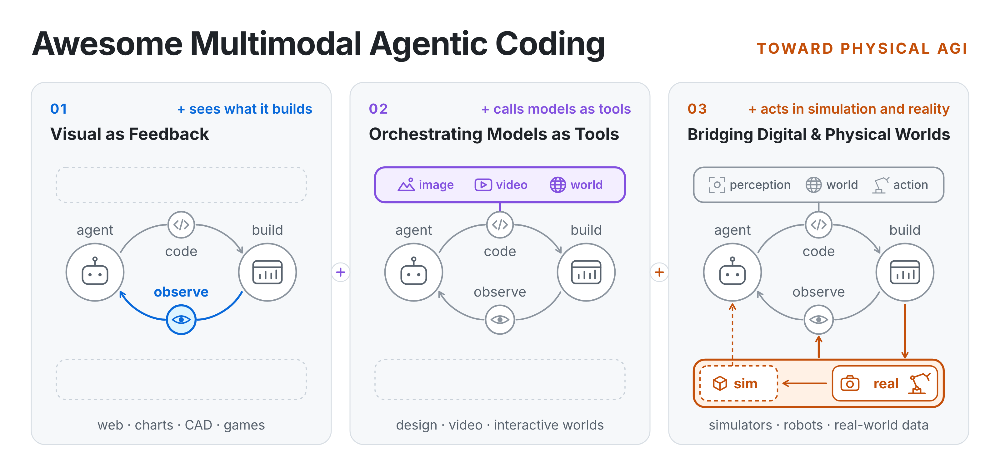

<!-- Generated by scripts/build_readme.py from data/*.yaml — edit the data, not this file. -->

<!-- mmac-layout: three-stages-v1 -->

<div align="center">

# Awesome Multimodal Agentic Coding

<picture>
  <source media="(prefers-color-scheme: dark)" srcset="assets/hero/hero-dark.png">
  
</picture>

A research map of multimodal agents that write code, observe what it does, and improve — from the digital world to the physical world.

[](https://awesome.re) [](#contents) [](https://github.com/jiangjin1999/awesome-multimodal-agentic-coding/commits/main) [](./LICENSE)

**English** · [简体中文](./README.zh-CN.md) · [日本語](./README.ja.md)

</div>

## Our Vision

From a coding perspective, we see three stages in multimodal agents' evolution from the digital world to the physical world:

1. **Visual feedback:** Build digital artifacts with code and refine them through visual feedback.
2. **Models as tools:** Orchestrate models through code to combine perception, generation, and action.
3. **Bridging digital and physical worlds:** Build simulations and drive actions with code, learning and improving in simulation and reality.

**Guides:** [How to read this collection](./docs/READING_GUIDE.md) · [Stage 3 in depth](./stage3/README.md) · [Simulator quality evaluation](./stage3/simulator-evaluation.md)

<a id="multimodal-agentic-coding-trilogy"></a>
<a id="start-here"></a>
<a id="topic-map"></a>
<a id="motivation"></a>
<a id="definition-and-scope"></a>
<a id="contribution-tags"></a>
<a id="foundations"></a>
<a id="section-1-1"></a>
<a id="adjacent-foundations"></a>
<a id="application-domains"></a>
<a id="contents"></a>

## Contents

- [Stage 1 · Visual as Feedback](#stage-1)
  - [1.1 Web, UI and applications](#s1-1) (51)
  - [1.2 GUI and software training environments](#s1-2) (10)
  - [1.3 Charts, scientific visualization and editable graphics](#s1-3) (45)
  - [1.4 Documents, slides, posters and code-driven media](#s1-4) (34)
  - [1.5 3D and CAD](#s1-5) (90)
  - [1.6 Games and executable game worlds](#s1-6) (43)
  - [1.7 Cross-task: visual evaluators, experience and training](#s1-7) (12)
- [Stage 2 · Orchestrating Models as Tools](#stage-2)
  - [2.1 Image generation models × image and visual design](#s2-1) (3)
  - [2.2 Video generation models × video creation and editing](#s2-2) (12)
  - [2.3 3D generation models × 3D assets and scenes](#s2-3) (11)
  - [2.4 Generative world models × interactive environments](#s2-4) (13)
  - [2.5 Perception models × scene understanding and reconstruction](#s2-5) (6)
  - [2.6 Action models × robot manipulation](#s2-6) (12)
- [Stage 3 · Bridging Digital & Physical Worlds](#stage-3)
  - [3.1 Embodied harnesses](#s3-1) (84)
  - [3.2 Simulator construction](#s3-2) (65)
  - [3.3 Simulator quality evaluation](#s3-3) (23)
  - [3.4 Data](#s3-4) (14)
  - [3.5 Training and capability improvement](#s3-5) (73)
  - [3.6 Physical applications and experiments](#s3-6) (36)
- [Surveys and related collections](#related)
- [Contact and contributing](#contact) · [Citation](#citation)

<a id="trilogy-visual-feedback"></a>
<a id="section-1-2"></a>
<a id="paper-and-project-list"></a>
<a id="execution-and-rendering-engines"></a>
<a id="section-5-3"></a>
<a id="stage-1"></a>

## Stage 1 · Visual as Feedback

The agent writes code, renders or runs what it built, **looks at the result**, and uses what it sees to choose the next edit. Vision is feedback, not only input. Works are organized by what is built.

**Start with:** [Programming with Pixels](#paper-2502-18525) · [CAD-Assistant](#paper-2412-13810) · [Procedura](#paper-2608-26238) · [GUI Agents for Continual Game Generation](#paper-2605-28258) · [Text-to-CAD Evaluation with CADTests](#paper-2605-07807)

<a id="software-engineering"></a>
<a id="web-ui-app"></a>
<a id="methods-software"></a>
<a id="evaluation-software"></a>
<a id="data-software"></a>
<a id="s1-1"></a>

### 1.1 Web, UI and applications

*Common execution environments:* [HTML](https://developer.mozilla.org/en-US/docs/Web/HTML) · [Three.js](https://threejs.org/docs/) · [CSS](https://developer.mozilla.org/en-US/docs/Web/CSS) · [SVG](https://developer.mozilla.org/en-US/docs/Web/SVG) · [Canvas](https://developer.mozilla.org/en-US/docs/Web/API/Canvas_API) · [WebGL](https://developer.mozilla.org/en-US/docs/Web/API/WebGL_API) · [WebGPU](https://developer.mozilla.org/en-US/docs/Web/API/WebGPU_API)

#### Methods

<!-- mmac-record: {"id": "2611.12112", "scope": "Core", "primary": "1.1", "stage": 1, "type": "paper"} -->

- <a id="paper-2611-12112"></a>`2026.11` **[LiveWorkspace: Externalizing Visual Understanding as Persistent Shared State for Screenshot-to-Code Agents](https://arxiv.org/abs/2611.12112)**
  > Maintains target and executed interfaces in a shared visual state, using measured geometry/style differences and source bindings to guide repeated code repair and localized edits.

<!-- mmac-record: {"id": "2610.04981", "scope": "Core", "primary": "1.1", "stage": 1, "type": "paper"} -->

- <a id="paper-2610-04981"></a>`2026.10` **[TeleGen: Improving LLM-Based Web Application Generation via Runtime Telemetry](https://arxiv.org/abs/2610.04981)** [[Code]](https://github.com/commoluo/TeleGen)
  > Repairs generated web applications with compressed runtime telemetry and task feedback, combining screenshot-based WebVoyager judgments with code revision in its WebGen-Bench configuration.

<!-- mmac-record: {"id": "2610.23104", "scope": "Core", "primary": "1.1", "stage": 1, "type": "paper"} -->

- <a id="paper-2610-23104"></a>`2026.10` **[WebCoder: Scaling General Frontend Development with Artifact-Grounded Agentic Reinforcement Learning](https://arxiv.org/abs/2610.23104)** [[Project page]](https://douzj-llm.github.io/WebCoder/) [[Code]](https://github.com/douzj-llm/WebCoder) [[Dataset]](https://huggingface.co/datasets/Roy-DOU/Webdev-Bench)
  > Trains a frontend builder with artifact-grounded reinforcement learning, using rendered feedback to revise a persistent application and assigning long-horizon credit through changes in requirement satisfaction.

<!-- mmac-record: {"id": "2610.02617", "scope": "Adjacent", "primary": "1.1", "stage": 1, "type": "paper"} -->

- <a id="paper-2610-02617"></a>`2026.10` **[WebUIProof: Benchmarking WebUI Code Generators with UI-Agent Execution Harness](https://arxiv.org/abs/2610.02617)** [[Code]](https://github.com/yunyuntsai/webuiproof-benchmark)
  > Evaluates generated Web/3D interfaces with structured interaction tests and visual UI agents, using outcome-level rewards to train generators rather than visually repair the current artifact.

<!-- mmac-record: {"id": "2609.15078", "scope": "Adjacent", "primary": "1.1", "stage": 1, "type": "paper"} -->

- <a id="paper-2609-15078"></a>`2026.09` **[Enabling Creative Exploration for Vibe Design Agents](https://arxiv.org/abs/2609.15078)**
  > Samples structured theme and asset directions before fixed-setting UI code generation, measuring rendered diversity, model-judge preference, and deployed user behavior as separate outcomes.

<!-- mmac-record: {"id": "2609.18805", "scope": "Adjacent", "primary": "1.1", "stage": 1, "type": "paper"} -->

- <a id="paper-2609-18805"></a>`2026.09` **[ProgramDistill: From Interactive Web Apps to Verifiable Reference-Guided SWE Tasks](https://arxiv.org/abs/2609.18805)**
  > Turns working web applications into replay-verifiable reconstruction tasks, studying observe–edit–validate behavior through structured text-based browser observations rather than screenshot inputs.

<!-- mmac-record: {"id": "2609.22000", "scope": "Core", "primary": "1.1", "stage": 1, "type": "paper"} -->

- <a id="paper-2609-22000"></a>`2026.09` **[RecreationWorld: Scalable and Verifiable Environments for Hybrid Computer-Use Agents](https://arxiv.org/abs/2609.22000)**
  > Recreates applications across desktop, Android, and Web by interleaving reference exploration, source implementation, execution, and visual checks, and trains hybrid agents on verified reconstruction trajectories.

<!-- mmac-record: {"id": "2609.02088", "scope": "Core", "primary": "1.1", "stage": 1, "type": "paper"} -->

- <a id="paper-2609-02088"></a>`2026.09` **[Rendering-in-the-Loop: An Execution-Driven Agent for Interactive Web Development](https://arxiv.org/abs/2609.02088)**
  > Replays reference interactions in a real browser, scores both behavior and rendering, and turns multimodal runtime evidence into repeated tool-assisted code repairs.

<!-- mmac-record: {"id": "2609.16936", "scope": "Adjacent", "primary": "1.1", "stage": 1, "type": "paper"} -->

- <a id="paper-2609-16936"></a>`2026.09` **[RepoAtlas: Guiding Coding Agents via Evolving Multimodal Repository Views](https://arxiv.org/abs/2609.16936)**
  > Helps coding agents localize and repair repository issues with evolving visual code-graph views and source-grounded text, using repository structure rather than rendered application outcomes as visual context.

<!-- mmac-record: {"id": "2608.24138", "scope": "Core", "primary": "1.1", "stage": 1, "type": "paper"} -->

- <a id="paper-2608-24138"></a>`2026.08` **[Rubrics as Visual-Repair Context for Self-Evolving UI-to-Code Generation](https://arxiv.org/abs/2608.24138)**
  > Uses persistent visual-repair rubrics to select scoped edits and reduce regression across repeated UI refinement rounds.

<!-- mmac-record: {"id": "2608.30530", "scope": "Core", "primary": "1.1", "stage": 1, "type": "paper"} -->

- <a id="paper-2608-30530"></a>`2026.08` **[WebWorld: The Browser as a World Model for Self-Improving Web Code](https://arxiv.org/abs/2608.30530)**
  > Turns screenshot-grounded critiques into scoped HTML repairs and replayable browser contracts, retaining only transitions that improve the target without regressing previously verified behavior.

<!-- mmac-record: {"id": "2607.14075", "scope": "Core", "primary": "1.1", "stage": 1, "type": "paper"} -->

- <a id="paper-2607-14075"></a>`2026.07` **[VisualRepair: Dynamic Tool Calling and Region Focusing for Visual Software Issue Repair](https://arxiv.org/abs/2607.14075)**
  > Dynamically selects visual tools and zooms into suspicious regions while iteratively repairing screenshot-grounded software issues.

<!-- mmac-record: {"id": "2604.19742", "scope": "Core", "primary": "1.1", "stage": 1, "type": "paper"} -->

- <a id="paper-2604-19742"></a>`2026.04` **[PlayCoder: Making LLM-Generated GUI Code Playable](https://arxiv.org/abs/2604.19742)** [[Code]](https://github.com/Tencent/PlayCoder)
  > Automatically runs and operates generated GUIs, then converts interaction failures into subsequent code repairs.

<!-- mmac-record: {"id": "2604.05839", "scope": "Core", "primary": "1.1", "stage": 1, "type": "paper"} -->

- <a id="paper-2604-05839"></a>`2026.04` **[Vision-Guided Iterative Refinement for Frontend Code Generation](https://arxiv.org/abs/2604.05839)**
  > Feeds rendered frontend differences back into repeated code revisions rather than stopping after initial generation.

<!-- mmac-record: {"id": "2604.19750", "scope": "Core", "primary": "1.1", "stage": 1, "type": "paper"} -->

- <a id="paper-2604-19750"></a>`2026.03` **[Coding with Eyes: Visual Feedback Unlocks Reliable GUI Code Generating and Debugging](https://arxiv.org/abs/2604.19750)**
  > Coordinates visual understanding, GUI interaction, code generation, and refactoring in an execution-grounded debugging loop.

<!-- mmac-record: {"id": "2603.17826", "scope": "Core", "primary": "1.1", "stage": 1, "type": "paper"} -->

- <a id="paper-2603-17826"></a>`2026.03` **[FailureMem: A Failure-Aware Multimodal Framework for Autonomous Software Repair](https://arxiv.org/abs/2603.17826)** [[Code]](https://github.com/Ruize-Ma/FailureMem)
  > Retrieves prior multimodal failure trajectories to guide diagnosis and subsequent repository-level repair actions.

<!-- mmac-record: {"id": "2602.06090", "scope": "Core", "primary": "1.1", "stage": 1, "type": "paper"} -->

- <a id="paper-2602-06090"></a>`2026.02` **[SVRepair: Structured Visual Reasoning for Automated Program Repair](https://arxiv.org/abs/2602.06090)**
  > Structures screenshots into localized visual evidence and iterates between scene understanding, code localization, and patching.

<!-- mmac-record: {"id": "2602.05998", "scope": "Core", "primary": "1.1", "stage": 1, "type": "paper"} -->

- <a id="paper-2602-05998"></a>`2026.02` **[VisRefiner: Learning from Visual Differences for Screenshot-to-Code Generation](https://arxiv.org/abs/2602.05998)**
  > Learns from target-versus-render visual differences and applies the resulting evidence to iterative code refinement.

<!-- mmac-record: {"id": "2601.04203", "scope": "Core", "primary": "1.1", "stage": 1, "type": "paper"} -->

- <a id="paper-2601-04203"></a>`2025.12` **[FronTalk: Benchmarking Front-End Development as Conversational Code Generation with Multi-Modal Feedback](https://arxiv.org/abs/2601.04203)** [[Project page]](https://frontalk-benchmark.github.io/) [[Code]](https://github.com/shirley-wu/frontalk)
  > Introduces multi-turn visual front-end conversations and AceCoder, which interacts with rendered sites, critiques failures, and regenerates improved code.

<!-- mmac-record: {"id": "2511.08195", "scope": "Core", "primary": "1.1", "stage": 1, "type": "paper"} -->

- <a id="paper-2511-08195"></a>`2025.11` **[UI2Code^N: UI-to-Code Generation as Interactive Visual Optimization](https://arxiv.org/abs/2511.08195)** [[Code]](https://github.com/zai-org/UI2Code_N)
  > Recasts UI-to-code as execution, visual inspection, and repeated refinement optimized with relative visual feedback.

<!-- mmac-record: {"id": "2511.06251", "scope": "Core", "primary": "1.1", "stage": 1, "type": "paper"} -->

- <a id="paper-2511-06251"></a>`2025.11` **[WebVIA: A Web-based Vision-Language Agentic Framework for Interactive and Verifiable UI-to-Code Generation](https://arxiv.org/abs/2511.06251)** [[Demo]](https://zheny2751-dotcom.github.io/webvia.github.io/) [[Code]](https://github.com/zheny2751-dotcom/WebVIA)
  > Explores source interfaces through repeated perception-action-verification, synthesizes executable interactive code, and validates recovered behaviors.

<!-- mmac-record: {"id": "2510.11498", "scope": "Core", "primary": "1.1", "stage": 1, "type": "paper"} -->

- <a id="paper-2510-11498"></a>`2025.10` **[ReLook: Vision-Grounded RL with a Multimodal LLM Critic for Agentic Web Coding](https://arxiv.org/abs/2510.11498)**
  > Feeds screenshot-grounded MLLM critiques into subsequent code revisions during training rollouts and critic-assisted use; its fast inference variant omits the external critic.

<!-- mmac-record: {"id": "2509.22644", "scope": "Core", "primary": "1.1", "stage": 1, "type": "paper"} -->

- <a id="paper-2509-22644"></a>`2025.09` **[WebGen-Agent: Enhancing Interactive Website Generation with Multi-Level Feedback and Step-Level Reinforcement Learning](https://arxiv.org/abs/2509.22644)** [[Code]](https://github.com/mnluzimu/WebGen-Agent)
  > Uses screenshots, GUI-agent testing, backtracking, and step-level rewards to iteratively improve website codebases.

<!-- mmac-record: {"id": "2507.20766", "scope": "Core", "primary": "1.1", "stage": 1, "type": "paper"} -->

- <a id="paper-2507-20766"></a>`2025.07` **[Learning Only with Images: Visual Reinforcement Learning with Reasoning, Rendering, and Visual Feedback](https://arxiv.org/abs/2507.20766)** [[Code]](https://github.com/L-O-I/RRVF)
  > Runs generated chart and web code, turns target-versus-render discrepancies into visual feedback, and uses it to guide the next code-generation turn.

<!-- mmac-record: {"id": "2506.13663", "scope": "Core", "primary": "1.1", "stage": 1, "type": "paper"} -->

- <a id="paper-2506-13663"></a>`2025.06` **[DesignCoder: Hierarchy-Aware and Self-Correcting UI Code Generation with Large Language Models](https://arxiv.org/abs/2506.13663)**
  > Captures rendered mobile UIs, compares component-level visual evidence, and iteratively applies localized code repairs.

<!-- mmac-record: {"id": "2506.16136", "scope": "Core", "primary": "1.1", "stage": 1, "type": "paper"} -->

- <a id="paper-2506-16136"></a>`2025.06` **[Seeing is Fixing: Cross-Modal Reasoning with Multimodal LLMs for Visual Software Issue Fixing](https://arxiv.org/abs/2506.16136)**
  > Combines image-to-code understanding with code-to-image validation to close the loop on visual software issue repair.

<!-- mmac-record: {"id": "2411.01606", "scope": "Core", "primary": "1.1", "stage": 1, "type": "paper"} -->

- <a id="paper-2411-01606"></a>`2024.11` **[DesignRepair: Dual-Stream Design Guideline-Aware Frontend Repair with Large Language Models](https://arxiv.org/abs/2411.01606)** [[Code]](https://github.com/UGAIForge/DesignRepair)
  > Jointly reasons over frontend source code and rendered views, using design guidelines to guide iterative visual repair.

#### Evaluation & data

<!-- mmac-record: {"id": "2610.35138", "scope": "Adjacent", "primary": "1.1", "stage": 1, "type": "paper"} -->

- <a id="paper-2610-35138"></a>`2026.10` **[Co-Design Bench: Multimodal Collaborative Coding Evaluation for Agentic Models](https://arxiv.org/abs/2610.35138)** [[Project page]](https://codesignbench.github.io/) [[Code]](https://github.com/Wiselnn570/Co-Design-Bench) [[Dataset]](https://huggingface.co/datasets/Wiselnn/Co-Design-Bench)
  > Evaluates edits to existing applications against hidden requirements using source, rendered interfaces, and interaction evidence, with an independent refutation stage that challenges positive judgments.

<!-- mmac-record: {"id": "2610.29014", "scope": "Adjacent", "primary": "1.1", "stage": 1, "type": "paper"} -->

- <a id="paper-2610-29014"></a>`2026.10` **[GenXR-Bench: Benchmarking Coding Agents for Interactive XR Development](https://arxiv.org/abs/2610.29014)** [[Code]](https://github.com/whuang37/genxr-bench) [[Dataset]](https://github.com/whuang37/genxr-bench/tree/master/tasks)
  > Evaluates XR feature implementation, bug repair, and app generation using simulated hand and environment inputs with held-out programmatic and visual tests, validated against expert reviews on XR hardware.

<!-- mmac-record: {"id": "2610.10374", "scope": "Adjacent", "primary": "1.1", "stage": 1, "type": "paper"} -->

- <a id="paper-2610-10374"></a>`2026.10` **[TaoD2C-Bench: Benchmarking MLLMs for Industrial UI Code Generation Beyond Visual Fidelity](https://arxiv.org/abs/2610.10374)** [[Project page]](https://taod2c-bench.github.io/)
  > Separates industrial UI requirement inference from code realization, evaluating generated component and layout constraints through source/runtime evidence alongside final rendered fidelity.

<!-- mmac-record: {"id": "2610.33149", "scope": "Adjacent", "primary": "1.1", "stage": 1, "type": "paper"} -->

- <a id="paper-2610-33149"></a>`2026.10` **[WebUniverse: Scaling Verified Training Data for Agentic Web Development](https://arxiv.org/abs/2610.33149)** [[Dataset]](https://huggingface.co/datasets/WebUniverse-NSL/WebUniverse-Env) [[Dataset]](https://huggingface.co/datasets/WebUniverse-NSL/WebUniverse-Mix) [[Project page]](https://webuniverse-nsl.github.io/)
  > Builds paired web-development environments and verified trajectories, combining functional and visual checks with independent attempts and failure continuations for supervised agent training.

<!-- mmac-record: {"id": "2609.32600", "scope": "Core", "primary": "1.1", "stage": 1, "type": "paper"} -->

- <a id="paper-2609-32600"></a>`2026.09` **[CUA-SWE: When Computer-Use Agents Meet Visual Software Engineering](https://arxiv.org/abs/2609.32600)**
  > Unifies source editing and screenshot-based computer use across web, game, mobile, and DevOps repairs, with visual runtime evidence guiding further edits and independent tests checking behavior and regressions.

<!-- mmac-record: {"id": "2609.15387", "scope": "Adjacent", "primary": "1.1", "stage": 1, "type": "paper"} -->

- <a id="paper-2609-15387"></a>`2026.09` **[IWC-Bench: Evaluating Web Application Generation from a Software Testing Perspective](https://arxiv.org/abs/2609.15387)**
  > Uses runtime code coverage to guide exploration of generated web applications, then judges screenshots and interaction evidence for aesthetics, usability, and requirement alignment without feeding those scores into code revision.

<!-- mmac-record: {"id": "2608.03474", "scope": "Core", "primary": "1.1", "stage": 1, "type": "paper"} -->

- <a id="paper-2608-03474"></a>`2026.08` **[MT-Web2Code: Benchmarking Coding Agents on Multi-Turn Regional Reconstruction and Localized Modification](https://arxiv.org/abs/2608.03474)**
  > Benchmarks multi-turn agents on localized web reconstruction and modification instead of one-shot screenshot imitation.

<!-- mmac-record: {"id": "2604.27419", "scope": "Core", "primary": "1.1", "stage": 1, "type": "paper"} -->

- <a id="paper-2604-27419"></a>`2026.04` **[InteractWeb-Bench: Can Multimodal Agent Escape Blind Execution in Interactive Website Generation?](https://arxiv.org/abs/2604.27419)**
  > Evaluates a Clarify–Implement–Verify–Submit loop in which browser inspection returns failure screenshots and grounded diagnostics for the agent's next code revision.

<!-- mmac-record: {"id": "2604.18224", "scope": "Adjacent", "primary": "1.1", "stage": 1, "type": "paper"} -->

- <a id="paper-2604-18224"></a>`2026.04` **[WebCompass: Towards Multimodal Web Coding Evaluation for Code Language Models](https://arxiv.org/abs/2604.18224)** [[Code]](https://github.com/NJU-LINK/WebCompass)
  > Covers web generation, editing, and repair with visual and interactive evaluation, but does not require a same-agent render-observe-recode trajectory.

<!-- mmac-record: {"id": "2602.18548", "scope": "Core", "primary": "1.1", "stage": 1, "type": "paper"} -->

- <a id="paper-2602-18548"></a>`2026.02` **[1D-Bench: A Benchmark for Iterative UI Code Generation with Visual Feedback in Real-World](https://arxiv.org/abs/2602.18548)**
  > Measures real-world UI coding performance over multiple visual-feedback rounds and localized code updates.

<!-- mmac-record: {"id": "2507.04952", "scope": "Adjacent", "primary": "1.1", "stage": 1, "type": "paper"} -->

- <a id="paper-2507-04952"></a>`2025.07` **[ArtifactsBench: Bridging the Visual-Interactive Gap in LLM Code Generation Evaluation](https://arxiv.org/abs/2507.04952)** [[Project page]](https://artifactsbenchmark.github.io/)
  > Evaluates completed interactive artifacts through rendered visuals and runtime behavior, without returning the resulting feedback to a later coding action.

<!-- mmac-record: {"id": "2502.18525", "scope": "Core", "primary": "1.1", "stage": 1, "type": "paper"} -->

- <a id="paper-2502-18525"></a>`2025.02` **[Programming with Pixels: Can Computer-Use Agents do Software Engineering?](https://arxiv.org/abs/2502.18525)** [[Demo]](https://programmingwithpixels.com/) [[Code]](https://github.com/ProgrammingwithPixels/PwP)
  > Evaluates coding agents that must observe and operate a visual IDE rather than relying on direct text-only tool access.

#### Tools & resources

<!-- mmac-record: {"id": "reading:tim-hinds-applitools-bridging-the-probabilistic-validation-gap-deterministic-visual-ai-guardrails-for-the-agentic-sdlc", "scope": "Reading", "primary": "1.1", "stage": 1, "type": "reading"} -->

- <a id="paper-reading-tim-hinds-applitools-bridging-the-probabilistic-validation-gap-deterministic-visual-ai-guardrails-for-the-agentic-sdlc"></a>`2026.09` **[Tim Hinds / Applitools — Bridging the “Probabilistic Validation Gap”: Deterministic Visual AI Guardrails for the Agentic SDLC](https://applitools.com/blog/probabilistic-validation-gap-agentic-sdlc/)**
  > *Topic link:* The “Probabilistic Validation Gap” motivates returning visual-diff coordinates and DOM context to coding agents, while keeping baseline changes behind human review; the product claims are an industry perspective, not an independent benchmark.

<!-- mmac-record: {"id": "res:agent-qa", "scope": "Resource", "primary": "1.1", "stage": 1, "type": "resource"} -->

- <a id="paper-res-agent-qa"></a>**[agent-qa](https://vostride.com)** [[Documentation]](https://vostride.com/docs/agent-qa/mcp)
  > Exposes natural-language web, Android and iOS tests, screenshots, console/network evidence and verdict corrections to coding agents; persistent memidex memory and evidence-gated self-improvement retain validated lessons across runs.

<a id="tool-agent-visual-diff"></a>
<!-- mmac-record: {"id": "res:agent-visual-diff", "scope": "Resource", "primary": "1.1", "stage": 1, "type": "resource"} -->

- <a id="paper-res-agent-visual-diff"></a>**[agent-visual-diff](https://github.com/lbframe/agent-visual-diff)** [[Documentation]](https://github.com/lbframe/agent-visual-diff/blob/main/docs/agent-contract.md)
  > Compares two PNGs and returns bounding boxes ranked by changed-pixel count in JSON. Optional shift detection flags content that moved together so an agent can inspect the layout and compare again after a fix.

<!-- mmac-record: {"id": "res:agentvision", "scope": "Resource", "primary": "1.1", "stage": 1, "type": "resource"} -->

- <a id="paper-res-agentvision"></a>**[AgentVision](https://github.com/amitpatole/agent-vision)**
  > Runs render → perceive → report → fix → re-render loops with DOM, contrast, OCR, coordinate-grounded issues, and pass/warn/fail verdicts.

<!-- mmac-record: {"id": "res:applitools-eyes-mcp", "scope": "Resource", "primary": "1.1", "stage": 1, "type": "resource"} -->

- <a id="paper-res-applitools-eyes-mcp"></a>**[Applitools Eyes MCP](https://support.applitools.com/solutions/agentic-testing/)**
  > Returns visual-diff regions, cropped images, and focused DOM context to coding agents, with explicit human authorization for saving baseline changes.

<!-- mmac-record: {"id": "demo:autoclaw-design", "scope": "Demo", "primary": "1.1", "stage": 1, "type": "demo"} -->

- <a id="paper-demo-autoclaw-design"></a>**[AutoClaw Design](https://autoclaw.z.ai/blog/product/product-brief-to-ui-design-with-autoclaw/)**
  > Combines reference-guided drafts, conversational or canvas edits, device previews and HTML/project exports; users review interactions and request corrections.

<!-- mmac-record: {"id": "res:figma-mcp-server", "scope": "Resource", "primary": "1.1", "stage": 1, "type": "resource"} -->

- <a id="paper-res-figma-mcp-server"></a>**[Figma MCP server](https://developers.figma.com/docs/figma-mcp-server/)** [[Article]](https://www.figma.com/blog/the-figma-canvas-is-now-open-to-agents/)
  > Lets an agent inspect design context, generate implementation code, and create or update native Figma content.

<a id="tool-orkas-uidesigner"></a>
<!-- mmac-record: {"id": "res:orkas-uidesigner", "scope": "Resource", "primary": "1.1", "stage": 1, "type": "resource"} -->

- <a id="paper-res-orkas-uidesigner"></a>**[Orkas UIDesigner](https://github.com/Orkas-AI/Orkas)** [[Documentation]](https://github.com/Orkas-AI/Orkas/blob/c7c0e21fad7ff55f5a72a575b7a464f3cf9bc3a1/resources/builtin/marketplace/agents/bcfcb4921dce/agent.json) [[Documentation]](https://github.com/Orkas-AI/Orkas/blob/c7c0e21fad7ff55f5a72a575b7a464f3cf9bc3a1/resources/builtin/marketplace/agents/bcfcb4921dce/skills/ui-design-source/SKILL.md#L156-L165)
  > Turns briefs, screenshots, Figma references, or existing UI code into editable mockups and specs, using HTML by default. After the final edit, it checks HTML structure and local file references. It compares the rendered result with the reference when the task requires it and rendering is available. Verifying a pixel-exact match requires fresh renders of both the reference and the mockup with the same viewport, UI state, theme, and locale.

<!-- mmac-record: {"id": "res:playwright-mcp", "scope": "Resource", "primary": "1.1", "stage": 1, "type": "resource"} -->

- <a id="paper-res-playwright-mcp"></a>**[Playwright MCP](https://github.com/microsoft/playwright-mcp)** [[Code]](https://github.com/ChromeDevTools/chrome-devtools-mcp)
  > Exposes accessibility structure, screenshots, interaction, console and network evidence, and performance traces.

<!-- mmac-record: {"id": "res:reprosight", "scope": "Resource", "primary": "1.1", "stage": 1, "type": "resource"} -->

- <a id="paper-res-reprosight"></a>**[ReproSight](https://github.com/tungcorn/ReproSight)**
  > Gives an external coding agent browser geometry, screenshots, CSS source candidates, isolated workspaces, and target/regression checks before human review; its flagship demo uses a deterministic mock provider, not a real-model accuracy benchmark.

<!-- mmac-record: {"id": "res:shotback", "scope": "Resource", "primary": "1.1", "stage": 1, "type": "resource"} -->

- <a id="paper-res-shotback"></a>**[Shotback](https://github.com/DCCA/shotback)**
  > Packages annotated screenshots with CSS selectors, React component paths, viewport context, and readable failed requests; supports before/after recapture for human-guided repairs.

<!-- mmac-record: {"id": "demo:wild-atlas", "scope": "Demo", "primary": "1.1", "stage": 1, "type": "demo"} -->

- <a id="paper-demo-wild-atlas"></a>**[Wild Atlas](https://x.com/_IamAlam/status/2107480596926939638)**
  > Stages an encyclopedia app into its interface, consistent animal assets, and card/rotation/info-panel interactions; a rotating presentation does not establish a released full 3D scene.

<a id="methods-gui-environments"></a>
<a id="evaluation-gui-environments"></a>
<a id="data-gui-environments"></a>
<a id="s1-2"></a>

### 1.2 GUI and software training environments

#### Methods

<!-- mmac-record: {"id": "2611.03634", "scope": "Adjacent", "primary": "1.2", "stage": 1, "type": "paper"} -->

- <a id="paper-2611-03634"></a>`2026.11` **[WebHarbor: Docking Real Websites for Evolving GUI Agent Environments](https://arxiv.org/abs/2611.03634)** [[Code]](https://github.com/aiming-lab/WebHarbor) [[Dataset]](https://huggingface.co/datasets/ChilleD/WebHarbor-Tasks)
  > Builds resettable full-stack website environments through task-scoped coding and human visual/workflow audits, supporting reproducible GUI evaluation and operator training.

<!-- mmac-record: {"id": "2610.26828", "scope": "Adjacent", "primary": "1.2", "stage": 1, "type": "paper"} -->

- <a id="paper-2610-26828"></a>`2026.10` **[Agent World Model in the Wild: Computer-Use Agent Environment Synthesis](https://arxiv.org/abs/2610.26828)** [[Code]](https://github.com/MSR-Orchard/WildAWM) [[Dataset]](https://huggingface.co/datasets/ChilleD/WildAWM)
  > Synthesizes replayable personal-computer worlds spanning GUI, MCP, and CLI, using heterogeneous rollouts and verifier-consistency gates to produce environment–task packages for computer-use training.

<!-- mmac-record: {"id": "2610.37567", "scope": "Core", "primary": "1.2", "stage": 1, "type": "paper"} -->

- <a id="paper-2610-37567"></a>`2026.10` **[Gym-Anything-RT: Scaling Real-Time Environments for Vision-Language Agents](https://arxiv.org/abs/2610.37567)** [[Code]](https://github.com/gym-anything/gym-anything-rt)
  > Builds real-time visual minigames through creator–auditor code revisions grounded in screenshots and recordings, then controls the environment clock to isolate latency from task capability.

<!-- mmac-record: {"id": "2610.12611", "scope": "Core", "primary": "1.2", "stage": 1, "type": "paper"} -->

- <a id="paper-2610-12611"></a>`2026.10` **[SoftwareGym: Scaling Computer-Use Agent Training with Diverse Synthesized Software Environments](https://arxiv.org/abs/2610.12611)** [[Code]](https://github.com/MrKiing-Jin/SoftwareGym)
  > Synthesizes native Avalonia applications, using screenshot-grounded GUI test trajectories to repair their source across fixed-case rounds before collecting computer-use training data.

<!-- mmac-record: {"id": "2610.30792", "scope": "Core", "primary": "1.2", "stage": 1, "type": "paper"} -->

- <a id="paper-2610-30792"></a>`2026.10` **[Trace2World: Reconstructing App Worlds from Real Interaction Traces for Scalable GUI Agent Training](https://arxiv.org/abs/2610.30792)**
  > Reconciles real interaction traces into a fixed app-behavior model, then uses independent screenshot-grounded replay to guide bounded package repair before synthesizing GUI-agent training tasks.

<!-- mmac-record: {"id": "2610.37786", "scope": "Core", "primary": "1.2", "stage": 1, "type": "paper"} -->

- <a id="paper-2610-37786"></a>`2026.10` **[WebAnything: From the Wild Web to Scalable Agent Environments](https://arxiv.org/abs/2610.37786)** [[Code]](https://github.com/china-qijizhifeng/Web-Anything)
  > Reconstructs resettable web-agent environments from source-site observations, using independent visual and interaction checks to drive code repair or targeted recapture before producing operator-training tasks.

<!-- mmac-record: {"id": "2608.15930", "scope": "Adjacent", "primary": "1.2", "stage": 1, "type": "paper"} -->

- <a id="paper-2608-15930"></a>`2026.08` **[UI-Mate: Advancing Open-Weight Foundation GUI Agents with In-Context Demonstrations](https://arxiv.org/abs/2608.15930)** [[Code]](https://github.com/Tencent/UI-Mate) [[Dataset]](https://huggingface.co/datasets/tencent/OSWorkerBench)
  > Couples executable desktop-task construction with capability-balanced operator training and demonstration-guided workflows that adapt to live screenshots rather than replaying fixed actions.

<!-- mmac-record: {"id": "2606.19930", "scope": "Adjacent", "primary": "1.2", "stage": 1, "type": "paper"} -->

- <a id="paper-2606-19930"></a>`2026.06` **[MobileForge: Annotation-Free Adaptation for Mobile GUI Agents with Hierarchical Feedback-Guided Policy Optimization](https://arxiv.org/abs/2606.19930)** [[Code]](https://github.com/kwai/MobileForge) [[Collection]](https://huggingface.co/collections/lgy0404/mobileforge-datasets) [[Project page]](https://mobile-forge.github.io/)
  > Adapts mobile GUI operators by mining tasks from real-app exploration, reusing visual-critic hints across attempts, and converting selected decisions into feedback-conditioned step-level policy updates.

<!-- mmac-record: {"id": "2605.25624", "scope": "Core", "primary": "1.2", "stage": 1, "type": "paper"} -->

- <a id="paper-2605-25624"></a>`2026.05` **[CUA-Gym: Scaling Verifiable Training Environments and Tasks for Computer-Use Agents](https://arxiv.org/abs/2605.25624)** [[Code]](https://github.com/xlang-ai/CUA-Gym) [[Code]](https://github.com/xlang-ai/CUA-Gym-Hub) [[Dataset]](https://huggingface.co/datasets/xlangai/CUA-Gym)
  > Co-generates resettable software states, tasks, and executable rewards, returning disagreements between rollout screenshots and programmatic scores to the reward-writing agent for revision and another rollout.

#### Tools & resources

<!-- mmac-record: {"id": "2610.41432", "scope": "Adjacent", "primary": "1.2", "stage": 1, "type": "paper"} -->

- <a id="paper-2610-41432"></a>`2026.10` **[Hybrid Computer Use: A Unified Programmatic, Semantic, and Visual Interface for General Agents](https://arxiv.org/abs/2610.41432)**
  > Lets agents combine programmatic tools, accessibility actions and visual interaction, using live-state guards, batched verification and returned AX changes to guide subsequent operations.

<a id="visualization"></a>
<a id="svg-diagrams"></a>
<a id="methods-graphics"></a>
<a id="evaluation-graphics"></a>
<a id="data-graphics"></a>
<a id="s1-3"></a>

### 1.3 Charts, scientific visualization and editable graphics

*Common execution environments:* [D3](https://d3js.org/) · [Mermaid](https://mermaid.js.org/) · [HTML](https://developer.mozilla.org/en-US/docs/Web/HTML) · [CSS](https://developer.mozilla.org/en-US/docs/Web/CSS) · [SVG](https://developer.mozilla.org/en-US/docs/Web/SVG) · [Canvas](https://developer.mozilla.org/en-US/docs/Web/API/Canvas_API) · [WebGL](https://developer.mozilla.org/en-US/docs/Web/API/WebGL_API) · [WebGPU](https://developer.mozilla.org/en-US/docs/Web/API/WebGPU_API) · [Vega-Lite](https://vega.github.io/vega-lite/) · [Plotly.js](https://plotly.com/javascript/) · [Graphviz](https://graphviz.org/documentation/) · [PlantUML](https://plantuml.com/) · [Typst](https://typst.app/docs/) · [TikZ](https://tikz.dev/)

#### Methods

<!-- mmac-record: {"id": "2611.10840", "scope": "Core", "primary": "1.3", "stage": 1, "type": "paper"} -->

- <a id="paper-2611-10840"></a>`2026.11` **[Simple Test-Time Refinement for Plot-to-Code Generation via Visual-Code Diagnostics](https://arxiv.org/abs/2611.10840)** [[Code]](https://github.com/guopeiming/plot_to_code_refine)
  > Trains a compact verifier to localize discrepancies between reference and rendered charts in their plotting code, then guides patch-based refinement across repeated renders.

<!-- mmac-record: {"id": "2610.08106", "scope": "Core", "primary": "1.3", "stage": 1, "type": "paper"} -->

- <a id="paper-2610-08106"></a>`2026.10` **[ChartBmkAgent: Harness-Governed Multi-Agent Construction of Chart QA Benchmarks from Sparse Error-Taxonomy Specifications](https://arxiv.org/abs/2610.08106)**
  > Constructs diagnostic chart-QA samples from sparse error descriptions, using evidence-gated multimodal critique to revise plotting programs while preserving frozen data and the intended error mechanism.

<!-- mmac-record: {"id": "2610.28282", "scope": "Adjacent", "primary": "1.3", "stage": 1, "type": "paper"} -->

- <a id="paper-2610-28282"></a>`2026.10` **[ChartEvo: Self-Evolving Agent Harnesses for Long-Tail Chart Reasoning](https://arxiv.org/abs/2610.28282)**
  > Evolves chart-specific skills, executable visual/numerical tools, and reusable toolchains using supervised task feedback, then reuses them for long-tail chart reasoning.

<!-- mmac-record: {"id": "2610.06852", "scope": "Core", "primary": "1.3", "stage": 1, "type": "paper"} -->

- <a id="paper-2610-06852"></a>`2026.10` **[One Figure, Every Canvas: Editable Flowchart Relayout via Agentic Pipeline](https://arxiv.org/abs/2610.06852)**
  > Relayouts raster flowcharts into editable draw.io XML for new aspect ratios, combining graph and layout constraints with rendered visual critiques to correct parsing, styling, and placement.

<!-- mmac-record: {"id": "2610.41260", "scope": "Core", "primary": "1.3", "stage": 1, "type": "paper"} -->

- <a id="paper-2610-41260"></a>`2026.10` **[SketchDirector: Complex Scene Sketching via Agentic Layout Reasoning and Detail Refinement](https://arxiv.org/abs/2610.41260)** [[Code]](https://github.com/GVCLab/SketchDirector) [[Dataset]](https://huggingface.co/datasets/yiki77/MCSketch8K) [[Project page]](https://yiki77.github.io/SketchDirector/)
  > Builds editable scene sketches through object-level SVG programs, revises layouts using geometric and visual-semantic feedback with reusable memory, and then refines curves with diffusion priors.

<!-- mmac-record: {"id": "2610.13502", "scope": "Adjacent", "primary": "1.3", "stage": 1, "type": "paper"} -->

- <a id="paper-2610-13502"></a>`2026.10` **[Stride: Scale-Aware Multi-Agent Evolutionary Refinement for Infographic Generation](https://arxiv.org/abs/2610.13502)** [[Code]](https://github.com/SJTUSAI/Stride)
  > Routes infographic failures between frozen-generator redraws and localized text/formula repairs using separate rubric verification and visual grounding, retaining only candidates with improved internal scores.

<!-- mmac-record: {"id": "2609.16598", "scope": "Adjacent", "primary": "1.3", "stage": 1, "type": "paper"} -->

- <a id="paper-2609-16598"></a>`2026.09` **[CATVis: A Collaborative Multi-Agent Workflow for Turbomachinery Simulation Data Visualization](https://arxiv.org/abs/2609.16598)**
  > Converts turbomachinery analysis requests into executable visualization DAGs through staged planning and error-aware refinement, leaving visual camera and workflow adjustments to an interactive human review step.

<!-- mmac-record: {"id": "2610.00374", "scope": "Adjacent", "primary": "1.3", "stage": 1, "type": "paper"} -->

- <a id="paper-2610-00374"></a>`2026.09` **[Faithful Chart Generation for Multimodal Deep Research: Frame-Evidence Co-Adaptation](https://arxiv.org/abs/2610.00374)**
  > Adapts chart frames to retrievable quantitative evidence before generating ECharts, keeping accepted values fixed during rendering retries and auditing numerical provenance.

<!-- mmac-record: {"id": "2609.32413", "scope": "Core", "primary": "1.3", "stage": 1, "type": "paper"} -->

- <a id="paper-2609-32413"></a>`2026.09` **[IChart2Code: Benchmarking Multimodal Large Language Models for Interactive Chart Code Generation](https://arxiv.org/abs/2609.32413)**
  > Benchmarks chart appearance, data fidelity, and interactive state changes, with TRAIL using browser-observed trajectories to diagnose failures and revise HTML/JavaScript.

<!-- mmac-record: {"id": "2609.14874", "scope": "Core", "primary": "1.3", "stage": 1, "type": "paper"} -->

- <a id="paper-2609-14874"></a>`2026.09` **[MedVA: An End-to-End Neuro-Symbolic Agentic System for Medical Volume Visualization](https://arxiv.org/abs/2609.14874)**
  > Builds structured JSON visualization specifications and refines ROI opacity using renderer-computed full-scene versus isolated visibility, combining anatomical ontology checks with multi-model segmentation.

<!-- mmac-record: {"id": "2609.33386", "scope": "Adjacent", "primary": "1.3", "stage": 1, "type": "paper"} -->

- <a id="paper-2609-33386"></a>`2026.09` **[SIVIA-RSI: Source-Grounded Adaptation of Diagramming Skills](https://arxiv.org/abs/2609.33386)**
  > Adapts reusable raster-diagram instructions from source-linked visual critiques and evaluates every proposed skill on fresh diagrams, separating selection preference from cross-paper relation fidelity.

<!-- mmac-record: {"id": "2609.15182", "scope": "Core", "primary": "1.3", "stage": 1, "type": "paper"} -->

- <a id="paper-2609-15182"></a>`2026.09` **[VisInteract: Towards Dynamic Interactive Text-to-Visualization under Imperfect Queries](https://arxiv.org/abs/2609.15182)**
  > Executes Altair programs and uses a simulated user's rendered-chart critiques and textual clarifications to steer subsequent code search toward underspecified visualization intent.

<!-- mmac-record: {"id": "2608.00548", "scope": "Core", "primary": "1.3", "stage": 1, "type": "paper"} -->

- <a id="paper-2608-00548"></a>`2026.08` **[DrawAI: Agentic Benchmark and Workflow for Making Raster Images Editable](https://arxiv.org/abs/2608.00548)** [[Code]](https://github.com/Renaissance-Mind/DrawAI) [[Project page]](https://drawai.renaissancemind.ai/)
  > Turns raster references into editable structured graphics through an agentic generation, rendering, and correction workflow.

<!-- mmac-record: {"id": "2609.16014", "scope": "Core", "primary": "1.3", "stage": 1, "type": "paper"} -->

- <a id="paper-2609-16014"></a>`2026.08` **[ViCo: Visual-oriented Coding with Self-Reflection for Chart Replication](https://arxiv.org/abs/2609.16014)** [[Code]](https://github.com/Xigmoid/ViCo)
  > Trains chart-coding agents to compare their previous render with a reference, turn discrepancies into explicit reflections, and implement those reflections through counterfactual-credit-guided code refinement.

<!-- mmac-record: {"id": "2608.10408", "scope": "Core", "primary": "1.3", "stage": 1, "type": "paper"} -->

- <a id="paper-2608-10408"></a>`2026.08` **[VisEditBench: Can Vision-Language Models Edit Visualization Code from Multimodal Feedback?](https://arxiv.org/abs/2608.10408)** [[Code]](https://github.com/vis-nlp/VisEditBench)
  > Introduces chart-repair and restyling tasks plus VisEditAgent, whose execution and visual-validation loop refines candidate code while preserving data semantics.

<!-- mmac-record: {"id": "2607.09839", "scope": "Core", "primary": "1.3", "stage": 1, "type": "paper"} -->

- <a id="paper-2607-09839"></a>`2026.07` **[Exploring Agentic Workflows for Generating High Quality Math Visual Aids](https://arxiv.org/abs/2607.09839)** [[Code]](https://github.com/ashnakhetan/self-improve-math-diagrams)
  > Generates TikZ diagrams, asks QA questions about the rendered image, and feeds unsatisfied visual checks into subsequent code regeneration.

<!-- mmac-record: {"id": "2607.28073", "scope": "Core", "primary": "1.3", "stage": 1, "type": "paper"} -->

- <a id="paper-2607-28073"></a>`2026.07` **[GVR-Coder: A Visual-Feedback Framework for Structured SVG Generation in Complex Document and Meeting Scenarios](https://arxiv.org/abs/2607.28073)** [[Code]](https://github.com/CurryaNa/GVR-Coder)
  > Implements a generate-visualize-refine loop for structured SVG programs under complex document requirements.

<!-- mmac-record: {"id": "2607.27699", "scope": "Core", "primary": "1.3", "stage": 1, "type": "paper"} -->

- <a id="paper-2607-27699"></a>`2026.07` **[RefineSVG: Visual Feedback-Driven Reinforcement Learning for Image-to-SVG Generation](https://arxiv.org/abs/2607.27699)** [[Code]](https://github.com/liuxiaobo66/RefineSVG)
  > Renders an initial SVG, converts target-versus-render residuals into correction signals, and trains a draft-then-refine policy.

<!-- mmac-record: {"id": "2605.23527", "scope": "Core", "primary": "1.3", "stage": 1, "type": "paper"} -->

- <a id="paper-2605-23527"></a>`2026.05` **[LiveFigure: Generating Editable Scientific Illustration with VLM Agents](https://arxiv.org/abs/2605.23527)** [[Code]](https://github.com/tsinghua-fib-lab/LiveFigure)
  > Generates editable scientific figures as executable artifacts and uses visual feedback to diagnose and revise them.

<!-- mmac-record: {"id": "2605.21825", "scope": "Core", "primary": "1.3", "stage": 1, "type": "paper"} -->

- <a id="paper-2605-21825"></a>`2026.05` **[Toward AI VIS Co-Scientists: A General and End-to-End Agent Harness for Solving Complex Data Visualization Tasks](https://arxiv.org/abs/2605.21825)**
  > Provides an end-to-end harness for planning, executing, observing, and revising complex visualization workflows.

<!-- mmac-record: {"id": "2604.01600", "scope": "Core", "primary": "1.3", "stage": 1, "type": "paper"} -->

- <a id="paper-2604-01600"></a>`2026.04` **[MM-ReCoder: Advancing Chart-to-Code Generation with Reinforcement Learning and Self-Correction](https://arxiv.org/abs/2604.01600)** [[Code]](https://github.com/ZitianTang/MMReCoder)
  > Combines multimodal reinforcement learning with rendered-chart self-correction for iterative chart-code improvement.

<!-- mmac-record: {"id": "2604.05514", "scope": "Adjacent", "primary": "1.3", "stage": 1, "type": "paper"} -->

- <a id="paper-2604-05514"></a>`2026.04` **[OmniDiagram: Advancing Unified Diagram Code Generation via Visual Interrogation Reward](https://arxiv.org/abs/2604.05514)** [[Code]](https://github.com/Haoyue-Yang/OmniDiagram)
  > Uses rendered-diagram questions as training and data-filtering signals for unified LaTeX, Mermaid, and PlantUML policies rather than as an inference-time repair turn.

<!-- mmac-record: {"id": "2603.12597", "scope": "Core", "primary": "1.3", "stage": 1, "type": "paper"} -->

- <a id="paper-2603-12597"></a>`2026.03` **[Feynman: Knowledge-Infused Diagramming Agent for Scalable Visual Designs](https://arxiv.org/abs/2603.12597)**
  > Combines domain knowledge with iterative diagram construction and visual inspection for scalable editable designs.

<!-- mmac-record: {"id": "2603.09312", "scope": "Core", "primary": "1.3", "stage": 1, "type": "paper"} -->

- <a id="paper-2603-09312"></a>`2026.03` **[IntroSVG: Learning from Rendering Feedback for Text-to-SVG Generation via an Introspective Generator-Critic Framework](https://arxiv.org/abs/2603.09312)**
  > Uses a generator-critic loop in which rendered SVG outputs are inspected and translated into subsequent program revisions.

<!-- mmac-record: {"id": "2602.17690", "scope": "Core", "primary": "1.3", "stage": 1, "type": "paper"} -->

- <a id="paper-2602-17690"></a>`2026.02` **[DesignAsCode: Bridging Structural Editability and Visual Fidelity in Graphic Design Generation](https://arxiv.org/abs/2602.17690)**
  > Uses a Plan-Implement-Reflect pipeline and visual-aware reflection to repair rendering artifacts in executable HTML/CSS designs.

<!-- mmac-record: {"id": "2511.02778", "scope": "Core", "primary": "1.3", "stage": 1, "type": "paper"} -->

- <a id="paper-2511-02778"></a>`2025.11` **[VCode: a Multimodal Coding Benchmark with SVG as Symbolic Visual Representation](https://arxiv.org/abs/2511.02778)**
  > Evaluates and supports iterative generation of executable, editable SVG code as a symbolic visual representation.

<!-- mmac-record: {"id": "2510.23642", "scope": "Core", "primary": "1.3", "stage": 1, "type": "paper"} -->

- <a id="paper-2510-23642"></a>`2025.10` **[VisCoder2: Building Multi-Language Visualization Coding Agents](https://arxiv.org/abs/2510.23642)** [[Demo]](https://tiger-ai-lab.github.io/VisCoder2/) [[Code]](https://github.com/TIGER-AI-Lab/VisCoder2)
  > Builds visualization coding agents across programming languages with executable feedback and repair-oriented data.

<a id="application-paper-2509-14778"></a>
<!-- mmac-record: {"id": "2509.14778", "scope": "Adjacent", "primary": "1.3", "stage": 1, "type": "paper"} -->

- <a id="paper-2509-14778"></a>`2025.09` **[OpenLens AI: Fully Autonomous Research Agent for Health Infomatics](https://arxiv.org/abs/2509.14778)** [[Code]](https://github.com/jarrycyx/openlens-ai)
  > Generates health-informatics analysis code and LaTeX manuscripts, using VLM feedback on plots and compiled pages to route subsequent code fixes and polishing.

<!-- mmac-record: {"id": "2508.15222", "scope": "Core", "primary": "1.3", "stage": 1, "type": "paper"} -->

- <a id="paper-2508-15222"></a>`2025.08` **[See it. Say it. Sorted: Agentic System for Compositional Diagram Generation](https://arxiv.org/abs/2508.15222)**
  > Coordinates visual understanding and code-based SVG construction to iteratively turn sketches into compositional diagrams.

<!-- mmac-record: {"id": "2506.14837", "scope": "Core", "primary": "1.3", "stage": 1, "type": "paper"} -->

- <a id="paper-2506-14837"></a>`2025.06` **[Improved Iterative Refinement for Chart-to-Code Generation via Structured Instruction](https://arxiv.org/abs/2506.14837)**
  > Structures visual discrepancy feedback into actionable instructions for repeated chart-code revisions.

<!-- mmac-record: {"id": "2502.11140", "scope": "Core", "primary": "1.3", "stage": 1, "type": "paper"} -->

- <a id="paper-2502-11140"></a>`2025.02` **[Automated Visualization Code Synthesis via Multi-Path Reasoning and Feedback-Driven Optimization](https://arxiv.org/abs/2502.11140)**
  > Executes multiple candidate visualization programs, assesses their rendered outputs, and aggregates targeted feedback into a revised solution.

<!-- mmac-record: {"id": "2502.17651", "scope": "Core", "primary": "1.3", "stage": 1, "type": "paper"} -->

- <a id="paper-2502-17651"></a>`2025.02` **[METAL: A Multi-Agent Framework for Chart Generation with Test-Time Scaling](https://arxiv.org/abs/2502.17651)** [[Code]](https://github.com/metal-chart-generation/metal)
  > Scales test-time chart generation through cooperating generation, visual inspection, and revision agents.

<!-- mmac-record: {"id": "2502.00988", "scope": "Core", "primary": "1.3", "stage": 1, "type": "paper"} -->

- <a id="paper-2502-00988"></a>`2025.02` **[PlotGen: Multi-Agent LLM-based Scientific Data Visualization via Multimodal Feedback](https://arxiv.org/abs/2502.00988)**
  > Coordinates code generation with numeric, lexical, and visual feedback agents that iteratively refine scientific plots.

<!-- mmac-record: {"id": "2402.11453", "scope": "Core", "primary": "1.3", "stage": 1, "type": "paper"} -->

- <a id="paper-2402-11453"></a>`2024.02` **[MatPlotAgent: Method and Evaluation for LLM-Based Agentic Scientific Data Visualization](https://arxiv.org/abs/2402.11453)** [[Code]](https://github.com/thunlp/MatPlotAgent)
  > Plans and executes scientific plotting code, then uses multimodal feedback to refine the generated visualization.

#### Evaluation & data

<!-- mmac-record: {"id": "2610.19337", "scope": "Adjacent", "primary": "1.3", "stage": 1, "type": "paper"} -->

- <a id="paper-2610-19337"></a>`2026.10` **[Beyond Initial Creation: Two Decades of Community-based Chart Revisions from Wikimedia Commons](https://arxiv.org/abs/2610.19337)** [[Dataset]](https://github.com/WikiVizEvolution/viz-revisions-dataset)
  > Releases longitudinal metadata and edit labels for 7,786 revisions of 1,664 Wikimedia charts, providing human revision histories for studying changes beyond initial chart creation.

<!-- mmac-record: {"id": "2610.02399", "scope": "Core", "primary": "1.3", "stage": 1, "type": "paper"} -->

- <a id="paper-2610-02399"></a>`2026.10` **[VisAudit: Evaluating Multimodal Agents for Visual Diagnosis and Repair](https://arxiv.org/abs/2610.02399)**
  > Diagnoses and revises visualization code through execution and rendered-chart feedback, separating defect recovery, preservation, and the decision to leave already-correct charts unchanged.

<!-- mmac-record: {"id": "2609.38642", "scope": "Core", "primary": "1.3", "stage": 1, "type": "paper"} -->

- <a id="paper-2609-38642"></a>`2026.09` **[ChartRevise: A Dataset and Evaluation Protocol for Exact Chart Editing via Code](https://arxiv.org/abs/2609.38642)**
  > Builds program-grounded chart edits through before/after rendering and judge-guided repair, then measures exactness by separating explicit requirements, coupled updates, and unrelated changes.

<!-- mmac-record: {"id": "2607.10301", "scope": "Adjacent", "primary": "1.3", "stage": 1, "type": "paper"} -->

- <a id="paper-2607-10301"></a>`2026.07` **[ChartSync: A Benchmark for Visuo-Logical Cascading Chart Editing](https://arxiv.org/abs/2607.10301)** [[Code]](https://github.com/kaka-yjk/ChartSyncCodebase) [[Dataset]](https://huggingface.co/datasets/JiakangYu/ChartSync)
  > Tests whether chart-image edits propagate changed values into the corresponding geometry while preserving unrelated content, using program-rendered, expert-curated targets and independent visual evaluation.

<!-- mmac-record: {"id": "2603.25804", "scope": "Core", "primary": "1.3", "stage": 1, "type": "paper"} -->

- <a id="paper-2603-25804"></a>`2026.03` **[RealChart2Code: Advancing Chart-to-Code Generation with Real Data and Multi-Task Evaluation](https://arxiv.org/abs/2603.25804)** [[Code]](https://github.com/Speakn0w/RealChart2Code)
  > Uses real charts and underlying data to evaluate generation, editing, and iterative chart-code refinement.

<!-- mmac-record: {"id": "2603.29139", "scope": "Adjacent", "primary": "1.3", "stage": 1, "type": "paper"} -->

- <a id="paper-2603-29139"></a>`2026.03` **[SciVisAgentBench: A Benchmark for Evaluating Scientific Data Analysis and Visualization Agents](https://arxiv.org/abs/2603.29139)** [[Project page]](https://scivisagentbench.github.io/)
  > Provides a rigorous multimodal, outcome-centric benchmark for scientific visualization agents without requiring a closed code-repair trajectory.

<!-- mmac-record: {"id": "2602.15758", "scope": "Core", "primary": "1.3", "stage": 1, "type": "paper"} -->

- <a id="paper-2602-15758"></a>`2026.02` **[ChartEditBench: Evaluating Grounded Multi-Turn Chart Editing in Multimodal Language Models](https://arxiv.org/abs/2602.15758)**
  > Benchmarks grounded multi-turn edits in which each visual instruction must be reflected in an updated chart artifact.

<!-- mmac-record: {"id": "2510.09724", "scope": "Adjacent", "primary": "1.3", "stage": 1, "type": "paper"} -->

- <a id="paper-2510-09724"></a>`2025.10` **[InteractScience: Programmatic and Visually-Grounded Evaluation of Interactive Scientific Demonstration Code Generation](https://arxiv.org/abs/2510.09724)** [[Code]](https://github.com/open-compass/InteractScience)
  > Combines programmatic interaction tests with visual comparison for generated scientific demonstrations, but stops at evaluation.

#### Tools & resources

<!-- mmac-record: {"id": "2606.05525", "scope": "Adjacent", "primary": "1.3", "stage": 1, "type": "paper"} -->

- <a id="paper-2606-05525"></a>`2026.06` **[SciVisAgentSkills: Design and Evaluation of Agent Skills for Scientific Data Analysis and Visualization](https://arxiv.org/abs/2606.05525)** [[Code]](https://github.com/KuangshiAi/SciVisAgentSkills)
  > Packages expert procedural knowledge for ParaView, napari, VMD, and TTK and evaluates long-horizon SciVis outcomes without requiring render-inspect-repair in the same episode.

<!-- mmac-record: {"id": "res:align", "scope": "Resource", "primary": "1.3", "stage": 1, "type": "resource"} -->

- <a id="paper-res-align"></a>**[ALIGN](https://github.com/wanshuiyin/ALIGN-Agentic-Loop-Image-GeneratioN)**
  > Packages reference-art and method-figure workflows for Codex and Claude Code: write p5.js, render, obtain an independent pixel-grounded review, revise the program, and retain the decisions and versions.

<!-- mmac-record: {"id": "res:mermaid-mcp-server", "scope": "Resource", "primary": "1.3", "stage": 1, "type": "resource"} -->

- <a id="paper-res-mermaid-mcp-server"></a>**[Mermaid MCP server](https://mermaid.ai/docs/ai/mcp-server)**
  > Validates diagram syntax and returns SVG/PNG renders that can be inspected and repaired.

<a id="documents-video"></a>
<a id="methods-media"></a>
<a id="evaluation-media"></a>
<a id="data-media"></a>
<a id="education-explanatory-media"></a>
<a id="s1-4"></a>

### 1.4 Documents, slides, posters and code-driven media

*Common execution environments:* [Manim](https://docs.manim.community/) · [Mermaid](https://mermaid.js.org/) · [Graphviz](https://graphviz.org/documentation/) · [PlantUML](https://plantuml.com/) · [Typst](https://typst.app/docs/) · [TikZ](https://tikz.dev/) · [Remotion](https://www.remotion.dev/docs/) · [FFmpeg](https://ffmpeg.org/documentation.html)

#### Methods

<!-- mmac-record: {"id": "2611.08294", "scope": "Core", "primary": "1.4", "stage": 1, "type": "paper"} -->

- <a id="paper-2611-08294"></a>`2026.11` **[ManimCode: Learning Visual Self-Correction for Educational Animation](https://arxiv.org/abs/2611.08294)** [[Project page]](https://liang-zhengyang.github.io/manimcode/)
  > Trains one 4B model to write, visually review and revise Manim programs using render–critique–repair trajectories and reinforcement learning on its own failures.

<!-- mmac-record: {"id": "2609.22086", "scope": "Core", "primary": "1.4", "stage": 1, "type": "paper"} -->

- <a id="paper-2609-22086"></a>`2026.09` **[Designer-RSI: Evolving Procedural Memory from User Traffic for Agentic Graphic Design](https://arxiv.org/abs/2609.22086)**
  > Builds editable graphic designs through tool operations and intermediate visual inspection, while evolving reusable skills from graded histories through a context-matched replay gate.

<!-- mmac-record: {"id": "2609.04034", "scope": "Core", "primary": "1.4", "stage": 1, "type": "paper"} -->

- <a id="paper-2609-04034"></a>`2026.09` **[Editable Visual Design](https://arxiv.org/abs/2609.04034)** [[Code]](https://github.com/yejy53/Editable-Design)
  > Combines image-model visual simulation with native HTML/CSS/SVG construction, then renders, visually reviews, and locally patches editable layered designs.

<!-- mmac-record: {"id": "2609.03445", "scope": "Core", "primary": "1.4", "stage": 1, "type": "paper"} -->

- <a id="paper-2609-03445"></a>`2026.09` **[OCR-EDR: Rendering-Aware Diagnosis and Repair for Closed-Loop OCR Improvement](https://arxiv.org/abs/2609.03445)**
  > Maintains OCR text or formula markup as editable state, rerenders every proposed correction, and uses the updated image to decide whether to edit again or stop.

<!-- mmac-record: {"id": "2609.03109", "scope": "Core", "primary": "1.4", "stage": 1, "type": "paper"} -->

- <a id="paper-2609-03109"></a>`2026.09` **[SlideForge: An LLM Agent for Controllable Editing of Slides as Structured Artifacts](https://arxiv.org/abs/2609.03109)** [[Code]](https://github.com/UIUC-MONET/SLIDEFORGE)
  > Links rendered components to native PPTX objects through a Deck State Graph, then maps visual verification failures back to graph nodes for localized slide repair.

<!-- mmac-record: {"id": "2609.31451", "scope": "Core", "primary": "1.4", "stage": 1, "type": "paper"} -->

- <a id="paper-2609-31451"></a>`2026.09` **[TemplateCraft: Agentic Visual Template Generation](https://arxiv.org/abs/2609.31451)**
  > Builds reusable, client-executable image and video templates, using multimodal trial-output evaluation to roll back and revise plans, materials, or effect workflows before recompilation.

<!-- mmac-record: {"id": "2608.13560", "scope": "Core", "primary": "1.4", "stage": 1, "type": "paper"} -->

- <a id="paper-2608-13560"></a>`2026.08` **[AutoDesign: Meta-Harness Optimization for Long-Horizon Agentic Design](https://arxiv.org/abs/2608.13560)** [[Demo]](https://autodesign.designanything.ai/) [[Code]](https://github.com/Yaxin9Luo/AutoDesign)
  > Meta-optimizes an executable design harness whose inner loop renders editable posters and uses rule-based and visual critics for localized revision.

<!-- mmac-record: {"id": "2608.02218", "scope": "Core", "primary": "1.4", "stage": 1, "type": "paper"} -->

- <a id="paper-2608-02218"></a>`2026.08` **[PosterMELD: Multi-Agent Paper-to-Poster Generation for Controllable Design Diversity with Editable Print-Ready Outputs](https://arxiv.org/abs/2608.02218)**
  > Coordinates paper understanding, layout planning, rendering, and visual revision to produce editable print-ready posters.

<!-- mmac-record: {"id": "2609.00194", "scope": "Core", "primary": "1.4", "stage": 1, "type": "paper"} -->

- <a id="paper-2609-00194"></a>`2026.08` **[ReDeck: Step-Level Render-Grounded Refinement for Document-to-Slide Generation](https://arxiv.org/abs/2609.00194)**
  > Combines renderer-derived geometry after each source edit with a turn-level critic that inspects rendered slides, maintaining localized issues and a submission gate against regressions.

<!-- mmac-record: {"id": "2608.03298", "scope": "Core", "primary": "1.4", "stage": 1, "type": "paper"} -->

- <a id="paper-2608-03298"></a>`2026.08` **[SeaSlides: Semantic Abstraction Layer for Agentic Slide Generation](https://arxiv.org/abs/2608.03298)** [[Code]](https://github.com/touying-typ/seaslides)
  > Authors HTML or Typst slides and stages build diagnostics, scripted checks, and rendered visual review before repairing and exporting them.

<!-- mmac-record: {"id": "2606.02915", "scope": "Core", "primary": "1.4", "stage": 1, "type": "paper"} -->

- <a id="paper-2606-02915"></a>`2026.06` **[Any2Poster: Any-Source Poster Generation Across Modalities and Domains](https://arxiv.org/abs/2606.02915)** [[Project page]](https://any2poster.github.io/Any2Poster/)
  > Transforms heterogeneous source material into code-rendered posters and uses multimodal review to repair visual defects.

<!-- mmac-record: {"id": "2606.30296", "scope": "Core", "primary": "1.4", "stage": 1, "type": "paper"} -->

- <a id="paper-2606-30296"></a>`2026.06` **[ManimAgent: Self-Evolving Multimodal Agents for Visual Education](https://arxiv.org/abs/2606.30296)** [[Code]](https://github.com/jwj1342/Paper2Manim) [[Project page]](https://manimagent.github.io/)
  > Plans educational animations, executes Manim code, inspects rendered frames, and self-corrects across repeated rounds.

<!-- mmac-record: {"id": "2605.15585", "scope": "Core", "primary": "1.4", "stage": 1, "type": "paper"} -->

- <a id="paper-2605-15585"></a>`2026.05` **[See Before You Code: Learning Visual Priors for Spatially Aware Educational Animation Generation](https://arxiv.org/abs/2605.15585)**
  > Learns visual planning priors before generating Manim code and uses rendered structure to improve spatial revisions.

<!-- mmac-record: {"id": "2604.18364", "scope": "Core", "primary": "1.4", "stage": 1, "type": "paper"} -->

- <a id="paper-2604-18364"></a>`2026.04` **[Training and Agentic Inference Strategies for LLM-based Manim Animation Generation](https://arxiv.org/abs/2604.18364)**
  > Studies training and test-time agent loops that execute, inspect, and revise generated Manim animations.

<!-- mmac-record: {"id": "2603.22187", "scope": "Core", "primary": "1.4", "stage": 1, "type": "paper"} -->

- <a id="paper-2603-22187"></a>`2026.03` **[Seeing is Improving: Visual Feedback for Iterative Text Layout Refinement](https://arxiv.org/abs/2603.22187)** [[Code]](https://github.com/FolSpark/VFLM)
  > Adaptively renders, visually reflects on, and revises text-layout code until a satisfactory structured design is reached.

<!-- mmac-record: {"id": "2602.22839", "scope": "Core", "primary": "1.4", "stage": 1, "type": "paper"} -->

- <a id="paper-2602-22839"></a>`2026.02` **[DeepPresenter: Environment-Grounded Reflection for Agentic Presentation Generation](https://arxiv.org/abs/2602.22839)** [[Code]](https://github.com/icip-cas/PPTAgent)
  > Lets presentation agents inspect rendered slide pixels, reflect on post-render defects, and plan targeted HTML revisions.

<!-- mmac-record: {"id": "2512.03042", "scope": "Core", "primary": "1.4", "stage": 1, "type": "paper"} -->

- <a id="paper-2512-03042"></a>`2025.12` **[PPTArena: A Benchmark for PowerPoint Editing](https://arxiv.org/abs/2512.03042)** [[Code]](https://github.com/michaelofengenden/PPTArena)
  > Introduces real-deck editing tasks and PPTPilot, which verifies PowerPoint edits in an iterative plan-edit-check loop.

<!-- mmac-record: {"id": "2510.05571", "scope": "Core", "primary": "1.4", "stage": 1, "type": "paper"} -->

- <a id="paper-2510-05571"></a>`2025.10` **[Presenting a Paper is an Art: Self-Improvement Aesthetic Agents for Academic Presentations](https://arxiv.org/abs/2510.05571)** [[Project page]](https://evopresent.github.io/) [[Code]](https://github.com/UCSB-AI/EvoPresent)
  > Generates HTML presentations and iterates with an aesthetic checker that scores visual design and returns targeted adjustments.

<!-- mmac-record: {"id": "2505.17104", "scope": "Core", "primary": "1.4", "stage": 1, "type": "paper"} -->

- <a id="paper-2505-17104"></a>`2025.05` **[P2P: Automated Paper-to-Poster Generation and Fine-Grained Benchmark](https://arxiv.org/abs/2505.17104)** [[Code]](https://github.com/multimodal-art-projection/P2P)
  > Generates HTML-rendered posters with specialized checker modules for iterative refinement and releases P2PInstruct and P2PEval.

<!-- mmac-record: {"id": "2505.21497", "scope": "Core", "primary": "1.4", "stage": 1, "type": "paper"} -->

- <a id="paper-2505-21497"></a>`2025.05` **[Paper2Poster: Towards Multimodal Poster Automation from Scientific Papers](https://arxiv.org/abs/2505.21497)** [[Code]](https://github.com/Paper2Poster/Paper2Poster)
  > Uses cooperating agents for scientific content selection, layout construction, rendering, and visual poster refinement.

<!-- mmac-record: {"id": "2505.21660", "scope": "Core", "primary": "1.4", "stage": 1, "type": "paper"} -->

- <a id="paper-2505-21660"></a>`2025.05` **[PreGenie: An Agentic Framework for High-quality Visual Presentation Generation](https://arxiv.org/abs/2505.21660)**
  > Organizes presentation planning, executable slide construction, rendering, and multimodal quality refinement as an agent workflow.

<!-- mmac-record: {"id": "2502.15412", "scope": "Core", "primary": "1.4", "stage": 1, "type": "paper"} -->

- <a id="paper-2502-15412"></a>`2025.02` **[Textual-to-Visual Iterative Self-Verification for Slide Generation](https://arxiv.org/abs/2502.15412)**
  > Alternates textual planning with rendered-slide verification and revision to improve visual presentation quality.

#### Evaluation & data

<!-- mmac-record: {"id": "system:mka", "scope": "Adjacent", "primary": "1.4", "stage": 1, "type": "paper"} -->

- <a id="paper-system-mka"></a>`2026.11` **[MKA: Evaluating Multimodal Knowledge Agents on end-to-end professional tasks](https://storage.googleapis.com/deepmind-media/papers/mka_tech_paper.pdf)** [[Results]](https://artificialanalysis.ai/evaluations/mka) [[Dataset]](https://huggingface.co/datasets/google/multimodal-knowledge-agent)
  > Evaluates visual multi-file knowledge work and professional deliverables with a shared tool harness, expert-weighted rubrics and a separate visual/programmatic autorater.

<!-- mmac-record: {"id": "2611.10592", "scope": "Adjacent", "primary": "1.4", "stage": 1, "type": "paper"} -->

- <a id="paper-2611-10592"></a>`2026.11` **[MotionGraphicsBench: Evaluating Motion Graphics Generation with Programmatic Verification](https://arxiv.org/abs/2611.10592)** [[Dataset]](https://huggingface.co/datasets/figma-ai/motion-graphics-bench) [[Project page]](https://motion-graphics-bench.github.io/)
  > Pairs 100 static-SVG motion-editing tasks with deterministic verification programs that check spatial, appearance and temporal requirements while accepting multiple valid animations.

<!-- mmac-record: {"id": "2610.37341", "scope": "Core", "primary": "1.4", "stage": 1, "type": "paper"} -->

- <a id="paper-2610-37341"></a>`2026.10` **[CodeCap-Bench: Can Code Serve as a Good Video Caption?](https://arxiv.org/abs/2610.37341)** [[Project page]](https://codecap-bench.github.io/)
  > Evaluates executable code as a representation of structured video, with agentic configurations comparing timestamp-aligned browser renders to reference frames before refining the reconstruction.

<!-- mmac-record: {"id": "2610.38425", "scope": "Adjacent", "primary": "1.4", "stage": 1, "type": "paper"} -->

- <a id="paper-2610-38425"></a>`2026.10` **[IntReal: A Real-World Dataset and Benchmark for Multimodal Interleaved Generation](https://arxiv.org/abs/2610.38425)** [[Code]](https://github.com/yushaohan/IntReal) [[Dataset]](https://huggingface.co/datasets/yushaohan/IntReal-100K) [[Project page]](https://yushaohan.github.io/IntReal/)
  > Pairs real-source interleaved text–image data with specialist evaluators for holistic quality and context-conditioned fidelity, distinguishing post-generation evaluation from the generator’s own feedback loop.

<!-- mmac-record: {"id": "2610.35864", "scope": "Adjacent", "primary": "1.4", "stage": 1, "type": "paper"} -->

- <a id="paper-2610-35864"></a>`2026.10` **[VibeVideoBench: Evaluating Multimodal Agents on Code-Driven Video Generation](https://arxiv.org/abs/2610.35864)** [[Project page]](https://vibevideobench.github.io/)
  > Evaluates code-rendered audiovisual videos through delivery checks, task-grounded rubrics, and multimodal quality judgments, separating self-inspection statistics from independently measured output quality.

<!-- mmac-record: {"id": "2606.28593", "scope": "Core", "primary": "1.4", "stage": 1, "type": "paper"} -->

- <a id="paper-2606-28593"></a>`2026.06` **[Animation2Code: Evaluating Temporal Visual Reasoning in Video-to-Code Generation](https://arxiv.org/abs/2606.28593)** [[Project page]](https://anya-ji.github.io/animation2code-website/)
  > Evaluates temporal understanding and iterative refinement when reconstructing executable animations from video.

#### Tools & resources

<!-- mmac-record: {"id": "res:diffusion-studio", "scope": "Resource", "primary": "1.4", "stage": 1, "type": "resource"} -->

- <a id="paper-res-diffusion-studio"></a>**[Diffusion Studio](https://github.com/diffusionstudio/editor)** [[Code]](https://github.com/diffusionstudio/skills)
  > Keeps editable SolidJS/TSX compositions synchronized with the canvas and timeline, connecting footage analysis, media generation, source edits, and rendering; agent workflows require the desktop app, and model-backed actions may use paid credits.

<!-- mmac-record: {"id": "res:manim-mcp", "scope": "Resource", "primary": "1.4", "stage": 1, "type": "resource"} -->

- <a id="paper-res-manim-mcp"></a>**[Manim MCP](https://github.com/paulnegz/manim-mcp)**
  > Connects text, generated Manim code, rendered video, and subsequent correction in one workflow.

<!-- mmac-record: {"id": "res:manim-video-lab", "scope": "Resource", "primary": "1.4", "stage": 1, "type": "resource"} -->

- <a id="paper-res-manim-video-lab"></a>**[Manim Video Lab](https://github.com/ApliroAI/manim-video-lab)**
  > Uses a Docker-backed Manim/FFmpeg pipeline with explicit storyboard contracts, video or sampled-frame review, timestamped code fixes, and bounded rerender-and-review passes.

<!-- mmac-record: {"id": "res:manimate", "scope": "Resource", "primary": "1.4", "stage": 1, "type": "resource"} -->

- <a id="paper-res-manimate"></a>**[manimate](https://github.com/bassimeledath/manimate)**
  > Guides Manim scene generation through SVG asset-grid and intermediate-frame checks, then fixes source code and rerenders within bounded retries before video assembly.

<!-- mmac-record: {"id": "res:remotion", "scope": "Resource", "primary": "1.4", "stage": 1, "type": "resource"} -->

- <a id="paper-res-remotion"></a>**[Remotion](https://github.com/remotion-dev/remotion)**
  > Turns React code into inspectable frames and videos, enabling frame-level rendering and iterative correction.

<!-- mmac-record: {"id": "res:rendley-video-editing-skill", "scope": "Resource", "primary": "1.4", "stage": 1, "type": "resource"} -->

- <a id="paper-res-rendley-video-editing-skill"></a>**[Rendley video-editing-skill](https://github.com/rendleyhq/video-editing-skill)** [[Documentation]](https://github.com/rendleyhq/video-editing-skill/blob/main/SKILL.md)
  > Passes an editing brief and media to Rendley's hosted agent through MCP or REST and returns an editable project; the MIT skill is an integration layer requiring a service connection, not a local editing engine.

<a id="3d-cad"></a>
<a id="methods-cad-3d"></a>
<a id="evaluation-cad-3d"></a>
<a id="data-cad-3d"></a>
<a id="medical-visualization"></a>
<a id="architecture-construction"></a>
<a id="community-and-practice"></a>
<a id="selected-cases-and-demos"></a>
<a id="s1-5"></a>

### 1.5 3D and CAD

*Common execution environments:* [Blender Python API](https://docs.blender.org/api/current/) · [OpenSCAD](https://openscad.org/documentation.html) · [Three.js](https://threejs.org/docs/) · [Babylon.js](https://doc.babylonjs.com/) · [React Three Fiber](https://r3f.docs.pmnd.rs/getting-started/introduction) · [CadQuery](https://cadquery.readthedocs.io/en/latest/) · [build123d](https://build123d.readthedocs.io/en/latest/) · [FreeCAD](https://wiki.freecad.org/Power_users_hub) · [Zoo/KCL](https://zoo.dev/docs/kcl)

#### Methods

<!-- mmac-record: {"id": "2611.10768", "scope": "Core", "primary": "1.5", "stage": 1, "type": "paper"} -->

- <a id="paper-2611-10768"></a>`2026.11` **[BlenderFORGE: Framework for Optimizing Reactive 3D-Graphics Editing Ability of MLLMs](https://arxiv.org/abs/2611.10768)** [[Project page]](https://sensetime-fvg.github.io/BlenderFORGE/)
  > Trains an open-weight coding agent to revise explicit Blender scenes using executable edits and rendered feedback.

<!-- mmac-record: {"id": "2611.09894", "scope": "Core", "primary": "1.5", "stage": 1, "type": "paper"} -->

- <a id="paper-2611-09894"></a>`2026.11` **[Video-Coder: Reinforcing Agentic Coding for Video Generation](https://arxiv.org/abs/2611.09894)** [[Code]](https://github.com/CYWang735/Video-Coder) [[Dataset]](https://huggingface.co/datasets/Video-Coder/Train-Data)
  > Trains a Blender coding agent to revise dynamic scene programs using rendered-frame feedback, then conditions a fixed downstream video generator on the resulting structural draft.

<!-- mmac-record: {"id": "2610.22341", "scope": "Core", "primary": "1.5", "stage": 1, "type": "paper"} -->

- <a id="paper-2610-22341"></a>`2026.10` **[3DCodeVerse: Exploring 3D Worlds as Code](https://arxiv.org/abs/2610.22341)** [[Project page]](https://3dcodeverse.com/) [[Code]](https://github.com/gaoypeng/3dcodeverse)
  > Couples a multi-runtime 3D program corpus with a DAG-based coding harness that converts geometric measurements and multiview visual critiques into targeted, file-scoped program revisions.

<!-- mmac-record: {"id": "2610.09127", "scope": "Core", "primary": "1.5", "stage": 1, "type": "paper"} -->

- <a id="paper-2610-09127"></a>`2026.10` **[CADFather: Autonomous CAD Reconstruction through Coordinated Tool Use](https://arxiv.org/abs/2610.09127)** [[Code]](https://github.com/kulibinai/CADFather)
  > Reconstructs meshes as CadQuery-based programs by inspecting target and candidate renders, coordinating learned proposals, geometric construction, and parameter optimization across a persistent candidate pool.

<!-- mmac-record: {"id": "2610.04262", "scope": "Core", "primary": "1.5", "stage": 1, "type": "paper"} -->

- <a id="paper-2610-04262"></a>`2026.10` **[CADForge: Agentic Single-View CAD Reconstruction with Explicit Geometry Reasoning](https://arxiv.org/abs/2610.04262)**
  > Reconstructs single-view objects as component-wise CadQuery programs, using explicit geometry calculations and highlighted multi-view reviews to route corrections back to parameter reasoning or code synthesis.

<!-- mmac-record: {"id": "2610.11215", "scope": "Core", "primary": "1.5", "stage": 1, "type": "paper"} -->

- <a id="paper-2610-11215"></a>`2026.10` **[GATOR: Generative and Agentic 3D Object Reconstruction From Casual Images](https://arxiv.org/abs/2610.11215)** [[Project page]](https://research.nvidia.com/labs/lpr/gator/)
  > Initializes a Blender edit–render–review loop with a pose-aware generative reconstruction, using input images and matched candidate renders to retain or revert local geometry and appearance repairs.

<!-- mmac-record: {"id": "2610.23121", "scope": "Core", "primary": "1.5", "stage": 1, "type": "paper"} -->

- <a id="paper-2610-23121"></a>`2026.10` **[Scene-Designer: Learning Design Intelligence for Agentic 3D Scene Generation](https://arxiv.org/abs/2610.23121)** [[Code]](https://github.com/ZJU-OmniAI/Scene-Designer) [[Dataset]](https://huggingface.co/datasets/XuanyuLiu/Scene-OTC-Bench) [[Project page]](https://zju-omniai.github.io/Scene-Designer/)
  > Learns scene construction and critique from consolidated editing trajectories and ranked scene perturbations, using rendered observations and critic-guided executable edits to improve indoor layouts.

<!-- mmac-record: {"id": "2610.09116", "scope": "Core", "primary": "1.5", "stage": 1, "type": "paper"} -->

- <a id="paper-2610-09116"></a>`2026.10` **[SPLATIFY: Reproduce, Discover, Innovate! From Papers and Ideas to Trainable 3DGS Code](https://arxiv.org/abs/2610.09116)**
  > Turns 3D Gaussian Splatting papers and ideas into trainable plugins, repairing code through rendered-image critique, cross-view Gaussian diagnostics, and training-curve feedback.

<!-- mmac-record: {"id": "2610.03799", "scope": "Core", "primary": "1.5", "stage": 1, "type": "paper"} -->

- <a id="paper-2610-03799"></a>`2026.10` **[StepCAD: Mesh-to-CAD Code Generation via LLM Policy and Geometry-Guided Search](https://arxiv.org/abs/2610.03799)**
  > Alternates CadQuery action generation with execution and intermediate point-cloud conditioning, then refines the resulting program through geometry-guided parameter and structural search.

<!-- mmac-record: {"id": "2610.02021", "scope": "Core", "primary": "1.5", "stage": 1, "type": "paper"} -->

- <a id="paper-2610-02021"></a>`2026.10` **[Task-Adaptive Grounded 3D-Programmers Using 2D VLMs](https://arxiv.org/abs/2610.02021)**
  > 3D-Prog grounds Python/OpenUSD edits in canonical multiview coordinates, returning task-specific diagnostic visualizations and judge critiques for subsequent asset-generation and editing rounds.

<!-- mmac-record: {"id": "2609.07434", "scope": "Core", "primary": "1.5", "stage": 1, "type": "paper"} -->

- <a id="paper-2609-07434"></a>`2026.09` **[CIT-CAD: Constraint Intent Tree-based CAD Code Generation and Verification](https://arxiv.org/abs/2609.07434)**
  > Repairs CadQuery programs against a constraint-intent tree using code analysis and post-execution spatial relations, accepting only revisions that reduce violations without breaking satisfied constraints.

<!-- mmac-record: {"id": "2609.34494", "scope": "Adjacent", "primary": "1.5", "stage": 1, "type": "paper"} -->

- <a id="paper-2609-34494"></a>`2026.09` **[ConCAD: Constraint-Aware Image-to-CAD Generation with Dual-Granularity Rewards](https://arxiv.org/abs/2609.34494)**
  > Trains image-to-CadQuery generation with code-constraint and executed-geometry rewards, evaluating relational design intent on B-reps rather than iteratively repairing the current artifact from visual feedback.

<!-- mmac-record: {"id": "2609.26793", "scope": "Core", "primary": "1.5", "stage": 1, "type": "paper"} -->

- <a id="paper-2609-26793"></a>`2026.09` **[HARMONY: Hierarchical Agentic Reasoning for MONocular Image-to-Scene Synthesis](https://arxiv.org/abs/2609.26793)** [[Project page]](https://cwchenwang.github.io/harmony/) [[Code]](https://github.com/ShufanSun/harmony-release)
  > Combines VLM spatial reasoning with image, 3D, and geometry tools, revising renderer-consumed room, placement, and lighting specifications through staged reference–render critique.

<!-- mmac-record: {"id": "2609.36380", "scope": "Core", "primary": "1.5", "stage": 1, "type": "paper"} -->

- <a id="paper-2609-36380"></a>`2026.09` **[LEGO-Anything: Coding Agents for 3D Scene Reconstruction](https://arxiv.org/abs/2609.36380)**
  > Reconstructs scenes as executable Blender programs and grounds iterative refinement in rendered views, reference-derived geometric residuals, and version control, separately evaluating artifact validity, geometry, and appearance.

<!-- mmac-record: {"id": "2609.11499", "scope": "Core", "primary": "1.5", "stage": 1, "type": "paper"} -->

- <a id="paper-2609-11499"></a>`2026.09` **[Recursive Code World Models: Building Complex Worlds through Recursive Scene Programs](https://arxiv.org/abs/2609.11499)**
  > Builds complex Three.js worlds as recursive scene programs: each subworld receives its own render-observe-edit loop, then returned code is re-rendered and jointly repaired in the parent context.

<!-- mmac-record: {"id": "2609.22325", "scope": "Core", "primary": "1.5", "stage": 1, "type": "paper"} -->

- <a id="paper-2609-22325"></a>`2026.09` **[ReliCAD: From Uncertain LLM Generation to Reliable Parametric CAD Modeling](https://arxiv.org/abs/2609.22325)**
  > Generates kernel-executed parametric instructions from explicit design intent, then combines runtime evidence with rendered-view validation to route repairs to specifications, plans, or local modeling operations.

<!-- mmac-record: {"id": "2609.03811", "scope": "Core", "primary": "1.5", "stage": 1, "type": "paper"} -->

- <a id="paper-2609-03811"></a>`2026.09` **[VisCAD: A Foundation Model Suite with Multimodal Industrial CAD Intelligence](https://arxiv.org/abs/2609.03811)**
  > Generates executable FreeCAD programs and evaluates a sequential variant that revises the program after inspecting six-view renders; the reported sequential loop does not improve quality, while parallel visual reranking does.

<!-- mmac-record: {"id": "2609.22688", "scope": "Core", "primary": "1.5", "stage": 1, "type": "paper"} -->

- <a id="paper-2609-22688"></a>`2026.09` **[Vision2CAD: A Visual Agent Harness for Explicit Geometry Referencing and Localization in Parametric CAD Modeling](https://arxiv.org/abs/2609.22688)**
  > Generates FreeCAD operations through ID-tagged geometry views and a sketch-coordinate bridge, then feeds rejected modeling previews back into command selection while preserving parametric references.

<!-- mmac-record: {"id": "2608.17975", "scope": "Core", "primary": "1.5", "stage": 1, "type": "paper"} -->

- <a id="paper-2608-17975"></a>`2026.08` **[aDSL: Agentic 3D Creation via Joint Agent-Program Design](https://arxiv.org/abs/2608.17975)**
  > Jointly designs the agent workflow and a domain-specific program representation for iterative 3D creation.

<!-- mmac-record: {"id": "2608.24020", "scope": "Core", "primary": "1.5", "stage": 1, "type": "paper"} -->

- <a id="paper-2608-24020"></a>`2026.08` **[IterCAD: Iterative Program Repair for CAD Code Generation from Orthographic Views](https://arxiv.org/abs/2608.24020)**
  > Repairs CAD programs over multiple render-and-compare rounds using orthographic-view evidence.

<!-- mmac-record: {"id": "2608.26238", "scope": "Core", "primary": "1.5", "stage": 1, "type": "paper"} -->

- <a id="paper-2608-26238"></a>`2026.08` **[Procedura: Agentic 3D Modeling with Procedural Control](https://arxiv.org/abs/2608.26238)** [[Project page]](https://spatiaos.github.io/projects/procedura/)
  > Builds editable 3D assembly programs part by part with typed mates, then uses a separate visual critic to gate each code revision against fresh renders.

<!-- mmac-record: {"id": "2608.05714", "scope": "Adjacent", "primary": "1.5", "stage": 1, "type": "paper"} -->

- <a id="paper-2608-05714"></a>`2026.08` **[RA-CAD: Learning Post-Execution Critique for State-Aware Text-to-CAD Generation](https://arxiv.org/abs/2608.05714)**
  > Jointly learns CAD proposal, textual post-execution critique, and rewriting from complete trajectories, using executor diagnostics for repair and terminal geometry rewards for policy optimization.

<!-- mmac-record: {"id": "2608.24169", "scope": "Adjacent", "primary": "1.5", "stage": 1, "type": "paper"} -->

- <a id="paper-2608-24169"></a>`2026.08` **[ViSculpt: Visual-Centric Agentic Geometry Editing](https://arxiv.org/abs/2608.24169)**
  > Edits existing meshes through Blender GUI brush actions and before/after visual critique, complementing programmatic 3D creation with localized sculpting that preserves untouched regions.

<!-- mmac-record: {"id": "2608.05248", "scope": "Core", "primary": "1.5", "stage": 1, "type": "paper"} -->

- <a id="paper-2608-05248"></a>`2026.08` **[WorldClaw: Agentic 3D Open-World Generation at Scale](https://arxiv.org/abs/2608.05248)** [[Code]](https://github.com/Tencent-Hunyuan/Hunyuan3D-WorldClaw)
  > Builds large 3D worlds through repeated code generation, rendering, visual auditing, and scene correction.

<!-- mmac-record: {"id": "2608.00084", "scope": "Core", "primary": "1.5", "stage": 1, "type": "paper"} -->

- <a id="paper-2608-00084"></a>`2026.07` **[From Pixels to PCells: A Neurosymbolic Approach to Photonic Component Creation](https://arxiv.org/abs/2608.00084)**
  > Uses a parametric photonics DSL and deterministic visual verifier to drive repeated program revision and verifier-guided training.

<!-- mmac-record: {"id": "2606.31252", "scope": "Adjacent", "primary": "1.5", "stage": 1, "type": "paper"} -->

- <a id="paper-2606-31252"></a>`2026.06` **[Embodied CAD: Solver-Grounded LLM Agents for Parametric B-Rep Assembly Modeling](https://arxiv.org/abs/2606.31252)**
  > Builds editable B-Rep assemblies through typed CAD skills and returns solver diagnostics, volumes, bounding boxes, and topology—rather than rendered perceptual feedback—to the planner.

<!-- mmac-record: {"id": "2606.13368", "scope": "Core", "primary": "1.5", "stage": 1, "type": "paper"} -->

- <a id="paper-2606-13368"></a>`2026.06` **[IterCAD: An Iterative Multimodal Agent for Visually-Grounded CAD Generation and Editing](https://arxiv.org/abs/2606.13368)**
  > Places a multimodal agent inside a CAD sandbox for repeated execution, visual inspection, editing, and recovery.

<!-- mmac-record: {"id": "2606.02580", "scope": "Core", "primary": "1.5", "stage": 1, "type": "paper"} -->

- <a id="paper-2606-02580"></a>`2026.06` **[Thinking in Blender: Staged Executable Inverse Graphics with Vision-Language Models](https://arxiv.org/abs/2606.02580)**
  > Stages inverse-graphics reasoning as executable Blender programs whose renders reveal errors for later revisions.

<!-- mmac-record: {"id": "2604.15184", "scope": "Core", "primary": "1.5", "stage": 1, "type": "paper"} -->

- <a id="paper-2604-15184"></a>`2026.04` **[Agent-Aided Design for Dynamic CAD Models](https://arxiv.org/abs/2604.15184)**
  > Supports iterative construction and revision of dynamic CAD programs through agent-guided execution feedback.

<!-- mmac-record: {"id": "2603.26512", "scope": "Core", "primary": "1.5", "stage": 1, "type": "paper"} -->

- <a id="paper-2603-26512"></a>`2026.03` **[CADSmith: Multi-Agent CAD Generation with Programmatic Geometric Validation](https://arxiv.org/abs/2603.26512)** [[Code]](https://github.com/jabarkle/CADSmith)
  > Combines CAD code generation with deterministic geometric validation and visual review in a repair loop.

<!-- mmac-record: {"id": "2603.12238", "scope": "Core", "primary": "1.5", "stage": 1, "type": "paper"} -->

- <a id="paper-2603-12238"></a>`2026.03` **[SceneAssistant: A Visual Feedback Agent for Open-Vocabulary 3D Scene Generation](https://arxiv.org/abs/2603.12238)**
  > Inspects rendered 3D scenes and translates detected object, layout, and appearance errors into further scene edits.

<!-- mmac-record: {"id": "2603.29847", "scope": "Core", "primary": "1.5", "stage": 1, "type": "paper"} -->

- <a id="paper-2603-29847"></a>`2026.02` **[CADReasoner: Iterative Program Editing for CAD Reverse Engineering](https://arxiv.org/abs/2603.29847)**
  > Rewrites runnable CadQuery programs using discrepancies between the target and the current reconstruction, combining multi-view renders with point-cloud feedback at each step.

<a id="application-paper-2603-00805"></a>
<!-- mmac-record: {"id": "2603.00805", "scope": "Adjacent", "primary": "1.5", "stage": 1, "type": "paper"} -->

- <a id="paper-2603-00805"></a>`2026.02` **[NERFIFY: A Multi-Agent Framework for Turning NeRF Papers into Code](https://arxiv.org/abs/2603.00805)**
  > Builds trainable Nerfstudio implementations from papers and uses render diagnostics and VLM-guided patches to refine their code.

<!-- mmac-record: {"id": "2601.11109", "scope": "Core", "primary": "1.5", "stage": 1, "type": "paper"} -->

- <a id="paper-2601-11109"></a>`2026.01` **[Vision-as-Inverse-Graphics Agent via Interleaved Multimodal Reasoning](https://arxiv.org/abs/2601.11109)**
  > Interleaves code generation, rendering, and multimodal reasoning to refine executable inverse-graphics hypotheses.

<!-- mmac-record: {"id": "2508.01031", "scope": "Core", "primary": "1.5", "stage": 1, "type": "paper"} -->

- <a id="paper-2508-01031"></a>`2025.08` **[CADDesigner: Conceptual CAD Model Generation with a General-Purpose Agent](https://arxiv.org/abs/2508.01031)**
  > Generates conceptual CAD programs from text or sketches and improves them through iterative visual feedback and accumulated design knowledge.

<!-- mmac-record: {"id": "2508.08228", "scope": "Core", "primary": "1.5", "stage": 1, "type": "paper"} -->

- <a id="paper-2508-08228"></a>`2025.08` **[LL3M: Large Language 3D Modelers](https://arxiv.org/abs/2508.08228)** [[Project page]](https://threedle.github.io/ll3m/)
  > Writes modular Blender Python, then uses a rendered-asset critic and a verification agent to drive targeted automatic code refinements before optional user edits.

<!-- mmac-record: {"id": "2412.13810", "scope": "Core", "primary": "1.5", "stage": 1, "type": "paper"} -->

- <a id="paper-2412-13810"></a>`2024.12` **[CAD-Assistant: Tool-Augmented VLLMs as Generic CAD Task Solvers](https://arxiv.org/abs/2412.13810)** [[Demo]](https://cadassistant.github.io/) [[Code]](https://github.com/dimitrismallis/CAD-Assistant)
  > Generates FreeCAD code actions, executes them, inspects the evolving multimodal CAD state, and adapts subsequent actions.

<!-- mmac-record: {"id": "2410.05340", "scope": "Core", "primary": "1.5", "stage": 1, "type": "paper"} -->

- <a id="paper-2410-05340"></a>`2024.10` **[Generating CAD Code with Vision-Language Models for 3D Designs](https://arxiv.org/abs/2410.05340)** [[Code]](https://github.com/Kamel773/CAD_Code_Generation)
  > Studies visually grounded CAD code generation with executable feedback and iterative design correction.

<!-- mmac-record: {"id": "2407.17572", "scope": "Core", "primary": "1.5", "stage": 1, "type": "paper"} -->

- <a id="paper-2407-17572"></a>`2024.07` **[CityX: Controllable Procedural Content Generation for Unbounded 3D Cities](https://arxiv.org/abs/2407.17572)** [[Project page]](https://cityx-lab.github.io/) [[Code]](https://github.com/cityx-lab/CityX-Lab)
  > Converts multimodal city specifications into procedural Blender programs and returns rendered geometry/material discrepancies to the planner for another construction step.

<a id="application-paper-2404-01063"></a>
<!-- mmac-record: {"id": "2404.01063", "scope": "Adjacent", "primary": "1.5", "stage": 1, "type": "paper"} -->

- <a id="paper-2404-01063"></a>`2024.04` **[Chat Modeling: Natural Language-based Procedural Modeling of Biological Structures without Training](https://arxiv.org/abs/2404.01063)** [[Project page]](https://yunhaiwang.net/vis2026/ChatModeling_website/ChatModeling.html)
  > Translates biological modeling requests into interpreted procedural recipes, with user inspection and interactive revision of the resulting 3D structures.

<!-- mmac-record: {"id": "2403.01248", "scope": "Core", "primary": "1.5", "stage": 1, "type": "paper"} -->

- <a id="paper-2403-01248"></a>`2024.03` **[SceneCraft: An LLM Agent for Synthesizing 3D Scene as Blender Code](https://arxiv.org/abs/2403.01248)**
  > Generates Blender scripts from scene graphs and repeatedly uses rendered-image critiques to revise layout constraints and reusable scene-construction functions.

<!-- mmac-record: {"id": "app:craftbot", "scope": "Adjacent", "primary": "1.5", "stage": 1, "type": "resource"} -->

- <a id="paper-app-craftbot"></a>**[CraftBot](https://github.com/lukapiskorec/craftbot)**
  > Writes Blender Python from architectural references, renders each version, and uses visual inspection reports alongside geometry checks to revise the building program.

#### Evaluation & data

<!-- mmac-record: {"id": "2611.09017", "scope": "Adjacent", "primary": "1.5", "stage": 1, "type": "paper"} -->

- <a id="paper-2611-09017"></a>`2026.11` **[Frontier3DBench: Benchmarking Coding Agents for 3D Creation across Objects, Scenes, and Interactive Open Worlds](https://arxiv.org/abs/2611.09017)** [[Code]](https://github.com/Einsia/Frontier3D) [[Project page]](https://lab.einsia.ai/frontier3dbench/)
  > Evaluates code-authored objects, scenes and interactive worlds across Blender and Unreal Engine.

<!-- mmac-record: {"id": "2610.38231", "scope": "Core", "primary": "1.5", "stage": 1, "type": "paper"} -->

- <a id="paper-2610-38231"></a>`2026.10` **[3DCodeEdit: Benchmarking Instruction-Guided 3D Program Editing](https://arxiv.org/abs/2610.38231)** [[Project page]](https://binjiew.github.io/3DCodeEdit/) [[Code]](https://github.com/BinjieW/3DCodeEdit) [[Dataset]](https://huggingface.co/datasets/BinjieW/3DCodeEdit)
  > Benchmarks instruction-guided Blender program editing with multi-view checks and a multi-turn study in which independent visual reviews guide code revisions beyond executable-but-geometrically-wrong outputs.

<!-- mmac-record: {"id": "2610.03715", "scope": "Adjacent", "primary": "1.5", "stage": 1, "type": "paper"} -->

- <a id="paper-2610-03715"></a>`2026.10` **[4DCodeBench: Benchmarking Agents on Inverse Graphics of Dynamic Scenes](https://arxiv.org/abs/2610.03715)**
  > Measures inverse graphics of dynamic videos through executable scene programs.

<a id="work-blenderworld"></a>
<!-- mmac-record: {"id": "system:blenderworld", "scope": "Core", "primary": "1.5", "stage": 1, "type": "paper"} -->

- <a id="paper-system-blenderworld"></a>`2026.10` **[BlenderWorld: Benchmarking Visual Agents for 3D Creation from Real-World References](https://arxiv.org/abs/2610.23986)** [[Project page]](https://blenderworld.github.io/) [[Code]](https://github.com/QwenLM/BlenderWorld) [[Dataset]](https://huggingface.co/datasets/Qwen/BlenderWorld)
  > Evaluates reusable Blender creations produced from real-world references and specifications.

<!-- mmac-record: {"id": "2610.12452", "scope": "Adjacent", "primary": "1.5", "stage": 1, "type": "paper"} -->

- <a id="paper-2610-12452"></a>`2026.10` **[BrickBench: Evaluating Agentic Brick Design](https://arxiv.org/abs/2610.12452)** [[Project page]](https://brickben.ch/) [[Code]](https://github.com/kulits/BrickAgent)
  > Benchmarks programmatic brick assemblies under size and inventory constraints, separately assessing collision/stability validity, multiview semantic alignment, and human-validated design preference.

<!-- mmac-record: {"id": "2610.16577", "scope": "Core", "primary": "1.5", "stage": 1, "type": "paper"} -->

- <a id="paper-2610-16577"></a>`2026.10` **[CineRecon: Benchmarking Frontier Models for Agentic Cinematic Reconstruction](https://arxiv.org/abs/2610.16577)** [[Project page]](https://cinerecon.github.io/)
  > Benchmarks agents that revise Blender Python scenes from time-aligned render–reference comparisons, separating camera, static, and dynamic fidelity across three appearance-detail settings.

<!-- mmac-record: {"id": "2610.04292", "scope": "Core", "primary": "1.5", "stage": 1, "type": "paper"} -->

- <a id="paper-2610-04292"></a>`2026.10` **[LMBuild: Evaluating LLM Agents for Generating Buildable and Functional Structures](https://arxiv.org/abs/2610.04292)** [[Code]](https://github.com/Lumos-Jiateng/LMBuild) [[Project page]](https://lumos-jiateng.github.io/LMBuild/)
  > Builds part-based structures with executable CSG and assembly operations, feeding rendered views and diagnostics into later review rounds while evaluating soundness, affordance, design, and physical realization.

<!-- mmac-record: {"id": "2609.40353", "scope": "Adjacent", "primary": "1.5", "stage": 1, "type": "paper"} -->

- <a id="paper-2609-40353"></a>`2026.09` **[AssemblyWorld: Rethinking 3D Assembly with General-Purpose Agents](https://arxiv.org/abs/2609.40353)** [[Project page]](https://assemblyworld.github.io/)
  > Studies agents that inspect rendered views and revise fixed-part poses through MCP tools rather than authoring construction programs, exposing the gap between approximate assembly and geometric precision.

<!-- mmac-record: {"id": "2609.15478", "scope": "Adjacent", "primary": "1.5", "stage": 1, "type": "paper"} -->

- <a id="paper-2609-15478"></a>`2026.09` **[BVB: Benchmarking Agentic Video Understanding via Programmatic Reconstruction in Blender](https://arxiv.org/abs/2609.15478)** [[Code]](https://github.com/yunlong10/BVB/blob/main/eval/dual_vqa_metric.py)
  > Uses programmatic Blender reconstruction to test agentic video understanding.

<!-- mmac-record: {"id": "2609.16251", "scope": "Adjacent", "primary": "1.5", "stage": 1, "type": "paper"} -->

- <a id="paper-2609-16251"></a>`2026.09` **[CADWorld: Computer-Use Benchmark for Long-Horizon Computer-Aided Design](https://arxiv.org/abs/2609.16251)** [[Project page]](https://cad-world.github.io/)
  > Evaluates screenshot-guided GUI workflows in FreeCAD through executable checks on persistent native CAD artifacts, complementing code-driven generation with engineering-process and constraint validation.

<!-- mmac-record: {"id": "2609.36777", "scope": "Core", "primary": "1.5", "stage": 1, "type": "paper"} -->

- <a id="paper-2609-36777"></a>`2026.09` **[Code4Scene: Benchmarking Coding Agents for Constructing and Editing 3D Scenes](https://arxiv.org/abs/2609.36777)**
  > Tests scene construction and precise editing through a shared Unreal Engine interface.

<!-- mmac-record: {"id": "2609.37686", "scope": "Adjacent", "primary": "1.5", "stage": 1, "type": "paper"} -->

- <a id="paper-2609-37686"></a>`2026.09` **[EngiWorld: What Can Frontier Agents Deliver in Professional Engineering Environments?](https://arxiv.org/abs/2609.37686)** [[Project page]](https://engiworld.github.io)
  > Evaluates GUI- and CLI-based engineering workflows across six domains and 26 software platforms through artifact-level geometric, physical, and cross-tool consistency checks, including runtime-image-access ablations.

<!-- mmac-record: {"id": "2611.02659", "scope": "Adjacent", "primary": "1.5", "stage": 1, "type": "paper"} -->

- <a id="paper-2611-02659"></a>`2026.09` **[Parametric CAD Bench v3: Evaluating Agentic Parametric CAD Authoring from Text and Engineering Drawings](https://arxiv.org/abs/2611.02659)** [[Project page]](https://cadbench.ai/) [[Article]](https://cadbench.ai/news/cad-bench-v3) [[Dataset]](https://huggingface.co/datasets/gnucleus-ai/cad-gen-freecad-bench-v3)
  > Tests native parametric CAD authoring from text, create-and-edit requests and engineering drawings.

<!-- mmac-record: {"id": "2608.05539", "scope": "Core", "primary": "1.5", "stage": 1, "type": "paper"} -->

- <a id="paper-2608-05539"></a>`2026.08` **[OmniMech: All-in-one Multimodal Mechanical Benchmark for 3D Reconstruction](https://arxiv.org/abs/2608.05539)** [[Project page]](https://omnimech.dev/) [[Code]](https://omnimech.dev/res/omnimech_code.zip) [[Examples]](https://omnimech.dev/res/omnimech_samples.zip)
  > Benchmarks executable, editable 3D CAD reconstruction from 251K dimensioned mechanical drawings, including a tool-augmented track that iterates through rendering, measurement, CAD execution, and verification.

<!-- mmac-record: {"id": "2606.01057", "scope": "Core", "primary": "1.5", "stage": 1, "type": "paper"} -->

- <a id="paper-2606-01057"></a>`2026.05` **[3DCodeBench: Benchmarking Agentic Procedural 3D Modeling Via Code](https://arxiv.org/abs/2606.01057)** [[Demo]](https://www.3dcodebench.com/)
  > Benchmarks coding agents on procedural 3D modeling with executable programs and rendered output evaluation.

<!-- mmac-record: {"id": "2605.07807", "scope": "Core", "primary": "1.5", "stage": 1, "type": "paper"} -->

- <a id="paper-2605-07807"></a>`2026.05` **[Text-to-CAD Evaluation with CADTests](https://arxiv.org/abs/2605.07807)** [[Code]](https://github.com/dimitrismallis/CADTestBench)
  > Evaluates CAD generation with executable geometry and topology tests, comparing test-driven repair with a four-view visual ReAct baseline; added visual feedback does not improve performance in this study.

<!-- mmac-record: {"id": "2506.23329", "scope": "Adjacent", "primary": "1.5", "stage": 1, "type": "paper"} -->

- <a id="paper-2506-23329"></a>`2025.06` **[IR3D-Bench: Evaluating Vision-Language Model Scene Understanding as Agentic Inverse Rendering](https://arxiv.org/abs/2506.23329)**
  > Uses agentic inverse rendering to test whether visual understanding can produce an executable scene.

<!-- mmac-record: {"id": "2504.01786", "scope": "Adjacent", "primary": "1.5", "stage": 1, "type": "paper"} -->

- <a id="paper-2504-01786"></a>`2025.04` **[BlenderGym: Benchmarking Foundational Model Systems for Graphics Editing](https://arxiv.org/abs/2504.01786)**
  > Benchmarks programmatic graphics edits and allocation of generation and verification compute.

#### Tools & resources

<!-- mmac-record: {"id": "demo:interactive-educational-3d-jet-engine", "scope": "Demo", "primary": "1.5", "stage": 1, "type": "demo"} -->

- <a id="paper-demo-interactive-educational-3d-jet-engine"></a>`2026.10` **[Interactive educational 3D jet engine](https://x.com/maker_evan/status/2108459952683811167)**
  > Shows model-generated browser demonstrations for an interactive 3D jet-engine brief; the author's cost estimates and visuals are not controlled performance or engineering-accuracy evidence.

<!-- mmac-record: {"id": "reading:andrej-karpathy-long-horizon-three-js-experiment-and-commentary", "scope": "Reading", "primary": "1.5", "stage": 1, "type": "reading"} -->

- <a id="paper-reading-andrej-karpathy-long-horizon-three-js-experiment-and-commentary"></a>`2026.08` **[Andrej Karpathy — Long-horizon Three.js experiment and commentary](https://x.com/karpathy/status/2083749667410727319?s=20)**
  > *Topic signal:* Large visual programs are becoming inexpensive to generate, while efficiently watching, playing, auditing, and repairing them remains a central bottleneck.

<!-- mmac-record: {"id": "res:3dmodel-skill", "scope": "Resource", "primary": "1.5", "stage": 1, "type": "resource"} -->

- <a id="paper-res-3dmodel-skill"></a>**[3dmodel-skill](https://github.com/fletcherholt/3dmodel-skill)**
  > Encodes a repeatable generate-geometry → render → inspect → fix workflow for Blender models and interactive Three.js viewers, including product, exploded, and x-ray views.

<!-- mmac-record: {"id": "res:agentcad", "scope": "Resource", "primary": "1.5", "stage": 1, "type": "resource"} -->

- <a id="paper-res-agentcad"></a>**[agentcad](https://github.com/jdilla1277/agentcad)**
  > Executes build123d or CadQuery scripts and returns versioned STEP artifacts, geometric measurements, multi-view previews, specification checks, and geometric diffs for subsequent edits.

<!-- mmac-record: {"id": "res:agentcad-n3r", "scope": "Resource", "primary": "1.5", "stage": 1, "type": "resource"} -->

- <a id="paper-res-agentcad-n3r"></a>**[AgentCAD (n3r)](https://github.com/n3r/AgentCAD)**
  > Builds build123d parts and assemblies, returns multi-view PNGs as MCP image content, and exposes measured design-spec results alongside geometry-aware review workflows.

<!-- mmac-record: {"id": "res:blender-agent-studio", "scope": "Resource", "primary": "1.5", "stage": 1, "type": "resource"} -->

- <a id="paper-res-blender-agent-studio"></a>**[Blender Agent Studio](https://github.com/ifBars/blender-agent-studio)**
  > Preserves rebuildable Python and editable .blend assets, with fixed-view review, localized repairs, and contract-specific export/fresh-import checks.

<!-- mmac-record: {"id": "res:blender-ai-plugin", "scope": "Resource", "primary": "1.5", "stage": 1, "type": "resource"} -->

- <a id="paper-res-blender-ai-plugin"></a>**[Blender AI Plugin](https://github.com/proyecto26/blender-ai-plugin)**
  > Routes briefs and references to specialist skills, pairs stage gates with viewport captures, and records geometry/export checks; supplies a reusable production workflow rather than a measured autonomous-agent benchmark.

<!-- mmac-record: {"id": "demo:blender-goblin-comparison", "scope": "Demo", "primary": "1.5", "stage": 1, "type": "demo"} -->

- <a id="paper-demo-blender-goblin-comparison"></a>**[Blender goblin comparison](https://x.com/CongLe/status/2109268147068862675)**
  > Juxtaposes six model sessions given the same goblin-and-walk brief and 15-minute budget; the author also reports failed walking outputs, without publishing code or audited generation trajectories.

<!-- mmac-record: {"id": "res:blender-lab-mcp-server", "scope": "Resource", "primary": "1.5", "stage": 1, "type": "resource"} -->

- <a id="paper-res-blender-lab-mcp-server"></a>**[Blender Lab MCP Server](https://www.blender.org/lab/mcp-server/)** [[Code]](https://github.com/ahujasid/blender-mcp)
  > Gives agents scene inspection and Python operations inside Blender; community demos show reference-image-to-scene and Blender-to-Three.js workflows.

<!-- mmac-record: {"id": "res:blender-agent-skills", "scope": "Resource", "primary": "1.5", "stage": 1, "type": "resource"} -->

- <a id="paper-res-blender-agent-skills"></a>**[blender-agent-skills](https://github.com/oh-ashen-one/blender-agent-skills)**
  > Community expert skills · MIT · references/scenes → staged builds, render checks and rig/export checks. Five documented skills organize isolated MCP sessions, staged construction, concept-to-render visual gates, voxel scenes and rig verification; reusable expert procedures, not a measured autonomous-learning system.

<!-- mmac-record: {"id": "res:blender-to-web", "scope": "Resource", "primary": "1.5", "stage": 1, "type": "resource"} -->

- <a id="paper-res-blender-to-web"></a>**[blender-to-web](https://github.com/cth9191/blender-to-web)**
  > Preserves concept → Blender geometry → GLB export → Three.js interaction → visual comparison and verification, with editable source assets and validation evidence.

<!-- mmac-record: {"id": "res:bpy-dev-blender-mcp", "scope": "Resource", "primary": "1.5", "stage": 1, "type": "resource"} -->

- <a id="paper-res-bpy-dev-blender-mcp"></a>**[bpy.dev Blender MCP](https://github.com/bpy-dev/blender-mcp)** [[Project page]](https://bpy.dev/) [[Results]](https://huggingface.co/datasets/michaelgold/blenderbench-direct-results/blob/7c2c43be4517aee4d76d2b445578988de186970c/results/results-summary.json)
  > Adds saved-.blend subprocess execution, rendering/inspection, and runtime API lookup; agents can use returned renders for further edits. Timeouts and output limits are process safeguards, not an OS sandbox or a verified repair-performance guarantee. In the published run, the agent viewed renders; CLIP scored 270 checkpoints across 27 tasks offline and was never shown to the agent.

<!-- mmac-record: {"id": "res:cadagent-toreleon", "scope": "Resource", "primary": "1.5", "stage": 1, "type": "resource"} -->

- <a id="paper-res-cadagent-toreleon"></a>**[CADAgent (toreleon)](https://github.com/toreleon/CADAgent)**
  > Adds a chat-driven Python/.FCStd workflow, reference-image attachments, measured geometry queries, and specification gates; documented capabilities are not a benchmark of autonomous visual repair.

<!-- mmac-record: {"id": "res:cadquery-ai-agent", "scope": "Resource", "primary": "1.5", "stage": 1, "type": "resource"} -->

- <a id="paper-res-cadquery-ai-agent"></a>**[CadQuery AI Agent](https://github.com/naturecodec-stack/Agentic-AI-for-CadQuery)**
  > Its v4 workflow executes CadQuery, sends three rendered projections to a multimodal reviewer, and returns rejection feedback to the coder; bounded visual retries end at human approval, and missing renders can bypass review.

<!-- mmac-record: {"id": "res:cadquery-mcp-server", "scope": "Resource", "primary": "1.5", "stage": 1, "type": "resource"} -->

- <a id="paper-res-cadquery-mcp-server"></a>**[CadQuery MCP server](https://github.com/CadQuery/cadquery-contrib/tree/master/mcp-server)**
  > Executes CadQuery, renders multiple SVG views, inspects topology and physical properties, and exports manufacturing formats.

<!-- mmac-record: {"id": "res:cc-blender-skill", "scope": "Resource", "primary": "1.5", "stage": 1, "type": "resource"} -->

- <a id="paper-res-cc-blender-skill"></a>**[cc-blender-skill](https://github.com/RobLe3/cc-blender-skill)** [[Results]](https://github.com/RobLe3/cc-blender-skill/blob/main/docs/test-results/v1.4.0-integration.md)
  > Turns text/reference briefs into staged modeling, materials, animation, render checks and exports; documents bounded Blender 5.1.1 checks and remaining engine/provider gaps.

<!-- mmac-record: {"id": "res:claude-blender", "scope": "Resource", "primary": "1.5", "stage": 1, "type": "resource"} -->

- <a id="paper-res-claude-blender"></a>**[Claude Blender](https://github.com/minihellboy/claude-blender)**
  > Executes Blender Python and returns viewport/render images, multi-view contact sheets, and scene diffs to an external agent; these interfaces support inspection and revision but are not an autonomous-repair benchmark.

<!-- mmac-record: {"id": "demo:human-atlas", "scope": "Demo", "primary": "1.5", "stage": 1, "type": "demo"} -->

- <a id="paper-demo-human-atlas"></a>**[Human Atlas](https://github.com/ashemag/human-atlas)** [[Demo]](https://human-atlas-seven.vercel.app/)
  > A React / Three.js anatomy explorer makes 2,234 BodyParts3D meshes selectable, searchable, and separable into exploded views across 15 anatomical systems. *Validation:* Mesh integrity, anatomical name/concept mapping, nonoverlapping exploded layouts, search/selection behavior, and desktop/mobile interaction checks documented by the project.

<!-- mmac-record: {"id": "res:img2threejs", "scope": "Resource", "primary": "1.5", "stage": 1, "type": "resource"} -->

- <a id="paper-res-img2threejs"></a>**[img2threejs](https://github.com/img2threejs/img2threejs)**
  > Reconstructs a reference image as editable TypeScript geometry, combining specification checks with reference-versus-render review and targeted refinement.

<!-- mmac-record: {"id": "app:mcp-slicer", "scope": "Adjacent", "primary": "1.5", "stage": 1, "type": "resource"} -->

- <a id="paper-app-mcp-slicer"></a>**[MCP-Slicer](https://github.com/zhaoyouj/mcp-slicer)**
  > Couples Python execution in 3D Slicer with screenshots of slice and 3D views, enabling agents to inspect and revise code-created medical scenes.

<!-- mmac-record: {"id": "res:mesh2threejs", "scope": "Resource", "primary": "1.5", "stage": 1, "type": "resource"} -->

- <a id="paper-res-mesh2threejs"></a>**[mesh2threejs](https://github.com/Anbeeld/mesh2threejs)**
  > Supports source-derived seeds or independent reconstruction, with matched diagnostic renders, geometric contracts, hash-bound evidence, and human final visual approval.

<!-- mmac-record: {"id": "demo:mr-tactical-blender-volcano-island", "scope": "Demo", "primary": "1.5", "stage": 1, "type": "demo"} -->

- <a id="paper-demo-mr-tactical-blender-volcano-island"></a>**[Mr Tactical — Blender volcano island](https://x.com/MrTacticalX/status/2116835082547740994)**
  > Two models were given the same brief to build an island entirely in code without downloaded assets; the author shows the resulting scenes.

<!-- mmac-record: {"id": "res:openscad-agent", "scope": "Resource", "primary": "1.5", "stage": 1, "type": "resource"} -->

- <a id="paper-res-openscad-agent"></a>**[OpenSCAD Agent](https://github.com/iancanderson/openscad-agent)**
  > Writes versioned .scad files, compares current/previous PNG previews, and exports STL with OpenSCAD warning summaries; export diagnostics are not an independent geometry or manufacturing-safety check.

<!-- mmac-record: {"id": "res:openscad-workbench", "scope": "Resource", "primary": "1.5", "stage": 1, "type": "resource"} -->

- <a id="paper-res-openscad-workbench"></a>**[OpenSCAD Workbench](https://github.com/geraldsummers/openscad-workbench)**
  > Combines mesh/specification checks with ten rendered views, binding agent-written visual inspection and human-facing presentation to the current artifact digest; these checks do not establish fabrication quality or physical safety.

<!-- mmac-record: {"id": "res:scenario-for-blender", "scope": "Resource", "primary": "1.5", "stage": 1, "type": "resource"} -->

- <a id="paper-res-scenario-for-blender"></a>**[Scenario for Blender](https://github.com/scenario-labs/blender-plugin)**
  > Exposes viewport screenshots, still renders, scene operations, and gated Python alongside hosted asset generation; Blender 5.0+ and Scenario credentials are required.

<!-- mmac-record: {"id": "res:text-to-cad", "scope": "Resource", "primary": "1.5", "stage": 1, "type": "resource"} -->

- <a id="paper-res-text-to-cad"></a>**[text-to-cad](https://github.com/earthtojake/text-to-cad)**
  > Covers CAD generation and editing, browser preview, STEP/DXF/robot formats, manufacturability checks, slicing, and handoff—not only one-shot geometry generation.

<!-- mmac-record: {"id": "res:threejs-skills", "scope": "Resource", "primary": "1.5", "stage": 1, "type": "resource"} -->

- <a id="paper-res-threejs-skills"></a>**[threejs-skills](https://github.com/full-stack-skills/threejs-skills)** [[Code]](https://github.com/majidmanzarpour/threejs-game-skills)
  > Encodes scene, camera, material, animation, gameplay, deterministic testing, and visual-regression workflows.

<!-- mmac-record: {"id": "res:trueform", "scope": "Resource", "primary": "1.5", "stage": 1, "type": "resource"} -->

- <a id="paper-res-trueform"></a>**[trueform](https://github.com/shidenkai0/trueform)**
  > Matches reference cameras, renders silhouette and surface diagnostics, rejects revisions that regress any required view, and guides the agent's next geometry edits.

<!-- mmac-record: {"id": "res:usd-content-agents", "scope": "Resource", "primary": "1.5", "stage": 1, "type": "resource"} -->

- <a id="paper-res-usd-content-agents"></a>**[USD Content Agents](https://github.com/NVIDIA-Omniverse/usd-content-agents)**
  > Supports programmatic USD edits, rendered material review, physics tuning, and evidence-based validation through an interactive coding agent; individual capabilities have different maturity levels.

<!-- mmac-record: {"id": "res:zoo-developer-tools", "scope": "Resource", "primary": "1.5", "stage": 1, "type": "resource"} -->

- <a id="paper-res-zoo-developer-tools"></a>**[Zoo developer tools](https://docs.zoo.dev/docs)**
  > Connects language-driven KCL workflows to geometric execution, snapshots, inspection, and debugging.

<a id="games"></a>
<a id="methods-games"></a>
<a id="evaluation-games"></a>
<a id="data-games"></a>
<a id="s1-6"></a>

### 1.6 Games and executable game worlds

*Common execution environments:* [PixiJS](https://pixijs.com/) · [Godot](https://docs.godotengine.org/en/stable/) · [Phaser](https://phaser.io/) · [Unity](https://docs.unity3d.com/Manual/index.html) · [Unreal Engine](https://dev.epicgames.com/documentation/en-us/unreal-engine)

#### Methods

<!-- mmac-record: {"id": "2610.12374", "scope": "Core", "primary": "1.6", "stage": 1, "type": "paper"} -->

- <a id="paper-2610-12374"></a>`2026.10` **[AgentGarten: Code Worlds for Evolving Agents](https://arxiv.org/abs/2610.12374)** [[Code]](https://github.com/MirroS-Lab/AgentGarten) [[Project page]](https://mirros-lab.github.io/agent-garten) [[Article]](https://mirros.ai/blog/worlds-for-evolving-agents)
  > Separates executable world state and rules from a shared neural renderer, with coding agents using model tools and multi-camera rollout checks to repair scene programs before deployed agents evolve their playbooks.

<!-- mmac-record: {"id": "2610.05033", "scope": "Adjacent", "primary": "1.6", "stage": 1, "type": "paper"} -->

- <a id="paper-2610-05033"></a>`2026.10` **[Code2Games: Enabling Coding Agents for Gaming World Generation](https://arxiv.org/abs/2610.05033)**
  > Connects Blender scene structure, visually guided gameplay placement, and Unreal Engine logic through persistent element identities, repairing engine adaptation with compilation diagnostics and scripted gameplay tests.

<!-- mmac-record: {"id": "2610.16776", "scope": "Core", "primary": "1.6", "stage": 1, "type": "paper"} -->

- <a id="paper-2610-16776"></a>`2026.10` **[Game-Creation-Agents: Autonomous Game Production](https://arxiv.org/abs/2610.16776)** [[Code]](https://github.com/Tencent/Game-Creation-Agents)
  > Coordinates Phaser code and model-generated assets through a multimodal design document, routing build-linked playtesting and visual-critic findings back to artifact owners for repair.

<!-- mmac-record: {"id": "2610.06910", "scope": "Adjacent", "primary": "1.6", "stage": 1, "type": "paper"} -->

- <a id="paper-2610-06910"></a>`2026.10` **[GAMEGO: Training Game-Dev Agents with Synthetic Trajectories Anchored in Real-World Assets](https://arxiv.org/abs/2610.06910)** [[Demo]](https://haoyue-yang.github.io/GameGo/games/) [[Code]](https://github.com/Haoyue-Yang/GameGo)
  > Turns game seeds into compact, asset-grounded requirements and executable React development trajectories for training, with separate multimodal play-and-quality evaluation of completed games.

<!-- mmac-record: {"id": "2610.08621", "scope": "Core", "primary": "1.6", "stage": 1, "type": "paper"} -->

- <a id="paper-2610-08621"></a>`2026.10` **[Recursive Game Creator: An Agentic Product-Level Experience-Oriented Game Harness](https://arxiv.org/abs/2610.08621)**
  > Separates policy-driven gameplay collection from visual experience review, using version-linked trajectories, screenshots, and user preferences to guide repeated game-code revisions and checkpoint retention.

<a id="work-3agamefactory"></a>
<!-- mmac-record: {"id": "system:3agamefactory", "scope": "Core", "primary": "1.6", "stage": 1, "type": "paper"} -->

- <a id="paper-system-3agamefactory"></a>`2026.09` **[3AGameFactory: Open-Source 3A Game Generation Skills and Asset Framework](https://github.com/OpenDCAI/GameFactory-3A)**
  > Uses a coding agent to assemble editable assets, gameplay, UI, and engine code across UE5, Unity, Godot, Blender, and Three.js; rendered asset sheets and in-engine captures expose visual defects for regeneration or targeted repair.

<!-- mmac-record: {"id": "2609.39045", "scope": "Core", "primary": "1.6", "stage": 1, "type": "paper"} -->

- <a id="paper-2609-39045"></a>`2026.09` **[RSIGame: Autonomous Agentic Game Development with Recursive Self-improvement](https://arxiv.org/abs/2609.39045)** [[Code]](https://github.com/WenyiWU0111/RSIGame)
  > Improves Godot and Phaser projects through evidence-grounded playtest–edit–verify loops, using an evolving checklist and replay-based checkpoint comparison to preserve progress before distilling successful development experience.

<!-- mmac-record: {"id": "2608.25518", "scope": "Core", "primary": "1.6", "stage": 1, "type": "paper"} -->

- <a id="paper-2608-25518"></a>`2026.08` **[Agentic Game Development as a Verifiable Trajectory Data Engine for Scaling World Models](https://arxiv.org/abs/2608.25518)** [[Code]](https://github.com/LanceZPF/cardinal-preview)
  > Introduces AWoMo and RLHEV, recording rendered evidence, engine checks, human review, and repair actions as multimodal trajectories for iterative world building and post-training.

<!-- mmac-record: {"id": "2608.25927", "scope": "Core", "primary": "1.6", "stage": 1, "type": "paper"} -->

- <a id="paper-2608-25927"></a>`2026.08` **[Code World Model: Coding Agent as World Brain](https://arxiv.org/abs/2608.25927)** [[Project page]](https://buaacyw.github.io/cwm/) [[Code]](https://github.com/buaacyw/code-world-model)
  > Makes persistent, revisable code the world brain, compiles state into visual proxies, and returns execution results, tests, and world feedback to later agent decisions.

<!-- mmac-record: {"id": "2608.14490", "scope": "Core", "primary": "1.6", "stage": 1, "type": "paper"} -->

- <a id="paper-2608-14490"></a>`2026.08` **[Twin: Playing an Unknown Game with a Test-Time Digital Twin](https://arxiv.org/abs/2608.14490)** [[Demo]](https://arc-agi-3-twin.vercel.app/)
  > Learns an executable digital twin from interaction counterexamples, validates past transitions, and plans inside the repaired model.

<!-- mmac-record: {"id": "2607.28287", "scope": "Core", "primary": "1.6", "stage": 1, "type": "paper"} -->

- <a id="paper-2607-28287"></a>`2026.07` **[Tycho: Active Abstraction with Programmatic World Models for ARC-AGI-3](https://arxiv.org/abs/2607.28287)** [[Code]](https://github.com/NIMI-research/Tycho)
  > Builds, tests, repairs, uses, or bypasses executable game hypotheses as new rendered interaction evidence arrives.

<!-- mmac-record: {"id": "2605.05138", "scope": "Core", "primary": "1.6", "stage": 1, "type": "paper"} -->

- <a id="paper-2605-05138"></a>`2026.05` **[Executable World Models for ARC-AGI-3 in the Era of Coding Agents](https://arxiv.org/abs/2605.05138)**
  > Maintains, validates, and refactors a Python world model as new game observations arrive, then uses it for planning.

<!-- mmac-record: {"id": "2605.28258", "scope": "Core", "primary": "1.6", "stage": 1, "type": "paper"} -->

- <a id="paper-2605-28258"></a>`2026.05` **[GUI Agents for Continual Game Generation](https://arxiv.org/abs/2605.28258)** [[Demo]](https://continual-game-generation.vercel.app/)
  > Couples a game-coding agent with a GUI-playing agent whose experience reports drive continued code changes.

<!-- mmac-record: {"id": "2604.18394", "scope": "Core", "primary": "1.6", "stage": 1, "type": "paper"} -->

- <a id="paper-2604-18394"></a>`2026.04` **[OpenGame: Open Agentic Coding for Games](https://arxiv.org/abs/2604.18394)** [[Code]](https://github.com/leigest519/OpenGame)
  > Provides an open agentic workflow and evaluation setting for creating, running, and iteratively improving games.

<a id="work-vibegame"></a>
<!-- mmac-record: {"id": "system:vibegame", "scope": "Core", "primary": "1.6", "stage": 1, "type": "paper"} -->

- <a id="paper-system-vibegame"></a>**[VibeGame: Prompt-to-Game Development with AI-Native Engine and Self-Evolving Adversarial Agent Team](https://arxiv.org/abs/2610.33106)** [[Code]](https://github.com/tettethu/VibeGame) [[Project page]](https://vibegame.tettet.org/)
  > Builds editable 2D games with an AI-native Phaser engine whose frame-synchronous play-testing and adversarial runtime verification route observed failures back into code, asset, and configuration revisions.

#### Evaluation & data

<!-- mmac-record: {"id": "2611.03626", "scope": "Adjacent", "primary": "1.6", "stage": 1, "type": "paper"} -->

- <a id="paper-2611-03626"></a>`2026.11` **[Isekai3D SDG: A Platform for Diverse Synthetic Gameplay Visual Data](https://arxiv.org/abs/2611.03626)** [[Project page]](https://research.nvidia.com/publication/2026-10_isekai3d-sdg-platform-diverse-synthetic-gameplay-visual-data)
  > Records gameplay state, actions, and camera tracks once in Unreal Engine, then replays the same events under different capture settings to generate aligned visual training data.

<!-- mmac-record: {"id": "2610.26098", "scope": "Core", "primary": "1.6", "stage": 1, "type": "paper"} -->

- <a id="paper-2610-26098"></a>`2026.10` **[From Code to Playable Systems: CEGame-Bench for Long-Horizon Game Creation Agents](https://arxiv.org/abs/2610.26098)**
  > Evaluates complete-game creation across five engines and introduces Game Completion Boost, which links input-driven visual observations to project revisions, targeted repairs, regression replay, and rollback.

<!-- mmac-record: {"id": "2610.02563", "scope": "Adjacent", "primary": "1.6", "stage": 1, "type": "paper"} -->

- <a id="paper-2610-02563"></a>`2026.10` **[OpenGameEval: Benchmarking Agentic Programming and Exploration in a Stateful Game Engine](https://arxiv.org/abs/2610.02563)** [[Code]](https://github.com/Roblox/open-game-eval)
  > Measures Roblox scene/script authoring through state-reading and editing tools, separating pre-edit dependency exploration from final scene and simulated client–server gameplay verification.

<!-- mmac-record: {"id": "2610.04253", "scope": "Adjacent", "primary": "1.6", "stage": 1, "type": "paper"} -->

- <a id="paper-2610-04253"></a>`2026.10` **[Spec2Game: Can LLMs Generate Complete Playable Games from Detailed Specifications?](https://arxiv.org/abs/2610.04253)** [[Code]](https://github.com/Aurora1094/Spec2Game-Bench)
  > Evaluates staged Pygame generation on controlled specification variants using source, runtime, and visual evidence, separating executability, requirement realization, code quality, and user-facing quality without feedback-driven repair.

<!-- mmac-record: {"id": "2610.35980", "scope": "Core", "primary": "1.6", "stage": 1, "type": "paper"} -->

- <a id="paper-2610-35980"></a>`2026.10` **[UnityBench-Mini3D: Evaluating LLM Agents for 3D Game Development in Unity](https://arxiv.org/abs/2610.35980)** [[Code]](https://github.com/Unity-China/UnityBench-Mini3D)
  > Evaluates complete Unity projects with hidden in-engine milestone tests, including an Excavator trajectory where scene-image diagnosis guides motion-path and carry-angle repairs.

<!-- mmac-record: {"id": "2610.02331", "scope": "Adjacent", "primary": "1.6", "stage": 1, "type": "paper"} -->

- <a id="paper-2610-02331"></a>`2026.10` **[World Editing: Intervening on Executable Worlds at Increasing Depth](https://arxiv.org/abs/2610.02331)** [[Project page]](https://vinesmsuic.github.io/IGMWorld/)
  > Benchmarks modifications to Minecraft and Terraria across increasing intervention depth, checking native builds, in-game behavior, targeted regressions, and semantic/style consistency of introduced assets.

<!-- mmac-record: {"id": "2609.39564", "scope": "Core", "primary": "1.6", "stage": 1, "type": "paper"} -->

- <a id="paper-2609-39564"></a>`2026.09` **[A2Z GameSpec-Bench: How Faithfully Can Coding Agents Generate Games from Game Design Specifications?](https://arxiv.org/abs/2609.39564)** [[Project page]](https://a2z-gamespec-bench.github.io)
  > Evaluates games against fixed dependency-aware contracts from long-form design documents, feeding requirement-linked source, replay-frame, and adaptive-playtest evidence into subsequent revisions.

<!-- mmac-record: {"id": "2609.23142", "scope": "Adjacent", "primary": "1.6", "stage": 1, "type": "paper"} -->

- <a id="paper-2609-23142"></a>`2026.09` **[CraftBench-UE: Deterministic Evaluation for Coding Agents in Unreal Engine](https://arxiv.org/abs/2609.23142)** [[Code]](https://github.com/ramenvr/craftbench-ue)
  > Reconstructs saved Unreal Engine submissions in clean projects and deterministically checks builds, native assets, and gameplay, contrasting matched C++ and Blueprint implementations with observed authoring workflows.

<!-- mmac-record: {"id": "2609.21562", "scope": "Adjacent", "primary": "1.6", "stage": 1, "type": "paper"} -->

- <a id="paper-2609-21562"></a>`2026.09` **[GameLogicBench: Evaluating Coding Agents on Runtime Game Logic with Tick-Level State Assertions](https://arxiv.org/abs/2609.21562)** [[Code]](https://github.com/NJU-LINK/GameLogicBench)
  > Tests Godot gameplay code with deterministic tick-level state assertions across evaluator-selected scenarios, calibrating judges against correct implementations and mutants to expose transient rule violations.

<!-- mmac-record: {"id": "2609.22308", "scope": "Core", "primary": "1.6", "stage": 1, "type": "paper"} -->

- <a id="paper-2609-22308"></a>`2026.09` **[GameReplica: A Benchmark for Black-Box Visual Game Replication by Vision-Language Agents](https://arxiv.org/abs/2609.22308)**
  > Tests black-box game replication from screenshot-only exploration, then has agents run, visually inspect, and revise their HTML replicas before separate implementation, rule-consistency, and appearance evaluation.

<!-- mmac-record: {"id": "2609.33678", "scope": "Adjacent", "primary": "1.6", "stage": 1, "type": "paper"} -->

- <a id="paper-2609-33678"></a>`2026.09` **[SWE-Game: Can Coding Agents Build the Games We Want?](https://arxiv.org/abs/2609.33678)**
  > Evaluates construction, repair, completion, and Godot-to-Unity porting from executable reference games, combining final state/replay checks with a separate visual rubric and matched no-input controls.

<!-- mmac-record: {"id": "2608.21833", "scope": "Adjacent", "primary": "1.6", "stage": 1, "type": "paper"} -->

- <a id="paper-2608-21833"></a>`2026.08` **[GameXpert-Bench: How Far Are Coding Agents from Expert Game Development?](https://arxiv.org/abs/2608.21833)**
  > Rigorously evaluates generation, deterministic game repair, and human-requested multi-turn optimization, but does not make a same-trajectory multimodal feedback loop a benchmark requirement.

<!-- mmac-record: {"id": "2606.17861", "scope": "Core", "primary": "1.6", "stage": 1, "type": "paper"} -->

- <a id="paper-2606-17861"></a>`2026.06` **[GameCraft-Bench: Can Agents Build Playable Games End-to-End in a Real Game Engine?](https://arxiv.org/abs/2606.17861)** [[Code]](https://github.com/FreedomIntelligence/gamecraft-bench)
  > Benchmarks complete Godot games and documents screenshot-guided project repair in its Kimi-K2.6 rollouts, distinct from final replay-based judging.

<!-- mmac-record: {"id": "2602.11103", "scope": "Core", "primary": "1.6", "stage": 1, "type": "paper"} -->

- <a id="paper-2602-11103"></a>`2026.02` **[GameDevBench: Evaluating Agentic Capabilities Through Game Development](https://arxiv.org/abs/2602.11103)** [[Code]](https://github.com/waynchi/gamedevbench)
  > Evaluates coding agents on real game-engine projects requiring multimodal specifications, assets, execution, and debugging.

<!-- mmac-record: {"id": "2602.10814", "scope": "Core", "primary": "1.6", "stage": 1, "type": "paper"} -->

- <a id="paper-2602-10814"></a>`2026.02` **[See, Plan, Snap: Evaluating Multimodal GUI Agents in Scratch](https://arxiv.org/abs/2602.10814)**
  > Benchmarks agents that visually operate Scratch to create, execute, inspect, and debug programs through the GUI.

#### Tools & resources

<!-- mmac-record: {"id": "res:agentic-gamedev-skills", "scope": "Resource", "primary": "1.6", "stage": 1, "type": "resource"} -->

- <a id="paper-res-agentic-gamedev-skills"></a>**[Agentic Gamedev Skills](https://github.com/abagames/agentic-gamedev-skills)**
  > Documents staged prototype refinement, screen-readability checks, deterministic replay and repair validation for browser and Godot workflows; reusable procedures, not a benchmarked autonomous system.

<!-- mmac-record: {"id": "demo:banana-jelly", "scope": "Demo", "primary": "1.6", "stage": 1, "type": "demo"} -->

- <a id="paper-demo-banana-jelly"></a>**[Banana Jelly](https://x.com/N1njaCodex/status/2107187133173678156)**
  > A single-file HTML/WebGPU/WGSL recipe combines flexible plants, translucent materials, and picking/collision interactions with debug hooks and repeatable browser assertions; specified QA is not evidence of passed tests.

<!-- mmac-record: {"id": "res:game-playtest", "scope": "Resource", "primary": "1.6", "stage": 1, "type": "resource"} -->

- <a id="paper-res-game-playtest"></a>**[Game Playtest](https://github.com/openai/plugins/blob/main/plugins/game-studio/skills/game-playtest/SKILL.md)**
  > Organizes input and scene-transition tests, screenshot-based canvas/WebGL review, HUD and camera checks, and reproducible issue reports for the next repair pass.

<!-- mmac-record: {"id": "res:godot-agent-loop", "scope": "Resource", "primary": "1.6", "stage": 1, "type": "resource"} -->

- <a id="paper-res-godot-agent-loop"></a>**[Godot Agent Loop](https://github.com/beremaran/godot-agent-loop)**
  > Returns runtime PNGs as MCP image content, with bounded input scenarios, tests, and independent verification; its skills distinguish saved project edits from ephemeral playtest state. Screenshots require a headed Godot 4.7+ runtime.

<!-- mmac-record: {"id": "res:godot-mcp", "scope": "Resource", "primary": "1.6", "stage": 1, "type": "resource"} -->

- <a id="paper-res-godot-mcp"></a>**[Godot MCP](https://github.com/hybridindie/godot-mcp)**
  > Supports scenes and scripts, running projects, input driving, screenshots, replays, profiling, and export.

<!-- mmac-record: {"id": "demo:gpt-6-astra-playco-playbot", "scope": "Demo", "primary": "1.6", "stage": 1, "type": "demo"} -->

- <a id="paper-demo-gpt-6-astra-playco-playbot"></a>**[GPT-6 Astra × Playco Playbot](https://openai.com/index/playco-game-prototyping-with-astra/)** [[Documentation]](https://developers.openai.com/api/docs/models/gpt-6-astra) [[Article]](https://openai.com/index/gpt-6-astra/)
  > Playbot connects Unity and Godot; Astra edits scenes, plays and tests the game, validates changes, finds bugs, and improves the playable artifact. OpenAI reports a customer-observed 50% reduction in manual fixes.

<!-- mmac-record: {"id": "demo:invisible-cities", "scope": "Demo", "primary": "1.6", "stage": 1, "type": "demo"} -->

- <a id="paper-demo-invisible-cities"></a>**[Invisible Cities](https://quesma.com/blog/invisible-cities-one-shot/)** [[Code]](https://github.com/stared/invisible-cities-astra) [[Code]](https://github.com/stared/invisible-cities-opus-5.5)
  > The same open-ended brief produces two procedural Three.js interpretations of Calvino's cities; the author compares their design and execution experience, rather than providing a controlled visual-repair benchmark.

<!-- mmac-record: {"id": "demo:speedrun-your-game-port-with-agentic-cod", "scope": "Demo", "primary": "1.6", "stage": 1, "type": "demo"} -->

- <a id="paper-demo-speedrun-your-game-port-with-agentic-cod"></a>**[Speedrun your game port with agentic coding](https://developer.apple.com/videos/play/wwdc2026/357/)**
  > The agent ports MiniEngine, captures and inspects GPU traces, fixes visibly incorrect lighting and textures, and validates the corrected render against reference captures.

<!-- mmac-record: {"id": "res:unity-agent-skills", "scope": "Resource", "primary": "1.6", "stage": 1, "type": "resource"} -->

- <a id="paper-res-unity-agent-skills"></a>**[Unity Agent Skills](https://github.com/Unity-Technologies/skills)**
  > Covers project setup, packages, UI, shaders, validation, and repeatable editor/build operations.

<!-- mmac-record: {"id": "res:unreal-engine-5-9-megajam-preview", "scope": "Resource", "primary": "1.6", "stage": 1, "type": "resource"} -->

- <a id="paper-res-unreal-engine-5-9-megajam-preview"></a>**[Unreal Engine 5.9 MegaJam Preview](https://forums.unrealengine.com/t/unreal-engine-5-9-megajam-preview/2852840)**
  > Prompts, references and scenes → editor operations, images, 3D/video assets and runtime inspection. Experimental preview adds Unreal MCP for editor/render/debug operations and Canvas for composing generative model tools; the official announcement describes integration capabilities, not an autonomous development benchmark.

<!-- mmac-record: {"id": "res:unreal-mcp", "scope": "Resource", "primary": "1.6", "stage": 1, "type": "resource"} -->

- <a id="paper-res-unreal-mcp"></a>**[Unreal MCP](https://github.com/ZiggyMar/unreal-mcp)**
  > Provides indexed, token-efficient inspection and editing of Unreal projects and Blueprints.

<!-- mmac-record: {"id": "demo:villa-jelly", "scope": "Demo", "primary": "1.6", "stage": 1, "type": "demo"} -->

- <a id="paper-demo-villa-jelly"></a>**[Villa Jelly](https://x.com/vib3coded/status/2107617476473164210)**
  > Specifies a single-file WebGPU/WGSL villa diorama with coupled waves, buoyancy, boat towing, bendable palms, and reproducible browser QA hooks; the requested checks are not a published test report.

<!-- mmac-record: {"id": "res:ziva-playtesting-workflow", "scope": "Resource", "primary": "1.6", "stage": 1, "type": "resource"} -->

- <a id="paper-res-ziva-playtesting-workflow"></a>**[Ziva playtesting workflow](https://ziva.sh/blogs/ai-agent-playtest-godot-game)** [[Documentation]](https://ziva.sh/docs/playtest)
  > The full playtest agent inspects live state and screenshots, returning verdicts, reproduction steps, and replay evidence; it does not edit the project, so repairs must be handed back to the development agent. Vendor demonstrations are not independent benchmark evidence.

<a id="section-1-3"></a>
<a id="visual-diff"></a>
<a id="benchmarks-and-evaluation"></a>
<a id="section-3-13"></a>
<a id="data-and-learning-resources"></a>
<a id="research-opportunities"></a>
<a id="research-frontiers"></a>
<a id="section-6-1"></a>
<a id="scientific-reproduction"></a>
<a id="perspectives"></a>
<a id="s1-7"></a>

### 1.7 Cross-task: visual evaluators, experience and training

#### Methods

<!-- mmac-record: {"id": "2610.38568", "scope": "Adjacent", "primary": "1.7", "stage": 1, "type": "paper"} -->

- <a id="paper-2610-38568"></a>`2026.10` **[A-RSI: Adaptive Task Refresh for Zero-Data Multimodal Self-Improvement](https://arxiv.org/abs/2610.38568)**
  > Uses a fixed library of model-authored rendering programs to produce independently checkable visual tasks, refreshing the solver’s training pool when logged learning signals weaken rather than rewriting generators online.

<!-- mmac-record: {"id": "2610.34921", "scope": "Adjacent", "primary": "1.7", "stage": 1, "type": "paper"} -->

- <a id="paper-2610-34921"></a>`2026.10` **[PhysEvolve: Verifier-grounded Self-evolution for Physical Reasoning with Executable Worlds](https://arxiv.org/abs/2610.34921)** [[Project page]](https://yelonhu.github.io/physevolve-page/)
  > Co-trains a world-program proposer and visual solver through deterministic counterfactual simulations and exact answer-bound rewards, improving physical reasoning through policy updates across rounds.

<!-- mmac-record: {"id": "2610.36077", "scope": "Adjacent", "primary": "1.7", "stage": 1, "type": "paper"} -->

- <a id="paper-2610-36077"></a>`2026.10` **[The Trinity: Capability-Driven Recursive Self-Improvement for Multimodal Agents](https://arxiv.org/abs/2610.36077)** [[Code]](https://github.com/InfRec-Cardinal/The-Trinity) [[Project page]](https://trinity-rsi.github.io/)
  > Couples verifiable world generation with capability-organized Harness evolution and routing, transferring selected Harness–skill configurations across heterogeneous tasks and two embodied settings.

<!-- mmac-record: {"id": "2609.15818", "scope": "Adjacent", "primary": "1.7", "stage": 1, "type": "paper"} -->

- <a id="paper-2609-15818"></a>`2026.09` **[Atria Dawn: The Dawn of Agentic Superintelligence](https://arxiv.org/abs/2609.15818)** [[Model]](https://huggingface.co/internlm/Atria-Dawn-Preview) [[Project page]](https://www.atria-asi.ai/)
  > Trains an agentic model through externally verified tool interactions and illustrates interactive applications and CAD generation, offering a foundation for artifact-building workflows alongside a study of human–AI collaboration.

#### Evaluation & data

<!-- mmac-record: {"id": "2610.22355", "scope": "Adjacent", "primary": "1.7", "stage": 1, "type": "paper"} -->

- <a id="paper-2610-22355"></a>`2026.10` **[OmniVerifier-C1: Decomposed Graded Verifier for Rule-Governed Generative World Modeling](https://arxiv.org/abs/2610.22355)** [[Code]](https://github.com/Cominclip/OmniVerifier)
  > Decomposes visual requirements into graded checks for training image generators, using ground-truth reference images to reduce target-state reasoning errors in rule-governed visual tasks.

<!-- mmac-record: {"id": "2610.15924", "scope": "Adjacent", "primary": "1.7", "stage": 1, "type": "paper"} -->

- <a id="paper-2610-15924"></a>`2026.10` **[Scalable Weak-to-Strong Verifier Hardening for Agent Environments](https://arxiv.org/abs/2610.15924)** [[Project page]](https://verifier-hardening.github.io/)
  > Iteratively audits and repairs sandboxed agent-environment verifiers with weaker models, checking retained legitimate solutions and fresh solver attempts before accepting each repair.

<!-- mmac-record: {"id": "2610.10622", "scope": "Adjacent", "primary": "1.7", "stage": 1, "type": "paper"} -->

- <a id="paper-2610-10622"></a>`2026.10` **[WorldBench: Evaluating LLMs on Three.js Voxel World Generation](https://arxiv.org/abs/2610.10622)** [[Code]](https://github.com/KrishBakshi/worldbench)
  > The judge changes the viewpoint and clock in a running Three.js voxel world and checks code, rendered evidence, and feature-removal tests. During repair the generator receives only parser or console errors.

<!-- mmac-record: {"id": "2606.15693", "scope": "Core", "primary": "1.7", "stage": 1, "type": "paper"} -->

- <a id="paper-2606-15693"></a>`2026.04` **[Imperfect Visual Verification for Code Edition: A Case Study on TikZ](https://arxiv.org/abs/2606.15693)**
  > Studies how imperfect visual verifiers score rendered TikZ edits and whether their feedback helps generators produce better code over multiple refinement steps.

<!-- mmac-record: {"id": "2604.18164", "scope": "Adjacent", "primary": "1.7", "stage": 1, "type": "paper"} -->

- <a id="paper-2604-18164"></a>`2026.04` **[MM-JudgeBias: A Benchmark for Evaluating Compositional Biases in MLLM-as-a-Judge](https://arxiv.org/abs/2604.18164)** [[Code]](https://github.com/naver-ai/MM-JudgeBias) [[Dataset]](https://huggingface.co/datasets/naver-ai/MM-JudgeBias)
  > Tests whether multimodal judges use the full query–image–response evidence through nine controlled perturbations, separating sensitivity to missing or mismatched evidence from stability under irrelevant changes.

<!-- mmac-record: {"id": "2511.15567", "scope": "Core", "primary": "1.7", "stage": 1, "type": "paper"} -->

- <a id="paper-2511-15567"></a>`2025.11` **[Computer-Use Agents as Judges for Generative User Interface](https://arxiv.org/abs/2511.15567)** [[Code]](https://github.com/showlab/AUI) [[Project page]](https://showlab.github.io/AUI/)
  > Pairs a coding model with a computer-use agent that tests generated interfaces and returns visual interaction histories for redesign.

#### Tools & resources

<!-- mmac-record: {"id": "reading:koray-kavukcuoglu-google-introducing-gemini-4-hydrogen", "scope": "Reading", "primary": "1.7", "stage": 1, "type": "reading"} -->

- <a id="paper-reading-koray-kavukcuoglu-google-introducing-gemini-4-hydrogen"></a>`2026.11` **[Koray Kavukcuoglu / Google — Introducing Gemini 4 Hydrogen](https://blog.google/innovation-and-ai/models-and-research/gemini-models/introducing-gemini-4-hydrogen/)**
  > *Topic link:* Describes routing between Carbon and Hydrogen for coordination, execution and verification, with a video-to-slides example that audits and repairs layout; these are attributed vendor demonstrations.

<!-- mmac-record: {"id": "reading:z-ai-autoclaw-team-glm-5-3-flash-more-intelligence-with-less-compute", "scope": "Reading", "primary": "1.7", "stage": 1, "type": "reading"} -->

- <a id="paper-reading-z-ai-autoclaw-team-glm-5-3-flash-more-intelligence-with-less-compute"></a>`2026.08` **[Z.ai / AutoClaw Team — GLM-5.3-Flash: More Intelligence with Less Compute](https://autoclaw.z.ai/blog/model/glm-5.3-flash/)** [[Model]](https://huggingface.co/zai-org/GLM-5.3-Flash)
  > “Vision therefore becomes part of execution and verification rather than a separate input capability.” *Topic link:* The model is explicitly framed around inspecting rendered work, determining what should happen next, and continuing refinement across documents, interfaces, and other visual artifacts.

<a id="trilogy-models-as-tools"></a>
<a id="section-1-4"></a>
<a id="methods-and-systems"></a>
<a id="general"></a>
<a id="capabilities-and-infrastructure"></a>
<a id="models-as-tools"></a>
<a id="section-5-2"></a>
<a id="stage-2"></a>

## Stage 2 · Orchestrating Models as Tools

The agent **calls other models through code** — image, video and world generators, perception and action models — composes them into workflows, and revises those workflows from feedback. A work is placed here when its main contribution is how models are chosen and combined. Works are organized by model type × task.

**Start with:** [VideoGen-Agent](#paper-2609-24997) · [Any Time, Any Space](#paper-2610-20571) · [State World Models](#paper-2610-26811) · [Route Anything](#paper-2611-05275)

<a id="s2-1"></a>

### 2.1 Image generation models × image and visual design

<!-- mmac-record: {"id": "2610.32120", "scope": "Adjacent", "primary": "2.1", "stage": 2, "type": "paper"} -->

- <a id="paper-2610-32120"></a>`2026.10` **[ImageRSI: Verification-Driven Recursive Self-Improvement for Agentic Image Generation](https://arxiv.org/abs/2610.32120)**
  > Repairs images with multimodal verification, admits reusable strategies through paired validation, and trains the judge offline while keeping the image generator frozen.

<!-- mmac-record: {"id": "2610.07250", "scope": "Adjacent", "primary": "2.1", "stage": 2, "type": "paper"} -->

- <a id="paper-2610-07250"></a>`2026.10` **[Internalizing Agent Experience into Diffusion Model Weights via On-Policy Context Distillation](https://arxiv.org/abs/2610.07250)** [[Code]](https://github.com/Yummytanmo/D-OPCD-CoEvolution)
  > Uses image-verification feedback to refine diffusion prompts and evolve textual skills, then distills part of that prompt-mediated experience into the generator before renewing harness adaptation.

#### Callable models

<!-- mmac-record: {"id": "res:know-then-draw-a-new-learning-paradigm-for-visual-generation", "scope": "Resource", "primary": "2.1", "stage": 2, "type": "resource"} -->

- <a id="paper-res-know-then-draw-a-new-learning-paradigm-for-visual-generation"></a>**[Know, then Draw: A New Learning Paradigm for Visual Generation](https://arxiv.org/abs/2610.37626)**
  > Text → semantic autoregressive tokens → diffusion-rendered image. Separates semantic acquisition from pixel rendering, using language-supervised visual tokens to condition a diffusion renderer; provides a paper-described text-to-image generation component.

*See also:* [Stride](#paper-2610-13502) · [Editable Visual Design](#paper-2609-04034)

<a id="s2-2"></a>

### 2.2 Video generation models × video creation and editing

<!-- mmac-record: {"id": "2611.06518", "scope": "Adjacent", "primary": "2.2", "stage": 2, "type": "paper"} -->

- <a id="paper-2611-06518"></a>`2026.11` **[EmoReward: Self-Evolving Reward Calibration for Emotional Video Generation RL](https://arxiv.org/abs/2611.06518)** [[Project page]](https://emoreward-project.github.io/) [[Code]](https://github.com/Tencent-Hunyuan/EmoReward)
  > Calibrates heterogeneous emotion-reward providers using current-video validity gates and a frozen table derived from earlier training traces, supplying better-grounded rewards for video-generator training.

<!-- mmac-record: {"id": "2611.16748", "scope": "Core", "primary": "2.2", "stage": 2, "type": "paper"} -->

- <a id="paper-2611-16748"></a>`2026.11` **[PhysLoop: Harnessing LLMs’ Physics Awareness for Self-Improving Video Generation Models](https://arxiv.org/abs/2611.16748)** [[Project page]](https://chenyx24.github.io/PhysLoop-site/) [[Code]](https://github.com/DAGroup-PKU/PhysLoop)
  > A coding agent builds simulator scenes and uses visual and state feedback to revise them or adjust a video refiner, supporting controlled video generation and local repair.

<!-- mmac-record: {"id": "2611.04418", "scope": "Adjacent", "primary": "2.2", "stage": 2, "type": "paper"} -->

- <a id="paper-2611-04418"></a>`2026.11` **[VidUEU-Agent: A Data-Curation Agent for Multimodal Understanding, Editing, and Unified Tasks](https://arxiv.org/abs/2611.04418)** [[Code]](https://github.com/LRuca/VidUEU-Agent) [[Dataset]](https://huggingface.co/datasets/Lruca/VidUEU100k)
  > Coordinates visual tools and VLM checks to curate 100K traceable understanding/editing/unified instructions from videos, then adjusts sampling and routing from downstream training feedback.

<!-- mmac-record: {"id": "2611.16217", "scope": "Adjacent", "primary": "2.2", "stage": 2, "type": "paper"} -->

- <a id="paper-2611-16217"></a>`2026.11` **[WorldDraft: If Code Builds the World, Can Video Models Just Render It?](https://arxiv.org/abs/2611.16217)** [[Project page]](https://haroldchen19.github.io/WorldDraft-site/) [[Code]](https://github.com/KevinHuge/WorldDraft) [[Dataset]](https://huggingface.co/datasets/KevinHuge/WorldDraft)
  > Benchmarks video models as renderers of executable 4D drafts, testing whether they preserve motion and camera paths while applying requested appearances.

<!-- mmac-record: {"id": "2610.20571", "scope": "Adjacent", "primary": "2.2", "stage": 2, "type": "paper"} -->

- <a id="paper-2610-20571"></a>`2026.10` **[Any Time, Any Space: A World-State-Centric Framework for Agentic Video Generation](https://arxiv.org/abs/2610.20571)** [[Project page]](http://lhmd.top/atas) [[Code]](https://github.com/ziplab/ATAS)
  > ATAS compiles screenplays into scene-, camera-, and time-grounded requests, conditioning later shots on registered scene/event memories while separating film acceptance from admission of generated observations to memory.

<!-- mmac-record: {"id": "2610.38352", "scope": "Core", "primary": "2.2", "stage": 2, "type": "paper"} -->

- <a id="paper-2610-38352"></a>`2026.10` **[WeVisCut: The Whole Editing Room in One Agent From Narration to Long-Form Video](https://arxiv.org/abs/2610.38352)** [[Code]](https://github.com/Tencent/WeVisCut) [[Model]](https://huggingface.co/tencent/WeVisCut) [[Project page]](https://tencent.github.io/WeVisCut/)
  > Trains a shared editing policy to construct executable shot plans, orchestrate narration and media tools, and revise template content and timelines from render-grounded production feedback.

<!-- mmac-record: {"id": "2609.24997", "scope": "Adjacent", "primary": "2.2", "stage": 2, "type": "paper"} -->

- <a id="paper-2609-24997"></a>`2026.09` **[VideoGen-Agent: Reinforcing Video Generation Agents](https://arxiv.org/abs/2609.24997)** [[Project page]](https://andyca111.github.io/VideoGen_Agent/)
  > Trains a multimodal policy to compose retrieval, simulation, video-generation, and visual-verification tools, using intermediate observations to choose subsequent calls or regenerate rather than rewrite the underlying tools.

<!-- mmac-record: {"id": "2607.16355", "scope": "Core", "primary": "2.2", "stage": 2, "type": "paper"} -->

- <a id="paper-2607-16355"></a>`2026.07` **[PhysAgent: Reflective Agentic Physics Control for Physically Plausible Video Generation](https://arxiv.org/abs/2607.16355)**
  > Closes the loop among executable physical-program generation, simulation, stage-specific visual verification, and targeted program repair.

#### Callable models

<!-- mmac-record: {"id": "res:bernini", "scope": "Resource", "primary": "2.2", "stage": 2, "type": "resource"} -->

- <a id="paper-res-bernini"></a>**[Bernini: Latent Semantic Planning for Video Diffusion](https://github.com/bytedance/Bernini)** [[Documentation]](https://github.com/bytedance/Bernini/blob/main/docs/bernini.md) [[Model]](https://huggingface.co/ByteDance/Bernini-Diffusers)
  > Connects a Qwen2.5-VL semantic planner to a Wan2.2 diffusion renderer through a shared task interface; released full-pipeline and renderer-only variants provide reusable media tools.

<!-- mmac-record: {"id": "demo:google-deepmind-gemini-omni-1-2-flash", "scope": "Demo", "primary": "2.2", "stage": 2, "type": "demo"} -->

- <a id="paper-demo-google-deepmind-gemini-omni-1-2-flash"></a>**[Google DeepMind — Gemini Omni 1.2 Flash](https://blog.google/innovation-and-ai/technology/developers-tools/introducing-gemini-omni-1-2-flash/)**
  > Introduces 15-second video generation, image/motion/audio references and multi-turn edits to an existing clip, offering a media tool for agent workflows; demonstrations are vendor product examples.

<!-- mmac-record: {"id": "res:moviedit", "scope": "Resource", "primary": "2.2", "stage": 2, "type": "resource"} -->

- <a id="paper-res-moviedit"></a>**[MoviEdit](https://arxiv.org/abs/2611.02737)** [[Project page]](https://multi-shot-edit.github.io/) [[Project page]](https://multi-shot-edit.github.io/benchmark.html)
  > Source video + edit text or edited reference frames → consistently edited multi-shot video. A global draft guides full-resolution autoregressive editing; 64-video/128-scenario benchmark materials accompany the method. The project provides demonstrations and evaluation manifests, without a released model download.

<!-- mmac-record: {"id": "res:omnishowcase-omnidirectional-subject-consistent-video-generation-from-multi-view-images", "scope": "Resource", "primary": "2.2", "stage": 2, "type": "resource"} -->

- <a id="paper-res-omnishowcase-omnidirectional-subject-consistent-video-generation-from-multi-view-images"></a>**[OmniShowcase: Omnidirectional Subject-Consistent Video Generation from Multi-View Images](https://arxiv.org/abs/2610.35684)** [[Code]](https://github.com/justin4ai/OmniShowcase) [[Project page]](https://justin4ai.github.io/OmniShowcase/)
  > Multiple reference images + motion prompt → subject-consistent video, conditioned on reconstructed surface-normal turntables. Combines multi-view reconstruction with a LoRA-adapted video generator for viewpoint changes around static subjects; non-rigid motion remains limited, and code/data release is planned.

<a id="s2-3"></a>

### 2.3 3D generation models × 3D assets and scenes

#### Callable models

<!-- mmac-record: {"id": "res:dynamesh", "scope": "Resource", "primary": "2.3", "stage": 2, "type": "resource"} -->

- <a id="paper-res-dynamesh"></a>**[DynaMesh](https://arxiv.org/abs/2610.05529)** [[Project page]](https://threedle.github.io/dynamesh/)
  > Mesh + effect prompt → one fixed mesh with a time-varying texture sequence. Combines a reference video with temporal conditioning and per-shape adapters on a 3D generator; appearance evolves while geometry stays fixed, supplying reusable surface effects rather than physical dynamics.

<!-- mmac-record: {"id": "res:hairdeck-animation-ready-stylized-hair-cards-from-a-single-image", "scope": "Resource", "primary": "2.3", "stage": 2, "type": "resource"} -->

- <a id="paper-res-hairdeck-animation-ready-stylized-hair-cards-from-a-single-image"></a>**[HairDeck: Animation-Ready Stylized Hair Cards from a Single Image](https://arxiv.org/abs/2610.40599)** [[Code]](https://github.com/hyz317/HairDeck) [[Model]](https://huggingface.co/hyz317/HairDeck)
  > Single image → separate hair-card geometry, per-card UVs and spring-bone chains; GLB / VRM export. Uses set diffusion to generate artist-style hair primitives and a second model for their animation rig; supplies editable avatar assets, with no texture generation or agent repair loop.

<!-- mmac-record: {"id": "res:miku", "scope": "Resource", "primary": "2.3", "stage": 2, "type": "resource"} -->

- <a id="paper-res-miku"></a>**[MIKU](https://arxiv.org/abs/2611.07354)**
  > Reference image + mesh geometry cues → multi-view albedo, metallic and roughness maps. Normalizes material conventions and separates albedo from deterministic metallic/roughness prediction; targets consistent renderable assets, not physically measured materials. Paper-described capability; code and weights are not linked.

<!-- mmac-record: {"id": "demo:seedthree", "scope": "Demo", "primary": "2.3", "stage": 2, "type": "demo"} -->

- <a id="paper-demo-seedthree"></a>**[SeedThree](https://github.com/SkyeShark/SeedThree)** [[Project page]](https://skyeshark.github.io/SeedThree/)
  > Combines editable plant presets with generated textures/audio, PBR-map derivation, wind, LODs, and GLB export; an illustrative model-tool collaboration, not a validated botanical or autonomous-repair benchmark.

<!-- mmac-record: {"id": "res:semo3d", "scope": "Resource", "primary": "2.3", "stage": 2, "type": "resource"} -->

- <a id="paper-res-semo3d"></a>**[SeMo3D](https://arxiv.org/abs/2611.02568)** [[Project page]](https://xiaokunsun.github.io/SeMo3D.github.io/)
  > Reference image, optional text/points, edit region and cached latents → textured 3D asset. Selectively models geometry and texture while preserving untouched regions; an agent can combine image generation with successive user-requested edits. Code and weights are announced but not yet released.

<!-- mmac-record: {"id": "res:supra-tex", "scope": "Resource", "primary": "2.3", "stage": 2, "type": "resource"} -->

- <a id="paper-res-supra-tex"></a>**[SUPRA-Tex](https://arxiv.org/abs/2610.22352)** [[Demo]](https://huggingface.co/spaces/UniLat3D/Supra-Tex) [[Code]](https://github.com/Supra-3D/supra-tex) [[Model]](https://huggingface.co/supra3d/supra-tex) [[Project page]](https://supra-3d.github.io/supratex/)
  > Preserves reference text, logos, and patterns while completing unseen surfaces with albedo, metallic, and roughness properties. Geometry is supplied or generated upstream by Pixal3D; edited 2D views can update materials on the same mesh, providing an appearance-generation step for 3D asset workflows.

<!-- mmac-record: {"id": "res:tex-zero", "scope": "Resource", "primary": "2.3", "stage": 2, "type": "resource"} -->

- <a id="paper-res-tex-zero"></a>**[Tex-Zero](https://arxiv.org/abs/2609.34621)** [[Code]](https://github.com/wangjiangshan0725/Tex-Zero)
  > Geometry + multiview reference images → geometry-aligned 3D surface colors. Learns a shared image/texture representation from image-derived training samples, providing a texturing capability without requiring real textured 3D assets for training.

<!-- mmac-record: {"id": "res:texgaussian", "scope": "Resource", "primary": "2.3", "stage": 2, "type": "resource"} -->

- <a id="paper-res-texgaussian"></a>**[TexGaussian](https://arxiv.org/abs/2411.19654)** [[Project page]](https://3d-aigc.github.io/TexGaussian/) [[Code]](https://github.com/ymxbj/TexGaussian) [[Model]](https://huggingface.co/ymxbj/TexGaussian)
  > Predicts octree-aligned Gaussian material channels and bakes their views into UV maps, supplying relightable surface appearance for downstream rendering; distinct from physical-dynamics modeling or agentic repair.

<!-- mmac-record: {"id": "res:texture-consolidation-of-generated-multi-view-renderings", "scope": "Resource", "primary": "2.3", "stage": 2, "type": "resource"} -->

- <a id="paper-res-texture-consolidation-of-generated-multi-view-renderings"></a>**[Texture Consolidation of Generated Multi-View Renderings](https://arxiv.org/abs/2610.36098)** [[Code]](https://github.com/hliuw/TextureConsolidation)
  > UV-atlased triangle mesh + sparse renders/photos + camera parameters → one coherent color texture. Aligns multi-view appearance with mesh-based optical flow and confidence-aware gradient-domain stitching; complements image generators while preserving the mesh geometry.

<!-- mmac-record: {"id": "res:ultratex-2k-multi-view-diffusion", "scope": "Resource", "primary": "2.3", "stage": 2, "type": "resource"} -->

- <a id="paper-res-ultratex-2k-multi-view-diffusion"></a>**[UltraTex (2K Multi-View Diffusion)](https://arxiv.org/abs/2609.23169)** [[Code]](https://github.com/YiboZ2001/UltraTex)
  > Supplies a surface-appearance module through high-resolution multi-view diffusion and texture baking; code and a G-buffer data release accompany the paper.

<!-- mmac-record: {"id": "res:videomatgen", "scope": "Resource", "primary": "2.3", "stage": 2, "type": "resource"} -->

- <a id="paper-res-videomatgen"></a>**[VideoMatGen](https://arxiv.org/abs/2603.16566)** [[Project page]](https://research.nvidia.com/labs/rtr/publication/hasselgren2026videomatgen/)
  > UV-mapped mesh + text, optionally a reference image → base color, roughness, metallicity, and height maps. Jointly generates intrinsic material views with a video diffusion model and bakes them into renderable textures; a documented asset-generation capability, not evidence of agentic repair or physical transfer.

*See also:* [SceneBloom](#paper-2610-32978) · [SAGE](#paper-2602-10116) · [Gen2Sim](#paper-2310-18308) · [PhysX-Omni](#paper-2605-21572) · [HARMONY](#paper-2609-26793) · [GATOR](#paper-2610-11215) · [3AGameFactory](#paper-system-3agamefactory) · [Lucida](#paper-2608-30821)

<a id="s2-4"></a>

### 2.4 Generative world models × interactive environments

<!-- mmac-record: {"id": "2611.02341", "scope": "Adjacent", "primary": "2.4", "stage": 2, "type": "paper"} -->

- <a id="paper-2611-02341"></a>`2026.11` **[AgiWorld: An Agentic Video World Model for Building Persistent Worlds](https://arxiv.org/abs/2611.02341)** [[Project page]](https://bshfang.github.io/agiworld/)
  > Directs a video world model with metric camera paths and structured prompts, then reviews sampled frames and geometry to revise the layout, replan a route, or regenerate a chunk.

<!-- mmac-record: {"id": "2611.04870", "scope": "Adjacent", "primary": "2.4", "stage": 2, "type": "paper"} -->

- <a id="paper-2611-04870"></a>`2026.11` **[PrimeSim: A Generalist World Model Simulator from Large-Scale Cross-Embodiment Demonstrations](https://arxiv.org/abs/2611.04870)** [[Project page]](https://primebottech.github.io/PrimeSim-website)
  > Uses an action-conditioned multiview video model as a closed-loop policy simulator and tests whether policy rankings and short-budget RL gains transfer back to the LIBERO physics simulator.

<!-- mmac-record: {"id": "2610.01215", "scope": "Adjacent", "primary": "2.4", "stage": 2, "type": "paper"} -->

- <a id="paper-2610-01215"></a>`2026.10` **[AutoGUIWorld: Image Generators as Visual World Models for GUI Agent](https://arxiv.org/abs/2610.01215)** [[Model]](https://huggingface.co/YangC777/AGW-35B)
  > Synthesizes action-conditioned GUI screenshot trajectories with a planner and image generator, repairing target annotations and filtering inconsistent transitions before operator training without running the depicted applications.

<!-- mmac-record: {"id": "2610.36371", "scope": "Adjacent", "primary": "2.4", "stage": 2, "type": "paper"} -->

- <a id="paper-2610-36371"></a>`2026.10` **[BoxWorld: Let World Engines Control and Video Generators Render](https://arxiv.org/abs/2610.36371)** [[Project page]](https://boxworld-web.github.io/)
  > Separates agent-authored interaction rules from generative appearance through an object-centric state interface, streaming executable world-engine states into a causal video renderer.

<!-- mmac-record: {"id": "2610.21910", "scope": "Adjacent", "primary": "2.4", "stage": 2, "type": "paper"} -->

- <a id="paper-2610-21910"></a>`2026.10` **[CoWorld Reasoner: Agentic Multimodal Reasoning with the Evolving Video World Model-Driven Harness](https://arxiv.org/abs/2610.21910)**
  > Lets a VLM choose video-world-model operations for visual reasoning, with development-set feedback revising tools, skills, and harness code before fixed-harness evaluation.

<!-- mmac-record: {"id": "2610.37257", "scope": "Adjacent", "primary": "2.4", "stage": 2, "type": "paper"} -->

- <a id="paper-2610-37257"></a>`2026.10` **[GameVerse: A Minute-Scale Gameplay Dataset for Long-Horizon Interactive World Modeling](https://arxiv.org/abs/2610.37257)** [[Code]](https://github.com/kangverse/GameVerse) [[Dataset]](https://huggingface.co/datasets/Kangverse/GameVerse) [[Project page]](https://kangverse.github.io/GameVerse/)
  > Pairs minute-scale gameplay clip metadata with estimated camera trajectories and hierarchical scene/action captions to support long-horizon video world modeling; the release provides annotations and source timestamps rather than redistributing MP4s.

<!-- mmac-record: {"id": "2610.26811", "scope": "Adjacent", "primary": "2.4", "stage": 2, "type": "paper"} -->

- <a id="paper-2610-26811"></a>`2026.10` **[State World Models: Execute the Rules, Generate the Pixels](https://arxiv.org/abs/2610.26811)** [[Code]](https://github.com/Zhangyr2022/StateWorldModel) [[Dataset]](https://huggingface.co/datasets/Louis0411/StateWorldModel) [[Project page]](https://ivg-yanranzhang.github.io/StateWorldModel/)
  > Separates coding-agent-authored rules from frozen video rendering, compiling settled events into visual instructions and admitting rule-compatible video observations into subsequent world state.

<!-- mmac-record: {"id": "2610.36925", "scope": "Adjacent", "primary": "2.4", "stage": 2, "type": "paper"} -->

- <a id="paper-2610-36925"></a>`2026.10` **[Vision-Language Agents Can Learn in Their Own Latent Worlds](https://arxiv.org/abs/2610.36925)** [[Code]](https://github.com/Tom111-lhx/Dwell)
  > Shares a frozen VLM backbone between latent-world and policy adapters, using imagined transitions and environment experience to improve visual decisions without reconstructing future images.

<!-- mmac-record: {"id": "2610.40339", "scope": "Adjacent", "primary": "2.4", "stage": 2, "type": "paper"} -->

- <a id="paper-2610-40339"></a>`2026.10` **[Wizard: Manipulate Any World in Real Time via Agentic Control](https://arxiv.org/abs/2610.40339)** [[Project page]](https://wyzardwu.github.io/wizard/)
  > Orchestrates geometry, skeleton, motion and video-generation tools around explicit game state, using agent-controlled visual proxies to render interactive worlds while keeping mechanics outside the diffusion model.

#### Callable models

<!-- mmac-record: {"id": "res:cosmos3-nano-sim-auto", "scope": "Resource", "primary": "2.4", "stage": 2, "type": "resource"} -->

- <a id="paper-res-cosmos3-nano-sim-auto"></a>**[Cosmos3-Nano-Sim-Auto](https://huggingface.co/nvidia/Cosmos3-Nano-Sim-Auto)** [[Article]](https://developer.nvidia.com/blog/build-world-models-for-interactive-simulation-with-nvidia-cosmos/) [[Documentation]](https://github.com/NVIDIA/cosmos-framework/blob/main/docs/inference_sim_auto.md)
  > A causal world-model tool with released weights and Cosmos Framework inference/adaptation skills; generated sensor feedback supports policy evaluation, with camera-rig and sim-to-real validity requiring separate checks.

<!-- mmac-record: {"id": "res:genie-4", "scope": "Resource", "primary": "2.4", "stage": 2, "type": "resource"} -->

- <a id="paper-res-genie-4"></a>**[Genie 4](https://deepmind.google/blog/genie-4-a-new-generation-of-world-simulation/)**
  > Prompts, reference images, navigation, and live edits → interactive audiovisual worlds. Research preview that combines generative simulation with Gemini planning and frame-based checks; access is limited to trusted testers. Spatial accuracy, physical interactions, and long-term consistency remain limitations; robotics examples are generated simulations.

<!-- mmac-record: {"id": "res:l3g-world-real-time-infinite-world-generation-with-latent-3d-gaussian-memory", "scope": "Resource", "primary": "2.4", "stage": 2, "type": "resource"} -->

- <a id="paper-res-l3g-world-real-time-infinite-world-generation-with-latent-3d-gaussian-memory"></a>**[L3G-World: Real-Time Infinite World Generation with Latent 3D Gaussian Memory](https://arxiv.org/abs/2610.40614)** [[Project page]](https://cvlab-kaist.github.io/L3G-World/) [[Code]](https://github.com/cvlab-kaist/L3G-World)
  > Image + text + camera trajectory → video chunks and persistent latent 3D Gaussian memory. Alternates video diffusion with selective Gaussian-memory updates and renders memory directly into latent space for consistent revisits; predicts visual worlds, with code and checkpoints listed as planned releases.

<!-- mmac-record: {"id": "res:worldfoundry", "scope": "Resource", "primary": "2.4", "stage": 2, "type": "resource"} -->

- <a id="paper-res-worldfoundry"></a>**[WorldFoundry](https://arxiv.org/abs/2611.10771)** [[Code]](https://github.com/OpenEnvision/WorldFoundry)
  > Connects model-specific inputs, runtime requirements and output artifacts to common inference and evaluation workflows, with explicit readiness and eligibility states.

<a id="section-5-1"></a>
<a id="s2-5"></a>

### 2.5 Perception models × scene understanding and reconstruction

<!-- mmac-record: {"id": "2611.06083", "scope": "Adjacent", "primary": "2.5", "stage": 2, "type": "paper"} -->

- <a id="paper-2611-06083"></a>`2026.11` **[SleuthVLM: Do We Really Need Audio-in-Video for Omni Video Understanding?](https://arxiv.org/abs/2611.06083)** [[Project page]](https://wpr001.github.io/sleuthVLM/)
  > Uses timed transcription as an index for a VLM to inspect frames and clips adaptively, with an optional audio-model tool for evidence that speech transcripts cannot supply.

<!-- mmac-record: {"id": "2610.06955", "scope": "Adjacent", "primary": "2.5", "stage": 2, "type": "paper"} -->

- <a id="paper-2610-06955"></a>`2026.10` **[ROMA: LLM System for Real-World Object-Centric Multi-Sensory Active Perception](https://arxiv.org/abs/2610.06955)** [[Project page]](https://gewu-lab.github.io/ROMA/) [[Code]](https://github.com/GeWu-Lab/ROMA)
  > Selects objects, physical interactions, and sensory modalities to acquire missing evidence through a grasping interface, updating subsequent perception decisions without rewriting policy code.

<!-- mmac-record: {"id": "2610.28354", "scope": "Adjacent", "primary": "2.5", "stage": 2, "type": "paper"} -->

- <a id="paper-2610-28354"></a>`2026.10` **[S-Agent 2.0: Spatial Reasoning with a General Coding Agent](https://arxiv.org/abs/2610.28354)** [[Code]](https://github.com/Ropedia/S-Agent-2.0) [[Project page]](https://ropedia.github.io/S-Agent-2.0)
  > Equips general coding agents with frozen perception tools, editable scene memory, and geometry-grounded readouts so they can inspect and correct evidence before answering spatial questions.

#### Callable models

<!-- mmac-record: {"id": "res:gen4p", "scope": "Resource", "primary": "2.5", "stage": 2, "type": "resource"} -->

- <a id="paper-res-gen4p"></a>**[Gen4P](https://arxiv.org/abs/2610.22371)** [[Project page]](https://gen4p.github.io/) [[Code]](https://github.com/yitongx/Gen4P)
  > Adapts a video generator with single-pass encoding and on-demand decoding, optionally reusing a frozen depth adapter; supplies scene measurements rather than an autonomous action loop. Installation and usage remain work in progress.

<!-- mmac-record: {"id": "res:mjev-spatial", "scope": "Resource", "primary": "2.5", "stage": 2, "type": "resource"} -->

- <a id="paper-res-mjev-spatial"></a>**[MJev-Spatial](https://arxiv.org/abs/2610.22276)** [[Code]](https://github.com/Fr0zenCrane/MJev-Spatial) [[Model]](https://huggingface.co/mindlab-research/MJev-Spatial-4B)
  > Uses native attention matching instead of answer-token generation; each decision is one pass, while scalar/point refinement can require multiple stages. A perception component evaluated offline, not evidence of robot execution.

<!-- mmac-record: {"id": "res:youtu-parsing-omni", "scope": "Resource", "primary": "2.5", "stage": 2, "type": "resource"} -->

- <a id="paper-res-youtu-parsing-omni"></a>**[Youtu-Parsing-Omni: One Encoder, One Schema, All Modalities](https://arxiv.org/abs/2610.39301)** [[Code]](https://github.com/TencentCloudADP/youtu-parsing) [[Model]](https://huggingface.co/tencent/Youtu-Parsing-Omni)
  > Uses a shared encoder and OmniSchema to expose source-grounded content across ten parsing tasks, supporting agent perception and inspection; dense autoregressive decoding remains a throughput limitation.

*See also:* [GRASE](#paper-2610-21498) · [SceneAgent](#paper-2610-34745) · [Real2Gym](#paper-2609-37089) · [LiteReality-Agent](#paper-2610-01863) · [Instruct2Act](#paper-2305-11176) · [Plumb](#paper-system-plumb)

<a id="section-5-4"></a>
<a id="s2-6"></a>

### 2.6 Action models × robot manipulation

<!-- mmac-record: {"id": "2611.05275", "scope": "Adjacent", "primary": "2.6", "stage": 2, "type": "paper"} -->

- <a id="paper-2611-05275"></a>`2026.11` **[Route Anything: A Study of Model and Policy Routing for General-Purpose AI Systems](https://arxiv.org/abs/2611.05275)** [[Code]](https://github.com/InfRec-Cardinal/route-anything) [[Dataset]](https://huggingface.co/datasets/Lance1573/route-anything-data)
  > Studies routing among heterogeneous models and robot policies under matched quality–cost comparisons; scene-conditioned selection saves policy time without editing the selected policies.

<!-- mmac-record: {"id": "2610.19677", "scope": "Adjacent", "primary": "2.6", "stage": 2, "type": "paper"} -->

- <a id="paper-2610-19677"></a>`2026.10` **[ACRO: Actor–Critic Rollout Orchestration](https://arxiv.org/abs/2610.19677)**
  > Wraps a frozen VLA with a learned critic and trajectory-retraction actor that physically returns the robot to a promising visited state before resuming from a fresh observation, rather than rewriting control code.

<!-- mmac-record: {"id": "2610.34186", "scope": "Adjacent", "primary": "2.6", "stage": 2, "type": "paper"} -->

- <a id="paper-2610-34186"></a>`2026.10` **[HuGe: Scaling Humanoid Generalist Vision-Language-Action Models with Egocentric Experience](https://arxiv.org/abs/2610.34186)** [[Code]](https://github.com/yliu-cs/HuGe) [[Project page]](https://yliu-cs.github.io/HuGe/)
  > Aligns egocentric human experience with humanoid observations and SONIC action latents for staged VLA training, connecting large-scale motion data to a frozen whole-body controller.

<!-- mmac-record: {"id": "2610.23334", "scope": "Adjacent", "primary": "2.6", "stage": 2, "type": "paper"} -->

- <a id="paper-2610-23334"></a>`2026.10` **[LAW: Unifying Language, Action, and World Modeling for Agentic Physical Intelligence](https://arxiv.org/abs/2610.23334)** [[Code]](https://github.com/hey-cjj/LAW) [[Project page]](https://hey-cjj.github.io/LAW-project/) [[Dataset]](https://huggingface.co/datasets/KAITANG2003/LAW-RoboTwin-VLM-Training)
  > Coordinates a world-action model with shared-backbone VLM experts for subtask planning, action valuation, and asynchronous progress checks, adapting robot decisions to fresh visual observations without rewriting policy code.

<!-- mmac-record: {"id": "2509.19571", "scope": "Adjacent", "primary": "2.6", "stage": 2, "type": "paper"} -->

- <a id="paper-2509-19571"></a>`2025.09` **[Agentic Scene Policies: Unifying Space, Semantics, and Affordances for Robot Action](https://arxiv.org/abs/2509.19571)** [[Code]](https://github.com/montrealrobotics/agentic-scene-policies) [[Project page]](https://montrealrobotics.ca/agentic-scene-policies.github.io/)
  > Composes scene grounding, spatial queries, and vision-based affordance tools with existing motion-planning skills, refreshing object maps and retrying tool actions after failures.

#### Callable models

<!-- mmac-record: {"id": "res:alpajudge", "scope": "Resource", "primary": "2.6", "stage": 2, "type": "resource"} -->

- <a id="paper-res-alpajudge"></a>**[AlpaJudge](https://huggingface.co/nvidia/alpajudge)** [[Code]](https://github.com/NVlabs/alpajudge)
  > Provides separate reference-based and visual reference-free checkpoints for data selection and reasoning rewards; rationale quality complements trajectory and collision metrics rather than certifying driving behavior.

<!-- mmac-record: {"id": "res:alpamayo-2-edge", "scope": "Resource", "primary": "2.6", "stage": 2, "type": "resource"} -->

- <a id="paper-res-alpamayo-2-edge"></a>**[Alpamayo 2 Edge](https://huggingface.co/nvidia/Alpamayo2-Edge)** [[Code]](https://github.com/NVlabs/alpamayo2-edge)
  > Combines a VLM backbone with a diffusion action expert; released weights and inference code support trajectory generation and simulation evaluation. Deployment latency and partner vehicle demonstrations have separate evidence from simulation scores.

<!-- mmac-record: {"id": "res:bridgewam", "scope": "Resource", "primary": "2.6", "stage": 2, "type": "resource"} -->

- <a id="paper-res-bridgewam"></a>**[BridgeWAM](https://arxiv.org/abs/2610.14746)** [[Code]](https://github.com/jxfang04/BridgeWAM-code) [[Model]](https://huggingface.co/BridgeWAM/bridgewam)
  > Compresses video-expert features into latent bridge queries for a lightweight action expert; the default inference path skips future-video generation. Evaluated in simulation and real manipulation, as a reusable model capability rather than LLM-led code repair.

<!-- mmac-record: {"id": "res:gemini-robotics-2-5", "scope": "Resource", "primary": "2.6", "stage": 2, "type": "resource"} -->

- <a id="paper-res-gemini-robotics-2-5"></a>**[Gemini Robotics 2.5](https://deepmind.google/blog/gemini-robotics-2-5-accelerates-real-world-physical-intelligence/)**
  > Google reports ER/action-model coordination in an Apollo 2 factory pilot and Argon-assisted simulation/data development. Access is rolling out to partners; vendor hardware results and development claims are distinct from open, independently reproduced evaluations.

<!-- mmac-record: {"id": "res:pi-api-beta", "scope": "Resource", "primary": "2.6", "stage": 2, "type": "resource"} -->

- <a id="paper-res-pi-api-beta"></a>**[Pi API beta](https://www.pi.website/blog/api-beta)**
  > Lets developers adapt and deploy action models, then use real-robot failures to choose the next data collection round; this is a developer-led workflow with beta access, not an autonomous LLM repair claim.

<!-- mmac-record: {"id": "res:vla-corrector", "scope": "Resource", "primary": "2.6", "stage": 2, "type": "resource"} -->

- <a id="paper-res-vla-corrector"></a>**[VLA-Corrector: Lightweight Detect-and-Correct Inference for Adaptive Action Horizon](https://arxiv.org/abs/2607.01804)** [[Code]](https://github.com/ZJU-OmniAI/vla-corrector)
  > A reusable ~40M external corrector for action-chunked VLAs; evaluated in simulation and on AgileX PiPER. Code is available; trained corrector weights and demonstration data are not included.

<!-- mmac-record: {"id": "res:when-black-box-robot-policies-fail-online-sensor-diagnosis-and-repair-with-a-transparent-surrogate", "scope": "Resource", "primary": "2.6", "stage": 2, "type": "resource"} -->

- <a id="paper-res-when-black-box-robot-policies-fail-online-sensor-diagnosis-and-repair-with-a-transparent-surrogate"></a>**[When Black-Box Robot Policies Fail: Online Sensor Diagnosis and Repair with a Transparent Surrogate](https://arxiv.org/abs/2610.36852)**
  > Sensor streams + frozen-policy actions + healthy gait references → fault diagnosis and repaired policy inputs. MBD/PRR uses an additive surrogate to diagnose sensor faults and repair inputs without policy gradients; evaluated on simulated quadrupeds, with no demonstrated LLM orchestration or hardware deployment.

*See also:* [REA](#paper-2610-42053) · [Harness VLA](#paper-2607-08448) · [The Harness](#paper-system-the-harness-corl2026) · [CarryOn](#paper-2610-21453) · [Seeing Through the Illusion](#paper-2611-03585)

<a id="trilogy-digital-physical"></a>
<a id="stage-3"></a>

## Stage 3 · Bridging Digital & Physical Worlds

The loop reaches simulation and reality: the agent **acts and observes in the real world**, builds simulators from real observations, and practises in simulation to become stronger — Real2Sim2Real. Works are organized by research question: build verifiable environments → collect interaction experience → improve the agent.

**Start with:** [Code as Policies](#paper-2209-07753) · [Democratizing Robot-Use Agents](#paper-2611-01560) · [Real2Gym](#paper-2609-37089) · [Agentic RSR](#paper-2610-10479) · [Eureka](#paper-2310-12931)

<a id="skills-and-tool-bridges"></a>
<a id="section-5-5"></a>
<a id="s3-1"></a>

### 3.1 Embodied harnesses

*Common execution environments:* [MuJoCo](https://mujoco.readthedocs.io/en/stable/overview.html) · [Isaac Sim](https://docs.isaacsim.omniverse.nvidia.com/latest/index.html) · [Gazebo](https://gazebosim.org/docs/latest/getstarted/) · [PyBullet](https://github.com/bulletphysics/bullet3)

#### Tools and control interfaces

<!-- mmac-record: {"id": "2611.01560", "scope": "Core", "primary": "3.1", "stage": 3, "type": "paper"} -->

- <a id="paper-2611-01560"></a>`2026.11` **[Democratizing Robot-Use Agents: A Unified Harness with Open Models](https://arxiv.org/abs/2611.01560)** [[Code]](https://github.com/Open-RUA/uni-robot-agent) [[Project page]](https://openrua.ai/uni-robot-agent)
  > Connects Qwen3.8-Flash-Next and GPT-6 Astra to shared perception and motion tools so agents can run geometric checks, inspect action outcomes, and adjust their next move.

<!-- mmac-record: {"id": "2611.01112", "scope": "Core", "primary": "3.1", "stage": 3, "type": "paper"} -->

- <a id="paper-2611-01112"></a>`2026.10` **[Auriga Technical Report: A Task-Agnostic Agent Harness for Zero-Shot Embodied Manipulation](https://arxiv.org/abs/2611.01112)** [[Project page]](https://auriga.stelledge.com/) [[Code]](https://github.com/lose4578/Auriga)
  > Coordinates perception tools, generated programs and staged robot actions through one preview-and-execution gateway, using fresh images and measured discrepancies to revise operations within a single simulation episode.

<!-- mmac-record: {"id": "2610.13862", "scope": "Adjacent", "primary": "3.1", "stage": 3, "type": "paper"} -->

- <a id="paper-2610-13862"></a>`2026.10` **[BT-Agent: Deploying Onboard Robot Agents with Behavior Trees and Multi-Fidelity Evaluation](https://arxiv.org/abs/2610.13862)**
  > Composes perception and physical-action tools through fixed behavior-tree skills, using structured failures to retry or change task decisions while local guards supervise operator-approved onboard motion.

<!-- mmac-record: {"id": "2610.29702", "scope": "Adjacent", "primary": "3.1", "stage": 3, "type": "paper"} -->

- <a id="paper-2610-29702"></a>`2026.10` **[CausGround: Causal Interaction Grounding for Adaptive Embodied Planning](https://arxiv.org/abs/2610.29702)** [[Project page]](https://causground.github.io/)
  > Grounds RGB observations in object-level causal mechanisms and retrieves action preconditions and effects to guide a frozen planner’s skill selection, with simulation, recorded-skill replay, and qualitative robot demonstrations.

<!-- mmac-record: {"id": "2610.01939", "scope": "Core", "primary": "3.1", "stage": 3, "type": "paper"} -->

- <a id="paper-2610-01939"></a>`2026.10` **[Fewer Tokens, Better Action: GPT-6 Astra Robot Agents with 14% Higher Success Rate but 65% Fewer Tokens](https://arxiv.org/abs/2610.01939)**
  > Batches robot primitives, computation, conditions and local retries inside Python cells, returning selected outputs to the model.

<!-- mmac-record: {"id": "2610.23479", "scope": "Core", "primary": "3.1", "stage": 3, "type": "paper"} -->

- <a id="paper-2610-23479"></a>`2026.10` **[HexaShell: A Universal Harness for Robot Coding Agents in Simulation and the Real World](https://arxiv.org/abs/2610.23479)** [[Code]](https://github.com/HexaFuture/HexaShell)
  > Lets a robot coding agent write a Python cell each turn against shared motion, perception and state tools, with optional task skills drafted from earlier runs.

<!-- mmac-record: {"id": "2610.02459", "scope": "Core", "primary": "3.1", "stage": 3, "type": "paper"} -->

- <a id="paper-2610-02459"></a>`2026.10` **[OpenRUA: Robot-Use Agents Are Zero-Shot Visuomotor Policies](https://arxiv.org/abs/2610.02459)** [[Code]](https://github.com/terminalworld/OpenRUA)
  > Gives an existing coding agent a terminal, ROS 2 documentation and a robot workspace for writing perception and motion programs.

<!-- mmac-record: {"id": "2610.06843", "scope": "Adjacent", "primary": "3.1", "stage": 3, "type": "paper"} -->

- <a id="paper-2610-06843"></a>`2026.10` **[Recursive Video In-Context Learning for Agentic Robot](https://arxiv.org/abs/2610.06843)** [[Code]](https://github.com/BWR-hhh/rvicl)
  > Lets robot agents query a hierarchical demonstration on demand and compare it with live camera views to adapt frozen VLA and analytic primitive calls, while retaining the underlying execution harness.

<!-- mmac-record: {"id": "2610.04929", "scope": "Adjacent", "primary": "3.1", "stage": 3, "type": "paper"} -->

- <a id="paper-2610-04929"></a>`2026.10` **[RobotUse: Allocating Computation, Context, and Decisions](https://arxiv.org/abs/2610.04929)** [[Project page]](https://robotuse-team.github.io/)
  > Allocates physical task decisions and detailed interactions to subagents while the parent receives compact results and constraints.

<!-- mmac-record: {"id": "2610.12457", "scope": "Adjacent", "primary": "3.1", "stage": 3, "type": "paper"} -->

- <a id="paper-2610-12457"></a>`2026.10` **[SpatialHarness: Test-Time Spatial Scaffolding for Fine Robotic Manipulation](https://arxiv.org/abs/2610.12457)** [[Project page]](https://emilia113.github.io/SpatialHarness/)
  > Maintains a simulation scene synchronized with real execution and renders task-specific auxiliary viewpoints.

<!-- mmac-record: {"id": "2610.30043", "scope": "Adjacent", "primary": "3.1", "stage": 3, "type": "paper"} -->

- <a id="paper-2610-30043"></a>`2026.10` **[TARSphere: A Robot-Oriented Full-Stack Framework for Long-Horizon Embodied Agents in Evolving Physical and Social Environments](https://arxiv.org/abs/2610.30043)** [[Code]](https://github.com/xuyicheng-zju/TARSphere) [[Project page]](https://xuyicheng-zju.github.io/TARSphere/)
  > Organizes long-horizon robot action using hierarchical executable skills, task memory and execution feedback around a frozen model.

<!-- mmac-record: {"id": "2609.12541", "scope": "Core", "primary": "3.1", "stage": 3, "type": "paper"} -->

- <a id="paper-2609-12541"></a>`2026.09` **[Agent as Policy for Robotic Manipulation](https://arxiv.org/abs/2609.12541)**
  > Lets a general agent inspect visual evidence, write programs and issue motion requests throughout a manipulation episode.

<!-- mmac-record: {"id": "2609.20822", "scope": "Core", "primary": "3.1", "stage": 3, "type": "paper"} -->

- <a id="paper-2609-20822"></a>`2026.09` **[Coding Agents with an Obstacle-Aware Harness for Safe Robot Manipulation](https://arxiv.org/abs/2609.20822)**
  > Equips code-as-policy agents with visually grounded route checks and contact constraints, replanning from the observed stopped pose when execution encounters an obstacle or an unmodeled physical constraint.

<!-- mmac-record: {"id": "2609.38078", "scope": "Adjacent", "primary": "3.1", "stage": 3, "type": "paper"} -->

- <a id="paper-2609-38078"></a>`2026.09` **[MotorMind: Scaffolding General Vision Language Models for Zero-Shot Robot Manipulation](https://arxiv.org/abs/2609.38078)**
  > Combines mid-level parameterized actions, deterministic control and asynchronous monitoring around a frozen VLM.

<!-- mmac-record: {"id": "2609.29389", "scope": "Adjacent", "primary": "3.1", "stage": 3, "type": "paper"} -->

- <a id="paper-2609-29389"></a>`2026.09` **[Robo-Harness K1: Harnessing Robot-Use Agents via Perception Augmentation](https://arxiv.org/abs/2609.29389)**
  > Provides depth, spatial measurement and grasp-candidate tools to a robot-use agent without retraining its visual encoder.

<!-- mmac-record: {"id": "2610.14018", "scope": "Adjacent", "primary": "3.1", "stage": 3, "type": "paper"} -->

- <a id="paper-2610-14018"></a>`2026.09` **[RoboHarness: A Simple Harness Outperforms VLA and World Action Models](https://arxiv.org/abs/2610.14018)**
  > Gives an LLM a visual-geometric control panel for zero-shot manipulation using existing robot tools.

<!-- mmac-record: {"id": "2609.10522", "scope": "Adjacent", "primary": "3.1", "stage": 3, "type": "paper"} -->

- <a id="paper-2609-10522"></a>`2026.09` **[Show-Harness: Just a VLM Agent Can Play Robots](https://arxiv.org/abs/2609.10522)** [[Project page]](https://showlab.github.io/Show-Harness)
  > Connects a general VLM to a robot interpreter through a compact semantic action interface.

<!-- mmac-record: {"id": "2609.29964", "scope": "Adjacent", "primary": "3.1", "stage": 3, "type": "paper"} -->

- <a id="paper-2609-29964"></a>`2026.09` **[World Action Agent: Harnessing VLMs for Robot Manipulation via World Action Rehearsal](https://arxiv.org/abs/2609.29964)**
  > Gives VLMs interaction-centered views, editable action rehearsals, and demonstration-derived skills to revise manipulation decisions through numerical planning tools without generating policy code.

<!-- mmac-record: {"id": "chemautoagent", "scope": "Adjacent", "primary": "3.1", "stage": 3, "type": "paper"} -->

- <a id="paper-chemautoagent"></a>`2026.08` **[ChemAutoAgent: A Multi-Agent System for Evidence-Controlled Laboratory Instrument Driver Generation from Text-Based Manuals](https://www.mdpi.com/2076-3417/16/16/8291)** [[Version notes]](https://www.mdpi.com/2076-3417/16/16/8291/notes)
  > Builds instrument drivers from source-linked manuals within deterministic protocol scaffolds, repairing them through hardware tests.

<!-- mmac-record: {"id": "2608.03924", "scope": "Adjacent", "primary": "3.1", "stage": 3, "type": "paper"} -->

- <a id="paper-2608-03924"></a>`2026.08` **[ETA: A New Agentic Paradigm for Embodied Tasks](https://arxiv.org/abs/2608.03924)**
  > Connects digital agents to observation, target marking and motion through a lightweight embodied interface.

<!-- mmac-record: {"id": "2607.05369", "scope": "Adjacent", "primary": "3.1", "stage": 3, "type": "paper"} -->

- <a id="paper-2607-05369"></a>`2026.07` **[GaP: A Graph-as-Policy Multi-Agent Self-Learning Harness For Variational Automation Tasks](https://arxiv.org/abs/2607.05369)** [[Project page]](https://graph-robots.github.io/gap)
  > Builds typed computation graphs connecting perception, planning and control skills, then rehearses and revises the graph in simulation.

<!-- mmac-record: {"id": "2607.16636", "scope": "Adjacent", "primary": "3.1", "stage": 3, "type": "paper"} -->

- <a id="paper-2607-16636"></a>`2026.07` **[PhyAgentOS: A Self-Evolving Operating System for Embodied Agents with Decoupled Cognitive Planning and Physical Execution](https://arxiv.org/abs/2607.16636)**
  > Separates cognitive planning from physical execution through file-based state contracts, tools and persistent execution records.

<!-- mmac-record: {"id": "2605.26637", "scope": "Adjacent", "primary": "3.1", "stage": 3, "type": "paper"} -->

- <a id="paper-2605-26637"></a>`2026.05` **[Enabling Extensible Embodied Capabilities with Tools](https://arxiv.org/abs/2605.26637)**
  > Defines an Embodied Tool Protocol for registering, discovering and invoking perception, reasoning and execution capabilities.

<!-- mmac-record: {"id": "2511.00917", "scope": "Core", "primary": "3.1", "stage": 3, "type": "paper"} -->

- <a id="paper-2511-00917"></a>`2025.11` **[MAESTRO: Orchestrating Robotics Modules with Coding Agents for Zero-Shot Generalist Robots](https://arxiv.org/abs/2511.00917)** [[Code]](https://github.com/penn-pal-lab/maestro) [[Project page]](https://maestro-robot.github.io)
  > Orchestrates perception, planning and control modules through generated programs, checking visual and execution feedback for recovery.

<!-- mmac-record: {"id": "2510.21302", "scope": "Adjacent", "primary": "3.1", "stage": 3, "type": "paper"} -->

- <a id="paper-2510-21302"></a>`2025.10` **[Towards Reliable Code-as-Policies: A Neuro-Symbolic Framework for Embodied Task Planning](https://arxiv.org/abs/2510.21302)**
  > Combines code-policy generation with symbolic verification and exploratory programs that obtain missing observations.

<!-- mmac-record: {"id": "2505.07532", "scope": "Adjacent", "primary": "3.1", "stage": 3, "type": "paper"} -->

- <a id="paper-2505-07532"></a>`2025.05` **[RAI: Flexible Agent Framework for Embodied AI](https://arxiv.org/abs/2505.07532)**
  > Connects language models, agents, ROS and simulators through modular tools and reusable robot runtime components.

<!-- mmac-record: {"id": "2503.21969", "scope": "Core", "primary": "3.1", "stage": 3, "type": "paper"} -->

- <a id="paper-2503-21969"></a>`2025.03` **[Robotic Long-Horizon Manipulation with Progressive In-Context Code Generation and Episodic Feedback](https://arxiv.org/abs/2503.21969)**
  > Uses progressive in-context examples to generate robot programs, then a visual reporter summarizes each episode for replanning.

<!-- mmac-record: {"id": "2412.04455", "scope": "Adjacent", "primary": "3.1", "stage": 3, "type": "paper"} -->

- <a id="paper-2412-04455"></a>`2024.12` **[Code-as-Monitor: Constraint-aware Visual Programming for Reactive and Proactive Robotic Failure Detection](https://arxiv.org/abs/2412.04455)** [[Project page]](https://zhoues.github.io/Code-as-Monitor/)
  > Generates executable spatial and temporal constraint monitors, using visual tracking to detect failures or impending violations.

<!-- mmac-record: {"id": "2410.06472", "scope": "Adjacent", "primary": "3.1", "stage": 3, "type": "paper"} -->

- <a id="paper-2410-06472"></a>`2024.10` **[Enabling Novel Mission Operations and Interactions with ROSA: The Robot Operating System Agent](https://arxiv.org/abs/2410.06472)**
  > Exposes ROS queries, diagnosis and operations as callable tools for language agents across robot platforms.

<!-- mmac-record: {"id": "bounded-motion", "scope": "Adjacent", "primary": "3.1", "stage": 3, "type": "paper"} -->

- <a id="paper-bounded-motion"></a>`2024.10` **[Language-guided Manipulator Motion Planning with Bounded Task Space](https://proceedings.mlr.press/v270/oelerich25a.html)** [[Project page]](https://www.acin.tuwien.ac.at/42d2/)
  > Generates Python calls to a constrained path planner; BoundMPC then realizes smooth robot trajectories.

<!-- mmac-record: {"id": "2312.04474", "scope": "Adjacent", "primary": "3.1", "stage": 3, "type": "paper"} -->

- <a id="paper-2312-04474"></a>`2023.12` **[Chain of Code: Reasoning with a Language Model-Augmented Code Emulator](https://arxiv.org/abs/2312.04474)** [[Project page]](https://chain-of-code.github.io)
  > Executes explicit program logic in an interpreter and asks a language model to emulate unresolved semantic operations.

<!-- mmac-record: {"id": "2306.09523", "scope": "Adjacent", "primary": "3.1", "stage": 3, "type": "paper"} -->

- <a id="paper-2306-09523"></a>`2023.06` **[Tell Me Where to Go: A Composable Framework for Context-Aware Embodied Robot Navigation](https://arxiv.org/abs/2306.09523)**
  > Uses generated Python as an intermediate layer between language reasoning, visual scene descriptions and mobile navigation.

<!-- mmac-record: {"id": "2305.11176", "scope": "Adjacent", "primary": "3.1", "stage": 3, "type": "paper"} -->

- <a id="paper-2305-11176"></a>`2023.05` **[Instruct2Act: Mapping Multi-modality Instructions to Robotic Actions with Large Language Model](https://arxiv.org/abs/2305.11176)** [[Code]](https://github.com/OpenGVLab/Instruct2Act)
  > Generates Python to connect SAM, CLIP and action APIs, turning multimodal instructions into perception, planning and execution.

<!-- mmac-record: {"id": "2306.17582", "scope": "Adjacent", "primary": "3.1", "stage": 3, "type": "paper"} -->

- <a id="paper-2306-17582"></a>`2023.02` **[ChatGPT for Robotics: Design Principles and Model Abilities](https://arxiv.org/abs/2306.17582)** [[Project page]](https://www.microsoft.com/en-us/research/publication/chatgpt-for-robotics-design-principles-and-model-abilities/)
  > Combines robot function libraries, prompting and human dialogue to generate and revise programs for arms, drones and mobile robots.

<!-- mmac-record: {"id": "2209.07753", "scope": "Adjacent", "primary": "3.1", "stage": 3, "type": "paper"} -->

- <a id="paper-2209-07753"></a>`2022.09` **[Code as Policies: Language Model Programs for Embodied Control](https://arxiv.org/abs/2209.07753)** [[Project page]](https://code-as-policies.github.io)
  > Recursively generates Python policies that combine perception results, geometric calculations and robot APIs.

<!-- mmac-record: {"id": "2209.11302", "scope": "Adjacent", "primary": "3.1", "stage": 3, "type": "paper"} -->

- <a id="paper-2209-11302"></a>`2022.09` **[ProgPrompt: Generating Situated Robot Task Plans using Large Language Models](https://arxiv.org/abs/2209.11302)** [[Project page]](http://progprompt.github.io)
  > Generates program-like plans using available objects, actions and assertions, with recovery steps when action preconditions fail.

#### Delegation to existing policies

<!-- mmac-record: {"id": "2611.03585", "scope": "Adjacent", "primary": "3.1", "stage": 3, "type": "paper"} -->

- <a id="paper-2611-03585"></a>`2026.11` **[Seeing Through the Illusion: Test-Time Scaling for World Action Models](https://arxiv.org/abs/2611.03585)**
  > Selects frozen world–action model rollouts by combining action validity, inverse-dynamics agreement with imagined motion, and task progress, then executes the chosen action chunk and replans from fresh observations.

<!-- mmac-record: {"id": "system:the-harness-corl2026", "scope": "Adjacent", "primary": "3.1", "stage": 3, "type": "paper"} -->

- <a id="paper-system-the-harness-corl2026"></a>`2026.11` **[The Harness: One Agent Harness for Anything that Acts](https://web.eecs.umich.edu/~stellayu/publication/2026harnessCoRLL.html)** [[Paper]](https://web.eecs.umich.edu/~stellayu/publication/doc/2026harnessCoRLL.pdf)
  > Combines agent-written programs, bounded VLA skills and reactive guards in a shared control hierarchy.

<!-- mmac-record: {"id": "2610.21453", "scope": "Adjacent", "primary": "3.1", "stage": 3, "type": "paper"} -->

- <a id="paper-2610-21453"></a>`2026.10` **[CarryOn: A Dual-Loop Harness for Personalized and Reliable Robot Assistance](https://arxiv.org/abs/2610.21453)** [[Code]](https://github.com/JIA-Lab-research/CarryOn) [[Project page]](https://vincent2311.github.io/Projects/CarryOn/)
  > Coordinates persistent user/scene memory, a frozen VLA, geometric shielding, and visual failure recovery, while offline reflection revises recovery strategies and parameters for later attempts.

<!-- mmac-record: {"id": "2610.42053", "scope": "Adjacent", "primary": "3.1", "stage": 3, "type": "paper"} -->

- <a id="paper-2610-42053"></a>`2026.10` **[REA: A Routed Embodied Agent Runtime for Asynchronous Brain-Cerebellum Control](https://arxiv.org/abs/2610.42053)** [[Project page]](https://mikeeeeeeeeeeeeee.github.io/REA/)
  > Separates fast robot execution from asynchronous model judging and route selection, coordinating fixed code policies and action models with visual outcome checks at policy-return boundaries.

<!-- mmac-record: {"id": "2609.29166", "scope": "Core", "primary": "3.1", "stage": 3, "type": "paper"} -->

- <a id="paper-2609-29166"></a>`2026.09` **[HarnessPAI: An Evolving Harness for Physical AI](https://arxiv.org/abs/2609.29166)** [[Project page]](https://darwin-agent.github.io/HarnessPAI)
  > Synthesizes programs over perception and motion primitives, then evolves them across rollouts and extracts reusable skills.

<!-- mmac-record: {"id": "2608.11246", "scope": "Adjacent", "primary": "3.1", "stage": 3, "type": "paper"} -->

- <a id="paper-2608-11246"></a>`2026.08` **[Towards the Harness of Embodied Agents](https://arxiv.org/abs/2608.11246)** [[Project page]](https://eit-hai.github.io/thea)
  > Uses a persistent scene graph and semantically meaningful tool returns to organize robot abilities and task progress.

<!-- mmac-record: {"id": "2607.08448", "scope": "Adjacent", "primary": "3.1", "stage": 3, "type": "paper"} -->

- <a id="paper-2607-08448"></a>`2026.07` **[Harness VLA: Steering Frozen VLAs into Reliable Manipulation Primitives via Memory-Guided Agents](https://arxiv.org/abs/2607.08448)**
  > Lets a coding agent combine analytic motion primitives with calls to a frozen VLA, assigning language subgoals, budgets and stopping conditions.

#### Agent capability evaluation

<!-- mmac-record: {"id": "2611.12177", "scope": "Adjacent", "primary": "3.1", "stage": 3, "type": "paper"} -->

- <a id="paper-2611-12177"></a>`2026.11` **[Embodied First Exam](https://arxiv.org/abs/2611.12177)**
  > Tests general-purpose agents across robot embodiments while varying observation access, reset budgets and execution timing.

<!-- mmac-record: {"id": "2611.16009", "scope": "Adjacent", "primary": "3.1", "stage": 3, "type": "paper"} -->

- <a id="paper-2611-16009"></a>`2026.11` **[JustRUA: A Controlled Study of GPT-6 Robot-Use Agents](https://arxiv.org/abs/2611.16009)** [[Project page]](https://zefanw.github.io/JustRUA/) [[Code]](https://github.com/ZefanW/JustRUA) [[Demo]](https://huggingface.co/spaces/ZefanW/robodojo-replay-explorer)
  > Studies how episode history, short motions, geometry and coordinate-solving code shape a general-purpose agent’s RoboDojo manipulation performance.

<!-- mmac-record: {"id": "2611.08209", "scope": "Adjacent", "primary": "3.1", "stage": 3, "type": "paper"} -->

- <a id="paper-2611-08209"></a>`2026.11` **[RoboARCade: Benchmarking Agentic Robot Control](https://arxiv.org/abs/2611.08209)** [[Project page]](http://roboarcade.org)
  > Benchmarks visual robot-control agents on randomized long-horizon MuJoCo tasks, separating interface effects, in-context demonstrations and cross-trial text-harness optimization.

<!-- mmac-record: {"id": "2611.02497", "scope": "Adjacent", "primary": "3.1", "stage": 3, "type": "paper"} -->

- <a id="paper-2611-02497"></a>`2026.11` **[RoboColosseum: Evaluating Physical Intelligence at Scale In-The-Wild](https://arxiv.org/abs/2611.02497)** [[Repository]](https://github.com/RoboColosseum) [[Project page]](https://robocolosseum.ai/)
  > Compares frozen agents and VLA policies through matched, blinded real-robot trials across sites, with a separate adaptation track and explicit embodiment-dependent ranking analysis.

<!-- mmac-record: {"id": "2610.00854", "scope": "Adjacent", "primary": "3.1", "stage": 3, "type": "paper"} -->

- <a id="paper-2610-00854"></a>`2026.10` **[Are Frontier VLM Agents Ready to Be Robot Generalists? An Empirical Study with the Embodied Agent Arena](https://arxiv.org/abs/2610.00854)** [[Project page]](https://embodied-agent-arena.github.io/embodied-agent-arena/)
  > Compares frontier VLM robot agents under shared budgets and source-task interfaces.

<!-- mmac-record: {"id": "2610.07594", "scope": "Adjacent", "primary": "3.1", "stage": 3, "type": "paper"} -->

- <a id="paper-2610-07594"></a>`2026.10` **[BiGym 2.0: Benchmarking Learned and Agent-Developed Policies for Humanoid Household Manipulation](https://arxiv.org/abs/2610.07594)** [[Code]](https://github.com/swirl-uk/BiGym2)
  > Compares learned and agent-developed humanoid policies under matched onboard observations and whole-body controllers.

<!-- mmac-record: {"id": "2610.27039", "scope": "Adjacent", "primary": "3.1", "stage": 3, "type": "paper"} -->

- <a id="paper-2610-27039"></a>`2026.10` **[Embodied Playground: A Long-Horizon Agentic Robotics Benchmark for Physical, Strategic, and Spatial Reasoning](https://arxiv.org/abs/2610.27039)** [[Project page]](https://winniechen2002.github.io/Agent-bench-website/)
  > Tests coordination of physical, strategic and spatial reasoning in long-horizon robot tasks.

<!-- mmac-record: {"id": "2610.16238", "scope": "Adjacent", "primary": "3.1", "stage": 3, "type": "paper"} -->

- <a id="paper-2610-16238"></a>`2026.10` **[Embodied Skill Bench: Benchmarking How Well Agents with Embodied Skills Perform on Physical Tasks](https://arxiv.org/abs/2610.16238)** [[Code]](https://github.com/HanZhi306/EmbodiedSkill-Bench)
  > Compares native control, skill-only execution and agent selection or modification of embodied skills.

<!-- mmac-record: {"id": "2610.30051", "scope": "Adjacent", "primary": "3.1", "stage": 3, "type": "paper"} -->

- <a id="paper-2610-30051"></a>`2026.10` **[From Reasoning to Action: Benchmarking Frontier AI Models on LIBERO-10 Robot Manipulation Tasks](https://arxiv.org/abs/2610.30051)** [[Code]](https://github.com/IRVLUTD/LLM_LIBERO) [[Project page]](https://irvlutd.github.io/LLM-LIBERO/)
  > Compares frontier models on LIBERO-10 using a shared interaction loop and control interface.

<!-- mmac-record: {"id": "2610.22471", "scope": "Adjacent", "primary": "3.1", "stage": 3, "type": "paper"} -->

- <a id="paper-2610-22471"></a>`2026.10` **[Has GPT-6-Astra Achieved Embodied Intelligence?](https://arxiv.org/abs/2610.22471)** [[Article]](https://sensenova.ai/has-gpt-6-astra-achieved-embodied-intelligence)
  > Studies demonstration-informed direct control and VLA-action review across twelve embodied benchmarks, separating gains from extended interaction budgets from zero-shot trials on eight real robot configurations.

<!-- mmac-record: {"id": "2610.34527", "scope": "Adjacent", "primary": "3.1", "stage": 3, "type": "paper"} -->

- <a id="paper-2610-34527"></a>`2026.10` **[LLM4Robot-Bench: How Far Can GPT-6 Astra Go in Robotic Manipulation? A Hierarchical, Paired Sim-Real Benchmark](https://arxiv.org/abs/2610.34527)** [[Code]](https://github.com/LLM4Robot/LLM4Robot-Bench) [[Project page]](https://llm4robot.github.io/bench/)
  > Originally released as PhysLadder, this benchmark tests GPT-6 Astra on geometric alignment, force regulation and contact reconfiguration in matched simulated and real dual-arm tasks.

<!-- mmac-record: {"id": "2610.34649", "scope": "Core", "primary": "3.1", "stage": 3, "type": "paper"} -->

- <a id="paper-2610-34649"></a>`2026.10` **[RobotAgentBench: Towards Open-world Robot Autonomy](https://arxiv.org/abs/2610.34649)** [[Project page]](https://aetherlabsai.github.io/RobotAgentBench/) [[Code]](https://github.com/AetherLabsAI/RobotAgentBench) [[Dataset]](https://huggingface.co/datasets/AetherLabs-AI/RobotAgentBench-assets)
  > Benchmarks household robot autonomy with code-based, learned and hybrid executors, including visual-feedback-driven program execution and reusable control-tool refinement in its coding-agent configurations.

<!-- mmac-record: {"id": "2610.10409", "scope": "Adjacent", "primary": "3.1", "stage": 3, "type": "paper"} -->

- <a id="paper-2610-10409"></a>`2026.10` **[RobotWorld: Benchmarking Multimodal Agents for Robot Use Across Diverse Tasks and Embodiments](https://arxiv.org/abs/2610.10409)** [[Code]](https://github.com/robotworldai/robotworld) [[Project page]](https://robotworldai.github.io/)
  > Evaluates image- and state-grounded robot tool use across 84 simulated tasks and diverse embodiments, separating auxiliary computation from optional environment-side control code.

<!-- mmac-record: {"id": "2610.31670", "scope": "Adjacent", "primary": "3.1", "stage": 3, "type": "paper"} -->

- <a id="paper-2610-31670"></a>`2026.10` **[Sensorimotor Alignment: A Platonic Proxy for Embodied Policy Success](https://arxiv.org/abs/2610.31670)** [[Code]](https://github.com/yunfeixie233/sensorimotor-alignment) [[Project page]](https://yunfeixie233.github.io/s2/)
  > Measures alignment between sensory embeddings and recorded motion neighborhoods as an offline proxy for prioritizing embodied models before costly closed-loop evaluation.

<!-- mmac-record: {"id": "2610.25287", "scope": "Adjacent", "primary": "3.1", "stage": 3, "type": "paper"} -->

- <a id="paper-2610-25287"></a>`2026.10` **[The Bitter Lesson Comes to Robotics](https://arxiv.org/abs/2610.25287)**
  > Studies general multimodal models operating physical robot arms through control interfaces.

<!-- mmac-record: {"id": "2609.33807", "scope": "Core", "primary": "3.1", "stage": 3, "type": "paper"} -->

- <a id="paper-2609-33807"></a>`2026.09` **[CodeActionBench: Evaluating Agentic Code-as-Policy for Embodied Manipulation](https://arxiv.org/abs/2609.33807)** [[Project page]](https://codeactionbench.org/) [[Code]](https://github.com/lyhkk/CodeActionBench)
  > Agents execute Python manipulation programs in RoboTwin 2.0 simulation and use camera views, robot state, and contact feedback to revise their policies. A hidden verifier checks the final state independently of the agent’s completion claim.

<!-- mmac-record: {"id": "2609.01404", "scope": "Adjacent", "primary": "3.1", "stage": 3, "type": "paper"} -->

- <a id="paper-2609-01404"></a>`2026.09` **[Evaluating Multimodal LLMs as Generalist Vision-Language-Action Agents for Drone Control: Commanding, Approaching, Tracking and Searching](https://arxiv.org/abs/2609.01404)** [[Code]](https://github.com/naver-ai/DroneCATS) [[Dataset]](https://huggingface.co/datasets/naver-ai/DroneCATS-Pilot-54K)
  > Evaluates image-conditioned drone actions and commander–sub-agent coordination across simulators and real Tello flights, exposing latency and arrival-declaration failures.

<!-- mmac-record: {"id": "2609.39507", "scope": "Adjacent", "primary": "3.1", "stage": 3, "type": "paper"} -->

- <a id="paper-2609-39507"></a>`2026.09` **[LIBERO-Agent: Evaluating General-Purpose Agents for Direct Embodied Manipulation](https://arxiv.org/abs/2609.39507)**
  > Turns LIBERO into an interactive setting where general agents inspect observations, use their own tools and issue native actions.

<!-- mmac-record: {"id": "2609.40325", "scope": "Adjacent", "primary": "3.1", "stage": 3, "type": "paper"} -->

- <a id="paper-2609-40325"></a>`2026.09` **[WorldAuditBench: Interactive 3D World Auditing with Multimodal Agents](https://arxiv.org/abs/2609.40325)** [[Project page]](https://ucsb-nlp-chang.github.io/WorldAuditBench/)
  > Measures an agent’s ability to explore interactive worlds and substantiate anomalies with evidence.

<!-- mmac-record: {"id": "2607.04434", "scope": "Resource", "primary": "3.1", "stage": 3, "type": "resource"} -->

- <a id="paper-2607-04434"></a>`2026.07` **[RoboDojo: A Unified Sim-and-Real Benchmark for Comprehensive Evaluation of Generalist Robot Manipulation Policies](https://arxiv.org/abs/2607.04434)** [[Project page]](http://robodojo-benchmark.com/) [[Code]](https://github.com/RoboDojo-Benchmark/RoboDojo) [[Project page]](https://robodojo-benchmark.com/) [[Leaderboard]](https://robodojo-benchmark.com/leaderboard)
  > Offers paired simulation and real-robot protocols for manipulation across tasks and environments.

<!-- mmac-record: {"id": "2604.25788", "scope": "Resource", "primary": "3.1", "stage": 3, "type": "resource"} -->

- <a id="paper-2604-25788"></a>`2026.04` **[KinDER: A Physical Reasoning Benchmark for Robot Learning and Planning](https://arxiv.org/abs/2604.25788)** [[Project page]](https://prpl-group.com/kinder-site/)
  > Provides resettable physical-reasoning tasks, parameterized skills and an evaluation interface for planning and learning.

<!-- mmac-record: {"id": "2603.22435", "scope": "Core", "primary": "3.1", "stage": 3, "type": "paper"} -->

- <a id="paper-2603-22435"></a>`2026.03` **[CaP-X: A Framework for Benchmarking and Improving Coding Agents for Robot Manipulation](https://arxiv.org/abs/2603.22435)**
  > Benchmarks and improves agents that write manipulation code, execute it, observe outcomes, and repair failed behaviors.

<!-- mmac-record: {"id": "2601.19510", "scope": "Adjacent", "primary": "3.1", "stage": 3, "type": "paper"} -->

- <a id="paper-2601-19510"></a>`2026.01` **[ALRM: Agentic LLM for Robotic Manipulation](https://arxiv.org/abs/2601.19510)**
  > Compares control-code generation with stepwise tool use within a shared ReAct manipulation framework.

<!-- mmac-record: {"id": "2601.20334", "scope": "Adjacent", "primary": "3.1", "stage": 3, "type": "paper"} -->

- <a id="paper-2601-20334"></a>`2026.01` **[Demonstration-Free Robotic Control via LLM Agents](https://arxiv.org/abs/2601.20334)** [[Code]](https://github.com/robiemusketeer/faea-sim)
  > Connects a software-engineering agent framework directly to robot control without demonstrations.

<!-- mmac-record: {"id": "2402.14623", "scope": "Adjacent", "primary": "3.1", "stage": 3, "type": "paper"} -->

- <a id="paper-2402-14623"></a>`2024.02` **[RoboScript: Code Generation for Free-Form Manipulation Tasks across Real and Simulation](https://arxiv.org/abs/2402.14623)**
  > Connects free-form robot code generation to ROS, perception and motion tools across simulation and real hardware.

<!-- mmac-record: {"id": "2311.11183", "scope": "Adjacent", "primary": "3.1", "stage": 3, "type": "paper"} -->

- <a id="paper-2311-11183"></a>`2023.11` **[Deploying and Evaluating LLMs to Program Service Mobile Robots](https://arxiv.org/abs/2311.11183)** [[Project page]](https://amrl.cs.utexas.edu/codebotler/)
  > CodeBotler generates service-robot programs in a Python-embedded language; RoboEval tests action order, conditions and task execution.

<!-- mmac-record: {"id": "2306.03310", "scope": "Resource", "primary": "3.1", "stage": 3, "type": "resource"} -->

- <a id="paper-2306-03310"></a>`2023.06` **[LIBERO: Benchmarking Knowledge Transfer for Lifelong Robot Learning](https://arxiv.org/abs/2306.03310)** [[Project page]](https://libero-project.github.io)
  > Provides resettable manipulation tasks, demonstrations and shared interfaces for studying lifelong transfer.

#### Skills

<!-- mmac-record: {"id": "reading:kanishka-rao-google-gemini-4-argon-for-robotics", "scope": "Reading", "primary": "3.1", "stage": 3, "type": "reading"} -->

- <a id="paper-reading-kanishka-rao-google-gemini-4-argon-for-robotics"></a>`2026.10` **[Kanishka Rao / Google — Gemini 4 Argon for Robotics](https://developers.googleblog.com/gemini-4-argon-for-robotics)**
  > *Topic link:* Illustrates model-tool use, video-world-model steering, MuJoCo twin construction, and hardware-feedback refinement across generated video, simulation, and real robots; these are attributed vendor demonstrations, not independent validation.

<!-- mmac-record: {"id": "kinex", "scope": "Resource", "primary": "3.1", "stage": 3, "type": "resource"} -->

- <a id="paper-kinex"></a>`2026.10` **[Kinex](https://github.com/stacx-lab/kinex)**
  > Organizes devices, tools, skills and session execution into a robot runtime with simulation and hardware adapters.

<!-- mmac-record: {"id": "qwen-mhs", "scope": "Resource", "primary": "3.1", "stage": 3, "type": "resource"} -->

- <a id="paper-qwen-mhs"></a>`2026.09` **[Qwen-MM-Plugins — MHS](https://github.com/QwenLM/Qwen-MM-Plugins)** [[Project page]](https://qwenlm.github.io/qwen-mm-plugins-hub/plugins/mhs/cookbook/)
  > Packages physical-device operations as multimodal-agent plugins with documented hardware workflows.

<!-- mmac-record: {"id": "safe-lab-agents", "scope": "Resource", "primary": "3.1", "stage": 3, "type": "resource"} -->

- <a id="paper-safe-lab-agents"></a>`2026.07` **[Safe Lab Agents](https://github.com/MaxNaeg/safe_lab_agents)** [[Project page]](https://safe-lab-agents.org/)
  > Lets isolated coding agents write scan and analysis scripts and call laboratory tools through host-side MCP and Python interfaces.

<!-- mmac-record: {"id": "2505.03728", "scope": "Resource", "primary": "3.1", "stage": 3, "type": "resource"} -->

- <a id="paper-2505-03728"></a>`2025.05` **[PyRoki: A Modular Toolkit for Robot Kinematic Optimization](https://arxiv.org/abs/2505.03728)** [[Project page]](https://pyroki-toolkit.github.io)
  > Provides composable kinematic optimization interfaces that realize agent-selected targets and motion programs.

<!-- mmac-record: {"id": "dimos", "scope": "Resource", "primary": "3.1", "stage": 3, "type": "resource"} -->

- <a id="paper-dimos"></a>**[DimOS](https://github.com/dimensionalOS/dimos)**
  > Combines Python modules, perception streams and robot control interfaces into a runtime that agents can orchestrate.

<!-- mmac-record: {"id": "nvidia-robot-skills", "scope": "Resource", "primary": "3.1", "stage": 3, "type": "resource"} -->

- <a id="paper-nvidia-robot-skills"></a>**[NVIDIA Agent Skills — Physical AI and Robotics](https://github.com/NVIDIA/skills)**
  > Provides procedural skills for robot development, Isaac simulation, data pipelines and digital-twin validation.

<!-- mmac-record: {"id": "phys-0", "scope": "Resource", "primary": "3.1", "stage": 3, "type": "resource"} -->

- <a id="paper-phys-0"></a>**[phys-0](https://jvboid.dev/projects/phys-0)** [[Code]](https://github.com/JacobFV/chem-0)
  > Connects editable physical scenes, a SO-101 arm and laboratory observations through logged agent tools.

<!-- mmac-record: {"id": "robouse", "scope": "Resource", "primary": "3.1", "stage": 3, "type": "resource"} -->

- <a id="paper-robouse"></a>**[Robo Use](https://github.com/benchflow-ai/robouse)**
  > Exposes robot simulation tasks, actions and episode results through a shared CLI and service interface.

<!-- mmac-record: {"id": "robotics-agent-skills", "scope": "Resource", "primary": "3.1", "stage": 3, "type": "resource"} -->

- <a id="paper-robotics-agent-skills"></a>**[Robotics Agent Skills](https://github.com/arpitg1304/robotics-agent-skills)**
  > Provides reusable skill files for ROS development, diagnosis and robotics workflows.

<!-- mmac-record: {"id": "ros-mcp-server", "scope": "Resource", "primary": "3.1", "stage": 3, "type": "resource"} -->

- <a id="paper-ros-mcp-server"></a>**[ROS MCP Server](https://github.com/robotmcp/ros-mcp-server)**
  > Exposes ROS topics, services, actions and sensor images to coding-agent clients through MCP.

<!-- mmac-record: {"id": "rosclaw", "scope": "Resource", "primary": "3.1", "stage": 3, "type": "resource"} -->

- <a id="paper-rosclaw"></a>**[ROSClaw](https://github.com/ros-claw/rosclaw)**
  > Connects coding agents to ROS workspaces through execution receipts, state interfaces and robot programs.

<!-- mmac-record: {"id": "vbot-lab", "scope": "Resource", "primary": "3.1", "stage": 3, "type": "resource"} -->

- <a id="paper-vbot-lab"></a>**[VBOT Lab](https://github.com/VitaDynamics/vbot-lab)**
  > Provides API definitions, examples and skills for coding agents developing applications on VBOT robots.

<!-- mmac-record: {"id": "res:webots-mcp", "scope": "Resource", "primary": "3.1", "stage": 3, "type": "resource"} -->

- <a id="paper-res-webots-mcp"></a>**[Webots MCP](https://github.com/MHasaan/webotMCP)**
  > Exposes scene editing, controller code, robot commands, multiview screenshots, motion traces and contact events to agents; ground-truth simulator readouts and reactive controls are distinguished from learned perception and planning.

<a id="methods-physical-assets"></a>
<a id="world-models"></a>
<a id="methods-world-models"></a>
<a id="methods-real-to-sim"></a>
<a id="data-world-models"></a>
<a id="s3-2"></a>

### 3.2 Simulator construction

*Common execution environments:* [MuJoCo](https://mujoco.readthedocs.io/en/stable/overview.html) · [Isaac Sim](https://docs.isaacsim.omniverse.nvidia.com/latest/index.html) · [Gazebo](https://gazebosim.org/docs/latest/getstarted/) · [PyBullet](https://github.com/bulletphysics/bullet3)

<!-- mmac-record: {"id": "2611.10602", "scope": "Adjacent", "primary": "3.2", "stage": 3, "type": "paper"} -->

- <a id="paper-2611-10602"></a>`2026.11` **[Agentic discrete-event simulation for manufacturing system design: an open 3D simulator, a benchmark and an industrial case](https://arxiv.org/abs/2611.10602)**
  > SimuLean gives agents verified modeling components for manufacturing simulation.

<!-- mmac-record: {"id": "2611.02691", "scope": "Core", "primary": "3.2", "stage": 3, "type": "paper"} -->

- <a id="paper-2611-02691"></a>`2026.11` **[Closing the Dynamics Gap through Self-Directed Robotic Interaction](https://arxiv.org/abs/2611.02691)** [[Project page]](https://cue-dynamics.github.io/)
  > An agent designs physical probes, measures their outcomes and calibrates an executable model.

<!-- mmac-record: {"id": "2611.11344", "scope": "Adjacent", "primary": "3.2", "stage": 3, "type": "paper"} -->

- <a id="paper-2611-11344"></a>`2026.11` **[Spatial Harness: Grounding Spatial Reasoning in Executable World States with Physics Engines](https://arxiv.org/abs/2611.11344)** [[Code]](https://github.com/tmlr-group/Spatial-Harness)
  > An executable proxy scene grounds spatial reasoning in explicit geometry.

<!-- mmac-record: {"id": "2610.30679", "scope": "Adjacent", "primary": "3.2", "stage": 3, "type": "paper"} -->

- <a id="paper-2610-30679"></a>`2026.10` **[AgentDreamer: Agentic 3D Motion Reasoning for Text-Controllable Physics Simulation](https://arxiv.org/abs/2610.30679)** [[Project page]](http://cv.snu.ac.kr/research/AgentDreamer/)
  > Translates annotated scene geometry and language into parametric 3D motion functions, then fits a differentiable MPM simulator to the fixed trajectories.

<!-- mmac-record: {"id": "2610.10479", "scope": "Core", "primary": "3.2", "stage": 3, "type": "paper"} -->

- <a id="paper-2610-10479"></a>`2026.10` **[Agentic RSR: Real-to-Sim-to-Real through Scene Reconstruction and Execution-Grounded Robot Policies](https://arxiv.org/abs/2610.10479)**
  > Scene reconstruction and executable policy development share a task-specific sim-to-real workflow.

<!-- mmac-record: {"id": "2610.02274", "scope": "Core", "primary": "3.2", "stage": 3, "type": "paper"} -->

- <a id="paper-2610-02274"></a>`2026.10` **[Awomo-SimDataEngine: Agentic Simulation-Ready World Generation](https://arxiv.org/abs/2610.02274)**
  > Asset generation, image reconstruction and text-based layout meet in a verified simulation data engine.

<!-- mmac-record: {"id": "2610.17114", "scope": "Core", "primary": "3.2", "stage": 3, "type": "paper"} -->

- <a id="paper-2610-17114"></a>`2026.10` **[D-World: An Explicit World-Language-Action Model with Recursive Self-Improvement under Dual Control](https://arxiv.org/abs/2610.17114)**
  > Real action measurements continually correct an agent-authored digital twin.

<!-- mmac-record: {"id": "2610.40754", "scope": "Core", "primary": "3.2", "stage": 3, "type": "paper"} -->

- <a id="paper-2610-40754"></a>`2026.10` **[DyCraft: An Agentic System for Long-Horizon 4D Scene Generation](https://arxiv.org/abs/2610.40754)** [[Project page]](https://dy-craft.github.io/) [[Code]](https://github.com/jefftan969/dycraft) [[Dataset]](https://huggingface.co/datasets/jefftan969/dycraft-films)
  > Storyboards and frame-level diagnostics guide code repair for long-horizon animated scenes.

<!-- mmac-record: {"id": "2610.21498", "scope": "Core", "primary": "3.2", "stage": 3, "type": "paper"} -->

- <a id="paper-2610-21498"></a>`2026.10` **[GRASE: Geometry-native Real-to-sim Agentic Scene Modeling from Video](https://arxiv.org/abs/2610.21498)**
  > Video-aligned rendering guides local revision of editable room geometry.

<!-- mmac-record: {"id": "2610.40565", "scope": "Core", "primary": "3.2", "stage": 3, "type": "paper"} -->

- <a id="paper-2610-40565"></a>`2026.10` **[Gym-Anything for Robotics: Scaling physical simulations with digital agents](https://arxiv.org/abs/2610.40565)** [[Project page]](https://gym-anything.github.io/robotics)
  > Coding agents construct physical simulators and revise them using independent audits.

<!-- mmac-record: {"id": "2610.36592", "scope": "Adjacent", "primary": "3.2", "stage": 3, "type": "paper"} -->

- <a id="paper-2610-36592"></a>`2026.10` **[LabWorld: Learning Interactive 4D Worlds for Scientific Experimentation](https://arxiv.org/abs/2610.36592)**
  > Laboratory videos become editable assets, trajectories and spatially constrained events.

<!-- mmac-record: {"id": "2610.33060", "scope": "Core", "primary": "3.2", "stage": 3, "type": "paper"} -->

- <a id="paper-2610-33060"></a>`2026.10` **[MARC: Mechanism-Aware Reflective Correction for Articulated Object Code Generation](https://arxiv.org/abs/2610.33060)** [[Project page]](https://demianmusk.github.io/MARC-Home/)
  > Connection-level diagnostics help agents repair executable mechanisms with loops and coupled motion.

<!-- mmac-record: {"id": "system:plumb", "scope": "Resource", "primary": "3.2", "stage": 3, "type": "resource"} -->

- <a id="paper-system-plumb"></a>`2026.10` **[Plumb: Coding Agents with 3D Perception Rebuild Physical Scenes from Video](https://yubel426.github.io/Plumb/)** [[Code]](https://github.com/Inception3D/Plumb)
  > A coding agent uses measured video geometry to reconstruct replayable MuJoCo scenes.

<!-- mmac-record: {"id": "2610.18835", "scope": "Core", "primary": "3.2", "stage": 3, "type": "paper"} -->

- <a id="paper-2610-18835"></a>`2026.10` **[RoboSimStudio: An Interactive Toolkit for Human and Agent Rapid Real2Sim of Robot Manipulation Tasks](https://arxiv.org/abs/2610.18835)** [[Project page]](https://robosimstudio.github.io)
  > Editable multiphysics models connect video-based construction with robot interaction feedback.

<!-- mmac-record: {"id": "2610.34745", "scope": "Core", "primary": "3.2", "stage": 3, "type": "paper"} -->

- <a id="paper-2610-34745"></a>`2026.10` **[SceneAgent: An Agentic Pipeline from 3D and 4D Captures to Simulation Environments](https://arxiv.org/abs/2610.34745)** [[Project page]](https://computationalrobotics.seas.harvard.edu/SceneAgent/)
  > An agent assembles captured geometry and dynamic observations into interactive simulation scenes.

<!-- mmac-record: {"id": "2610.32978", "scope": "Adjacent", "primary": "3.2", "stage": 3, "type": "paper"} -->

- <a id="paper-2610-32978"></a>`2026.10` **[SceneBloom: Agentic Indoor Environment Generation with Realistic and Diverse Layouts for Embodied Learning](https://arxiv.org/abs/2610.32978)** [[Code]](https://github.com/Tinaliu0123/scenebloom) [[Project page]](https://tinaliu0123.github.io/scenebloom/)
  > Visual layout proposals are compiled into geometrically feasible indoor environments.

<!-- mmac-record: {"id": "2610.13947", "scope": "Core", "primary": "3.2", "stage": 3, "type": "paper"} -->

- <a id="paper-2610-13947"></a>`2026.10` **[Towards Physically Grounded Articulated 3D Assets: A Multi-Agent Pipeline and Benchmark](https://arxiv.org/abs/2610.13947)** [[Project page]](https://physicalvision.github.io/artisan/)
  > Agent teams revise articulated assets using motion, collision and stability evidence.

<!-- mmac-record: {"id": "2610.11322", "scope": "Core", "primary": "3.2", "stage": 3, "type": "paper"} -->

- <a id="paper-2610-11322"></a>`2026.10` **[USDCraft: Geometrically Grounded Programmatic Modeling of Articulated 3D Assets for Simulation](https://arxiv.org/abs/2610.11322)** [[Project page]](https://xingyoujun.github.io/usdcraft/)
  > Programs reconstruct articulated USD assets while distinguishing missing observed surfaces from unseen space.

<!-- mmac-record: {"id": "2610.31834", "scope": "Core", "primary": "3.2", "stage": 3, "type": "paper"} -->

- <a id="paper-2610-31834"></a>`2026.10` **[WorldMirror: Agentic Real-to-Sim Generation of Interactive Worlds from In-the-Wild Robot Demonstrations](https://arxiv.org/abs/2610.31834)** [[Project page]](https://worldmirror-page.github.io/)
  > Recorded robot demonstrations guide construction of editable worlds that support direct trajectory replay.

<!-- mmac-record: {"id": "2611.00513", "scope": "Core", "primary": "3.2", "stage": 3, "type": "paper"} -->

- <a id="paper-2611-00513"></a>`2026.10` **[WorldSketch: Sketching World Models for Zero-Shot Mobile Manipulation](https://arxiv.org/abs/2611.00513)**
  > A task-specific kinematic sketch connects RGB-D observations to geometric action planning.

<!-- mmac-record: {"id": "2609.36024", "scope": "Core", "primary": "3.2", "stage": 3, "type": "paper"} -->

- <a id="paper-2609-36024"></a>`2026.09` **[CoDimRecon: Agentic Reconstruction of Sim-Ready 3D Scenes with Deformable Curves, Surfaces, and Volumes](https://arxiv.org/abs/2609.36024)** [[Project page]](https://shuzhaoxie.github.io/CoDimRecon/)
  > Editable reconstruction separates line, surface and volume models for deformable simulation.

<!-- mmac-record: {"id": "2609.18620", "scope": "Core", "primary": "3.2", "stage": 3, "type": "paper"} -->

- <a id="paper-2609-18620"></a>`2026.09` **[DeformSmith: Physics Harness-Guided Hierarchical Generation of Deformable Assets for Robot Manipulation](https://arxiv.org/abs/2609.18620)** [[Project page]](https://can-lee.github.io/DeformSmith_web/)
  > Layered physical tests guide construction and repair of deformable assets.

<!-- mmac-record: {"id": "2609.23103", "scope": "Core", "primary": "3.2", "stage": 3, "type": "paper"} -->

- <a id="paper-2609-23103"></a>`2026.09` **[DiagGen: Agentic Generation of Deformable Assets with Sim-based Diagnostics for Robotic Simulation](https://arxiv.org/abs/2609.23103)** [[Project page]](https://diaggen.github.io/)
  > Active manipulation probes route asset defects back to their generating stages.

<!-- mmac-record: {"id": "2609.37067", "scope": "Adjacent", "primary": "3.2", "stage": 3, "type": "paper"} -->

- <a id="paper-2609-37067"></a>`2026.09` **[FACT: Fidelity-Aware Construction of Articulated Twins](https://arxiv.org/abs/2609.37067)**
  > Geometry, contact and response fidelity are developed as distinct stages of articulated-twin construction.

<!-- mmac-record: {"id": "2609.05927", "scope": "Adjacent", "primary": "3.2", "stage": 3, "type": "paper"} -->

- <a id="paper-2609-05927"></a>`2026.09` **[GIF: Agentic Generation of Interactive and Functional Object Compositions for Robot Learning](https://arxiv.org/abs/2609.05927)** [[Project page]](https://fufumeichi.github.io/gif-project-page/)
  > Generated object combinations are refined for functional contact relationships.

<!-- mmac-record: {"id": "2609.37089", "scope": "Core", "primary": "3.2", "stage": 3, "type": "paper"} -->

- <a id="paper-2609-37089"></a>`2026.09` **[Real2Gym: Building Gyms from Videos, Bringing Skills to Robots](https://arxiv.org/abs/2609.37089)** [[Project page]](https://real2gym.github.io/)
  > Human or robot demonstrations become visually aligned, executable task environments.

<!-- mmac-record: {"id": "2609.05594", "scope": "Adjacent", "primary": "3.2", "stage": 3, "type": "paper"} -->

- <a id="paper-2609-05594"></a>`2026.09` **[SceneMosaic: Efficient and Diverse Simulation-Ready Scene Generation via Hybrid Agentic Layout Evolution](https://arxiv.org/abs/2609.05594)** [[Code]](https://github.com/rxjfighting/SceneMosaic) [[Project page]](https://rxjfighting.github.io/SceneMosaic/)
  > Local layout units make simulation-ready scene variation more efficient.

<!-- mmac-record: {"id": "2609.36593", "scope": "Core", "primary": "3.2", "stage": 3, "type": "paper"} -->

- <a id="paper-2609-36593"></a>`2026.09` **[Text2Sim: Agentic Physics-Based Simulation Generation with Distilled Expertise](https://arxiv.org/abs/2609.36593)**
  > A planner delegates simulation modules and directs repairs using execution evidence.

<!-- mmac-record: {"id": "2609.33208", "scope": "Core", "primary": "3.2", "stage": 3, "type": "paper"} -->

- <a id="paper-2609-33208"></a>`2026.09` **[WorldAgent: Verification-Guided Agentic Physical World Construction](https://arxiv.org/abs/2609.33208)**
  > World specifications make physical scene construction and revision addressable by object and time.

<!-- mmac-record: {"id": "2608.18840", "scope": "Adjacent", "primary": "3.2", "stage": 3, "type": "paper"} -->

- <a id="paper-2608-18840"></a>`2026.08` **[Beyond Placement and Articulation: Usage-Driven Code Scenes for Embodied Interaction](https://arxiv.org/abs/2608.18840)**
  > Usage requirements become articulated rooms with executable interaction rules.

<!-- mmac-record: {"id": "2608.27549", "scope": "Core", "primary": "3.2", "stage": 3, "type": "paper"} -->

- <a id="paper-2608-27549"></a>`2026.08` **[Code as Worlds: Agentic Discovery of Executable World Representations for Physical Reasoning](https://arxiv.org/abs/2608.27549)** [[Project page]](https://mirros-lab.github.io/code-as-world)
  > Executable world hypotheses connect multimodal evidence to inspectable representations.

<!-- mmac-record: {"id": "2610.01863", "scope": "Core", "primary": "3.2", "stage": 3, "type": "paper"} -->

- <a id="paper-2610-01863"></a>`2026.08` **[LiteReality-Agent: An Agentic System for Interactable 3D Indoor Scene Reconstruction](https://arxiv.org/abs/2610.01863)** [[Project page]](https://litereality.github.io/agent/)
  > An editable room program unifies scan geometry, generated assets and reconstruction feedback.

<!-- mmac-record: {"id": "2608.30821", "scope": "Adjacent", "primary": "3.2", "stage": 3, "type": "paper"} -->

- <a id="paper-2608-30821"></a>`2026.08` **[Lucida: Parse, Generate, and Place for Composable Real-to-Sim Scene Modeling](https://arxiv.org/abs/2608.30821)** [[Project page]](https://lucida-r2s.github.io/)
  > A visual editing agent aligns generated assets to measured scene evidence.

<!-- mmac-record: {"id": "2607.19190", "scope": "Core", "primary": "3.2", "stage": 3, "type": "paper"} -->

- <a id="paper-2607-19190"></a>`2026.07` **[Agentic Real2Sim: Physics-based World Modeling with Vision-Language Agents](https://arxiv.org/abs/2607.19190)** [[Project page]](https://agentic-real2sim.github.io/)
  > Robot episodes are reconstructed and refined through recorded-trajectory replay.

<!-- mmac-record: {"id": "2607.07459", "scope": "Resource", "primary": "3.2", "stage": 3, "type": "resource"} -->

- <a id="paper-2607-07459"></a>`2026.07` **[EmbodiedGen V2: An Agentic, Simulation-Ready 3D World Engine for Embodied AI](https://arxiv.org/abs/2607.07459)** [[Project page]](https://horizonrobotics.github.io/EmbodiedGen/)
  > Physical assets, relational placement and stateful editing form a reusable world-building pipeline.

<!-- mmac-record: {"id": "2607.21522", "scope": "Adjacent", "primary": "3.2", "stage": 3, "type": "paper"} -->

- <a id="paper-2607-21522"></a>`2026.07` **[GS-Agent: Creating 4D Physical Worlds With Generative Simulation](https://arxiv.org/abs/2607.21522)** [[Project page]](https://umass-embodied-agi.github.io/gs-agent/)
  > Generative simulation connects scene language to editable physical programs.

<!-- mmac-record: {"id": "2607.01766", "scope": "Adjacent", "primary": "3.2", "stage": 3, "type": "paper"} -->

- <a id="paper-2607-01766"></a>`2026.07` **[SimWorlds: A Multi-Agent System for Dynamic 3D Scene Creation](https://arxiv.org/abs/2607.01766)** [[Project page]](https://dynsimworlds.github.io/)
  > A staged coding system builds editable scenes that include animated and simulated processes.

<!-- mmac-record: {"id": "2607.13586", "scope": "Adjacent", "primary": "3.2", "stage": 3, "type": "paper"} -->

- <a id="paper-2607-13586"></a>`2026.07` **[UniPhysGen: Unified Physical Grounding for Simulation-Ready 3D Assets](https://arxiv.org/abs/2607.13586)** [[Code]](https://github.com/breezexian/UniPhysGen) [[Dataset]](https://huggingface.co/datasets/spatialverse/UniPhys-Bench)
  > Asset decomposition and learned physical grounding produce articulated simulation assets.

<!-- mmac-record: {"id": "2606.14168", "scope": "Adjacent", "primary": "3.2", "stage": 3, "type": "paper"} -->

- <a id="paper-2606-14168"></a>`2026.06` **[MUSE: Agentic 3D Scene Authoring via Memory-Grounded Incremental Requirement Satisfaction](https://arxiv.org/abs/2606.14168)** [[Project page]](https://xujay111.github.io/muse_githubio/)
  > An architect–builder–inspector workflow incrementally realizes editable indoor requirements.

<!-- mmac-record: {"id": "2606.04226", "scope": "Adjacent", "primary": "3.2", "stage": 3, "type": "paper"} -->

- <a id="paper-2606-04226"></a>`2026.06` **[PerceptTwin: Semantic Scene Reconstruction for Iterative LLM Planning and Verification](https://arxiv.org/abs/2606.04226)** [[Project page]](https://percept-twin.github.io/)
  > An object-centric reconstruction adds executable affordances for checking robot plans.

<!-- mmac-record: {"id": "2606.28276", "scope": "Adjacent", "primary": "3.2", "stage": 3, "type": "paper"} -->

- <a id="paper-2606-28276"></a>`2026.06` **[SimFoundry: Modular and Automated Scene Generation for Policy Learning and Evaluation](https://arxiv.org/abs/2606.28276)** [[Code]](https://github.com/NVlabs/SimFoundry) [[Project page]](https://research.nvidia.com/labs/gear/simfoundry/)
  > Real-video reconstruction expands into task-conditioned digital cousins for policy evaluation and training.

<!-- mmac-record: {"id": "2605.15187", "scope": "Adjacent", "primary": "3.2", "stage": 3, "type": "paper"} -->

- <a id="paper-2605-15187"></a>`2026.05` **[Articraft: An Agentic System for Scalable Articulated 3D Asset Generation](https://arxiv.org/abs/2605.15187)** [[Project page]](https://articraft3d.github.io/)
  > A single editable part program is tested with geometric and articulation probes before export.

<!-- mmac-record: {"id": "2605.14398", "scope": "Core", "primary": "3.2", "stage": 3, "type": "paper"} -->

- <a id="paper-2605-14398"></a>`2026.05` **[ChronoAgentic: A Code-based Multi-Agent World Simulator for Physically Grounded Simulation Construction](https://arxiv.org/abs/2605.14398)** [[Project page]](https://uwsbel.github.io/chrono-agentic-website/)
  > A coding agent uses visual and numerical execution reports to build Chrono simulations.

<!-- mmac-record: {"id": "2605.09586", "scope": "Adjacent", "primary": "3.2", "stage": 3, "type": "paper"} -->

- <a id="paper-2605-09586"></a>`2026.05` **[DeformMaster: An Interactive Physics-Neural World Model for Deformable Objects from Videos](https://arxiv.org/abs/2605.09586)** [[Project page]](https://can-lee.github.io/deformmaster-web/)
  > A differentiable deformable model recovers material behavior and contact from video.

<!-- mmac-record: {"id": "2605.21572", "scope": "Adjacent", "primary": "3.2", "stage": 3, "type": "paper"} -->

- <a id="paper-2605-21572"></a>`2026.05` **[PhysX-Omni: Unified Simulation-Ready Physical 3D Generation for Rigid, Deformable, and Articulated Objects](https://arxiv.org/abs/2605.21572)** [[Project page]](https://physx-omni.github.io/)
  > A multimodal asset model predicts geometry together with articulated and physical structure.

<!-- mmac-record: {"id": "2605.19587", "scope": "Adjacent", "primary": "3.2", "stage": 3, "type": "paper"} -->

- <a id="paper-2605-19587"></a>`2026.05` **[SceneCode: Executable World Programs for Editable Indoor Scenes with Articulated Objects](https://arxiv.org/abs/2605.19587)** [[Code]](https://github.com/wangpuyi/SceneCode) [[Project page]](https://scene-code.github.io/)
  > Room planning and part-level programs produce editable scenes with physical asset metadata.

<!-- mmac-record: {"id": "2605.09423", "scope": "Core", "primary": "3.2", "stage": 3, "type": "paper"} -->

- <a id="paper-2605-09423"></a>`2026.05` **[SimWorld Studio: Automatic Environment Generation with Evolving Coding Agent for Embodied Agent Learning](https://arxiv.org/abs/2605.09423)** [[Code]](https://github.com/SimWorld-AI/SimWorld-Studio)
  > Environment construction and policy-learning feedback jointly shape simulated task curricula.

<!-- mmac-record: {"id": "2604.10992", "scope": "Core", "primary": "3.2", "stage": 3, "type": "paper"} -->

- <a id="paper-2604-10992"></a>`2026.04` **[ArtiCAD: Articulated CAD Assembly Design via Multi-Agent Code Generation](https://arxiv.org/abs/2604.10992)** [[Project page]](https://shui-yuan.github.io/articad/)
  > Part-local CAD programs and explicit connectors support repairable articulated assembly.

<!-- mmac-record: {"id": "2602.12311", "scope": "Core", "primary": "3.2", "stage": 3, "type": "paper"} -->

- <a id="paper-2602-12311"></a>`2026.02` **[Perceptual Self-Reflection in Agentic Physics Simulation Code Generation](https://arxiv.org/abs/2602.12311)**
  > Feeds rendered animation frames to a physics validator so that generated simulation code can be diagnosed and self-corrected.

<!-- mmac-record: {"id": "2602.10116", "scope": "Adjacent", "primary": "3.2", "stage": 3, "type": "paper"} -->

- <a id="paper-2602-10116"></a>`2026.02` **[SAGE: Scalable Agentic 3D Scene Generation for Embodied AI](https://arxiv.org/abs/2602.10116)** [[Project page]](https://research.nvidia.com/labs/dir/sage/)
  > Visual and physical critics guide the generation of diverse robot-learning scenes.

<!-- mmac-record: {"id": "2602.09153", "scope": "Core", "primary": "3.2", "stage": 3, "type": "paper"} -->

- <a id="paper-2602-09153"></a>`2026.02` **[SceneSmith: Agentic Generation of Simulation-Ready Indoor Scenes](https://arxiv.org/abs/2602.09153)** [[Project page]](https://scenesmith.github.io/)
  > Hierarchical agents generate physical scenes from architecture down to small objects.

<!-- mmac-record: {"id": "2509.20414", "scope": "Adjacent", "primary": "3.2", "stage": 3, "type": "paper"} -->

- <a id="paper-2509-20414"></a>`2025.09` **[SceneWeaver: All-in-One 3D Scene Synthesis with an Extensible and Self-Reflective Agent](https://arxiv.org/abs/2509.20414)** [[Code]](https://github.com/Scene-Weaver/SceneWeaver) [[Project page]](https://scene-weaver.github.io/)
  > Persistent scene state supports iterative generation, completion and local editing.

<!-- mmac-record: {"id": "2411.01775", "scope": "Adjacent", "primary": "3.2", "stage": 3, "type": "paper"} -->

- <a id="paper-2411-01775"></a>`2024.11` **[Eurekaverse: Environment Curriculum Generation via Large Language Models](https://arxiv.org/abs/2411.01775)** [[Project page]](https://eureka-research.github.io/eurekaverse/)
  > Policy-learning outcomes drive an expanding curriculum of procedurally coded terrains.

<!-- mmac-record: {"id": "2410.13882", "scope": "Core", "primary": "3.2", "stage": 3, "type": "paper"} -->

- <a id="paper-2410-13882"></a>`2024.10` **[Articulate-Anything: Automatic Modeling of Articulated Objects via a Vision-Language Foundation Model](https://arxiv.org/abs/2410.13882)** [[Project page]](https://articulate-anything.github.io/) [[Code]](https://github.com/vlongle/articulate-anything)
  > Image and motion feedback guide code that reconstructs articulated objects.

<!-- mmac-record: {"id": "2410.15536", "scope": "Adjacent", "primary": "3.2", "stage": 3, "type": "paper"} -->

- <a id="paper-2410-15536"></a>`2024.10` **[GRS: Generating Robotic Simulation Tasks from Real-World Images](https://arxiv.org/abs/2410.15536)**
  > Real RGB-D scenes seed executable robot tasks whose code and tests are iteratively repaired.

<!-- mmac-record: {"id": "2409.17652", "scope": "Adjacent", "primary": "3.2", "stage": 3, "type": "paper"} -->

- <a id="paper-2409-17652"></a>`2024.09` **[FactorSim: Generative Simulation via Factorized Representation](https://arxiv.org/abs/2409.17652)** [[Project page]](https://cs.stanford.edu/~sunfanyun/factorsim/)
  > Factored state and transition models help generate task environments with limited context.

<!-- mmac-record: {"id": "2409.02920", "scope": "Adjacent", "primary": "3.2", "stage": 3, "type": "paper"} -->

- <a id="paper-2409-02920"></a>`2024.09` **[RoboTwin: Dual-Arm Robot Benchmark with Generative Digital Twins](https://arxiv.org/abs/2409.02920)** [[Project page]](https://robotwin-benchmark.github.io/early-version/)
  > Reconstructed assets and language-generated motion programs produce bimanual demonstrations.

<!-- mmac-record: {"id": "2406.08474", "scope": "Adjacent", "primary": "3.2", "stage": 3, "type": "paper"} -->

- <a id="paper-2406-08474"></a>`2024.06` **[Real2Code: Reconstruct Articulated Objects via Code Generation](https://arxiv.org/abs/2406.08474)** [[Project page]](https://real2code.github.io/)
  > Multiview reconstruction and a specialized code model recover articulated object descriptions.

<!-- mmac-record: {"id": "2405.15568", "scope": "Adjacent", "primary": "3.2", "stage": 3, "type": "paper"} -->

- <a id="paper-2405-15568"></a>`2024.05` **[OMNI-EPIC: Open-endedness via Models of human Notions of Interestingness with Environments Programmed in Code](https://arxiv.org/abs/2405.15568)** [[Project page]](https://dub.sh/omniepic)
  > An archive of task outcomes supports open-ended generation of executable learning environments.

<!-- mmac-record: {"id": "2312.09067", "scope": "Adjacent", "primary": "3.2", "stage": 3, "type": "paper"} -->

- <a id="paper-2312-09067"></a>`2023.12` **[Holodeck: Language Guided Generation of 3D Embodied AI Environments](https://arxiv.org/abs/2312.09067)** [[Code]](https://github.com/allenai/Holodeck) [[Project page]](https://yueyang1996.github.io/holodeck/)
  > Language-guided spatial constraints turn retrieved assets into interactive indoor environments.

<!-- mmac-record: {"id": "2311.01455", "scope": "Adjacent", "primary": "3.2", "stage": 3, "type": "paper"} -->

- <a id="paper-2311-01455"></a>`2023.11` **[RoboGen: Towards Unleashing Infinite Data for Automated Robot Learning via Generative Simulation](https://arxiv.org/abs/2311.01455)** [[Project page]](https://robogen-ai.github.io/)
  > Task, environment and supervision generation automate diverse simulated robot-skill learning.

<!-- mmac-record: {"id": "2310.18308", "scope": "Adjacent", "primary": "3.2", "stage": 3, "type": "paper"} -->

- <a id="paper-2310-18308"></a>`2023.10` **[Gen2Sim: Scaling up Robot Learning in Simulation with Generative Models](https://arxiv.org/abs/2310.18308)** [[Project page]](https://gen2sim.github.io/)
  > Image-derived physical assets and generated rewards support simulated manipulation learning.

<!-- mmac-record: {"id": "2310.01361", "scope": "Adjacent", "primary": "3.2", "stage": 3, "type": "paper"} -->

- <a id="paper-2310-01361"></a>`2023.10` **[GenSim: Generating Robotic Simulation Tasks via Large Language Models](https://arxiv.org/abs/2310.01361)** [[Code]](https://github.com/liruiw/GenSim) [[Project page]](https://liruiw.github.io/gensim)
  > Executable task generation scales demonstration collection and downstream robot-policy training.

<!-- mmac-record: {"id": "res:aha-3d", "scope": "Resource", "primary": "3.2", "stage": 3, "type": "resource"} -->

- <a id="paper-res-aha-3d"></a>**[AHa-3D: Agentic Tool Use for Real2Sim with GPT-6 Astra](https://github.com/KevinXu02/aha-3d)** [[Documentation]](https://github.com/KevinXu02/aha-3d/blob/main/docs/GETTING_STARTED.md)
  > KevinXu02's workflow combines geometry, segmentation and motion tools with coding-agent scene authoring and staged visual reviews; the office walkthrough includes Gallery/X-ray refinement, with separate third-party model requirements.

<!-- mmac-record: {"id": "mujoco-workbench", "scope": "Resource", "primary": "3.2", "stage": 3, "type": "resource"} -->

- <a id="paper-mujoco-workbench"></a>**[mujoco-workbench](https://github.com/Hebbian-Robotics/mujoco-workbench)**
  > A CLI and agent skills support rapid construction and inspection of MuJoCo scenes.

<a id="evaluation-physical-assets"></a>
<a id="evaluation-world-models"></a>
<a id="evaluation-real-to-sim"></a>
<a id="evaluation-real2sim2real"></a>
<a id="section-6-2"></a>
<a id="s3-3"></a>

### 3.3 Simulator quality evaluation

| No. | Level | Core question | Works |
|---|---|---|---|
| L0a | Semantic fidelity | Does it do what the requirements say? | [SceneEval](#paper-2503-14756) † · [LEGO-Eval](#paper-2511-03001) † · [SceneCritic](#paper-2604-13035) † · [Code4Scene](#paper-2609-36777) |
| L0b | Visual / reconstruction fidelity | Does it look the same as the reference? | [IR3D-Bench](#paper-2506-23329) · [BlenderGym](#paper-2504-01786) · [BlenderWorld](#paper-system-blenderworld) · [Parametric CAD Bench v3](#paper-2611-02659) · [BVB](#paper-2609-15478) · [Frontier3DBench](#paper-2611-09017) |
| L1 | Static physical plausibility | Left at rest, does it stand stably and can people get through? | [GREP](#paper-2611-05802) † · [SceneTeract](#paper-2603-29798) † |
| L2 | Interaction plausibility | Push it or open it: does it respond correctly? | [ScIntBench](#paper-2610-37326) · [WorldCoder-Bench](#paper-2606-01869) · [Lab2Sim](#paper-2611-02928) |
| L3a | Dynamics: looks right | Does the motion match the reference video? (Only frames and trajectories are compared, so hand-written animation can also score well.) | [ExeWorldBench](#paper-2610-15166) · [4DCodeBench](#paper-2610-03715) · [VisPhyWorld](#paper-2602-13294) · [Physics-Inspired Animations](#paper-2602-10840) · [PhyRubric](#paper-2611-13576) † · [Latent Prediction Error](#paper-2611-01815) · [Video2World](#paper-2610-04432) · [Real2Sim Benchmark](#paper-real2sim-benchmark) |
| L3b | Dynamics: truly simulated | Rerun under changed conditions (a steeper ramp, a heavier ball): does the result change correctly? | [PhysCodeGym](#paper-2610-17288) · [PhysCodeBench](#paper-2604-23580) · [WorldSolver](#paper-2610-08720) |
| L3c | Dynamics: numerically accurate | Do parameters such as mass and friction match reality? Given the first few seconds, can it predict what follows? | [IRIS](#paper-2603-16432) · [Δynamics](#paper-2605-20576) · [MPMWorlds](#paper-2606-01538) |
| L4a | Downstream: evaluation proxy | Used for evaluation, do policy rankings match the real world? | [SIMPLER](#paper-2405-05941) · [YUBI-Real2Sim](#paper-2610-17521) |
| L4b | Downstream: training utility | Used for training, do the trained policies work in the real world? | None yet |

† marks evaluators, works whose main contribution is an evaluation tool. Each work is placed by its main claimed contribution. Full explanation: [Simulator quality evaluation: a fidelity ladder](stage3/simulator-evaluation.md).

<!-- mmac-record: {"id": "2611.05802", "scope": "Adjacent", "primary": "3.3", "stage": 3, "type": "paper"} -->

- <a id="paper-2611-05802"></a>`2026.11` **[GREP: Grounding Generated Room Evaluation in Principles](https://arxiv.org/abs/2611.05802)**
  > An evaluation agent diagnoses generated rooms using scene-specific principles and active inspection.

<!-- mmac-record: {"id": "2611.02928", "scope": "Core", "primary": "3.3", "stage": 3, "type": "paper"} -->

- <a id="paper-2611-02928"></a>`2026.11` **[Lab2Sim: Turning Real-World Experiment Videos into Interactive Virtual Experiments](https://arxiv.org/abs/2611.02928)** [[Project page]](https://black1948.github.io/lab2sim)
  > Benchmarks interactive browser reconstructions of filmed experiments and uses a separate verifier to compare replayed states with video evidence before revising assets or state-machine logic.

<!-- mmac-record: {"id": "2611.13576", "scope": "Adjacent", "primary": "3.3", "stage": 3, "type": "paper"} -->

- <a id="paper-2611-13576"></a>`2026.11` **[PhyRubric: Rubric-Grounded Diagnostic Evaluation of Physical Commonsense in Text-to-Video Generation](https://arxiv.org/abs/2611.13576)** [[Code]](https://github.com/chenyil6/phyRubric) [[Dataset]](https://huggingface.co/datasets/kittyhy/PhyRubric-Bench) [[Dataset]](https://huggingface.co/datasets/kittyhy/PhyRubric-Train) [[Model]](https://huggingface.co/kittyhy/PhyRubric-Judge)
  > Diagnoses visible physical-commonsense failures in generated videos through caption-specific rubrics.

<!-- mmac-record: {"id": "2611.01815", "scope": "Adjacent", "primary": "3.3", "stage": 3, "type": "paper"} -->

- <a id="paper-2611-01815"></a>`2026.11` **[When Does Latent Prediction Error Support Physical Surprise Claims in Video World Models?](https://arxiv.org/abs/2611.01815)** [[Code]](https://github.com/3-ml/jepa-surprise)
  > Tests whether a video world model’s native prediction error distinguishes physical violations from appearance changes and whether a fixed threshold transfers to new scenes.

<!-- mmac-record: {"id": "2610.15166", "scope": "Adjacent", "primary": "3.3", "stage": 3, "type": "paper"} -->

- <a id="paper-2610-15166"></a>`2026.10` **[ExeWorldBench: Benchmarking Code-Based Executable 3D World Modeling](https://arxiv.org/abs/2610.15166)** [[Project page]](https://helen1p.github.io/ExeWorldBench/) [[Dataset]](https://huggingface.co/datasets/HelenPeng/ExeWorldBench)
  > Evaluates executable worlds spanning isolated mechanisms, coupled systems and goal-driven design.

<!-- mmac-record: {"id": "2610.17288", "scope": "Core", "primary": "3.3", "stage": 3, "type": "paper"} -->

- <a id="paper-2610-17288"></a>`2026.10` **[PhysCodeGym: Benchmarking Coding Agents for Physically Verifiable 4D Reconstruction](https://arxiv.org/abs/2610.17288)** [[Code]](https://github.com/ShaoShuai0605/PhysCodeGym)
  > Tests coding agents that reconstruct physical video phenomena as executable Blender scenes.

<!-- mmac-record: {"id": "2610.37326", "scope": "Adjacent", "primary": "3.3", "stage": 3, "type": "paper"} -->

- <a id="paper-2610-37326"></a>`2026.10` **[ScIntBench: Physical Interaction Plausibility in 3D Scene Generation](https://arxiv.org/abs/2610.37326)** [[Project page]](https://scintbench.github.io/)
  > Tests whether generated indoor scenes support prescribed physical interactions.

<!-- mmac-record: {"id": "2610.04432", "scope": "Core", "primary": "3.3", "stage": 3, "type": "paper"} -->

- <a id="paper-2610-04432"></a>`2026.10` **[Video2World: Benchmarking Coding Agents for Interactive World Modeling from Embodied Videos](https://arxiv.org/abs/2610.04432)** [[Project page]](https://aetherlabsai.github.io/Video2World) [[Code]](https://github.com/AetherLabsAI/Video2World) [[Documentation]](https://github.com/AetherLabsAI/Video2World/blob/main/docs/benchmark.md) [[Dataset]](https://huggingface.co/datasets/AetherLabs-AI/Video2World) [[Cross-execution diagnostics]](https://arxiv.org/html/2610.04432#S10.SS1) [[Data sources and video selection]](https://arxiv.org/html/2610.04432#S8.SS1)
  > Evaluates joint reconstruction of simulated environments and robot behavior from embodied videos.

<!-- mmac-record: {"id": "2610.08720", "scope": "Adjacent", "primary": "3.3", "stage": 3, "type": "paper"} -->

- <a id="paper-2610-08720"></a>`2026.10` **[WorldSolver: Can LLM Agents Simulate the Physical Dynamics via Solver Generation?](https://arxiv.org/abs/2610.08720)** [[Code]](https://github.com/sirujiang/WorldSolver)
  > Asks language-model agents to implement the dynamics solver within a prepared simulation framework.

<!-- mmac-record: {"id": "2610.17521", "scope": "Adjacent", "primary": "3.3", "stage": 3, "type": "paper"} -->

- <a id="paper-2610-17521"></a>`2026.10` **[YUBI-Real2Sim: 3DGS Scene Verification for Reliable Policy Evaluation](https://arxiv.org/abs/2610.17521)** [[Code]](https://github.com/airoa-org/yubi-real2sim) [[Dataset]](https://huggingface.co/datasets/airoa-org/yubi-real2sim-assets) [[Project page]](https://research.airoa.io/publications/yubi-real2sim/)
  > Studies whether reconstructed 3DGS scenes preserve real robot policy rankings.

<!-- mmac-record: {"id": "2606.01538", "scope": "Adjacent", "primary": "3.3", "stage": 3, "type": "paper"} -->

- <a id="paper-2606-01538"></a>`2026.06` **[MPMWorlds: Material-Point-Method Simulations for Inferring and Extrapolating Physical Dynamics](https://arxiv.org/abs/2606.01538)**
  > Compares program-based physical inference with video prediction in synthetic 2D material-point worlds.

<!-- mmac-record: {"id": "2606.01869", "scope": "Adjacent", "primary": "3.3", "stage": 3, "type": "paper"} -->

- <a id="paper-2606-01869"></a>`2026.06` **[WorldCoder-Bench: Benchmarking Physically Grounded 3D World Synthesis](https://arxiv.org/abs/2606.01869)**
  > Tests whether generated interactive 3D programs satisfy executable world contracts.

<!-- mmac-record: {"id": "2605.20576", "scope": "Adjacent", "primary": "3.3", "stage": 3, "type": "paper"} -->

- <a id="paper-2605-20576"></a>`2026.05` **[Δynamics: Language-Based Representation for Inferring Rigid-Body Dynamics From Videos](https://arxiv.org/abs/2605.20576)**
  > Represents video-inferred rigid-body systems as structured simulator configurations.

<!-- mmac-record: {"id": "2604.23580", "scope": "Adjacent", "primary": "3.3", "stage": 3, "type": "paper"} -->

- <a id="paper-2604-23580"></a>`2026.04` **[PhysCodeBench: Benchmarking Physics-Aware Symbolic Simulation of 3D Scenes via Self-Corrective Multi-Agent Refinement](https://arxiv.org/abs/2604.23580)**
  > Evaluates simulation code for described physical phenomena and studies targeted multi-agent correction.

<!-- mmac-record: {"id": "2604.13035", "scope": "Adjacent", "primary": "3.3", "stage": 3, "type": "paper"} -->

- <a id="paper-2604-13035"></a>`2026.04` **[SceneCritic: A Symbolic Evaluator for 3D Indoor Scene Synthesis](https://arxiv.org/abs/2604.13035)**
  > Provides explainable symbolic assessment of indoor layouts and feedback for revision.

<!-- mmac-record: {"id": "2603.16432", "scope": "Adjacent", "primary": "3.3", "stage": 3, "type": "paper"} -->

- <a id="paper-2603-16432"></a>`2026.03` **[IRIS: A Real-World Benchmark for Inverse Recovery and Identification of Physical Dynamic Systems from Monocular Video](https://arxiv.org/abs/2603.16432)**
  > Benchmarks inverse identification of physical systems using real videos and independent measurements.

<!-- mmac-record: {"id": "2603.29798", "scope": "Adjacent", "primary": "3.3", "stage": 3, "type": "paper"} -->

- <a id="paper-2603-29798"></a>`2026.03` **[SceneTeract: Probing and Improving Agent-Aware Activity Reasoning in 3D Indoor Scenes](https://arxiv.org/abs/2603.29798)**
  > Tests whether a scene can support an activity for a specified body and uses verification feedback to improve activity reasoning.

<!-- mmac-record: {"id": "2602.10840", "scope": "Adjacent", "primary": "3.3", "stage": 3, "type": "paper"} -->

- <a id="paper-2602-10840"></a>`2026.02` **[Training and Benchmarking Code Generation for Physics-Inspired Animations](https://arxiv.org/abs/2602.10840)**
  > Trains and evaluates language models that express physical concepts through executable animations.

<!-- mmac-record: {"id": "2602.13294", "scope": "Adjacent", "primary": "3.3", "stage": 3, "type": "paper"} -->

- <a id="paper-2602-13294"></a>`2026.02` **[VisPhyWorld: Probing Physical Reasoning via Code-Driven Video Reconstruction](https://arxiv.org/abs/2602.13294)**
  > Probes physical reasoning by reconstructing controlled videos as simulator programs.

<!-- mmac-record: {"id": "2511.03001", "scope": "Adjacent", "primary": "3.3", "stage": 3, "type": "paper"} -->

- <a id="paper-2511-03001"></a>`2025.11` **[Apples on the Table? Evaluating Text-Guided 3D Scene Synthesis via Fine-Grained Constraint Verification](https://arxiv.org/abs/2511.03001)**
  > Evaluates text-guided scenes by verifying fine-grained requirements individually.

<!-- mmac-record: {"id": "2503.14756", "scope": "Adjacent", "primary": "3.3", "stage": 3, "type": "paper"} -->

- <a id="paper-2503-14756"></a>`2025.03` **[SceneEval: Evaluating Semantic Coherence in Text-Conditioned 3D Indoor Scene Synthesis](https://arxiv.org/abs/2503.14756)**
  > Provides fine-grained semantic and static checks for text-conditioned indoor scene generation.

<!-- mmac-record: {"id": "2405.05941", "scope": "Adjacent", "primary": "3.3", "stage": 3, "type": "paper"} -->

- <a id="paper-2405-05941"></a>`2024.05` **[Evaluating Real-World Robot Manipulation Policies in Simulation](https://arxiv.org/abs/2405.05941)**
  > Studies whether simulation can predict real-world manipulation policy performance.

<!-- mmac-record: {"id": "real2sim-benchmark", "scope": "Adjacent", "primary": "3.3", "stage": 3, "type": "paper"} -->

- <a id="paper-real2sim-benchmark"></a>**[Real2Sim Benchmark](https://www.real2sim.bot/)**
  > Tests reconstruction of robot episodes through frozen-scene rendering, action replay and policy execution.

*See also:* [Frontier3DBench](#paper-2611-09017) · [4DCodeBench](#paper-2610-03715) · [BlenderWorld](#paper-system-blenderworld) · [BVB](#paper-2609-15478) · [Code4Scene](#paper-2609-36777) · [Parametric CAD Bench v3](#paper-2611-02659) · [IR3D-Bench](#paper-2506-23329) · [BlenderGym](#paper-2504-01786)

<a id="data-physical-assets"></a>
<a id="data-real-to-sim"></a>
<a id="data-robot-programs"></a>
<a id="data-real2sim2real"></a>
<a id="data-experience"></a>
<a id="section-6-5"></a>
<a id="s3-4"></a>

### 3.4 Data

#### Real observations and interaction records

<!-- mmac-record: {"id": "2611.06817", "scope": "Adjacent", "primary": "3.4", "stage": 3, "type": "paper"} -->

- <a id="paper-2611-06817"></a>`2026.11` **[Open-HumanWAM: An Open Recipe for Scaling Human and Robot Experience for Embodied Foundation Models](https://arxiv.org/abs/2611.06817)** [[Project page]](https://dagroup-pku.github.io/open-humanwam/) [[Code]](https://github.com/DAGroup-PKU/HumanNet/tree/Open-HumanWAM) [[Dataset]](https://huggingface.co/datasets/DAGroup-PKU/Open-HumanWAM-50K)
  > Curates human manipulation experience and aligned actions for world–action model pretraining and robot adaptation.

<!-- mmac-record: {"id": "2406.18915", "scope": "Adjacent", "primary": "3.4", "stage": 3, "type": "paper"} -->

- <a id="paper-2406-18915"></a>`2024.06` **[Manipulate-Anything: Automating Real-World Robots using Vision-Language Models](https://arxiv.org/abs/2406.18915)** [[Project page]](https://robot-ma.github.io/)
  > Collects real demonstrations with visual-language feedback.

<!-- mmac-record: {"id": "2403.12945", "scope": "Resource", "primary": "3.4", "stage": 3, "type": "resource"} -->

- <a id="paper-2403-12945"></a>`2024.03` **[DROID: A Large-Scale In-The-Wild Robot Manipulation Dataset](https://arxiv.org/abs/2403.12945)** [[Project page]](https://droid-dataset.github.io/)
  > Supplies real observations for robot-learning pipelines.

#### Synthetic data and production methods

<!-- mmac-record: {"id": "2611.12411", "scope": "Core", "primary": "3.4", "stage": 3, "type": "paper"} -->

- <a id="paper-2611-12411"></a>`2026.11` **[PhysOPSD: Code as Privilege for Physically Plausible Video Generation](https://arxiv.org/abs/2611.12411)** [[Project page]](https://haroldchen19.github.io/PhysOPSD-site/)
  > Constructs executable physical scenes and paired visual supervision for video-generator post-training.

<!-- mmac-record: {"id": "2611.05320", "scope": "Adjacent", "primary": "3.4", "stage": 3, "type": "paper"} -->

- <a id="paper-2611-05320"></a>`2026.11` **[PyRUA-DataFarm: LLM Agent as a Cost-Efficient Teleoperator for Real-Ready Robot Data](https://arxiv.org/abs/2611.05320)** [[Project page]](https://dagroup-pku.github.io/PyRUA-Lean/DataFarm) [[Code]](https://github.com/DAGroup-PKU/PyRUA-Lean/tree/DataFarm)
  > Creates action-labelled data with code and video models.

<!-- mmac-record: {"id": "2611.05163", "scope": "Adjacent", "primary": "3.4", "stage": 3, "type": "paper"} -->

- <a id="paper-2611-05163"></a>`2026.11` **[RoboTryOn: Synthesizing Dexterous Robot Demonstrations from Human Videos via Virtual Try-On](https://arxiv.org/abs/2611.05163)** [[Project page]](https://ryan-seungyong-lee.github.io/RoboTryOn)
  > Translates human demonstrations into target-robot videos, infers pseudo-actions with inverse dynamics and wrist correction, and uses the resulting data to train policies evaluated on two real robot platforms.

<!-- mmac-record: {"id": "2610.22362", "scope": "Core", "primary": "3.4", "stage": 3, "type": "paper"} -->

- <a id="paper-2610-22362"></a>`2026.10` **[CoDA: Co-Evolution of Data Engines and Action Policies](https://arxiv.org/abs/2610.22362)** [[Project page]](https://plan-lab.github.io/projects/coda/)
  > Co-evolves data-generation programs and robot policies.

<!-- mmac-record: {"id": "2610.07969", "scope": "Core", "primary": "3.4", "stage": 3, "type": "paper"} -->

- <a id="paper-2610-07969"></a>`2026.10` **[EmbodiedSmith: Scaling Embodied Data through Recursive Self-Improvement Flywheel in Simulation](https://arxiv.org/abs/2610.07969)**
  > Builds a self-improving simulation data engine.

<!-- mmac-record: {"id": "2609.35318", "scope": "Core", "primary": "3.4", "stage": 3, "type": "paper"} -->

- <a id="paper-2609-35318"></a>`2026.09` **[DexAgent: An Agentic Human2Sim2Robot Framework for Dexterous Manipulation with Self-Evolving Tool Library](https://arxiv.org/abs/2609.35318)** [[Project page]](https://dexagent1.github.io/) [[Project page]](https://dexagent123.github.io/)
  > Converts human videos into simulated dexterous supervision.

<!-- mmac-record: {"id": "2609.27308", "scope": "Core", "primary": "3.4", "stage": 3, "type": "paper"} -->

- <a id="paper-2609-27308"></a>`2026.09` **[EmbodiedSWE: Coding Agents for Long Horizon Dexterous Robotics](https://arxiv.org/abs/2609.27308)**
  > Scales verified robot programs into synthetic demonstrations.

<!-- mmac-record: {"id": "2607.23704", "scope": "Adjacent", "primary": "3.4", "stage": 3, "type": "paper"} -->

- <a id="paper-2607-23704"></a>`2026.07` **[LabRobFail: A Benchmark for Robotic Failure Analysis in Chemical Self-driving Laboratory](https://arxiv.org/abs/2607.23704)** [[Code]](https://github.com/Su-ISE-2001/LabRobFail)
  > Builds simulated laboratory failure trajectories with structured diagnoses and correction labels.

<!-- mmac-record: {"id": "2506.18088", "scope": "Adjacent", "primary": "3.4", "stage": 3, "type": "paper"} -->

- <a id="paper-2506-18088"></a>`2025.06` **[RoboTwin 2.0: A Scalable Data Generator and Benchmark with Strong Domain Randomization for Robust Bimanual Robotic Manipulation](https://arxiv.org/abs/2506.18088)** [[Code]](https://github.com/RoboTwin-Platform/RoboTwin) [[Code]](https://github.com/robotwin-Platform/robotwin) [[Code]](https://github.com/robotwin-Platform/robotwin/) [[Project page]](https://robotwin-platform.github.io/) [[Project page]](https://robotwin-platform.github.io/doc/)
  > Generates diverse bimanual training trajectories.

<!-- mmac-record: {"id": "2410.03645", "scope": "Adjacent", "primary": "3.4", "stage": 3, "type": "paper"} -->

- <a id="paper-2410-03645"></a>`2024.10` **[GenSim2: Scaling Robot Data Generation with Multi-modal and Reasoning LLMs](https://arxiv.org/abs/2410.03645)** [[Project page]](https://gensim2.github.io/)
  > Scales robot demonstrations through generated tasks and solvers.

<!-- mmac-record: {"id": "2307.14535", "scope": "Adjacent", "primary": "3.4", "stage": 3, "type": "paper"} -->

- <a id="paper-2307-14535"></a>`2023.07` **[Scaling Up and Distilling Down: Language-Guided Robot Skill Acquisition](https://arxiv.org/abs/2307.14535)** [[Project page]](https://www.cs.columbia.edu/~huy/scalingup/)
  > Distills generated robot experience into a visuomotor policy.

<a id="robotics"></a>
<a id="methods-robot-programs"></a>
<a id="methods-experience"></a>
<a id="evaluation-robot-programs"></a>
<a id="evaluation-experience"></a>
<a id="section-6-3"></a>
<a id="s3-5"></a>

### 3.5 Training and capability improvement

#### Program and policy development

<!-- mmac-record: {"id": "2610.09588", "scope": "Core", "primary": "3.5", "stage": 3, "type": "paper"} -->

- <a id="paper-2610-09588"></a>`2026.10` **[Adaptive Code Generation for Controlling Robots](https://arxiv.org/abs/2610.09588)**
  > Hot-reloads robot workflows after world-state changes.

<!-- mmac-record: {"id": "2610.23288", "scope": "Core", "primary": "3.5", "stage": 3, "type": "paper"} -->

- <a id="paper-2610-23288"></a>`2026.10` **[CoEvolve: Self-Evolving Code Policies from Skills to Strategies for Humanoid Robots](https://arxiv.org/abs/2610.23288)**
  > Evolves team strategies over fixed humanoid skills.

<!-- mmac-record: {"id": "2610.12369", "scope": "Core", "primary": "3.5", "stage": 3, "type": "paper"} -->

- <a id="paper-2610-12369"></a>`2026.10` **[Embodied Turing Machines: Stateful Code for Robot Recursive Self-Improvement](https://arxiv.org/abs/2610.12369)**
  > Develops stateful code for model-free deployment.

<!-- mmac-record: {"id": "2610.36533", "scope": "Core", "primary": "3.5", "stage": 3, "type": "paper"} -->

- <a id="paper-2610-36533"></a>`2026.10` **[RoboAuto: Autonomous Robot Program Search through Multi-Level Physical Understanding](https://arxiv.org/abs/2610.36533)** [[Project page]](https://roboauto-ai.github.io/)
  > Searches programs using staged physical diagnostics.

<!-- mmac-record: {"id": "2610.18792", "scope": "Core", "primary": "3.5", "stage": 3, "type": "paper"} -->

- <a id="paper-2610-18792"></a>`2026.10` **[SEAR: Self-Evolving Agentic Robotics](https://arxiv.org/abs/2610.18792)**
  > Compares several modes of agentic robot improvement.

<!-- mmac-record: {"id": "2609.30233", "scope": "Adjacent", "primary": "3.5", "stage": 3, "type": "paper"} -->

- <a id="paper-2609-30233"></a>`2026.09` **[Coding Agents for Generalized Task and Motion Planning Problems](https://arxiv.org/abs/2609.30233)**
  > Programs solvers for task-and-motion planning.

<!-- mmac-record: {"id": "2609.30594", "scope": "Core", "primary": "3.5", "stage": 3, "type": "paper"} -->

- <a id="paper-2609-30594"></a>`2026.09` **[HuGo: LLMs as Whole-Body Policy Code Designers for Humanoid Loco-Manipulation](https://arxiv.org/abs/2609.30594)** [[Project page]](https://iconlab.negarmehr.com/HuGo/)
  > Designs high-level humanoid policy code.

<!-- mmac-record: {"id": "2609.24145", "scope": "Adjacent", "primary": "3.5", "stage": 3, "type": "paper"} -->

- <a id="paper-2609-24145"></a>`2026.09` **[MimicAgent: Quadruped Skills via Prompt-to-Trajectory Generation](https://arxiv.org/abs/2609.24145)** [[Project page]](https://luckykantnayak.github.io/mimic-agent/)
  > Generates reference motion for quadruped policy training.

<!-- mmac-record: {"id": "2609.38982", "scope": "Core", "primary": "3.5", "stage": 3, "type": "paper"} -->

- <a id="paper-2609-38982"></a>`2026.09` **[SimEX: Simulation-Integrated Robotics AutoResearch](https://arxiv.org/abs/2609.38982)** [[Project page]](https://robo-simex.github.io/)
  > Combines simulation research with limited physical feedback.

<!-- mmac-record: {"id": "2608.07555", "scope": "Adjacent", "primary": "3.5", "stage": 3, "type": "paper"} -->

- <a id="paper-2608-07555"></a>`2026.08` **[You Don't Need To Stay in The Loop: An Agentic Robotics Loop for Robot-Policy Improvement](https://arxiv.org/abs/2608.07555)**
  > Organizes a repeatable loop for policy development.

<!-- mmac-record: {"id": "2606.19980", "scope": "Core", "primary": "3.5", "stage": 3, "type": "paper"} -->

- <a id="paper-2606-19980"></a>`2026.06` **[ENPIRE: Agentic Robot Policy Self-Improvement in the Real World](https://arxiv.org/abs/2606.19980)** [[Project page]](https://research.nvidia.com/labs/gear/enpire/)
  > Develops robot policies from physical trial evidence.

<!-- mmac-record: {"id": "2606.08610", "scope": "Core", "primary": "3.5", "stage": 3, "type": "paper"} -->

- <a id="paper-2606-08610"></a>`2026.06` **[HARBOR: A Harness Framework for Agentic Robot Reinforcement Learning](https://arxiv.org/abs/2606.08610)**
  > Makes robot RL development an agent workspace.

<!-- mmac-record: {"id": "2606.16458", "scope": "Core", "primary": "3.5", "stage": 3, "type": "paper"} -->

- <a id="paper-2606-16458"></a>`2026.06` **[RHO: Your Coding Agent is Secretly a Roboticist](https://arxiv.org/abs/2606.16458)** [[Project page]](https://rho-robotics.github.io)
  > Searches reusable policy repositories before deployment.

<!-- mmac-record: {"id": "2603.04466", "scope": "Core", "primary": "3.5", "stage": 3, "type": "paper"} -->

- <a id="paper-2603-04466"></a>`2026.03` **[Act-Observe-Rewrite: Multimodal Coding Agents as In-Context Policy Learners for Robot Manipulation](https://arxiv.org/abs/2603.04466)**
  > Learns control programs from execution and visual feedback.

<!-- mmac-record: {"id": "2508.02629", "scope": "Core", "primary": "3.5", "stage": 3, "type": "paper"} -->

- <a id="paper-2508-02629"></a>`2025.08` **[HyCodePolicy: Hybrid Language Controllers for Multimodal Monitoring and Decision in Embodied Agents](https://arxiv.org/abs/2508.02629)**
  > Combines executable policies with multimodal monitoring.

<!-- mmac-record: {"id": "2503.13660", "scope": "Adjacent", "primary": "3.5", "stage": 3, "type": "paper"} -->

- <a id="paper-2503-13660"></a>`2025.03` **[INPROVF: Leveraging Large Language Models to Repair High-level Robot Controllers from Assumption Violations](https://arxiv.org/abs/2503.13660)**
  > Uses formal counterexamples to repair robot controllers.

<!-- mmac-record: {"id": "2410.18893", "scope": "Adjacent", "primary": "3.5", "stage": 3, "type": "paper"} -->

- <a id="paper-2410-18893"></a>`2024.10` **[Creating and Repairing Robot Programs in Open-World Domains](https://arxiv.org/abs/2410.18893)**
  > Repairs programs while preserving completed work.

<!-- mmac-record: {"id": "2409.01652", "scope": "Adjacent", "primary": "3.5", "stage": 3, "type": "paper"} -->

- <a id="paper-2409-01652"></a>`2024.09` **[ReKep: Spatio-Temporal Reasoning of Relational Keypoint Constraints for Robotic Manipulation](https://arxiv.org/abs/2409.01652)** [[Project page]](https://rekep-robot.github.io/)
  > Programs geometric constraints for online manipulation.

<!-- mmac-record: {"id": "2406.01967", "scope": "Adjacent", "primary": "3.5", "stage": 3, "type": "paper"} -->

- <a id="paper-2406-01967"></a>`2024.06` **[DrEureka: Language Model Guided Sim-To-Real Transfer](https://arxiv.org/abs/2406.01967)** [[Project page]](https://eureka-research.github.io/dr-eureka/)
  > Uses generated rewards and randomization for sim-to-real.

<!-- mmac-record: {"id": "2402.04764", "scope": "Adjacent", "primary": "3.5", "stage": 3, "type": "paper"} -->

- <a id="paper-2402-04764"></a>`2024.02` **[Code as Reward: Empowering Reinforcement Learning with VLMs](https://arxiv.org/abs/2402.04764)**
  > Compiles visual task understanding into reusable reward code.

<!-- mmac-record: {"id": "2310.12931", "scope": "Adjacent", "primary": "3.5", "stage": 3, "type": "paper"} -->

- <a id="paper-2310-12931"></a>`2023.10` **[Eureka: Human-Level Reward Design via Coding Large Language Models](https://arxiv.org/abs/2310.12931)** [[Project page]](https://eureka-research.github.io/)
  > Searches reward programs using policy-training feedback.

<!-- mmac-record: {"id": "2309.11489", "scope": "Adjacent", "primary": "3.5", "stage": 3, "type": "paper"} -->

- <a id="paper-2309-11489"></a>`2023.09` **[Text2Reward: Reward Shaping with Language Models for Reinforcement Learning](https://arxiv.org/abs/2309.11489)** [[Project page]](https://text-to-reward.github.io/)
  > Makes reward shaping a code-generation problem.

<!-- mmac-record: {"id": "2306.08647", "scope": "Adjacent", "primary": "3.5", "stage": 3, "type": "paper"} -->

- <a id="paper-2306-08647"></a>`2023.06` **[Language to Rewards for Robotic Skill Synthesis](https://arxiv.org/abs/2306.08647)** [[Project page]](https://language-to-reward.github.io/)
  > Expresses desired robot skills through generated rewards.

<!-- mmac-record: {"id": "autoresearch-robotics", "scope": "Resource", "primary": "3.5", "stage": 3, "type": "resource"} -->

- <a id="paper-autoresearch-robotics"></a>**[autoresearch-robotics](https://github.com/jellyheadandrew/autoresearch-robotics)**
  > Provides a community robot-RL development example.

#### Experience

<!-- mmac-record: {"id": "reading:lance-martin-anthropic-the-components-of-agent-memory", "scope": "Reading", "primary": "3.5", "stage": 3, "type": "reading"} -->

- <a id="paper-reading-lance-martin-anthropic-the-components-of-agent-memory"></a>`2026.11` **[Lance Martin / Anthropic — The components of agent memory](https://www.anthropic.com/research/components-of-agent-memory)**
  > *Topic link:* Connects experience to later actions through selective notes, transcript-grounded memory correction and offline consolidation; Pokémon and document examples are attributed engineering observations, with memory updates distinct from model training.

<!-- mmac-record: {"id": "2611.14432", "scope": "Core", "primary": "3.5", "stage": 3, "type": "paper"} -->

- <a id="paper-2611-14432"></a>`2026.11` **[One Policy for 100 Household Tasks: Our Solution for the 2026 BEHAVIOR Challenge](https://arxiv.org/abs/2611.14432)**
  > Combines a learned household VLA with task-specific coding-agent practice sessions that are frozen before evaluation.

<!-- mmac-record: {"id": "2611.06768", "scope": "Core", "primary": "3.5", "stage": 3, "type": "paper"} -->

- <a id="paper-2611-06768"></a>`2026.11` **[PyRUA-REAL: Robot Exploration and Adaptive Learning through RSI in the Real World](https://arxiv.org/abs/2611.06768)** [[Project page]](https://dagroup-pku.github.io/PyRUA-Lean/real/) [[Code]](https://github.com/DAGroup-PKU/PyRUA-Lean/tree/REAL)
  > Learns reusable robot code from physical exploration.

<!-- mmac-record: {"id": "2611.12885", "scope": "Adjacent", "primary": "3.5", "stage": 3, "type": "paper"} -->

- <a id="paper-2611-12885"></a>`2026.11` **[World In-Context Learning for Agentic Robot Manipulation](https://arxiv.org/abs/2611.12885)** [[Project page]](https://ArcheOne-AI.github.io/RoboScript) [[Project page]](https://archeone-ai.github.io/RoboScript/) [[Code]](https://github.com/ArcheOne-AI/RoboScript)
  > Uses simulator rehearsal to build transferable task memory while the foundation model stays frozen.

<!-- mmac-record: {"id": "2610.18874", "scope": "Adjacent", "primary": "3.5", "stage": 3, "type": "paper"} -->

- <a id="paper-2610-18874"></a>`2026.10` **[ChunkAct: Action Chunking for Agentic Robotics](https://arxiv.org/abs/2610.18874)**
  > Compiles memory into autonomous action chunks.

<!-- mmac-record: {"id": "2610.25114", "scope": "Core", "primary": "3.5", "stage": 3, "type": "paper"} -->

- <a id="paper-2610-25114"></a>`2026.10` **[Compile Once, Run Cheap: Frozen, Portable Skills for Embodied Agents, and What Recursive Self-Improvement Adds](https://arxiv.org/abs/2610.25114)** [[Code]](https://github.com/Orillusion/embodied-skill-rsi)
  > Builds skills offline for inexpensive frozen reuse.

<!-- mmac-record: {"id": "2610.18867", "scope": "Core", "primary": "3.5", "stage": 3, "type": "paper"} -->

- <a id="paper-2610-18867"></a>`2026.10` **[EmbodiedEvo: Self-Evolving Coding Agent For Physical Intelligence](https://arxiv.org/abs/2610.18867)**
  > Separates executable skills from diagnostic lessons.

<!-- mmac-record: {"id": "2610.10498", "scope": "Core", "primary": "3.5", "stage": 3, "type": "paper"} -->

- <a id="paper-2610-10498"></a>`2026.10` **[EmbodiedRSI: Active Continual Robot Learning Through Hypothesis-Guided Co-Evolution](https://arxiv.org/abs/2610.10498)**
  > Chooses robot experiments using explicit hypotheses.

<!-- mmac-record: {"id": "2610.29560", "scope": "Core", "primary": "3.5", "stage": 3, "type": "paper"} -->

- <a id="paper-2610-29560"></a>`2026.10` **[From VLM Planners to Robotic Agents: Self-Evolving Harnesses for History-Dependent Manipulation](https://arxiv.org/abs/2610.29560)**
  > Adapts harness context for history-dependent tasks.

<!-- mmac-record: {"id": "2610.14224", "scope": "Adjacent", "primary": "3.5", "stage": 3, "type": "paper"} -->

- <a id="paper-2610-14224"></a>`2026.10` **[Harness^2: Recursive Agent Harnessing for an Open World](https://arxiv.org/abs/2610.14224)**
  > Evolves harnesses within and across tasks.

<!-- mmac-record: {"id": "2610.23098", "scope": "Core", "primary": "3.5", "stage": 3, "type": "paper"} -->

- <a id="paper-2610-23098"></a>`2026.10` **[InstAgent: A Recursively Self-Improving Agent Operating System for Heterogeneous Robot Collaboration](https://arxiv.org/abs/2610.23098)**
  > Retains repaired programs for heterogeneous robot teams.

<!-- mmac-record: {"id": "2610.03476", "scope": "Adjacent", "primary": "3.5", "stage": 3, "type": "paper"} -->

- <a id="paper-2610-03476"></a>`2026.10` **[MobiAgent: Dual-Loop Recursive Policy Self-Improvement for Long-Horizon Mobile Manipulation](https://arxiv.org/abs/2610.03476)** [[Code]](https://github.com/kaiknower/MobiAgent) [[Project page]](https://kaiknower.github.io/mobiagent/)
  > Combines visual planning and reflection with reusable action experts, recycling verified deployment rollouts into offline skill-policy updates rather than generated control-code revisions.

<!-- mmac-record: {"id": "2610.08995", "scope": "Core", "primary": "3.5", "stage": 3, "type": "paper"} -->

- <a id="paper-2610-08995"></a>`2026.10` **[PhysEvo: Astra Can Act, Let It](https://arxiv.org/abs/2610.08995)**
  > Improves robot tools while keeping the model frozen.

<!-- mmac-record: {"id": "2610.02204", "scope": "Adjacent", "primary": "3.5", "stage": 3, "type": "paper"} -->

- <a id="paper-2610-02204"></a>`2026.10` **[Reconstruct, Practice, Go Real: Guided Self-Improvement for Embodied Agents](https://arxiv.org/abs/2610.02204)** [[Project page]](https://rpg-robot.github.io/)
  > Uses reconstructed practice environments to improve agents.

<!-- mmac-record: {"id": "2610.01178", "scope": "Core", "primary": "3.5", "stage": 3, "type": "paper"} -->

- <a id="paper-2610-01178"></a>`2026.10` **[Recova: Agent-Guided Failure Recovery for Autonomous Robotic Manipulation](https://arxiv.org/abs/2610.01178)** [[Project page]](https://www.liuisabella.com/Recova)
  > Practices recovery in digital twins before real execution.

<!-- mmac-record: {"id": "2610.42141", "scope": "Core", "primary": "3.5", "stage": 3, "type": "paper"} -->

- <a id="paper-2610-42141"></a>`2026.10` **[RoboArchitect: Automating the Design of Robotic Agents with Persistent Memory](https://arxiv.org/abs/2610.42141)** [[Code]](https://github.com/roboarchitect-ai/RoboArchitect) [[Project page]](https://roboarchitect-ai.github.io/)
  > Evolves persistent memory and robot-control code.

<!-- mmac-record: {"id": "2610.22496", "scope": "Core", "primary": "3.5", "stage": 3, "type": "paper"} -->

- <a id="paper-2610-22496"></a>`2026.10` **[Scaling Online Exploration for Robot Agents](https://arxiv.org/abs/2610.22496)** [[Code]](https://github.com/robot-agent-exploration/rax) [[Code]](https://github.com/robot-agent-exploration/skills-lib) [[Dataset]](https://huggingface.co/datasets/robot-agent-exploration/robot-session-logs) [[Project page]](https://robot-agent-exploration.com/)
  > Studies how exploration becomes reusable robot experience.

<!-- mmac-record: {"id": "2610.22736", "scope": "Adjacent", "primary": "3.5", "stage": 3, "type": "paper"} -->

- <a id="paper-2610-22736"></a>`2026.10` **[Spatial Memory by Agents, for Agents](https://arxiv.org/abs/2610.22736)** [[Project page]](https://ba-fa-3344.github.io/)
  > Programs the spatial memory used by another agent.

<!-- mmac-record: {"id": "2609.39207", "scope": "Core", "primary": "3.5", "stage": 3, "type": "paper"} -->

- <a id="paper-2609-39207"></a>`2026.09` **[ASENA: Self-evolving Agents for Embodied Navigation](https://arxiv.org/abs/2609.39207)** [[Project page]](https://research.nvidia.com/labs/gear/asena)
  > Retains navigation repairs for subsequent environments.

<!-- mmac-record: {"id": "2609.40306", "scope": "Adjacent", "primary": "3.5", "stage": 3, "type": "paper"} -->

- <a id="paper-2609-40306"></a>`2026.09` **[DynaHarness: A Dynamic Physical Harness for Self-Evolving Robot Agents](https://arxiv.org/abs/2609.40306)** [[Project page]](https://denghaoyuan123.github.io/Dynaharness_page/)
  > Grounds harness evolution in physical execution contracts.

<!-- mmac-record: {"id": "2609.39018", "scope": "Core", "primary": "3.5", "stage": 3, "type": "paper"} -->

- <a id="paper-2609-39018"></a>`2026.09` **[Make Code as Policy Great Again: Frontier Agents Write, Call, and Evolve Robot Tools](https://arxiv.org/abs/2609.39018)**
  > Lets agents write and evolve the tools they execute.

<!-- mmac-record: {"id": "2609.29394", "scope": "Core", "primary": "3.5", "stage": 3, "type": "paper"} -->

- <a id="paper-2609-29394"></a>`2026.09` **[RACaP: Agentic Reasoning, Acting, and Coding as Policies for Evolvable Robot Learning](https://arxiv.org/abs/2609.29394)**
  > Separates online decisions from an evolving robot API.

<!-- mmac-record: {"id": "2609.33378", "scope": "Adjacent", "primary": "3.5", "stage": 3, "type": "paper"} -->

- <a id="paper-2609-33378"></a>`2026.09` **[Recursive Harness Distillation across Agents for Robot Manipulation](https://arxiv.org/abs/2609.33378)**
  > Transfers external harness guidance between agents.

<!-- mmac-record: {"id": "2609.32862", "scope": "Core", "primary": "3.5", "stage": 3, "type": "paper"} -->

- <a id="paper-2609-32862"></a>`2026.09` **[RoboFoundry: System-as-Policy Evolution for Self-Learning Embodied Agents](https://arxiv.org/abs/2609.32862)** [[Project page]](https://jingsongliang.com/robofoundry)
  > Treats the robot support system as an evolving policy.

<!-- mmac-record: {"id": "2609.37583", "scope": "Adjacent", "primary": "3.5", "stage": 3, "type": "paper"} -->

- <a id="paper-2609-37583"></a>`2026.09` **[RoboHarn-Evo: Evolving Hierarchical Physical Knowledge for Self-Improving Robotic Manipulation](https://arxiv.org/abs/2609.37583)**
  > Accumulates hierarchical knowledge from physical interaction.

<!-- mmac-record: {"id": "2609.39304", "scope": "Core", "primary": "3.5", "stage": 3, "type": "paper"} -->

- <a id="paper-2609-39304"></a>`2026.09` **[Scale and Selection: What Makes Automatic Harness Evolution Work for Visual-Interface Robot Agents](https://arxiv.org/abs/2609.39304)**
  > Studies scale and selection in harness optimization.

<!-- mmac-record: {"id": "2609.35432", "scope": "Core", "primary": "3.5", "stage": 3, "type": "paper"} -->

- <a id="paper-2609-35432"></a>`2026.09` **[Self-Evolving Coding Agents: From Digital Programs to Physical-World Intelligence](https://arxiv.org/abs/2609.35432)**
  > Improves robot tools through explicit world and policy code.

<!-- mmac-record: {"id": "2609.31760", "scope": "Core", "primary": "3.5", "stage": 3, "type": "paper"} -->

- <a id="paper-2609-31760"></a>`2026.09` **[What Stops Recursive Self-Improvement in Robotics? Lessons from 123 Rounds of Agentic Skill Discovery](https://arxiv.org/abs/2609.31760)**
  > Analyzes why repeated code and skill improvements can fail to produce cumulative task success.

<!-- mmac-record: {"id": "2608.11350", "scope": "Adjacent", "primary": "3.5", "stage": 3, "type": "paper"} -->

- <a id="paper-2608-11350"></a>`2026.08` **[Self-Evolving Embodied Agents via Skill-Harness Evolution](https://arxiv.org/abs/2608.11350)**
  > Evolves skills and the harness together.

<!-- mmac-record: {"id": "2608.09410", "scope": "Core", "primary": "3.5", "stage": 3, "type": "paper"} -->

- <a id="paper-2608-09410"></a>`2026.08` **[Skills in Weights, Memory in Code: Hybrid Learning for Memory-Dependent Robot Manipulation](https://arxiv.org/abs/2608.09410)**
  > Combines learned skills with programmable memory.

<!-- mmac-record: {"id": "2608.16590", "scope": "Core", "primary": "3.5", "stage": 3, "type": "paper"} -->

- <a id="paper-2608-16590"></a>`2026.08` **[Zetta $ζ$: An Efficient Closed-Loop Embodied Harness for Self-Evolving Physical Intelligence](https://arxiv.org/abs/2608.16590)**
  > Evolves monitors and recovery around a frozen policy.

<!-- mmac-record: {"id": "2607.23784", "scope": "Adjacent", "primary": "3.5", "stage": 3, "type": "paper"} -->

- <a id="paper-2607-23784"></a>`2026.07` **[A Few Words Go a Long Way: Language Guided Robot Policy Synthesis](https://arxiv.org/abs/2607.23784)** [[Project page]](https://robo-architect.github.io/)
  > Uses language corrections to improve robot programs.

<!-- mmac-record: {"id": "2607.00272", "scope": "Core", "primary": "3.5", "stage": 3, "type": "paper"} -->

- <a id="paper-2607-00272"></a>`2026.06` **[ASPIRE: Agentic /Skills Discovery for Robotics](https://arxiv.org/abs/2607.00272)** [[Demo]](https://research.nvidia.com/labs/gear/aspire/) [[Code]](https://github.com/NVlabs/ASPIRE)
  > Turns verified code repairs into reusable skills.

<!-- mmac-record: {"id": "2606.19419", "scope": "Core", "primary": "3.5", "stage": 3, "type": "paper"} -->

- <a id="paper-2606-19419"></a>`2026.06` **[Playful Agentic Robot Learning](https://arxiv.org/abs/2606.19419)** [[Project page]](https://playful-rats.github.io/)
  > Turns task-free exploration into persistent code skills.

<!-- mmac-record: {"id": "2605.10332", "scope": "Adjacent", "primary": "3.5", "stage": 3, "type": "paper"} -->

- <a id="paper-2605-10332"></a>`2026.05` **[EmbodiSkill: Skill-Aware Reflection for Self-Evolving Embodied Agents](https://arxiv.org/abs/2605.10332)**
  > Links reflection to the skills responsible for failures.

<!-- mmac-record: {"id": "2603.02623", "scope": "Adjacent", "primary": "3.5", "stage": 3, "type": "paper"} -->

- <a id="paper-2603-02623"></a>`2026.03` **[Uni-Skill: Building Self-Evolving Skill Repository for Generalizable Robotic Manipulation](https://arxiv.org/abs/2603.02623)**
  > Maintains an evolving repository of robot skills.

<!-- mmac-record: {"id": "2509.18597", "scope": "Core", "primary": "3.5", "stage": 3, "type": "paper"} -->

- <a id="paper-2509-18597"></a>`2025.09` **[Robotic Ultra-Long-Horizon Manipulation Skills via Human-guided Lifelong Code Generation](https://arxiv.org/abs/2509.18597)** [[Project page]](https://ghiara.github.io/LYRA/) [[Code]](https://github.com/Ghiara/LYRA)
  > Retains human corrections as long-horizon code skills.

<!-- mmac-record: {"id": "2406.18746", "scope": "Adjacent", "primary": "3.5", "stage": 3, "type": "paper"} -->

- <a id="paper-2406-18746"></a>`2024.06` **[Lifelong Robot Library Learning: Bootstrapping Composable and Generalizable Skills for Embodied Control with Language Models](https://arxiv.org/abs/2406.18746)** [[Project page]](https://gtziafas.github.io/LRLL_project)
  > Accumulates a library of composable control programs.

<!-- mmac-record: {"id": "2406.03757", "scope": "Adjacent", "primary": "3.5", "stage": 3, "type": "paper"} -->

- <a id="paper-2406-03757"></a>`2024.06` **[RoboCoder: Robotic Learning from Basic Skills to General Tasks with Large Language Models](https://arxiv.org/abs/2406.03757)**
  > Builds complex tasks from reusable basic skills.

<!-- mmac-record: {"id": "2405.19758", "scope": "Adjacent", "primary": "3.5", "stage": 3, "type": "paper"} -->

- <a id="paper-2405-19758"></a>`2024.05` **[InterPreT: Interactive Predicate Learning from Language Feedback for Generalizable Task Planning](https://arxiv.org/abs/2405.19758)** [[Project page]](https://interpret-robot.github.io)
  > Learns planning predicates from language corrections.

<!-- mmac-record: {"id": "2305.16744", "scope": "Adjacent", "primary": "3.5", "stage": 3, "type": "paper"} -->

- <a id="paper-2305-16744"></a>`2023.05` **[Demo2Code: From Summarizing Demonstrations to Synthesizing Code via Extended Chain-of-Thought](https://arxiv.org/abs/2305.16744)** [[Project page]](https://portal-cornell.github.io/demo2code/)
  > Turns demonstrations into reusable robot programs.

#### Post-training the coding agent

<!-- mmac-record: {"id": "2610.30136", "scope": "Adjacent", "primary": "3.5", "stage": 3, "type": "paper"} -->

- <a id="paper-2610-30136"></a>`2026.10` **[Agentic World Action Models](https://arxiv.org/abs/2610.30136)** [[Project page]](https://agentic-wam.github.io/)
  > Models programs, predicted video and robot actions together.

<!-- mmac-record: {"id": "2610.28589", "scope": "Core", "primary": "3.5", "stage": 3, "type": "paper"} -->

- <a id="paper-2610-28589"></a>`2026.10` **[AgenticRoboRL: Bringing Coding-Agent Post-Training to Agentic Robotics](https://arxiv.org/abs/2610.28589)**
  > Post-trains robot planners across different harnesses.

<!-- mmac-record: {"id": "2610.40799", "scope": "Core", "primary": "3.5", "stage": 3, "type": "paper"} -->

- <a id="paper-2610-40799"></a>`2026.10` **[CaPtain: A Pipeline for Post-Training Code-as-Policy Robot Agents](https://arxiv.org/abs/2610.40799)** [[Code]](https://github.com/waltstephen/CaPtain) [[Code]](https://github.com/waltstephen/CaPtain-Harness) [[Dataset]](https://huggingface.co/datasets/YijiaFan/CaPtain-SFT-Data)
  > Trains a small model to act through robot code.

<!-- mmac-record: {"id": "2610.36013", "scope": "Adjacent", "primary": "3.5", "stage": 3, "type": "paper"} -->

- <a id="paper-2610-36013"></a>`2026.10` **[OmniBrain-0: A Unified Agentic Model for Embodied Intelligence](https://arxiv.org/abs/2610.36013)** [[Code]](https://github.com/luo-yc17/OmniBrain-0) [[Project page]](https://public-bots.github.io/OmniBrain-0/)
  > Consolidates manipulation and navigation experts into a compact multimodal agent that coordinates specialist tools, while rubric-guided feedback supplies reminders and verified trajectories for further learning.

<!-- mmac-record: {"id": "2610.41216", "scope": "Adjacent", "primary": "3.5", "stage": 3, "type": "paper"} -->

- <a id="paper-2610-41216"></a>`2026.10` **[TinyAstral: Transferring Self-Evolving Harnesses to Tiny Generalist Manipulation Agents](https://arxiv.org/abs/2610.41216)** [[Project page]](https://garfield-kh.github.io/TinyAstral/)
  > Transfers a refined teacher harness to a small agent.

<!-- mmac-record: {"id": "2606.18363", "scope": "Adjacent", "primary": "3.5", "stage": 3, "type": "paper"} -->

- <a id="paper-2606-18363"></a>`2026.06` **[Guava: Distilling Frontier VLMs into a Compact Agent through a Robotic Manipulation Harness](https://arxiv.org/abs/2606.18363)**
  > Distills a frontier model through a robot harness.

<!-- mmac-record: {"id": "2501.04268", "scope": "Adjacent", "primary": "3.5", "stage": 3, "type": "paper"} -->

- <a id="paper-2501-04268"></a>`2025.01` **[Robotic Programmer: Video Instructed Policy Code Generation for Robotic Manipulation](https://arxiv.org/abs/2501.04268)**
  > Uses real videos to train a robot code generator.

<!-- mmac-record: {"id": "2402.16117", "scope": "Adjacent", "primary": "3.5", "stage": 3, "type": "paper"} -->

- <a id="paper-2402-16117"></a>`2024.02` **[RoboCodeX: Multimodal Code Generation for Robotic Behavior Synthesis](https://arxiv.org/abs/2402.16117)**
  > Trains a multimodal model to write robot behaviors.

*See also:* [BlenderFORGE](#paper-2611-10768)

<a id="methods-real2sim2real"></a>
<a id="section-6-4"></a>
<a id="s3-6"></a>

### 3.6 Physical applications and experiments

#### Robot interaction and manipulation

<!-- mmac-record: {"id": "2611.08321", "scope": "Adjacent", "primary": "3.6", "stage": 3, "type": "paper"} -->

- <a id="paper-2611-08321"></a>`2026.11` **[ControlAnything: Generative UI and On-Demand Device Integration for Mixed-Reality Hand Interaction by a Coding Agent](https://arxiv.org/abs/2611.08321)** [[Code]](https://github.com/Apolotary/controlanything)
  > Generates interfaces that connect hand gestures to devices.

<!-- mmac-record: {"id": "2611.07881", "scope": "Adjacent", "primary": "3.6", "stage": 3, "type": "paper"} -->

- <a id="paper-2611-07881"></a>`2026.11` **[TactileLab: Sim-to-Real Dexterous Robot Manipulation with Efficient Shear-Sensitive Tactile Simulation](https://arxiv.org/abs/2611.07881)** [[Project page]](https://yijionglin.github.io/tactilelab/)
  > Transfers simulation-trained manipulation policies using paired real/sim tactile representations.

<!-- mmac-record: {"id": "2610.12549", "scope": "Core", "primary": "3.6", "stage": 3, "type": "paper"} -->

- <a id="paper-2610-12549"></a>`2026.10` **[Fly-by-Code: Embodied Coding Agents for Aerial Manipulation with Active Visual and Physical Feedback](https://arxiv.org/abs/2610.12549)** [[Project page]](https://fly-by-code.github.io/)
  > Uses active sensing to program aerial manipulation.

<!-- mmac-record: {"id": "2610.31841", "scope": "Core", "primary": "3.6", "stage": 3, "type": "paper"} -->

- <a id="paper-2610-31841"></a>`2026.10` **[FORCA: A Force-Aware Coding Agent for Contact-Rich Robot Manipulation](https://arxiv.org/abs/2610.31841)** [[Project page]](https://tanoom.github.io/forca/)
  > Uses vision and force traces to repair contact code.

<!-- mmac-record: {"id": "2610.20998", "scope": "Core", "primary": "3.6", "stage": 3, "type": "paper"} -->

- <a id="paper-2610-20998"></a>`2026.10` **[MoCaP: Mobile Code-as-Policies for Zero-Shot Mobile Manipulation from Passive Human Videos](https://arxiv.org/abs/2610.20998)** [[Project page]](https://mocap-7.github.io/MoCAP-page/)
  > Transfers human-video priors to mobile robot programs.

<!-- mmac-record: {"id": "2609.23133", "scope": "Core", "primary": "3.6", "stage": 3, "type": "paper"} -->

- <a id="paper-2609-23133"></a>`2026.09` **[AquaCap: A Training-Free Underwater Embodied Agent with Code-as-Policy](https://arxiv.org/abs/2609.23133)**
  > Adapts underwater programs using execution feedback.

<!-- mmac-record: {"id": "2609.30249", "scope": "Adjacent", "primary": "3.6", "stage": 3, "type": "paper"} -->

- <a id="paper-2609-30249"></a>`2026.09` **[RAPID: Robot Agentic Programming from Demonstrations](https://arxiv.org/abs/2609.30249)** [[Project page]](https://yuyaoliu.me/projects/rapid)
  > Infers reusable relational robot programs and a verification environment from one visual demonstration.

<!-- mmac-record: {"id": "2503.23875", "scope": "Core", "primary": "3.6", "stage": 3, "type": "paper"} -->

- <a id="paper-2503-23875"></a>`2025.03` **[GenSwarm: Scalable Multi-Robot Code-Policy Generation and Deployment via Language Models](https://arxiv.org/abs/2503.23875)** [[Code]](https://github.com/WindyLab/GenSwarm)
  > Generates and deploys multi-robot code policies.

<!-- mmac-record: {"id": "2403.07832", "scope": "Adjacent", "primary": "3.6", "stage": 3, "type": "paper"} -->

- <a id="paper-2403-07832"></a>`2024.03` **[DeliGrasp: Inferring Object Properties with LLMs for Adaptive Grasp Policies](https://arxiv.org/abs/2403.07832)** [[Project page]](https://deligrasp.github.io)
  > Combines object-property estimates with adaptive grasping.

<!-- mmac-record: {"id": "2310.13065", "scope": "Adjacent", "primary": "3.6", "stage": 3, "type": "paper"} -->

- <a id="paper-2310-13065"></a>`2023.10` **[Creative Robot Tool Use with Large Language Models](https://arxiv.org/abs/2310.13065)** [[Project page]](https://creative-robotool.github.io/)
  > Programs robots to solve tasks with physical tools.

<!-- mmac-record: {"id": "2307.05973", "scope": "Adjacent", "primary": "3.6", "stage": 3, "type": "paper"} -->

- <a id="paper-2307-05973"></a>`2023.07` **[VoxPoser: Composable 3D Value Maps for Robotic Manipulation with Language Models](https://arxiv.org/abs/2307.05973)** [[Project page]](https://voxposer.github.io)
  > Builds spatial value maps for manipulation.

<!-- mmac-record: {"id": "demo:nvidia-factory-operations-blueprint", "scope": "Demo", "primary": "3.6", "stage": 3, "type": "demo"} -->

- <a id="paper-demo-nvidia-factory-operations-blueprint"></a>**[NVIDIA — Factory Operations Blueprint](https://developer.nvidia.com/blog/how-nvidia-factory-operations-blueprint-coordinates-ai-agents-to-investigate-production-issues/)**
  > A manager coordinates visual inspection, time-series analysis and fleet specialists; transport is demonstrated in Isaac Sim/ROS 2, while physical integration, approval and human rework remain deployment steps.

#### Experiments

<!-- mmac-record: {"id": "2610.41383", "scope": "Adjacent", "primary": "3.6", "stage": 3, "type": "paper"} -->

- <a id="paper-2610-41383"></a>`2026.10` **[BioAgent: Self-Directed Skill Acquisition and Capability Growth for Long-Horizon Laboratory Protocols](https://arxiv.org/abs/2610.41383)**
  > Adds laboratory skills through teaching and implementation.

<!-- mmac-record: {"id": "2610.37649", "scope": "Core", "primary": "3.6", "stage": 3, "type": "paper"} -->

- <a id="paper-2610-37649"></a>`2026.10` **[Can LLMs Uncover Hidden Physical Laws through Free Exploration?](https://arxiv.org/abs/2610.37649)** [[Code]](https://github.com/EnVision-Research/LongChang) [[Project page]](https://zhenyangcs.github.io/LongChang-website/)
  > Tests open-ended investigation of simulated physical laws.

<!-- mmac-record: {"id": "2610.35385", "scope": "Adjacent", "primary": "3.6", "stage": 3, "type": "paper"} -->

- <a id="paper-2610-35385"></a>`2026.10` **[EmbodiedLab: Benchmarking Embodied Agents That Act to Know](https://arxiv.org/abs/2610.35385)** [[Code]](https://github.com/HexaFuture/EmbodiedLab) [[Project page]](https://hexafuture.ai/benchmarks/embodiedlab/)
  > Evaluates agents that act to obtain scientific evidence.

<!-- mmac-record: {"id": "2610.41717", "scope": "Adjacent", "primary": "3.6", "stage": 3, "type": "paper"} -->

- <a id="paper-2610-41717"></a>`2026.10` **[Evaluating Instrument-Centered AI Agents for Table-Top Science Experiments](https://arxiv.org/abs/2610.41717)** [[Code]](https://github.com/caidish/instrMCP) [[Code]](https://github.com/caidish/qdevbench)
  > Tests instrument-centered reasoning through programmable tools.

<!-- mmac-record: {"id": "2610.23826", "scope": "Adjacent", "primary": "3.6", "stage": 3, "type": "paper"} -->

- <a id="paper-2610-23826"></a>`2026.10` **[Self-Building Labs](https://arxiv.org/abs/2610.23826)** [[Project page]](https://self-building-labs.github.io/)
  > Makes experimental apparatus part of the program.

<!-- mmac-record: {"id": "2609.18435", "scope": "Adjacent", "primary": "3.6", "stage": 3, "type": "paper"} -->

- <a id="paper-2609-18435"></a>`2026.09` **[WetRobo: A Reproducible Robot Kit for Coding Agents in Biological Laboratories](https://arxiv.org/abs/2609.18435)** [[Code]](https://github.com/tsudalab/WetRobo)
  > Provides a laboratory kit for coding-agent experimentation.

<!-- mmac-record: {"id": "2608.01690", "scope": "Adjacent", "primary": "3.6", "stage": 3, "type": "paper"} -->

- <a id="paper-2608-01690"></a>`2026.08` **[ProtoAct: Turning Wet-Lab Protocols into Embodied Robotic Actions](https://arxiv.org/abs/2608.01690)**
  > Compiles laboratory protocols into robot actions.

<!-- mmac-record: {"id": "2607.23045", "scope": "Adjacent", "primary": "3.6", "stage": 3, "type": "paper"} -->

- <a id="paper-2607-23045"></a>`2026.07` **[Stress-testing large language model agents in a robotic chemistry laboratory](https://arxiv.org/abs/2607.23045)**
  > Tests coding agents on laboratory workflows.

<!-- mmac-record: {"id": "bespoke-instrument", "scope": "Resource", "primary": "3.6", "stage": 3, "type": "resource"} -->

- <a id="paper-bespoke-instrument"></a>`2026.05` **[AI-designed and AI-implemented control systems for bespoke scientific instrumentation: application to scanning microscopy](https://pubs.rsc.org/en/content/articlelanding/2026/dd/d6dd00177g)** [[Paper]](https://www.repository.cam.ac.uk/items/cb2e6fef-94c4-4fe9-903a-aaa198da8f4f)
  > Develops instrument-control code with human oversight.

<!-- mmac-record: {"id": "2509.24978", "scope": "Core", "primary": "3.6", "stage": 3, "type": "paper"} -->

- <a id="paper-2509-24978"></a>`2025.09` **[Agentic Exploration of Physics Models](https://arxiv.org/abs/2509.24978)** [[Code]](https://github.com/MaxNaeg/SciExplorer)
  > Uses programmed numerical experiments to study physics.

<!-- mmac-record: {"id": "2509.25651", "scope": "Adjacent", "primary": "3.6", "stage": 3, "type": "paper"} -->

- <a id="paper-2509-25651"></a>`2025.09` **[AutoLabs: cognitive multi-agent systems with self-correction for autonomous chemical experimentation](https://arxiv.org/abs/2509.25651)** [[Code]](https://github.com/pnnl/autolabs)
  > Produces checked, hardware-ready laboratory protocols.

<!-- mmac-record: {"id": "chemagents", "scope": "Adjacent", "primary": "3.6", "stage": 3, "type": "paper"} -->

- <a id="paper-chemagents"></a>`2024.07` **[A Multiagent-Driven Robotic AI Chemist Enabling Autonomous Chemical Research On Demand](https://doi.org/10.1021/jacs.4c17738)**
  > Coordinates robot chemistry through generated API programs.

<!-- mmac-record: {"id": "2304.05332", "scope": "Adjacent", "primary": "3.6", "stage": 3, "type": "paper"} -->

- <a id="paper-2304-05332"></a>`2023.04` **[Autonomous chemical research with large language models](https://arxiv.org/abs/2304.05332)** [[Code]](https://github.com/gomesgroup/coscientist)
  > Connects language reasoning to automated chemistry.

<!-- mmac-record: {"id": "xray-scientist", "scope": "Adjacent", "primary": "3.6", "stage": 3, "type": "paper"} -->

- <a id="paper-xray-scientist"></a>**[An agentic artificially intelligent X-ray scientist](https://www.nature.com/articles/s42256-026-01261-5)** [[Code]](https://github.com/zhantaochen/llm4xray)
  > Connects an experimental agent to X-ray instruments.

<!-- mmac-record: {"id": "demo:google-deepmind-agentic-cheminformatics", "scope": "Demo", "primary": "3.6", "stage": 3, "type": "demo"} -->

- <a id="paper-demo-google-deepmind-agentic-cheminformatics"></a>**[Google DeepMind — Agentic cheminformatics](https://deepmind.google/blog/agentic-cheminformatics-with-google-antigravity/)**
  > Antigravity uses RDKit and potency models to propose macrocycles; a scientist inspects the plots and predictions, and synthesis and experimental validation remain necessary.

#### Physical design

<!-- mmac-record: {"id": "2611.08175", "scope": "Core", "primary": "3.6", "stage": 3, "type": "paper"} -->

- <a id="paper-2611-08175"></a>`2026.11` **[PCBRouteAgent: How Close Are LLM Agents to Becoming PCB Routing Engineers?](https://arxiv.org/abs/2611.08175)** [[Project page]](https://chip-ai-agent.github.io/research/pcbrouteagent)
  > Revises PCB routing guides from native KiCad execution feedback to improve board connectivity.

<!-- mmac-record: {"id": "2611.13344", "scope": "Core", "primary": "3.6", "stage": 3, "type": "paper"} -->

- <a id="paper-2611-13344"></a>`2026.11` **[PneuGen: Task-Driven Agentic Co-Design of Soft Pneumatic Robots](https://arxiv.org/abs/2611.13344)**
  > Iteratively co-designs soft pneumatic robot geometry and actuation through executable design programs and simulation critique.

<!-- mmac-record: {"id": "2610.17881", "scope": "Core", "primary": "3.6", "stage": 3, "type": "paper"} -->

- <a id="paper-2610-17881"></a>`2026.10` **[Agentic Robot Creation through Generation, Verification, and Revision](https://arxiv.org/abs/2610.17881)** [[Project page]](https://roboforge-project.github.io/)
  > Co-develops robot bodies and executable behavior.

<!-- mmac-record: {"id": "2610.31651", "scope": "Core", "primary": "3.6", "stage": 3, "type": "paper"} -->

- <a id="paper-2610-31651"></a>`2026.10` **[BrickWright: Agentic Creation of Physically Feasible Brick Builds](https://arxiv.org/abs/2610.31651)** [[Project page]](https://avalovelace1.github.io/brickwright/) [[Code]](https://github.com/avalovelace1/brickwright)
  > Checks programmatic brick designs for structural feasibility.

<!-- mmac-record: {"id": "2609.08220", "scope": "Core", "primary": "3.6", "stage": 3, "type": "paper"} -->

- <a id="paper-2609-08220"></a>`2026.09` **[Bridging Language and Physics: Automated Design of Continuum Robots with Large Language Models](https://arxiv.org/abs/2609.08220)** [[Code]](https://github.com/UNITES-Lab/AID-SR)
  > Uses physics feedback to improve continuum-robot designs.

<!-- mmac-record: {"id": "2605.17448", "scope": "Core", "primary": "3.6", "stage": 3, "type": "paper"} -->

- <a id="paper-2605-17448"></a>`2026.05` **[Self-Improving CAD Generation Agents with Finite Element Analysis as Feedback](https://arxiv.org/abs/2605.17448)**
  > Uses visual and finite-element feedback to improve CAD.

<!-- mmac-record: {"id": "2408.14307", "scope": "Adjacent", "primary": "3.6", "stage": 3, "type": "paper"} -->

- <a id="paper-2408-14307"></a>`2024.08` **[LLM-3D Print: Large Language Models To Monitor and Control 3D Printing](https://arxiv.org/abs/2408.14307)** [[Code]](https://github.com/BaratiLab/LLM-3D-Print-Large-Language-Models-To-Monitor-and-Control-3D-Printing)
  > Closes the loop between print images and printer control.

<!-- mmac-record: {"id": "agentic-fdm-printing", "scope": "Resource", "primary": "3.6", "stage": 3, "type": "resource"} -->

- <a id="paper-agentic-fdm-printing"></a>**[Agentic AI for FDM 3D Printing Process Control](https://github.com/jabarkle/AgenticAI-FDM-Printing)** [[Code]](https://github.com/BaratiLab/LLM-3D-Print-Large-Language-Models-To-Monitor-and-Control-3D-Printing)
  > Documents a reused agentic 3D-printing workflow.

<!-- mmac-record: {"id": "ai-cad", "scope": "Resource", "primary": "3.6", "stage": 3, "type": "resource"} -->

- <a id="paper-ai-cad"></a>**[ai-cad](https://github.com/BorjaLL/ai-cad)** [[Results]](https://github.com/BorjaLL/ai-cad/blob/1ef2bf72de799006d069498d3ee146dae2e4f075/data/fits-measured.json)
  > Connects parametric CAD to manual print-fit feedback.

<a id="surveys-and-related-collections"></a>
<a id="related"></a>

## Surveys and related collections

<!-- mmac-record: {"id": "2611.01860", "scope": "Survey", "primary": "SV", "stage": null, "type": "paper"} -->

- <a id="paper-2611-01860"></a>`2026.11` **[Advances in Agentic Computer Graphics](https://arxiv.org/abs/2611.01860)**
  > Organizes agentic graphics around task specifications, base models, orchestration, and graphics interfaces across 2D, static 3D, and dynamic assets.

<!-- mmac-record: {"id": "2610.40191", "scope": "Survey", "primary": "SV", "stage": null, "type": "paper"} -->

- <a id="paper-2610-40191"></a>`2026.10` **[Video Generation Meets Agent Harness: Agentic Video Generation, Agentic World Modeling and Recursive Self-Improvement](https://arxiv.org/abs/2610.40191)**
  > Surveys how agent runtimes coordinate video generation, interact with world models, and route evaluation signals into changes to models or their surrounding programs.

<!-- mmac-record: {"id": "2608.28122", "scope": "Survey", "primary": "SV", "stage": null, "type": "paper"} -->

- <a id="paper-2608-28122"></a>`2026.08` **[Agentic Artifact Creation: Systems, Evaluation, Principles, and Opportunities](https://arxiv.org/abs/2608.28122)** [[Collection]](https://github.com/GeminiLight/awesome-agentic-artifact-creation)
  > Surveys stateful artifact construction in which intermediate observations redirect later work across software, visual media, 3D, and other deliverables.

<!-- mmac-record: {"id": "2606.15932", "scope": "Survey", "primary": "SV", "stage": null, "type": "paper"} -->

- <a id="paper-2606-15932"></a>`2026.06` **[Beyond NL2Code: A Structured Survey of Multimodal Code Intelligence](https://arxiv.org/abs/2606.15932)**
  > Surveys multimodal code intelligence across UI, scientific visualization, structured graphics, and emerging agentic settings.

**Related awesome lists**

- [Awesome Multimodal LLM for Code](https://github.com/xjywhu/Awesome-Multimodal-LLM-for-Code) — The closest broad collection, covering both one-shot and agentic multimodal code generation.
- [Awesome Agentic Artifact Creation](https://github.com/GeminiLight/awesome-agentic-artifact-creation) — A broader artifact-centric list spanning code, visual media, audio, video and 3D.
- [Awesome Agentic Coding Papers](https://github.com/archersama/awesome-agentic-coding-papers) — Coding-agent research with less emphasis on multimodal execution feedback.
- [Awesome Code Agents](https://github.com/EuniAI/awesome-code-agents) — Coding agents organized by the artifacts and environments they build, including web, CAD, 3D, graphics and games.
- [Awesome Agentic MLLMs](https://github.com/HJYao00/Awesome-Agentic-MLLMs) — General multimodal-agent methods, benchmarks and datasets.
- [Awesome Multimodal Agent](https://github.com/OpenEnvision/Awesome-Multimodal-Agent) — A broad collection spanning visual agents, agentic AIGC, CAD and 3D.
- [Awesome Multimodal Agent Benchmarks](https://github.com/PhiloLabs/awesome-multimodal-agent-benchmarks) — Benchmark-focused multimodal-agent resources.
- [Awesome LLM SWE-bench](https://github.com/wasiahmad/Awesome-LLM-SWE-Bench) — Repository-level software-engineering agents and the SWE-bench ecosystem.
- [Awesome Issue Solving](https://github.com/ZhonghaoJiang/Awesome-Issue-Solving) — Issue understanding, localization, patching and evaluation resources.

<a id="contact-and-collaboration"></a>
<a id="contributing"></a>
<a id="contact"></a>

## Contact and contributing

Suggestions, corrections and discussions are welcome. [Suggest a paper, tool or demo](https://github.com/jiangjin1999/awesome-multimodal-agentic-coding/issues/new/choose) or read the [contribution guide](./CONTRIBUTING.md). You can also reach us by [email](mailto:jiangjin@stu.pku.edu.cn) or WeChat:


<a id="citation"></a>

## Citation

If you find this repository useful, please cite:

```bibtex
@misc{jiang2026awesomemultimodalagenticcoding,
  author       = {Jiang, Jin},
  title        = {Awesome Multimodal Agentic Coding},
  year         = {2026},
  publisher    = {GitHub},
  howpublished = {\url{https://github.com/jiangjin1999/awesome-multimodal-agentic-coding}}
}
```

## License

This repository is released under the [MIT License](./LICENSE). Linked papers, code, datasets and media keep their own licenses. Hero image is generated from code in `assets/hero/`.

## Acknowledgments

We thank Liangcai Gao, Wenshan Wu, Haoling Yang, and Yu Chen.
