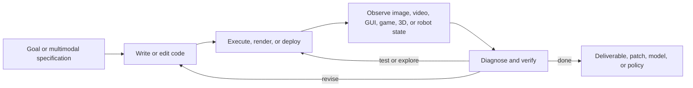

# Awesome Multimodal Agentic Coding

A research map of multimodal agents that orchestrate model capabilities to build, act, and continually improve in digital and physical worlds—from websites and CAD to games, simulations, and robotics.

<a id="multimodal-agentic-coding-trilogy"></a>

## Our Vision: A Multimodal Agentic Coding Trilogy

We envision the development of **multimodal agentic coding** through three connected, cumulative research directions. This trilogy forms the core perspective of this collection, guiding how we connect methods, data, and evaluation.

<a id="trilogy-visual-feedback"></a>

### 01 · Visual as Feedback

Use **visual feedback** to help agents continually observe, improve, and refine what they build.

<a id="trilogy-models-as-tools"></a>

### 02 · Orchestrating Models as Tools

Enable agents to **organize and combine model capabilities**, expanding their ability to build, act, and solve problems.

<a id="trilogy-digital-physical"></a>

### 03 · Bridging Digital & Physical Worlds

**Connect digital and physical worlds**, extending construction, action, and learning across them.

---

**[Start here](./docs/READING_GUIDE.md) · [Browse papers](#paper-and-project-list) · [Explore demos](#selected-cases-and-demos) · [Suggest a work](https://github.com/jiangjin1999/awesome-multimodal-agentic-coding/issues/new/choose)**

<div align="center">


<br>

***What Can Be Verified Can Be Scaled.***

**Multimodal agents that orchestrate model capabilities to build, act, and continually improve in the world.**

[](https://awesome.re)
[](./LICENSE)
[](#contributing)
[](#contact-and-collaboration)
[](#paper-and-project-list)

[](./README.md)
[](./README.zh-CN.md)

**Last updated: 2026-10-29**

</div>

<!-- mmac-layout: directions-v4 -->

<a id="start-here"></a>

## Start Here

Read by **research question**, **resource type**, or **application**. Start with the [foundations](#foundations), follow a direction across methods, evaluation, and data, then explore [capabilities](#capabilities-and-infrastructure) and [research opportunities](#research-opportunities). The [reading guide](./docs/READING_GUIDE.md) offers five introductory examples.

Each work has one complete bibliographic entry. Other sections link to it in a specific role, so a method, benchmark, and data contribution can be connected without counting the paper three times. **Core**, **Adjacent**, and **Resource** describe scope; they are independent of research direction and contribution tags. Background surveys and application examples retain their separate reading roles.

<a id="topic-map"></a>

| Direction | Methods | Evaluation | Data |
|---|---|---|---|
| Visual software engineering and application recreation | [2.1](#methods-software) | [3.1](#evaluation-software) | [4.1](#data-software) |
| GUI and software training-environment synthesis | [2.2](#methods-gui-environments) | [3.2](#evaluation-gui-environments) | [4.2](#data-gui-environments) |
| Charts, scientific visualization, and editable graphics | [2.3](#methods-graphics) | [3.3](#evaluation-graphics) | [4.3](#data-graphics) |
| Documents and visual media | [2.4](#methods-media) | [3.4](#evaluation-media) | [4.4](#data-media) |
| Procedural 3D and CAD construction | [2.5](#methods-cad-3d) | [3.5](#evaluation-cad-3d) | [4.5](#data-cad-3d) |
| Physical asset construction and diagnosis | [2.6](#methods-physical-assets) | [3.6](#evaluation-physical-assets) | [4.6](#data-physical-assets) |
| Playable game construction, recreation, and repair | [2.7](#methods-games) | [3.7](#evaluation-games) | [4.7](#data-games) |
| Executable world models and simulation programs | [2.8](#methods-world-models) | [3.8](#evaluation-world-models) | [4.8](#data-world-models) |
| Agentic Real-to-Sim | [2.9](#methods-real-to-sim) | [3.9](#evaluation-real-to-sim) | [4.9](#data-real-to-sim) |
| Robot program and policy development | [2.10](#methods-robot-programs) | [3.10](#evaluation-robot-programs) | [4.10](#data-robot-programs) |
| Real2Sim2Real: task learning and real execution | [2.11](#methods-real2sim2real) | [3.11](#evaluation-real2sim2real) | [4.11](#data-real2sim2real) |
| Learning from construction and interaction experience | [2.12](#methods-experience) | [3.12](#evaluation-experience) | [4.12](#data-experience) |

[1. Foundations & Background Reading](#foundations) · [2. Methods & Systems](#methods-and-systems) · [3. Benchmarks & Evaluation](#benchmarks-and-evaluation) · [4. Data & Learning Resources](#data-and-learning-resources) · [5. Model Capabilities & Infrastructure](#capabilities-and-infrastructure) · [6. Research Opportunities](#research-opportunities)

[Evaluator reliability](#section-3-13) · [Application index](#application-domains) · [Community & practice](#community-and-practice) · [Scope and tags](#definition-and-scope)

<a id="motivation"></a>

## 💡 Motivation

Multimodal coding has traditionally meant **using an image, video, chart, or design as the initial input to code generation**. Our starting point went further: code acts in digital and physical worlds, and visual perception becomes feedback for improving what the agent builds.

We now place the **multimodal agent at the center**: it understands goals and observations, selects and combines model capabilities, and uses execution feedback to decide what to build, how to act, and what to change next.

> ***We believe multimodal agentic coding is an emerging multimodal paradigm: let an agent orchestrate different model capabilities to build, act, and continually improve in the world.***

The [Multimodal Agentic Coding Trilogy](#multimodal-agentic-coding-trilogy) expresses this expanding vision. Visual feedback remains foundational as agents draw on broader capabilities and act across worlds.

Within the third direction, **emerging physical intelligence in LLMs** is a research perspective we are especially interested in: how LLM-based agents develop capabilities for understanding and acting in the physical world.

### Models as tools, code as composition

**Models can provide reusable, atomic capabilities—not only serve as the agent itself.** For example, an agent can call a diffusion model to generate visual assets for a digital environment, or an action model to supply movement or manipulation capabilities in a physical environment. Perception, prediction, and verification models can also participate in the same workflow.

| Role | Function in the agent loop |
|---|---|
| **Multimodal agent** | Understand goals and observations; plan, select capabilities, coordinate execution, and revise decisions. |
| **Models as tools** | Supply capabilities for perception, image/video/3D generation, prediction, action, and evaluation. |
| **Code and skills** | Compose model calls, assets, and tool actions into executable workflows, with state, checks, and recovery. Code is both a deliverable and a composition medium. |
| **Digital, simulated, and physical worlds** | Execute programs and actions, expose their consequences, and return visual, temporal, spatial, interactive, or embodied feedback. |

“Multimodal” describes the **whole agent system**, not a requirement to put every capability in one native multimodal model. A coding agent with a separate visual critic is also a valid architecture. Calling a model once, however, does not by itself establish a feedback loop.

### Visual feedback remains central

The original **code → execute/render → observe → verify → repair** loop is a central instance of this broader perspective. Vision is still **feedback, not just input**: the agent sees what it builds, interacts with it, and lets those observations redirect later work. The same principle extends to revising model selection, tool use, and executable workflows—not only the final artifact.

Continual improvement here means evidence-driven iteration; it does not require updating model weights. The agent may revise code, plans, prompts, capability choices, or reusable skills in response to what happens in the world.



This trilogy offers **connected perspectives on the field's development**. A work can contribute to several directions, and new tasks and methods can extend their scope.

| Framework | Questions to carry across directions | Reading path |
|---|---|---|
| **Visual as Feedback** | How can visual feedback support agents in continually improving what they build? | [Software](#methods-software) · [Graphics](#methods-graphics) · [3D](#methods-cad-3d) → [Evaluator reliability](#section-3-13) |
| **Orchestrating Models as Tools** | How can organizing model capabilities expand what agents can build and do? | [Media](#methods-media) · [Physical assets](#methods-physical-assets) → [Capabilities](#capabilities-and-infrastructure) |
| **Bridging Digital & Physical Worlds** | How can construction, action, and learning connect digital and physical worlds? | [Real-to-Sim](#methods-real-to-sim) → [Robot programs](#methods-robot-programs) → [Real2Sim2Real evaluation](#evaluation-real2sim2real) |

<a id="definition-and-scope"></a>

## 📌 Definition and Scope

Within this agent-centered perspective, the **core work list** focuses on multimodal agentic coding systems in which the following four events occur in the **same agent trajectory**:

1. the agent generates or modifies executable code or another programmatic representation;
2. that code creates or changes an executable or editable artifact—or an executable world state;
3. the agent receives a post-execution visual, temporal, spatial, interactive, or embodied observation; and
4. that observation changes a later code or tool action.

Here, an **artifact** is a product or state built through code: for example a web page, UI, chart, SVG, CAD model, 3D scene, game, document, video, simulator, digital twin, or robot policy.

The central inclusion test is:

> **Can we trace code → executable artifact → post-execution multimodal evidence → a later code/tool action within one trajectory?**

A benchmark may instantiate this loop through a named track, baseline, or documented agent configuration, even when other evaluated settings do not use multimodal feedback.

Adjacent papers and Resource entries complement Core work across the research directions and capability sections. Model orchestration alone is not enough for a core coding loop: executable code or a programmatic representation must remain part of the trajectory.

### What is included

- Iterative generation and repair of web pages, apps, charts, diagrams, 3D scenes, CAD models, games, slides, posters, animations, and videos.
- Repository-level visual issue reproduction, localization, patching, and regression validation.
- Visual coding agents that actively browse, inspect screenshots, sample video frames, operate GUIs, play games, or observe robots while modifying code.
- Agent-authored executable world models and digital twins whose code is revised from multimodal observations or interaction counterexamples.
- Agent programs that compose generative, perceptual, predictive, or action models and refine those workflows from post-execution multimodal feedback.
- Training methods, datasets, and benchmarks specifically built around these loops.

| Scope | Reading role |
|---|---|
| **Core** | The documented coding loop meets the four criteria above; this identity may apply to a method or an evaluated benchmark setting. |
| **Adjacent** | Related construction, orchestration, perception, action, or evaluation foundations; scope remains distinct from Core. |
| **Resource** | Callable model capabilities, skills, tools, engines, and practice resources. Resource entries are not counted as Core papers. |

<details>
<summary>Contribution and research-role tags</summary>

<a id="contribution-tags"></a>

## 🏷️ Tag System

Tags are split into two orthogonal axes. **Contribution tags** describe what a work contributes; **research-role tags** describe where that contribution acts in the agent-development loop. Each work has at least one contribution tag, while research-role tags identify only its central roles.

### Contribution tags

| Tag | Meaning |
|---|---|
| `[Method]` | A new agent method, framework, model, algorithm, or optimization procedure. |
| `[System]` | An integrated implementation or model-and-tool system; this tag does not establish closed-loop behavior by itself. |
| `[Benchmark]` | An evaluation task, environment, protocol, or benchmark suite. |
| `[Dataset]` | A concrete training, evaluation, or trajectory collection is released as a central contribution. |
| `[Empirical Study]` | The central contribution is systematic observation, comparison, auditing, or failure analysis rather than a new agent. |
| `[Survey]` | A survey, taxonomy, or position paper. |

A work may carry multiple contribution tags when it makes multiple substantial contributions.

### Research-role tags

| Tag | Meaning |
|---|---|
| `[Data Curation]` | Constructs, synthesizes, filters, annotates, decontaminates, or versions tasks, environments, demonstrations, preferences, or trajectories. This is a data-engineering contribution, not merely the use of a dataset. |
| `[Training]` | Updates a model, policy, critic, verifier, memory, skill, or agent harness through SFT, distillation, preference optimization, RL/RLVR, heuristic learning, or another learning procedure. |
| `[Inference]` | Changes the test-time agent loop through planning, search, reflection, memory, interaction, repair, reranking, or test-time scaling. |
| `[Environment]` | Contributes a reusable executable substrate such as a sandbox, renderer, simulator, browser/game runtime, action interface, or task environment. |
| `[Verification]` | Introduces a critic, judge, reward, rubric, metric, or deterministic checker that turns execution outcomes into scores or actionable diagnoses. Final-only scoring does not imply in-loop feedback. |
| `[Trajectory Analysis]` | Treats complete action–observation histories as the primary object for process characterization, representation, diagnosis, failure attribution, monitoring, or intervention. Merely saving logs is insufficient. |

Important distinctions keep the labels useful:

- `[Dataset]` marks a released collection; `[Data Curation]` marks a method or pipeline for producing trustworthy data. A work may be both.
- `[Benchmark]` marks what is measured; `[Verification]` marks how an outcome or intermediate state is judged. A benchmark may use an existing verifier and therefore need only `[Benchmark]`.
- `[Training]` requires a learned update; prompt-only, search-only, or reflection-only improvements are `[Inference]`.
- Trajectories used only as training examples receive `[Training]` and, when released, `[Dataset]`. `[Trajectory Analysis]` is reserved for work that studies or diagnoses the path itself.

In the entries below, contribution tags appear first and research-role tags follow the `·` separator. Broad surveys may remain contribution-only when assigning a single pipeline role would be misleading. The following examples illustrate how the two axes compose:

| Work | Contribution tags | Research-role tags |
|---|---|---|
| **Learning Only with Images / RRVF** | `[Method]` | `[Training]` `[Inference]` `[Verification]` |
| **Programming with Pixels** | `[Benchmark]` | `[Environment]` `[Verification]` |
| **Rendering-in-the-Loop** | `[Method]` `[Benchmark]` `[Dataset]` | `[Data Curation]` `[Inference]` `[Environment]` `[Verification]` |
| **ReLook** | `[Method]` | `[Training]` `[Inference]` `[Verification]` |

</details>

The `arXiv YYYY.MM` label follows the source page’s first-submission date. **Verification** summarizes what the paper checks; it may include both in-loop feedback and final evaluation.

<a id="foundations"></a>

## 1. Foundations & Background Reading

<a id="section-1-1"></a>

### 1.1 Representations, programs, and assets

**Task.** Understand what an agent generates or edits, and how programs, assets, and observations relate: HTML/CSS, graphics programs, parametric CAD, meshes, scene graphs, and materials offer different forms of editability and execution.

**Boundary.** A rendered image is one observation of an artifact. Shape, program structure, interaction state, and physical parameters require separate descriptions.

**Connect:** [2.3 Charts, scientific visualization, and editable graphics](#methods-graphics) · [2.5 Procedural 3D and CAD construction](#methods-cad-3d) · [5.2 Program, geometry, material, and visual-media generation/editing](#section-5-2)

<a id="paper-2606-15932"></a>
<!-- mmac-record: {"id": "2606.15932", "scope": "Survey", "primary": "1.1", "task": null} -->

- `arXiv 2026.06` **Beyond NL2Code: A Structured Survey of Multimodal Code Intelligence**. [[paper]](https://arxiv.org/abs/2606.15932) — `[Survey]` · **Background survey**
  > Surveys multimodal code intelligence across UI, scientific visualization, structured graphics, and emerging agentic settings.

**Reading links**

- [SceneCraft](#paper-2403-01248) · **Core** · [2.5](#methods-cad-3d)
- [3DCodeVerse](#paper-2610-22341) · **Core** · [2.5](#methods-cad-3d)

<a id="section-1-2"></a>

### 1.2 Program synthesis, generation, retrieval, and assembly

**Task.** Compare how program synthesis, generative models, retrieval, parameter optimization, and asset assembly contribute to construction, including their inputs, outputs, and coordination.

**Boundary.** An agent system and an independently callable capability model are different units. Using several models does not establish adaptive tool selection.

**Connect:** [2.2 GUI and software training-environment synthesis](#methods-gui-environments) · [2.6 Physical asset construction and diagnosis](#methods-physical-assets) · [2.9 Agentic Real-to-Sim](#methods-real-to-sim) · [5.2 Program, geometry, material, and visual-media generation/editing](#section-5-2) · [5.3 Execution, rendering, simulation, and automation interfaces](#section-5-3)

**Reading links**

- [Towards Physically Grounded Articulated 3D Assets](#paper-2610-13947) · **Core** · [2.6](#methods-physical-assets)
- [LiteReality-Agent](#paper-2610-01863) · **Core** · [2.9](#methods-real-to-sim)
- [SoftwareGym](#paper-2610-12611) · **Core** · [2.2](#methods-gui-environments)

<a id="section-1-3"></a>

### 1.3 Execution, observation, feedback, repair, and verification

**Task.** Study how execution, observation, diagnosis, repair, and verification form an improvement loop; distinguish reference inputs, runtime feedback, training rewards, and final scores.

**Boundary.** Saving a screenshot or assigning a final visual score does not show that the observation guided a later revision. Training-time and inference-time feedback paths are described separately.

**Connect:** [2.1 Visual software engineering and application recreation](#methods-software) · [2.12 Learning from construction and interaction experience](#methods-experience) · [3.13 Test, reward, and evaluator reliability](#section-3-13)

**Reading links**

- [ReLook](#paper-2510-11498) · **Core** · [2.1](#methods-software)
- [Learning Only with Images](#paper-2507-20766) · **Core** · [2.1](#methods-software)
- [Imperfect Visual Verification for Code Edition](#paper-2606-15693) · **Core** · [3.13](#section-3-13)

<a id="section-1-4"></a>

### 1.4 From artifacts to environments: state, actions, resets, tasks, and rewards

**Task.** Understand how an executable artifact becomes an environment for agent action, planning, training, or evaluation through state, actions, initialization/reset, tasks, and outcome checks.

**Boundary.** Loadability and renderability describe execution. Learning utility also depends on task interfaces, interaction coverage, and learning signals.

**Connect:** [2.2 GUI and software training-environment synthesis](#methods-gui-environments) · [2.8 Executable world models and simulation programs](#methods-world-models) · [2.11 Real2Sim2Real: task learning and real execution](#methods-real2sim2real) · [4.2 GUI/software environments, tasks, rewards, and action traces](#data-gui-environments)

<a id="paper-2608-28122"></a>
<!-- mmac-record: {"id": "2608.28122", "scope": "Survey", "primary": "1.4", "task": null} -->

- `arXiv 2026.08` **Agentic Artifact Creation: Systems, Evaluation, Principles, and Opportunities**. [[paper]](https://arxiv.org/abs/2608.28122) [[code]](https://github.com/GeminiLight/awesome-agentic-artifact-creation) — `[Survey]` · **Background survey**
  > Surveys stateful artifact construction in which intermediate observations redirect later work across software, visual media, 3D, and other deliverables.

**Reading links**

- [SoftwareGym](#paper-2610-12611) · **Core** · [2.2](#methods-gui-environments)
- [AgentGarten](#paper-2610-12374) · **Core** · [2.8](#methods-world-models)

<a id="methods-and-systems"></a>

<a id="paper-and-project-list"></a>

## 2. Methods & Systems

<a id="general"></a>

<a id="software-engineering"></a>

<a id="web-ui-app"></a>

<a id="methods-software"></a>

### 2.1 Visual software engineering and application recreation

**Task.** Generate, recreate, and repair software from requirements, screenshots, interaction traces, or a running reference application. Recover observable interfaces and behavior while preserving existing functionality.

**Boundary.** The deliverable is a software implementation. Environments built specifically to train operating agents belong in 2.2. Reference exploration, development checks, and hidden submission tests are distinct.

**Connect:** [3.1 Visual software engineering and recreation evaluation](#evaluation-software) · [4.1 Software requirements, application observations, and development traces](#data-software) · [2.2 GUI and software training-environment synthesis](#methods-gui-environments) · [2.12 Learning from construction and interaction experience](#methods-experience)

<a id="paper-2609-22000"></a>
<!-- mmac-record: {"id": "2609.22000", "scope": "Core", "primary": "2.1", "task": 1} -->

- `arXiv 2026.09` **RecreationWorld: Scalable and Verifiable Environments for Hybrid Computer-Use Agents**. [[paper]](https://arxiv.org/abs/2609.22000) — `[Method]` `[Benchmark]` · `[Data Curation]` `[Training]` `[Environment]` `[Verification]` · **Core**
  > Recreates applications across desktop, Android, and Web by interleaving reference exploration, source implementation, execution, and visual checks, and trains hybrid agents on verified reconstruction trajectories.<br>
  > **Verification:** Build/launch validity · hidden behavioral and visual assertions · reconstruction fidelity · GUI–code switching · transfer after training.

<a id="paper-2507-20766"></a>
<!-- mmac-record: {"id": "2507.20766", "scope": "Core", "primary": "2.1", "task": 1} -->

- `arXiv 2025.07` **Learning Only with Images: Visual Reinforcement Learning with Reasoning, Rendering, and Visual Feedback**. [[paper]](https://arxiv.org/abs/2507.20766) [[code]](https://github.com/L-O-I/RRVF) — `[Method]` · `[Training]` `[Inference]` `[Verification]` · **Core**
  > Runs generated chart and web code, turns target-versus-render discrepancies into visual feedback, and uses it to guide the next code-generation turn.<br>
  > **Verification:** Code and format validity · rendered visual similarity · semantic and element completeness.

<a id="paper-2607-14075"></a>
<!-- mmac-record: {"id": "2607.14075", "scope": "Core", "primary": "2.1", "task": 1} -->

- `arXiv 2026.07` **VisualRepair: Dynamic Tool Calling and Region Focusing for Visual Software Issue Repair**. [[paper]](https://arxiv.org/abs/2607.14075) — `[Method]` · `[Inference]` · **Core**
  > Dynamically selects visual tools and zooms into suspicious regions while iteratively repairing screenshot-grounded software issues.<br>
  > **Verification:** Resolved rate · repository-test pass · screenshot-grounded repair correctness.

<a id="paper-2603-17826"></a>
<!-- mmac-record: {"id": "2603.17826", "scope": "Core", "primary": "2.1", "task": 1} -->

- `arXiv 2026.03` **FailureMem: A Failure-Aware Multimodal Framework for Autonomous Software Repair**. [[paper]](https://arxiv.org/abs/2603.17826) [[code]](https://github.com/Ruize-Ma/FailureMem) — `[Method]` · `[Inference]` · **Core**
  > Retrieves prior multimodal failure trajectories to guide diagnosis and subsequent repository-level repair actions.<br>
  > **Verification:** SWE-bench Multimodal resolved rate · repository-test pass · visual-issue resolution.

<a id="paper-2602-06090"></a>
<!-- mmac-record: {"id": "2602.06090", "scope": "Core", "primary": "2.1", "task": 1} -->

- `arXiv 2026.02` **SVRepair: Structured Visual Reasoning for Automated Program Repair**. [[paper]](https://arxiv.org/abs/2602.06090) — `[Method]` · `[Inference]` · **Core**
  > Structures screenshots into localized visual evidence and iterates between scene understanding, code localization, and patching.<br>
  > **Verification:** Resolved rate · repository-test pass · localization and patch correctness.

<a id="paper-2506-16136"></a>
<!-- mmac-record: {"id": "2506.16136", "scope": "Core", "primary": "2.1", "task": 1} -->

- `arXiv 2025.06` **Seeing is Fixing: Cross-Modal Reasoning with Multimodal LLMs for Visual Software Issue Fixing**. [[paper]](https://arxiv.org/abs/2506.16136) — `[Method]` · `[Inference]` `[Verification]` · **Core**
  > Combines image-to-code understanding with code-to-image validation to close the loop on visual software issue repair.<br>
  > **Verification:** Pass@1 · repository-test pass · visual patch validation.

<a id="paper-2411-01606"></a>
<!-- mmac-record: {"id": "2411.01606", "scope": "Core", "primary": "2.1", "task": 1} -->

- `arXiv 2024.11` **DesignRepair: Dual-Stream Design Guideline-Aware Frontend Repair with Large Language Models**. [[paper]](https://arxiv.org/abs/2411.01606) [[code]](https://github.com/UGAIForge/DesignRepair) — `[Method]` · `[Inference]` `[Verification]` · **Core**
  > Jointly reasons over frontend source code and rendered views, using design guidelines to guide iterative visual repair.<br>
  > **Verification:** Violation detection precision/recall · repair precision/recall · perceived visual quality.

<a id="paper-2610-04981"></a>
<!-- mmac-record: {"id": "2610.04981", "scope": "Core", "primary": "2.1", "task": 1} -->

- `arXiv 2026.10` **TeleGen: Improving LLM-Based Web Application Generation via Runtime Telemetry**. [[paper]](https://arxiv.org/abs/2610.04981) [[code]](https://github.com/commoluo/TeleGen) — `[Method]` · `[Inference]` `[Verification]` · **Core**
  > Repairs generated web applications with compressed runtime telemetry and task feedback, combining screenshot-based WebVoyager judgments with code revision in its WebGen-Bench configuration.<br>
  > **Verification:** UI task success · telemetry/no-telemetry repair ablations · test Pass@2 · judgment audit · context cost.

<a id="paper-2609-02088"></a>
<!-- mmac-record: {"id": "2609.02088", "scope": "Core", "primary": "2.1", "task": 1} -->

- `arXiv 2026.09` **Rendering-in-the-Loop: An Execution-Driven Agent for Interactive Web Development**. [[paper]](https://arxiv.org/abs/2609.02088) — `[Method]` `[Benchmark]` `[Dataset]` · `[Data Curation]` `[Inference]` `[Environment]` `[Verification]` · **Core**
  > Replays reference interactions in a real browser, scores both behavior and rendering, and turns multimodal runtime evidence into repeated tool-assisted code repairs.<br>
  > **Verification:** Interaction execution success · SSIM/OCR/semantic visual fidelity · improvement across repair rounds.

<a id="paper-2608-30530"></a>
<!-- mmac-record: {"id": "2608.30530", "scope": "Core", "primary": "2.1", "task": 1} -->

- `arXiv 2026.08` **WebWorld: The Browser as a World Model for Self-Improving Web Code**. [[paper]](https://arxiv.org/abs/2608.30530) — `[Method]` · `[Data Curation]` `[Training]` `[Inference]` `[Environment]` `[Verification]` · **Core**
  > Turns screenshot-grounded critiques into scoped HTML repairs and replayable browser contracts, retaining only transitions that improve the target without regressing previously verified behavior.<br>
  > **Verification:** Browser replay · target-predicate progress · prior-capability preservation · certificate-backed training transitions.

<a id="paper-2608-24138"></a>
<!-- mmac-record: {"id": "2608.24138", "scope": "Core", "primary": "2.1", "task": 1} -->

- `arXiv 2026.08` **Rubrics as Visual-Repair Context for Self-Evolving UI-to-Code Generation**. [[paper]](https://arxiv.org/abs/2608.24138) — `[Method]` · `[Inference]` `[Verification]` · **Core**
  > Uses persistent visual-repair rubrics to select scoped edits and reduce regression across repeated UI refinement rounds.<br>
  > **Verification:** Overall visual fidelity · five aspect-level UI ratings · regression across repair rounds.

<a id="paper-2604-19742"></a>
<!-- mmac-record: {"id": "2604.19742", "scope": "Core", "primary": "2.1", "task": 1} -->

- `arXiv 2026.04` **PlayCoder: Making LLM-Generated GUI Code Playable**. [[paper]](https://arxiv.org/abs/2604.19742) [[code]](https://github.com/Tencent/PlayCoder) — `[Method]` `[Benchmark]` · `[Inference]` `[Environment]` `[Verification]` · **Core**
  > Automatically runs and operates generated GUIs, then converts interaction failures into subsequent code repairs.<br>
  > **Verification:** Exec@k · unit-test Pass@k · interactive Play@k · token efficiency.

<a id="paper-2604-05839"></a>
<!-- mmac-record: {"id": "2604.05839", "scope": "Core", "primary": "2.1", "task": 1} -->

- `arXiv 2026.04` **Vision-Guided Iterative Refinement for Frontend Code Generation**. [[paper]](https://arxiv.org/abs/2604.05839) — `[Method]` · `[Inference]` `[Verification]` · **Core**
  > Feeds rendered frontend differences back into repeated code revisions rather than stopping after initial generation.<br>
  > **Verification:** Visual task fulfillment · aesthetics · code task fulfillment · code quality.

<a id="paper-2604-19750"></a>
<!-- mmac-record: {"id": "2604.19750", "scope": "Core", "primary": "2.1", "task": 1} -->

- `arXiv 2026.03` **Coding with Eyes: Visual Feedback Unlocks Reliable GUI Code Generating and Debugging**. [[paper]](https://arxiv.org/abs/2604.19750) — `[Method]` `[Benchmark]` · `[Inference]` `[Environment]` `[Verification]` · **Core**
  > Coordinates visual understanding, GUI interaction, code generation, and refactoring in an execution-grounded debugging loop.<br>
  > **Verification:** Application execution · element/color/layout assertions · interaction-state correctness.

<a id="paper-2602-05998"></a>
<!-- mmac-record: {"id": "2602.05998", "scope": "Core", "primary": "2.1", "task": 1} -->

- `arXiv 2026.02` **VisRefiner: Learning from Visual Differences for Screenshot-to-Code Generation**. [[paper]](https://arxiv.org/abs/2602.05998) — `[Method]` `[Dataset]` · `[Data Curation]` `[Training]` `[Inference]` `[Verification]` · **Core**
  > Learns from target-versus-render visual differences and applies the resulting evidence to iterative code refinement.<br>
  > **Verification:** HTML/CSS validity · block/text/position/color/CLIP fidelity · iterative improvement.

<a id="paper-2601-04203"></a>
<!-- mmac-record: {"id": "2601.04203", "scope": "Core", "primary": "2.1", "task": 1} -->

- `arXiv 2025.12` **FronTalk: Benchmarking Front-End Development as Conversational Code Generation with Multi-Modal Feedback**. [[paper]](https://arxiv.org/abs/2601.04203) [[code]](https://github.com/shirley-wu/frontalk) [[project]](https://frontalk-benchmark.github.io/) — `[Method]` `[Benchmark]` `[Dataset]` · `[Data Curation]` `[Inference]` `[Environment]` `[Verification]` · **Core**
  > Introduces multi-turn visual front-end conversations and AceCoder, which interacts with rendered sites, critiques failures, and regenerates improved code.<br>
  > **Verification:** Interactive pass rate · usability · forgetting/regression rate.

<a id="paper-2511-08195"></a>
<!-- mmac-record: {"id": "2511.08195", "scope": "Core", "primary": "2.1", "task": 1} -->

- `arXiv 2025.11` **UI2Code^N: UI-to-Code Generation as Interactive Visual Optimization**. [[paper]](https://arxiv.org/abs/2511.08195) [[code]](https://github.com/zai-org/UI2Code_N) — `[Method]` · `[Inference]` `[Verification]` · **Core**
  > Recasts UI-to-code as execution, visual inspection, and repeated refinement optimized with relative visual feedback.<br>
  > **Verification:** Render validity · pairwise visual preference · drafting and polishing quality.

<a id="paper-2511-06251"></a>
<!-- mmac-record: {"id": "2511.06251", "scope": "Core", "primary": "2.1", "task": 1} -->

- `arXiv 2025.11` **WebVIA: A Web-based Vision-Language Agentic Framework for Interactive and Verifiable UI-to-Code Generation**. [[paper]](https://arxiv.org/abs/2511.06251) [[code]](https://github.com/zheny2751-dotcom/WebVIA) [[project]](https://zheny2751-dotcom.github.io/webvia.github.io/) — `[Method]` `[Benchmark]` `[Dataset]` · `[Data Curation]` `[Inference]` `[Environment]` `[Verification]` · **Core**
  > Explores source interfaces through repeated perception-action-verification, synthesizes executable interactive code, and validates recovered behaviors.<br>
  > **Verification:** Structural fidelity · end-to-end interaction completion · action validity.

<a id="paper-2510-11498"></a>
<!-- mmac-record: {"id": "2510.11498", "scope": "Core", "primary": "2.1", "task": 1} -->

- `arXiv 2025.10` **ReLook: Vision-Grounded RL with a Multimodal LLM Critic for Agentic Web Coding**. [[paper]](https://arxiv.org/abs/2510.11498) — `[Method]` · `[Training]` `[Inference]` `[Verification]` · **Core**
  > Feeds screenshot-grounded MLLM critiques into subsequent code revisions during training rollouts and critic-assisted use; its fast inference variant omits the external critic.<br>
  > **Verification:** Valid Render Rate · ArtifactsBench visual/interactive rubric score · accepted-revision improvement.

<a id="paper-2509-22644"></a>
<!-- mmac-record: {"id": "2509.22644", "scope": "Core", "primary": "2.1", "task": 1} -->

- `arXiv 2025.09` **WebGen-Agent: Enhancing Interactive Website Generation with Multi-Level Feedback and Step-Level Reinforcement Learning**. [[paper]](https://arxiv.org/abs/2509.22644) [[code]](https://github.com/mnluzimu/WebGen-Agent) — `[Method]` · `[Training]` `[Inference]` `[Verification]` · **Core**
  > Uses screenshots, GUI-agent testing, backtracking, and step-level rewards to iteratively improve website codebases.<br>
  > **Verification:** Screenshot appearance · GUI-agent task success · best-state improvement.

<a id="paper-2506-13663"></a>
<!-- mmac-record: {"id": "2506.13663", "scope": "Core", "primary": "2.1", "task": 1} -->

- `arXiv 2025.06` **DesignCoder: Hierarchy-Aware and Self-Correcting UI Code Generation with Large Language Models**. [[paper]](https://arxiv.org/abs/2506.13663) — `[Method]` · `[Inference]` `[Verification]` · **Core**
  > Captures rendered mobile UIs, compares component-level visual evidence, and iteratively applies localized code repairs.<br>
  > **Verification:** MSE/CLIP/SSIM visual fidelity · component-tree similarity · user-rated usability.

<a id="paper-2610-09116"></a>
<!-- mmac-record: {"id": "2610.09116", "scope": "Core", "primary": "2.1", "task": 1} -->

- `arXiv 2026.10` **SPLATIFY: Reproduce, Discover, Innovate! From Papers and Ideas to Trainable 3DGS Code**. [[paper]](https://arxiv.org/abs/2610.09116) — `[Method]` `[Benchmark]` · `[Inference]` `[Verification]` · **Core**
  > Turns 3D Gaussian Splatting papers and ideas into trainable plugins, repairing code through rendered-image critique, cross-view Gaussian diagnostics, and training-curve feedback.<br>
  > **Verification:** Trainability · expert-reference render quality · novelty fidelity · structural/curve-feedback ablations · search cost.

<a id="paper-2610-02617"></a>
<!-- mmac-record: {"id": "2610.02617", "scope": "Adjacent", "primary": "2.1", "task": 1} -->

- `arXiv 2026.10` **WebUIProof: Benchmarking WebUI Code Generators with UI-Agent Execution Harness**. [[paper]](https://arxiv.org/abs/2610.02617) [[code]](https://github.com/yunyuntsai/webuiproof-benchmark) — `[Method]` `[Benchmark]` `[Dataset]` · `[Data Curation]` `[Training]` `[Environment]` `[Verification]` · **Adjacent**
  > Evaluates generated Web/3D interfaces with structured interaction tests and visual UI agents, using outcome-level rewards to train generators rather than visually repair the current artifact.<br>
  > **Verification:** Build success · interaction completion · element coverage · human–agent agreement · evaluator step-budget sensitivity.

<a id="paper-2609-15078"></a>
<!-- mmac-record: {"id": "2609.15078", "scope": "Adjacent", "primary": "2.1", "task": 1} -->

- `arXiv 2026.09` **Enabling Creative Exploration for Vibe Design Agents**. [[paper]](https://arxiv.org/abs/2609.15078) — `[Method]` `[Empirical Study]` · `[Inference]` `[Verification]` · **Adjacent**
  > Samples structured theme and asset directions before fixed-setting UI code generation, measuring rendered diversity, model-judge preference, and deployed user behavior as separate outcomes.<br>
  > **Verification:** Design-option coverage · screenshot/DOM variation · pairwise quality judgments · online corrections, latency, and completion.

<a id="paper-2609-16936"></a>
<!-- mmac-record: {"id": "2609.16936", "scope": "Adjacent", "primary": "2.1", "task": 1} -->

- `arXiv 2026.09` **RepoAtlas: Guiding Coding Agents via Evolving Multimodal Repository Views**. [[paper]](https://arxiv.org/abs/2609.16936) — `[Method]` · `[Inference]` `[Verification]` · **Adjacent**
  > Helps coding agents localize and repair repository issues with evolving visual code-graph views and source-grounded text, using repository structure rather than rendered application outcomes as visual context.<br>
  > **Verification:** SWE-bench Verified resolve rate · token cost · model calls · repository-view selection and refresh.

<a id="paper-2609-18805"></a>
<!-- mmac-record: {"id": "2609.18805", "scope": "Adjacent", "primary": "2.1", "task": 1} -->

- `arXiv 2026.09` **ProgramDistill: From Interactive Web Apps to Verifiable Reference-Guided SWE Tasks**. [[paper]](https://arxiv.org/abs/2609.18805) — `[Method]` `[Benchmark]` · `[Data Curation]` `[Environment]` `[Verification]` `[Trajectory Analysis]` · **Adjacent**
  > Turns working web applications into replay-verifiable reconstruction tasks, studying observe–edit–validate behavior through structured text-based browser observations rather than screenshot inputs.

**Related evaluation contributions**

- [CUA-SWE](#paper-2609-32600) · **Core** · [3.1](#evaluation-software)
- [Programming with Pixels](#paper-2502-18525) · **Core** · [3.1](#evaluation-software)
- [MT-Web2Code](#paper-2608-03474) · **Core** · [3.1](#evaluation-software)
- [InteractWeb-Bench](#paper-2604-27419) · **Core** · [3.1](#evaluation-software)
- [1D-Bench](#paper-2602-18548) · **Core** · [3.1](#evaluation-software)
- [TaoD2C-Bench](#paper-2610-10374) · **Adjacent** · [3.1](#evaluation-software)
- [EngiWorld](#paper-2609-37686) · **Adjacent** · [3.5](#evaluation-cad-3d)
- [IWC-Bench](#paper-2609-15387) · **Adjacent** · [3.1](#evaluation-software)
- [WebCompass](#paper-2604-18224) · **Adjacent** · [3.1](#evaluation-software)
- [ArtifactsBench](#paper-2507-04952) · **Adjacent** · [3.1](#evaluation-software)

**Related methods and systems**

- [Computer-Use Agents as Judges for Generative User Interface](#paper-2511-15567) · **Core** · [3.13](#section-3-13)

**Related capabilities and workflows**

- [Atria Dawn](#paper-2609-15818) · **Adjacent** · [5.4](#section-5-4)

**Application reading:** [OpenLens AI](#application-paper-2509-14778) · [NERFIFY](#application-paper-2603-00805) — research-code workflows and their evaluation; these retain their application-example scope.

<a id="methods-gui-environments"></a>

### 2.2 GUI and software training-environment synthesis

**Task.** Build software environments for operating-agent training or evaluation, connecting tasks, state, verification, and action trajectories. This includes diverse application synthesis and task-conditioned substitutes that preserve necessary behavior.

**Boundary.** Environment quality and downstream agent benefit are evaluated separately. Transfer from synthetic software to target applications is digital-environment transfer.

**Connect:** [3.2 Training-environment construction and downstream utility](#evaluation-gui-environments) · [4.2 GUI/software environments, tasks, rewards, and action traces](#data-gui-environments) · [1.4 From artifacts to environments: state, actions, resets, tasks, and rewards](#section-1-4) · [2.1 Visual software engineering and application recreation](#methods-software) · [2.12 Learning from construction and interaction experience](#methods-experience)

<a id="paper-2610-37567"></a>
<!-- mmac-record: {"id": "2610.37567", "scope": "Core", "primary": "2.2", "task": 2} -->

- `arXiv 2026.10` **Gym-Anything-RT: Scaling Real-Time Environments for Vision-Language Agents**. [[paper]](https://arxiv.org/abs/2610.37567) [[code]](https://github.com/gym-anything/gym-anything-rt) — `[Method]` `[Benchmark]` `[Dataset]` · `[Environment]` `[Verification]` · **Core**
  > Builds real-time visual minigames through creator–auditor code revisions grounded in screenshots and recordings, then controls the environment clock to isolate latency from task capability.<br>
  > **Verification:** 100 minigames · six capabilities · live/slow/paused comparisons · solvability and temporal audits; Core refers to environment construction.

<a id="paper-2610-26828"></a>
<!-- mmac-record: {"id": "2610.26828", "scope": "Adjacent", "primary": "2.2", "task": 2} -->

- `arXiv 2026.10` **Agent World Model in the Wild: Computer-Use Agent Environment Synthesis**. [[paper]](https://arxiv.org/abs/2610.26828) [[code]](https://github.com/MSR-Orchard/WildAWM) [[dataset]](https://huggingface.co/datasets/ChilleD/WildAWM) — `[Method]` `[Dataset]` · `[Data Curation]` `[Training]` `[Environment]` `[Verification]` · **Adjacent**
  > Synthesizes replayable personal-computer worlds spanning GUI, MCP, and CLI, using heterogeneous rollouts and verifier-consistency gates to produce environment–task packages for computer-use training.<br>
  > **Verification:** Deterministic reset/replay · solvability and difficulty · judge consistency and counterfactual probes · downstream computer-use generalization.

<a id="paper-2610-30792"></a>
<!-- mmac-record: {"id": "2610.30792", "scope": "Core", "primary": "2.2", "task": 2} -->

- `arXiv 2026.10` **Trace2World: Reconstructing App Worlds from Real Interaction Traces for Scalable GUI Agent Training**. [[paper]](https://arxiv.org/abs/2610.30792) — `[Method]` `[Benchmark]` · `[Data Curation]` `[Training]` `[Environment]` `[Verification]` · **Core**
  > Reconciles real interaction traces into a fixed app-behavior model, then uses independent screenshot-grounded replay to guide bounded package repair before synthesizing GUI-agent training tasks.<br>
  > **Verification:** Six source-workflow obligations · reset/state contracts · environment-repair ablation · downstream GUI and real-device transfer.

<a id="paper-2605-25624"></a>
<!-- mmac-record: {"id": "2605.25624", "scope": "Core", "primary": "2.2", "task": 2} -->

- `arXiv 2026.05` **CUA-Gym: Scaling Verifiable Training Environments and Tasks for Computer-Use Agents**. [[paper]](https://arxiv.org/abs/2605.25624) [[code]](https://github.com/xlang-ai/CUA-Gym) [[environments]](https://github.com/xlang-ai/CUA-Gym-Hub) [[data]](https://huggingface.co/datasets/xlangai/CUA-Gym) — `[Method]` `[Dataset]` · `[Data Curation]` `[Training]` `[Environment]` `[Verification]` · **Core**
  > Co-generates resettable software states, tasks, and executable rewards, returning disagreements between rollout screenshots and programmatic scores to the reward-writing agent for revision and another rollout.<br>
  > **Verification:** Initial/golden-state reward checks · independent visual-score agreement · task feasibility · OSWorld/WebArena downstream transfer · 32,112 training tuples in the paper versus 10,910 tasks in the public release.

<a id="paper-2610-12611"></a>
<!-- mmac-record: {"id": "2610.12611", "scope": "Core", "primary": "2.2", "task": 2} -->

- `arXiv 2026.10` **SoftwareGym: Scaling Computer-Use Agent Training with Diverse Synthesized Software Environments**. [[paper]](https://arxiv.org/abs/2610.12611) [[code]](https://github.com/MrKiing-Jin/SoftwareGym) — `[Method]` `[Benchmark]` `[Dataset]` · `[Data Curation]` `[Training]` `[Inference]` `[Environment]` `[Verification]` · **Core**
  > Synthesizes native Avalonia applications, using screenshot-grounded GUI test trajectories to repair their source across fixed-case rounds before collecting computer-use training data.<br>
  > **Verification:** Build/launch validity · fixed-case GUI completion and repair ablations · design-token fidelity · 120-task SoftwareGym-Bench · transfer on a 244-task OSWorld subset.

<a id="visualization"></a>

<a id="svg-diagrams"></a>

<a id="methods-graphics"></a>

### 2.3 Charts, scientific visualization, and editable graphics

**Task.** Build and edit charts, scientific visualizations, and structured graphics while keeping programs, underlying data, visual encodings, and interaction behavior consistent. Precise edits also preserve unaffected content.

**Boundary.** Chart semantics, scientific analysis goals, and SVG/TikZ structure impose different constraints; overall visual similarity alone cannot capture success.

**Connect:** [3.3 Chart, scientific visualization, and graphics-editing evaluation](#evaluation-graphics) · [4.3 Chart data, graphics programs, and edit records](#data-graphics) · [2.4 Documents and visual media](#methods-media) · [3.13 Test, reward, and evaluator reliability](#section-3-13) · [5.5 Skills, tool bridges, and reusable workflows](#section-5-5)

<a id="paper-2610-08106"></a>
<!-- mmac-record: {"id": "2610.08106", "scope": "Core", "primary": "2.3", "task": 3} -->

- `arXiv 2026.10` **ChartBmkAgent: Harness-Governed Multi-Agent Construction of Chart QA Benchmarks from Sparse Error-Taxonomy Specifications**. [[paper]](https://arxiv.org/abs/2610.08106) — `[Method]` `[Benchmark]` · `[Data Curation]` `[Inference]` `[Verification]` · **Core**
  > Constructs diagnostic chart-QA samples from sparse error descriptions, using evidence-gated multimodal critique to revise plotting programs while preserving frozen data and the intended error mechanism.<br>
  > **Verification:** Execution/rendering · chart/data fidelity · diagnostic-target preservation · shortcut rejection · paired construction and gate ablations.

<a id="paper-2609-32413"></a>
<!-- mmac-record: {"id": "2609.32413", "scope": "Core", "primary": "2.3", "task": 3} -->

- `arXiv 2026.09` **IChart2Code: Benchmarking Multimodal Large Language Models for Interactive Chart Code Generation**. [[paper]](https://arxiv.org/abs/2609.32413) — `[Method]` `[Benchmark]` · `[Data Curation]` `[Inference]` `[Environment]` `[Verification]` · **Core**
  > Benchmarks chart appearance, data fidelity, and interactive state changes, with TRAIL using browser-observed trajectories to diagnose failures and revise HTML/JavaScript.<br>
  > **Verification:** Executability · data fidelity · static visual correctness · interaction correctness · human-calibrated judging.

<a id="paper-2609-15182"></a>
<!-- mmac-record: {"id": "2609.15182", "scope": "Core", "primary": "2.3", "task": 3} -->

- `arXiv 2026.09` **VisInteract: Towards Dynamic Interactive Text-to-Visualization under Imperfect Queries**. [[paper]](https://arxiv.org/abs/2609.15182) — `[Method]` `[Benchmark]` `[Dataset]` · `[Data Curation]` `[Inference]` `[Environment]` `[Verification]` · **Core**
  > Executes Altair programs and uses a simulated user's rendered-chart critiques and textual clarifications to steer subsequent code search toward underspecified visualization intent.<br>
  > **Verification:** Renderability · code/chart key-feature satisfaction · intent alignment · multi-turn task success.

<a id="paper-2609-14874"></a>
<!-- mmac-record: {"id": "2609.14874", "scope": "Core", "primary": "2.3", "task": 3} -->

- `arXiv 2026.09` **MedVA: An End-to-End Neuro-Symbolic Agentic System for Medical Volume Visualization**. [[paper]](https://arxiv.org/abs/2609.14874) — `[Method]` `[System]` · `[Inference]` `[Environment]` `[Verification]` · **Core**
  > Builds structured JSON visualization specifications and refines ROI opacity using renderer-computed full-scene versus isolated visibility, combining anatomical ontology checks with multi-model segmentation.<br>
  > **Verification:** ROI identification · visibility/occlusion constraints · retained improvements after re-rendering · expert usability assessment.

<a id="paper-2609-16014"></a>
<!-- mmac-record: {"id": "2609.16014", "scope": "Core", "primary": "2.3", "task": 3} -->

- `arXiv 2026.08` **ViCo: Visual-oriented Coding with Self-Reflection for Chart Replication**. [[paper]](https://arxiv.org/abs/2609.16014) [[repo]](https://github.com/Xigmoid/ViCo) — `[Method]` · `[Training]` `[Inference]` `[Verification]` · **Core**
  > Trains chart-coding agents to compare their previous render with a reference, turn discrepancies into explicit reflections, and implement those reflections through counterfactual-credit-guided code refinement.<br>
  > **Verification:** Code execution success · semantic/layout/style fidelity · reflection-following consistency · improvement across refinement rounds.

<a id="paper-2608-10408"></a>
<!-- mmac-record: {"id": "2608.10408", "scope": "Core", "primary": "2.3", "task": 3} -->

- `arXiv 2026.08` **VisEditBench: Can Vision-Language Models Edit Visualization Code from Multimodal Feedback?**. [[paper]](https://arxiv.org/abs/2608.10408) [[repo (release pending)]](https://github.com/vis-nlp/VisEditBench) — `[Method]` `[Benchmark]` `[Dataset]` · `[Data Curation]` `[Inference]` `[Environment]` `[Verification]` · **Core**
  > Introduces chart-repair and restyling tasks plus VisEditAgent, whose execution and visual-validation loop refines candidate code while preserving data semantics.<br>
  > **Verification:** Executability · task accuracy · readability/clarity · visual quality/similarity · final pass rate.

<a id="paper-2605-23527"></a>
<!-- mmac-record: {"id": "2605.23527", "scope": "Core", "primary": "2.3", "task": 3} -->

- `arXiv 2026.05` **LiveFigure: Generating Editable Scientific Illustration with VLM Agents**. [[paper]](https://arxiv.org/abs/2605.23527) [[code]](https://github.com/tsinghua-fib-lab/LiveFigure) — `[Method]` · `[Inference]` `[Verification]` · **Core**
  > Generates editable scientific figures as executable artifacts and uses visual feedback to diagnose and revise them.<br>
  > **Verification:** Visual design · information clarity and legibility · content fidelity and completeness · editability.

<a id="paper-2605-21825"></a>
<!-- mmac-record: {"id": "2605.21825", "scope": "Core", "primary": "2.3", "task": 3} -->

- `arXiv 2026.05` **Toward AI VIS Co-Scientists: A General and End-to-End Agent Harness for Solving Complex Data Visualization Tasks**. [[paper]](https://arxiv.org/abs/2605.21825) — `[Method]` · `[Inference]` `[Environment]` `[Verification]` · **Core**
  > Provides an end-to-end harness for planning, executing, observing, and revising complex visualization workflows.<br>
  > **Verification:** Browser execution and console health · control/linked-view behavior · visual and scientific correctness.

<a id="paper-2604-01600"></a>
<!-- mmac-record: {"id": "2604.01600", "scope": "Core", "primary": "2.3", "task": 3} -->

- `arXiv 2026.04` **MM-ReCoder: Advancing Chart-to-Code Generation with Reinforcement Learning and Self-Correction**. [[paper]](https://arxiv.org/abs/2604.01600) [[code]](https://github.com/ZitianTang/MMReCoder) — `[Method]` · `[Training]` `[Inference]` `[Verification]` · **Core**
  > Combines multimodal reinforcement learning with rendered-chart self-correction for iterative chart-code improvement.<br>
  > **Verification:** Execution rate · text/type/color/layout fidelity · high-level VLM rating.

<a id="paper-2510-23642"></a>
<!-- mmac-record: {"id": "2510.23642", "scope": "Core", "primary": "2.3", "task": 3} -->

- `arXiv 2025.10` **VisCoder2: Building Multi-Language Visualization Coding Agents**. [[paper]](https://arxiv.org/abs/2510.23642) [[code]](https://github.com/TIGER-AI-Lab/VisCoder2) [[project]](https://tiger-ai-lab.github.io/VisCoder2/) — `[Method]` `[Dataset]` · `[Data Curation]` `[Training]` `[Inference]` `[Verification]` · **Core**
  > Builds visualization coding agents across programming languages with executable feedback and repair-oriented data.<br>
  > **Verification:** Execution pass · instruction compliance · visual similarity · multi-round recovery.

<a id="paper-2506-14837"></a>
<!-- mmac-record: {"id": "2506.14837", "scope": "Core", "primary": "2.3", "task": 3} -->

- `arXiv 2025.06` **Improved Iterative Refinement for Chart-to-Code Generation via Structured Instruction**. [[paper]](https://arxiv.org/abs/2506.14837) — `[Method]` · `[Inference]` `[Verification]` · **Core**
  > Structures visual discrepancy feedback into actionable instructions for repeated chart-code revisions.<br>
  > **Verification:** VLM visual quality · text/layout/type/color fidelity · PSNR/SSIM/MSE.

<a id="paper-2502-17651"></a>
<!-- mmac-record: {"id": "2502.17651", "scope": "Core", "primary": "2.3", "task": 3} -->

- `arXiv 2025.02` **METAL: A Multi-Agent Framework for Chart Generation with Test-Time Scaling**. [[paper]](https://arxiv.org/abs/2502.17651) [[code]](https://github.com/metal-chart-generation/metal) — `[Method]` · `[Inference]` `[Verification]` · **Core**
  > Scales test-time chart generation through cooperating generation, visual inspection, and revision agents.<br>
  > **Verification:** Text/type/color/layout F1 · multi-criteria verification score.

<a id="paper-2502-11140"></a>
<!-- mmac-record: {"id": "2502.11140", "scope": "Core", "primary": "2.3", "task": 3} -->

- `arXiv 2025.02` **Automated Visualization Code Synthesis via Multi-Path Reasoning and Feedback-Driven Optimization**. [[paper]](https://arxiv.org/abs/2502.11140) — `[Method]` · `[Inference]` `[Verification]` · **Core**
  > Executes multiple candidate visualization programs, assesses their rendered outputs, and aggregates targeted feedback into a revised solution.<br>
  > **Verification:** Error-free execution · plot similarity · code correctness.

<a id="paper-2502-00988"></a>
<!-- mmac-record: {"id": "2502.00988", "scope": "Core", "primary": "2.3", "task": 3} -->

- `arXiv 2025.02` **PlotGen: Multi-Agent LLM-based Scientific Data Visualization via Multimodal Feedback**. [[paper]](https://arxiv.org/abs/2502.00988) — `[Method]` · `[Inference]` `[Verification]` · **Core**
  > Coordinates code generation with numeric, lexical, and visual feedback agents that iteratively refine scientific plots.<br>
  > **Verification:** Numeric fidelity · lexical labeling · visual aesthetics · human-rated quality.

<a id="paper-2402-11453"></a>
<!-- mmac-record: {"id": "2402.11453", "scope": "Core", "primary": "2.3", "task": 3} -->

- `arXiv 2024.02` **MatPlotAgent: Method and Evaluation for LLM-Based Agentic Scientific Data Visualization**. [[paper]](https://arxiv.org/abs/2402.11453) [[code]](https://github.com/thunlp/MatPlotAgent) — `[Method]` `[Benchmark]` · `[Inference]` `[Verification]` · **Core**
  > Plans and executes scientific plotting code, then uses multimodal feedback to refine the generated visualization.<br>
  > **Verification:** Code execution · GPT-4V visual score · human-evaluator correlation.

<a id="paper-2610-06852"></a>
<!-- mmac-record: {"id": "2610.06852", "scope": "Core", "primary": "2.3", "task": 3} -->

- `arXiv 2026.10` **One Figure, Every Canvas: Editable Flowchart Relayout via Agentic Pipeline**. [[paper]](https://arxiv.org/abs/2610.06852) — `[Method]` `[Benchmark]` · `[Data Curation]` `[Inference]` `[Verification]` · **Core**
  > Relayouts raster flowcharts into editable draw.io XML for new aspect ratios, combining graph and layout constraints with rendered visual critiques to correct parsing, styling, and placement.<br>
  > **Verification:** Relationship preservation · hallucination-free content · layout/style quality · editability · human-aligned judging.

<a id="paper-2608-00548"></a>
<!-- mmac-record: {"id": "2608.00548", "scope": "Core", "primary": "2.3", "task": 3} -->

- `arXiv 2026.08` **DrawAI: Agentic Benchmark and Workflow for Making Raster Images Editable**. [[paper]](https://arxiv.org/abs/2608.00548) [[code]](https://github.com/Renaissance-Mind/DrawAI) [[project]](https://drawai.renaissancemind.ai/) — `[Method]` `[Benchmark]` · `[Data Curation]` `[Inference]` `[Verification]` · **Core**
  > Turns raster references into editable structured graphics through an agentic generation, rendering, and correction workflow.<br>
  > **Verification:** Rendered fidelity · structural editability · text/image/formula/shape/connector/table criteria.

<a id="paper-2607-28073"></a>
<!-- mmac-record: {"id": "2607.28073", "scope": "Core", "primary": "2.3", "task": 3} -->

- `arXiv 2026.07` **GVR-Coder: A Visual-Feedback Framework for Structured SVG Generation in Complex Document and Meeting Scenarios**. [[paper]](https://arxiv.org/abs/2607.28073) [[code]](https://github.com/CurryaNa/GVR-Coder) — `[Method]` `[Dataset]` · `[Data Curation]` `[Training]` `[Inference]` `[Verification]` · **Core**
  > Implements a generate-visualize-refine loop for structured SVG programs under complex document requirements.<br>
  > **Verification:** SVG render validity · overlap/connectivity/overflow/clutter/alignment/occlusion · structural complexity.

<a id="paper-2607-27699"></a>
<!-- mmac-record: {"id": "2607.27699", "scope": "Core", "primary": "2.3", "task": 3} -->

- `arXiv 2026.07` **RefineSVG: Visual Feedback-Driven Reinforcement Learning for Image-to-SVG Generation**. [[paper]](https://arxiv.org/abs/2607.27699) [[code]](https://github.com/liuxiaobo66/RefineSVG) — `[Method]` `[Dataset]` · `[Data Curation]` `[Training]` `[Inference]` `[Verification]` · **Core**
  > Renders an initial SVG, converts target-versus-render residuals into correction signals, and trains a draft-then-refine policy.<br>
  > **Verification:** Render validity · pixel structural fidelity · semantic alignment · code efficiency.

<a id="paper-2607-09839"></a>
<!-- mmac-record: {"id": "2607.09839", "scope": "Core", "primary": "2.3", "task": 3} -->

- `arXiv 2026.07` **Exploring Agentic Workflows for Generating High Quality Math Visual Aids**. [[paper]](https://arxiv.org/abs/2607.09839) [[code]](https://github.com/ashnakhetan/self-improve-math-diagrams) — `[Method]` · `[Inference]` `[Verification]` · **Core**
  > Generates TikZ diagrams, asks QA questions about the rendered image, and feeds unsatisfied visual checks into subsequent code regeneration.<br>
  > **Verification:** Question-answer correctness from code and image · human agreement · educational usefulness.

<a id="paper-2603-12597"></a>
<!-- mmac-record: {"id": "2603.12597", "scope": "Core", "primary": "2.3", "task": 3} -->

- `arXiv 2026.03` **Feynman: Knowledge-Infused Diagramming Agent for Scalable Visual Designs**. [[paper]](https://arxiv.org/abs/2603.12597) — `[Method]` `[Dataset]` · `[Data Curation]` `[Inference]` `[Verification]` · **Core**
  > Combines domain knowledge with iterative diagram construction and visual inspection for scalable editable designs.<br>
  > **Verification:** Program compilation · knowledge and label correctness · visual alignment and readability.

<a id="paper-2603-09312"></a>
<!-- mmac-record: {"id": "2603.09312", "scope": "Core", "primary": "2.3", "task": 3} -->

- `arXiv 2026.03` **IntroSVG: Learning from Rendering Feedback for Text-to-SVG Generation via an Introspective Generator-Critic Framework**. [[paper]](https://arxiv.org/abs/2603.09312) — `[Method]` · `[Data Curation]` `[Training]` `[Inference]` `[Verification]` · **Core**
  > Uses a generator-critic loop in which rendered SVG outputs are inspected and translated into subsequent program revisions.<br>
  > **Verification:** CairoSVG render success · visual quality/FID · text-semantic alignment · human preference.

<a id="paper-2602-17690"></a>
<!-- mmac-record: {"id": "2602.17690", "scope": "Core", "primary": "2.3", "task": 3} -->

- `arXiv 2026.02` **DesignAsCode: Bridging Structural Editability and Visual Fidelity in Graphic Design Generation**. [[paper]](https://arxiv.org/abs/2602.17690) — `[Method]` · `[Inference]` `[Verification]` · **Core**
  > Uses a Plan-Implement-Reflect pipeline and visual-aware reflection to repair rendering artifacts in executable HTML/CSS designs.<br>
  > **Verification:** Structural validity · alignment/readability/CLIP · text/image/layout/color quality · human aesthetics.

<a id="paper-2511-02778"></a>
<!-- mmac-record: {"id": "2511.02778", "scope": "Core", "primary": "2.3", "task": 3} -->

- `arXiv 2025.11` **VCode: a Multimodal Coding Benchmark with SVG as Symbolic Visual Representation**. [[paper]](https://arxiv.org/abs/2511.02778) — `[Method]` `[Benchmark]` · `[Data Curation]` `[Inference]` `[Verification]` · **Core**
  > Evaluates and supports iterative generation of executable, editable SVG code as a symbolic visual representation.<br>
  > **Verification:** SVG render success · SigLIP semantic fidelity · CodeVQA reasoning preservation.

<a id="paper-2508-15222"></a>
<!-- mmac-record: {"id": "2508.15222", "scope": "Core", "primary": "2.3", "task": 3} -->

- `arXiv 2025.08` **See it. Say it. Sorted: Agentic System for Compositional Diagram Generation**. [[paper]](https://arxiv.org/abs/2508.15222) — `[Method]` · `[Inference]` `[Verification]` · **Core**
  > Coordinates visual understanding and code-based SVG construction to iteratively turn sketches into compositional diagrams.<br>
  > **Verification:** Sketch-structure fidelity · primitive count and orientation · spatial alignment.

<a id="paper-2610-00374"></a>
<!-- mmac-record: {"id": "2610.00374", "scope": "Adjacent", "primary": "2.3", "task": 3} -->

- `arXiv 2026.09` **Faithful Chart Generation for Multimodal Deep Research: Frame-Evidence Co-Adaptation**. [[paper]](https://arxiv.org/abs/2610.00374) — `[Method]` · `[Inference]` `[Verification]` · **Adjacent**
  > Adapts chart frames to retrievable quantitative evidence before generating ECharts, keeping accepted values fixed during rendering retries and auditing numerical provenance.<br>
  > **Verification:** Numerical fidelity · source provenance · unsupported-value rate · chart utility · report quality.

<a id="paper-2609-16598"></a>
<!-- mmac-record: {"id": "2609.16598", "scope": "Adjacent", "primary": "2.3", "task": 3} -->

- `arXiv 2026.09` **CATVis: A Collaborative Multi-Agent Workflow for Turbomachinery Simulation Data Visualization**. [[paper]](https://arxiv.org/abs/2609.16598) — `[Method]` `[System]` · `[Inference]` `[Environment]` `[Verification]` · **Adjacent**
  > Converts turbomachinery analysis requests into executable visualization DAGs through staged planning and error-aware refinement, leaving visual camera and workflow adjustments to an interactive human review step.<br>
  > **Verification:** Added/deleted workflow nodes · connection changes · parameter mismatches · manual corrections needed.

<a id="paper-2604-05514"></a>
<!-- mmac-record: {"id": "2604.05514", "scope": "Adjacent", "primary": "2.3", "task": 3} -->

- `arXiv 2026.04` **OmniDiagram: Advancing Unified Diagram Code Generation via Visual Interrogation Reward**. [[paper]](https://arxiv.org/abs/2604.05514) [[code]](https://github.com/Haoyue-Yang/OmniDiagram) — `[Method]` `[Benchmark]` `[Dataset]` · `[Data Curation]` `[Training]` `[Verification]` · **Adjacent**
  > Uses rendered-diagram questions as training and data-filtering signals for unified LaTeX, Mermaid, and PlantUML policies rather than as an inference-time repair turn.

**Related methods and systems**

- [Learning Only with Images](#paper-2507-20766) · **Core** · [2.1](#methods-software)
- [Imperfect Visual Verification for Code Edition](#paper-2606-15693) · **Core** · [3.13](#section-3-13)
- [SIVIA-RSI](#paper-2609-33386) · **Adjacent** · [2.12](#methods-experience)
- [SciVisAgentSkills](#paper-2606-05525) · **Adjacent** · [5.5](#section-5-5)

**Related evaluation contributions**

- [ChartRevise](#paper-2609-38642) · **Core** · [3.3](#evaluation-graphics)
- [RealChart2Code](#paper-2603-25804) · **Core** · [3.3](#evaluation-graphics)
- [ChartEditBench](#paper-2602-15758) · **Core** · [3.3](#evaluation-graphics)
- [SciVisAgentBench](#paper-2603-29139) · **Adjacent** · [3.3](#evaluation-graphics)
- [ArtifactsBench](#paper-2507-04952) · **Adjacent** · [3.1](#evaluation-software)
- [InteractScience](#paper-2510-09724) · **Adjacent** · [3.3](#evaluation-graphics)

<a id="documents-video"></a>

<a id="methods-media"></a>

### 2.4 Documents and visual media

**Task.** Turn content, design requirements, or reference media into editable documents, slides, animations, and visual media. Compare multipage structure, temporal organization, program construction, and generative-model orchestration.

**Boundary.** Documents, programmatic animation, and generated media have different editable objects and metrics. Model-orchestration systems are distinct from individual generators.

**Connect:** [3.4 Document and visual-media evaluation](#evaluation-media) · [4.4 Documents, media assets, and construction/editing traces](#data-media) · [2.3 Charts, scientific visualization, and editable graphics](#methods-graphics) · [2.12 Learning from construction and interaction experience](#methods-experience) · [5.2 Program, geometry, material, and visual-media generation/editing](#section-5-2)

<a id="paper-2609-31451"></a>
<!-- mmac-record: {"id": "2609.31451", "scope": "Core", "primary": "2.4", "task": 4} -->

- `arXiv 2026.09` **TemplateCraft: Agentic Visual Template Generation**. [[paper]](https://arxiv.org/abs/2609.31451) — `[Method]` `[Benchmark]` · `[Data Curation]` `[Inference]` `[Verification]` · **Core**
  > Builds reusable, client-executable image and video templates, using multimodal trial-output evaluation to roll back and revise plans, materials, or effect workflows before recompilation.<br>
  > **Verification:** Execution success · template adherence · style consistency · cross-input reuse · feedback-stage ablations.

<a id="paper-2609-04034"></a>
<!-- mmac-record: {"id": "2609.04034", "scope": "Core", "primary": "2.4", "task": 4} -->

- `arXiv 2026.09` **Editable Visual Design**. [[paper]](https://arxiv.org/abs/2609.04034) [[code]](https://github.com/yejy53/Editable-Design) — `[Method]` `[System]` · `[Inference]` `[Verification]` · **Core**
  > Combines image-model visual simulation with native HTML/CSS/SVG construction, then renders, visually reviews, and locally patches editable layered designs.<br>
  > **Verification:** Deterministic DOM/layout checks · rendered visual balance/alignment/readability · one-to-two-round local repair · native layer editability.

<a id="paper-2609-03445"></a>
<!-- mmac-record: {"id": "2609.03445", "scope": "Core", "primary": "2.4", "task": 4} -->

- `arXiv 2026.09` **OCR-EDR: Rendering-Aware Diagnosis and Repair for Closed-Loop OCR Improvement**. [[paper]](https://arxiv.org/abs/2609.03445) — `[Method]` `[Benchmark]` `[Dataset]` · `[Data Curation]` `[Inference]` `[Environment]` `[Verification]` · **Core**
  > Maintains OCR text or formula markup as editable state, rerenders every proposed correction, and uses the updated image to decide whether to edit again or stop.<br>
  > **Verification:** Diagnostic accuracy · ExactFix/VisFix · text/formula localization · rendering-equivalent preservation · updated-rendering ablation.

<a id="paper-2609-03109"></a>
<!-- mmac-record: {"id": "2609.03109", "scope": "Core", "primary": "2.4", "task": 4} -->

- `arXiv 2026.09` **SlideForge: An LLM Agent for Controllable Editing of Slides as Structured Artifacts**. [[paper]](https://arxiv.org/abs/2609.03109) [[code]](https://github.com/UIUC-MONET/SLIDEFORGE) — `[Method]` `[System]` `[Benchmark]` · `[Data Curation]` `[Inference]` `[Environment]` `[Verification]` · **Core**
  > Links rendered components to native PPTX objects through a Deck State Graph, then maps visual verification failures back to graph nodes for localized slide repair.<br>
  > **Verification:** Instruction satisfaction · protected-content preservation · overflow/alignment/layering · restyling quality · native editability.

<a id="paper-2609-00194"></a>
<!-- mmac-record: {"id": "2609.00194", "scope": "Core", "primary": "2.4", "task": 4} -->

- `arXiv 2026.08` **ReDeck: Step-Level Render-Grounded Refinement for Document-to-Slide Generation**. [[paper]](https://arxiv.org/abs/2609.00194) — `[Method]` `[Benchmark]` · `[Data Curation]` `[Inference]` `[Environment]` `[Verification]` · **Core**
  > Combines renderer-derived geometry after each source edit with a turn-level critic that inspects rendered slides, maintaining localized issues and a submission gate against regressions.<br>
  > **Verification:** ContentQuiz fidelity · SpatialCheck clean rate · Aesthetics · DeckDesign · overflow/overlap/clipping/off-canvas violations.

<a id="paper-2608-03298"></a>
<!-- mmac-record: {"id": "2608.03298", "scope": "Core", "primary": "2.4", "task": 4} -->

- `arXiv 2026.08` **SeaSlides: Semantic Abstraction Layer for Agentic Slide Generation**. [[paper]](https://arxiv.org/abs/2608.03298) [[code]](https://github.com/touying-typ/seaslides) — `[Method]` `[Benchmark]` · `[Data Curation]` `[Inference]` `[Environment]` `[Verification]` · **Core**
  > Authors HTML or Typst slides and stages build diagnostics, scripted checks, and rendered visual review before repairing and exporting them.<br>
  > **Verification:** Build diagnostics · deterministic project checks · content/style/readability · source and artifact quality.

<a id="paper-2608-02218"></a>
<!-- mmac-record: {"id": "2608.02218", "scope": "Core", "primary": "2.4", "task": 4} -->

- `arXiv 2026.08` **PosterMELD: Multi-Agent Paper-to-Poster Generation for Controllable Design Diversity with Editable Print-Ready Outputs**. [[paper]](https://arxiv.org/abs/2608.02218) — `[Method]` `[Benchmark]` · `[Data Curation]` `[Inference]` `[Verification]` · **Core**
  > Coordinates paper understanding, layout planning, rendering, and visual revision to produce editable print-ready posters.<br>
  > **Verification:** Print-Ready Rate · geometric/readability/asset/factual gates · CHE aesthetics · keypoint fidelity.

<a id="paper-2606-30296"></a>
<!-- mmac-record: {"id": "2606.30296", "scope": "Core", "primary": "2.4", "task": 4} -->

- `arXiv 2026.06` **ManimAgent: Self-Evolving Multimodal Agents for Visual Education**. [[paper]](https://arxiv.org/abs/2606.30296) [[project]](https://manimagent.github.io/) — `[Method]` · `[Inference]` `[Verification]` · **Core**
  > Plans educational animations, executes Manim code, inspects rendered frames, and self-corrects across repeated rounds.<br>
  > **Verification:** Human Pass@1 · reflection rounds · human-rated quality · fatal-error checks.

<a id="paper-2606-02915"></a>
<!-- mmac-record: {"id": "2606.02915", "scope": "Core", "primary": "2.4", "task": 4} -->

- `arXiv 2026.06` **Any2Poster: Any-Source Poster Generation Across Modalities and Domains**. [[paper]](https://arxiv.org/abs/2606.02915) [[project]](https://any2poster.github.io/Any2Poster/) — `[Method]` `[Benchmark]` · `[Data Curation]` `[Inference]` `[Verification]` · **Core**
  > Transforms heterogeneous source material into code-rendered posters and uses multimodal review to repair visual defects.<br>
  > **Verification:** BenchQuiz information recovery · visual/readability quality · source faithfulness · editability.

<a id="paper-2605-15585"></a>
<!-- mmac-record: {"id": "2605.15585", "scope": "Core", "primary": "2.4", "task": 4} -->

- `arXiv 2026.05` **See Before You Code: Learning Visual Priors for Spatially Aware Educational Animation Generation**. [[paper]](https://arxiv.org/abs/2605.15585) — `[Method]` `[Dataset]` · `[Data Curation]` `[Training]` `[Inference]` `[Verification]` · **Core**
  > Learns visual planning priors before generating Manim code and uses rendered structure to improve spatial revisions.<br>
  > **Verification:** First/final render success · content and pedagogical quality · overlap/layout/continuity/visual consistency.

<a id="paper-2604-18364"></a>
<!-- mmac-record: {"id": "2604.18364", "scope": "Core", "primary": "2.4", "task": 4} -->

- `arXiv 2026.04` **Training and Agentic Inference Strategies for LLM-based Manim Animation Generation**. [[paper]](https://arxiv.org/abs/2604.18364) — `[Method]` · `[Training]` `[Inference]` `[Verification]` · **Core**
  > Studies training and test-time agent loops that execute, inspect, and revise generated Manim animations.<br>
  > **Verification:** CodeBLEU/CodeBERT · render success · SSIM/CLIP visual fidelity · temporal similarity.

<a id="paper-2603-22187"></a>
<!-- mmac-record: {"id": "2603.22187", "scope": "Core", "primary": "2.4", "task": 4} -->

- `arXiv 2026.03` **Seeing is Improving: Visual Feedback for Iterative Text Layout Refinement**. [[paper]](https://arxiv.org/abs/2603.22187) [[code]](https://github.com/FolSpark/VFLM) — `[Method]` `[Dataset]` · `[Data Curation]` `[Training]` `[Inference]` `[Verification]` · **Core**
  > Adaptively renders, visually reflects on, and revises text-layout code until a satisfactory structured design is reached.<br>
  > **Verification:** OCR text accuracy · alignment/overlap/smoothness · text–background harmony · meaning expression.

<a id="paper-2602-22839"></a>
<!-- mmac-record: {"id": "2602.22839", "scope": "Core", "primary": "2.4", "task": 4} -->

- `arXiv 2026.02` **DeepPresenter: Environment-Grounded Reflection for Agentic Presentation Generation**. [[paper]](https://arxiv.org/abs/2602.22839) [[code]](https://github.com/icip-cas/PPTAgent) — `[Method]` · `[Inference]` `[Environment]` `[Verification]` · **Core**
  > Lets presentation agents inspect rendered slide pixels, reflect on post-render defects, and plan targeted HTML revisions.<br>
  > **Verification:** Constraint satisfaction · content quality · style quality · cross-presentation diversity.

<a id="paper-2512-03042"></a>
<!-- mmac-record: {"id": "2512.03042", "scope": "Core", "primary": "2.4", "task": 4} -->

- `arXiv 2025.12` **PPTArena: A Benchmark for PowerPoint Editing**. [[paper]](https://arxiv.org/abs/2512.03042) [[code]](https://github.com/michaelofengenden/PPTArena) — `[Method]` `[Benchmark]` · `[Data Curation]` `[Inference]` `[Environment]` `[Verification]` · **Core**
  > Introduces real-deck editing tasks and PPTPilot, which verifies PowerPoint edits in an iterative plan-edit-check loop.<br>
  > **Verification:** Instruction following · visual quality · layout/alignment/typography/color · deck-wide consistency.

<a id="paper-2510-05571"></a>
<!-- mmac-record: {"id": "2510.05571", "scope": "Core", "primary": "2.4", "task": 4} -->

- `arXiv 2025.10` **Presenting a Paper is an Art: Self-Improvement Aesthetic Agents for Academic Presentations**. [[paper]](https://arxiv.org/abs/2510.05571) [[code]](https://github.com/UCSB-AI/EvoPresent) [[project]](https://evopresent.github.io/) — `[Method]` `[Benchmark]` `[Dataset]` · `[Data Curation]` `[Inference]` `[Verification]` · **Core**
  > Generates HTML presentations and iterates with an aesthetic checker that scores visual design and returns targeted adjustments.<br>
  > **Verification:** Content fidelity/clarity/narrative/engagement · layout/hierarchy/color · aesthetic awareness.

<a id="paper-2505-21497"></a>
<!-- mmac-record: {"id": "2505.21497", "scope": "Core", "primary": "2.4", "task": 4} -->

- `arXiv 2025.05` **Paper2Poster: Towards Multimodal Poster Automation from Scientific Papers**. [[paper]](https://arxiv.org/abs/2505.21497) [[code]](https://github.com/Paper2Poster/Paper2Poster) — `[Method]` `[Benchmark]` · `[Data Curation]` `[Inference]` `[Verification]` · **Core**
  > Uses cooperating agents for scientific content selection, layout construction, rendering, and visual poster refinement.<br>
  > **Verification:** Visual quality · textual coherence · VLM judge quality · PaperQuiz knowledge communication.

<a id="paper-2505-21660"></a>
<!-- mmac-record: {"id": "2505.21660", "scope": "Core", "primary": "2.4", "task": 4} -->

- `arXiv 2025.05` **PreGenie: An Agentic Framework for High-quality Visual Presentation Generation**. [[paper]](https://arxiv.org/abs/2505.21660) — `[Method]` · `[Inference]` `[Verification]` · **Core**
  > Organizes presentation planning, executable slide construction, rendering, and multimodal quality refinement as an agent workflow.<br>
  > **Verification:** Page design · text coherence · text–image relevance · content coverage.

<a id="paper-2505-17104"></a>
<!-- mmac-record: {"id": "2505.17104", "scope": "Core", "primary": "2.4", "task": 4} -->

- `arXiv 2025.05` **P2P: Automated Paper-to-Poster Generation and Fine-Grained Benchmark**. [[paper]](https://arxiv.org/abs/2505.17104) [[code]](https://github.com/multimodal-art-projection/P2P) — `[Method]` `[Benchmark]` `[Dataset]` · `[Data Curation]` `[Inference]` `[Verification]` · **Core**
  > Generates HTML-rendered posters with specialized checker modules for iterative refinement and releases P2PInstruct and P2PEval.<br>
  > **Verification:** Universal visual quality · content and visual checklist fidelity · human-aligned scoring.

<a id="paper-2502-15412"></a>
<!-- mmac-record: {"id": "2502.15412", "scope": "Core", "primary": "2.4", "task": 4} -->

- `arXiv 2025.02` **Textual-to-Visual Iterative Self-Verification for Slide Generation**. [[paper]](https://arxiv.org/abs/2502.15412) — `[Method]` · `[Inference]` `[Verification]` · **Core**
  > Alternates textual planning with rendered-slide verification and revision to improve visual presentation quality.<br>
  > **Verification:** ROUGE content fidelity · alignment/spacing · logical flow/text–visual consistency · appeal/readability.

<a id="paper-2610-20571"></a>
<!-- mmac-record: {"id": "2610.20571", "scope": "Adjacent", "primary": "2.4", "task": 4} -->

- `arXiv 2026.10` **Any Time, Any Space: A World-State-Centric Framework for Agentic Video Generation**. [[paper]](https://arxiv.org/abs/2610.20571) [[repository]](https://github.com/ziplab/ATAS) [[project]](http://lhmd.top/atas) — `[Method]` `[System]` · `[Inference]` `[Verification]` · **Adjacent**
  > ATAS compiles screenplays into scene-, camera-, and time-grounded requests, conditioning later shots on registered scene/event memories while separating film acceptance from admission of generated observations to memory.<br>
  > **Verification:** Four video backbones · spatial revisits and event recapture · memory/validation ablations · human evaluation · retry reduction versus added compute.

<a id="paper-2609-24997"></a>
<!-- mmac-record: {"id": "2609.24997", "scope": "Adjacent", "primary": "2.4", "task": 4} -->

- `arXiv 2026.09` **VideoGen-Agent: Reinforcing Video Generation Agents**. [[paper]](https://arxiv.org/abs/2609.24997) [[project]](https://andyca111.github.io/VideoGen_Agent/) — `[Method]` `[Benchmark]` · `[Training]` `[Inference]` `[Verification]` · **Adjacent**
  > Trains a multimodal policy to compose retrieval, simulation, video-generation, and visual-verification tools, using intermediate observations to choose subsequent calls or regenerate rather than rewrite the underlying tools.<br>
  > **Verification:** Six-category VABench · tool-use/reward ablations · generator upgrades with a fixed agent · human preference · separate qualitative action-to-video extension, not robot execution.

<a id="paper-2610-07250"></a>
<!-- mmac-record: {"id": "2610.07250", "scope": "Adjacent", "primary": "2.4", "task": 4} -->

- `arXiv 2026.10` **Internalizing Agent Experience into Diffusion Model Weights via On-Policy Context Distillation**. [[paper]](https://arxiv.org/abs/2610.07250) [[code]](https://github.com/Yummytanmo/D-OPCD-CoEvolution) — `[Method]` · `[Training]` `[Inference]` `[Verification]` · **Adjacent**
  > Uses image-verification feedback to refine diffusion prompts and evolve textual skills, then distills part of that prompt-mediated experience into the generator before renewing harness adaptation.<br>
  > **Verification:** Four-benchmark image quality · direct-generation versus harness gains · prompt/skill ablations · one generator-update and re-evolution cycle.

**Related evaluation contributions**

- [CineRecon](#paper-2610-16577) · **Core** · [3.5](#evaluation-cad-3d)
- [Animation2Code](#paper-2606-28593) · **Core** · [3.4](#evaluation-media)
- [4DCodeBench](#paper-2610-03715) · **Adjacent** · [3.5](#evaluation-cad-3d)
- [BVB](#paper-2609-15478) · **Adjacent** · [3.5](#evaluation-cad-3d)
- [ArtifactsBench](#paper-2507-04952) · **Adjacent** · [3.1](#evaluation-software)

**Related methods and systems**

- [Designer-RSI](#paper-2609-22086) · **Core** · [2.12](#methods-experience)
- [AutoDesign](#paper-2608-13560) · **Core** · [2.12](#methods-experience)

<a id="3d-cad"></a>

<a id="methods-cad-3d"></a>

### 2.5 Procedural 3D and CAD construction

**Task.** Create executable, editable CAD and procedural 3D representations from requirements, drawings, geometry, or images, using constraints, decomposition, scene programs, inverse graphics, and asset assembly.

**Boundary.** CAD design constraints differ from scene composition. Physical usability belongs in 2.6; observation-grounded simulation reconstruction belongs in 2.9.

**Connect:** [3.5 Procedural 3D and CAD benchmarks](#evaluation-cad-3d) · [4.5 Procedural 3D and CAD data: requirements, programs, and assets](#data-cad-3d) · [2.6 Physical asset construction and diagnosis](#methods-physical-assets) · [2.9 Agentic Real-to-Sim](#methods-real-to-sim) · [5.3 Execution, rendering, simulation, and automation interfaces](#section-5-3)

<a id="paper-2610-32978"></a>
<!-- mmac-record: {"id": "2610.32978", "scope": "Adjacent", "primary": "2.5", "task": 5} -->

- `arXiv 2026.10` **SceneBloom: Agentic Indoor Environment Generation with Realistic and Diverse Layouts for Embodied Learning**. [[paper]](https://arxiv.org/abs/2610.32978) [[code]](https://github.com/Tinaliu0123/scenebloom) — `[Method]` · `[Inference]` `[Environment]` `[Verification]` · **Adjacent**
  > Combines asset-conditioned diffusion proposals and VLM-extracted spatial contracts with geometric compilation to build diverse indoor scenes for navigation training.<br>
  > **Verification:** Mesh collisions and boundaries · simulated physical stability · real-layout distributions · navigation on held-out scanned scenes in Habitat; no hardware transfer evaluation.

<a id="paper-2610-23121"></a>
<!-- mmac-record: {"id": "2610.23121", "scope": "Core", "primary": "2.5", "task": 5} -->

- `arXiv 2026.10` **Scene-Designer: Learning Design Intelligence for Agentic 3D Scene Generation**. [[paper]](https://arxiv.org/abs/2610.23121) [[project]](https://zju-omniai.github.io/Scene-Designer/) [[code]](https://github.com/ZJU-OmniAI/Scene-Designer) [[evaluation data]](https://huggingface.co/datasets/XuanyuLiu/Scene-OTC-Bench) — `[Method]` `[Dataset]` · `[Data Curation]` `[Training]` `[Inference]` `[Environment]` `[Verification]` · **Core**
  > Learns scene construction and critique from consolidated editing trajectories and ranked scene perturbations, using rendered observations and critic-guided executable edits to improve indoor layouts.<br>
  > **Verification:** Collision/boundary checks · accessibility and functional organization · scene-ranking accuracy · correction efficiency · training and test-time critic ablations; published evaluation data is distinct from the training collections.

<a id="paper-2610-22341"></a>
<!-- mmac-record: {"id": "2610.22341", "scope": "Core", "primary": "2.5", "task": 5} -->

- `arXiv 2026.10` **3DCodeVerse: Exploring 3D Worlds as Code**. [[paper]](https://arxiv.org/abs/2610.22341) [[code]](https://github.com/gaoypeng/3dcodeverse) [[project]](https://3dcodeverse.com/) — `[Method]` `[Dataset]` `[System]` · `[Data Curation]` `[Training]` `[Inference]` `[Environment]` `[Verification]` · **Core**
  > Couples a multi-runtime 3D program corpus with a DAG-based coding harness that converts geometric measurements and multiview visual critiques into targeted, file-scoped program revisions.<br>
  > **Verification:** Execution validity · contact/collision and joint-sweep gates · rendered appearance · recorded repair trajectories · human preference · open-model fine-tuning.

<a id="paper-2610-02021"></a>
<!-- mmac-record: {"id": "2610.02021", "scope": "Core", "primary": "2.5", "task": 5} -->

- `arXiv 2026.10` **Task-Adaptive Grounded 3D-Programmers Using 2D VLMs**. [[paper]](https://arxiv.org/abs/2610.02021) — `[Method]` · `[Inference]` `[Environment]` `[Verification]` · **Core**
  > 3D-Prog grounds Python/OpenUSD edits in canonical multiview coordinates, returning task-specific diagnostic visualizations and judge critiques for subsequent asset-generation and editing rounds.<br>
  > **Verification:** Geometric reconstruction · segmentation/detection · articulation axes · coordinate/feedback ablations · small-scale task and user evaluations.

<a id="paper-2609-26793"></a>
<!-- mmac-record: {"id": "2609.26793", "scope": "Core", "primary": "2.5", "task": 5} -->

- `arXiv 2026.09` **HARMONY: Hierarchical Agentic Reasoning for MONocular Image-to-Scene Synthesis**. [[paper]](https://arxiv.org/abs/2609.26793) [[code]](https://github.com/ShufanSun/harmony-release) [[project]](https://cwchenwang.github.io/harmony/) — `[Method]` `[Benchmark]` `[Dataset]` · `[Data Curation]` `[Inference]` `[Environment]` `[Verification]` · **Core**
  > Combines VLM spatial reasoning with image, 3D, and geometry tools, revising renderer-consumed room, placement, and lighting specifications through staged reference–render critique.<br>
  > **Verification:** Matched-view appearance · synthetic-scene geometry · placement/feedback ablations · human preference · runtime.

<a id="paper-2610-11215"></a>
<!-- mmac-record: {"id": "2610.11215", "scope": "Core", "primary": "2.5", "task": 5} -->

- `arXiv 2026.10` **GATOR: Generative and Agentic 3D Object Reconstruction From Casual Images**. [[paper]](https://arxiv.org/abs/2610.11215) [[project]](https://research.nvidia.com/labs/lpr/gator/) — `[Method]` `[System]` · `[Inference]` `[Environment]` `[Verification]` · **Core**
  > Initializes a Blender edit–render–review loop with a pose-aware generative reconstruction, using input images and matched candidate renders to retain or revert local geometry and appearance repairs.<br>
  > **Verification:** Posed geometry and surface accuracy · rendered appearance · refinement/time-budget ablations · asset validity.

<a id="paper-2610-09127"></a>
<!-- mmac-record: {"id": "2610.09127", "scope": "Core", "primary": "2.5", "task": 5} -->

- `arXiv 2026.10` **CADFather: Autonomous CAD Reconstruction through Coordinated Tool Use**. [[paper]](https://arxiv.org/abs/2610.09127) [[code]](https://github.com/kulibinai/CADFather) — `[Method]` `[System]` · `[Inference]` `[Environment]` `[Verification]` · **Core**
  > Reconstructs meshes as CadQuery-based programs by inspecting target and candidate renders, coordinating learned proposals, geometric construction, and parameter optimization across a persistent candidate pool.<br>
  > **Verification:** Execution and watertight validity · volumetric overlap · surface/normal agreement · geometric distance · search cost.

<a id="paper-2610-04262"></a>
<!-- mmac-record: {"id": "2610.04262", "scope": "Core", "primary": "2.5", "task": 5} -->

- `arXiv 2026.10` **CADForge: Agentic Single-View CAD Reconstruction with Explicit Geometry Reasoning**. [[paper]](https://arxiv.org/abs/2610.04262) — `[Method]` · `[Inference]` `[Environment]` `[Verification]` · **Core**
  > Reconstructs single-view objects as component-wise CadQuery programs, using explicit geometry calculations and highlighted multi-view reviews to route corrections back to parameter reasoning or code synthesis.<br>
  > **Verification:** CAD validity · geometric distance/F-score · silhouette alignment · perceptual review · repair efficiency.

<a id="paper-2610-03799"></a>
<!-- mmac-record: {"id": "2610.03799", "scope": "Core", "primary": "2.5", "task": 5} -->

- `arXiv 2026.10` **StepCAD: Mesh-to-CAD Code Generation via LLM Policy and Geometry-Guided Search**. [[paper]](https://arxiv.org/abs/2610.03799) — `[Method]` `[Dataset]` · `[Data Curation]` `[Training]` `[Inference]` `[Verification]` · **Core**
  > Alternates CadQuery action generation with execution and intermediate point-cloud conditioning, then refines the resulting program through geometry-guided parameter and structural search.<br>
  > **Verification:** Volumetric IoU · Chamfer distance · valid solid rate · intermediate-state conditioning and search ablations.

<a id="paper-2609-36380"></a>
<!-- mmac-record: {"id": "2609.36380", "scope": "Core", "primary": "2.5", "task": 5} -->

- `arXiv 2026.09` **LEGO-Anything: Coding Agents for 3D Scene Reconstruction**. [[paper]](https://arxiv.org/abs/2609.36380) — `[Method]` `[Benchmark]` · `[Data Curation]` `[Inference]` `[Environment]` `[Verification]` `[Trajectory Analysis]` · **Core**
  > Reconstructs scenes as executable Blender programs and grounds iterative refinement in rendered views, reference-derived geometric residuals, and version control, separately evaluating artifact validity, geometry, and appearance.<br>
  > **Verification:** Artifact validity · visible-surface reconstruction · rendered appearance · edit regressions · reference-grounded residuals.

<a id="paper-2609-22688"></a>
<!-- mmac-record: {"id": "2609.22688", "scope": "Core", "primary": "2.5", "task": 5} -->

- `arXiv 2026.09` **Vision2CAD: A Visual Agent Harness for Explicit Geometry Referencing and Localization in Parametric CAD Modeling**. [[paper]](https://arxiv.org/abs/2609.22688) — `[Method]` · `[Inference]` `[Environment]` `[Verification]` · **Core**
  > Generates FreeCAD operations through ID-tagged geometry views and a sketch-coordinate bridge, then feeds rejected modeling previews back into command selection while preserving parametric references.<br>
  > **Verification:** Execution-preview acceptance · geometric mIoU/Chamfer distance · reference localization · parameter-edit dependency preservation.

<a id="paper-2609-22325"></a>
<!-- mmac-record: {"id": "2609.22325", "scope": "Core", "primary": "2.5", "task": 5} -->

- `arXiv 2026.09` **ReliCAD: From Uncertain LLM Generation to Reliable Parametric CAD Modeling**. [[paper]](https://arxiv.org/abs/2609.22325) — `[Method]` · `[Inference]` `[Environment]` `[Verification]` · **Core**
  > Generates kernel-executed parametric instructions from explicit design intent, then combines runtime evidence with rendered-view validation to route repairs to specifications, plans, or local modeling operations.<br>
  > **Verification:** Model validity · geometric IoU/Chamfer distance · design-intent preservation · multi-granularity edit success · validation/repair ablations.

<a id="paper-2609-07434"></a>
<!-- mmac-record: {"id": "2609.07434", "scope": "Core", "primary": "2.5", "task": 5} -->

- `arXiv 2026.09` **CIT-CAD: Constraint Intent Tree-based CAD Code Generation and Verification**. [[paper]](https://arxiv.org/abs/2609.07434) — `[Method]` · `[Inference]` `[Verification]` · **Core**
  > Repairs CadQuery programs against a constraint-intent tree using code analysis and post-execution spatial relations, accepting only revisions that reduce violations without breaking satisfied constraints.<br>
  > **Verification:** Syntax/execution validity · geometric IoU · construction-constraint satisfaction · contact/coplanarity/shared-axis checks · accepted-repair non-regression.

<a id="paper-2609-11499"></a>
<!-- mmac-record: {"id": "2609.11499", "scope": "Core", "primary": "2.5", "task": 5} -->

- `arXiv 2026.09` **Recursive Code World Models: Building Complex Worlds through Recursive Scene Programs**. [[paper]](https://arxiv.org/abs/2609.11499) — `[Method]` · `[Inference]` `[Verification]` · **Core**
  > Builds complex Three.js worlds as recursive scene programs: each subworld receives its own render-observe-edit loop, then returned code is re-rendered and jointly repaired in the parent context.<br>
  > **Verification:** PSNR/SSIM · edge F1 · LPIPS/CLIP similarity · local-detail fidelity · recursive-depth and parent-revisitation ablations.

<a id="paper-2609-03811"></a>
<!-- mmac-record: {"id": "2609.03811", "scope": "Core", "primary": "2.5", "task": 5} -->

- `arXiv 2026.09` **VisCAD: A Foundation Model Suite with Multimodal Industrial CAD Intelligence**. [[paper]](https://arxiv.org/abs/2609.03811) — `[Method]` `[System]` `[Benchmark]` · `[Data Curation]` `[Training]` `[Inference]` `[Environment]` `[Verification]` · **Core**
  > Generates executable FreeCAD programs and evaluates a sequential variant that revises the program after inspecting six-view renders; the reported sequential loop does not improve quality, while parallel visual reranking does.<br>
  > **Verification:** FreeCAD-program execution · six-view mesh rendering · solid/surface IoU · visual judge score · sequential-refinement outcome.

<a id="paper-2608-26238"></a>
<!-- mmac-record: {"id": "2608.26238", "scope": "Core", "primary": "2.5", "task": 5} -->

- `arXiv 2026.08` **Procedura: Agentic 3D Modeling with Procedural Control**. [[paper]](https://arxiv.org/abs/2608.26238) [[project]](https://spatiaos.github.io/projects/procedura/) — `[Method]` `[Benchmark]` · `[Inference]` `[Verification]` · **Core**
  > Builds editable 3D assembly programs part by part with typed mates, then uses a separate visual critic to gate each code revision against fresh renders.<br>
  > **Verification:** Compilation and mate constraints · mesh connectivity · judged assembly quality · geometric sharpness · simulated articulation.

<a id="paper-2608-24020"></a>
<!-- mmac-record: {"id": "2608.24020", "scope": "Core", "primary": "2.5", "task": 5} -->

- `arXiv 2026.08` **IterCAD: Iterative Program Repair for CAD Code Generation from Orthographic Views**. [[paper]](https://arxiv.org/abs/2608.24020) — `[Method]` `[Dataset]` · `[Data Curation]` `[Training]` `[Inference]` `[Environment]` `[Verification]` · **Core**
  > Repairs CAD programs over multiple render-and-compare rounds using orthographic-view evidence.<br>
  > **Verification:** Executability · volumetric IoU · mean/median Chamfer distance · revise/stop correctness.

<a id="paper-2608-17975"></a>
<!-- mmac-record: {"id": "2608.17975", "scope": "Core", "primary": "2.5", "task": 5} -->

- `arXiv 2026.08` **aDSL: Agentic 3D Creation via Joint Agent-Program Design**. [[paper]](https://arxiv.org/abs/2608.17975) — `[Method]` · `[Inference]` `[Environment]` · **Core**
  > Jointly designs the agent workflow and a domain-specific program representation for iterative 3D creation.<br>
  > **Verification:** Prompt alignment · geometric and visual quality · text/image-to-shape similarity.

<a id="paper-2608-05248"></a>
<!-- mmac-record: {"id": "2608.05248", "scope": "Core", "primary": "2.5", "task": 5} -->

- `arXiv 2026.08` **WorldClaw: Agentic 3D Open-World Generation at Scale**. [[paper]](https://arxiv.org/abs/2608.05248) [[code]](https://github.com/Tencent-Hunyuan/Hunyuan3D-WorldClaw) — `[Method]` · `[Inference]` `[Verification]` · **Core**
  > Builds large 3D worlds through repeated code generation, rendering, visual auditing, and scene correction.<br>
  > **Verification:** Terrain and region organization · content richness and prompt alignment · free-viewpoint appearance · scene representation (qualitative).

<a id="paper-2608-00084"></a>
<!-- mmac-record: {"id": "2608.00084", "scope": "Core", "primary": "2.5", "task": 5} -->

- `arXiv 2026.07` **From Pixels to PCells: A Neurosymbolic Approach to Photonic Component Creation**. [[paper]](https://arxiv.org/abs/2608.00084) — `[Method]` `[Dataset]` · `[Data Curation]` `[Training]` `[Inference]` `[Environment]` `[Verification]` · **Core**
  > Uses a parametric photonics DSL and deterministic visual verifier to drive repeated program revision and verifier-guided training.<br>
  > **Verification:** Program/DSL compliance · geometric IoU · parametric response · forbidden-primitive gates.

<a id="paper-2606-13368"></a>
<!-- mmac-record: {"id": "2606.13368", "scope": "Core", "primary": "2.5", "task": 5} -->

- `arXiv 2026.06` **IterCAD: An Iterative Multimodal Agent for Visually-Grounded CAD Generation and Editing**. [[paper]](https://arxiv.org/abs/2606.13368) — `[Method]` `[Benchmark]` · `[Data Curation]` `[Inference]` `[Environment]` `[Verification]` · **Core**
  > Places a multimodal agent inside a CAD sandbox for repeated execution, visual inspection, editing, and recovery.<br>
  > **Verification:** Invalid rate · turn-result AUC · Chamfer distance · topology preservation.

<a id="paper-2606-02580"></a>
<!-- mmac-record: {"id": "2606.02580", "scope": "Core", "primary": "2.5", "task": 5} -->

- `arXiv 2026.06` **Thinking in Blender: Staged Executable Inverse Graphics with Vision-Language Models**. [[paper]](https://arxiv.org/abs/2606.02580) — `[Method]` · `[Inference]` `[Verification]` · **Core**
  > Stages inverse-graphics reasoning as executable Blender programs whose renders reveal errors for later revisions.<br>
  > **Verification:** Pixel/perceptual/semantic render fidelity · geometry/material/layout/lighting recovery · editability.

<a id="paper-2605-17448"></a>
<!-- mmac-record: {"id": "2605.17448", "scope": "Core", "primary": "2.5", "task": 5} -->

- `arXiv 2026.05` **Self-Improving CAD Generation Agents with Finite Element Analysis as Feedback**. [[paper]](https://arxiv.org/abs/2605.17448) — `[Method]` · `[Inference]` `[Verification]` · **Core**
  > Uses finite-element simulation outcomes as feedback for repeated CAD program improvement.<br>
  > **Verification:** CAD/STEP execution · stress/displacement/modal/buckling/contact/clearance requirements · strict and mean requirement pass.

<a id="paper-2604-15184"></a>
<!-- mmac-record: {"id": "2604.15184", "scope": "Core", "primary": "2.5", "task": 5} -->

- `arXiv 2026.04` **Agent-Aided Design for Dynamic CAD Models**. [[paper]](https://arxiv.org/abs/2604.15184) — `[Method]` · `[Inference]` `[Environment]` `[Verification]` · **Core**
  > Supports iterative construction and revision of dynamic CAD programs through agent-guided execution feedback.<br>
  > **Verification:** Compilation success · assembly-constraint satisfaction · joint/DoF motion · visual similarity.

<a id="paper-2603-26512"></a>
<!-- mmac-record: {"id": "2603.26512", "scope": "Core", "primary": "2.5", "task": 5} -->

- `arXiv 2026.03` **CADSmith: Multi-Agent CAD Generation with Programmatic Geometric Validation**. [[paper]](https://arxiv.org/abs/2603.26512) [[code]](https://github.com/jabarkle/CADSmith) — `[Method]` `[Benchmark]` · `[Data Curation]` `[Inference]` `[Environment]` `[Verification]` · **Core**
  > Combines CAD code generation with deterministic geometric validation and visual review in a repair loop.<br>
  > **Verification:** Watertight-solid validity · kernel dimensions/topology · Chamfer/F1/volumetric IoU · visual feature coverage.

<a id="paper-2603-12238"></a>
<!-- mmac-record: {"id": "2603.12238", "scope": "Core", "primary": "2.5", "task": 5} -->

- `arXiv 2026.03` **SceneAssistant: A Visual Feedback Agent for Open-Vocabulary 3D Scene Generation**. [[paper]](https://arxiv.org/abs/2603.12238) — `[Method]` · `[Inference]` `[Verification]` · **Core**
  > Inspects rendered 3D scenes and translates detected object, layout, and appearance errors into further scene edits.<br>
  > **Verification:** Layout correctness · object quality · human preference.

<a id="paper-2603-29847"></a>
<!-- mmac-record: {"id": "2603.29847", "scope": "Core", "primary": "2.5", "task": 5} -->

- `arXiv 2026.02` **CADReasoner: Iterative Program Editing for CAD Reverse Engineering**. [[paper]](https://arxiv.org/abs/2603.29847) — `[Method]` · `[Inference]` `[Verification]` · **Core**
  > Rewrites runnable CadQuery programs using discrepancies between the target and the current reconstruction, combining multi-view renders with point-cloud feedback at each step.<br>
  > **Verification:** Median Chamfer Distance · volumetric IoU · Invalid Rate · best-so-far quality across refinement steps.

<a id="paper-2601-11109"></a>
<!-- mmac-record: {"id": "2601.11109", "scope": "Core", "primary": "2.5", "task": 5} -->

- `arXiv 2026.01` **Vision-as-Inverse-Graphics Agent via Interleaved Multimodal Reasoning**. [[paper]](https://arxiv.org/abs/2601.11109) — `[Method]` · `[Inference]` `[Verification]` · **Core**
  > Interleaves code generation, rendering, and multimodal reasoning to refine executable inverse-graphics hypotheses.<br>
  > **Verification:** Photometric/perceptual/semantic fidelity · multi-step editing · unedited-element preservation.

<a id="paper-2508-08228"></a>
<!-- mmac-record: {"id": "2508.08228", "scope": "Core", "primary": "2.5", "task": 5} -->

- `arXiv 2025.08` **LL3M: Large Language 3D Modelers**. [[paper]](https://arxiv.org/abs/2508.08228) [[project]](https://threedle.github.io/ll3m/) — `[Method]` · `[Inference]` `[Verification]` · **Core**
  > Writes modular Blender Python, then uses a rendered-asset critic and a verification agent to drive targeted automatic code refinements before optional user edits.<br>
  > **Verification:** Code execution error rate · complex Blender-operation usage · rendered geometry/material/prompt consistency.

<a id="paper-2508-01031"></a>
<!-- mmac-record: {"id": "2508.01031", "scope": "Core", "primary": "2.5", "task": 5} -->

- `arXiv 2025.08` **CADDesigner: Conceptual CAD Model Generation with a General-Purpose Agent**. [[paper]](https://arxiv.org/abs/2508.01031) — `[Method]` · `[Inference]` `[Verification]` · **Core**
  > Generates conceptual CAD programs from text or sketches and improves them through iterative visual feedback and accumulated design knowledge.<br>
  > **Verification:** Code success/Pass@1 · IoU/Chamfer/Hausdorff geometry · retries and efficiency.

<a id="paper-2412-13810"></a>
<!-- mmac-record: {"id": "2412.13810", "scope": "Core", "primary": "2.5", "task": 5} -->

- `arXiv 2024.12` **CAD-Assistant: Tool-Augmented VLLMs as Generic CAD Task Solvers**. [[paper]](https://arxiv.org/abs/2412.13810) [[code]](https://github.com/dimitrismallis/CAD-Assistant) [[project]](https://cadassistant.github.io/) — `[Method]` · `[Inference]` `[Environment]` · **Core**
  > Generates FreeCAD code actions, executes them, inspects the evolving multimodal CAD state, and adapts subsequent actions.<br>
  > **Verification:** 2D/3D CAD QA accuracy · primitive/constraint F1 · tool-augmented task success.

<a id="paper-2410-05340"></a>
<!-- mmac-record: {"id": "2410.05340", "scope": "Core", "primary": "2.5", "task": 5} -->

- `arXiv 2024.10` **Generating CAD Code with Vision-Language Models for 3D Designs**. [[paper]](https://arxiv.org/abs/2410.05340) [[code]](https://github.com/Kamel773/CAD_Code_Generation) — `[Method]` `[Benchmark]` · `[Data Curation]` `[Inference]` `[Verification]` · **Core**
  > Studies visually grounded CAD code generation with executable feedback and iterative design correction.<br>
  > **Verification:** CAD-code execution · geometric dimensions/topology/volume · visual similarity.

<a id="paper-2407-17572"></a>
<!-- mmac-record: {"id": "2407.17572", "scope": "Core", "primary": "2.5", "task": 5} -->

- `arXiv 2024.07` **CityX: Controllable Procedural Content Generation for Unbounded 3D Cities**. [[paper]](https://arxiv.org/abs/2407.17572) [[project]](https://cityx-lab.github.io/) [[code]](https://github.com/cityx-lab/CityX-Lab) — `[Method]` · `[Inference]` `[Environment]` `[Verification]` · **Core**
  > Converts multimodal city specifications into procedural Blender programs and returns rendered geometry/material discrepancies to the planner for another construction step.<br>
  > **Verification:** Executability Rate (ER@1) · Success Rate (SR@1) · rendered geometry/material agreement · human aesthetic ratings.

<a id="paper-2403-01248"></a>
<!-- mmac-record: {"id": "2403.01248", "scope": "Core", "primary": "2.5", "task": 5} -->

- `arXiv 2024.03` **SceneCraft: An LLM Agent for Synthesizing 3D Scene as Blender Code**. [[paper]](https://arxiv.org/abs/2403.01248) — `[Method]` · `[Inference]` `[Verification]` · **Core**
  > Generates Blender scripts from scene graphs and repeatedly uses rendered-image critiques to revise layout constraints and reusable scene-construction functions.<br>
  > **Verification:** Spatial-constraint passing score · CLIP score · human preference.

<a id="paper-2609-34494"></a>
<!-- mmac-record: {"id": "2609.34494", "scope": "Adjacent", "primary": "2.5", "task": 5} -->

- `arXiv 2026.09` **ConCAD: Constraint-Aware Image-to-CAD Generation with Dual-Granularity Rewards**. [[paper]](https://arxiv.org/abs/2609.34494) — `[Method]` · `[Training]` `[Verification]` · **Adjacent**
  > Trains image-to-CadQuery generation with code-constraint and executed-geometry rewards, evaluating relational design intent on B-reps rather than iteratively repairing the current artifact from visual feedback.<br>
  > **Verification:** Execution validity · volumetric overlap · Chamfer distance · B-rep constraint satisfaction · reward-component ablations.

<a id="paper-2608-24169"></a>
<!-- mmac-record: {"id": "2608.24169", "scope": "Adjacent", "primary": "2.5", "task": 5} -->

- `arXiv 2026.08` **ViSculpt: Visual-Centric Agentic Geometry Editing**. [[paper]](https://arxiv.org/abs/2608.24169) — `[Method]` · `[Inference]` `[Verification]` · **Adjacent**
  > Edits existing meshes through Blender GUI brush actions and before/after visual critique, complementing programmatic 3D creation with localized sculpting that preserves untouched regions.<br>
  > **Verification:** Instruction-following and edit quality · identity preservation · blinded user ratings · visual-localization and primitive-action ablations.

<a id="paper-2606-31252"></a>
<!-- mmac-record: {"id": "2606.31252", "scope": "Adjacent", "primary": "2.5", "task": 5} -->

- `arXiv 2026.06` **Embodied CAD: Solver-Grounded LLM Agents for Parametric B-Rep Assembly Modeling**. [[paper]](https://arxiv.org/abs/2606.31252) — `[Method]` · `[Inference]` `[Environment]` `[Verification]` · **Adjacent**
  > Builds editable B-Rep assemblies through typed CAD skills and returns solver diagnostics, volumes, bounding boxes, and topology—rather than rendered perceptual feedback—to the planner.<br>
  > **Verification:** Valid/executable rate · skill/operation-family/exact-policy accuracy · task completion · FreeCAD execution success.

**Related evaluation contributions**

- [BlenderWorld](#work-blenderworld) · **Core** · [3.5](#evaluation-cad-3d) — interactive scene-creation evaluation.
- [CineRecon](#paper-2610-16577) · **Core** · [3.5](#evaluation-cad-3d)
- [LMBuild](#paper-2610-04292) · **Core** · [3.5](#evaluation-cad-3d)
- [Code4Scene](#paper-2609-36777) · **Core** · [3.5](#evaluation-cad-3d)
- [OmniMech](#paper-2608-05539) · **Core** · [3.5](#evaluation-cad-3d)
- [3DCodeBench](#paper-2606-01057) · **Core** · [3.5](#evaluation-cad-3d)
- [AssemblyWorld](#paper-2609-40353) · **Adjacent** · [3.5](#evaluation-cad-3d)
- [BrickBench](#paper-2610-12452) · **Adjacent** · [3.5](#evaluation-cad-3d)
- [EngiWorld](#paper-2609-37686) · **Adjacent** · [3.5](#evaluation-cad-3d)
- [4DCodeBench](#paper-2610-03715) · **Adjacent** · [3.5](#evaluation-cad-3d)
- [BVB](#paper-2609-15478) · **Adjacent** · [3.5](#evaluation-cad-3d)
- [CADWorld](#paper-2609-16251) · **Adjacent** · [3.5](#evaluation-cad-3d)
- [ArtifactsBench](#paper-2507-04952) · **Adjacent** · [3.1](#evaluation-software)

**Related methods and systems**

- [Text-to-CAD Evaluation with CADTests](#paper-2605-07807) · **Core** · [3.5](#evaluation-cad-3d)
- [RA-CAD](#paper-2608-05714) · **Adjacent** · [2.12](#methods-experience)

**Application reading:** [Chat Modeling](#application-paper-2404-01063) — human-in-the-loop biological procedural modeling.

<a id="methods-physical-assets"></a>

### 2.6 Physical asset construction and diagnosis

**Task.** Build simulation assets with usable collision, articulation, material, and deformation behavior, then use motion or interaction probes to diagnose and repair them. Inputs may be design requirements or reference instances.

**Boundary.** Geometric similarity, successful loading, and physical usability are separate properties. Assets with real references may also connect to Real-to-Sim; physical asset generation does not always reconstruct reality.

**Connect:** [3.6 Physical asset construction and usability evaluation](#evaluation-physical-assets) · [4.6 Physical assets, parameters, and diagnostic interactions](#data-physical-assets) · [2.5 Procedural 3D and CAD construction](#methods-cad-3d) · [2.9 Agentic Real-to-Sim](#methods-real-to-sim) · [2.11 Real2Sim2Real: task learning and real execution](#methods-real2sim2real)

<a id="paper-2610-33060"></a>
<!-- mmac-record: {"id": "2610.33060", "scope": "Core", "primary": "2.6", "task": 6} -->

- `arXiv 2026.10` **MARC: Mechanism-Aware Reflective Correction for Articulated Object Code Generation**. [[paper]](https://arxiv.org/abs/2610.33060) [[project]](https://demianmusk.github.io/MARC-Home/) — `[Method]` · `[Inference]` `[Verification]` · **Core**
  > Shares an executable kinematic graph across articulated-object code generation, constraint solving, and visual diagnosis, using targeted probes to repair geometry and coupled connections before replaying the original motion paths.<br>
  > **Verification:** Connection preservation · joint limits and collisions · valid motion coverage · coupled-motion correctness · paired repair ablations on 20 simulated mechanisms.

<a id="paper-2610-31651"></a>
<!-- mmac-record: {"id": "2610.31651", "scope": "Core", "primary": "2.6", "task": 6} -->

- `arXiv 2026.10` **BrickWright: Agentic Creation of Physically Feasible Brick Builds**. [[paper]](https://arxiv.org/abs/2610.31651) [[code]](https://github.com/avalovelace1/brickwright) [[project]](https://avalovelace1.github.io/brickwright/) — `[Method]` · `[Inference]` `[Verification]` · **Core**
  > Repairs Python brick assemblies through typed-connector, collision, and floating-part checks plus rendered-view inspection; physical feasibility here excludes stability and executable assembly-sequence guarantees.<br>
  > **Verification:** BrickNet-512 validity · connected components · prompt adherence · validation-call and token cost.

<a id="paper-2610-13947"></a>
<!-- mmac-record: {"id": "2610.13947", "scope": "Core", "primary": "2.6", "task": 6} -->

- `arXiv 2026.10` **Towards Physically Grounded Articulated 3D Assets: A Multi-Agent Pipeline and Benchmark**. [[paper]](https://arxiv.org/abs/2610.13947) [[project]](https://physicalvision.github.io/artisan/) — `[Method]` `[Benchmark]` · `[Inference]` `[Environment]` `[Verification]` · **Core**
  > Artisan separates design, coding, and review, revising Python asset programs from Blender views and MuJoCo motion/stability reports while preserving intended articulation and functions.<br>
  > **Verification:** Geometry/appearance · joint-motion collision · gravity stability · mass/material estimates · simulated robot-task utility · interactive human assessment.

<a id="paper-2610-11322"></a>
<!-- mmac-record: {"id": "2610.11322", "scope": "Core", "primary": "2.6", "task": 6} -->

- `arXiv 2026.10` **USDCraft: Geometrically Grounded Programmatic Modeling of Articulated 3D Assets for Simulation**. [[paper]](https://arxiv.org/abs/2610.11322) [[project]](https://xingyoujun.github.io/usdcraft/) — `[Method]` `[System]` · `[Inference]` `[Environment]` `[Verification]` · **Core**
  > Builds articulated USD assets as executable programs, iteratively revising parts and joints from metric source/candidate geometry comparisons and rendered appearance and motion checks.<br>
  > **Verification:** Part recovery · static/articulated geometry · joint axes · harness ablations · sim-to-real policy transfer.

<a id="paper-2609-23103"></a>
<!-- mmac-record: {"id": "2609.23103", "scope": "Core", "primary": "2.6", "task": 6} -->

- `arXiv 2026.09` **DiagGen: Agentic Generation of Deformable Assets with Sim-based Diagnostics for Robotic Simulation**. [[paper]](https://arxiv.org/abs/2609.23103) — `[Method]` · `[Inference]` `[Environment]` `[Verification]` · **Core**
  > Probes generated deformable assets in Genesis with an online visual diagnostic agent, routing observed response failures to part segmentation, material specifications, or mesh processing before rerunning downstream stages.<br>
  > **Verification:** Part–material consistency · paired interaction plausibility · controlled probe replay · repair attribution · simulator loadability.

<a id="paper-2609-18620"></a>
<!-- mmac-record: {"id": "2609.18620", "scope": "Core", "primary": "2.6", "task": 6} -->

- `arXiv 2026.09` **DeformSmith: Physics Harness-Guided Hierarchical Generation of Deformable Assets for Robot Manipulation**. [[paper]](https://arxiv.org/abs/2609.18620) — `[Method]` · `[Inference]` `[Environment]` `[Verification]` · **Core**
  > Constructs deformable simulation assets through hierarchical physical configurations, using probe and robot-contact observations to revise material or action choices under shared validation constraints.<br>
  > **Verification:** Physical validity and stability · deformation/material plausibility · robot contact and force budgets · manipulation success · replay consistency.

<a id="paper-2604-10992"></a>
<!-- mmac-record: {"id": "2604.10992", "scope": "Core", "primary": "2.6", "task": 6} -->

- `arXiv 2026.04` **ArtiCAD: Articulated CAD Assembly Design via Multi-Agent Code Generation**. [[paper]](https://arxiv.org/abs/2604.10992) — `[Method]` `[Benchmark]` · `[Data Curation]` `[Inference]` `[Environment]` `[Verification]` · **Core**
  > Generates articulated assembly code and repeatedly checks execution, geometry, and visual correctness.<br>
  > **Verification:** Script execution · shape/proportion/orientation · placement/interference · joint-motion fidelity.

**Related methods and systems**

- [Awomo-SimDataEngine](#paper-2610-02274) · **Core** · [2.8](#methods-world-models)
- [Agentic Robot Creation through Generation, Verification, and Revision](#paper-2610-17881) · **Core** · [2.10](#methods-robot-programs)

**Related evaluation contributions**

- [EngiWorld](#paper-2609-37686) · **Adjacent** · [3.5](#evaluation-cad-3d)

<a id="games"></a>

<a id="methods-games"></a>

### 2.7 Playable game construction, recreation, and repair

**Task.** Build playable games from specifications or reference interactions, revising source, scenes, assets, and runtime behavior. Success includes rules, long-term behavior, visual expression, and playability.

**Boundary.** Delivering a game and learning a predictive model from gameplay have different objectives. Executable models of unknown games for planning belong in 2.8.

**Connect:** [3.7 Game behavior, playability, and repair evaluation](#evaluation-games) · [4.7 Game requirements, code, assets, and playtesting traces](#data-games) · [2.8 Executable world models and simulation programs](#methods-world-models) · [2.12 Learning from construction and interaction experience](#methods-experience) · [5.5 Skills, tool bridges, and reusable workflows](#section-5-5)

<a id="paper-2610-16776"></a>
<!-- mmac-record: {"id": "2610.16776", "scope": "Core", "primary": "2.7", "task": 7} -->

- `arXiv 2026.10` **Game-Creation-Agents: Autonomous Game Production**. [[paper]](https://arxiv.org/abs/2610.16776) [[code]](https://github.com/Tencent/Game-Creation-Agents) — `[Method]` `[System]` · `[Inference]` `[Environment]` `[Verification]` · **Core**
  > Coordinates Phaser code and model-generated assets through a multimodal design document, routing build-linked playtesting and visual-critic findings back to artifact owners for repair.<br>
  > **Verification:** Real-UI requirement checks · visual evidence tied to the current build · bounded repair gates · separate finished-game evaluation on 20 prompt-matched task pairs · human preference.

<a id="paper-2610-08621"></a>
<!-- mmac-record: {"id": "2610.08621", "scope": "Core", "primary": "2.7", "task": 7} -->

- `arXiv 2026.10` **Recursive Game Creator: An Agentic Product-Level Experience-Oriented Game Harness**. [[paper]](https://arxiv.org/abs/2610.08621) — `[Method]` · `[Inference]` `[Environment]` `[Verification]` · **Core**
  > Separates policy-driven gameplay collection from visual experience review, using version-linked trajectories, screenshots, and user preferences to guide repeated game-code revisions and checkpoint retention.<br>
  > **Verification:** Runtime requirements · replay-grounded experience · visual coherence · preference alignment · version retention · testing cost.

<a id="paper-2609-39045"></a>
<!-- mmac-record: {"id": "2609.39045", "scope": "Core", "primary": "2.7", "task": 7} -->

- `arXiv 2026.09` **RSIGame: Autonomous Agentic Game Development with Recursive Self-improvement**. [[paper]](https://arxiv.org/abs/2609.39045) [[code]](https://github.com/WenyiWU0111/RSIGame) — `[Method]` · `[Data Curation]` `[Training]` `[Inference]` `[Verification]` · **Core**
  > Improves Godot and Phaser projects through evidence-grounded playtest–edit–verify loops, using an evolving checklist and replay-based checkpoint comparison to preserve progress before distilling successful development experience.<br>
  > **Verification:** Replay-based mechanics/visual quality · grounded diagnosis · regression detection · checkpoint selection · development cost.

<a id="work-3agamefactory"></a>
<!-- mmac-record: {"id": "system:3agamefactory", "scope": "Core", "primary": "2.7", "task": 7} -->

- `Open-source system 2026.09` **3AGameFactory: Open-Source 3A Game Generation Skills and Asset Framework**. [[repo]](https://github.com/OpenDCAI/GameFactory-3A) — `[System]` · `[Inference]` `[Environment]` `[Verification]` · **Core**
  > Uses a coding agent to assemble editable assets, gameplay, UI, and engine code across UE5, Unity, Godot, Blender, and Three.js; rendered asset sheets and in-engine captures expose visual defects for regeneration or targeted repair.<br>
  > **Verification:** Structural/provenance gates · multi-view asset review · in-engine orientation/scale/clipping/material/animation checks · native builds/tests and gameplay captures.

<a id="work-vibegame"></a>
<!-- mmac-record: {"id": "system:vibegame", "scope": "Core", "primary": "2.7", "task": 7} -->

- `Technical Report 2026` **VibeGame: Prompt-to-Game Development with AI-Native Engine and Self-Evolving Adversarial Agent Team**. [[paper]](https://github.com/tettethu/VibeGame/blob/main/technical_report.pdf) [[repo]](https://github.com/tettethu/VibeGame) [[project]](https://vibegame.tettet.org/) — `[Method]` · `[Inference]` `[Environment]` `[Verification]` · **Core**
  > Builds editable 2D games with an AI-native Phaser engine whose frame-synchronous play-testing and adversarial runtime verification route observed failures back into code, asset, and configuration revisions.<br>
  > **Verification:** Schema/static validity · frame-synchronous runtime behavior · functionality/visual quality/playability (qualitative).

<a id="paper-2605-28258"></a>
<!-- mmac-record: {"id": "2605.28258", "scope": "Core", "primary": "2.7", "task": 7} -->

- `arXiv 2026.05` **GUI Agents for Continual Game Generation**. [[paper]](https://arxiv.org/abs/2605.28258) [[project]](https://continual-game-generation.vercel.app/) — `[Method]` `[Benchmark]` · `[Inference]` `[Environment]` `[Verification]` · **Core**
  > Couples a game-coding agent with a GUI-playing agent whose experience reports drive continued code changes.<br>
  > **Verification:** Gameplay-rubric pass fraction · GUI–human agreement · cross-generation improvement.

<a id="paper-2604-18394"></a>
<!-- mmac-record: {"id": "2604.18394", "scope": "Core", "primary": "2.7", "task": 7} -->

- `arXiv 2026.04` **OpenGame: Open Agentic Coding for Games**. [[paper]](https://arxiv.org/abs/2604.18394) [[code]](https://github.com/leigest519/OpenGame) — `[Method]` `[Benchmark]` · `[Data Curation]` `[Inference]` `[Environment]` `[Verification]` · **Core**
  > Provides an open agentic workflow and evaluation setting for creating, running, and iteratively improving games.<br>
  > **Verification:** Build correctness · visual quality · intent satisfaction.

<a id="paper-2610-06910"></a>
<!-- mmac-record: {"id": "2610.06910", "scope": "Adjacent", "primary": "2.7", "task": 7} -->

- `arXiv 2026.10` **GAMEGO: Training Game-Dev Agents with Synthetic Trajectories Anchored in Real-World Assets**. [[paper]](https://arxiv.org/abs/2610.06910) [[project]](https://github.com/Haoyue-Yang/GameGo) — `[Method]` `[Benchmark]` `[Dataset]` · `[Data Curation]` `[Training]` `[Inference]` `[Verification]` · **Adjacent**
  > Turns game seeds into compact, asset-grounded requirements and executable React development trajectories for training, with separate multimodal play-and-quality evaluation of completed games.<br>
  > **Verification:** Build/runtime admission · requirement satisfaction · visual/interaction quality · human preference · task-compression and training ablations.

<a id="paper-2610-05033"></a>
<!-- mmac-record: {"id": "2610.05033", "scope": "Adjacent", "primary": "2.7", "task": 7} -->

- `arXiv 2026.10` **Code2Games: Enabling Coding Agents for Gaming World Generation**. [[paper]](https://arxiv.org/abs/2610.05033) — `[Method]` `[Benchmark]` · `[Data Curation]` `[Inference]` `[Environment]` `[Verification]` · **Adjacent**
  > Connects Blender scene structure, visually guided gameplay placement, and Unreal Engine logic through persistent element identities, repairing engine adaptation with compilation diagnostics and scripted gameplay tests.<br>
  > **Verification:** Build reliability · gameplay objectives · interaction/physics adherence · visual and motion quality · human playability ratings.

**Related evaluation contributions**

- [CEGame-Bench / GCB](#paper-2610-26098) · **Core** · [3.7](#evaluation-games) — Game Completion Boost playtesting and guarded repair.
- [A2Z GameSpec-Bench](#paper-2609-39564) · **Core** · [3.7](#evaluation-games)
- [GameReplica](#paper-2609-22308) · **Core** · [3.7](#evaluation-games)
- [GameCraft-Bench](#paper-2606-17861) · **Core** · [3.7](#evaluation-games)
- [GameDevBench](#paper-2602-11103) · **Core** · [3.7](#evaluation-games)
- [See, Plan, Snap](#paper-2602-10814) · **Core** · [3.7](#evaluation-games)
- [SWE-Game](#paper-2609-33678) · **Adjacent** · [3.7](#evaluation-games)
- [OpenGameEval](#paper-2610-02563) · **Adjacent** · [3.7](#evaluation-games)
- [World Editing](#paper-2610-02331) · **Adjacent** · [3.7](#evaluation-games)
- [GameLogicBench](#paper-2609-21562) · **Adjacent** · [3.13](#section-3-13)
- [CraftBench-UE](#paper-2609-23142) · **Adjacent** · [3.7](#evaluation-games)
- [Spec2Game](#paper-2610-04253) · **Adjacent** · [3.7](#evaluation-games)
- [GameXpert-Bench](#paper-2608-21833) · **Adjacent** · [3.7](#evaluation-games)
- [ArtifactsBench](#paper-2507-04952) · **Adjacent** · [3.1](#evaluation-software)

<a id="world-models"></a>

<a id="methods-world-models"></a>

### 2.8 Executable world models and simulation programs

**Task.** Build executable world states, rules, transitions, or simulation solvers; revise them using observations and interaction counterexamples to support prediction, planning, or subsequent action.

**Boundary.** Worlds may be digital or generated from requirements. Correspondence to real observations belongs in 2.9. Solvers for fixed scenes and scene-generation systems are distinct tasks.

**Connect:** [3.8 World-model prediction, intervention, and planning evaluation](#evaluation-world-models) · [4.8 World observations, transitions, and simulation-program data](#data-world-models) · [2.7 Playable game construction, recreation, and repair](#methods-games) · [2.9 Agentic Real-to-Sim](#methods-real-to-sim) · [2.12 Learning from construction and interaction experience](#methods-experience)

<a id="paper-2610-36371"></a>
<!-- mmac-record: {"id": "2610.36371", "scope": "Adjacent", "primary": "2.8", "task": 8} -->

- `arXiv 2026.10` **BoxWorld: Let World Engines Control and Video Generators Render**. [[paper]](https://arxiv.org/abs/2610.36371) [[project]](https://boxworld-web.github.io/) — `[Method]` `[Benchmark]` · `[Inference]` `[Environment]` `[Verification]` · **Adjacent**
  > Separates agent-authored interaction rules from generative appearance through an object-centric state interface, streaming executable world-engine states into a causal video renderer.<br>
  > **Verification:** Paired counterfactual interaction control · state-transition fidelity · video quality and streaming speed; rendered dynamics are not real-hardware validation.

<a id="paper-2610-30679"></a>
<!-- mmac-record: {"id": "2610.30679", "scope": "Adjacent", "primary": "2.8", "task": 8} -->

- `arXiv 2026.10` **AgentDreamer: Agentic 3D Motion Reasoning for Text-Controllable Physics Simulation**. [[paper]](https://arxiv.org/abs/2610.30679) [[project]](http://cv.snu.ac.kr/research/AgentDreamer/) — `[Method]` · `[Inference]` `[Environment]` `[Verification]` · **Adjacent**
  > Translates annotated scene geometry and language into parametric 3D motion functions, then fits a differentiable MPM simulator to the fixed trajectories.<br>
  > **Verification:** Motion-IG text–motion alignment · human preference · motion-function analysis · eight scenes and 20 instructions in simulation.

<a id="paper-2610-26811"></a>
<!-- mmac-record: {"id": "2610.26811", "scope": "Adjacent", "primary": "2.8", "task": 8} -->

- `arXiv 2026.10` **State World Models: Execute the Rules, Generate the Pixels**. [[paper]](https://arxiv.org/abs/2610.26811) [[code]](https://github.com/Zhangyr2022/StateWorldModel) [[project]](https://ivg-yanranzhang.github.io/StateWorldModel/) [[dataset]](https://huggingface.co/datasets/Louis0411/StateWorldModel) — `[Method]` `[Benchmark]` `[Dataset]` · `[Data Curation]` `[Inference]` `[Environment]` `[Verification]` · **Adjacent**
  > Separates coding-agent-authored rules from frozen video rendering, compiling settled events into visual instructions and admitting rule-compatible video observations into subsequent world state.<br>
  > **Verification:** Hidden-state counterfactual pairs · required and forbidden outcomes · matched frozen-backbone comparison · multi-turn examples; runtime state feedback keeps the rule program fixed.

<a id="paper-2602-12311"></a>
<!-- mmac-record: {"id": "2602.12311", "scope": "Core", "primary": "2.8", "task": 8} -->

- `arXiv 2026.02` **Perceptual Self-Reflection in Agentic Physics Simulation Code Generation**. [[paper]](https://arxiv.org/abs/2602.12311) — `[Method]` · `[Inference]` `[Verification]` · **Core**
  > Feeds rendered animation frames to a physics validator so that generated simulation code can be diagnosed and self-corrected.<br>
  > **Verification:** Code execution · frame-level task criteria · dynamic physical correctness.

<a id="paper-2609-36593"></a>
<!-- mmac-record: {"id": "2609.36593", "scope": "Core", "primary": "2.8", "task": 8} -->

- `arXiv 2026.09` **Text2Sim: Agentic Physics-Based Simulation Generation with Distilled Expertise**. [[paper]](https://arxiv.org/abs/2609.36593) — `[Method]` `[System]` · `[Inference]` `[Environment]` `[Verification]` · **Core**
  > Orchestrates Meshy assets and specialized Genesis code writers, using an independent critic's frames, video, and physical records to route targeted source repairs with reusable Debug Cards.<br>
  > **Verification:** Executable simulation · agent-assessed physical requirements · video quality · blinded human preference · role/card ablations, not certified real-world validity.

<a id="paper-2610-02274"></a>
<!-- mmac-record: {"id": "2610.02274", "scope": "Core", "primary": "2.8", "task": 8} -->

- `arXiv 2026.10` **Awomo-SimDataEngine: Agentic Simulation-ReadyWorld Generation**. [[paper]](https://arxiv.org/abs/2610.02274) — `[Method]` `[Dataset]` · `[Data Curation]` `[Training]` `[Inference]` `[Environment]` `[Verification]` · **Core**
  > Orchestrates asset and scene models through an evidence-tracking harness, repairing URDF joints from simulated-motion video critiques and revising world construction before robot-demonstration synthesis.<br>
  > **Verification:** Part geometry · fixed-geometry joint binding · scene registration/support · simulator export/reset checks · cross-simulator policy-data utility, not measured real-robot transfer.

<a id="paper-2610-12374"></a>
<!-- mmac-record: {"id": "2610.12374", "scope": "Core", "primary": "2.8", "task": 8} -->

- `arXiv 2026.10` **AgentGarten: Code Worlds for Evolving Agents**. [[paper]](https://arxiv.org/abs/2610.12374) [[code]](https://github.com/MirroS-Lab/AgentGarten) [[project]](https://mirros-lab.github.io/agent-garten) [[blog]](https://mirros.ai/blog/worlds-for-evolving-agents) — `[Method]` `[System]` · `[Training]` `[Inference]` `[Environment]` `[Verification]` · **Core**
  > Separates executable world state and rules from a shared neural renderer, with coding agents using model tools and multi-camera rollout checks to repair scene programs before deployed agents evolve their playbooks.<br>
  > **Verification:** Render consistency/latency · rollout contact, collision, and occlusion checks · multi-round task outcomes · renderer ablations.

<a id="paper-2609-33208"></a>
<!-- mmac-record: {"id": "2609.33208", "scope": "Core", "primary": "2.8", "task": 8} -->

- `arXiv 2026.09` **WorldAgent: Verification-Guided Agentic Physical World Construction**. [[paper]](https://arxiv.org/abs/2609.33208) — `[Method]` `[Benchmark]` · `[Data Curation]` `[Inference]` `[Environment]` `[Verification]` · **Core**
  > Constructs editable Blender worlds from structured specifications and uses rendered views, geometry, and simulation-state checks to revise failed construction or physics steps before re-execution.<br>
  > **Verification:** Scale/support/connectivity · static and dynamic interpenetration · causal behavior · conservation/stability · task alignment.

<a id="paper-2608-27549"></a>
<!-- mmac-record: {"id": "2608.27549", "scope": "Core", "primary": "2.8", "task": 8} -->

- `arXiv 2026.08` **Code as Worlds: Agentic Discovery of Executable World Representations for Physical Reasoning**. [[paper]](https://arxiv.org/abs/2608.27549) — `[Method]` · `[Inference]` `[Environment]` `[Verification]` · **Core**
  > Proposes executable world hypotheses, simulates and renders them, compares them with multimodal evidence, and revises the code.<br>
  > **Verification:** Simulator execution · visual alignment (silhouette/depth/RGB) · object IoU · trajectory/velocity fidelity.

<a id="paper-2608-25927"></a>
<!-- mmac-record: {"id": "2608.25927", "scope": "Core", "primary": "2.8", "task": 8} -->

- `arXiv 2026.08` **Code World Model: Coding Agent as World Brain**. [[paper]](https://arxiv.org/abs/2608.25927) [[code]](https://github.com/buaacyw/code-world-model) [[project]](https://buaacyw.github.io/cwm/) — `[Method]` `[System]` · `[Inference]` `[Environment]` `[Verification]` · **Core**
  > Makes persistent, revisable code the world brain, compiles state into visual proxies, and returns execution results, tests, and world feedback to later agent decisions.<br>
  > **Verification:** Executable/player-controllable world · proxy adherence in entity motion/layout/camera · temporal continuity (qualitative).

<a id="paper-2608-25518"></a>
<!-- mmac-record: {"id": "2608.25518", "scope": "Core", "primary": "2.8", "task": 8} -->

- `arXiv 2026.08` **Agentic Game Development as a Verifiable Trajectory Data Engine for Scaling World Models**. [[paper]](https://arxiv.org/abs/2608.25518) [[artifacts]](https://github.com/LanceZPF/cardinal-preview) — `[Method]` `[Benchmark]` `[Dataset]` · `[Data Curation]` `[Training]` `[Inference]` `[Environment]` `[Verification]` · **Core**
  > Introduces AWoMo and RLHEV, recording rendered evidence, engine checks, human review, and repair actions as multimodal trajectories for iterative world building and post-training.<br>
  > **Verification:** Script/engine validity · collider/navmesh/test-suite checks · rendered playtest evidence · human acceptance.

<a id="paper-2608-14490"></a>
<!-- mmac-record: {"id": "2608.14490", "scope": "Core", "primary": "2.8", "task": 8} -->

- `arXiv 2026.08` **Twin: Playing an Unknown Game with a Test-Time Digital Twin**. [[paper]](https://arxiv.org/abs/2608.14490) [[project]](https://arc-agi-3-twin.vercel.app/) — `[Method]` `[Benchmark]` · `[Inference]` `[Environment]` `[Verification]` · **Core**
  > Learns an executable digital twin from interaction counterexamples, validates past transitions, and plans inside the repaired model.<br>
  > **Verification:** Interaction-log replay · transition prediction · level completion · action efficiency.

<a id="paper-2607-28287"></a>
<!-- mmac-record: {"id": "2607.28287", "scope": "Core", "primary": "2.8", "task": 8} -->

- `arXiv 2026.07` **Tycho: Active Abstraction with Programmatic World Models for ARC-AGI-3**. [[paper]](https://arxiv.org/abs/2607.28287) [[code]](https://github.com/NIMI-research/Tycho) — `[Method]` `[Benchmark]` · `[Inference]` `[Environment]` `[Verification]` · **Core**
  > Builds, tests, repairs, uses, or bypasses executable game hypotheses as new rendered interaction evidence arrives.<br>
  > **Verification:** Known-cell accuracy and coverage · outcome correctness · replay consistency · game score/action efficiency.

<a id="paper-2607-16355"></a>
<!-- mmac-record: {"id": "2607.16355", "scope": "Core", "primary": "2.8", "task": 8} -->

- `arXiv 2026.07` **PhysAgent: Reflective Agentic Physics Control for Physically Plausible Video Generation**. [[paper]](https://arxiv.org/abs/2607.16355) — `[Method]` · `[Inference]` `[Environment]` `[Verification]` · **Core**
  > Closes the loop among executable physical-program generation, simulation, stage-specific visual verification, and targeted program repair.<br>
  > **Verification:** Visual quality · temporal consistency · physical plausibility · prompt-event alignment.

<a id="paper-2605-14398"></a>
<!-- mmac-record: {"id": "2605.14398", "scope": "Core", "primary": "2.8", "task": 8} -->

- `arXiv 2026.05` **ChronoAgentic: A Code-based Multi-Agent World Simulator for Physically Grounded Simulation Construction**. [[paper]](https://arxiv.org/abs/2605.14398) — `[Method]` `[Benchmark]` · `[Data Curation]` `[Inference]` `[Environment]` `[Verification]` · **Core**
  > Constructs executable physical simulators and combines rendered evidence with deterministic checks for iterative correction.<br>
  > **Verification:** Static-lint validity · semantic adherence · physical correctness · full-video temporal behavior.

<a id="paper-2605-05138"></a>
<!-- mmac-record: {"id": "2605.05138", "scope": "Core", "primary": "2.8", "task": 8} -->

- `arXiv 2026.05` **Executable World Models for ARC-AGI-3 in the Era of Coding Agents**. [[paper]](https://arxiv.org/abs/2605.05138) — `[Method]` · `[Inference]` `[Environment]` `[Verification]` · **Core**
  > Maintains, validates, and refactors a Python world model as new game observations arrive, then uses it for planning.<br>
  > **Verification:** Recorded-transition replay · predicted/observed frame match · planner reachability · game score.

**Related evaluation contributions**

- [ExeWorldBench](#paper-2610-15166) · **Adjacent** · [3.8](#evaluation-world-models)
- [PhysCodeGym](#paper-2610-17288) · **Core** · [3.9](#evaluation-real-to-sim)
- [Video2World](#paper-2610-04432) · **Core** · [3.9](#evaluation-real-to-sim)
- [WorldSolver](#paper-2610-08720) · **Adjacent** · [3.8](#evaluation-world-models)
- [World Editing](#paper-2610-02331) · **Adjacent** · [3.7](#evaluation-games)
- [WorldAuditBench](#paper-2609-40325) · **Adjacent** · [3.8](#evaluation-world-models)

**Related methods and systems**

- [CoWorld Reasoner](#paper-2610-21910) · **Adjacent** · [2.12](#methods-experience)

<a id="methods-real-to-sim"></a>

### 2.9 Agentic Real-to-Sim

**Task.** Turn observations of real objects, scenes, or interactions into editable, executable simulation representations, revising them against geometric, visual, or interaction discrepancies. Units include assets, scenes, and episodes.

**Boundary.** Report static geometry, physical dynamics, and interaction fidelity separately, and distinguish real from synthetic references. Runnable simulation and real-task transfer require different evidence.

**Connect:** [3.9 Scene and interaction construction for Agentic Real-to-Sim](#evaluation-real-to-sim) · [4.9 Real-to-Sim observation, simulation, and interaction correspondences](#data-real-to-sim) · [2.6 Physical asset construction and diagnosis](#methods-physical-assets) · [2.8 Executable world models and simulation programs](#methods-world-models) · [2.11 Real2Sim2Real: task learning and real execution](#methods-real2sim2real)

<a id="paper-2610-34745"></a>
<!-- mmac-record: {"id": "2610.34745", "scope": "Core", "primary": "2.9", "task": 9} -->

- `arXiv 2026.10` **SceneAgent: An Agentic Pipeline from 3D and 4D Captures to Simulation Environments**. [[paper]](https://arxiv.org/abs/2610.34745) [[project]](https://computationalrobotics.seas.harvard.edu/SceneAgent/) — `[Method]` · `[Inference]` `[Environment]` `[Verification]` · **Core**
  > Orchestrates reconstruction and physical-modeling tools to turn 3D/4D captures into simulation scenes, revising assets and simulation programs through multiview inspection before generating policy-training variations.<br>
  > **Verification:** Static geometry and dynamic reconstruction · visual repair · preliminary Franka pick-and-place transfer; physical parameters remain uncalibrated against measured interactions.

<a id="paper-2610-31834"></a>
<!-- mmac-record: {"id": "2610.31834", "scope": "Core", "primary": "2.9", "task": 9} -->

- `arXiv 2026.10` **WorldMirror: Agentic Real-to-Sim Generation of Interactive Worlds from In-the-Wild Robot Demonstrations**. [[paper]](https://arxiv.org/abs/2610.31834) [[project]](https://worldmirror-page.github.io/) — `[Method]` · `[Inference]` `[Environment]` `[Verification]` · **Core**
  > Orchestrates reconstruction and generation tools to refine camera-aligned world programs from robot demonstrations, using rendered and simulation feedback to preserve interaction and trajectory replay.<br>
  > **Verification:** Appearance and geometry · camera/robot alignment · collision consistency · recorded-trajectory replay in simulation.

<a id="paper-2610-21498"></a>
<!-- mmac-record: {"id": "2610.21498", "scope": "Core", "primary": "2.9", "task": 9} -->

- `arXiv 2026.10` **GRASE: Geometry-native Real-to-sim Agentic Scene Modeling from Video**. [[paper]](https://arxiv.org/abs/2610.21498) — `[Method]` `[System]` · `[Inference]` `[Environment]` `[Verification]` · **Core**
  > Combines depth, segmentation, and 3D-generation models with Blender editing, using source–render comparisons and geometric checks to repair room topology, object placement, and individual mesh parts.<br>
  > **Verification:** Replica/Imaginarium reconstruction · multiview rendering · geometric-feedback ablations · static geometry/layout only, not material dynamics or robot transfer.

<a id="paper-2610-01863"></a>
<!-- mmac-record: {"id": "2610.01863", "scope": "Core", "primary": "2.9", "task": 9} -->

- `arXiv 2026.10` **LiteReality-Agent: An Agentic System for Interactable 3D Indoor Scene Reconstruction**. [[paper]](https://arxiv.org/abs/2610.01863) [[project]](https://litereality.github.io/agent/) — `[Method]` `[System]` · `[Inference]` `[Environment]` `[Verification]` · **Core**
  > Orchestrates image and 3D generation tools around an executable Room.py workspace, revising room and object programs through calibrated photo–render comparisons, metric measurements, and collision/support checks.<br>
  > **Verification:** Matched-view fidelity · metric geometry · support/intersection checks · perceptual assessment · articulated simulation export.

<a id="paper-2609-36024"></a>
<!-- mmac-record: {"id": "2609.36024", "scope": "Core", "primary": "2.9", "task": 9} -->

- `arXiv 2026.09` **CoDimRecon: Agentic Reconstruction of Sim-Ready 3D Scenes with Deformable Curves, Surfaces, and Volumes**. [[paper]](https://arxiv.org/abs/2609.36024) — `[Method]` · `[Inference]` `[Environment]` `[Verification]` · **Core**
  > Reconstructs editable scenes with rigid, articulated, and curve/surface/volume deformable objects, using render comparisons and simulator behavior tests to revise geometry, boundary conditions, numerics, or material models.<br>
  > **Verification:** Reconstruction geometry · rendered-view fidelity · settling stability · controlled deformation and interaction tests.

**Related evaluation contributions**

- [PhysCodeGym](#paper-2610-17288) · **Core** · [3.9](#evaluation-real-to-sim)
- [Video2World](#paper-2610-04432) · **Core** · [3.9](#evaluation-real-to-sim)

**Related methods and systems**

- [Agentic RSR](#paper-2610-10479) · **Core** · [2.11](#methods-real2sim2real)
- [RAPID](#paper-2609-30249) · **Adjacent** · [2.11](#methods-real2sim2real)

<a id="robotics"></a>

<a id="methods-robot-programs"></a>

### 2.10 Robot program and policy development

**Task.** Generate and revise robot programs, controllers, rewards, or policies using execution feedback, connecting perception, action, debugging, and task completion.

**Boundary.** Calling an existing action model does not itself constitute program development. Separate simulation from hardware results and code updates from policy learning.

**Connect:** [3.10 Robot program and policy execution evaluation](#evaluation-robot-programs) · [4.10 Robot demonstrations, execution, and repair trajectories](#data-robot-programs) · [2.11 Real2Sim2Real: task learning and real execution](#methods-real2sim2real) · [2.12 Learning from construction and interaction experience](#methods-experience) · [5.4 Action, policy, prediction, and verification capabilities](#section-5-4)

<a id="paper-2610-36533"></a>
<!-- mmac-record: {"id": "2610.36533", "scope": "Core", "primary": "2.10", "task": 10} -->

- `arXiv 2026.10` **RoboAuto: Autonomous Robot Program Search through Multi-Level Physical Understanding**. [[paper]](https://arxiv.org/abs/2610.36533) [[project]](https://roboauto-ai.github.io/) — `[Method]` · `[Inference]` `[Environment]` `[Verification]` · **Core**
  > Combines object-centric physical knowledge, visual scene grounding, and self-designed diagnostic experiments to revise staged robot programs from synchronized rollout-video audits.<br>
  > **Verification:** Program-search generalization · stage-wise visual audits · simulation-to-robot knowledge transfer; real trials use human success judgments and resets.

<a id="paper-2610-31841"></a>
<!-- mmac-record: {"id": "2610.31841", "scope": "Core", "primary": "2.10", "task": 10} -->

- `arXiv 2026.10` **FORCA: A Force-Aware Coding Agent for Contact-Rich Robot Manipulation**. [[paper]](https://arxiv.org/abs/2610.31841) — `[Method]` · `[Inference]` `[Verification]` · **Core**
  > Revises Python contact-control logic using real-robot visual outcomes and force/torque traces, extending execution feedback from motion parameters to contact detection and recovery behavior.<br>
  > **Verification:** Five UR5e hardware tasks · frozen-controller success · force limits · real-interaction and revision cost.

<a id="paper-2610-30136"></a>
<!-- mmac-record: {"id": "2610.30136", "scope": "Adjacent", "primary": "2.10", "task": 10} -->

- `arXiv 2026.10` **Agentic World Action Models**. [[paper]](https://arxiv.org/abs/2610.30136) [[project]](https://agentic-wam.github.io/) — `[Method]` · `[Data Curation]` `[Training]` `[Inference]` · **Adjacent**
  > Jointly generates skill-program plans, future video, and robot actions; an optional hybrid mode invokes valid program slices alongside learned action chunks, without online skill-library learning.<br>
  > **Verification:** RoboTwin clean/random conditions · two physical bimanual platforms · code-expert ablations · hybrid-execution trade-offs.

<a id="paper-2610-20998"></a>
<!-- mmac-record: {"id": "2610.20998", "scope": "Core", "primary": "2.10", "task": 10} -->

- `arXiv 2026.10` **MoCaP: Mobile Code-as-Policies for Zero-Shot Mobile Manipulation from Passive Human Videos**. [[paper]](https://arxiv.org/abs/2610.20998) [[project]](https://mocap-7.github.io/MoCAP-page/) — `[Method]` `[System]` · `[Inference]` `[Environment]` `[Verification]` · **Core**
  > Turns passive human video into spatial and approach priors, then revises short Python robot programs from live RGB-D observations and execution feedback while perception and motion tools enforce robot-specific constraints.<br>
  > **Verification:** Real YOR navigation and two grasping tasks · memory/approach-prior ablations · collision-aware baseline · single-environment feasibility, not broad cross-home generalization.

<a id="paper-2610-17881"></a>
<!-- mmac-record: {"id": "2610.17881", "scope": "Core", "primary": "2.10", "task": 10} -->

- `arXiv 2026.10` **Agentic Robot Creation through Generation, Verification, and Revision**. [[paper]](https://arxiv.org/abs/2610.17881) [[project]](https://roboforge-project.github.io/) — `[Method]` `[System]` · `[Inference]` `[Environment]` `[Verification]` · **Core**
  > Introduces RoboForge, which revises procedural reference motions and reward specifications from simulated body, joint, and contact feedback before transferring learned policies to a fabricated robot whose design receives manual corrections.<br>
  > **Verification:** Pre-fabrication design checks · four-embodiment/19-task simulation · motion–reward refinement ablations · human behavior ratings · separate hardware walking and waving demonstrations.

<a id="paper-2609-30594"></a>
<!-- mmac-record: {"id": "2609.30594", "scope": "Core", "primary": "2.10", "task": 10} -->

- `arXiv 2026.09` **HuGo: LLMs as Whole-Body Policy Code Designers for Humanoid Loco-Manipulation**. [[paper]](https://arxiv.org/abs/2609.30594) [[project]](https://iconlab.negarmehr.com/HuGo/) — `[Method]` `[System]` · `[Inference]` `[Environment]` `[Verification]` · **Core**
  > Writes high-level policy code over frozen whole-body controllers and revises it from rollout video and numerical trajectories, supporting simulation-to-hardware transfer and real-robot code refinement.<br>
  > **Verification:** Held-out simulated task success · visual/keyframe ablations · zero-shot hardware transfer · real-rollout refinement · controller and geometry-hint limitations.

<a id="paper-2610-09588"></a>
<!-- mmac-record: {"id": "2610.09588", "scope": "Core", "primary": "2.10", "task": 10} -->

- `arXiv 2026.10` **Adaptive Code Generation for Controlling Robots**. [[paper]](https://arxiv.org/abs/2610.09588) — `[Method]` `[System]` · `[Inference]` `[Environment]` `[Verification]` · **Core**
  > Revises Python robot workflows when fused RGB/LiDAR world-state changes trigger replanning, preserving VM instruction and variable snapshots for hot-reloaded execution.<br>
  > **Verification:** Gazebo exploration success · syntactic executability · re-adaptation frequency · grounding/termination failures · cognition latency.

<a id="paper-2609-23133"></a>
<!-- mmac-record: {"id": "2609.23133", "scope": "Core", "primary": "2.10", "task": 10} -->

- `arXiv 2026.09` **AquaCap: A Training-Free Underwater Embodied Agent with Code-as-Policy**. [[paper]](https://arxiv.org/abs/2609.23133) — `[Method]` `[System]` · `[Inference]` `[Environment]` `[Verification]` · **Core**
  > Uses sensor-derived target geometry and reliability to verify underwater action outcomes, feeding failed grasp corrections into subsequent Python programs and replanning.<br>
  > **Verification:** Simulation success/path efficiency · perception/memory ablations · pool grasping/transport (20% each) · recovery and timeout analysis.

<a id="paper-2610-12369"></a>
<!-- mmac-record: {"id": "2610.12369", "scope": "Core", "primary": "2.10", "task": 10} -->

- `arXiv 2026.10` **Embodied Turing Machines: Stateful Code for Robot Recursive Self-Improvement**. [[paper]](https://arxiv.org/abs/2610.12369) — `[Method]` `[System]` · `[Inference]` `[Environment]` `[Verification]` · **Core**
  > Develops a shared code-only robot policy offline by inspecting failed-run videos and explicit state, revising perception/control code, and retaining independently validated changes before model-free execution.<br>
  > **Verification:** Held-out task success · State-estimation accuracy · Compatibility and regression checks · Revision acceptance · Runtime cost.

<a id="paper-2609-35432"></a>
<!-- mmac-record: {"id": "2609.35432", "scope": "Core", "primary": "2.10", "task": 10} -->

- `arXiv 2026.09` **Self-Evolving Coding Agents: From Digital Programs to Physical-World Intelligence**. [[paper]](https://arxiv.org/abs/2609.35432) — `[Method]` `[System]` · `[Training]` `[Inference]` `[Environment]` `[Verification]` · **Core**
  > Organizes perception and learned action tools through explicit world and policy programs, using robot execution evidence to revise reusable tool code and retaining traces for separate model updates.<br>
  > **Verification:** Fixed-action-model manipulation · versioned tool replay · held-out seeds · quantitative simulated experiments · constrained real-robot trials.

<a id="paper-2509-18597"></a>
<!-- mmac-record: {"id": "2509.18597", "scope": "Core", "primary": "2.10", "task": 10} -->

- `arXiv 2025.09` **Robotic Ultra-Long-Horizon Manipulation Skills via Human-guided Lifelong Code Generation**. [[paper]](https://arxiv.org/abs/2509.18597) [[code]](https://github.com/Ghiara/LYRA) [[project]](https://ghiara.github.io/LYRA/) — `[Method]` · `[Inference]` `[Verification]` · **Core**
  > Preserves human corrections as inherited, retrievable robot skill code, with a separately evaluated RGB-D feedback configuration that diagnoses executed plans and iteratively revises them.<br>
  > **Verification:** Human-guided versus visual-feedback success · correction efficiency · memory ablation · long-horizon real-robot trials.

<a id="paper-2610-08995"></a>
<!-- mmac-record: {"id": "2610.08995", "scope": "Core", "primary": "2.10", "task": 10} -->

- `arXiv 2026.10` **PhysEvo: Astra Can Act, Let It**. [[paper]](https://arxiv.org/abs/2610.08995) — `[Method]` `[System]` · `[Inference]` `[Environment]` `[Verification]` · **Core**
  > Uses aligned robot images, states, and execution traces to revise both action and diagnostic harness code around a frozen model, testing and retaining improvements between development episodes before fixed-version evaluation.<br>
  > **Verification:** Held-out-layout task success · action/observation interface ablations · revision acceptance · real-robot skill adaptation.

<a id="paper-2609-20822"></a>
<!-- mmac-record: {"id": "2609.20822", "scope": "Core", "primary": "2.10", "task": 10} -->

- `arXiv 2026.09` **Coding Agents with an Obstacle-Aware Harness for Safe Robot Manipulation**. [[paper]](https://arxiv.org/abs/2609.20822) — `[Method]` · `[Inference]` `[Environment]` `[Verification]` · **Core**
  > Equips code-as-policy agents with visually grounded route checks and contact constraints, replanning from the observed stopped pose when execution encounters an obstacle or an unmodeled physical constraint.<br>
  > **Verification:** Task success · collision avoidance · route clearance · recovery under execution-time constraints.

<a id="paper-2609-08220"></a>
<!-- mmac-record: {"id": "2609.08220", "scope": "Core", "primary": "2.10", "task": 10} -->

- `arXiv 2026.09` **Bridging Language and Physics: Automated Design of Continuum Robots with Large Language Models**. [[paper]](https://arxiv.org/abs/2609.08220) [[code]](https://github.com/UNITES-Lab/AID-SR) — `[Method]` `[Benchmark]` · `[Inference]` `[Environment]` `[Verification]` · **Core**
  > Generates executable MuJoCo XML robot designs, observes their simulated physical states, and returns structured diagnostics to the coding agent for iterative morphology repair.<br>
  > **Verification:** XML validity · physical stability · downstream task success · simulation-to-reality consistency.

<a id="paper-2608-09410"></a>
<!-- mmac-record: {"id": "2608.09410", "scope": "Core", "primary": "2.10", "task": 10} -->

- `arXiv 2026.08` **Skills in Weights, Memory in Code: Hybrid Learning for Memory-Dependent Robot Manipulation**. [[paper]](https://arxiv.org/abs/2608.09410) — `[Method]` · `[Training]` `[Inference]` `[Verification]` · **Core**
  > Iteratively updates an executable memory-management heuristic from robot rollouts and closes execution with multimodal stage verification.<br>
  > **Verification:** Task success rate · cumulative stage success · proprioceptive/visual completion detection.

<a id="paper-2607-00272"></a>
<!-- mmac-record: {"id": "2607.00272", "scope": "Core", "primary": "2.10", "task": 10} -->

- `arXiv 2026.06` **ASPIRE: Agentic /Skills Discovery for Robotics**. [[paper]](https://arxiv.org/abs/2607.00272) [[code]](https://github.com/NVlabs/ASPIRE) [[project]](https://research.nvidia.com/labs/gear/aspire/) — `[Method]` · `[Training]` `[Inference]` `[Verification]` · **Core**
  > Writes and repairs code-as-policy programs from fine-grained multimodal rollout traces, validates them by re-execution, and distills successful fixes into reusable skills.<br>
  > **Verification:** Held-out manipulation success · perturbation robustness · navigation/task success · tokens to first real-robot success.

<a id="paper-2606-19980"></a>
<!-- mmac-record: {"id": "2606.19980", "scope": "Core", "primary": "2.10", "task": 10} -->

- `arXiv 2026.06` **ENPIRE: Agentic Robot Policy Self-Improvement in the Real World**. [[paper]](https://arxiv.org/abs/2606.19980) — `[Method]` · `[Training]` `[Inference]` `[Verification]` · **Core**
  > Lets coding agents modify robot policies and training code using video, force, proprioceptive, and automated execution feedback.<br>
  > **Verification:** Rollout success and recovery · reward precision/recall · inference latency · multimodal outcome checks.

<a id="paper-2603-22435"></a>
<!-- mmac-record: {"id": "2603.22435", "scope": "Core", "primary": "2.10", "task": 10} -->

- `arXiv 2026.03` **CaP-X: A Framework for Benchmarking and Improving Coding Agents for Robot Manipulation**. [[paper]](https://arxiv.org/abs/2603.22435) — `[Method]` `[Benchmark]` · `[Data Curation]` `[Inference]` `[Environment]` `[Verification]` · **Core**
  > Benchmarks and improves agents that write manipulation code, execute it, observe outcomes, and repair failed behaviors.<br>
  > **Verification:** Compilation success · dense task reward · task success · privileged-vs-RGB-D robustness.

<a id="paper-2603-04466"></a>
<!-- mmac-record: {"id": "2603.04466", "scope": "Core", "primary": "2.10", "task": 10} -->

- `arXiv 2026.03` **Act-Observe-Rewrite: Multimodal Coding Agents as In-Context Policy Learners for Robot Manipulation**. [[paper]](https://arxiv.org/abs/2603.04466) — `[Method]` · `[Inference]` `[Verification]` · **Core**
  > Executes a generated controller, observes the robot visually, and rewrites the policy code from the resulting evidence.<br>
  > **Verification:** Controller compilation · task success across trials · failure-type recovery.

<a id="paper-2508-02629"></a>
<!-- mmac-record: {"id": "2508.02629", "scope": "Core", "primary": "2.10", "task": 10} -->

- `arXiv 2025.08` **HyCodePolicy: Hybrid Language Controllers for Multimodal Monitoring and Decision in Embodied Agents**. [[paper]](https://arxiv.org/abs/2508.02629) — `[Method]` · `[Inference]` `[Verification]` · **Core**
  > Combines executable policy code with multimodal monitoring so that embodied behavior can be diagnosed and revised online.<br>
  > **Verification:** Task/subgoal success · VLM completion judgment · failure localization and repair efficiency.

**Related methods and systems**

- [Awomo-SimDataEngine](#paper-2610-02274) · **Core** · [2.8](#methods-world-models)
- [Agentic RSR](#paper-2610-10479) · **Core** · [2.11](#methods-real2sim2real)
- [RAPID](#paper-2609-30249) · **Adjacent** · [2.11](#methods-real2sim2real)

**Related capabilities and workflows**

- [World Action Agent](#paper-2609-29964) · **Adjacent** · [5.4](#section-5-4)
- [CarryOn](#paper-2610-21453) · **Adjacent** · [2.12](#methods-experience) — frozen-policy coordination with retained recovery skills.
- [ROMA](#paper-2610-06955) · **Adjacent** · [5.1](#section-5-1)
- [BT-Agent](#paper-2610-13862) · **Adjacent** · [5.4](#section-5-4)
- [Recursive Video In-Context Learning for Agentic Robot](#paper-2610-06843) · **Adjacent** · [5.4](#section-5-4)
- [MobiAgent](#paper-2610-03476) · **Adjacent** · [5.4](#section-5-4)
- [Agentic Scene Policies](#paper-2509-19571) · **Adjacent** · [5.4](#section-5-4)

**Related evaluation contributions**

- [RobotWorld](#paper-2610-10409) · **Adjacent** · [3.10](#evaluation-robot-programs)

<a id="methods-real2sim2real"></a>

### 2.11 Real2Sim2Real: task learning and real execution

**Task.** Connect real observations, reconstructed simulation, task learning or program development, and real execution; study how changes to the environment or controller affect transfer.

**Boundary.** Generic simulation-to-real transfer without reconstruction is a neighboring setting. A real deployment result alone does not isolate the contribution of simulation reconstruction.

**Connect:** [3.11 Real2Sim2Real utility and real-transfer evaluation](#evaluation-real2sim2real) · [4.11 Real2Sim2Real environments, policies, and paired transfer records](#data-real2sim2real) · [2.9 Agentic Real-to-Sim](#methods-real-to-sim) · [2.10 Robot program and policy development](#methods-robot-programs) · [5.4 Action, policy, prediction, and verification capabilities](#section-5-4)

<a id="paper-2610-10479"></a>
<!-- mmac-record: {"id": "2610.10479", "scope": "Core", "primary": "2.11", "task": 11} -->

- `arXiv 2026.10` **Agentic RSR: Real-to-Sim-to-Real through Scene Reconstruction and Execution-Grounded Robot Policies**. [[paper]](https://arxiv.org/abs/2610.10479) — `[Method]` `[System]` · `[Inference]` `[Environment]` `[Verification]` · **Core**
  > Connects visually refined Blender scene reconstruction with robot-policy development, feeding executed RGB observations and action outcomes back into program revision before fixed-policy real-world transfer.<br>
  > **Verification:** Metric reconstruction · scene-refinement ablations · randomized simulation success · paired real-robot transfer.

<a id="paper-2609-30249"></a>
<!-- mmac-record: {"id": "2609.30249", "scope": "Adjacent", "primary": "2.11", "task": 11} -->

- `arXiv 2026.09` **RAPID: Robot Agentic Programming from Demonstrations**. [[paper]](https://arxiv.org/abs/2609.30249) — `[Method]` · `[Inference]` `[Environment]` `[Verification]` · **Adjacent**
  > Derives relational robot programs, success predicates, and reconstructed simulation environments from a visual demonstration, refining primitives and their composition on scene variants before fixed-program deployment.<br>
  > **Verification:** Inferred-predicate verification · hidden task success · scene-variation generalization · real-robot deployment.

<a id="methods-experience"></a>

### 2.12 Learning from construction and interaction experience

**Task.** Use construction, failure, diagnosis, repair, and interaction experience to improve later tasks through training, memory, skills, or agent-workflow updates.

**Boundary.** Distinguish learning the builder from learning the operator in a generated environment. Within-task iteration and static expert skills do not by themselves establish cross-task learning.

**Connect:** [3.12 Experience learning and cross-task generalization evaluation](#evaluation-experience) · [4.12 Cross-task construction, repair, and skill-learning resources](#data-experience) · [2.2 GUI and software training-environment synthesis](#methods-gui-environments) · [5.5 Skills, tool bridges, and reusable workflows](#section-5-5) · [6.5 From construction experience to transferable capability](#section-6-5)

<a id="paper-2610-36077"></a>
<!-- mmac-record: {"id": "2610.36077", "scope": "Adjacent", "primary": "2.12", "task": 12} -->

- `arXiv 2026.10` **The Trinity: Capability-Driven Recursive Self-Improvement for Multimodal Agents**. [[paper]](https://arxiv.org/abs/2610.36077) [[project]](https://trinity-rsi.github.io/) [[repository]](https://github.com/InfRec-Cardinal/The-Trinity) — `[Method]` · `[Training]` `[Environment]` `[Verification]` · **Adjacent**
  > Couples verifiable world generation with capability-organized Harness evolution and routing, transferring selected Harness–skill configurations across heterogeneous tasks and two embodied settings.<br>
  > **Verification:** Training/unseen task transfer · module inheritance and routing · two embodied tasks; module evolution and task-specific skill preparation are evaluated jointly.

<a id="paper-2610-34921"></a>
<!-- mmac-record: {"id": "2610.34921", "scope": "Adjacent", "primary": "2.12", "task": 12} -->

- `arXiv 2026.10` **PhysEvolve: Verifier-grounded Self-evolution for Physical Reasoning with Executable Worlds**. [[paper]](https://arxiv.org/abs/2610.34921) [[project]](https://yelonhu.github.io/physevolve-page/) — `[Method]` · `[Data Curation]` `[Training]` `[Environment]` `[Verification]` · **Adjacent**
  > Co-trains a world-program proposer and visual solver through deterministic counterfactual simulations and exact answer-bound rewards, improving physical reasoning through policy updates across rounds.<br>
  > **Verification:** PhysBench, CausalPhys, and ContPhy transfer · paired-branch and proposer-update ablations · reward-hacking audit; video reasoning rather than hardware control.

<a id="paper-2610-32120"></a>
<!-- mmac-record: {"id": "2610.32120", "scope": "Adjacent", "primary": "2.12", "task": 12} -->

- `arXiv 2026.10` **ImageRSI: Verification-Driven Recursive Self-Improvement for Agentic Image Generation**. [[paper]](https://arxiv.org/abs/2610.32120) — `[Method]` · `[Training]` `[Inference]` `[Verification]` · **Adjacent**
  > Repairs images with multimodal verification, admits reusable strategies through paired validation, and trains the judge offline while keeping the image generator frozen.<br>
  > **Verification:** Checklist strict accuracy · matched-budget repair · experience-reuse ablations · judge error; prompt and experience updates, with the judge fixed within each task.

<a id="paper-2610-23479"></a>
<!-- mmac-record: {"id": "2610.23479", "scope": "Core", "primary": "2.12", "task": 12} -->

- `arXiv 2026.10` **HexaShell: A Thin Harness for Exploring the Limits of VLM Agents as Robot Coding Agents**. [[paper]](https://arxiv.org/abs/2610.23479) [[tools and interfaces]](https://github.com/HexaFuture/HexaShell) — `[Method]` `[System]` · `[Inference]` `[Environment]` `[Verification]` `[Trajectory Analysis]` · **Core**
  > Converts robot failures into reusable Python tools through episode-log and selected camera-frame analysis, same-layout repair trials, and subsequent frozen-tool evaluation in RoboDojo simulation.<br>
  > **Verification:** Held-out layouts within one seed · RGB triangulation and active-view costs · executed-edit case studies · contact-sensitive failure analysis; fixed shared tools and task guidance, with no hardware evaluation.

<a id="paper-2610-22362"></a>
<!-- mmac-record: {"id": "2610.22362", "scope": "Core", "primary": "2.12", "task": 12} -->

- `arXiv 2026.10` **CoDA: Co-Evolution of Data Engines and Action Policies**. [[paper]](https://arxiv.org/abs/2610.22362) — `[Method]` · `[Data Curation]` `[Training]` `[Environment]` `[Verification]` · **Core**
  > Turns video-grounded robot failure diagnoses into reusable scene-generation and training-potential programs, refining these programs and action policies through measured learning progress in simulation.<br>
  > **Verification:** Scene validity · targeted/control difficulty comparisons · held-out object/layout/task/category success · LIBERO-Pro transfer · matched generation budgets and memory/critic ablations; no real-hardware evaluation.

<a id="paper-2610-21453"></a>
<!-- mmac-record: {"id": "2610.21453", "scope": "Adjacent", "primary": "2.12", "task": 12} -->

- `arXiv 2026.10` **CarryOn: A Dual-Loop Harness for Personalized and Reliable Robot Assistance**. [[paper]](https://arxiv.org/abs/2610.21453) [[project]](https://vincent2311.github.io/Projects/CarryOn/) [[repository]](https://github.com/JIA-Lab-research/CarryOn) — `[Method]` `[System]` · `[Inference]` `[Environment]` `[Verification]` · **Adjacent**
  > Coordinates persistent user/scene memory, a frozen VLA, geometric shielding, and visual failure recovery, while offline reflection revises recovery strategies and parameters for later attempts.<br>
  > **Verification:** Preference-consistent planning · scene-memory correction · simulation and hardware safety/recovery tests · cumulative retry success, distinct from single-attempt success.

<a id="paper-2609-22086"></a>
<!-- mmac-record: {"id": "2609.22086", "scope": "Core", "primary": "2.12", "task": 12} -->

- `arXiv 2026.09` **Designer-RSI: Evolving Procedural Memory from User Traffic for Agentic Graphic Design**. [[paper]](https://arxiv.org/abs/2609.22086) — `[Method]` · `[Training]` `[Inference]` `[Verification]` · **Core**
  > Builds editable graphic designs through tool operations and intermediate visual inspection, while evolving reusable skills from graded histories through a context-matched replay gate.<br>
  > **Verification:** Execution success · requirement completeness · aesthetic/critique scores · paired replay wins and regressions · skill widening/deepening ablations.

<a id="paper-2608-13560"></a>
<!-- mmac-record: {"id": "2608.13560", "scope": "Core", "primary": "2.12", "task": 12} -->

- `arXiv 2026.08` **AutoDesign: Meta-Harness Optimization for Long-Horizon Agentic Design**. [[paper]](https://arxiv.org/abs/2608.13560) [[code]](https://github.com/Yaxin9Luo/AutoDesign) [[project]](https://autodesign.designanything.ai/) — `[Method]` `[Benchmark]` · `[Data Curation]` `[Training]` `[Inference]` `[Environment]` `[Verification]` · **Core**
  > Meta-optimizes an executable design harness whose inner loop renders editable posters and uses rule-based and visual critics for localized revision.<br>
  > **Verification:** Artifact and render integrity · overflow/overlap · content faithfulness · layout/readability/aesthetics.

<a id="paper-2610-21910"></a>
<!-- mmac-record: {"id": "2610.21910", "scope": "Adjacent", "primary": "2.12", "task": 12} -->

- `arXiv 2026.10` **CoWorld Reasoner: Agentic Multimodal Reasoning with the Evolving Video World Model-Driven Harness**. [[paper]](https://arxiv.org/abs/2610.21910) — `[Method]` `[System]` · `[Inference]` `[Verification]` · **Adjacent**
  > Lets a VLM choose video-world-model operations for visual reasoning, with development-set feedback revising tools, skills, and harness code before fixed-harness evaluation.<br>
  > **Verification:** Seven held-out reasoning benchmarks · generated-evidence and evolution ablations · operation-level traces · predicted videos, not physical execution.

<a id="paper-2608-05714"></a>
<!-- mmac-record: {"id": "2608.05714", "scope": "Adjacent", "primary": "2.12", "task": 12} -->

- `arXiv 2026.08` **RA-CAD: Learning Post-Execution Critique for State-Aware Text-to-CAD Generation**. [[paper]](https://arxiv.org/abs/2608.05714) — `[Method]` · `[Training]` `[Inference]` `[Verification]` · **Adjacent**
  > Jointly learns CAD proposal, textual post-execution critique, and rewriting from complete trajectories, using executor diagnostics for repair and terminal geometry rewards for policy optimization.<br>
  > **Verification:** Execution validity · primitive-sequence F1 · final geometric distance · generation/critique policy ablations.

<a id="paper-2609-33386"></a>
<!-- mmac-record: {"id": "2609.33386", "scope": "Adjacent", "primary": "2.12", "task": 12} -->

- `arXiv 2026.09` **SIVIA-RSI: Source-Grounded Adaptation of Diagramming Skills**. [[paper]](https://arxiv.org/abs/2609.33386) — `[Method]` `[Empirical Study]` · `[Inference]` `[Verification]` · **Adjacent**
  > Adapts reusable raster-diagram instructions from source-linked visual critiques and evaluates every proposed skill on fresh diagrams, separating selection preference from cross-paper relation fidelity.<br>
  > **Verification:** Source-grounded relations · complete-candidate coverage · fresh-output transfer · prompt/image traceability.

**Related methods and systems**

- [RecreationWorld](#paper-2609-22000) · **Core** · [2.1](#methods-software)
- [Learning Only with Images](#paper-2507-20766) · **Core** · [2.1](#methods-software)
- [SoftwareGym](#paper-2610-12611) · **Core** · [2.2](#methods-gui-environments)
- [WebWorld](#paper-2608-30530) · **Core** · [2.1](#methods-software)
- [VisRefiner](#paper-2602-05998) · **Core** · [2.1](#methods-software)
- [ReLook](#paper-2510-11498) · **Core** · [2.1](#methods-software)
- [WebGen-Agent](#paper-2509-22644) · **Core** · [2.1](#methods-software)
- [ViCo](#paper-2609-16014) · **Core** · [2.3](#methods-graphics)
- [MM-ReCoder](#paper-2604-01600) · **Core** · [2.3](#methods-graphics)
- [VisCoder2](#paper-2510-23642) · **Core** · [2.3](#methods-graphics)
- [RefineSVG](#paper-2607-27699) · **Core** · [2.3](#methods-graphics)
- [From Pixels to PCells](#paper-2608-00084) · **Core** · [2.5](#methods-cad-3d)
- [RSIGame](#paper-2609-39045) · **Core** · [2.7](#methods-games)
- [AgentGarten](#paper-2610-12374) · **Core** · [2.8](#methods-world-models)
- [Agentic Game Development as a Verifiable Trajectory Data Engine for Scaling World Models](#paper-2608-25518) · **Core** · [2.8](#methods-world-models)
- [Embodied Turing Machines](#paper-2610-12369) · **Core** · [2.10](#methods-robot-programs)
- [Self-Evolving Coding Agents](#paper-2609-35432) · **Core** · [2.10](#methods-robot-programs)
- [PhysEvo](#paper-2610-08995) · **Core** · [2.10](#methods-robot-programs)
- [Skills in Weights, Memory in Code](#paper-2608-09410) · **Core** · [2.10](#methods-robot-programs)
- [ASPIRE](#paper-2607-00272) · **Core** · [2.10](#methods-robot-programs)
- [ENPIRE](#paper-2606-19980) · **Core** · [2.10](#methods-robot-programs)
- [Internalizing Agent Experience into Diffusion Model Weights via On-Policy Context Distillation](#paper-2610-07250) · **Adjacent** · [2.4](#methods-media)
- [GAMEGO](#paper-2610-06910) · **Adjacent** · [2.7](#methods-games)

**Related capabilities and workflows**

- [MobiAgent](#paper-2610-03476) · **Adjacent** · [5.4](#section-5-4)
- [SciVisAgentSkills](#paper-2606-05525) · **Adjacent** · [5.5](#section-5-5)

<a id="benchmarks-and-evaluation"></a>

## 3. Benchmarks & Evaluation

Benchmark contributions and experimental protocols are distinguished below. Compare task units, observation access, tool permissions, evaluator independence, and budgets before comparing scores.

**Productivity-oriented evaluation.** Across [software](#evaluation-software), [documents and media](#evaluation-media), and [procedural 3D/CAD](#evaluation-cad-3d), ask whether agents satisfy practical briefs and deliver usable, editable artifacts—not only plausible-looking outputs. [BlenderWorld](#work-blenderworld) illustrates this perspective through reference-driven 3D production tasks. Real-world workflows or reference images do not by themselves establish validation on physical hardware.

<a id="evaluation-software"></a>

### 3.1 Visual software engineering and recreation evaluation

**Task.** Evaluate interface fidelity, requirements, interaction behavior, regression preservation, and development processes for software construction and recreation.

**Boundary.** Static screenshot matching, multi-state functionality, and repository repair require different protocols. Specify available reference access, tools, budgets, and hidden tests; broad artifact benchmarks also span other directions.

**Connect:** [2.1 Visual software engineering and application recreation](#methods-software) · [4.1 Software requirements, application observations, and development traces](#data-software) · [3.13 Test, reward, and evaluator reliability](#section-3-13)

<a id="paper-2610-29014"></a>
<!-- mmac-record: {"id": "2610.29014", "scope": "Adjacent", "primary": "3.1", "task": 1} -->

- `arXiv 2026.10` **GenXR-Bench: Benchmarking Coding Agents for Interactive XR Development**. [[paper]](https://arxiv.org/abs/2610.29014) [[code]](https://github.com/whuang37/genxr-bench) [[tasks]](https://github.com/whuang37/genxr-bench/tree/master/tasks) — `[Benchmark]` `[Dataset]` · `[Environment]` `[Verification]` · **Adjacent**
  > Evaluates XR feature implementation, bug repair, and app generation using simulated hand and environment inputs with held-out programmatic and visual tests, validated against expert reviews on XR hardware.<br>
  > **Verification:** 112 tasks · functional and interaction assertions · agreement with expert judgments on 124 applications · test flakiness and sensor-lifecycle failures.

<a id="paper-2609-32600"></a>
<!-- mmac-record: {"id": "2609.32600", "scope": "Core", "primary": "3.1", "task": 1} -->

- `arXiv 2026.09` **CUA-SWE: When Computer-Use Agents Meet Visual Software Engineering**. [[paper]](https://arxiv.org/abs/2609.32600) — `[Benchmark]` · `[Data Curation]` `[Environment]` `[Verification]` `[Trajectory Analysis]` · **Core**
  > Unifies source editing and screenshot-based computer use across web, game, mobile, and DevOps repairs, with visual runtime evidence guiding further edits and independent tests checking behavior and regressions.<br>
  > **Verification:** Requested behavior · regression preservation · permitted changes · valid tool use · post-edit interaction evidence.

<a id="paper-2502-18525"></a>
<!-- mmac-record: {"id": "2502.18525", "scope": "Core", "primary": "3.1", "task": 1} -->

- `arXiv 2025.02` **Programming with Pixels: Can Computer-Use Agents do Software Engineering?**. [[paper]](https://arxiv.org/abs/2502.18525) [[code]](https://github.com/ProgrammingwithPixels/PwP) [[project]](https://programmingwithpixels.com/) — `[Benchmark]` · `[Environment]` `[Verification]` · **Core**
  > Evaluates coding agents that must observe and operate a visual IDE rather than relying on direct text-only tool access.<br>
  > **Verification:** Execution-based task completion · unit-test pass · final IDE state.

<a id="paper-2608-03474"></a>
<!-- mmac-record: {"id": "2608.03474", "scope": "Core", "primary": "3.1", "task": 1} -->

- `arXiv 2026.08` **MT-Web2Code: Benchmarking Coding Agents on Multi-Turn Regional Reconstruction and Localized Modification**. [[paper]](https://arxiv.org/abs/2608.03474) — `[Benchmark]` · `[Data Curation]` `[Environment]` `[Verification]` · **Core**
  > Benchmarks multi-turn agents on localized web reconstruction and modification instead of one-shot screenshot imitation.<br>
  > **Verification:** In-box fidelity · out-of-box preservation · macro/micro edit success.

<a id="paper-2604-27419"></a>
<!-- mmac-record: {"id": "2604.27419", "scope": "Core", "primary": "3.1", "task": 1} -->

- `arXiv 2026.04` **InteractWeb-Bench: Can Multimodal Agent Escape Blind Execution in Interactive Website Generation?**. [[paper]](https://arxiv.org/abs/2604.27419) — `[Benchmark]` · `[Data Curation]` `[Environment]` `[Verification]` · **Core**
  > Evaluates a Clarify–Implement–Verify–Submit loop in which browser inspection returns failure screenshots and grounded diagnostics for the agent's next code revision.<br>
  > **Verification:** Oracle-slot Task Completion Rate · unrequested-element Hallucination Rate · functional and visual requirement satisfaction.

<a id="paper-2602-18548"></a>
<!-- mmac-record: {"id": "2602.18548", "scope": "Core", "primary": "3.1", "task": 1} -->

- `arXiv 2026.02` **1D-Bench: A Benchmark for Iterative UI Code Generation with Visual Feedback in Real-World**. [[paper]](https://arxiv.org/abs/2602.18548) — `[Benchmark]` · `[Data Curation]` `[Environment]` `[Verification]` · **Core**
  > Measures real-world UI coding performance over multiple visual-feedback rounds and localized code updates.<br>
  > **Verification:** Render success · visual similarity · improvement across feedback rounds.

<a id="paper-2610-10374"></a>
<!-- mmac-record: {"id": "2610.10374", "scope": "Adjacent", "primary": "3.1", "task": 1} -->

- `arXiv 2026.10` **TaoD2C-Bench: Benchmarking MLLMs for Industrial UI Code Generation Beyond Visual Fidelity**. [[paper]](https://arxiv.org/abs/2610.10374) [[project]](https://taod2c-bench.github.io/) — `[Benchmark]` `[Dataset]` · `[Data Curation]` `[Environment]` `[Verification]` · **Adjacent**
  > Separates industrial UI requirement inference from code realization, evaluating generated component and layout constraints through source/runtime evidence alongside final rendered fidelity.<br>
  > **Verification:** Component type/properties · grouping/alignment/position · requirement inference · final visual fidelity.

<a id="paper-2609-15387"></a>
<!-- mmac-record: {"id": "2609.15387", "scope": "Adjacent", "primary": "3.1", "task": 1} -->

- `arXiv 2026.09` **IWC-Bench: Evaluating Web Application Generation from a Software Testing Perspective**. [[paper]](https://arxiv.org/abs/2609.15387) — `[Benchmark]` · `[Data Curation]` `[Environment]` `[Verification]` · **Adjacent**
  > Uses runtime code coverage to guide exploration of generated web applications, then judges screenshots and interaction evidence for aesthetics, usability, and requirement alignment without feeding those scores into code revision.<br>
  > **Verification:** Exploration coverage · visual aesthetics · usability · acceptance-criterion satisfaction · human-preference agreement.

<a id="paper-2604-18224"></a>
<!-- mmac-record: {"id": "2604.18224", "scope": "Adjacent", "primary": "3.1", "task": 1} -->

- `arXiv 2026.04` **WebCompass: Towards Multimodal Web Coding Evaluation for Code Language Models**. [[paper]](https://arxiv.org/abs/2604.18224) [[code]](https://github.com/NJU-LINK/WebCompass) — `[Benchmark]` · `[Data Curation]` `[Environment]` `[Verification]` · **Adjacent**
  > Covers web generation, editing, and repair with visual and interactive evaluation, but does not require a same-agent render-observe-recode trajectory.

<a id="paper-2507-04952"></a>
<!-- mmac-record: {"id": "2507.04952", "scope": "Adjacent", "primary": "3.1", "task": 1} -->

- `arXiv 2025.07` **ArtifactsBench: Bridging the Visual-Interactive Gap in LLM Code Generation Evaluation**. [[paper]](https://arxiv.org/abs/2507.04952) [[project]](https://artifactsbenchmark.github.io/) — `[Benchmark]` · `[Data Curation]` `[Environment]` `[Verification]` · **Adjacent**
  > Evaluates completed interactive artifacts through rendered visuals and runtime behavior, without returning the resulting feedback to a later coding action.

**Benchmark contributions**

- [RecreationWorld](#paper-2609-22000) · **Core** · [2.1](#methods-software)
- [Rendering-in-the-Loop](#paper-2609-02088) · **Core** · [2.1](#methods-software)
- [PlayCoder](#paper-2604-19742) · **Core** · [2.1](#methods-software)
- [Coding with Eyes](#paper-2604-19750) · **Core** · [2.1](#methods-software)
- [FronTalk](#paper-2601-04203) · **Core** · [2.1](#methods-software)
- [Computer-Use Agents as Judges for Generative User Interface](#paper-2511-15567) · **Core** · [3.13](#section-3-13)
- [WebVIA](#paper-2511-06251) · **Core** · [2.1](#methods-software)
- [SPLATIFY](#paper-2610-09116) · **Core** · [2.1](#methods-software)
- [WebUIProof](#paper-2610-02617) · **Adjacent** · [2.1](#methods-software)
- [EngiWorld](#paper-2609-37686) · **Adjacent** · [3.5](#evaluation-cad-3d)
- [ProgramDistill](#paper-2609-18805) · **Adjacent** · [2.1](#methods-software)

**Evaluation settings in method papers**

- [WebUniverse](#paper-2610-33149) · **Adjacent** · [4.1](#data-software) — web-development transfer after fine-tuning.
- [Learning Only with Images](#paper-2507-20766) · **Core** · [2.1](#methods-software)
- [VisualRepair](#paper-2607-14075) · **Core** · [2.1](#methods-software)
- [FailureMem](#paper-2603-17826) · **Core** · [2.1](#methods-software)
- [SVRepair](#paper-2602-06090) · **Core** · [2.1](#methods-software)
- [Seeing is Fixing](#paper-2506-16136) · **Core** · [2.1](#methods-software)
- [DesignRepair](#paper-2411-01606) · **Core** · [2.1](#methods-software)
- [TeleGen](#paper-2610-04981) · **Core** · [2.1](#methods-software)
- [WebWorld](#paper-2608-30530) · **Core** · [2.1](#methods-software)
- [Rubrics as Visual-Repair Context for Self-Evolving UI-to-Code Generation](#paper-2608-24138) · **Core** · [2.1](#methods-software)
- [Vision-Guided Iterative Refinement for Frontend Code Generation](#paper-2604-05839) · **Core** · [2.1](#methods-software)
- [VisRefiner](#paper-2602-05998) · **Core** · [2.1](#methods-software)
- [UI2Code^N](#paper-2511-08195) · **Core** · [2.1](#methods-software)
- [ReLook](#paper-2510-11498) · **Core** · [2.1](#methods-software)
- [WebGen-Agent](#paper-2509-22644) · **Core** · [2.1](#methods-software)
- [DesignCoder](#paper-2506-13663) · **Core** · [2.1](#methods-software)
- [Enabling Creative Exploration for Vibe Design Agents](#paper-2609-15078) · **Adjacent** · [2.1](#methods-software)
- [RepoAtlas](#paper-2609-16936) · **Adjacent** · [2.1](#methods-software)

**Related capability evaluation**

- [Atria Dawn](#paper-2609-15818) · **Adjacent** · [5.4](#section-5-4)

**Application reading:** [OpenLens AI](#application-paper-2509-14778) · [NERFIFY](#application-paper-2603-00805) — research-code workflows and their evaluation; these retain their application-example scope.

<a id="evaluation-gui-environments"></a>

### 3.2 Training-environment construction and downstream utility

**Task.** Evaluate generated GUI/software environments through executability, task coverage, behavioral fidelity, reward correctness, and benefits to agents trained or evaluated in them.

**Boundary.** Report environment quality separately from downstream transfer. Distinguish construction-agent performance from operating-agent performance and specify the target applications.

**Connect:** [2.2 GUI and software training-environment synthesis](#methods-gui-environments) · [4.2 GUI/software environments, tasks, rewards, and action traces](#data-gui-environments) · [3.1 Visual software engineering and recreation evaluation](#evaluation-software) · [3.12 Experience learning and cross-task generalization evaluation](#evaluation-experience) · [3.13 Test, reward, and evaluator reliability](#section-3-13)

**Benchmark contributions**

- [Trace2World](#paper-2610-30792) · **Core** · [2.2](#methods-gui-environments)
- [SoftwareGym](#paper-2610-12611) · **Core** · [2.2](#methods-gui-environments)

**Evaluation settings in method papers**

- [Gym-Anything-RT](#paper-2610-37567) · **Core** · [2.2](#methods-gui-environments) — downstream real-time versus paused visual interaction.
- [WildAWM](#paper-2610-26828) · **Adjacent** · [2.2](#methods-gui-environments) — task validity and downstream computer-use transfer.
- [CUA-Gym](#paper-2605-25624) · **Core** · [2.2](#methods-gui-environments) — reward fidelity and downstream computer-use transfer.

<a id="evaluation-graphics"></a>

### 3.3 Chart, scientific visualization, and graphics-editing evaluation

**Task.** Evaluate data semantics, structural correctness, edit precision, interaction behavior, and visual communication in charts, scientific visualization, and graphics.

**Boundary.** Visual preference does not establish numerical correctness or preservation of untouched content. Static, interactive, and scientific analysis tasks need matched checks.

**Connect:** [2.3 Charts, scientific visualization, and editable graphics](#methods-graphics) · [4.3 Chart data, graphics programs, and edit records](#data-graphics) · [3.13 Test, reward, and evaluator reliability](#section-3-13)

<a id="paper-2607-10301"></a>
<!-- mmac-record: {"id": "2607.10301", "scope": "Adjacent", "primary": "3.3", "task": 3} -->

- `arXiv 2026.07` **ChartSync: A Benchmark for Visuo-Logical Cascading Chart Editing**. [[paper]](https://arxiv.org/abs/2607.10301) [[code]](https://github.com/kaka-yjk/ChartSyncCodebase) [[data]](https://huggingface.co/datasets/JiakangYu/ChartSync) — `[Benchmark]` `[Dataset]` · `[Data Curation]` `[Verification]` · **Adjacent**
  > Tests whether chart-image edits propagate changed values into the corresponding geometry while preserving unrelated content, using program-rendered, expert-curated targets and independent visual evaluation.<br>
  > **Verification:** 870 editing triplets, including 235 geometry-coupled cases · OCR/structural fidelity · geometric synchronization · background preservation · human–judge agreement.

<a id="paper-2609-38642"></a>
<!-- mmac-record: {"id": "2609.38642", "scope": "Core", "primary": "3.3", "task": 3} -->

- `arXiv 2026.09` **ChartRevise: A Dataset and Evaluation Protocol for Exact Chart Editing via Code**. [[paper]](https://arxiv.org/abs/2609.38642) — `[Dataset]` `[Benchmark]` · `[Data Curation]` `[Training]` `[Verification]` · **Core**
  > Builds program-grounded chart edits through before/after rendering and judge-guided repair, then measures exactness by separating explicit requirements, coupled updates, and unrelated changes.<br>
  > **Verification:** Execution/rendering · requirement completion · coupled updates · unrelated-change preservation · judge agreement.

<a id="paper-2603-25804"></a>
<!-- mmac-record: {"id": "2603.25804", "scope": "Core", "primary": "3.3", "task": 3} -->

- `arXiv 2026.03` **RealChart2Code: Advancing Chart-to-Code Generation with Real Data and Multi-Task Evaluation**. [[paper]](https://arxiv.org/abs/2603.25804) [[code]](https://github.com/Speakn0w/RealChart2Code) — `[Benchmark]` · `[Data Curation]` `[Environment]` `[Verification]` · **Core**
  > Uses real charts and underlying data to evaluate generation, editing, and iterative chart-code refinement.<br>
  > **Verification:** Sandbox pass rate · eight-axis visual accuracy · data-pattern consistency · design quality.

<a id="paper-2602-15758"></a>
<!-- mmac-record: {"id": "2602.15758", "scope": "Core", "primary": "3.3", "task": 3} -->

- `arXiv 2026.02` **ChartEditBench: Evaluating Grounded Multi-Turn Chart Editing in Multimodal Language Models**. [[paper]](https://arxiv.org/abs/2602.15758) — `[Benchmark]` · `[Data Curation]` `[Environment]` `[Verification]` · **Core**
  > Benchmarks grounded multi-turn edits in which each visual instruction must be reflected in an updated chart artifact.<br>
  > **Verification:** Syntax/execution/render/structure validity · edit satisfaction · cross-turn preservation.

<a id="paper-2603-29139"></a>
<!-- mmac-record: {"id": "2603.29139", "scope": "Adjacent", "primary": "3.3", "task": 3} -->

- `arXiv 2026.03` **SciVisAgentBench: A Benchmark for Evaluating Scientific Data Analysis and Visualization Agents**. [[paper]](https://arxiv.org/abs/2603.29139) [[project]](https://scivisagentbench.github.io/) — `[Benchmark]` · `[Data Curation]` `[Environment]` `[Verification]` · **Adjacent**
  > Provides a rigorous multimodal, outcome-centric benchmark for scientific visualization agents without requiring a closed code-repair trajectory.

<a id="paper-2510-09724"></a>
<!-- mmac-record: {"id": "2510.09724", "scope": "Adjacent", "primary": "3.3", "task": 3} -->

- `arXiv 2025.10` **InteractScience: Programmatic and Visually-Grounded Evaluation of Interactive Scientific Demonstration Code Generation**. [[paper]](https://arxiv.org/abs/2510.09724) [[code]](https://github.com/open-compass/InteractScience) — `[Benchmark]` · `[Data Curation]` `[Environment]` `[Verification]` · **Adjacent**
  > Combines programmatic interaction tests with visual comparison for generated scientific demonstrations, but stops at evaluation.

**Evaluation settings in method papers**

- [Learning Only with Images](#paper-2507-20766) · **Core** · [2.1](#methods-software)
- [MedVA](#paper-2609-14874) · **Core** · [2.3](#methods-graphics)
- [ViCo](#paper-2609-16014) · **Core** · [2.3](#methods-graphics)
- [LiveFigure](#paper-2605-23527) · **Core** · [2.3](#methods-graphics)
- [Toward AI VIS Co-Scientists](#paper-2605-21825) · **Core** · [2.3](#methods-graphics)
- [MM-ReCoder](#paper-2604-01600) · **Core** · [2.3](#methods-graphics)
- [VisCoder2](#paper-2510-23642) · **Core** · [2.3](#methods-graphics)
- [Improved Iterative Refinement for Chart-to-Code Generation via Structured Instruction](#paper-2506-14837) · **Core** · [2.3](#methods-graphics)
- [METAL](#paper-2502-17651) · **Core** · [2.3](#methods-graphics)
- [Automated Visualization Code Synthesis via Multi-Path Reasoning and Feedback-Driven Optimization](#paper-2502-11140) · **Core** · [2.3](#methods-graphics)
- [PlotGen](#paper-2502-00988) · **Core** · [2.3](#methods-graphics)
- [GVR-Coder](#paper-2607-28073) · **Core** · [2.3](#methods-graphics)
- [RefineSVG](#paper-2607-27699) · **Core** · [2.3](#methods-graphics)
- [Exploring Agentic Workflows for Generating High Quality Math Visual Aids](#paper-2607-09839) · **Core** · [2.3](#methods-graphics)
- [Imperfect Visual Verification for Code Edition](#paper-2606-15693) · **Core** · [3.13](#section-3-13)
- [Feynman](#paper-2603-12597) · **Core** · [2.3](#methods-graphics)
- [IntroSVG](#paper-2603-09312) · **Core** · [2.3](#methods-graphics)
- [DesignAsCode](#paper-2602-17690) · **Core** · [2.3](#methods-graphics)
- [See it. Say it. Sorted](#paper-2508-15222) · **Core** · [2.3](#methods-graphics)
- [Faithful Chart Generation for Multimodal Deep Research](#paper-2610-00374) · **Adjacent** · [2.3](#methods-graphics)
- [SIVIA-RSI](#paper-2609-33386) · **Adjacent** · [2.12](#methods-experience)
- [CATVis](#paper-2609-16598) · **Adjacent** · [2.3](#methods-graphics)

**Benchmark contributions**

- [ChartBmkAgent](#paper-2610-08106) · **Core** · [2.3](#methods-graphics)
- [IChart2Code](#paper-2609-32413) · **Core** · [2.3](#methods-graphics)
- [VisInteract](#paper-2609-15182) · **Core** · [2.3](#methods-graphics)
- [VisEditBench](#paper-2608-10408) · **Core** · [2.3](#methods-graphics)
- [MatPlotAgent](#paper-2402-11453) · **Core** · [2.3](#methods-graphics)
- [One Figure, Every Canvas](#paper-2610-06852) · **Core** · [2.3](#methods-graphics)
- [DrawAI](#paper-2608-00548) · **Core** · [2.3](#methods-graphics)
- [VCode](#paper-2511-02778) · **Core** · [2.3](#methods-graphics)
- [OmniDiagram](#paper-2604-05514) · **Adjacent** · [2.3](#methods-graphics)
- [SciVisAgentSkills](#paper-2606-05525) · **Adjacent** · [5.5](#section-5-5)
- [ArtifactsBench](#paper-2507-04952) · **Adjacent** · [3.1](#evaluation-software)

<a id="evaluation-media"></a>

### 3.4 Document and visual-media evaluation

**Task.** Evaluate content alignment, layout or temporal consistency, controllable editing, and executability using metrics appropriate to documents, programmatic animation, or generated media.

**Boundary.** Native editability, rendering success, visual preference, and information fidelity are different properties. Cross-page and cross-frame errors require corresponding tests.

**Connect:** [2.4 Documents and visual media](#methods-media) · [4.4 Documents, media assets, and construction/editing traces](#data-media) · [3.3 Chart, scientific visualization, and graphics-editing evaluation](#evaluation-graphics) · [3.13 Test, reward, and evaluator reliability](#section-3-13)

<a id="paper-2610-37341"></a>
<!-- mmac-record: {"id": "2610.37341", "scope": "Core", "primary": "3.4", "task": 4} -->

- `arXiv 2026.10` **CodeCap-Bench: Can Code Serve as a Good Video Caption?**. [[paper]](https://arxiv.org/abs/2610.37341) [[project]](https://codecap-bench.github.io/) — `[Benchmark]` · `[Inference]` `[Verification]` · **Core**
  > Evaluates executable code as a representation of structured video, with agentic configurations comparing timestamp-aligned browser renders to reference frames before refining the reconstruction.<br>
  > **Verification:** 323 videos · visual similarity · object spatiotemporal IoU · static/dynamic information retention; agentic visual refinement is separate from single-pass baselines.

<a id="paper-2610-35864"></a>
<!-- mmac-record: {"id": "2610.35864", "scope": "Adjacent", "primary": "3.4", "task": 4} -->

- `arXiv 2026.10` **VibeVideoBench: Evaluating Multimodal Agents on Code-Driven Video Generation**. [[paper]](https://arxiv.org/abs/2610.35864) [[project]](https://vibevideobench.github.io/) — `[Benchmark]` · `[Verification]` · **Adjacent**
  > Evaluates code-rendered audiovisual videos through delivery checks, task-grounded rubrics, and multimodal quality judgments, separating self-inspection statistics from independently measured output quality.<br>
  > **Verification:** 239 tasks · decodable video and audio specifications · task-grounded checks · three judge panels and blind human preferences · delivery failures and inspection behavior.

<a id="paper-2606-28593"></a>
<!-- mmac-record: {"id": "2606.28593", "scope": "Core", "primary": "3.4", "task": 4} -->

- `arXiv 2026.06` **Animation2Code: Evaluating Temporal Visual Reasoning in Video-to-Code Generation**. [[paper]](https://arxiv.org/abs/2606.28593) [[project]](https://anya-ji.github.io/animation2code-website/) — `[Benchmark]` `[Dataset]` · `[Data Curation]` `[Environment]` `[Verification]` · **Core**
  > Evaluates temporal understanding and iterative refinement when reconstructing executable animations from video.<br>
  > **Verification:** Render validity · appearance similarity · temporal motion similarity · human preference alignment.

**Benchmark contributions**

- [CineRecon](#paper-2610-16577) · **Core** · [3.5](#evaluation-cad-3d)
- [TemplateCraft](#paper-2609-31451) · **Core** · [2.4](#methods-media)
- [OCR-EDR](#paper-2609-03445) · **Core** · [2.4](#methods-media)
- [SlideForge](#paper-2609-03109) · **Core** · [2.4](#methods-media)
- [AutoDesign](#paper-2608-13560) · **Core** · [2.12](#methods-experience)
- [ReDeck](#paper-2609-00194) · **Core** · [2.4](#methods-media)
- [SeaSlides](#paper-2608-03298) · **Core** · [2.4](#methods-media)
- [PosterMELD](#paper-2608-02218) · **Core** · [2.4](#methods-media)
- [Any2Poster](#paper-2606-02915) · **Core** · [2.4](#methods-media)
- [PPTArena](#paper-2512-03042) · **Core** · [2.4](#methods-media)
- [Presenting a Paper is an Art](#paper-2510-05571) · **Core** · [2.4](#methods-media)
- [Paper2Poster](#paper-2505-21497) · **Core** · [2.4](#methods-media)
- [P2P](#paper-2505-17104) · **Core** · [2.4](#methods-media)
- [VideoGen-Agent](#paper-2609-24997) · **Adjacent** · [2.4](#methods-media)
- [4DCodeBench](#paper-2610-03715) · **Adjacent** · [3.5](#evaluation-cad-3d)
- [BVB](#paper-2609-15478) · **Adjacent** · [3.5](#evaluation-cad-3d)
- [ArtifactsBench](#paper-2507-04952) · **Adjacent** · [3.1](#evaluation-software)

**Evaluation settings in method papers**

- [Designer-RSI](#paper-2609-22086) · **Core** · [2.12](#methods-experience)
- [Editable Visual Design](#paper-2609-04034) · **Core** · [2.4](#methods-media)
- [ManimAgent](#paper-2606-30296) · **Core** · [2.4](#methods-media)
- [See Before You Code](#paper-2605-15585) · **Core** · [2.4](#methods-media)
- [Training and Agentic Inference Strategies for LLM-based Manim Animation Generation](#paper-2604-18364) · **Core** · [2.4](#methods-media)
- [Seeing is Improving](#paper-2603-22187) · **Core** · [2.4](#methods-media)
- [DeepPresenter](#paper-2602-22839) · **Core** · [2.4](#methods-media)
- [PreGenie](#paper-2505-21660) · **Core** · [2.4](#methods-media)
- [Textual-to-Visual Iterative Self-Verification for Slide Generation](#paper-2502-15412) · **Core** · [2.4](#methods-media)
- [Any Time, Any Space](#paper-2610-20571) · **Adjacent** · [2.4](#methods-media)
- [Internalizing Agent Experience into Diffusion Model Weights via On-Policy Context Distillation](#paper-2610-07250) · **Adjacent** · [2.4](#methods-media)

<a id="evaluation-cad-3d"></a>

### 3.5 Procedural 3D and CAD benchmarks

**Task.** Evaluate execution, geometry, constraints, scene fidelity, and subsequent editing for CAD and procedural 3D, including tool and search costs.

**Boundary.** Shape distance does not capture all constraints or design intent. CAD, scene programs, and GUI modeling require matched inputs and action permissions; broader engineering benchmarks also cover other domains.

**Connect:** [2.5 Procedural 3D and CAD construction](#methods-cad-3d) · [4.5 Procedural 3D and CAD data: requirements, programs, and assets](#data-cad-3d) · [3.6 Physical asset construction and usability evaluation](#evaluation-physical-assets) · [3.13 Test, reward, and evaluator reliability](#section-3-13)

<a id="work-blenderworld"></a>
<!-- mmac-record: {"id": "system:blenderworld", "scope": "Core", "primary": "3.5", "task": 5} -->

- `Technical Report 2026.10` **BlenderWorld: Benchmarking Visual Agents for 3D Creation from Real-World References**. [[paper]](https://arxiv.org/abs/2610.23986) [[report]](https://github.com/QwenLM/BlenderWorld/blob/main/docs/BlenderWorld__Benchmarking_Visual_Agents_for_3D_Creation_from_Real_World_References.pdf) [[code]](https://github.com/QwenLM/BlenderWorld) [[project]](https://blenderworld.github.io/) [[dataset]](https://huggingface.co/datasets/Qwen/BlenderWorld) — `[Benchmark]` `[Dataset]` · `[Data Curation]` `[Environment]` `[Verification]` `[Trajectory Analysis]` · **Core**
  > Benchmarks 223 reference-driven Blender creation tasks in which coding agents inspect and revise editable scenes, with a separate evaluator combining 2,651 requirement checks, adaptive multi-view renders, and visual-quality judgments.<br>
  > **Verification:** Editable scene structure · weighted requirement satisfaction · multi-view visual quality · human–judge agreement · tool-use and failure trajectories.

<a id="paper-2610-16577"></a>
<!-- mmac-record: {"id": "2610.16577", "scope": "Core", "primary": "3.5", "task": 5} -->

- `arXiv 2026.10` **CineRecon: Benchmarking Frontier Models for Agentic Cinematic Reconstruction**. [[paper]](https://arxiv.org/abs/2610.16577) [[project]](https://cinerecon.github.io/) — `[Benchmark]` `[Dataset]` · `[Data Curation]` `[Environment]` `[Verification]` · **Core**
  > Benchmarks agents that revise Blender Python scenes from time-aligned render–reference comparisons, separating camera, static, and dynamic fidelity across three appearance-detail settings.<br>
  > **Verification:** Camera/shot consistency · spatial and appearance fidelity · action timing/contact · human–judge alignment · refinement ablations.

<a id="paper-2610-04292"></a>
<!-- mmac-record: {"id": "2610.04292", "scope": "Core", "primary": "3.5", "task": 5} -->

- `arXiv 2026.10` **LMBuild: Evaluating LLM Agents for Generating Buildable and Functional Structures**. [[paper]](https://arxiv.org/abs/2610.04292) [[project]](https://lumos-jiateng.github.io/LMBuild/) [[code]](https://github.com/Lumos-Jiateng/LMBuild) — `[Benchmark]` · `[Data Curation]` `[Inference]` `[Environment]` `[Verification]` · **Core**
  > Builds part-based structures with executable CSG and assembly operations, feeding rendered views and diagnostics into later review rounds while evaluating soundness, affordance, design, and physical realization.<br>
  > **Verification:** Assembly soundness · functional-part completeness · kinematic correctness · rendered design quality · physical operability.

<a id="paper-2609-36777"></a>
<!-- mmac-record: {"id": "2609.36777", "scope": "Core", "primary": "3.5", "task": 5} -->

- `arXiv 2026.09` **Code4Scene: Benchmarking Coding Agents for Constructing and Editing 3D Scenes**. [[paper]](https://arxiv.org/abs/2609.36777) — `[Benchmark]` · `[Data Curation]` `[Environment]` `[Verification]` `[Trajectory Analysis]` · **Core**
  > Evaluates code-driven Unreal Engine construction and reference-guided scene repair with in-loop scene inspection, scoring native artifact integrity, spatial validity, target recovery, and preservation of unrelated content.<br>
  > **Verification:** Native-scene loadability · semantic alignment · support/interpenetration · repair precision/recall · collateral edits.

<a id="paper-2608-05539"></a>
<!-- mmac-record: {"id": "2608.05539", "scope": "Core", "primary": "3.5", "task": 5} -->

- `arXiv 2026.08` **OmniMech: All-in-one Multimodal Mechanical Benchmark for 3D Reconstruction**. [[paper]](https://arxiv.org/abs/2608.05539) [[project]](https://omnimech.dev/) [[code]](https://omnimech.dev/res/omnimech_code.zip) [[samples]](https://omnimech.dev/res/omnimech_samples.zip) — `[Benchmark]` `[Dataset]` · `[Data Curation]` `[Environment]` `[Verification]` · **Core**
  > Benchmarks executable, editable 3D CAD reconstruction from 251K dimensioned mechanical drawings, including a tool-augmented track that iterates through rendering, measurement, CAD execution, and verification.<br>
  > **Verification:** CAD-program legality and executability · CD/SIoU/VIoU/Surface F-score · surface/volume error · inference/token/tool-use efficiency.

<a id="paper-2606-01057"></a>
<!-- mmac-record: {"id": "2606.01057", "scope": "Core", "primary": "3.5", "task": 5} -->

- `arXiv 2026.05` **3DCodeBench: Benchmarking Agentic Procedural 3D Modeling Via Code**. [[paper]](https://arxiv.org/abs/2606.01057) [[project]](https://www.3dcodebench.com/) — `[Benchmark]` `[Dataset]` · `[Data Curation]` `[Environment]` `[Verification]` · **Core**
  > Benchmarks coding agents on procedural 3D modeling with executable programs and rendered output evaluation.<br>
  > **Verification:** Blender execution · multi-view SigLIP/DINO · Chamfer/Uni3D geometry · human-preference Elo.

<a id="paper-2605-07807"></a>
<!-- mmac-record: {"id": "2605.07807", "scope": "Core", "primary": "3.5", "task": 5} -->

- `arXiv 2026.05` **Text-to-CAD Evaluation with CADTests**. [[paper]](https://arxiv.org/abs/2605.07807) [[code]](https://github.com/dimitrismallis/CADTestBench) — `[Method]` `[Benchmark]` `[Dataset]` · `[Data Curation]` `[Inference]` `[Environment]` `[Verification]` · **Core**
  > Evaluates CAD generation with executable geometry and topology tests, comparing test-driven repair with a four-view visual ReAct baseline; added visual feedback does not improve performance in this study.<br>
  > **Verification:** CAD validity · requirement score and pass rate · test soundness and mutation coverage · human agreement · visual versus test-feedback comparison.

<a id="paper-2609-40353"></a>
<!-- mmac-record: {"id": "2609.40353", "scope": "Adjacent", "primary": "3.5", "task": 5} -->

- `arXiv 2026.09` **AssemblyWorld: Rethinking 3D Assembly with General-Purpose Agents**. [[paper]](https://arxiv.org/abs/2609.40353) [[project]](https://assemblyworld.github.io/) — `[Benchmark]` · `[Environment]` `[Verification]` `[Trajectory Analysis]` · **Adjacent**
  > Studies agents that inspect rendered views and revise fixed-part poses through MCP tools rather than authoring construction programs, exposing the gap between approximate assembly and geometric precision.<br>
  > **Verification:** Part accuracy · complete-assembly success · reference/viewpoint effects · interaction/failure trajectories · free-space geometry, not physical stability.

<a id="paper-2610-12452"></a>
<!-- mmac-record: {"id": "2610.12452", "scope": "Adjacent", "primary": "3.5", "task": 5} -->

- `arXiv 2026.10` **BrickBench: Evaluating Agentic Brick Design**. [[paper]](https://arxiv.org/abs/2610.12452) [[code]](https://github.com/kulits/BrickAgent) [[project]](https://brickben.ch/) — `[Benchmark]` · `[Data Curation]` `[Environment]` `[Verification]` · **Adjacent**
  > Benchmarks programmatic brick assemblies under size and inventory constraints, separately assessing collision/stability validity, multiview semantic alignment, and human-validated design preference.<br>
  > **Verification:** Part inventory · collision/stability proxies · visual requirement graphs · pairwise design ratings · human agreement.

<a id="paper-2609-37686"></a>
<!-- mmac-record: {"id": "2609.37686", "scope": "Adjacent", "primary": "3.5", "task": 5} -->

- `arXiv 2026.09` **EngiWorld: What Can Frontier Agents Deliver in Professional Engineering Environments?**. [[paper]](https://arxiv.org/abs/2609.37686) [[project]](https://engiworld.github.io) — `[Benchmark]` · `[Data Curation]` `[Environment]` `[Verification]` · **Adjacent**
  > Evaluates GUI- and CLI-based engineering workflows across six domains and 26 software platforms through artifact-level geometric, physical, and cross-tool consistency checks, including runtime-image-access ablations.<br>
  > **Verification:** Native artifact validity · geometric/physical constraints · cross-tool consistency · feasibility-gated design quality.

<a id="paper-2610-03715"></a>
<!-- mmac-record: {"id": "2610.03715", "scope": "Adjacent", "primary": "3.5", "task": 5} -->

- `arXiv 2026.10` **4DCodeBench: Benchmarking Agents on Inverse Graphics of Dynamic Scenes**. [[paper]](https://arxiv.org/abs/2610.03715) — `[Benchmark]` · `[Data Curation]` `[Environment]` `[Verification]` · **Adjacent**
  > Evaluates executable reconstructions of dynamic videos across rendered appearance, explicit 3D geometry, and motion trajectories, exposing the gap between visual similarity and faithful scene dynamics.<br>
  > **Verification:** Rendered static/dynamic fidelity · 3D geometry · trajectory DTW · motion distribution · executable submission validity.

<a id="paper-2609-15478"></a>
<!-- mmac-record: {"id": "2609.15478", "scope": "Adjacent", "primary": "3.5", "task": 5} -->

- `arXiv 2026.09` **BVB: Benchmarking Agentic Video Understanding via Programmatic Reconstruction in Blender**. [[paper]](https://arxiv.org/abs/2609.15478) — `[Benchmark]` · `[Data Curation]` `[Environment]` `[Verification]` · **Adjacent**
  > Tests video understanding through editable Blender reconstructions, comparing semantic retention and perceptual similarity after generation while agents revisit source-video frames during coding.<br>
  > **Verification:** Dual VQA semantic retention · V-JEPA latent similarity · balanced overall score · per-scene cost.

<a id="paper-2609-16251"></a>
<!-- mmac-record: {"id": "2609.16251", "scope": "Adjacent", "primary": "3.5", "task": 5} -->

- `arXiv 2026.09` **CADWorld: Computer-Use Benchmark for Long-Horizon Computer-Aided Design**. [[paper]](https://arxiv.org/abs/2609.16251) [[project]](https://cad-world.github.io/) — `[Benchmark]` · `[Data Curation]` `[Environment]` `[Verification]` · **Adjacent**
  > Evaluates screenshot-guided GUI workflows in FreeCAD through executable checks on persistent native CAD artifacts, complementing code-driven generation with engineering-process and constraint validation.<br>
  > **Verification:** Task-specific geometry and constraints · native artifact structure · manufacturing/simulation state · task success.

**Evaluation settings in method papers**

- [SceneBloom](#paper-2610-32978) · **Adjacent** · [2.5](#methods-cad-3d)
- [3DCodeVerse](#paper-2610-22341) · **Core** · [2.5](#methods-cad-3d)
- [Task-Adaptive Grounded 3D-Programmers Using 2D VLMs](#paper-2610-02021) · **Core** · [2.5](#methods-cad-3d)
- [GATOR](#paper-2610-11215) · **Core** · [2.5](#methods-cad-3d)
- [CADFather](#paper-2610-09127) · **Core** · [2.5](#methods-cad-3d)
- [CADForge](#paper-2610-04262) · **Core** · [2.5](#methods-cad-3d)
- [StepCAD](#paper-2610-03799) · **Core** · [2.5](#methods-cad-3d)
- [Vision2CAD](#paper-2609-22688) · **Core** · [2.5](#methods-cad-3d)
- [ReliCAD](#paper-2609-22325) · **Core** · [2.5](#methods-cad-3d)
- [CIT-CAD](#paper-2609-07434) · **Core** · [2.5](#methods-cad-3d)
- [Recursive Code World Models](#paper-2609-11499) · **Core** · [2.5](#methods-cad-3d)
- [IterCAD](#paper-2608-24020) · **Core** · [2.5](#methods-cad-3d)
- [aDSL](#paper-2608-17975) · **Core** · [2.5](#methods-cad-3d)
- [WorldClaw](#paper-2608-05248) · **Core** · [2.5](#methods-cad-3d)
- [From Pixels to PCells](#paper-2608-00084) · **Core** · [2.5](#methods-cad-3d)
- [Thinking in Blender](#paper-2606-02580) · **Core** · [2.5](#methods-cad-3d)
- [Self-Improving CAD Generation Agents with Finite Element Analysis as Feedback](#paper-2605-17448) · **Core** · [2.5](#methods-cad-3d)
- [Agent-Aided Design for Dynamic CAD Models](#paper-2604-15184) · **Core** · [2.5](#methods-cad-3d)
- [SceneAssistant](#paper-2603-12238) · **Core** · [2.5](#methods-cad-3d)
- [CADReasoner](#paper-2603-29847) · **Core** · [2.5](#methods-cad-3d)
- [Vision-as-Inverse-Graphics Agent via Interleaved Multimodal Reasoning](#paper-2601-11109) · **Core** · [2.5](#methods-cad-3d)
- [Scene-Designer](#paper-2610-23121) · **Core** · [2.5](#methods-cad-3d) — scene validity, correction efficiency, and held-out Scene-OTC ranking tests.
- [LL3M](#paper-2508-08228) · **Core** · [2.5](#methods-cad-3d)
- [CADDesigner](#paper-2508-01031) · **Core** · [2.5](#methods-cad-3d)
- [CAD-Assistant](#paper-2412-13810) · **Core** · [2.5](#methods-cad-3d)
- [CityX](#paper-2407-17572) · **Core** · [2.5](#methods-cad-3d)
- [SceneCraft](#paper-2403-01248) · **Core** · [2.5](#methods-cad-3d)
- [ConCAD](#paper-2609-34494) · **Adjacent** · [2.5](#methods-cad-3d)
- [RA-CAD](#paper-2608-05714) · **Adjacent** · [2.12](#methods-experience)
- [ViSculpt](#paper-2608-24169) · **Adjacent** · [2.5](#methods-cad-3d)
- [Embodied CAD](#paper-2606-31252) · **Adjacent** · [2.5](#methods-cad-3d)

**Benchmark contributions**

- [HARMONY](#paper-2609-26793) · **Core** · [2.5](#methods-cad-3d)
- [LEGO-Anything](#paper-2609-36380) · **Core** · [2.5](#methods-cad-3d)
- [VisCAD](#paper-2609-03811) · **Core** · [2.5](#methods-cad-3d)
- [Procedura](#paper-2608-26238) · **Core** · [2.5](#methods-cad-3d)
- [IterCAD](#paper-2606-13368) · **Core** · [2.5](#methods-cad-3d)
- [CADSmith](#paper-2603-26512) · **Core** · [2.5](#methods-cad-3d)
- [Generating CAD Code with Vision-Language Models for 3D Designs](#paper-2410-05340) · **Core** · [2.5](#methods-cad-3d)
- [ArtifactsBench](#paper-2507-04952) · **Adjacent** · [3.1](#evaluation-software)

**Application reading:** [Chat Modeling](#application-paper-2404-01063) — human-in-the-loop biological procedural modeling.

<a id="evaluation-physical-assets"></a>

### 3.6 Physical asset construction and usability evaluation

**Task.** Evaluate structure, joints, collision, material response, and simulation usability, including whether diagnosis and repair improve interaction outcomes.

**Boundary.** Loading success, plausible motion, and correct physical response need separate checks. Asset-level experiments and scene/task transfer are reported separately.

**Connect:** [2.6 Physical asset construction and diagnosis](#methods-physical-assets) · [4.6 Physical assets, parameters, and diagnostic interactions](#data-physical-assets) · [3.9 Scene and interaction construction for Agentic Real-to-Sim](#evaluation-real-to-sim) · [3.11 Real2Sim2Real utility and real-transfer evaluation](#evaluation-real2sim2real)

<a id="paper-2610-37326"></a>
<!-- mmac-record: {"id": "2610.37326", "scope": "Adjacent", "primary": "3.6", "task": 6} -->

- `arXiv 2026.10` **ScIntBench: Physical Interaction Plausibility in 3D Scene Generation**. [[paper]](https://arxiv.org/abs/2610.37326) [[project]](https://scintbench.github.io/) — `[Benchmark]` · `[Verification]` · **Adjacent**
  > Tests generated indoor scenes with calibrated opening, pushing, and surface-probing interventions, separating native interaction capability, task success, post-contact integrity, and dynamic plausibility.<br>
  > **Verification:** 12 generation systems · 10 room types · simulation-based interaction and integrity · independent visual judging; no generator repair loop.

**Benchmark contributions**

- [Towards Physically Grounded Articulated 3D Assets](#paper-2610-13947) · **Core** · [2.6](#methods-physical-assets)
- [ArtiCAD](#paper-2604-10992) · **Core** · [2.6](#methods-physical-assets)
- [EngiWorld](#paper-2609-37686) · **Adjacent** · [3.5](#evaluation-cad-3d)

**Evaluation settings in method papers**

- [MARC](#paper-2610-33060) · **Core** · [2.6](#methods-physical-assets) — 20-object mechanism and motion validation.
- [BrickWright](#paper-2610-31651) · **Core** · [2.6](#methods-physical-assets)
- [USDCraft](#paper-2610-11322) · **Core** · [2.6](#methods-physical-assets)
- [DiagGen](#paper-2609-23103) · **Core** · [2.6](#methods-physical-assets)
- [DeformSmith](#paper-2609-18620) · **Core** · [2.6](#methods-physical-assets)
- [Awomo-SimDataEngine](#paper-2610-02274) · **Core** · [2.8](#methods-world-models)
- [Agentic Robot Creation through Generation, Verification, and Revision](#paper-2610-17881) · **Core** · [2.10](#methods-robot-programs)

<a id="evaluation-games"></a>

### 3.7 Game behavior, playability, and repair evaluation

**Task.** Evaluate requirements, rules, sustained playability, and behavioral preservation after repair through source checks, state assertions, replay, and actual play.

**Boundary.** Appearance and rule fidelity are separate. Final screenshots can miss transient violations, event ordering, and long-horizon failures.

**Connect:** [2.7 Playable game construction, recreation, and repair](#methods-games) · [4.7 Game requirements, code, assets, and playtesting traces](#data-games) · [3.8 World-model prediction, intervention, and planning evaluation](#evaluation-world-models) · [3.13 Test, reward, and evaluator reliability](#section-3-13)

<a id="paper-2610-35980"></a>
<!-- mmac-record: {"id": "2610.35980", "scope": "Core", "primary": "3.7", "task": 7} -->

- `arXiv 2026.10` **UnityBench-Mini3D: Evaluating LLM Agents for 3D Game Development in Unity**. [[paper]](https://arxiv.org/abs/2610.35980) [[repository]](https://github.com/Unity-China/UnityBench-Mini3D) — `[Benchmark]` · `[Environment]` `[Verification]` · **Core**
  > Evaluates complete Unity projects with hidden in-engine milestone tests, including an Excavator trajectory where scene-image diagnosis guides motion-path and carry-angle repairs.<br>
  > **Verification:** 77 tasks · 1,178 held-out milestone tests · scene/component/runtime checks; visual repair is evidenced by a specific trajectory, not every harness.

<a id="paper-2610-26098"></a>
<!-- mmac-record: {"id": "2610.26098", "scope": "Core", "primary": "3.7", "task": 7} -->

- `arXiv 2026.10` **From Code to Playable Systems: CEGame-Bench for Long-Horizon Game Creation Agents**. [[paper]](https://arxiv.org/abs/2610.26098) — `[Benchmark]` `[Method]` · `[Inference]` `[Verification]` · **Core**
  > Evaluates complete-game creation across five engines and introduces Game Completion Boost, which links input-driven visual observations to project revisions, targeted repairs, regression replay, and rollback.<br>
  > **Verification:** Functional completion · mechanics and lifecycle · state–view agreement · hidden gameplay evaluation; the GCB configuration provides the construction-time visual repair loop.

<a id="paper-2609-39564"></a>
<!-- mmac-record: {"id": "2609.39564", "scope": "Core", "primary": "3.7", "task": 7} -->

- `arXiv 2026.09` **A2Z GameSpec-Bench: How Faithfully Can Coding Agents Generate Games from Game Design Specifications?**. [[paper]](https://arxiv.org/abs/2609.39564) [[project]](https://a2z-gamespec-bench.github.io) — `[Benchmark]` · `[Data Curation]` `[Environment]` `[Verification]` · **Core**
  > Evaluates games against fixed dependency-aware contracts from long-form design documents, feeding requirement-linked source, replay-frame, and adaptive-playtest evidence into subsequent revisions.<br>
  > **Verification:** GDD fidelity · dependency-aware requirements · source/replay/playtest agreement · revision gains.

<a id="paper-2609-22308"></a>
<!-- mmac-record: {"id": "2609.22308", "scope": "Core", "primary": "3.7", "task": 7} -->

- `arXiv 2026.09` **GameReplica: A Benchmark for Black-Box Visual Game Replication by Vision-Language Agents**. [[paper]](https://arxiv.org/abs/2609.22308) — `[Benchmark]` · `[Data Curation]` `[Environment]` `[Verification]` `[Trajectory Analysis]` · **Core**
  > Tests black-box game replication from screenshot-only exploration, then has agents run, visually inspect, and revise their HTML replicas before separate implementation, rule-consistency, and appearance evaluation.<br>
  > **Verification:** Executable implementation · rule consistency · visual fidelity · difficulty scaling · self-check and repair behavior.

<a id="paper-2606-17861"></a>
<!-- mmac-record: {"id": "2606.17861", "scope": "Core", "primary": "3.7", "task": 7} -->

- `arXiv 2026.06` **GameCraft-Bench: Can Agents Build Playable Games End-to-End in a Real Game Engine?**. [[paper]](https://arxiv.org/abs/2606.17861) [[code]](https://github.com/FreedomIntelligence/gamecraft-bench) — `[Benchmark]` · `[Data Curation]` `[Environment]` `[Verification]` · **Core**
  > Benchmarks complete Godot games and documents screenshot-guided project repair in its Kimi-K2.6 rollouts, distinct from final replay-based judging.<br>
  > **Verification:** Godot project execution · mechanics/content replay · visual feedback and presentation.

<a id="paper-2602-11103"></a>
<!-- mmac-record: {"id": "2602.11103", "scope": "Core", "primary": "3.7", "task": 7} -->

- `arXiv 2026.02` **GameDevBench: Evaluating Agentic Capabilities Through Game Development**. [[paper]](https://arxiv.org/abs/2602.11103) [[code]](https://github.com/waynchi/gamedevbench) — `[Benchmark]` · `[Data Curation]` `[Environment]` `[Verification]` · **Core**
  > Evaluates coding agents on real game-engine projects requiring multimodal specifications, assets, execution, and debugging.<br>
  > **Verification:** Godot task Pass@1 · multimodal asset/scene correctness · token and cost efficiency.

<a id="paper-2602-10814"></a>
<!-- mmac-record: {"id": "2602.10814", "scope": "Core", "primary": "3.7", "task": 7} -->

- `arXiv 2026.02` **See, Plan, Snap: Evaluating Multimodal GUI Agents in Scratch**. [[paper]](https://arxiv.org/abs/2602.10814) — `[Benchmark]` · `[Data Curation]` `[Environment]` `[Verification]` · **Core**
  > Benchmarks agents that visually operate Scratch to create, execute, inspect, and debug programs through the GUI.<br>
  > **Verification:** Scratch VM runtime tests · event/state correctness · Create/Debug/Extend/Compute success.

<a id="paper-2609-33678"></a>
<!-- mmac-record: {"id": "2609.33678", "scope": "Adjacent", "primary": "3.7", "task": 7} -->

- `arXiv 2026.09` **SWE-Game: Can Coding Agents Build the Games We Want?**. [[paper]](https://arxiv.org/abs/2609.33678) — `[Benchmark]` · `[Data Curation]` `[Environment]` `[Verification]` · **Adjacent**
  > Evaluates construction, repair, completion, and Godot-to-Unity porting from executable reference games, combining final state/replay checks with a separate visual rubric and matched no-input controls.<br>
  > **Verification:** Required mechanics · action-dependent playability · repair restoration/preservation · port readiness · visual–human agreement.

<a id="paper-2610-02563"></a>
<!-- mmac-record: {"id": "2610.02563", "scope": "Adjacent", "primary": "3.7", "task": 7} -->

- `arXiv 2026.10` **OpenGameEval: Benchmarking Agentic Programming and Exploration in a Stateful Game Engine**. [[paper]](https://arxiv.org/abs/2610.02563) [[project]](https://github.com/Roblox/open-game-eval) — `[Benchmark]` `[Empirical Study]` · `[Environment]` `[Verification]` `[Trajectory Analysis]` · **Adjacent**
  > Measures Roblox scene/script authoring through state-reading and editing tools, separating pre-edit dependency exploration from final scene and simulated client–server gameplay verification.<br>
  > **Verification:** Scene assertions · play-time behavior · repeated-attempt reliability · dependency coverage · null-agent check validity.

<a id="paper-2610-02331"></a>
<!-- mmac-record: {"id": "2610.02331", "scope": "Adjacent", "primary": "3.7", "task": 7} -->

- `arXiv 2026.10` **World Editing: Intervening on Executable Worlds at Increasing Depth**. [[paper]](https://arxiv.org/abs/2610.02331) [[project]](https://vinesmsuic.github.io/IGMWorld/) — `[Benchmark]` · `[Data Curation]` `[Environment]` `[Verification]` · **Adjacent**
  > Benchmarks modifications to Minecraft and Terraria across increasing intervention depth, checking native builds, in-game behavior, targeted regressions, and semantic/style consistency of introduced assets.<br>
  > **Verification:** Build/load gates · behavioral criteria · unrelated-property preservation · asset consistency · intervention depth.

<a id="paper-2609-23142"></a>
<!-- mmac-record: {"id": "2609.23142", "scope": "Adjacent", "primary": "3.7", "task": 7} -->

- `arXiv 2026.09` **CraftBench-UE: Deterministic Evaluation for Coding Agents in Unreal Engine**. [[paper]](https://arxiv.org/abs/2609.23142) [[code]](https://github.com/ramenvr/craftbench-ue) — `[Benchmark]` `[Empirical Study]` · `[Data Curation]` `[Environment]` `[Verification]` `[Trajectory Analysis]` · **Adjacent**
  > Reconstructs saved Unreal Engine submissions in clean projects and deterministically checks builds, native assets, and gameplay, contrasting matched C++ and Blueprint implementations with observed authoring workflows.<br>
  > **Verification:** Clean-project replay · build/asset/runtime gates · matched deliverables · authoring-state readback.

<a id="paper-2610-04253"></a>
<!-- mmac-record: {"id": "2610.04253", "scope": "Adjacent", "primary": "3.7", "task": 7} -->

- `arXiv 2026.10` **Spec2Game: Can LLMs Generate Complete Playable Games from Detailed Specifications?**. [[paper]](https://arxiv.org/abs/2610.04253) [[code]](https://github.com/Aurora1094/Spec2Game-Bench) — `[Benchmark]` · `[Data Curation]` `[Environment]` `[Verification]` · **Adjacent**
  > Evaluates staged Pygame generation on controlled specification variants using source, runtime, and visual evidence, separating executability, requirement realization, code quality, and user-facing quality without feedback-driven repair.<br>
  > **Verification:** Executability · requirement checkpoints · code quality · user-visible dynamic feedback · controlled rule variants.

<a id="paper-2608-21833"></a>
<!-- mmac-record: {"id": "2608.21833", "scope": "Adjacent", "primary": "3.7", "task": 7} -->

- `arXiv 2026.08` **GameXpert-Bench: How Far Are Coding Agents from Expert Game Development?**. [[paper]](https://arxiv.org/abs/2608.21833) — `[Benchmark]` · `[Data Curation]` `[Environment]` `[Verification]` · **Adjacent**
  > Rigorously evaluates generation, deterministic game repair, and human-requested multi-turn optimization, but does not make a same-trajectory multimodal feedback loop a benchmark requirement.

**Evaluation settings in method papers**

- [Game-Creation-Agents](#paper-2610-16776) · **Core** · [2.7](#methods-games) — 20 prompt-matched game pairs; UI-grounded requirement scoring and separate human evaluation.
- [Recursive Game Creator](#paper-2610-08621) · **Core** · [2.7](#methods-games)
- [RSIGame](#paper-2609-39045) · **Core** · [2.7](#methods-games)
- [3AGameFactory](#work-3agamefactory) · **Core** · [2.7](#methods-games)
- [VibeGame](#work-vibegame) · **Core** · [2.7](#methods-games)

**Benchmark contributions**

- [GUI Agents for Continual Game Generation](#paper-2605-28258) · **Core** · [2.7](#methods-games)
- [OpenGame](#paper-2604-18394) · **Core** · [2.7](#methods-games)
- [GAMEGO](#paper-2610-06910) · **Adjacent** · [2.7](#methods-games)
- [GameLogicBench](#paper-2609-21562) · **Adjacent** · [3.13](#section-3-13)
- [Code2Games](#paper-2610-05033) · **Adjacent** · [2.7](#methods-games)
- [ArtifactsBench](#paper-2507-04952) · **Adjacent** · [3.1](#evaluation-software)

<a id="evaluation-world-models"></a>

### 3.8 World-model prediction, intervention, and planning evaluation

**Task.** Evaluate how executable world models and simulation programs support observations, unseen transitions, interventions, and planning, including their benefit to subsequent action.

**Boundary.** Measure replay of known traces, prediction under new actions, and model-assisted task completion separately. Real-world validity requires additional evidence.

**Connect:** [2.8 Executable world models and simulation programs](#methods-world-models) · [4.8 World observations, transitions, and simulation-program data](#data-world-models) · [3.7 Game behavior, playability, and repair evaluation](#evaluation-games) · [3.9 Scene and interaction construction for Agentic Real-to-Sim](#evaluation-real-to-sim)

<a id="paper-2610-15166"></a>
<!-- mmac-record: {"id": "2610.15166", "scope": "Adjacent", "primary": "3.8", "task": 8} -->

- `arXiv 2026.10` **ExeWorldBench: Benchmarking Code-Based Executable 3D World Modeling**. [[paper]](https://arxiv.org/abs/2610.15166) [[project]](https://helen1p.github.io/ExeWorldBench/) [[dataset]](https://huggingface.co/datasets/HelenPeng/ExeWorldBench) — `[Benchmark]` `[Dataset]` · `[Data Curation]` `[Environment]` `[Verification]` · **Adjacent**
  > Tests Blender programs on individual mechanisms, multi-stage causal systems, and goal-driven world synthesis, separating rendered structure, motion, and goal satisfaction from mere code executability.<br>
  > **Verification:** Execution-penalized and execution-conditioned scores · visual/mechanical/causal judgments · chain-length and motion-reference analyses; API execution-error repair is distinct from visual mechanism revision.

<a id="paper-2610-08720"></a>
<!-- mmac-record: {"id": "2610.08720", "scope": "Adjacent", "primary": "3.8", "task": 8} -->

- `arXiv 2026.10` **WorldSolver: Can LLM Agents Simulate the Physical Dynamics via Solver Generation?**. [[paper]](https://arxiv.org/abs/2610.08720) [[code]](https://github.com/sirujiang/WorldSolver) — `[Benchmark]` · `[Data Curation]` `[Environment]` `[Verification]` · **Adjacent**
  > Isolates physics-solver code generation with fixed scene scaffolds, then evaluates frozen submissions through rendered-event fidelity and continuous trajectory-based physical checks.<br>
  > **Verification:** Execution validity · event/interaction fidelity · temporal coherence · conservation/contact residuals · solver delivery.

<a id="paper-2609-40325"></a>
<!-- mmac-record: {"id": "2609.40325", "scope": "Adjacent", "primary": "3.8", "task": 8} -->

- `arXiv 2026.09` **WorldAuditBench: Interactive 3D World Auditing with Multimodal Agents**. [[paper]](https://arxiv.org/abs/2609.40325) [[project]](https://ucsb-nlp-chang.github.io/WorldAuditBench/) — `[Benchmark]` · `[Data Curation]` `[Environment]` `[Verification]` · **Adjacent**
  > Benchmarks agents that actively explore Unreal Engine and Three.js worlds to substantiate physical, spatial, temporal, and semantic anomalies, producing evidence-linked audit reports rather than code repairs.<br>
  > **Verification:** Anomaly identification · exploration budget · evidence gathering · action–reasoning coupling.

**Evaluation settings in method papers**

- [BoxWorld](#paper-2610-36371) · **Adjacent** · [2.8](#methods-world-models) — PairedStateBench evaluates paired counterfactual outcomes and conditional state changes.
- [AgentDreamer](#paper-2610-30679) · **Adjacent** · [2.8](#methods-world-models)
- [Perceptual Self-Reflection in Agentic Physics Simulation Code Generation](#paper-2602-12311) · **Core** · [2.8](#methods-world-models)
- [Text2Sim](#paper-2609-36593) · **Core** · [2.8](#methods-world-models)
- [Awomo-SimDataEngine](#paper-2610-02274) · **Core** · [2.8](#methods-world-models)
- [AgentGarten](#paper-2610-12374) · **Core** · [2.8](#methods-world-models)
- [Code as Worlds](#paper-2608-27549) · **Core** · [2.8](#methods-world-models)
- [Code World Model](#paper-2608-25927) · **Core** · [2.8](#methods-world-models)
- [PhysAgent](#paper-2607-16355) · **Core** · [2.8](#methods-world-models)
- [Executable World Models for ARC-AGI-3 in the Era of Coding Agents](#paper-2605-05138) · **Core** · [2.8](#methods-world-models)
- [CoWorld Reasoner](#paper-2610-21910) · **Adjacent** · [2.12](#methods-experience)

**Benchmark contributions**

- [State World Models / WorldState-Bench](#paper-2610-26811) · **Adjacent** · [2.8](#methods-world-models) — 50 hidden-state counterfactual pairs with shared visible inputs.
- [PhysCodeGym](#paper-2610-17288) · **Core** · [3.9](#evaluation-real-to-sim)
- [Video2World](#paper-2610-04432) · **Core** · [3.9](#evaluation-real-to-sim)
- [WorldAgent](#paper-2609-33208) · **Core** · [2.8](#methods-world-models)
- [Agentic Game Development as a Verifiable Trajectory Data Engine for Scaling World Models](#paper-2608-25518) · **Core** · [2.8](#methods-world-models)
- [Twin](#paper-2608-14490) · **Core** · [2.8](#methods-world-models)
- [Tycho](#paper-2607-28287) · **Core** · [2.8](#methods-world-models)
- [ChronoAgentic](#paper-2605-14398) · **Core** · [2.8](#methods-world-models)
- [World Editing](#paper-2610-02331) · **Adjacent** · [3.7](#evaluation-games)

<a id="evaluation-real-to-sim"></a>

### 3.9 Scene and interaction construction for Agentic Real-to-Sim

**Task.** Evaluate observation-grounded scene and interaction programs through geometry/appearance, physical mechanisms, dynamic events, unseen interventions, and repair budgets.

**Boundary.** Assets, scenes, and episodes are different construction units. Video provenance, visible parameters, and allowed tools affect comparability. Construction evaluation is distinct from real-policy transfer.

**Connect:** [2.9 Agentic Real-to-Sim](#methods-real-to-sim) · [4.9 Real-to-Sim observation, simulation, and interaction correspondences](#data-real-to-sim) · [3.6 Physical asset construction and usability evaluation](#evaluation-physical-assets) · [3.8 World-model prediction, intervention, and planning evaluation](#evaluation-world-models) · [3.11 Real2Sim2Real utility and real-transfer evaluation](#evaluation-real2sim2real)

<a id="paper-2610-17288"></a>
<!-- mmac-record: {"id": "2610.17288", "scope": "Core", "primary": "3.9", "task": 9} -->

- `arXiv 2026.10` **PhysCodeGym: Benchmarking Coding Agents for Physically Verifiable 4D Reconstruction**. [[paper]](https://arxiv.org/abs/2610.17288) [[code]](https://github.com/ShaoShuai0605/PhysCodeGym) — `[Benchmark]` `[Dataset]` · `[Data Curation]` `[Environment]` `[Verification]` `[Trajectory Analysis]` · **Core**
  > Benchmarks video-to-Blender reconstruction with agents that inspect simulation previews and repair scene programs, separating visual resemblance from native physical mechanisms and selected counterfactual checks.<br>
  > **Verification:** Visual/event/motion fidelity · native-scene physical validity · counterfactual interventions · completed repair traces · execution-budget effects.

<a id="paper-2610-04432"></a>
<!-- mmac-record: {"id": "2610.04432", "scope": "Core", "primary": "3.9", "task": 9} -->

- `arXiv 2026.10` **Video2World: Benchmarking Coding Agents for Interactive World Modeling from Embodied Videos**. [[paper]](https://arxiv.org/abs/2610.04432) — `[Benchmark]` · `[Data Curation]` `[Environment]` `[Verification]` · **Core**
  > Benchmarks agents that reconstruct environment and robot-control programs from embodied videos, inspect their own physical rollouts, and revise both before hidden geometry, dynamics, and task evaluation.<br>
  > **Verification:** Build rate · geometric fidelity · object-motion fidelity · physical task progress and success.

**Evaluation settings in method papers**

- [SceneAgent](#paper-2610-34745) · **Core** · [2.9](#methods-real-to-sim) — static and dynamic reconstruction.
- [WorldMirror](#paper-2610-31834) · **Core** · [2.9](#methods-real-to-sim)
- [GRASE](#paper-2610-21498) · **Core** · [2.9](#methods-real-to-sim)
- [LiteReality-Agent](#paper-2610-01863) · **Core** · [2.9](#methods-real-to-sim)
- [CoDimRecon](#paper-2609-36024) · **Core** · [2.9](#methods-real-to-sim)
- [Agentic RSR](#paper-2610-10479) · **Core** · [2.11](#methods-real2sim2real)
- [RAPID](#paper-2609-30249) · **Adjacent** · [2.11](#methods-real2sim2real)

<a id="evaluation-robot-programs"></a>

### 3.10 Robot program and policy execution evaluation

**Task.** Evaluate task success, constraint satisfaction, recovery, and robustness of robot programs or policies, alongside debugging and interaction costs.

**Boundary.** Compare privileged state and perceptual observations separately. Simulation, hardware, and robot-platform results are not interchangeable; robot-tool-use benchmarks are related capability evaluations.

**Connect:** [2.10 Robot program and policy development](#methods-robot-programs) · [4.10 Robot demonstrations, execution, and repair trajectories](#data-robot-programs) · [3.11 Real2Sim2Real utility and real-transfer evaluation](#evaluation-real2sim2real) · [3.12 Experience learning and cross-task generalization evaluation](#evaluation-experience)

<a id="paper-2610-22471"></a>
<!-- mmac-record: {"id": "2610.22471", "scope": "Adjacent", "primary": "3.10", "task": 10} -->

- `arXiv 2026.10` **Has GPT-6-Astra Achieved Embodied Intelligence?**. [[paper]](https://arxiv.org/abs/2610.22471) [[project]](https://sensenova.ai/has-gpt-6-astra-achieved-embodied-intelligence) — `[Benchmark]` · `[Inference]` `[Environment]` `[Verification]` `[Trajectory Analysis]` · **Adjacent**
  > Studies demonstration-informed direct control and VLA-action review across twelve embodied benchmarks, separating gains from extended interaction budgets from zero-shot trials on eight real robot configurations.<br>
  > **Verification:** Standard versus up-to-10× step budgets · frozen in-context knowledge · action-interface and token-cost ablations · human context/safety supervision · hardware contact, latency, and recovery limits.

<a id="paper-2610-10409"></a>
<!-- mmac-record: {"id": "2610.10409", "scope": "Adjacent", "primary": "3.10", "task": 10} -->

- `arXiv 2026.10` **RobotWorld: Benchmarking Multimodal Agents for Robot Use Across Diverse Tasks and Embodiments**. [[paper]](https://arxiv.org/abs/2610.10409) [[code]](https://github.com/robotworldai/robotworld) [[project]](https://robotworldai.github.io/) — `[Benchmark]` · `[Environment]` `[Verification]` `[Trajectory Analysis]` · **Adjacent**
  > Evaluates image- and state-grounded robot tool use across 84 simulated tasks and diverse embodiments, separating auxiliary computation from optional environment-side control code.<br>
  > **Verification:** Hidden-checker task success · action/non-action budgets · perception/control failures · cross-embodiment coverage.

**Evaluation settings in method papers**

- [RoboAuto](#paper-2610-36533) · **Core** · [2.10](#methods-robot-programs) — program-search generalization and physical-grounding ablations.
- [FORCA](#paper-2610-31841) · **Core** · [2.10](#methods-robot-programs)
- [AW-0](#paper-2610-30136) · **Adjacent** · [2.10](#methods-robot-programs)
- [Awomo-SimDataEngine](#paper-2610-02274) · **Core** · [2.8](#methods-world-models)
- [MoCaP](#paper-2610-20998) · **Core** · [2.10](#methods-robot-programs)
- [ACRO](#paper-2610-19677) · **Adjacent** · [5.4](#section-5-4) — simulated and real-robot recovery under physical-step budgets that include return motion.
- [Agentic Robot Creation through Generation, Verification, and Revision](#paper-2610-17881) · **Core** · [2.10](#methods-robot-programs)
- [HuGo](#paper-2609-30594) · **Core** · [2.10](#methods-robot-programs)
- [Adaptive Code Generation for Controlling Robots](#paper-2610-09588) · **Core** · [2.10](#methods-robot-programs)
- [AquaCap](#paper-2609-23133) · **Core** · [2.10](#methods-robot-programs)
- [Embodied Turing Machines](#paper-2610-12369) · **Core** · [2.10](#methods-robot-programs)
- [Agentic RSR](#paper-2610-10479) · **Core** · [2.11](#methods-real2sim2real)
- [Self-Evolving Coding Agents](#paper-2609-35432) · **Core** · [2.10](#methods-robot-programs)
- [Robotic Ultra-Long-Horizon Manipulation Skills via Human-guided Lifelong Code Generation](#paper-2509-18597) · **Core** · [2.10](#methods-robot-programs)
- [PhysEvo](#paper-2610-08995) · **Core** · [2.10](#methods-robot-programs)
- [Coding Agents with an Obstacle-Aware Harness for Safe Robot Manipulation](#paper-2609-20822) · **Core** · [2.10](#methods-robot-programs)
- [Skills in Weights, Memory in Code](#paper-2608-09410) · **Core** · [2.10](#methods-robot-programs)
- [ASPIRE](#paper-2607-00272) · **Core** · [2.10](#methods-robot-programs)
- [ENPIRE](#paper-2606-19980) · **Core** · [2.10](#methods-robot-programs)
- [Act-Observe-Rewrite](#paper-2603-04466) · **Core** · [2.10](#methods-robot-programs)
- [HyCodePolicy](#paper-2508-02629) · **Core** · [2.10](#methods-robot-programs)
- [RAPID](#paper-2609-30249) · **Adjacent** · [2.11](#methods-real2sim2real)

**Benchmark contributions**

- [Bridging Language and Physics](#paper-2609-08220) · **Core** · [2.10](#methods-robot-programs)
- [CaP-X](#paper-2603-22435) · **Core** · [2.10](#methods-robot-programs)

**Related capability evaluation**

- [World Action Agent](#paper-2609-29964) · **Adjacent** · [5.4](#section-5-4)
- [CarryOn](#paper-2610-21453) · **Adjacent** · [2.12](#methods-experience) — simulation and hardware safety/recovery protocols.
- [ROMA](#paper-2610-06955) · **Adjacent** · [5.1](#section-5-1)
- [BT-Agent](#paper-2610-13862) · **Adjacent** · [5.4](#section-5-4)
- [Recursive Video In-Context Learning for Agentic Robot](#paper-2610-06843) · **Adjacent** · [5.4](#section-5-4)
- [MobiAgent](#paper-2610-03476) · **Adjacent** · [5.4](#section-5-4)
- [Agentic Scene Policies](#paper-2509-19571) · **Adjacent** · [5.4](#section-5-4)

<a id="evaluation-real2sim2real"></a>

### 3.11 Real2Sim2Real utility and real-transfer evaluation

**Task.** Evaluate simulation construction through its effect on real tasks, pairing environment and policy/program versions with simulation and hardware outcomes.

**Boundary.** Control environment and policy changes separately, and state whether real feedback supports development, calibration, or final testing. Paper-specific protocols do not automatically form a shared benchmark.

**Connect:** [2.11 Real2Sim2Real: task learning and real execution](#methods-real2sim2real) · [4.11 Real2Sim2Real environments, policies, and paired transfer records](#data-real2sim2real) · [3.9 Scene and interaction construction for Agentic Real-to-Sim](#evaluation-real-to-sim) · [3.10 Robot program and policy execution evaluation](#evaluation-robot-programs)

**Evaluation settings in method papers**

- [The Trinity](#paper-2610-36077) · **Adjacent** · [2.12](#methods-experience) — frozen Harness–skill configurations in simulation and on two robots.
- [RoboAuto](#paper-2610-36533) · **Core** · [2.10](#methods-robot-programs) — simulation-derived knowledge on three WidowX tasks with human-scored stage completion.
- [SceneAgent](#paper-2610-34745) · **Core** · [2.9](#methods-real-to-sim) — preliminary real-robot pick-and-place transfer.
- [Agentic RSR](#paper-2610-10479) · **Core** · [2.11](#methods-real2sim2real)
- [RAPID](#paper-2609-30249) · **Adjacent** · [2.11](#methods-real2sim2real)

<a id="evaluation-experience"></a>

### 3.12 Experience learning and cross-task generalization evaluation

**Task.** Evaluate whether process experience improves later tasks, separating gains from data, model parameters, skills, memory, and workflow changes.

**Boundary.** Match tasks, data, and budgets, and report transfer and regressions. Training builders and training operators inside generated environments require different protocols.

**Connect:** [2.12 Learning from construction and interaction experience](#methods-experience) · [4.12 Cross-task construction, repair, and skill-learning resources](#data-experience) · [3.2 Training-environment construction and downstream utility](#evaluation-gui-environments) · [3.10 Robot program and policy execution evaluation](#evaluation-robot-programs) · [6.5 From construction experience to transferable capability](#section-6-5)

**Benchmark contributions**

- [RecreationWorld](#paper-2609-22000) · **Core** · [2.1](#methods-software)
- [SoftwareGym](#paper-2610-12611) · **Core** · [2.2](#methods-gui-environments)
- [Agentic Game Development as a Verifiable Trajectory Data Engine for Scaling World Models](#paper-2608-25518) · **Core** · [2.8](#methods-world-models)
- [AutoDesign](#paper-2608-13560) · **Core** · [2.12](#methods-experience)
- [GAMEGO](#paper-2610-06910) · **Adjacent** · [2.7](#methods-games)

**Evaluation settings in method papers**

- [The Trinity](#paper-2610-36077) · **Adjacent** · [2.12](#methods-experience) — capability-tree organization, inheritance, routing, and unseen-task transfer.
- [PhysEvolve](#paper-2610-34921) · **Adjacent** · [2.12](#methods-experience) — physical-reasoning transfer and paired training ablations.
- [ImageRSI](#paper-2610-32120) · **Adjacent** · [2.12](#methods-experience)
- [Learning Only with Images](#paper-2507-20766) · **Core** · [2.1](#methods-software)
- [WebWorld](#paper-2608-30530) · **Core** · [2.1](#methods-software)
- [HexaShell](#paper-2610-23479) · **Core** · [2.12](#methods-experience) — frozen-tool tests on unseen same-seed layouts, distinct from cross-task or multi-seed generalization.
- [CoDA](#paper-2610-22362) · **Core** · [2.12](#methods-experience) — cross-task generation-program reuse and policy learning in simulation.
- [VisRefiner](#paper-2602-05998) · **Core** · [2.1](#methods-software)
- [ReLook](#paper-2510-11498) · **Core** · [2.1](#methods-software)
- [WebGen-Agent](#paper-2509-22644) · **Core** · [2.1](#methods-software)
- [ViCo](#paper-2609-16014) · **Core** · [2.3](#methods-graphics)
- [MM-ReCoder](#paper-2604-01600) · **Core** · [2.3](#methods-graphics)
- [VisCoder2](#paper-2510-23642) · **Core** · [2.3](#methods-graphics)
- [RefineSVG](#paper-2607-27699) · **Core** · [2.3](#methods-graphics)
- [From Pixels to PCells](#paper-2608-00084) · **Core** · [2.5](#methods-cad-3d)
- [RSIGame](#paper-2609-39045) · **Core** · [2.7](#methods-games)
- [AgentGarten](#paper-2610-12374) · **Core** · [2.8](#methods-world-models)
- [Designer-RSI](#paper-2609-22086) · **Core** · [2.12](#methods-experience)
- [Embodied Turing Machines](#paper-2610-12369) · **Core** · [2.10](#methods-robot-programs)
- [Self-Evolving Coding Agents](#paper-2609-35432) · **Core** · [2.10](#methods-robot-programs)
- [PhysEvo](#paper-2610-08995) · **Core** · [2.10](#methods-robot-programs)
- [Skills in Weights, Memory in Code](#paper-2608-09410) · **Core** · [2.10](#methods-robot-programs)
- [ASPIRE](#paper-2607-00272) · **Core** · [2.10](#methods-robot-programs)
- [ENPIRE](#paper-2606-19980) · **Core** · [2.10](#methods-robot-programs)
- [CoWorld Reasoner](#paper-2610-21910) · **Adjacent** · [2.12](#methods-experience)
- [Internalizing Agent Experience into Diffusion Model Weights via On-Policy Context Distillation](#paper-2610-07250) · **Adjacent** · [2.4](#methods-media)
- [MobiAgent](#paper-2610-03476) · **Adjacent** · [5.4](#section-5-4)
- [RA-CAD](#paper-2608-05714) · **Adjacent** · [2.12](#methods-experience)
- [SIVIA-RSI](#paper-2609-33386) · **Adjacent** · [2.12](#methods-experience)

**Related capability evaluation**

- [SciVisAgentSkills](#paper-2606-05525) · **Adjacent** · [5.5](#section-5-5)

<a id="section-3-13"></a>

### 3.13 Test, reward, and evaluator reliability

**Task.** Study whether tests, rewards, and evaluators accept correct outcomes, reject faulty implementations, and provide feedback that improves subsequent construction.

**Boundary.** Deterministic execution does not guarantee semantic correctness. Judge–human agreement also does not replace evidence of better closed-loop repairs.

**Connect:** [3.1 Visual software engineering and recreation evaluation](#evaluation-software) · [3.3 Chart, scientific visualization, and graphics-editing evaluation](#evaluation-graphics) · [3.5 Procedural 3D and CAD benchmarks](#evaluation-cad-3d) · [3.7 Game behavior, playability, and repair evaluation](#evaluation-games) · [4.12 Cross-task construction, repair, and skill-learning resources](#data-experience) · [6.3 Independent verification and trustworthy rewards](#section-6-3)

<a id="paper-2610-22355"></a>
<!-- mmac-record: {"id": "2610.22355", "scope": "Adjacent", "primary": "3.13", "task": 8} -->

- `arXiv 2026.10` **OmniVerifier-C1: Decomposed Graded Verifier for Rule-Governed Generative World Modeling**. [[paper]](https://arxiv.org/abs/2610.22355) [[code]](https://github.com/Cominclip/OmniVerifier) — `[Method]` · `[Training]` `[Verification]` · **Adjacent**
  > Decomposes visual requirements into graded checks for training image generators, using ground-truth reference images to reduce target-state reasoning errors in rule-governed visual tasks.<br>
  > **Verification:** Visual critic generalization · text–image alignment · rule-task correctness · pointwise/pairwise and graded/binary comparisons; reference-based rewards require a target image.

<a id="paper-2610-15924"></a>
<!-- mmac-record: {"id": "2610.15924", "scope": "Adjacent", "primary": "3.13", "task": 1} -->

- `arXiv 2026.10` **Scalable Weak-to-Strong Verifier Hardening for Agent Environments**. [[paper]](https://arxiv.org/abs/2610.15924) [[project]](https://verifier-hardening.github.io/) — `[Method]` · `[Environment]` `[Verification]` · **Adjacent**
  > Iteratively audits and repairs sandboxed agent-environment verifiers with weaker models, checking retained legitimate solutions and fresh solver attempts before accepting each repair.<br>
  > **Verification:** Held-out stronger-agent attack success · benign validity · iterative/static repair comparison · residual exploits and finite validation coverage.

<a id="paper-2511-15567"></a>
<!-- mmac-record: {"id": "2511.15567", "scope": "Core", "primary": "3.13", "task": 1} -->

- `arXiv 2025.11` **Computer-Use Agents as Judges for Generative User Interface**. [[paper]](https://arxiv.org/abs/2511.15567) [[code]](https://github.com/showlab/AUI) [[project]](https://showlab.github.io/AUI/) — `[Method]` `[Benchmark]` `[Dataset]` · `[Data Curation]` `[Inference]` `[Environment]` `[Verification]` · **Core**
  > Pairs a coding model with a computer-use agent that tests generated interfaces and returns visual interaction histories for redesign.<br>
  > **Verification:** GUI task success · interaction solvability · verifier–human agreement.

<a id="paper-2606-15693"></a>
<!-- mmac-record: {"id": "2606.15693", "scope": "Core", "primary": "3.13", "task": 3} -->

- `arXiv 2026.04` **Imperfect Visual Verification for Code Edition: A Case Study on TikZ**. [[paper]](https://arxiv.org/abs/2606.15693) — `[Method]` · `[Inference]` `[Verification]` · **Core**
  > Studies how imperfect visual verifiers score rendered TikZ edits and whether their feedback helps generators produce better code over multiple refinement steps.<br>
  > **Verification:** Instruction-application detection · score accuracy · feedback usefulness · human agreement.

<a id="paper-2609-21562"></a>
<!-- mmac-record: {"id": "2609.21562", "scope": "Adjacent", "primary": "3.13", "task": 7} -->

- `arXiv 2026.09` **GameLogicBench: Evaluating Coding Agents on Runtime Game Logic with Tick-Level State Assertions**. [[paper]](https://arxiv.org/abs/2609.21562) [[code]](https://github.com/NJU-LINK/GameLogicBench) — `[Benchmark]` · `[Data Curation]` `[Environment]` `[Verification]` · **Adjacent**
  > Tests Godot gameplay code with deterministic tick-level state assertions across evaluator-selected scenarios, calibrating judges against correct implementations and mutants to expose transient rule violations.<br>
  > **Verification:** Tick-level invariants · event ordering · multi-scenario reproducibility · mutant rejection · sealed-network evaluation.

**Benchmark contributions**

- [BlenderWorld](#work-blenderworld) · **Core** · [3.5](#evaluation-cad-3d) — independent scene/visual judging and human alignment.
- [Text-to-CAD Evaluation with CADTests](#paper-2605-07807) · **Core** · [3.5](#evaluation-cad-3d)

<a id="data-and-learning-resources"></a>

## 4. Data & Learning Resources

This is a research-resource index, not a claim that every linked paper releases a downloadable dataset. **Dataset**, **data construction**, and **experimental material** identify different roles; reuse depends on each source’s actual release, license, and dependencies.

<a id="data-software"></a>

### 4.1 Software requirements, application observations, and development traces

**Task.** Connect requirements, reference interfaces, interaction observations, code versions, and development/recreation traces to study how observations guide implementation and repair.

**Boundary.** Screenshot–code pairs, reference exploration, construction processes, and operating trajectories are different data units. Experimental use and independent release are stated separately.

**Connect:** [2.1 Visual software engineering and application recreation](#methods-software) · [3.1 Visual software engineering and recreation evaluation](#evaluation-software) · [4.2 GUI/software environments, tasks, rewards, and action traces](#data-gui-environments) · [4.12 Cross-task construction, repair, and skill-learning resources](#data-experience)

**Data-construction contributions**

- [RecreationWorld](#paper-2609-22000) · **Core** · [2.1](#methods-software)
- [CUA-SWE](#paper-2609-32600) · **Core** · [3.1](#evaluation-software)
- [WebWorld](#paper-2608-30530) · **Core** · [2.1](#methods-software)
- [MT-Web2Code](#paper-2608-03474) · **Core** · [3.1](#evaluation-software)
- [InteractWeb-Bench](#paper-2604-27419) · **Core** · [3.1](#evaluation-software)
- [1D-Bench](#paper-2602-18548) · **Core** · [3.1](#evaluation-software)
- [EngiWorld](#paper-2609-37686) · **Adjacent** · [3.5](#evaluation-cad-3d)
- [IWC-Bench](#paper-2609-15387) · **Adjacent** · [3.1](#evaluation-software)
- [ProgramDistill](#paper-2609-18805) · **Adjacent** · [2.1](#methods-software)
- [WebCompass](#paper-2604-18224) · **Adjacent** · [3.1](#evaluation-software)
- [ArtifactsBench](#paper-2507-04952) · **Adjacent** · [3.1](#evaluation-software)

**Dataset contributions**

<a id="paper-2610-33149"></a>
<!-- mmac-record: {"id": "2610.33149", "scope": "Adjacent", "primary": "4.1", "task": 1} -->

- `arXiv 2026.10` **WebUniverse: Scaling Verified Training Data for Agentic Web Development**. [[paper]](https://arxiv.org/abs/2610.33149) [[project]](https://webuniverse-nsl.github.io/) [[environments]](https://huggingface.co/datasets/WebUniverse-NSL/WebUniverse-Env) [[trajectories]](https://huggingface.co/datasets/WebUniverse-NSL/WebUniverse-Mix) — `[Dataset]` `[Method]` · `[Data Curation]` `[Training]` `[Verification]` · **Adjacent**
  > Builds paired web-development environments and verified trajectories, combining functional and visual checks with independent attempts and failure continuations for supervised agent training.<br>
  > **Verification:** Browser and GUI tests · page–viewport similarity · trajectory integrity and decontamination · matched-budget fine-tuning; environment and trajectory releases require access approval.

- [GenXR-Bench](#paper-2610-29014) · **Adjacent** · [3.1](#evaluation-software) — released XR task instructions, configurations, and tests.
- [Rendering-in-the-Loop](#paper-2609-02088) · **Core** · [2.1](#methods-software)
- [VisRefiner](#paper-2602-05998) · **Core** · [2.1](#methods-software)
- [FronTalk](#paper-2601-04203) · **Core** · [2.1](#methods-software)
- [Computer-Use Agents as Judges for Generative User Interface](#paper-2511-15567) · **Core** · [3.13](#section-3-13)
- [WebVIA](#paper-2511-06251) · **Core** · [2.1](#methods-software)
- [WebUIProof](#paper-2610-02617) · **Adjacent** · [2.1](#methods-software)
- [TaoD2C-Bench](#paper-2610-10374) · **Adjacent** · [3.1](#evaluation-software)

**Application reading:** [OpenLens AI](#application-paper-2509-14778) · [NERFIFY](#application-paper-2603-00805) — research-code workflows and their evaluation; these retain their application-example scope.

<a id="data-gui-environments"></a>

### 4.2 GUI/software environments, tasks, rewards, and action traces

**Task.** Organize executable software, initial states, resets, action/observation interfaces, tasks, rewards, and action trajectories for repeated training and evaluation.

**Boundary.** Count environments, tasks, and trajectories separately. Reuse depends on versions and runtime dependencies; experimental scale does not establish downloadable scale.

**Connect:** [2.2 GUI and software training-environment synthesis](#methods-gui-environments) · [3.2 Training-environment construction and downstream utility](#evaluation-gui-environments) · [4.1 Software requirements, application observations, and development traces](#data-software) · [4.12 Cross-task construction, repair, and skill-learning resources](#data-experience)

**Dataset contributions**

- [Gym-Anything-RT](#paper-2610-37567) · **Core** · [2.2](#methods-gui-environments) — released minigame programs, interface contracts, and verification assets.
- [WildAWM](#paper-2610-26828) · **Adjacent** · [2.2](#methods-gui-environments) — released environment, instruction, reset, and verifier packages.
- [SoftwareGym](#paper-2610-12611) · **Core** · [2.2](#methods-gui-environments)

- [CUA-Gym](#paper-2605-25624) · **Core** · [2.2](#methods-gui-environments) — 10,910 released task bundles with setup artifacts and reward code; web tasks require self-hosted mock endpoints.

<a id="data-graphics"></a>

### 4.3 Chart data, graphics programs, and edit records

**Task.** Link underlying data, graphics programs, renders, edit instructions, and before/after versions, including interaction states and diagnostic targets.

**Boundary.** Precise editing describes intended changes, necessary dependent changes, and protected content. Builder-training data differs from chart-understanding evaluation data.

**Connect:** [2.3 Charts, scientific visualization, and editable graphics](#methods-graphics) · [3.3 Chart, scientific visualization, and graphics-editing evaluation](#evaluation-graphics) · [4.12 Cross-task construction, repair, and skill-learning resources](#data-experience) · [3.13 Test, reward, and evaluator reliability](#section-3-13)

**Data-construction contributions**

- [ChartBmkAgent](#paper-2610-08106) · **Core** · [2.3](#methods-graphics)
- [IChart2Code](#paper-2609-32413) · **Core** · [2.3](#methods-graphics)
- [RealChart2Code](#paper-2603-25804) · **Core** · [3.3](#evaluation-graphics)
- [ChartEditBench](#paper-2602-15758) · **Core** · [3.3](#evaluation-graphics)
- [One Figure, Every Canvas](#paper-2610-06852) · **Core** · [2.3](#methods-graphics)
- [DrawAI](#paper-2608-00548) · **Core** · [2.3](#methods-graphics)
- [IntroSVG](#paper-2603-09312) · **Core** · [2.3](#methods-graphics)
- [VCode](#paper-2511-02778) · **Core** · [2.3](#methods-graphics)
- [SciVisAgentBench](#paper-2603-29139) · **Adjacent** · [3.3](#evaluation-graphics)
- [ArtifactsBench](#paper-2507-04952) · **Adjacent** · [3.1](#evaluation-software)
- [InteractScience](#paper-2510-09724) · **Adjacent** · [3.3](#evaluation-graphics)

**Dataset contributions**

- [ChartRevise](#paper-2609-38642) · **Core** · [3.3](#evaluation-graphics)
- [ChartSync](#paper-2607-10301) · **Adjacent** · [3.3](#evaluation-graphics) — 870 released source/instruction/target triplets with paired plotting programs; 235 test value-to-geometry synchronization.
- [VisInteract](#paper-2609-15182) · **Core** · [2.3](#methods-graphics)
- [VisEditBench](#paper-2608-10408) · **Core** · [2.3](#methods-graphics)
- [VisCoder2](#paper-2510-23642) · **Core** · [2.3](#methods-graphics)
- [GVR-Coder](#paper-2607-28073) · **Core** · [2.3](#methods-graphics)
- [RefineSVG](#paper-2607-27699) · **Core** · [2.3](#methods-graphics)
- [Feynman](#paper-2603-12597) · **Core** · [2.3](#methods-graphics)
- [OmniDiagram](#paper-2604-05514) · **Adjacent** · [2.3](#methods-graphics)

<a id="data-media"></a>

### 4.4 Documents, media assets, and construction/editing traces

**Task.** Organize source content, assets, native documents or programs, layout/timing structures, and editing processes for document and media construction.

**Boundary.** Editable source files, final images/videos, and construction traces are distinct. Licenses, dependencies, and temporal alignment affect reuse.

**Connect:** [2.4 Documents and visual media](#methods-media) · [3.4 Document and visual-media evaluation](#evaluation-media) · [4.3 Chart data, graphics programs, and edit records](#data-graphics) · [4.12 Cross-task construction, repair, and skill-learning resources](#data-experience)

**Dataset contributions**

- [CineRecon](#paper-2610-16577) · **Core** · [3.5](#evaluation-cad-3d)
- [OCR-EDR](#paper-2609-03445) · **Core** · [2.4](#methods-media)
- [Animation2Code](#paper-2606-28593) · **Core** · [3.4](#evaluation-media)
- [See Before You Code](#paper-2605-15585) · **Core** · [2.4](#methods-media)
- [Seeing is Improving](#paper-2603-22187) · **Core** · [2.4](#methods-media)
- [Presenting a Paper is an Art](#paper-2510-05571) · **Core** · [2.4](#methods-media)
- [P2P](#paper-2505-17104) · **Core** · [2.4](#methods-media)

**Data-construction contributions**

- [TemplateCraft](#paper-2609-31451) · **Core** · [2.4](#methods-media)
- [SlideForge](#paper-2609-03109) · **Core** · [2.4](#methods-media)
- [AutoDesign](#paper-2608-13560) · **Core** · [2.12](#methods-experience)
- [ReDeck](#paper-2609-00194) · **Core** · [2.4](#methods-media)
- [SeaSlides](#paper-2608-03298) · **Core** · [2.4](#methods-media)
- [PosterMELD](#paper-2608-02218) · **Core** · [2.4](#methods-media)
- [Any2Poster](#paper-2606-02915) · **Core** · [2.4](#methods-media)
- [PPTArena](#paper-2512-03042) · **Core** · [2.4](#methods-media)
- [Paper2Poster](#paper-2505-21497) · **Core** · [2.4](#methods-media)
- [4DCodeBench](#paper-2610-03715) · **Adjacent** · [3.5](#evaluation-cad-3d)
- [BVB](#paper-2609-15478) · **Adjacent** · [3.5](#evaluation-cad-3d)
- [ArtifactsBench](#paper-2507-04952) · **Adjacent** · [3.1](#evaluation-software)

<a id="data-cad-3d"></a>

### 4.5 Procedural 3D and CAD data: requirements, programs, and assets

**Task.** Link requirements, drawings, and observations to geometry, CAD or scene programs, intermediate operations, constraints, and editable structure.

**Boundary.** Meshes, B-reps, parametric programs, and scene code provide different supervision. Matching final geometry does not ensure matching design intent.

**Connect:** [2.5 Procedural 3D and CAD construction](#methods-cad-3d) · [3.5 Procedural 3D and CAD benchmarks](#evaluation-cad-3d) · [4.6 Physical assets, parameters, and diagnostic interactions](#data-physical-assets) · [4.9 Real-to-Sim observation, simulation, and interaction correspondences](#data-real-to-sim)

**Dataset contributions**

- [Scene-Designer](#paper-2610-23121) · **Core** · [2.5](#methods-cad-3d) — released Scene-OTC-Bench has 149 ranking questions and 408 scene images; Scene-OTA-35K/Scene-OTC-15K are separately described training-data constructions.
- [BlenderWorld](#work-blenderworld) · **Core** · [3.5](#evaluation-cad-3d) — released task briefs, references, specifications, and rubrics.
- [3DCodeVerse](#paper-2610-22341) · **Core** · [2.5](#methods-cad-3d)
- [CineRecon](#paper-2610-16577) · **Core** · [3.5](#evaluation-cad-3d)
- [HARMONY](#paper-2609-26793) · **Core** · [2.5](#methods-cad-3d)
- [StepCAD](#paper-2610-03799) · **Core** · [2.5](#methods-cad-3d)
- [IterCAD](#paper-2608-24020) · **Core** · [2.5](#methods-cad-3d)
- [OmniMech](#paper-2608-05539) · **Core** · [3.5](#evaluation-cad-3d)
- [From Pixels to PCells](#paper-2608-00084) · **Core** · [2.5](#methods-cad-3d)
- [3DCodeBench](#paper-2606-01057) · **Core** · [3.5](#evaluation-cad-3d)
- [Text-to-CAD Evaluation with CADTests](#paper-2605-07807) · **Core** · [3.5](#evaluation-cad-3d)

**Data-construction contributions**

- [LMBuild](#paper-2610-04292) · **Core** · [3.5](#evaluation-cad-3d)
- [Code4Scene](#paper-2609-36777) · **Core** · [3.5](#evaluation-cad-3d)
- [LEGO-Anything](#paper-2609-36380) · **Core** · [2.5](#methods-cad-3d)
- [VisCAD](#paper-2609-03811) · **Core** · [2.5](#methods-cad-3d)
- [IterCAD](#paper-2606-13368) · **Core** · [2.5](#methods-cad-3d)
- [CADSmith](#paper-2603-26512) · **Core** · [2.5](#methods-cad-3d)
- [Generating CAD Code with Vision-Language Models for 3D Designs](#paper-2410-05340) · **Core** · [2.5](#methods-cad-3d)
- [BrickBench](#paper-2610-12452) · **Adjacent** · [3.5](#evaluation-cad-3d)
- [EngiWorld](#paper-2609-37686) · **Adjacent** · [3.5](#evaluation-cad-3d)
- [4DCodeBench](#paper-2610-03715) · **Adjacent** · [3.5](#evaluation-cad-3d)
- [BVB](#paper-2609-15478) · **Adjacent** · [3.5](#evaluation-cad-3d)
- [CADWorld](#paper-2609-16251) · **Adjacent** · [3.5](#evaluation-cad-3d)
- [ArtifactsBench](#paper-2507-04952) · **Adjacent** · [3.1](#evaluation-software)

<a id="data-physical-assets"></a>

### 4.6 Physical assets, parameters, and diagnostic interactions

**Task.** Organize asset geometry, joint/material configurations, probe actions, physical responses, failures, and repairs for studying simulation usability.

**Boundary.** A program or mesh download may omit materials and diagnostic records. Physical configurations require simulator, scale, initial-state, and probing context.

**Connect:** [2.6 Physical asset construction and diagnosis](#methods-physical-assets) · [3.6 Physical asset construction and usability evaluation](#evaluation-physical-assets) · [4.5 Procedural 3D and CAD data: requirements, programs, and assets](#data-cad-3d) · [4.9 Real-to-Sim observation, simulation, and interaction correspondences](#data-real-to-sim) · [4.10 Robot demonstrations, execution, and repair trajectories](#data-robot-programs)

**Data-construction contributions**

- [ArtiCAD](#paper-2604-10992) · **Core** · [2.6](#methods-physical-assets)
- [EngiWorld](#paper-2609-37686) · **Adjacent** · [3.5](#evaluation-cad-3d)

**Dataset contributions**

- [Awomo-SimDataEngine](#paper-2610-02274) · **Core** · [2.8](#methods-world-models)

**Experimental data and protocols described in papers**

- [DiagGen](#paper-2609-23103) · **Core** · [2.6](#methods-physical-assets)
- [USDCraft](#paper-2610-11322) · **Core** · [2.6](#methods-physical-assets)

<a id="data-games"></a>

### 4.7 Game requirements, code, assets, and playtesting traces

**Task.** Organize game specifications, code, scenes, assets, runtime states, actions, events, replays, and development/repair trajectories.

**Boundary.** Developer traces and player traces train different actors. Replays must be tied to program versions and initial conditions.

**Connect:** [2.7 Playable game construction, recreation, and repair](#methods-games) · [3.7 Game behavior, playability, and repair evaluation](#evaluation-games) · [4.8 World observations, transitions, and simulation-program data](#data-world-models) · [4.12 Cross-task construction, repair, and skill-learning resources](#data-experience)

**Data-construction contributions**

- [RSIGame](#paper-2609-39045) · **Core** · [2.7](#methods-games)
- [A2Z GameSpec-Bench](#paper-2609-39564) · **Core** · [3.7](#evaluation-games)
- [GameReplica](#paper-2609-22308) · **Core** · [3.7](#evaluation-games)
- [GameCraft-Bench](#paper-2606-17861) · **Core** · [3.7](#evaluation-games)
- [OpenGame](#paper-2604-18394) · **Core** · [2.7](#methods-games)
- [GameDevBench](#paper-2602-11103) · **Core** · [3.7](#evaluation-games)
- [See, Plan, Snap](#paper-2602-10814) · **Core** · [3.7](#evaluation-games)
- [SWE-Game](#paper-2609-33678) · **Adjacent** · [3.7](#evaluation-games)
- [World Editing](#paper-2610-02331) · **Adjacent** · [3.7](#evaluation-games)
- [GameLogicBench](#paper-2609-21562) · **Adjacent** · [3.13](#section-3-13)
- [CraftBench-UE](#paper-2609-23142) · **Adjacent** · [3.7](#evaluation-games)
- [Spec2Game](#paper-2610-04253) · **Adjacent** · [3.7](#evaluation-games)
- [Code2Games](#paper-2610-05033) · **Adjacent** · [2.7](#methods-games)
- [GameXpert-Bench](#paper-2608-21833) · **Adjacent** · [3.7](#evaluation-games)
- [ArtifactsBench](#paper-2507-04952) · **Adjacent** · [3.1](#evaluation-software)

**Dataset contributions**

- [GAMEGO](#paper-2610-06910) · **Adjacent** · [2.7](#methods-games)

<a id="data-world-models"></a>

### 4.8 World observations, transitions, and simulation-program data

**Task.** Link observations, actions, and transitions to executable rules, simulation programs, intervention settings, and interaction counterexamples.

**Boundary.** Replay logs, world-construction processes, and policy demonstrations serve different purposes. Digital games, generated simulations, and real sources are distinguished.

**Connect:** [2.8 Executable world models and simulation programs](#methods-world-models) · [3.8 World-model prediction, intervention, and planning evaluation](#evaluation-world-models) · [4.7 Game requirements, code, assets, and playtesting traces](#data-games) · [4.9 Real-to-Sim observation, simulation, and interaction correspondences](#data-real-to-sim) · [4.12 Cross-task construction, repair, and skill-learning resources](#data-experience)

**Dataset contributions**

- [State World Models / WorldState-Bench](#paper-2610-26811) · **Adjacent** · [2.8](#methods-world-models) — released case programs, first frames, and paired instructions.
- [ExeWorldBench](#paper-2610-15166) · **Adjacent** · [3.8](#evaluation-world-models) — released task prompts, references, and Blender-world construction materials.
- [PhysCodeGym](#paper-2610-17288) · **Core** · [3.9](#evaluation-real-to-sim)
- [Awomo-SimDataEngine](#paper-2610-02274) · **Core** · [2.8](#methods-world-models)
- [Agentic Game Development as a Verifiable Trajectory Data Engine for Scaling World Models](#paper-2608-25518) · **Core** · [2.8](#methods-world-models)

**Data-construction contributions**

- [Video2World](#paper-2610-04432) · **Core** · [3.9](#evaluation-real-to-sim)
- [WorldAgent](#paper-2609-33208) · **Core** · [2.8](#methods-world-models)
- [ChronoAgentic](#paper-2605-14398) · **Core** · [2.8](#methods-world-models)
- [WorldSolver](#paper-2610-08720) · **Adjacent** · [3.8](#evaluation-world-models)
- [World Editing](#paper-2610-02331) · **Adjacent** · [3.7](#evaluation-games)
- [WorldAuditBench](#paper-2609-40325) · **Adjacent** · [3.8](#evaluation-world-models)

**Experimental data and protocols described in papers**

- [Twin](#paper-2608-14490) · **Core** · [2.8](#methods-world-models)

<a id="data-real-to-sim"></a>

### 4.9 Real-to-Sim observation, simulation, and interaction correspondences

**Task.** Connect source observations to simulated assets, scenes, or interactions, recording coordinate, scale, geometry, parameter, and action-outcome correspondences.

**Boundary.** Distinguish real/synthetic sources, known/unknown physical parameters, and asset/scene/episode units. Using an existing dataset is not a new dataset release.

**Connect:** [2.9 Agentic Real-to-Sim](#methods-real-to-sim) · [3.9 Scene and interaction construction for Agentic Real-to-Sim](#evaluation-real-to-sim) · [4.6 Physical assets, parameters, and diagnostic interactions](#data-physical-assets) · [4.8 World observations, transitions, and simulation-program data](#data-world-models) · [4.11 Real2Sim2Real environments, policies, and paired transfer records](#data-real2sim2real)

**Dataset contributions**

- [PhysCodeGym](#paper-2610-17288) · **Core** · [3.9](#evaluation-real-to-sim)

**Data-construction contributions**

- [Video2World](#paper-2610-04432) · **Core** · [3.9](#evaluation-real-to-sim)

**Experimental data and protocols described in papers**

- [GRASE](#paper-2610-21498) · **Core** · [2.9](#methods-real-to-sim)
- [CoDimRecon](#paper-2609-36024) · **Core** · [2.9](#methods-real-to-sim)

<a id="data-robot-programs"></a>

### 4.10 Robot demonstrations, execution, and repair trajectories

**Task.** Organize demonstrations, sensor observations, task-program/policy versions, execution results, and failure-driven repair processes.

**Boundary.** Passive human video, robot-operation logs, and code-edit traces are different resources. Action spaces, control rates, sensing, and hardware affect reuse.

**Connect:** [2.10 Robot program and policy development](#methods-robot-programs) · [3.10 Robot program and policy execution evaluation](#evaluation-robot-programs) · [4.11 Real2Sim2Real environments, policies, and paired transfer records](#data-real2sim2real) · [4.12 Cross-task construction, repair, and skill-learning resources](#data-experience)

**Dataset contributions**

- [Awomo-SimDataEngine](#paper-2610-02274) · **Core** · [2.8](#methods-world-models)

**Data-construction contributions**

- [AW-0](#paper-2610-30136) · **Adjacent** · [2.10](#methods-robot-programs)
- [CaP-X](#paper-2603-22435) · **Core** · [2.10](#methods-robot-programs)
- [MobiAgent](#paper-2610-03476) · **Adjacent** · [5.4](#section-5-4)

**Experimental data and protocols described in papers**

- [MoCaP](#paper-2610-20998) · **Core** · [2.10](#methods-robot-programs)
- [ENPIRE](#paper-2606-19980) · **Core** · [2.10](#methods-robot-programs)

<a id="data-real2sim2real"></a>

### 4.11 Real2Sim2Real environments, policies, and paired transfer records

**Task.** Pair real demonstrations, reconstructed environments, policy/program versions, simulation outcomes, and real execution to support transfer analysis.

**Boundary.** Record which components remain fixed and which change. Experimental materials described in a paper differ from independently released reusable data.

**Connect:** [2.11 Real2Sim2Real: task learning and real execution](#methods-real2sim2real) · [3.11 Real2Sim2Real utility and real-transfer evaluation](#evaluation-real2sim2real) · [4.9 Real-to-Sim observation, simulation, and interaction correspondences](#data-real-to-sim) · [4.10 Robot demonstrations, execution, and repair trajectories](#data-robot-programs)

**Experimental data and protocols described in papers**

- [Agentic RSR](#paper-2610-10479) · **Core** · [2.11](#methods-real2sim2real)
- [RAPID](#paper-2609-30249) · **Adjacent** · [2.11](#methods-real2sim2real)

<a id="data-experience"></a>

### 4.12 Cross-task construction, repair, and skill-learning resources

**Task.** Index construction, diagnosis, failure, repair, and version-update material with an explicit learning purpose across tasks, connecting experience to subsequent capability.

**Boundary.** Distinguish training trajectories, static expert skills, and experience updated during execution. Final successful samples alone cannot explain repair decisions.

**Connect:** [2.12 Learning from construction and interaction experience](#methods-experience) · [3.12 Experience learning and cross-task generalization evaluation](#evaluation-experience) · [4.1 Software requirements, application observations, and development traces](#data-software) · [4.7 Game requirements, code, assets, and playtesting traces](#data-games) · [4.10 Robot demonstrations, execution, and repair trajectories](#data-robot-programs) · [3.13 Test, reward, and evaluator reliability](#section-3-13) · [6.5 From construction experience to transferable capability](#section-6-5)

**Data-construction contributions**

- [RecreationWorld](#paper-2609-22000) · **Core** · [2.1](#methods-software)
- [WebWorld](#paper-2608-30530) · **Core** · [2.1](#methods-software)
- [RSIGame](#paper-2609-39045) · **Core** · [2.7](#methods-games)
- [AutoDesign](#paper-2608-13560) · **Core** · [2.12](#methods-experience)
- [CoDA](#paper-2610-22362) · **Core** · [2.12](#methods-experience) — generated scenes, failure diagnoses, and program memory support iterative policy training.
- [MobiAgent](#paper-2610-03476) · **Adjacent** · [5.4](#section-5-4)

**Dataset contributions**

- [SoftwareGym](#paper-2610-12611) · **Core** · [2.2](#methods-gui-environments)
- [VisRefiner](#paper-2602-05998) · **Core** · [2.1](#methods-software)
- [VisCoder2](#paper-2510-23642) · **Core** · [2.3](#methods-graphics)
- [RefineSVG](#paper-2607-27699) · **Core** · [2.3](#methods-graphics)
- [From Pixels to PCells](#paper-2608-00084) · **Core** · [2.5](#methods-cad-3d)
- [Agentic Game Development as a Verifiable Trajectory Data Engine for Scaling World Models](#paper-2608-25518) · **Core** · [2.8](#methods-world-models)
- [GAMEGO](#paper-2610-06910) · **Adjacent** · [2.7](#methods-games)

**Experimental data and protocols described in papers**

- [RA-CAD](#paper-2608-05714) · **Adjacent** · [2.12](#methods-experience)
- [Designer-RSI](#paper-2609-22086) · **Core** · [2.12](#methods-experience)
- [CarryOn](#paper-2610-21453) · **Adjacent** · [2.12](#methods-experience) — failure examples and recovery-version chains described in the paper.
- [HexaShell](#paper-2610-23479) · **Core** · [2.12](#methods-experience) — released frozen tools, interfaces, and results; optimizer development logs, tests, and the full harness are not bundled.

<a id="capabilities-and-infrastructure"></a>

## 5. Model Capabilities & Infrastructure

<a id="section-5-1"></a>

### 5.1 Perception, localization, measurement, and state estimation

**Task.** Study capabilities that inform construction: segmentation, depth, localization, geometry measurement, active multimodal perception, and state estimation.

**Boundary.** System papers demonstrate how capabilities are coordinated; a whole system is not necessarily a callable model. Coordinate frames and output uncertainty also matter.

**Connect:** [2.9 Agentic Real-to-Sim](#methods-real-to-sim) · [2.10 Robot program and policy development](#methods-robot-programs) · [6.1 Active evidence acquisition and task-relevant fidelity](#section-6-1)

<a id="paper-2610-28354"></a>
<!-- mmac-record: {"id": "2610.28354", "scope": "Adjacent", "primary": "5.1", "task": 9} -->

- `arXiv 2026.10` **S-Agent 2.0: Spatial Reasoning with a General Coding Agent**. [[paper]](https://arxiv.org/abs/2610.28354) [[code]](https://github.com/Ropedia/S-Agent-2.0) [[project]](https://ropedia.github.io/S-Agent-2.0) — `[Method]` `[System]` · `[Inference]` `[Verification]` · **Adjacent**
  > Equips general coding agents with frozen perception tools, editable scene memory, and geometry-grounded readouts so they can inspect and correct evidence before answering spatial questions.<br>
  > **Verification:** Five offline multi-view/video reasoning benchmarks · tools/no-tools and interface ablations · harness transfer · coordinate-frame and viewpoint-grounding failures; not robot-execution evaluation.

<a id="paper-2610-06955"></a>
<!-- mmac-record: {"id": "2610.06955", "scope": "Adjacent", "primary": "5.1", "task": 10} -->

- `arXiv 2026.10` **ROMA: LLM System for Real-World Object-Centric Multi-Sensory Active Perception**. [[paper]](https://arxiv.org/abs/2610.06955) [[project]](https://gewu-lab.github.io/ROMA/) [[code]](https://github.com/GeWu-Lab/ROMA) — `[Method]` `[Benchmark]` `[Dataset]` · `[Data Curation]` `[Training]` `[Inference]` `[Environment]` `[Verification]` · **Adjacent**
  > Selects objects, physical interactions, and sensory modalities to acquire missing evidence through a grasping interface, updating subsequent perception decisions without rewriting policy code.<br>
  > **Verification:** Offline perception-chain accuracy · separate real-arm tasks · localization/grasp failures · modality selection · interaction cost.

**Reading links**

- [GRASE](#paper-2610-21498) · **Core** · [2.9](#methods-real-to-sim)

**Resource**

| Capability | Resource and sources | Inputs → outputs | Role in a workflow |
|---|---|---|---|
| Feed-forward 4D perception | **Gen4P** — *Gen4P: Video Generators are 4D Perceivers* [[paper]](https://arxiv.org/abs/2610.22371) · [[project]](https://gen4p.github.io/) · [[repository]](https://github.com/yitongx/Gen4P) | Monocular video + spatiotemporal queries → 3D tracks, geometry/depth, and camera estimates | Adapts a video generator with single-pass encoding and on-demand decoding, optionally reusing a frozen depth adapter; supplies scene measurements rather than an autonomous action loop. Installation and usage remain work in progress. |
| Typed spatial decisions | **MJev-Spatial** — *MJev-Spatial: System One Spatial Intelligence via Native Attention Matching* [[paper]](https://arxiv.org/abs/2610.22276) · [[repository docs]](https://github.com/Fr0zenCrane/MJev-Spatial) · [[weights]](https://huggingface.co/mindlab-research/MJev-Spatial-4B) | Image + spatial question + candidate contract → option, scalar, or image point with scores | Uses native attention matching instead of answer-token generation; each decision is one pass, while scalar/point refinement can require multiple stages. A perception component evaluated offline, not evidence of robot execution. |

<a id="models-as-tools"></a>

<a id="section-5-2"></a>

### 5.2 Program, geometry, material, and visual-media generation/editing

**Task.** Organize callable generation/editing capabilities by inputs, outputs, and constraints, spanning programs, geometry, textures/materials, and visual media.

**Boundary.** Capability resources need not implement their own agent loop. Distinguish geometry, surface colors, PBR materials, and time-varying appearance from physical dynamics.

**Connect:** [2.4 Documents and visual media](#methods-media) · [2.5 Procedural 3D and CAD construction](#methods-cad-3d) · [2.6 Physical asset construction and diagnosis](#methods-physical-assets)

**Resource**

| Capability | Resource and sources | Inputs → outputs | Role in a workflow |
|---|---|---|---|
| Multi-view texture consolidation | **Texture Consolidation of Generated Multi-View Renderings** [[paper]](https://arxiv.org/abs/2610.36098) · [[code]](https://github.com/hliuw/TextureConsolidation) | UV-atlased triangle mesh + sparse renders/photos + camera parameters → one coherent color texture | Aligns multi-view appearance with mesh-based optical flow and confidence-aware gradient-domain stitching; complements image generators while preserving the mesh geometry. |
| Dynamic 3D textures | **DynaMesh** — *DynaMesh: Dynamic 3D Texture Generation* [[paper]](https://arxiv.org/abs/2610.05529) · [[project]](https://threedle.github.io/dynamesh/) | Mesh + effect prompt → one fixed mesh with a time-varying texture sequence | Combines a reference video with temporal conditioning and per-shape adapters on a 3D generator; appearance evolves while geometry stays fixed, supplying reusable surface effects rather than physical dynamics. |
| Native 3D texture generation | **Tex-Zero** — *Does Native 3D Texture Generation Necessarily Require 3D Assets for Training?* [[paper]](https://arxiv.org/abs/2609.34621) · [[repository docs]](https://github.com/wangjiangshan0725/Tex-Zero) | Geometry + multiview reference images → geometry-aligned 3D surface colors | Learns a shared image/texture representation from image-derived training samples, providing a texturing capability without requiring real textured 3D assets for training. |
| 3D material generation and editing | **SUPRA-Tex** — *SUPRA-TEX: 3D Generation with Super-Aligned Texture* [[paper]](https://arxiv.org/abs/2610.22352) · [[project]](https://supra-3d.github.io/supratex/) · [[repository docs]](https://github.com/Supra-3D/supra-tex) · [[weights]](https://huggingface.co/supra3d/supra-tex) · [[demo]](https://huggingface.co/spaces/UniLat3D/Supra-Tex) | Reference image + mesh + camera projection → full-surface, relightable PBR materials | Preserves reference text, logos, and patterns while completing unseen surfaces with albedo, metallic, and roughness properties. Geometry is supplied or generated upstream by Pixal3D; edited 2D views can update materials on the same mesh, providing an appearance-generation step for 3D asset workflows. |
| Feed-forward PBR materials | **TexGaussian** — *TexGaussian: Generating High-quality PBR Material via Octree-based 3D Gaussian Splatting* [[paper]](https://arxiv.org/abs/2411.19654) · [[project]](https://3d-aigc.github.io/TexGaussian/) · [[code]](https://github.com/ymxbj/TexGaussian) · [[weights]](https://huggingface.co/ymxbj/TexGaussian) | Mesh + text → albedo, roughness, and metallic maps | Predicts octree-aligned Gaussian material channels and bakes their views into UV maps, supplying relightable surface appearance for downstream rendering; distinct from physical-dynamics modeling or agentic repair. |
| Joint PBR material generation | **VideoMatGen** — *VideoMatGen: PBR Materials through Joint Generative Modeling* [[paper]](https://arxiv.org/abs/2603.16566) · [[official publication]](https://research.nvidia.com/labs/rtr/publication/hasselgren2026videomatgen/) | UV-mapped mesh + text, optionally a reference image → base color, roughness, metallicity, and height maps | Jointly generates intrinsic material views with a video diffusion model and bakes them into renderable textures; a documented asset-generation capability, not evidence of agentic repair or physical transfer. |

<a id="execution-and-rendering-engines"></a>

<a id="section-5-3"></a>

### 5.3 Execution, rendering, simulation, and automation interfaces

**Task.** Map the interfaces through which programs execute, produce observations, and receive actions: browser automation, CAD execution, 3D rendering, simulation, and engine control.

**Boundary.** Engines, interface bridges, and agent workflows are different resources. An execution interface alone does not establish autonomous repair performance.

**Connect:** [1.3 Execution, observation, feedback, repair, and verification](#section-1-3) · [2.5 Procedural 3D and CAD construction](#methods-cad-3d) · [2.8 Executable world models and simulation programs](#methods-world-models)

**Reading links**

- [SoftwareGym](#paper-2610-12611) · **Core** · [2.2](#methods-gui-environments)
- [CADFather](#paper-2610-09127) · **Core** · [2.5](#methods-cad-3d)

**Resource**

The engine is not merely an output target: it determines what the agent can execute, what it can observe, and how cheaply it can verify a change. A useful default is to choose the **lowest-complexity engine that can express the artifact and expose reliable observations**.

> `HTML/CSS → SVG/Canvas → Three.js/Babylon.js → Blender or CAD → Godot/Unity/Unreal → Robotics simulators`

| Layer | Common engines and runtimes | Typical code surface | Agent-visible feedback |
|---|---|---|---|
| Browser baseline | [HTML](https://developer.mozilla.org/en-US/docs/Web/HTML) / [CSS](https://developer.mozilla.org/en-US/docs/Web/CSS) / JavaScript · [SVG](https://developer.mozilla.org/en-US/docs/Web/SVG) · [Canvas](https://developer.mozilla.org/en-US/docs/Web/API/Canvas_API) · [WebGL](https://developer.mozilla.org/en-US/docs/Web/API/WebGL_API) / [WebGPU](https://developer.mozilla.org/en-US/docs/Web/API/WebGPU_API) | Markup, styles, DOM, vector paths, shaders | DOM/accessibility tree, screenshots, events, console/network logs, pixels |
| Browser 2D and games | [PixiJS](https://pixijs.com/) · [Phaser](https://phaser.io/) | JavaScript/TypeScript scenes and game logic | Frames, pointer/keyboard behavior, collisions, timing, performance |
| Web 3D | [Three.js](https://threejs.org/docs/) · [Babylon.js](https://doc.babylonjs.com/) · [React Three Fiber](https://r3f.docs.pmnd.rs/getting-started/introduction) | JavaScript/TypeScript scene graphs and shaders | Multi-view screenshots, cameras, object transforms, scene state, GPU diagnostics |
| Data visualization | [D3](https://d3js.org/) · [Vega-Lite](https://vega.github.io/vega-lite/) · [Plotly.js](https://plotly.com/javascript/) | Declarative specs or JavaScript | SVG/Canvas renders, data/scale/legend checks, hover and interaction state |
| Diagrams and documents | [Mermaid](https://mermaid.js.org/) · [Graphviz](https://graphviz.org/documentation/) · [PlantUML](https://plantuml.com/) · [Typst](https://typst.app/docs/) · [TikZ](https://tikz.dev/) | Textual diagram or page-description languages | Parser/compiler errors, SVG/PNG/PDF renders, layout and page geometry |
| CAD and geometry | [OpenSCAD](https://openscad.org/documentation.html) · [CadQuery](https://cadquery.readthedocs.io/en/latest/) · [build123d](https://build123d.readthedocs.io/en/latest/) · [FreeCAD](https://wiki.freecad.org/Power_users_hub) · [Zoo/KCL](https://zoo.dev/docs/kcl) | Parametric scripts, feature trees, constraints, B-Rep/mesh operations | Geometry validity, topology, bounds/volume, multi-view renders, STEP/STL export |
| DCC and procedural 3D | [Blender Python API](https://docs.blender.org/api/current/) | Python, geometry nodes, scene and material graphs | Scene graph, object/material statistics, stills, multi-view renders, animation |
| Game engines | [Godot](https://docs.godotengine.org/en/stable/) · [Unity](https://docs.unity3d.com/Manual/index.html) · [Unreal Engine](https://dev.epicgames.com/documentation/en-us/unreal-engine) | Engine scripts, scenes, prefabs/nodes, shaders, Blueprints/C++ | Build/test logs, screenshots, input traces, replays, physics and runtime state |
| Animation and video | [Manim](https://docs.manim.community/) · [Remotion](https://www.remotion.dev/docs/) · [FFmpeg](https://ffmpeg.org/documentation.html) | Python, React/TypeScript, media pipelines | Frames, video, timing, duration/audio checks, render and encoding errors |
| Robotics and simulation | [MuJoCo](https://mujoco.readthedocs.io/en/stable/overview.html) · [Isaac Sim](https://docs.isaacsim.omniverse.nvidia.com/latest/index.html) · [Gazebo](https://gazebosim.org/docs/latest/getstarted/) · [PyBullet](https://github.com/bulletphysics/bullet3) | Robot models, controllers, policies, simulation scripts | Sensor/state streams, contacts, trajectories, rollout video, task outcomes |

These layers are complementary rather than mutually exclusive. For example, an agent may edit a CadQuery model, inspect it in a browser viewer, render polished views in Blender, and validate assembly behavior in a simulator. We therefore track both the **artifact engine** and the **observation channel** when evaluating a system.

<a id="section-5-4"></a>

### 5.4 Action, policy, prediction, and verification capabilities

**Task.** Study reusable action, policy, prediction, and verification capabilities, including model services, control tools, and task checks.

**Boundary.** Distinguish a called model's capability from the agent's coordination contribution. Model adaptation, code editing, policy invocation, and real-feedback collection are different operations.

**Connect:** [2.10 Robot program and policy development](#methods-robot-programs) · [2.11 Real2Sim2Real: task learning and real execution](#methods-real2sim2real) · [3.13 Test, reward, and evaluator reliability](#section-3-13)

<a id="paper-2610-19677"></a>
<!-- mmac-record: {"id": "2610.19677", "scope": "Adjacent", "primary": "5.4", "task": 10} -->

- `arXiv 2026.10` **ACRO: Actor–Critic Rollout Orchestration**. [[paper]](https://arxiv.org/abs/2610.19677) — `[Method]` · `[Training]` `[Inference]` `[Verification]` · **Adjacent**
  > Wraps a frozen VLA with a learned critic and trajectory-retraction actor that physically returns the robot to a promising visited state before resuming from a fresh observation, rather than rewriting control code.<br>
  > **Verification:** SimplerEnv/RoboCasa and real-robot success · intervention and return-motion costs · matched physical-step budgets · recovery ablations; physical-step budgets are not wall-clock budgets.

<a id="paper-2609-29964"></a>
<!-- mmac-record: {"id": "2609.29964", "scope": "Adjacent", "primary": "5.4", "task": 10} -->

- `arXiv 2026.09` **World Action Agent: Harnessing VLMs for Robot Manipulation via World Action Rehearsal**. [[paper]](https://arxiv.org/abs/2609.29964) — `[Method]` `[System]` · `[Training]` `[Inference]` `[Environment]` `[Verification]` · **Adjacent**
  > Gives VLMs interaction-centered views, editable action rehearsals, and demonstration-derived skills to revise manipulation decisions through numerical planning tools without generating policy code.<br>
  > **Verification:** LIBERO-Pro/robosuite simulation · frozen-skill transfer · perception-source variants · local recovery cases · smaller-pilot distillation with unchanged frontier-model subagents.

<a id="paper-2610-13862"></a>
<!-- mmac-record: {"id": "2610.13862", "scope": "Adjacent", "primary": "5.4", "task": 10} -->

- `arXiv 2026.10` **BT-Agent: Deploying Onboard Robot Agents with Behavior Trees and Multi-Fidelity Evaluation**. [[paper]](https://arxiv.org/abs/2610.13862) — `[Method]` `[Benchmark]` · `[Inference]` `[Environment]` `[Verification]` · **Adjacent**
  > Composes perception and physical-action tools through fixed behavior-tree skills, using structured failures to retry or change task decisions while local guards supervise operator-approved onboard motion.<br>
  > **Verification:** Text/Habitat task alignment · perception and motion failures · real-robot task completion · guard interruption · interface/feedback ablations.

<a id="paper-2610-06843"></a>
<!-- mmac-record: {"id": "2610.06843", "scope": "Adjacent", "primary": "5.4", "task": 10} -->

- `arXiv 2026.10` **Recursive Video In-Context Learning for Agentic Robot**. [[paper]](https://arxiv.org/abs/2610.06843) [[code]](https://github.com/BWR-hhh/rvicl) — `[Method]` · `[Inference]` `[Verification]` · **Adjacent**
  > Lets robot agents query a hierarchical demonstration on demand and compare it with live camera views to adapt frozen VLA and analytic primitive calls, while retaining the underlying execution harness.<br>
  > **Verification:** LIBERO-PRO/Plus success · demonstration-access ablations · retrieval budgets · failure-conditioned re-entry.

<a id="paper-2610-03476"></a>
<!-- mmac-record: {"id": "2610.03476", "scope": "Adjacent", "primary": "5.4", "task": 10} -->

- `arXiv 2026.10` **MobiAgent: Dual-Loop Recursive Policy Self-Improvement for Long-Horizon Mobile Manipulation**. [[paper]](https://arxiv.org/abs/2610.03476) [[code]](https://github.com/kaiknower/MobiAgent) [[project]](https://kaiknower.github.io/mobiagent/) — `[Method]` `[System]` · `[Data Curation]` `[Training]` `[Inference]` `[Verification]` · **Adjacent**
  > Combines visual planning and reflection with reusable action experts, recycling verified deployment rollouts into offline skill-policy updates rather than generated control-code revisions.<br>
  > **Verification:** Long-horizon simulation/real-robot success · recovery/replanning · deployment-to-training rounds · component ablations.

<a id="paper-2509-19571"></a>
<!-- mmac-record: {"id": "2509.19571", "scope": "Adjacent", "primary": "5.4", "task": 10} -->

- `arXiv 2025.09` **Agentic Scene Policies: Unifying Space, Semantics, and Affordances for Robot Action**. [[paper]](https://arxiv.org/abs/2509.19571) [[code]](https://github.com/montrealrobotics/agentic-scene-policies) [[project]](https://montrealrobotics.ca/agentic-scene-policies.github.io/) — `[Method]` · `[Inference]` `[Environment]` `[Verification]` · **Adjacent**
  > Composes scene grounding, spatial queries, and vision-based affordance tools with existing motion-planning skills, refreshing object maps and retrying tool actions after failures.<br>
  > **Verification:** Zero-shot real-robot manipulation · affordance ablations · mobile spatial queries · perception failures and latency.

<a id="paper-2609-15818"></a>
<!-- mmac-record: {"id": "2609.15818", "scope": "Adjacent", "primary": "5.4", "task": 1} -->

- `arXiv 2026.09` **Atria Dawn: The Dawn of Agentic Superintelligence**. [[paper]](https://arxiv.org/abs/2609.15818) [[model card]](https://huggingface.co/internlm/Atria-Dawn-Preview) [[project]](https://www.atria-asi.ai/) — `[System]` · `[Training]` `[Inference]` · **Adjacent**
  > Trains an agentic model through externally verified tool interactions and illustrates interactive applications and CAD generation, offering a foundation for artifact-building workflows alongside a study of human–AI collaboration.

**Reading links**

- [PhysEvo](#paper-2610-08995) · **Core** · [2.10](#methods-robot-programs)
- [MoCaP](#paper-2610-20998) · **Core** · [2.10](#methods-robot-programs)

**Resource**

| Capability | Resource and sources | Inputs → outputs | Role in a workflow |
|---|---|---|---|
| Interactive world simulation | **Genie 4** [[official blog]](https://deepmind.google/blog/genie-4-a-new-generation-of-world-simulation/) | Prompts, reference images, navigation, and live edits → interactive audiovisual worlds. | Research preview that combines generative simulation with Gemini planning and frame-based checks; access is limited to trusted testers. Spatial accuracy, physical interactions, and long-term consistency remain limitations; robotics examples are generated simulations. |
| Adaptive action-horizon correction | **VLA-Corrector: Lightweight Detect-and-Correct Inference for Adaptive Action Horizon** [[paper]](https://arxiv.org/abs/2607.01804) · [[code]](https://github.com/ZJU-OmniAI/vla-corrector) | Frozen-VLA visual features + executed actions → drift signal, chunk truncation, and a guided recovery replan. | A reusable ~40M external corrector for action-chunked VLAs; evaluated in simulation and on AgileX PiPER. Code is available; trained corrector weights and demonstration data are not included. |
| Video-to-action capability | **BridgeWAM** — *BridgeWAM: Bridging Video and Action Experts via Latent Bridge Queries* [[paper]](https://arxiv.org/abs/2610.14746) · [[code]](https://github.com/jxfang04/BridgeWAM-code) · [[weights]](https://huggingface.co/BridgeWAM/bridgewam) | Camera observations + language + proprioception → action chunks | Compresses video-expert features into latent bridge queries for a lightweight action expert; the default inference path skips future-video generation. Evaluated in simulation and real manipulation, as a reusable model capability rather than LLM-led code repair. |
| Robot policy adaptation and serving | **Pi API beta** — Physical Intelligence [[official announcement]](https://www.pi.website/blog/api-beta) | Robot demonstrations/data → fine-tuned policy accessible through hosted inference | Lets developers adapt and deploy action models, then use real-robot failures to choose the next data collection round; this is a developer-led workflow with beta access, not an autonomous LLM repair claim. |

<a id="skills-and-tool-bridges"></a>

<a id="section-5-5"></a>

### 5.5 Skills, tool bridges, and reusable workflows

**Task.** Organize reusable procedural knowledge, tool bridges, and workflows that help agents plan, build, inspect, and revise within particular tools.

**Boundary.** Static expert skills, invocation interfaces, and skills learned from execution are distinguished. Experience-improvement mechanisms belong in 2.12.

**Connect:** [2.7 Playable game construction, recreation, and repair](#methods-games) · [2.12 Learning from construction and interaction experience](#methods-experience) · [4.12 Cross-task construction, repair, and skill-learning resources](#data-experience)

<a id="paper-2606-05525"></a>
<!-- mmac-record: {"id": "2606.05525", "scope": "Adjacent", "primary": "5.5", "task": 12} -->

- `arXiv 2026.06` **SciVisAgentSkills: Design and Evaluation of Agent Skills for Scientific Data Analysis and Visualization**. [[paper]](https://arxiv.org/abs/2606.05525) [[code]](https://github.com/KuangshiAi/SciVisAgentSkills) — `[Method]` `[Benchmark]` · `[Inference]` `[Environment]` `[Verification]` · **Adjacent**
  > Packages expert procedural knowledge for ParaView, napari, VMD, and TTK and evaluates long-horizon SciVis outcomes without requiring render-inspect-repair in the same episode.

**Resource**

Papers describe methods; skills and tool bridges make those methods operable in real environments. We use **skill** for reusable procedural knowledge—typically instructions plus optional scripts, references, and assets—and distinguish it from the CLI, MCP server, API, or plugin that exposes actions and observations.

> **Operational stack:** `Agent Skill → CLI / MCP / API → Engine or Runtime → Render / Execute → Observe → Revise`

The list below is a practical starting point rather than a security audit or endorsement. Each resource supports an artifact-code loop through artifact-specific execution or observation. **Official** denotes a resource maintained by the underlying platform or project; **Community** integrations should be inspected and sandboxed before use.

| Capability | Resource | Form and provenance | Why it matters for the closed loop |
|---|---|---|---|
| Browser building and testing | [Playwright MCP](https://github.com/microsoft/playwright-mcp) · [Chrome DevTools MCP](https://github.com/ChromeDevTools/chrome-devtools-mcp) | Official MCP / CLI + skills | Exposes accessibility structure, screenshots, interaction, console and network evidence, and performance traces. |
| Human-to-agent visual bug reports | [Shotback](https://github.com/DCCA/shotback) | Community browser extension + skill; MIT | Packages annotated screenshots with CSS selectors, React component paths, viewport context, and readable failed requests; supports before/after recapture for human-guided repairs. |
| Evidence-gated UI repair | [ReproSight](https://github.com/tungcorn/ReproSight) | Community CLI; MIT | Gives an external coding agent browser geometry, screenshots, CSS source candidates, isolated workspaces, and target/regression checks before human review; its flagship demo uses a deterministic mock provider, not a real-model accuracy benchmark. |
| Design-to-code and design write-back | [Figma MCP server](https://developers.figma.com/docs/figma-mcp-server/) | Official MCP + skills | Lets an agent inspect design context, generate implementation code, and create or update native Figma content. |
| Text/image-to-CAD workflows | [text-to-cad](https://github.com/earthtojake/text-to-cad) | Community skill library | Covers CAD generation and editing, browser preview, STEP/DXF/robot formats, manufacturability checks, slicing, and handoff—not only one-shot geometry generation. |
| Versioned OpenSCAD iteration | [OpenSCAD Agent](https://github.com/iancanderson/openscad-agent) | Community Skills; README declares MIT | Writes versioned .scad files, compares current/previous PNG previews, and exports STL with OpenSCAD warning summaries; export diagnostics are not an independent geometry or manufacturing-safety check. |
| Evidence-bound OpenSCAD review | [OpenSCAD Workbench](https://github.com/geraldsummers/openscad-workbench) | Community workbench + CLI; MIT | Combines mesh/specification checks with ten rendered views, binding agent-written visual inspection and human-facing presentation to the current artifact digest; these checks do not establish fabrication quality or physical safety. |
| In-app FreeCAD authoring and inspection | [CADAgent (toreleon)](https://github.com/toreleon/CADAgent) | Community FreeCAD fork; LGPL-2.1-or-later agent modules | Adds a chat-driven Python/.FCStd workflow, reference-image attachments, measured geometry queries, and specification gates; documented capabilities are not a benchmark of autonomous visual repair. |
| Parametric CAD execution | [CadQuery MCP server](https://github.com/CadQuery/cadquery-contrib/tree/master/mcp-server) | Project-hosted MCP | Executes CadQuery, renders multiple SVG views, inspects topology and physical properties, and exports manufacturing formats. |
| CQ-Editor skill-guided CAD review | [CadQuery AI Agent](https://github.com/naturecodec-stack/Agentic-AI-for-CadQuery) | Community workflow + shape templates; license unspecified | Its v4 workflow executes CadQuery, sends three rendered projections to a multimodal reviewer, and returns rejection feedback to the coder; bounded visual retries end at human approval, and missing renders can bypass review. |
| Measurable, versioned CAD iteration | [agentcad](https://github.com/jdilla1277/agentcad) | Community CLI + optional MCP; Apache-2.0 | Executes build123d or CadQuery scripts and returns versioned STEP artifacts, geometric measurements, multi-view previews, specification checks, and geometric diffs for subsequent edits. |
| Parametric CAD workbench and review | [AgentCAD (n3r)](https://github.com/n3r/AgentCAD) | Community workbench + HTTP/MCP; Apache-2.0 | Builds build123d parts and assemblies, returns multi-view PNGs as MCP image content, and exposes measured design-spec results alongside geometry-aware review workflows. |
| Hosted CAD agents and geometry APIs | [Zoo developer tools](https://docs.zoo.dev/docs) | Official MCP / Agent API / Engine API | Connects language-driven KCL workflows to geometric execution, snapshots, inspection, and debugging. |
| Blender and procedural 3D | [Blender Lab MCP Server](https://www.blender.org/lab/mcp-server/) · [BlenderMCP community demos](https://github.com/ahujasid/blender-mcp) | Official MCP + community demo ecosystem | Gives agents scene inspection and Python operations inside Blender; community demos show reference-image-to-scene and Blender-to-Three.js workflows. |
| Blender coding and multi-view inspection | [Claude Blender](https://github.com/minihellboy/claude-blender) | Community MCP; MIT | Executes Blender Python and returns viewport/render images, multi-view contact sheets, and scene diffs to an external agent; these interfaces support inspection and revision but are not an autonomous-repair benchmark. |
| Saved-file and headless Blender iteration | [bpy.dev Blender MCP](https://github.com/bpy-dev/blender-mcp) · [workflow](https://bpy.dev/) | Community developer-preview fork of Blender Lab MCP; GPL-3.0 | Adds saved-.blend subprocess execution, rendering/inspection, and runtime API lookup; agents can use returned renders for further edits. Timeouts and output limits are process safeguards, not an OS sandbox or a verified repair-performance guarantee. |
| Blender scene and generation bridge | [Scenario for Blender](https://github.com/scenario-labs/blender-plugin) | Project-maintained experimental extension + MCP; GPL-3.0-or-later | Exposes viewport screenshots, still renders, scene operations, and gated Python alongside hosted asset generation; Blender 5.0+ and Scenario credentials are required. |
| Reproducible Blender asset workflows | [Blender Agent Studio](https://github.com/ifBars/blender-agent-studio) | Community skills + local MCP; MIT | Preserves rebuildable Python and editable .blend assets, with fixed-view review, localized repairs, and contract-specific export/fresh-import checks. |
| Multi-view Blender model diagnosis | [trueform](https://github.com/shidenkai0/trueform) | Community skill + MIT toolkit | Matches reference cameras, renders silhouette and surface diagnostics, rejects revisions that regress any required view, and guides the agent's next geometry edits. |
| General visual QA for coding agents | [AgentVision](https://github.com/amitpatole/agent-vision) | Community framework + skills | Runs render → perceive → report → fix → re-render loops with DOM, contrast, OCR, coordinate-grounded issues, and pass/warn/fail verdicts. |
| Visual regression diagnosis and review | [Applitools Eyes MCP](https://support.applitools.com/solutions/agentic-testing/) | Vendor-maintained MCP + commercial visual-testing platform | Returns visual-diff regions, cropped images, and focused DOM context to coding agents, with explicit human authorization for saving baseline changes. |
| Blender-to-Three.js 3D authoring | [3dmodel-skill](https://github.com/fletcherholt/3dmodel-skill) | Community Claude Code skill | Encodes a repeatable generate-geometry → render → inspect → fix workflow for Blender models and interactive Three.js viewers, including product, exploded, and x-ray views. |
| Blender-to-browser handoff | [blender-to-web](https://github.com/cth9191/blender-to-web) | Community skill + runnable reference project | Preserves concept → Blender geometry → GLB export → Three.js interaction → visual comparison and verification, with editable source assets and validation evidence. |
| Image-to-procedural Three.js | [img2threejs](https://github.com/img2threejs/img2threejs) | Community skill + deterministic scripts | Reconstructs a reference image as editable TypeScript geometry, combining specification checks with reference-versus-render review and targeted refinement. |
| GLB-to-procedural Three.js | [mesh2threejs](https://github.com/Anbeeld/mesh2threejs) | Community CLI + Skills; MIT | Supports source-derived seeds or independent reconstruction, with matched diagnostic renders, geometric contracts, hash-bound evidence, and human final visual approval. |
| USD scene authoring and validation | [USD Content Agents](https://github.com/NVIDIA-Omniverse/usd-content-agents) | NVIDIA-maintained skills + agents + CLI | Supports programmatic USD edits, rendered material review, physics tuning, and evidence-based validation through an interactive coding agent; individual capabilities have different maturity levels. |
| Three.js and browser 3D | [threejs-skills](https://github.com/full-stack-skills/threejs-skills) · [threejs-game-skills](https://github.com/majidmanzarpour/threejs-game-skills) | Community skills | Encodes scene, camera, material, animation, gameplay, deterministic testing, and visual-regression workflows. |
| Multi-engine game construction and visual QA | [3AGameFactory](https://github.com/OpenDCAI/GameFactory-3A) | Project-hosted skills + pipelines + engine adapters | Routes coding agents across asset, gameplay, and UI generation for UE5, Unity, Godot, Blender, and Three.js, then requires rendered asset review, in-engine capture, and repair before acceptance. |
| p5.js visual creation and review | [ALIGN](https://github.com/wanshuiyin/ALIGN-Agentic-Loop-Image-GeneratioN) | Community skills + reproducible demos | Packages reference-art and method-figure workflows for Codex and Claude Code: write p5.js, render, obtain an independent pixel-grounded review, revise the program, and retain the decisions and versions. |
| Unity development | [Unity Agent Skills](https://github.com/Unity-Technologies/skills) | Official skills + CLI | Covers project setup, packages, UI, shaders, validation, and repeatable editor/build operations. |
| Browser-game playtesting | [Game Playtest](https://github.com/openai/plugins/blob/main/plugins/game-studio/skills/game-playtest/SKILL.md) | OpenAI-maintained skill | Organizes input and scene-transition tests, screenshot-based canvas/WebGL review, HUD and camera checks, and reproducible issue reports for the next repair pass. |
| Godot development | [Godot MCP](https://github.com/hybridindie/godot-mcp) | Community MCP | Supports scenes and scripts, running projects, input driving, screenshots, replays, profiling, and export. |
| Godot authoring and runtime verification | [Godot Agent Loop](https://github.com/beremaran/godot-agent-loop) | Community MCP + build/debug/verify/ship skills | Returns runtime PNGs as MCP image content, with bounded input scenarios, tests, and independent verification; its skills distinguish saved project edits from ephemeral playtest state. Screenshots require a headed Godot 4.7+ runtime. |
| Godot visual playtesting | [Ziva playtesting workflow](https://ziva.sh/blogs/ai-agent-playtest-godot-game) · [playtesting docs](https://ziva.sh/docs/playtest) | Official docs/blog + commercial plugin | The full playtest agent inspects live state and screenshots, returning verdicts, reproduction steps, and replay evidence; it does not edit the project, so repairs must be handed back to the development agent. Vendor demonstrations are not independent benchmark evidence. |
| Unreal development | [Unreal MCP](https://github.com/ZiggyMar/unreal-mcp) | Community MCP | Provides indexed, token-efficient inspection and editing of Unreal projects and Blueprints. |
| Diagram-as-code | [Mermaid MCP server](https://mermaid.ai/docs/ai/mcp-server) | Official MCP | Validates diagram syntax and returns SVG/PNG renders that can be inspected and repaired. |
| Programmatic video | [Remotion](https://github.com/remotion-dev/remotion) | Official framework + skills | Turns React code into inspectable frames and videos, enabling frame-level rendering and iterative correction. |
| Agent-driven video editing and media tools | [Diffusion Studio](https://github.com/diffusionstudio/editor) · [skills](https://github.com/diffusionstudio/skills) | Project-maintained editor + CLI/MCP + skills; MPL-2.0 editor / MIT skills | Keeps editable SolidJS/TSX compositions synchronized with the canvas and timeline, connecting footage analysis, media generation, source edits, and rendering; agent workflows require the desktop app, and model-backed actions may use paid credits. |
| Mathematical animation | [Manim MCP](https://github.com/paulnegz/manim-mcp) | Community MCP | Connects text, generated Manim code, rendered video, and subsequent correction in one workflow. |
| SVG-first animation with preview gates | [manimate](https://github.com/bassimeledath/manimate) | Community Agent Skill; MIT | Guides Manim scene generation through SVG asset-grid and intermediate-frame checks, then fixes source code and rerenders within bounded retries before video assembly. |
| Mathematical animation direction and review | [Manim Video Lab](https://github.com/ApliroAI/manim-video-lab) | Community Agent Skill; MIT | Uses a Docker-backed Manim/FFmpeg pipeline with explicit storyboard contracts, video or sampled-frame review, timestamped code fixes, and bounded rerender-and-review passes. |

> **Safety note:** many of these integrations can execute code inside browsers, CAD systems, DCC tools, and game engines. Review the source, pin versions, restrict filesystem and network access, and use isolated project copies when evaluating community bridges.

<a id="research-opportunities"></a>

<a id="research-frontiers"></a>

## 6. Research Opportunities

The questions below are this collection’s synthesis of the linked work. They identify connections and evaluation needs, rather than asserting that an entire direction has no prior research.

<a id="section-6-1"></a>

### 6.1 Active evidence acquisition and task-relevant fidelity

**Task.** Study which exploration step, viewpoint, or physical probe to choose under a fixed observation/construction budget, and which details matter most to the target task.

**Boundary.** Active perception has its own research foundations. The question here is how new evidence changes construction decisions and downstream utility, measured against acquisition cost.

**Connect:** [2.1 Visual software engineering and application recreation](#methods-software) · [2.9 Agentic Real-to-Sim](#methods-real-to-sim) · [3.9 Scene and interaction construction for Agentic Real-to-Sim](#evaluation-real-to-sim) · [5.1 Perception, localization, measurement, and state estimation](#section-5-1)

**Reading links**

- [WebVIA](#paper-2511-06251) · **Core** · [2.1](#methods-software)
- [ROMA](#paper-2610-06955) · **Adjacent** · [5.1](#section-5-1)
- [GRASE](#paper-2610-21498) · **Core** · [2.9](#methods-real-to-sim)

<a id="section-6-2"></a>

### 6.2 From observed replay to unseen interaction

**Task.** Study whether reconstructed programs and environments remain useful under unseen actions, states, and interventions, beyond matching observed demonstrations.

**Boundary.** Replay, behavioral generalization, physical validity, and real transfer are separate claims; protocols should expose the transition between them.

**Connect:** [2.8 Executable world models and simulation programs](#methods-world-models) · [2.9 Agentic Real-to-Sim](#methods-real-to-sim) · [3.8 World-model prediction, intervention, and planning evaluation](#evaluation-world-models) · [3.9 Scene and interaction construction for Agentic Real-to-Sim](#evaluation-real-to-sim)

**Reading links**

- [Twin](#paper-2608-14490) · **Core** · [2.8](#methods-world-models)
- [Tycho](#paper-2607-28287) · **Core** · [2.8](#methods-world-models)
- [PhysCodeGym](#paper-2610-17288) · **Core** · [3.9](#evaluation-real-to-sim)

<a id="section-6-3"></a>

### 6.3 Independent verification and trustworthy rewards

**Task.** Study independent checks and reward construction that detect faulty artifacts, resist evaluator exploitation, and improve subsequent revisions.

**Boundary.** An executable checker may encode an incomplete task. Evaluate correctness, coverage, and feedback utility separately, including calibration against valid and faulty implementations.

**Connect:** [3.13 Test, reward, and evaluator reliability](#section-3-13) · [3.2 Training-environment construction and downstream utility](#evaluation-gui-environments) · [4.12 Cross-task construction, repair, and skill-learning resources](#data-experience)

**Reading links**

- [Text-to-CAD Evaluation with CADTests](#paper-2605-07807) · **Core** · [3.5](#evaluation-cad-3d)
- [GameLogicBench](#paper-2609-21562) · **Adjacent** · [3.13](#section-3-13)
- [Imperfect Visual Verification for Code Edition](#paper-2606-15693) · **Core** · [3.13](#section-3-13)

<a id="section-6-4"></a>

### 6.4 Error attribution, tool selection, and repair decisions

**Task.** Study whether an agent can identify the failing representation, component, model, or tool interface and choose a useful repair under a constrained budget.

**Boundary.** Final quality alone does not isolate orchestration contributions. Attribute gains using controlled tool, feedback, and repair comparisons, including latency and interaction costs.

**Connect:** [2.6 Physical asset construction and diagnosis](#methods-physical-assets) · [2.9 Agentic Real-to-Sim](#methods-real-to-sim) · [3.6 Physical asset construction and usability evaluation](#evaluation-physical-assets) · [4.6 Physical assets, parameters, and diagnostic interactions](#data-physical-assets)

**Reading links**

- [VisualRepair](#paper-2607-14075) · **Core** · [2.1](#methods-software)
- [DiagGen](#paper-2609-23103) · **Core** · [2.6](#methods-physical-assets)
- [CoDimRecon](#paper-2609-36024) · **Core** · [2.9](#methods-real-to-sim)

<a id="section-6-5"></a>

### 6.5 From construction experience to transferable capability

**Task.** Study which construction and repair experiences improve future tasks, and how model parameters, memory, skills, and workflow updates support transfer.

**Boundary.** Distinguish within-task adaptation, cross-task learning, training the builder, and training an operator. Match data and compute, and test retention as well as improvement.

**Connect:** [2.12 Learning from construction and interaction experience](#methods-experience) · [3.12 Experience learning and cross-task generalization evaluation](#evaluation-experience) · [4.12 Cross-task construction, repair, and skill-learning resources](#data-experience) · [5.5 Skills, tool bridges, and reusable workflows](#section-5-5)

**Reading links**

- [RecreationWorld](#paper-2609-22000) · **Core** · [2.1](#methods-software)
- [AutoDesign](#paper-2608-13560) · **Core** · [2.12](#methods-experience)
- [ASPIRE](#paper-2607-00272) · **Core** · [2.10](#methods-robot-programs)

<a id="adjacent-foundations"></a>

## Adjacent Reading Index

Adjacent papers are integrated into the directions above. This index collects their canonical entries without changing scope or duplicating records.

- [2.1 Visual software engineering and application recreation](#methods-software)：[WebUIProof](#paper-2610-02617) · [Enabling Creative Exploration for Vibe Design Agents](#paper-2609-15078) · [RepoAtlas](#paper-2609-16936) · [ProgramDistill](#paper-2609-18805)

- [2.3 Charts, scientific visualization, and editable graphics](#methods-graphics)：[Faithful Chart Generation for Multimodal Deep Research](#paper-2610-00374) · [CATVis](#paper-2609-16598) · [OmniDiagram](#paper-2604-05514)

- [2.4 Documents and visual media](#methods-media)：[Any Time, Any Space](#paper-2610-20571) · [VideoGen-Agent](#paper-2609-24997) · [Internalizing Agent Experience into Diffusion Model Weights via On-Policy Context Distillation](#paper-2610-07250)

- [2.5 Procedural 3D and CAD construction](#methods-cad-3d)：[ConCAD](#paper-2609-34494) · [ViSculpt](#paper-2608-24169) · [Embodied CAD](#paper-2606-31252)

- [2.7 Playable game construction, recreation, and repair](#methods-games)：[GAMEGO](#paper-2610-06910) · [Code2Games](#paper-2610-05033)

- [2.11 Real2Sim2Real: task learning and real execution](#methods-real2sim2real)：[RAPID](#paper-2609-30249)

- [2.12 Learning from construction and interaction experience](#methods-experience)：[CoWorld Reasoner](#paper-2610-21910) · [RA-CAD](#paper-2608-05714) · [SIVIA-RSI](#paper-2609-33386)

- [3.1 Visual software engineering and recreation evaluation](#evaluation-software)：[TaoD2C-Bench](#paper-2610-10374) · [IWC-Bench](#paper-2609-15387) · [WebCompass](#paper-2604-18224) · [ArtifactsBench](#paper-2507-04952)

- [3.3 Chart, scientific visualization, and graphics-editing evaluation](#evaluation-graphics)：[SciVisAgentBench](#paper-2603-29139) · [InteractScience](#paper-2510-09724)

- [3.5 Procedural 3D and CAD benchmarks](#evaluation-cad-3d)：[AssemblyWorld](#paper-2609-40353) · [BrickBench](#paper-2610-12452) · [EngiWorld](#paper-2609-37686) · [4DCodeBench](#paper-2610-03715) · [BVB](#paper-2609-15478) · [CADWorld](#paper-2609-16251)

- [3.7 Game behavior, playability, and repair evaluation](#evaluation-games)：[SWE-Game](#paper-2609-33678) · [OpenGameEval](#paper-2610-02563) · [World Editing](#paper-2610-02331) · [CraftBench-UE](#paper-2609-23142) · [Spec2Game](#paper-2610-04253) · [GameXpert-Bench](#paper-2608-21833)

- [3.8 World-model prediction, intervention, and planning evaluation](#evaluation-world-models)：[WorldSolver](#paper-2610-08720) · [WorldAuditBench](#paper-2609-40325)

- [3.10 Robot program and policy execution evaluation](#evaluation-robot-programs)：[RobotWorld](#paper-2610-10409)

- [3.13 Test, reward, and evaluator reliability](#section-3-13)：[GameLogicBench](#paper-2609-21562)

- [5.1 Perception, localization, measurement, and state estimation](#section-5-1)：[ROMA](#paper-2610-06955)

- [5.4 Action, policy, prediction, and verification capabilities](#section-5-4)：[World Action Agent](#paper-2609-29964) · [BT-Agent](#paper-2610-13862) · [Recursive Video In-Context Learning for Agentic Robot](#paper-2610-06843) · [MobiAgent](#paper-2610-03476) · [Agentic Scene Policies](#paper-2509-19571) · [Atria Dawn](#paper-2609-15818)

- [5.5 Skills, tool bridges, and reusable workflows](#section-5-5)：[SciVisAgentSkills](#paper-2606-05525)

<a id="application-domains"></a>

## 🌐 Application Domains

The task map describes **what is built**; this complementary index describes **where it is used**. Each domain brings its own visual evidence and verification requirements.

| Domain | Code-built artifacts | Representative resources |
|---|---|---|
| [Medicine and biological visualization](#medical-visualization) | Anatomy explorers, procedural biological models, medical research figures | Human Atlas · Chat Modeling · OpenLens AI · MCP-Slicer |
| [Architecture and construction](#architecture-construction) | Procedural buildings and construction geometry | CraftBot |
| [Education and explanatory media](#education-explanatory-media) | Executable mathematical animations and visual lessons | ManimAgent |
| [Scientific reproduction and neural rendering](#scientific-reproduction) | Trainable rendering implementations and reconstructed views | NERFIFY |

<a id="medical-visualization"></a>

### 🩺 Medical Visualization and Simulation

A cross-cutting application dimension connecting **3D anatomy, scientific visualization, animation, and executable simulation**. Editable code can turn anatomical assets and medical explanations into interactive learning artifacts. Promising tasks include anatomy exploration, procedural teaching animations, and biomechanical simulations; verification must distinguish software behavior from anatomical and clinical correctness.

- **Human Atlas** — ashemag. **Community demo · Interactive anatomy.** [[GitHub]](https://github.com/ashemag/human-atlas) [[Live demo]](https://human-atlas-seven.vercel.app/)
  > A React / Three.js anatomy explorer makes 2,234 BodyParts3D meshes selectable, searchable, and separable into exploded views across 15 anatomical systems.
  >
  > *Validation:* Mesh integrity, anatomical name/concept mapping, nonoverlapping exploded layouts, search/selection behavior, and desktop/mobile interaction checks documented by the project.

The code is MIT-licensed; BodyParts3D anatomy data requires CC BY 4.0 attribution. Human Atlas is an **educational explorer, not a diagnostic or surgical tool**.

<a id="application-paper-2509-14778"></a>

- `arXiv 2025.09` **OpenLens AI: Fully Autonomous Research Agent for Health Infomatics** — Cheng & Suo. **Research workflow.** [[paper]](https://arxiv.org/abs/2509.14778) [[code]](https://github.com/jarrycyx/openlens-ai)
  > Generates health-informatics analysis code and LaTeX manuscripts, using VLM feedback on plots and compiled pages to route subsequent code fixes and polishing.<br>
  > **Verification:** Code execution · plot clarity/correctness · compiled-page layout · evidence traceability.
<a id="application-paper-2404-01063"></a>

- `arXiv 2024.04` **Chat Modeling: Natural Language-based Procedural Modeling of Biological Structures without Training** — Jia, Wang & Viola. **Human-in-the-loop research.** [[paper]](https://arxiv.org/abs/2404.01063) [[updated project]](https://yunhaiwang.net/vis2026/ChatModeling_website/ChatModeling.html)
  > Translates biological modeling requests into interpreted procedural recipes, with user inspection and interactive revision of the resulting 3D structures.<br>
  > **Verification:** Recipe syntax and execution · user assessment of modeling results · structural-biologist evaluation.
- **MCP-Slicer** — zhaoyouj. **Third-party tool bridge.** [[code + examples]](https://github.com/zhaoyouj/mcp-slicer)
  > Couples Python execution in 3D Slicer with screenshots of slice and 3D views, enabling agents to inspect and revise code-created medical scenes.<br>
  > **Observation channels:** MRML scene nodes · slice-view screenshots · 3D-view screenshots.

Software, visual, and clinical validation are different layers: a successful render or an agent's approval does not establish anatomical accuracy, patient safety, or clinical efficacy. Medical research data also requires appropriate privacy safeguards. MCP-Slicer is a third-party integration whose authors do not recommend production use.

<a id="architecture-construction"></a>

### 🏛️ Architecture and Construction

Design briefs, drawings, and reference photographs can become editable building programs. Here, visual fidelity meets spatial and construction constraints.

- **CraftBot** — Luka Piskorec. **Code-first research project and community workflow.** [[code + experiments + draft paper]](https://github.com/lukapiskorec/craftbot)
  > Writes Blender Python from architectural references, renders each version, and uses visual inspection reports alongside geometry checks to revise the building program.<br>
  > **Verification:** Missing or misplaced elements · reference/requirement alignment · geometric overlaps and contacts.

<a id="education-explanatory-media"></a>

### 🎓 Education and Explanatory Media

Executable lessons make abstract concepts visible through motion and interaction. The key feedback concerns not only appearance, but whether the explanation is accurate and readable.

- `2026-10-09` **Interactive educational 3D jet engine** — chacha (@maker_evan). **Community demo · Browser-based explanation.** [[Original post]](https://x.com/maker_evan/status/2108459952683811167)
  > Shows model-generated browser demonstrations for an interactive 3D jet-engine brief; the author's cost estimates and visuals are not controlled performance or engineering-accuracy evidence.

- **[ManimAgent](#paper-2606-30296)**. **Research workflow.** [[code]](https://github.com/jwj1342/Paper2Manim) [[task listing]](#documents-video)
  > Revises executable Manim animations using rendered-frame review and carries successful and failed refinement experience across tasks.<br>
  > **Verification:** Logical flow · layout/occlusion · accuracy · human Pass@1.

<a id="scientific-reproduction"></a>

### 🔬 Scientific Reproduction and Neural Rendering

Research implementations can themselves produce inspectable visual artifacts. Render-grounded debugging connects paper reproduction with code repair, beyond merely obtaining a runnable repository.

<a id="application-paper-2603-00805"></a>

- `arXiv 2026.02` **NERFIFY: A Multi-Agent Framework for Turning NeRF Papers into Code** — Jain et al. **Research method and benchmark.** [[paper]](https://arxiv.org/abs/2603.00805)
  > Builds trainable Nerfstudio implementations from papers and uses render diagnostics and VLM-guided patches to refine their code.<br>
  > **Verification:** Executability · PSNR/SSIM · low-quality image regions · cross-view geometric consistency.

The paper introduces **Nerfify-Bench**, covering 30 NeRF papers.

Related directions: [2.1 Visual software engineering and application recreation](#methods-software) · [3.1 Visual software engineering and recreation evaluation](#evaluation-software) · [4.1 Software requirements, application observations, and development traces](#data-software) · [2.4 Documents and visual media](#methods-media) · [2.5 Procedural 3D and CAD construction](#methods-cad-3d)

<a id="community-and-practice"></a>

## Community & Practice

<a id="selected-cases-and-demos"></a>

## 🎬 Selected Cases and Demos

The following examples make the coding loop concrete across different tasks. We prioritize author or official sources and label the strength of the evidence: a case may be useful as an **industry proof-of-concept**, **community demo**, or **adjacent creation signal** without qualifying as a core closed-loop research work.

| Task | Case and source | What to watch | Evidence label |
|---|---|---|---|
| Visual software engineering | **Programming with Pixels** — Aggarwal & Welleck [[project + demo]](https://programmingwithpixels.com/) | A computer-use agent sees VS Code, types and clicks, edits UI code, and inspects the live preview instead of relying only on text tools. | Closed-loop research demo |
| Web and UI reconstruction | **WebVIA** — Zhen et al. [[project + cases]](https://zheny2751-dotcom.github.io/webvia.github.io/) | The agent explores multi-state source pages, builds executable HTML/CSS/JS, then tests clicks, input, and navigation against the observed behavior. | Closed-loop research demo |
| Native design systems | **Agents, meet the Figma canvas** — Figma [[official blog + demos]](https://www.figma.com/blog/the-figma-canvas-is-now-open-to-agents/) | Coding agents create or edit native Figma layers with real components and variables, take screenshots, and iterate through a documented self-healing loop. | Official product workflow |
| Data visualization | **VisCoder2** — TIGER AI Lab [[project + case studies]](https://tiger-ai-lab.github.io/VisCoder2/) | Examples span Python, Vega-Lite, Mermaid, SVG, LaTeX, and other languages, including successful execution recovery and failed visual-repair attempts. | Closed-loop research demo |
| Programmatic image and method-figure creation | **ALIGN** — wanshuiyin [[repo + interactive gallery]](https://github.com/wanshuiyin/ALIGN-Agentic-Loop-Image-GeneratioN) | Coding agents construct images as editable p5.js programs; independent reviewers inspect rendered pixels and their critiques drive later code revisions across documented multi-round histories. | Closed-loop community demo |
| Raster to editable graphics | **DrawAI Workbench** — Renaissance Mind [[repo + demo]](https://github.com/Renaissance-Mind/DrawAI) | Raster figures, slides, and diagrams become editable SVG/PPTX artifacts; the workbench exposes intermediate outputs and validation rather than only a final image. | Closed-loop research demo |
| CAD from text, sketches, and scans | **CAD-Assistant** — Mallis et al. [[project + video]](https://cadassistant.github.io/) | The agent writes and executes FreeCAD actions, observes the evolving model, and adapts later code to hand-drawn commands or 3D scan evidence. | Closed-loop research demo |
| Procedural 3D | **3DCodeBench** — 3DCodeBench team [[interactive gallery]](https://www.3dcodebench.com/) | Agents execute Blender programs, read errors, retry, refine across turns, and visually critique procedural objects; the site includes draggable 3D examples. | Closed-loop research demo |
| Continual game generation | **Play2Code gallery** — GUI Agents for Continual Game Generation [[playable demos]](https://continual-game-generation.vercel.app/) | A GUI agent plays generated browser games and returns experience traces to a coding agent, which continues modifying the game. | Closed-loop research demo |
| Browser-game training artifacts | **GameGoCoder 3.8 gallery** — Yang et al. [[play + source archives]](https://haoyue-yang.github.io/GameGo/games/) | Inspect selected generated games and their downloadable source archives; the gallery contains 12 successful outputs from a selected 13-task set, not an unfiltered evaluation suite. | Selected research artifacts |
| Game-engine coding and self-validation | **GPT-6 Astra × Playco Playbot** — OpenAI & Playco [[official case]](https://openai.com/index/playco-game-prototyping-with-astra/) | Playbot connects Unity and Godot; Astra edits scenes, plays and tests the game, validates changes, finds bugs, and improves the playable artifact. OpenAI reports a customer-observed 50% reduction in manual fixes. | Official product case |
| Game porting and GPU repair | **Speedrun your game port with agentic coding** — Apple [[WWDC26 video + transcript]](https://developer.apple.com/videos/play/wwdc2026/357/) | The agent ports MiniEngine, captures and inspects GPU traces, fixes visibly incorrect lighting and textures, and validates the corrected render against reference captures. | Official engineering workflow |
| Executable world models | **TWIN interactive replay** — TWIN team [[project + replay]](https://arc-agi-3-twin.vercel.app/) | The agent writes a Python twin of an unknown game, validates transitions against interaction history, repairs the first mismatch, and plans inside the revised model. | Closed-loop research demo |
| Multi-format design | **AutoDesign Open Research Demo** — Luo et al. [[project + artifacts]](https://autodesign.designanything.ai/) | One source paper becomes an editable poster, slide deck, research site, and narrated video; each rollout retains executable artifacts, renders, diagnostics, and localized repairs. | Closed-loop research demo |
| Robot code-as-policy | **ASPIRE task gallery** — NVIDIA GEAR et al. [[project + 88 demos]](https://research.nvidia.com/labs/gear/aspire/) | Baseline and repaired robot rollouts are paired with fix code: the agent inspects multimodal traces, rewrites the policy, reruns it, and stores validated repairs as reusable skills. | Closed-loop research demo |
| Interactive physics and material prompt | **Banana Jelly** — NinjaCodex / @N1njaCodex [[author post + prompt]](https://x.com/N1njaCodex/status/2107187133173678156) | A single-file HTML/WebGPU/WGSL recipe combines flexible plants, translucent materials, and picking/collision interactions with debug hooks and repeatable browser assertions; specified QA is not evidence of passed tests. | Attributed community prompt |
| Asset-generation and web-integration prompt | **Wild Atlas** — IamAlam / @_IamAlam [[author post + prompt]](https://x.com/_IamAlam/status/2107480596926939638) | Stages an encyclopedia app into its interface, consistent animal assets, and card/rotation/info-panel interactions; a rotating presentation does not establish a released full 3D scene. | Attributed community prompt |
| Literary worlds and interactive media | **Invisible Cities** — Piotr Migdał [[author blog]](https://quesma.com/blog/invisible-cities-one-shot/) · [[Astra source]](https://github.com/stared/invisible-cities-astra) · [[Opus source]](https://github.com/stared/invisible-cities-opus-5.5) | The same open-ended brief produces two procedural Three.js interpretations of Calvino's cities; the author compares their design and execution experience, rather than providing a controlled visual-repair benchmark. | Author-reported creation case |
| Interactive water and material prompt | **Villa Jelly** — Vib3Coded / @vib3coded [[author post + prompt]](https://x.com/vib3coded/status/2107617476473164210) | Specifies a single-file WebGPU/WGSL villa diorama with coupled waves, buoyancy, boat towing, bendable palms, and reproducible browser QA hooks; the requested checks are not a published test report. | Attributed community prompt |
| Procedural nature and model-generated assets | **SeedThree** — SkyeShark [[source + workflow]](https://github.com/SkyeShark/SeedThree) · [[live demo]](https://skyeshark.github.io/SeedThree/) | Combines editable plant presets with generated textures/audio, PBR-map derivation, wind, LODs, and GLB export; an illustrative model-tool collaboration, not a validated botanical or autonomous-repair benchmark. | Author-reported creation case |
| Character modeling and walking animation | **Blender goblin comparison** — Cong Le / @CongLe [[author post]](https://x.com/CongLe/status/2109268147068862675) | Juxtaposes six model sessions given the same goblin-and-walk brief and 15-minute budget; the author also reports failed walking outputs, without publishing code or audited generation trajectories. | Author-reported comparison demo |

<a id="perspectives"></a>

## ✍️ Perspectives, Blogs, and Industry Signals

This section collects attributed, non-peer-reviewed signals on multimodal feedback, model-tool orchestration, and digital–physical connections, complementing the research literature with practitioner examples.

- `2026-10-13` **Kanishka Rao / Google — Gemini 4 Argon for Robotics.** [[official blog]](https://developers.googleblog.com/gemini-4-argon-for-robotics)
  > *Topic link:* Illustrates model-tool use, video-world-model steering, MuJoCo twin construction, and hardware-feedback refinement across generated video, simulation, and real robots; these are attributed vendor demonstrations, not independent validation.

- `2026-09-14` **Tim Hinds / Applitools — Bridging the “Probabilistic Validation Gap”: Deterministic Visual AI Guardrails for the Agentic SDLC.** [[official blog]](https://applitools.com/blog/probabilistic-validation-gap-agentic-sdlc/)
  > *Topic link:* The “Probabilistic Validation Gap” motivates returning visual-diff coordinates and DOM context to coding agents, while keeping baseline changes behind human review; the product claims are an industry perspective, not an independent benchmark.

- `2026-09-03` **OpenAI — GPT-6 Astra and the Playco game-prototyping case.** [[official launch]](https://openai.com/index/gpt-6-astra/) [[Playco case]](https://openai.com/index/playco-game-prototyping-with-astra/) [[model guide]](https://developers.openai.com/api/docs/models/gpt-6-astra)
  > Astra can “create a website, and run frontend QA checks to make sure all the features on that site work.”
  >
  > *Topic link:* The launch highlights visual judgment over websites, games, applications, and renderings; the Playco case makes the loop concrete through scene edits, gameplay tests, validation, bug finding, and further improvement in Unity and Godot.

- `2026-08-27` **Z.ai / AutoClaw Team — GLM-5.3-Flash: More Intelligence with Less Compute.** [[official blog]](https://autoclaw.z.ai/blog/model/glm-5.3-flash/) [[model card]](https://huggingface.co/zai-org/GLM-5.3-Flash)
  > “Vision therefore becomes part of execution and verification rather than a separate input capability.”
  >
  > *Topic link:* The model is explicitly framed around inspecting rendered work, determining what should happen next, and continuing refinement across documents, interfaces, and other visual artifacts.

- `2026-08-02` **Andrej Karpathy — Long-horizon Three.js experiment and commentary.** [[X]](https://x.com/karpathy/status/2083749667410727319?s=20) — **Direct inspiration for this repository.**
  > *Topic signal:* Large visual programs are becoming inexpensive to generate, while efficiently watching, playing, auditing, and repairing them remains a central bottleneck.

<a id="surveys-and-related-collections"></a>

### Surveys and Related Collections

[Agentic Artifact Creation](#paper-2608-28122) · [Beyond NL2Code](#paper-2606-15932)

### Related Awesome Lists

- [**Awesome Multimodal LLM for Code**](https://github.com/xjywhu/Awesome-Multimodal-LLM-for-Code) — The closest broad collection, covering both one-shot and agentic multimodal code generation.
- [**Awesome Agentic Artifact Creation**](https://github.com/GeminiLight/awesome-agentic-artifact-creation) — A broader artifact-centric list spanning code, visual media, audio, video, and 3D.
- [**Awesome Agentic Coding Papers**](https://github.com/archersama/awesome-agentic-coding-papers) — Coding-agent research with less emphasis on multimodal execution feedback.
- [**Awesome Code Agents**](https://github.com/EuniAI/awesome-code-agents) — Coding agents organized by the artifacts and environments they build, including web, CAD, 3D, graphics, and games.
- [**Awesome Agentic MLLMs**](https://github.com/HJYao00/Awesome-Agentic-MLLMs) — General multimodal-agent methods, benchmarks, and datasets.
- [**Awesome Multimodal Agent**](https://github.com/OpenEnvision/Awesome-Multimodal-Agent) — A broad collection spanning visual agents, agentic AIGC, CAD, and 3D.
- [**Awesome Multimodal Agent Benchmarks**](https://github.com/PhiloLabs/awesome-multimodal-agent-benchmarks) — Benchmark-focused multimodal-agent resources.
- [**Awesome LLM SWE-bench**](https://github.com/wasiahmad/Awesome-LLM-SWE-Bench) — Repository-level software-engineering agents and the SWE-bench ecosystem.
- [**Awesome Issue Solving**](https://github.com/ZhonghaoJiang/Awesome-Issue-Solving) — Issue understanding, localization, patching, and evaluation resources.

<a id="contact-and-collaboration"></a>
<a id="contributing"></a>

## 🤝 Contact, Collaboration, and Contributing

If this direction resonates with you—whether you are exploring multimodal agentic coding, visual-feedback-driven agents, executable visual artifacts, or related benchmarks—**we warmly welcome discussion, resource sharing, and research collaboration**.

- **Email:** [jiangjin@stu.pku.edu.cn](mailto:jiangjin@stu.pku.edu.cn)
- **WeChat:** Scan the QR code below to connect.


[Suggest a paper, tool, or demo](https://github.com/jiangjin1999/awesome-multimodal-agentic-coding/issues/new/choose) or read the [contribution guide](./CONTRIBUTING.md). English and Chinese submissions are welcome; a link and a short explanation are enough to start.

Missing papers, corrected links, and placement discussions are welcome. For a paper addition, please include a one-sentence summary and briefly explain how post-execution multimodal feedback changes a later code or tool action.

The shortest fit check is:

```text
Code is generated or modified
        +
The code creates or changes an executable/editable artifact
        +
The artifact is executed, rendered, deployed, or interacted with
        +
A post-execution multimodal observation changes a later code/tool action in the same trajectory
        =
Core multimodal agentic coding
```

For a large batch, a new task category, or a taxonomy change, please open an issue first.

<a id="citation"></a>

## 📝 Citation

If you find this repository useful, please cite:

```bibtex
@misc{jiang2026awesomemultimodalagenticcoding,
  author       = {Jiang, Jin},
  title        = {Awesome Multimodal Agentic Coding},
  year         = {2026},
  publisher    = {GitHub},
  howpublished = {\url{https://github.com/jiangjin1999/awesome-multimodal-agentic-coding}}
}
```

## 📄 License

This repository is released under the [MIT License](./LICENSE). Linked papers, code, datasets, and third-party media retain their respective licenses.
