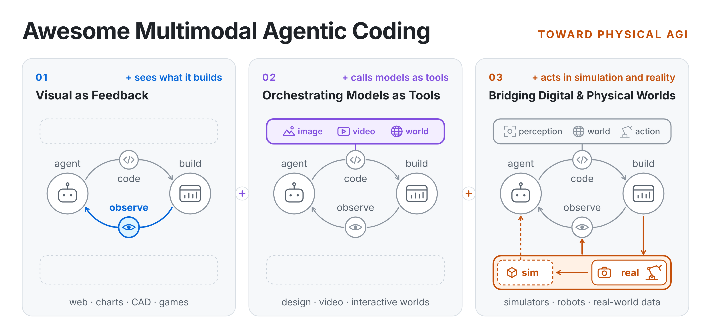

<!-- Generated by scripts/build_readme.py from data/*.yaml — edit the data, not this file. -->

<!-- mmac-layout: three-stages-v1 -->

<div align="center">

# Awesome Multimodal Agentic Coding

<picture>
  <source media="(prefers-color-scheme: dark)" srcset="assets/hero/hero-dark.png">
  
</picture>

一份多模态智能体编程的研究地图：Agent 编写代码，观察代码运行的结果，并据此不断改进——从数字世界延伸到物理世界。

[](https://awesome.re) [](#contents) [](https://github.com/jiangjin1999/awesome-multimodal-agentic-coding/commits/main) [](./LICENSE)

[English](./README.md) · **简体中文** · [日本語](./README.ja.md)

</div>

## 我们的愿景

我们从 coding 的视角，将多模态 Agent 从数字世界走向物理世界的演进分为三个阶段：

1. **视觉反馈**：用代码构建数字产物，并通过视觉反馈改进。
2. **模型作为工具**：用代码编排不同模型，组合感知、生成与行动能力。
3. **连接数字与物理世界**：用代码构建仿真、驱动行动，在仿真与现实中学习和改进。

<a id="multimodal-agentic-coding-trilogy"></a>
<a id="start-here"></a>
<a id="topic-map"></a>
<a id="motivation"></a>
<a id="definition-and-scope"></a>
<a id="contribution-tags"></a>
<a id="foundations"></a>
<a id="section-1-1"></a>
<a id="adjacent-foundations"></a>
<a id="application-domains"></a>
<a id="contents"></a>

## 目录

- [Stage 1 · 视觉作为反馈](#stage-1)
  - [1.1 网页、UI 与应用](#s1-1) (51)
  - [1.2 GUI 与软件训练环境](#s1-2) (10)
  - [1.3 图表、科学可视化与可编辑图形](#s1-3) (45)
  - [1.4 文档、幻灯片、海报与代码驱动的媒体](#s1-4) (34)
  - [1.5 3D 与 CAD](#s1-5) (90)
  - [1.6 游戏与可执行游戏世界](#s1-6) (43)
  - [1.7 跨任务：视觉评估器、经验与训练](#s1-7) (12)
- [Stage 2 · 把模型当作工具来编排](#stage-2)
  - [2.1 图像生成模型 × 图像与视觉设计](#s2-1) (3)
  - [2.2 视频生成模型 × 视频创作与编辑](#s2-2) (12)
  - [2.3 3D 生成模型 × 3D 资产与场景](#s2-3) (11)
  - [2.4 生成式世界模型 × 可交互环境](#s2-4) (13)
  - [2.5 感知模型 × 场景理解与重建](#s2-5) (6)
  - [2.6 动作模型 × 机器人操作](#s2-6) (12)
- [Stage 3 · 打通数字世界与物理世界](#stage-3)
  - [3.1 具身框架（Harness）](#s3-1) (84)
  - [3.2 仿真器构建](#s3-2) (65)
  - [3.3 仿真器质量评估](#s3-3) (23)
  - [3.4 数据](#s3-4) (14)
  - [3.5 训练与能力提升](#s3-5) (73)
  - [3.6 物理应用与实验](#s3-6) (36)
- [综述与相关合集](#related)
- [联系与贡献](#contact) · [引用](#citation)

<a id="trilogy-visual-feedback"></a>
<a id="section-1-2"></a>
<a id="paper-and-project-list"></a>
<a id="execution-and-rendering-engines"></a>
<a id="section-5-3"></a>
<a id="stage-1"></a>

## Stage 1 · 视觉作为反馈

Agent 编写代码，渲染或运行构建出的产物，**观察结果**，再根据看到的内容决定下一步修改。视觉是反馈，而不只是输入。本阶段按构建的对象（任务）组织。

**入门必读:** [Programming with Pixels](#paper-2502-18525) · [CAD-Assistant](#paper-2412-13810) · [Procedura](#paper-2608-26238) · [GUI Agents for Continual Game Generation](#paper-2605-28258) · [Text-to-CAD Evaluation with CADTests](#paper-2605-07807)

<a id="software-engineering"></a>
<a id="web-ui-app"></a>
<a id="methods-software"></a>
<a id="evaluation-software"></a>
<a id="data-software"></a>
<a id="s1-1"></a>

### 1.1 网页、UI 与应用

*常用执行环境:* [HTML](https://developer.mozilla.org/en-US/docs/Web/HTML) · [Three.js](https://threejs.org/docs/) · [CSS](https://developer.mozilla.org/en-US/docs/Web/CSS) · [SVG](https://developer.mozilla.org/en-US/docs/Web/SVG) · [Canvas](https://developer.mozilla.org/en-US/docs/Web/API/Canvas_API) · [WebGL](https://developer.mozilla.org/en-US/docs/Web/API/WebGL_API) · [WebGPU](https://developer.mozilla.org/en-US/docs/Web/API/WebGPU_API)

#### 方法

<!-- mmac-record: {"id": "2611.12112", "scope": "Core", "primary": "1.1", "stage": 1, "type": "paper"} -->

- <a id="paper-2611-12112"></a>`2026.11` **[LiveWorkspace: Externalizing Visual Understanding as Persistent Shared State for Screenshot-to-Code Agents](https://arxiv.org/abs/2611.12112)**
  > 把目标界面与实际执行界面维护为共享视觉状态，依据实测几何／样式差异及源码绑定持续修复代码并完成局部编辑。

<!-- mmac-record: {"id": "2610.04981", "scope": "Core", "primary": "1.1", "stage": 1, "type": "paper"} -->

- <a id="paper-2610-04981"></a>`2026.10` **[TeleGen: Improving LLM-Based Web Application Generation via Runtime Telemetry](https://arxiv.org/abs/2610.04981)** [[代码]](https://github.com/commoluo/TeleGen)
  > 以压缩运行遥测和任务反馈修复生成的 Web 应用，在 WebGen-Bench 配置中将 WebVoyager 的截图判定结果传入代码修订。

<!-- mmac-record: {"id": "2610.23104", "scope": "Core", "primary": "1.1", "stage": 1, "type": "paper"} -->

- <a id="paper-2610-23104"></a>`2026.10` **[WebCoder: Scaling General Frontend Development with Artifact-Grounded Agentic Reinforcement Learning](https://arxiv.org/abs/2610.23104)** [[项目页]](https://douzj-llm.github.io/WebCoder/) [[代码]](https://github.com/douzj-llm/WebCoder) [[数据集]](https://huggingface.co/datasets/Roy-DOU/Webdev-Bench)
  > 以产物进展为依据训练前端构建者，通过渲染反馈持续修订同一应用，并按需求满足度的变化分配长轨迹强化学习信用。

<!-- mmac-record: {"id": "2610.02617", "scope": "Adjacent", "primary": "1.1", "stage": 1, "type": "paper"} -->

- <a id="paper-2610-02617"></a>`2026.10` **[WebUIProof: Benchmarking WebUI Code Generators with UI-Agent Execution Harness](https://arxiv.org/abs/2610.02617)** [[代码]](https://github.com/yunyuntsai/webuiproof-benchmark)
  > 用结构化交互测试与视觉 UI Agent 评测生成的 Web／3D 界面，将结果级奖励用于训练生成器，而不是对当前产物进行视觉代码修复。

<!-- mmac-record: {"id": "2609.15078", "scope": "Adjacent", "primary": "1.1", "stage": 1, "type": "paper"} -->

- <a id="paper-2609-15078"></a>`2026.09` **[Enabling Creative Exploration for Vibe Design Agents](https://arxiv.org/abs/2609.15078)**
  > 在固定设置的 UI 代码生成前抽样结构化主题与资产方向，并分别衡量渲染多样性、模型裁判偏好及线上用户行为。

<!-- mmac-record: {"id": "2609.18805", "scope": "Adjacent", "primary": "1.1", "stage": 1, "type": "paper"} -->

- <a id="paper-2609-18805"></a>`2026.09` **[ProgramDistill: From Interactive Web Apps to Verifiable Reference-Guided SWE Tasks](https://arxiv.org/abs/2609.18805)**
  > 将可运行网页转化为可重放验证的重建任务，通过结构化文本式浏览器观测而非截图输入，研究“观察—编辑—验证”行为。

<!-- mmac-record: {"id": "2609.22000", "scope": "Core", "primary": "1.1", "stage": 1, "type": "paper"} -->

- <a id="paper-2609-22000"></a>`2026.09` **[RecreationWorld: Scalable and Verifiable Environments for Hybrid Computer-Use Agents](https://arxiv.org/abs/2609.22000)**
  > 在桌面、Android 与 Web 上交替探索参考应用、编写源码、运行与视觉检查，并用通过验证的重建轨迹训练混合交互 Agent。

<!-- mmac-record: {"id": "2609.02088", "scope": "Core", "primary": "1.1", "stage": 1, "type": "paper"} -->

- <a id="paper-2609-02088"></a>`2026.09` **[Rendering-in-the-Loop: An Execution-Driven Agent for Interactive Web Development](https://arxiv.org/abs/2609.02088)**
  > 在真实浏览器中重放参考交互，同时评估行为与渲染，再将多模态运行证据转化为多轮工具辅助代码修复。

<!-- mmac-record: {"id": "2609.16936", "scope": "Adjacent", "primary": "1.1", "stage": 1, "type": "paper"} -->

- <a id="paper-2609-16936"></a>`2026.09` **[RepoAtlas: Guiding Coding Agents via Evolving Multimodal Repository Views](https://arxiv.org/abs/2609.16936)**
  > 通过动态视觉代码图与定位到源代码的文本帮助 Agent 定位和修复仓库问题，其视觉上下文来自仓库结构，而非应用渲染结果。

<!-- mmac-record: {"id": "2608.24138", "scope": "Core", "primary": "1.1", "stage": 1, "type": "paper"} -->

- <a id="paper-2608-24138"></a>`2026.08` **[Rubrics as Visual-Repair Context for Self-Evolving UI-to-Code Generation](https://arxiv.org/abs/2608.24138)**
  > 使用持久化视觉修复 Rubric 选择限定范围的修改，减少多轮 UI 细化中的回归。

<!-- mmac-record: {"id": "2608.30530", "scope": "Core", "primary": "1.1", "stage": 1, "type": "paper"} -->

- <a id="paper-2608-30530"></a>`2026.08` **[WebWorld: The Browser as a World Model for Self-Improving Web Code](https://arxiv.org/abs/2608.30530)**
  > 将截图证据支持的点评转化为限定范围的 HTML 修复和可重放浏览器契约，仅保留推进目标且不破坏已验证行为的状态转移。

<!-- mmac-record: {"id": "2607.14075", "scope": "Core", "primary": "1.1", "stage": 1, "type": "paper"} -->

- <a id="paper-2607-14075"></a>`2026.07` **[VisualRepair: Dynamic Tool Calling and Region Focusing for Visual Software Issue Repair](https://arxiv.org/abs/2607.14075)**
  > 在迭代修复截图驱动的软件问题时，动态选择视觉工具并聚焦可疑区域。

<!-- mmac-record: {"id": "2604.19742", "scope": "Core", "primary": "1.1", "stage": 1, "type": "paper"} -->

- <a id="paper-2604-19742"></a>`2026.04` **[PlayCoder: Making LLM-Generated GUI Code Playable](https://arxiv.org/abs/2604.19742)** [[代码]](https://github.com/Tencent/PlayCoder)
  > 自动运行并操作生成的 GUI，再把交互失败转化为后续代码修复。

<!-- mmac-record: {"id": "2604.05839", "scope": "Core", "primary": "1.1", "stage": 1, "type": "paper"} -->

- <a id="paper-2604-05839"></a>`2026.04` **[Vision-Guided Iterative Refinement for Frontend Code Generation](https://arxiv.org/abs/2604.05839)**
  > 将前端渲染差异反馈到反复代码修改中，而不是在初次生成后停止。

<!-- mmac-record: {"id": "2604.19750", "scope": "Core", "primary": "1.1", "stage": 1, "type": "paper"} -->

- <a id="paper-2604-19750"></a>`2026.03` **[Coding with Eyes: Visual Feedback Unlocks Reliable GUI Code Generating and Debugging](https://arxiv.org/abs/2604.19750)**
  > 在执行驱动的调试闭环中协调视觉理解、GUI 交互、代码生成与重构。

<!-- mmac-record: {"id": "2603.17826", "scope": "Core", "primary": "1.1", "stage": 1, "type": "paper"} -->

- <a id="paper-2603-17826"></a>`2026.03` **[FailureMem: A Failure-Aware Multimodal Framework for Autonomous Software Repair](https://arxiv.org/abs/2603.17826)** [[代码]](https://github.com/Ruize-Ma/FailureMem)
  > 检索既往多模态失败轨迹，指导诊断及后续仓库级修复动作。

<!-- mmac-record: {"id": "2602.06090", "scope": "Core", "primary": "1.1", "stage": 1, "type": "paper"} -->

- <a id="paper-2602-06090"></a>`2026.02` **[SVRepair: Structured Visual Reasoning for Automated Program Repair](https://arxiv.org/abs/2602.06090)**
  > 将截图结构化为局部视觉证据，在场景理解、代码定位与补丁生成之间迭代。

<!-- mmac-record: {"id": "2602.05998", "scope": "Core", "primary": "1.1", "stage": 1, "type": "paper"} -->

- <a id="paper-2602-05998"></a>`2026.02` **[VisRefiner: Learning from Visual Differences for Screenshot-to-Code Generation](https://arxiv.org/abs/2602.05998)**
  > 从目标与渲染结果的视觉差异中学习，并将证据用于迭代代码细化。

<!-- mmac-record: {"id": "2601.04203", "scope": "Core", "primary": "1.1", "stage": 1, "type": "paper"} -->

- <a id="paper-2601-04203"></a>`2025.12` **[FronTalk: Benchmarking Front-End Development as Conversational Code Generation with Multi-Modal Feedback](https://arxiv.org/abs/2601.04203)** [[项目页]](https://frontalk-benchmark.github.io/) [[代码]](https://github.com/shirley-wu/frontalk)
  > 引入多轮视觉前端对话与 AceCoder；后者与渲染网站交互、批评失败并重新生成改进代码。

<!-- mmac-record: {"id": "2511.08195", "scope": "Core", "primary": "1.1", "stage": 1, "type": "paper"} -->

- <a id="paper-2511-08195"></a>`2025.11` **[UI2Code^N: UI-to-Code Generation as Interactive Visual Optimization](https://arxiv.org/abs/2511.08195)** [[代码]](https://github.com/zai-org/UI2Code_N)
  > 将 UI-to-code 重构为执行、视觉检查和反复细化，并以相对视觉反馈进行优化。

<!-- mmac-record: {"id": "2511.06251", "scope": "Core", "primary": "1.1", "stage": 1, "type": "paper"} -->

- <a id="paper-2511-06251"></a>`2025.11` **[WebVIA: A Web-based Vision-Language Agentic Framework for Interactive and Verifiable UI-to-Code Generation](https://arxiv.org/abs/2511.06251)** [[Demo]](https://zheny2751-dotcom.github.io/webvia.github.io/) [[代码]](https://github.com/zheny2751-dotcom/WebVIA)
  > 通过反复的感知—行动—验证探索源界面，合成可执行交互代码并验证恢复出的行为。

<!-- mmac-record: {"id": "2510.11498", "scope": "Core", "primary": "1.1", "stage": 1, "type": "paper"} -->

- <a id="paper-2510-11498"></a>`2025.10` **[ReLook: Vision-Grounded RL with a Multimodal LLM Critic for Agentic Web Coding](https://arxiv.org/abs/2510.11498)**
  > 在训练 Rollout 与带 Critic 设置中，将基于截图的 MLLM 诊断反馈给后续代码修改；快速推理变体会移除外部 Critic。

<!-- mmac-record: {"id": "2509.22644", "scope": "Core", "primary": "1.1", "stage": 1, "type": "paper"} -->

- <a id="paper-2509-22644"></a>`2025.09` **[WebGen-Agent: Enhancing Interactive Website Generation with Multi-Level Feedback and Step-Level Reinforcement Learning](https://arxiv.org/abs/2509.22644)** [[代码]](https://github.com/mnluzimu/WebGen-Agent)
  > 使用截图、GUI Agent 测试、回溯和步骤级奖励，迭代改进网站代码库。

<!-- mmac-record: {"id": "2507.20766", "scope": "Core", "primary": "1.1", "stage": 1, "type": "paper"} -->

- <a id="paper-2507-20766"></a>`2025.07` **[Learning Only with Images: Visual Reinforcement Learning with Reasoning, Rendering, and Visual Feedback](https://arxiv.org/abs/2507.20766)** [[代码]](https://github.com/L-O-I/RRVF)
  > 运行生成的图表与网页代码，将目标和渲染结果的差异转为视觉反馈，并指导下一轮代码生成。

<!-- mmac-record: {"id": "2506.13663", "scope": "Core", "primary": "1.1", "stage": 1, "type": "paper"} -->

- <a id="paper-2506-13663"></a>`2025.06` **[DesignCoder: Hierarchy-Aware and Self-Correcting UI Code Generation with Large Language Models](https://arxiv.org/abs/2506.13663)**
  > 捕获渲染后的移动端 UI，比较组件级视觉证据，并迭代应用局部代码修复。

<!-- mmac-record: {"id": "2506.16136", "scope": "Core", "primary": "1.1", "stage": 1, "type": "paper"} -->

- <a id="paper-2506-16136"></a>`2025.06` **[Seeing is Fixing: Cross-Modal Reasoning with Multimodal LLMs for Visual Software Issue Fixing](https://arxiv.org/abs/2506.16136)**
  > 结合图像到代码理解与代码到图像验证，闭合视觉软件问题修复循环。

<!-- mmac-record: {"id": "2411.01606", "scope": "Core", "primary": "1.1", "stage": 1, "type": "paper"} -->

- <a id="paper-2411-01606"></a>`2024.11` **[DesignRepair: Dual-Stream Design Guideline-Aware Frontend Repair with Large Language Models](https://arxiv.org/abs/2411.01606)** [[代码]](https://github.com/UGAIForge/DesignRepair)
  > 联合推理前端源码和渲染视图，并使用设计规范指导迭代式视觉修复。

#### 评测与数据

<!-- mmac-record: {"id": "2610.35138", "scope": "Adjacent", "primary": "1.1", "stage": 1, "type": "paper"} -->

- <a id="paper-2610-35138"></a>`2026.10` **[Co-Design Bench: Multimodal Collaborative Coding Evaluation for Agentic Models](https://arxiv.org/abs/2610.35138)** [[项目页]](https://codesignbench.github.io/) [[代码]](https://github.com/Wiselnn570/Co-Design-Bench) [[数据集]](https://huggingface.co/datasets/Wiselnn/Co-Design-Bench)
  > 用源代码、渲染界面和交互证据检查已有应用的修改是否满足隐藏需求，并通过独立反驳阶段复核正向判定。

<!-- mmac-record: {"id": "2610.29014", "scope": "Adjacent", "primary": "1.1", "stage": 1, "type": "paper"} -->

- <a id="paper-2610-29014"></a>`2026.10` **[GenXR-Bench: Benchmarking Coding Agents for Interactive XR Development](https://arxiv.org/abs/2610.29014)** [[代码]](https://github.com/whuang37/genxr-bench) [[数据集]](https://github.com/whuang37/genxr-bench/tree/master/tasks)
  > 使用模拟手部与环境输入、隐藏程序及视觉测试评估 XR 功能实现、缺陷修复和应用生成，并对照 XR 真机上的专家评审验证测试器。

<!-- mmac-record: {"id": "2610.10374", "scope": "Adjacent", "primary": "1.1", "stage": 1, "type": "paper"} -->

- <a id="paper-2610-10374"></a>`2026.10` **[TaoD2C-Bench: Benchmarking MLLMs for Industrial UI Code Generation Beyond Visual Fidelity](https://arxiv.org/abs/2610.10374)** [[项目页]](https://taod2c-bench.github.io/)
  > 将工业 UI 需求推断与代码实现分开评测，结合源码和运行时证据检查组件与布局约束，并独立比较最终渲染忠实度。

<!-- mmac-record: {"id": "2610.33149", "scope": "Adjacent", "primary": "1.1", "stage": 1, "type": "paper"} -->

- <a id="paper-2610-33149"></a>`2026.10` **[WebUniverse: Scaling Verified Training Data for Agentic Web Development](https://arxiv.org/abs/2610.33149)** [[数据集]](https://huggingface.co/datasets/WebUniverse-NSL/WebUniverse-Env) [[数据集]](https://huggingface.co/datasets/WebUniverse-NSL/WebUniverse-Mix) [[项目页]](https://webuniverse-nsl.github.io/)
  > 构建配套网页开发环境与经验证的轨迹，结合功能和视觉检查、独立尝试及失败续写，为 Agent 监督训练提供数据。

<!-- mmac-record: {"id": "2609.32600", "scope": "Core", "primary": "1.1", "stage": 1, "type": "paper"} -->

- <a id="paper-2609-32600"></a>`2026.09` **[CUA-SWE: When Computer-Use Agents Meet Visual Software Engineering](https://arxiv.org/abs/2609.32600)**
  > 在 Web、游戏、移动应用和 DevOps 修复中统一源码编辑与截图驱动的计算机操作，用运行时视觉证据指导后续修改，并通过独立测试检查行为与回归。

<!-- mmac-record: {"id": "2609.15387", "scope": "Adjacent", "primary": "1.1", "stage": 1, "type": "paper"} -->

- <a id="paper-2609-15387"></a>`2026.09` **[IWC-Bench: Evaluating Web Application Generation from a Software Testing Perspective](https://arxiv.org/abs/2609.15387)**
  > 以运行时代码覆盖率引导对生成网页的探索，再依据截图与交互证据评估美观度、可用性和需求对齐；评分不回传到代码修订。

<!-- mmac-record: {"id": "2608.03474", "scope": "Core", "primary": "1.1", "stage": 1, "type": "paper"} -->

- <a id="paper-2608-03474"></a>`2026.08` **[MT-Web2Code: Benchmarking Coding Agents on Multi-Turn Regional Reconstruction and Localized Modification](https://arxiv.org/abs/2608.03474)**
  > 评测多轮 Agent 的局部网页重建与修改，而不是一次性截图模仿。

<!-- mmac-record: {"id": "2604.27419", "scope": "Core", "primary": "1.1", "stage": 1, "type": "paper"} -->

- <a id="paper-2604-27419"></a>`2026.04` **[InteractWeb-Bench: Can Multimodal Agent Escape Blind Execution in Interactive Website Generation?](https://arxiv.org/abs/2604.27419)**
  > 评测“澄清—实现—验证—提交”闭环：浏览器检查返回失败截图与有依据的诊断，指导 Agent 下一轮代码修改。

<!-- mmac-record: {"id": "2604.18224", "scope": "Adjacent", "primary": "1.1", "stage": 1, "type": "paper"} -->

- <a id="paper-2604-18224"></a>`2026.04` **[WebCompass: Towards Multimodal Web Coding Evaluation for Code Language Models](https://arxiv.org/abs/2604.18224)** [[代码]](https://github.com/NJU-LINK/WebCompass)
  > 覆盖网页生成、编辑与修复的视觉和交互评测，但不要求同一个 Agent 完成“渲染—观察—再编码”轨迹。

<!-- mmac-record: {"id": "2602.18548", "scope": "Core", "primary": "1.1", "stage": 1, "type": "paper"} -->

- <a id="paper-2602-18548"></a>`2026.02` **[1D-Bench: A Benchmark for Iterative UI Code Generation with Visual Feedback in Real-World](https://arxiv.org/abs/2602.18548)**
  > 衡量真实环境中多轮视觉反馈和局部代码更新下的 UI Coding 表现。

<!-- mmac-record: {"id": "2507.04952", "scope": "Adjacent", "primary": "1.1", "stage": 1, "type": "paper"} -->

- <a id="paper-2507-04952"></a>`2025.07` **[ArtifactsBench: Bridging the Visual-Interactive Gap in LLM Code Generation Evaluation](https://arxiv.org/abs/2507.04952)** [[项目页]](https://artifactsbenchmark.github.io/)
  > 通过渲染视觉与运行时行为评估已完成的交互产物，但不会把所得反馈返回给后续编码动作。

<!-- mmac-record: {"id": "2502.18525", "scope": "Core", "primary": "1.1", "stage": 1, "type": "paper"} -->

- <a id="paper-2502-18525"></a>`2025.02` **[Programming with Pixels: Can Computer-Use Agents do Software Engineering?](https://arxiv.org/abs/2502.18525)** [[Demo]](https://programmingwithpixels.com/) [[代码]](https://github.com/ProgrammingwithPixels/PwP)
  > 评测必须观察并操作视觉 IDE、而不能只依赖文本工具接口的 Coding Agent。

#### 工具与资源

<!-- mmac-record: {"id": "reading:tim-hinds-applitools-bridging-the-probabilistic-validation-gap-deterministic-visual-ai-guardrails-for-the-agentic-sdlc", "scope": "Reading", "primary": "1.1", "stage": 1, "type": "reading"} -->

- <a id="paper-reading-tim-hinds-applitools-bridging-the-probabilistic-validation-gap-deterministic-visual-ai-guardrails-for-the-agentic-sdlc"></a>`2026.09` **[Tim Hinds / Applitools — Bridging the “Probabilistic Validation Gap”: Deterministic Visual AI Guardrails for the Agentic SDLC](https://applitools.com/blog/probabilistic-validation-gap-agentic-sdlc/)**
  > *与本主题的关联：* “Probabilistic Validation Gap” 强调把视觉差异坐标与 DOM 上下文返回给 Coding Agent，同时保留基线变更的人工审核；文中的产品主张属于产业观点，而非独立 Benchmark 结论。

<!-- mmac-record: {"id": "res:agent-qa", "scope": "Resource", "primary": "1.1", "stage": 1, "type": "resource"} -->

- <a id="paper-res-agent-qa"></a>**[agent-qa](https://vostride.com)** [[文档]](https://vostride.com/docs/agent-qa/mcp)
  > 向编码 Agent 提供自然语言网页、Android 和 iOS 测试、截图、控制台/网络证据及判定纠正；持久 memidex 记忆与基于证据的自我改进在多次运行间保留已验证经验。

<a id="tool-agent-visual-diff"></a>
<!-- mmac-record: {"id": "res:agent-visual-diff", "scope": "Resource", "primary": "1.1", "stage": 1, "type": "resource"} -->

- <a id="paper-res-agent-visual-diff"></a>**[agent-visual-diff](https://github.com/lbframe/agent-visual-diff)** [[文档]](https://github.com/lbframe/agent-visual-diff/blob/main/docs/agent-contract.md)
  > 比较两张 PNG，以 JSON 返回按变化像素数排序的区域边界框。可选的位移检测会标出一起移动的内容，供 Agent 检查布局并在修改后再次比对。

<!-- mmac-record: {"id": "res:agentvision", "scope": "Resource", "primary": "1.1", "stage": 1, "type": "resource"} -->

- <a id="paper-res-agentvision"></a>**[AgentVision](https://github.com/amitpatole/agent-vision)**
  > 运行“渲染—感知—报告—修复—再渲染”循环，提供 DOM、对比度、OCR、坐标级问题和 pass/warn/fail 判定。

<!-- mmac-record: {"id": "res:applitools-eyes-mcp", "scope": "Resource", "primary": "1.1", "stage": 1, "type": "resource"} -->

- <a id="paper-res-applitools-eyes-mcp"></a>**[Applitools Eyes MCP](https://support.applitools.com/solutions/agentic-testing/)**
  > 向 Coding Agent 返回视觉差异区域、裁剪图和精简 DOM 上下文；保存基线变更需要明确的人工授权。

<!-- mmac-record: {"id": "demo:autoclaw-design", "scope": "Demo", "primary": "1.1", "stage": 1, "type": "demo"} -->

- <a id="paper-demo-autoclaw-design"></a>**[AutoClaw Design](https://autoclaw.z.ai/blog/product/product-brief-to-ui-design-with-autoclaw/)**
  > 结合参考素材生成、对话／画布编辑、设备预览和 HTML／项目导出，由用户检查交互并提出修正。

<!-- mmac-record: {"id": "res:figma-mcp-server", "scope": "Resource", "primary": "1.1", "stage": 1, "type": "resource"} -->

- <a id="paper-res-figma-mcp-server"></a>**[Figma MCP server](https://developers.figma.com/docs/figma-mcp-server/)** [[文章]](https://www.figma.com/blog/the-figma-canvas-is-now-open-to-agents/)
  > 允许 Agent 检查设计上下文、生成实现代码，并创建或更新原生 Figma 内容。

<a id="tool-orkas-uidesigner"></a>
<!-- mmac-record: {"id": "res:orkas-uidesigner", "scope": "Resource", "primary": "1.1", "stage": 1, "type": "resource"} -->

- <a id="paper-res-orkas-uidesigner"></a>**[Orkas UIDesigner](https://github.com/Orkas-AI/Orkas)** [[文档]](https://github.com/Orkas-AI/Orkas/blob/c7c0e21fad7ff55f5a72a575b7a464f3cf9bc3a1/resources/builtin/marketplace/agents/bcfcb4921dce/agent.json) [[文档]](https://github.com/Orkas-AI/Orkas/blob/c7c0e21fad7ff55f5a72a575b7a464f3cf9bc3a1/resources/builtin/marketplace/agents/bcfcb4921dce/skills/ui-design-source/SKILL.md#L156-L165)
  > 根据需求、截图、Figma 参考或现有 UI 源码制作可编辑的设计稿与规范，默认以 HTML 交付。最终编辑后检查 HTML 结构和本地文件引用。任务需要且具备渲染条件时，再将渲染结果与参考对照。若要确认像素级一致，须在相同的视口、界面状态、主题和语言区域设置下重新渲染参考界面与设计稿。

<!-- mmac-record: {"id": "res:playwright-mcp", "scope": "Resource", "primary": "1.1", "stage": 1, "type": "resource"} -->

- <a id="paper-res-playwright-mcp"></a>**[Playwright MCP](https://github.com/microsoft/playwright-mcp)** [[代码]](https://github.com/ChromeDevTools/chrome-devtools-mcp)
  > 暴露可访问性结构、截图、交互、控制台与网络证据，以及性能 Trace。

<!-- mmac-record: {"id": "res:reprosight", "scope": "Resource", "primary": "1.1", "stage": 1, "type": "resource"} -->

- <a id="paper-res-reprosight"></a>**[ReproSight](https://github.com/tungcorn/ReproSight)**
  > 向外部 Coding Agent 提供浏览器几何、截图、CSS 源码候选、隔离工作区及目标／回归检查，再交由人工审阅；其主要 Demo 使用确定性的模拟提供器，并非真实模型准确率基准。

<!-- mmac-record: {"id": "res:shotback", "scope": "Resource", "primary": "1.1", "stage": 1, "type": "resource"} -->

- <a id="paper-res-shotback"></a>**[Shotback](https://github.com/DCCA/shotback)**
  > 将标注截图与 CSS 选择器、React 组件路径、视口上下文及可读取的失败请求一起交付，并支持前后重截图比较，辅助人工反馈驱动的修复。

<!-- mmac-record: {"id": "demo:wild-atlas", "scope": "Demo", "primary": "1.1", "stage": 1, "type": "demo"} -->

- <a id="paper-demo-wild-atlas"></a>**[Wild Atlas](https://x.com/_IamAlam/status/2107480596926939638)**
  > 将百科应用分为界面、统一风格动物资产及卡片／旋转／信息面板交互三个阶段；旋转展示不代表已公开完整 3D 场景。

<a id="methods-gui-environments"></a>
<a id="evaluation-gui-environments"></a>
<a id="data-gui-environments"></a>
<a id="s1-2"></a>

### 1.2 GUI 与软件训练环境

#### 方法

<!-- mmac-record: {"id": "2611.03634", "scope": "Adjacent", "primary": "1.2", "stage": 1, "type": "paper"} -->

- <a id="paper-2611-03634"></a>`2026.11` **[WebHarbor: Docking Real Websites for Evolving GUI Agent Environments](https://arxiv.org/abs/2611.03634)** [[代码]](https://github.com/aiming-lab/WebHarbor) [[数据集]](https://huggingface.co/datasets/ChilleD/WebHarbor-Tasks)
  > 通过任务限定的全栈编码与人工视觉／流程审阅，构造可重置网站环境，支持可复现 GUI 评测与操作者训练。

<!-- mmac-record: {"id": "2610.26828", "scope": "Adjacent", "primary": "1.2", "stage": 1, "type": "paper"} -->

- <a id="paper-2610-26828"></a>`2026.10` **[Agent World Model in the Wild: Computer-Use Agent Environment Synthesis](https://arxiv.org/abs/2610.26828)** [[代码]](https://github.com/MSR-Orchard/WildAWM) [[数据集]](https://huggingface.co/datasets/ChilleD/WildAWM)
  > 合成覆盖 GUI、MCP 和 CLI 的可重放个人电脑世界，以异构执行轨迹和验证器一致性检查生成计算机使用训练的环境—任务包。

<!-- mmac-record: {"id": "2610.37567", "scope": "Core", "primary": "1.2", "stage": 1, "type": "paper"} -->

- <a id="paper-2610-37567"></a>`2026.10` **[Gym-Anything-RT: Scaling Real-Time Environments for Vision-Language Agents](https://arxiv.org/abs/2610.37567)** [[代码]](https://github.com/gym-anything/gym-anything-rt)
  > 通过依据截图和录像的 Creator—Auditor 代码修订构建实时视觉小游戏，再控制环境时钟以区分动作延迟与任务能力。

<!-- mmac-record: {"id": "2610.12611", "scope": "Core", "primary": "1.2", "stage": 1, "type": "paper"} -->

- <a id="paper-2610-12611"></a>`2026.10` **[SoftwareGym: Scaling Computer-Use Agent Training with Diverse Synthesized Software Environments](https://arxiv.org/abs/2610.12611)** [[代码]](https://github.com/MrKiing-Jin/SoftwareGym)
  > 合成原生 Avalonia 应用，以截图驱动的 GUI 测试轨迹在固定用例下逐轮修复源码，再收集计算机操作训练数据。

<!-- mmac-record: {"id": "2610.30792", "scope": "Core", "primary": "1.2", "stage": 1, "type": "paper"} -->

- <a id="paper-2610-30792"></a>`2026.10` **[Trace2World: Reconstructing App Worlds from Real Interaction Traces for Scalable GUI Agent Training](https://arxiv.org/abs/2610.30792)**
  > 先从真实交互轨迹确定应用行为，再以独立截图重放定位缺陷、约束环境代码修复，随后生成 GUI Agent 训练任务。

<!-- mmac-record: {"id": "2610.37786", "scope": "Core", "primary": "1.2", "stage": 1, "type": "paper"} -->

- <a id="paper-2610-37786"></a>`2026.10` **[WebAnything: From the Wild Web to Scalable Agent Environments](https://arxiv.org/abs/2610.37786)** [[代码]](https://github.com/china-qijizhifeng/Web-Anything)
  > 依据源站观测重建可重置Web Agent环境，以独立视觉与交互检查驱动代码修复或定向补采，再构造操作者训练任务。

<!-- mmac-record: {"id": "2608.15930", "scope": "Adjacent", "primary": "1.2", "stage": 1, "type": "paper"} -->

- <a id="paper-2608-15930"></a>`2026.08` **[UI-Mate: Advancing Open-Weight Foundation GUI Agents with In-Context Demonstrations](https://arxiv.org/abs/2608.15930)** [[代码]](https://github.com/Tencent/UI-Mate) [[数据集]](https://huggingface.co/datasets/tencent/OSWorkerBench)
  > 将可执行桌面任务构造、能力覆盖均衡的操作者训练和示范引导工作流相结合，依据实时截图调整操作。

<!-- mmac-record: {"id": "2606.19930", "scope": "Adjacent", "primary": "1.2", "stage": 1, "type": "paper"} -->

- <a id="paper-2606-19930"></a>`2026.06` **[MobileForge: Annotation-Free Adaptation for Mobile GUI Agents with Hierarchical Feedback-Guided Policy Optimization](https://arxiv.org/abs/2606.19930)** [[代码]](https://github.com/kwai/MobileForge) [[合集]](https://huggingface.co/collections/lgy0404/mobileforge-datasets) [[项目页]](https://mobile-forge.github.io/)
  > 从真实 App 探索中挖掘任务，跨尝试复用视觉 Critic 的纠错提示，并把优选决策转为带反馈条件的步骤级策略更新。

<!-- mmac-record: {"id": "2605.25624", "scope": "Core", "primary": "1.2", "stage": 1, "type": "paper"} -->

- <a id="paper-2605-25624"></a>`2026.05` **[CUA-Gym: Scaling Verifiable Training Environments and Tasks for Computer-Use Agents](https://arxiv.org/abs/2605.25624)** [[代码]](https://github.com/xlang-ai/CUA-Gym) [[代码]](https://github.com/xlang-ai/CUA-Gym-Hub) [[数据集]](https://huggingface.co/datasets/xlangai/CUA-Gym)
  > 联合生成可重置的软件状态、任务与可执行奖励，将 rollout 截图判断与程序评分之间的分歧反馈给奖励编写 Agent，修改后重新执行验证。

#### 工具与资源

<!-- mmac-record: {"id": "2610.41432", "scope": "Adjacent", "primary": "1.2", "stage": 1, "type": "paper"} -->

- <a id="paper-2610-41432"></a>`2026.10` **[Hybrid Computer Use: A Unified Programmatic, Semantic, and Visual Interface for General Agents](https://arxiv.org/abs/2610.41432)**
  > 让 Agent 组合程序工具、可访问性动作与视觉交互，通过实时状态检查、批次内验证及返回的 AX 变化指导后续操作。

<a id="visualization"></a>
<a id="svg-diagrams"></a>
<a id="methods-graphics"></a>
<a id="evaluation-graphics"></a>
<a id="data-graphics"></a>
<a id="s1-3"></a>

### 1.3 图表、科学可视化与可编辑图形

*常用执行环境:* [D3](https://d3js.org/) · [Mermaid](https://mermaid.js.org/) · [HTML](https://developer.mozilla.org/en-US/docs/Web/HTML) · [CSS](https://developer.mozilla.org/en-US/docs/Web/CSS) · [SVG](https://developer.mozilla.org/en-US/docs/Web/SVG) · [Canvas](https://developer.mozilla.org/en-US/docs/Web/API/Canvas_API) · [WebGL](https://developer.mozilla.org/en-US/docs/Web/API/WebGL_API) · [WebGPU](https://developer.mozilla.org/en-US/docs/Web/API/WebGPU_API) · [Vega-Lite](https://vega.github.io/vega-lite/) · [Plotly.js](https://plotly.com/javascript/) · [Graphviz](https://graphviz.org/documentation/) · [PlantUML](https://plantuml.com/) · [Typst](https://typst.app/docs/) · [TikZ](https://tikz.dev/)

#### 方法

<!-- mmac-record: {"id": "2611.10840", "scope": "Core", "primary": "1.3", "stage": 1, "type": "paper"} -->

- <a id="paper-2611-10840"></a>`2026.11` **[Simple Test-Time Refinement for Plot-to-Code Generation via Visual-Code Diagnostics](https://arxiv.org/abs/2611.10840)** [[代码]](https://github.com/guopeiming/plot_to_code_refine)
  > 训练小型验证器，将参考图与渲染图的差异定位到绘图代码，再通过反复渲染驱动局部补丁修复。

<!-- mmac-record: {"id": "2610.08106", "scope": "Core", "primary": "1.3", "stage": 1, "type": "paper"} -->

- <a id="paper-2610-08106"></a>`2026.10` **[ChartBmkAgent: Harness-Governed Multi-Agent Construction of Chart QA Benchmarks from Sparse Error-Taxonomy Specifications](https://arxiv.org/abs/2610.08106)**
  > 从稀疏错误描述构建诊断性图表问答，以证据门控的多模态批评修订绘图程序，同时保持冻结数据及预定错误机制。

<!-- mmac-record: {"id": "2610.28282", "scope": "Adjacent", "primary": "1.3", "stage": 1, "type": "paper"} -->

- <a id="paper-2610-28282"></a>`2026.10` **[ChartEvo: Self-Evolving Agent Harnesses for Long-Tail Chart Reasoning](https://arxiv.org/abs/2610.28282)**
  > 利用有监督任务反馈演化图表专用 Skills、可执行视觉／数值工具及可复用工具链，支持长尾图表推理。

<!-- mmac-record: {"id": "2610.06852", "scope": "Core", "primary": "1.3", "stage": 1, "type": "paper"} -->

- <a id="paper-2610-06852"></a>`2026.10` **[One Figure, Every Canvas: Editable Flowchart Relayout via Agentic Pipeline](https://arxiv.org/abs/2610.06852)**
  > 把栅格流程图重排为适应新画布比例的可编辑 draw.io XML，结合图结构、布局约束和渲染视觉点评，纠正解析、风格与摆放。

<!-- mmac-record: {"id": "2610.41260", "scope": "Core", "primary": "1.3", "stage": 1, "type": "paper"} -->

- <a id="paper-2610-41260"></a>`2026.10` **[SketchDirector: Complex Scene Sketching via Agentic Layout Reasoning and Detail Refinement](https://arxiv.org/abs/2610.41260)** [[代码]](https://github.com/GVCLab/SketchDirector) [[数据集]](https://huggingface.co/datasets/yiki77/MCSketch8K) [[项目页]](https://yiki77.github.io/SketchDirector/)
  > 通过对象级 SVG 程序构建可编辑场景草图，以几何与视觉语义反馈及可复用记忆修订布局，再用扩散先验细化曲线。

<!-- mmac-record: {"id": "2610.13502", "scope": "Adjacent", "primary": "1.3", "stage": 1, "type": "paper"} -->

- <a id="paper-2610-13502"></a>`2026.10` **[Stride: Scale-Aware Multi-Agent Evolutionary Refinement for Infographic Generation](https://arxiv.org/abs/2610.13502)** [[代码]](https://github.com/SJTUSAI/Stride)
  > 结合独立的约束评分与视觉定位，将信息图错误分派给冻结生成器重画或局部文字／公式修补，并保留内部评分提升的候选。

<!-- mmac-record: {"id": "2609.16598", "scope": "Adjacent", "primary": "1.3", "stage": 1, "type": "paper"} -->

- <a id="paper-2609-16598"></a>`2026.09` **[CATVis: A Collaborative Multi-Agent Workflow for Turbomachinery Simulation Data Visualization](https://arxiv.org/abs/2609.16598)**
  > 通过分阶段规划和错误感知修订，将涡轮机械分析需求转为可执行可视化 DAG，并由交互式人工审阅进一步调整相机与工作流。

<!-- mmac-record: {"id": "2610.00374", "scope": "Adjacent", "primary": "1.3", "stage": 1, "type": "paper"} -->

- <a id="paper-2610-00374"></a>`2026.09` **[Faithful Chart Generation for Multimodal Deep Research: Frame-Evidence Co-Adaptation](https://arxiv.org/abs/2610.00374)**
  > 在生成 ECharts 前让图表框架适配可检索定量证据，在渲染重试中固定已接受数值，并审计数字来源。

<!-- mmac-record: {"id": "2609.32413", "scope": "Core", "primary": "1.3", "stage": 1, "type": "paper"} -->

- <a id="paper-2609-32413"></a>`2026.09` **[IChart2Code: Benchmarking Multimodal Large Language Models for Interactive Chart Code Generation](https://arxiv.org/abs/2609.32413)**
  > 同时评测图表外观、数据忠实度与交互状态变化，TRAIL 根据浏览器观测轨迹诊断失败并修订 HTML/JavaScript。

<!-- mmac-record: {"id": "2609.14874", "scope": "Core", "primary": "1.3", "stage": 1, "type": "paper"} -->

- <a id="paper-2609-14874"></a>`2026.09` **[MedVA: An End-to-End Neuro-Symbolic Agentic System for Medical Volume Visualization](https://arxiv.org/abs/2609.14874)**
  > 构建结构化 JSON 可视化规格，根据渲染器测得的完整场景与独立区域可见性迭代调整 ROI 不透明度，并结合解剖本体检查与多模型分割。

<!-- mmac-record: {"id": "2609.33386", "scope": "Adjacent", "primary": "1.3", "stage": 1, "type": "paper"} -->

- <a id="paper-2609-33386"></a>`2026.09` **[SIVIA-RSI: Source-Grounded Adaptation of Diagramming Skills](https://arxiv.org/abs/2609.33386)**
  > 根据关联源段落的视觉批评调整可复用栅格绘图指令，并用全新图像评测每个候选，区分选择偏好与跨论文关系忠实度。

<!-- mmac-record: {"id": "2609.15182", "scope": "Core", "primary": "1.3", "stage": 1, "type": "paper"} -->

- <a id="paper-2609-15182"></a>`2026.09` **[VisInteract: Towards Dynamic Interactive Text-to-Visualization under Imperfect Queries](https://arxiv.org/abs/2609.15182)**
  > 执行 Altair 程序，让模拟用户评阅渲染图表，并将视觉点评与文字澄清反馈用于后续代码搜索，逐步还原不完整需求中的可视化意图。

<!-- mmac-record: {"id": "2608.00548", "scope": "Core", "primary": "1.3", "stage": 1, "type": "paper"} -->

- <a id="paper-2608-00548"></a>`2026.08` **[DrawAI: Agentic Benchmark and Workflow for Making Raster Images Editable](https://arxiv.org/abs/2608.00548)** [[代码]](https://github.com/Renaissance-Mind/DrawAI) [[项目页]](https://drawai.renaissancemind.ai/)
  > 通过 Agentic 生成、渲染与修正流程，将 Raster 参考图转成可编辑结构化图形。

<!-- mmac-record: {"id": "2609.16014", "scope": "Core", "primary": "1.3", "stage": 1, "type": "paper"} -->

- <a id="paper-2609-16014"></a>`2026.08` **[ViCo: Visual-oriented Coding with Self-Reflection for Chart Replication](https://arxiv.org/abs/2609.16014)** [[代码]](https://github.com/Xigmoid/ViCo)
  > 训练图表编程 Agent 对比上一轮渲染与参考图，将差异写成明确反思，并通过反事实信用分配指导代码修订、落实反思。

<!-- mmac-record: {"id": "2608.10408", "scope": "Core", "primary": "1.3", "stage": 1, "type": "paper"} -->

- <a id="paper-2608-10408"></a>`2026.08` **[VisEditBench: Can Vision-Language Models Edit Visualization Code from Multimodal Feedback?](https://arxiv.org/abs/2608.10408)** [[代码]](https://github.com/vis-nlp/VisEditBench)
  > 提出图表修复与风格迁移任务，并以 VisEditAgent 反复执行、视觉验证和修改候选代码，同时保持数据语义。

<!-- mmac-record: {"id": "2607.09839", "scope": "Core", "primary": "1.3", "stage": 1, "type": "paper"} -->

- <a id="paper-2607-09839"></a>`2026.07` **[Exploring Agentic Workflows for Generating High Quality Math Visual Aids](https://arxiv.org/abs/2607.09839)** [[代码]](https://github.com/ashnakhetan/self-improve-math-diagrams)
  > 生成 TikZ Diagram，对渲染图像提出 QA 问题，并把未满足的视觉检查反馈给后续代码再生成。

<!-- mmac-record: {"id": "2607.28073", "scope": "Core", "primary": "1.3", "stage": 1, "type": "paper"} -->

- <a id="paper-2607-28073"></a>`2026.07` **[GVR-Coder: A Visual-Feedback Framework for Structured SVG Generation in Complex Document and Meeting Scenarios](https://arxiv.org/abs/2607.28073)** [[代码]](https://github.com/CurryaNa/GVR-Coder)
  > 在复杂文档需求下，为结构化 SVG 程序实现“生成—可视化—细化”循环。

<!-- mmac-record: {"id": "2607.27699", "scope": "Core", "primary": "1.3", "stage": 1, "type": "paper"} -->

- <a id="paper-2607-27699"></a>`2026.07` **[RefineSVG: Visual Feedback-Driven Reinforcement Learning for Image-to-SVG Generation](https://arxiv.org/abs/2607.27699)** [[代码]](https://github.com/liuxiaobo66/RefineSVG)
  > 渲染初始 SVG，将目标与渲染残差转为纠错信号，并训练 Draft-then-refine 策略。

<!-- mmac-record: {"id": "2605.23527", "scope": "Core", "primary": "1.3", "stage": 1, "type": "paper"} -->

- <a id="paper-2605-23527"></a>`2026.05` **[LiveFigure: Generating Editable Scientific Illustration with VLM Agents](https://arxiv.org/abs/2605.23527)** [[代码]](https://github.com/tsinghua-fib-lab/LiveFigure)
  > 将可编辑科学 Figure 生成为可执行产物，并用视觉反馈进行诊断和修改。

<!-- mmac-record: {"id": "2605.21825", "scope": "Core", "primary": "1.3", "stage": 1, "type": "paper"} -->

- <a id="paper-2605-21825"></a>`2026.05` **[Toward AI VIS Co-Scientists: A General and End-to-End Agent Harness for Solving Complex Data Visualization Tasks](https://arxiv.org/abs/2605.21825)**
  > 为复杂可视化工作流提供端到端的规划、执行、观察与修改 Harness。

<!-- mmac-record: {"id": "2604.01600", "scope": "Core", "primary": "1.3", "stage": 1, "type": "paper"} -->

- <a id="paper-2604-01600"></a>`2026.04` **[MM-ReCoder: Advancing Chart-to-Code Generation with Reinforcement Learning and Self-Correction](https://arxiv.org/abs/2604.01600)** [[代码]](https://github.com/ZitianTang/MMReCoder)
  > 将多模态强化学习与渲染图表自修正结合，用于迭代改进 Chart Code。

<!-- mmac-record: {"id": "2604.05514", "scope": "Adjacent", "primary": "1.3", "stage": 1, "type": "paper"} -->

- <a id="paper-2604-05514"></a>`2026.04` **[OmniDiagram: Advancing Unified Diagram Code Generation via Visual Interrogation Reward](https://arxiv.org/abs/2604.05514)** [[代码]](https://github.com/Haoyue-Yang/OmniDiagram)
  > 将渲染 Diagram 的问题式验证用于训练与数据过滤，而不是同一推理轨迹中的下一轮代码修复。

<!-- mmac-record: {"id": "2603.12597", "scope": "Core", "primary": "1.3", "stage": 1, "type": "paper"} -->

- <a id="paper-2603-12597"></a>`2026.03` **[Feynman: Knowledge-Infused Diagramming Agent for Scalable Visual Designs](https://arxiv.org/abs/2603.12597)**
  > 将领域知识与迭代式 Diagram 构建、视觉检查结合，生成可扩展的可编辑设计。

<!-- mmac-record: {"id": "2603.09312", "scope": "Core", "primary": "1.3", "stage": 1, "type": "paper"} -->

- <a id="paper-2603-09312"></a>`2026.03` **[IntroSVG: Learning from Rendering Feedback for Text-to-SVG Generation via an Introspective Generator-Critic Framework](https://arxiv.org/abs/2603.09312)**
  > 使用 Generator–Critic 循环检查渲染 SVG，并将观察转化为后续程序修改。

<!-- mmac-record: {"id": "2602.17690", "scope": "Core", "primary": "1.3", "stage": 1, "type": "paper"} -->

- <a id="paper-2602-17690"></a>`2026.02` **[DesignAsCode: Bridging Structural Editability and Visual Fidelity in Graphic Design Generation](https://arxiv.org/abs/2602.17690)**
  > 通过 Plan–Implement–Reflect 流程和视觉感知反思，修复可执行 HTML/CSS 设计中的渲染缺陷。

<!-- mmac-record: {"id": "2511.02778", "scope": "Core", "primary": "1.3", "stage": 1, "type": "paper"} -->

- <a id="paper-2511-02778"></a>`2025.11` **[VCode: a Multimodal Coding Benchmark with SVG as Symbolic Visual Representation](https://arxiv.org/abs/2511.02778)**
  > 以可执行、可编辑的 SVG Code 作为符号化视觉表示，支持并评测其迭代生成。

<!-- mmac-record: {"id": "2510.23642", "scope": "Core", "primary": "1.3", "stage": 1, "type": "paper"} -->

- <a id="paper-2510-23642"></a>`2025.10` **[VisCoder2: Building Multi-Language Visualization Coding Agents](https://arxiv.org/abs/2510.23642)** [[Demo]](https://tiger-ai-lab.github.io/VisCoder2/) [[代码]](https://github.com/TIGER-AI-Lab/VisCoder2)
  > 使用可执行反馈与面向修复的数据，构建跨编程语言的可视化 Coding Agent。

<a id="application-paper-2509-14778"></a>
<!-- mmac-record: {"id": "2509.14778", "scope": "Adjacent", "primary": "1.3", "stage": 1, "type": "paper"} -->

- <a id="paper-2509-14778"></a>`2025.09` **[OpenLens AI: Fully Autonomous Research Agent for Health Infomatics](https://arxiv.org/abs/2509.14778)** [[代码]](https://github.com/jarrycyx/openlens-ai)
  > 生成健康信息学分析代码与 LaTeX 稿件，利用 VLM 对图表和编译页面的反馈，决定后续代码修复与排版改进。

<!-- mmac-record: {"id": "2508.15222", "scope": "Core", "primary": "1.3", "stage": 1, "type": "paper"} -->

- <a id="paper-2508-15222"></a>`2025.08` **[See it. Say it. Sorted: Agentic System for Compositional Diagram Generation](https://arxiv.org/abs/2508.15222)**
  > 协调视觉理解与基于代码的 SVG 构建，迭代地将草图转成组合式 Diagram。

<!-- mmac-record: {"id": "2506.14837", "scope": "Core", "primary": "1.3", "stage": 1, "type": "paper"} -->

- <a id="paper-2506-14837"></a>`2025.06` **[Improved Iterative Refinement for Chart-to-Code Generation via Structured Instruction](https://arxiv.org/abs/2506.14837)**
  > 将视觉差异反馈结构化为可行动指令，用于反复修改 Chart Code。

<!-- mmac-record: {"id": "2502.11140", "scope": "Core", "primary": "1.3", "stage": 1, "type": "paper"} -->

- <a id="paper-2502-11140"></a>`2025.02` **[Automated Visualization Code Synthesis via Multi-Path Reasoning and Feedback-Driven Optimization](https://arxiv.org/abs/2502.11140)**
  > 执行多条候选可视化程序，评估渲染结果，并将针对性反馈聚合进修订方案。

<!-- mmac-record: {"id": "2502.17651", "scope": "Core", "primary": "1.3", "stage": 1, "type": "paper"} -->

- <a id="paper-2502-17651"></a>`2025.02` **[METAL: A Multi-Agent Framework for Chart Generation with Test-Time Scaling](https://arxiv.org/abs/2502.17651)** [[代码]](https://github.com/metal-chart-generation/metal)
  > 通过协作的生成、视觉检查和修改 Agent 扩展测试时图表生成。

<!-- mmac-record: {"id": "2502.00988", "scope": "Core", "primary": "1.3", "stage": 1, "type": "paper"} -->

- <a id="paper-2502-00988"></a>`2025.02` **[PlotGen: Multi-Agent LLM-based Scientific Data Visualization via Multimodal Feedback](https://arxiv.org/abs/2502.00988)**
  > 协调代码生成以及数值、词汇和视觉反馈 Agent，迭代细化科学 Plot。

<!-- mmac-record: {"id": "2402.11453", "scope": "Core", "primary": "1.3", "stage": 1, "type": "paper"} -->

- <a id="paper-2402-11453"></a>`2024.02` **[MatPlotAgent: Method and Evaluation for LLM-Based Agentic Scientific Data Visualization](https://arxiv.org/abs/2402.11453)** [[代码]](https://github.com/thunlp/MatPlotAgent)
  > 规划并执行科学绘图代码，再利用多模态反馈改进生成的可视化。

#### 评测与数据

<!-- mmac-record: {"id": "2610.19337", "scope": "Adjacent", "primary": "1.3", "stage": 1, "type": "paper"} -->

- <a id="paper-2610-19337"></a>`2026.10` **[Beyond Initial Creation: Two Decades of Community-based Chart Revisions from Wikimedia Commons](https://arxiv.org/abs/2610.19337)** [[数据集]](https://github.com/WikiVizEvolution/viz-revisions-dataset)
  > 发布 1,664 张 Wikimedia 图表、7,786 次修订的历史元数据与编辑标签，为初次创建之后的图表变化提供人类编辑数据。

<!-- mmac-record: {"id": "2610.02399", "scope": "Core", "primary": "1.3", "stage": 1, "type": "paper"} -->

- <a id="paper-2610-02399"></a>`2026.10` **[VisAudit: Evaluating Multimodal Agents for Visual Diagnosis and Repair](https://arxiv.org/abs/2610.02399)**
  > 通过执行与渲染图表反馈诊断并修订可视化代码，分别评测缺陷恢复、正确内容保持，以及对原本正确图表不作修改的判断。

<!-- mmac-record: {"id": "2609.38642", "scope": "Core", "primary": "1.3", "stage": 1, "type": "paper"} -->

- <a id="paper-2609-38642"></a>`2026.09` **[ChartRevise: A Dataset and Evaluation Protocol for Exact Chart Editing via Code](https://arxiv.org/abs/2609.38642)**
  > 通过修改前后渲染与判定器引导的修复构建程序化图表编辑，并将显式要求、关联更新和无关改动分开衡量编辑精确性。

<!-- mmac-record: {"id": "2607.10301", "scope": "Adjacent", "primary": "1.3", "stage": 1, "type": "paper"} -->

- <a id="paper-2607-10301"></a>`2026.07` **[ChartSync: A Benchmark for Visuo-Logical Cascading Chart Editing](https://arxiv.org/abs/2607.10301)** [[代码]](https://github.com/kaka-yjk/ChartSyncCodebase) [[数据集]](https://huggingface.co/datasets/JiakangYu/ChartSync)
  > 以程序渲染、专家校正的目标图及独立视觉评测，检查图表图像编辑能否让数值变化同步反映到对应几何，同时保持无关内容不变。

<!-- mmac-record: {"id": "2603.25804", "scope": "Core", "primary": "1.3", "stage": 1, "type": "paper"} -->

- <a id="paper-2603-25804"></a>`2026.03` **[RealChart2Code: Advancing Chart-to-Code Generation with Real Data and Multi-Task Evaluation](https://arxiv.org/abs/2603.25804)** [[代码]](https://github.com/Speakn0w/RealChart2Code)
  > 使用真实图表及其底层数据，评测生成、编辑与迭代式 Chart-to-code。

<!-- mmac-record: {"id": "2603.29139", "scope": "Adjacent", "primary": "1.3", "stage": 1, "type": "paper"} -->

- <a id="paper-2603-29139"></a>`2026.03` **[SciVisAgentBench: A Benchmark for Evaluating Scientific Data Analysis and Visualization Agents](https://arxiv.org/abs/2603.29139)** [[项目页]](https://scivisagentbench.github.io/)
  > 提供严谨、以多模态结果为中心的科学可视化 Agent 评测，但不要求闭环代码修复轨迹。

<!-- mmac-record: {"id": "2602.15758", "scope": "Core", "primary": "1.3", "stage": 1, "type": "paper"} -->

- <a id="paper-2602-15758"></a>`2026.02` **[ChartEditBench: Evaluating Grounded Multi-Turn Chart Editing in Multimodal Language Models](https://arxiv.org/abs/2602.15758)**
  > 评测有现实依据的多轮图表编辑，要求每条视觉指令都反映在更新后的图表产物中。

<!-- mmac-record: {"id": "2510.09724", "scope": "Adjacent", "primary": "1.3", "stage": 1, "type": "paper"} -->

- <a id="paper-2510-09724"></a>`2025.10` **[InteractScience: Programmatic and Visually-Grounded Evaluation of Interactive Scientific Demonstration Code Generation](https://arxiv.org/abs/2510.09724)** [[代码]](https://github.com/open-compass/InteractScience)
  > 将程序化交互测试与视觉比较结合来评估科学 Demo 代码，但流程止于评测。

#### 工具与资源

<!-- mmac-record: {"id": "2606.05525", "scope": "Adjacent", "primary": "1.3", "stage": 1, "type": "paper"} -->

- <a id="paper-2606-05525"></a>`2026.06` **[SciVisAgentSkills: Design and Evaluation of Agent Skills for Scientific Data Analysis and Visualization](https://arxiv.org/abs/2606.05525)** [[代码]](https://github.com/KuangshiAi/SciVisAgentSkills)
  > 为 ParaView、napari、VMD 和 TTK 封装专家过程知识并评测长程 SciVis 结果，但不要求同一 Episode 完成渲染—检查—修复。

<!-- mmac-record: {"id": "res:align", "scope": "Resource", "primary": "1.3", "stage": 1, "type": "resource"} -->

- <a id="paper-res-align"></a>**[ALIGN](https://github.com/wanshuiyin/ALIGN-Agentic-Loop-Image-GeneratioN)**
  > 为 Codex 与 Claude Code 封装参考图绘制和方法图工作流：编写 p5.js、渲染、获得独立的像素级审阅、修改程序，并保留决策与版本。

<!-- mmac-record: {"id": "res:mermaid-mcp-server", "scope": "Resource", "primary": "1.3", "stage": 1, "type": "resource"} -->

- <a id="paper-res-mermaid-mcp-server"></a>**[Mermaid MCP server](https://mermaid.ai/docs/ai/mcp-server)**
  > 验证 Diagram 语法并返回可供检查与修复的 SVG/PNG 渲染。

<a id="documents-video"></a>
<a id="methods-media"></a>
<a id="evaluation-media"></a>
<a id="data-media"></a>
<a id="education-explanatory-media"></a>
<a id="s1-4"></a>

### 1.4 文档、幻灯片、海报与代码驱动的媒体

*常用执行环境:* [Manim](https://docs.manim.community/) · [Mermaid](https://mermaid.js.org/) · [Graphviz](https://graphviz.org/documentation/) · [PlantUML](https://plantuml.com/) · [Typst](https://typst.app/docs/) · [TikZ](https://tikz.dev/) · [Remotion](https://www.remotion.dev/docs/) · [FFmpeg](https://ffmpeg.org/documentation.html)

#### 方法

<!-- mmac-record: {"id": "2611.08294", "scope": "Core", "primary": "1.4", "stage": 1, "type": "paper"} -->

- <a id="paper-2611-08294"></a>`2026.11` **[ManimCode: Learning Visual Self-Correction for Educational Animation](https://arxiv.org/abs/2611.08294)** [[项目页]](https://liang-zhengyang.github.io/manimcode/)
  > 利用渲染—批评—修复轨迹与自身失败状态上的强化学习，训练同一个 4B 模型编写、视觉审阅和修订 Manim 程序。

<!-- mmac-record: {"id": "2609.22086", "scope": "Core", "primary": "1.4", "stage": 1, "type": "paper"} -->

- <a id="paper-2609-22086"></a>`2026.09` **[Designer-RSI: Evolving Procedural Memory from User Traffic for Agentic Graphic Design](https://arxiv.org/abs/2609.22086)**
  > 通过工具操作和中间视觉检查构建可编辑设计，并从带评价的历史轨迹演化可复用 Skill，以匹配上下文的重放筛选更新。

<!-- mmac-record: {"id": "2609.04034", "scope": "Core", "primary": "1.4", "stage": 1, "type": "paper"} -->

- <a id="paper-2609-04034"></a>`2026.09` **[Editable Visual Design](https://arxiv.org/abs/2609.04034)** [[代码]](https://github.com/yejy53/Editable-Design)
  > 将图像模型的视觉模拟与原生 HTML/CSS/SVG 构建结合，再对可编辑分层设计进行渲染、视觉复核和局部代码修补。

<!-- mmac-record: {"id": "2609.03445", "scope": "Core", "primary": "1.4", "stage": 1, "type": "paper"} -->

- <a id="paper-2609-03445"></a>`2026.09` **[OCR-EDR: Rendering-Aware Diagnosis and Repair for Closed-Loop OCR Improvement](https://arxiv.org/abs/2609.03445)**
  > 将 OCR 文本或公式标记维护为可编辑状态，对每次修正重新渲染，并依据更新图像决定继续编辑或停止。

<!-- mmac-record: {"id": "2609.03109", "scope": "Core", "primary": "1.4", "stage": 1, "type": "paper"} -->

- <a id="paper-2609-03109"></a>`2026.09` **[SlideForge: An LLM Agent for Controllable Editing of Slides as Structured Artifacts](https://arxiv.org/abs/2609.03109)** [[代码]](https://github.com/UIUC-MONET/SLIDEFORGE)
  > 通过 Deck State Graph 连接渲染组件与原生 PPTX 对象，再将视觉验证失败映射回图节点进行局部 Slide 修复。

<!-- mmac-record: {"id": "2609.31451", "scope": "Core", "primary": "1.4", "stage": 1, "type": "paper"} -->

- <a id="paper-2609-31451"></a>`2026.09` **[TemplateCraft: Agentic Visual Template Generation](https://arxiv.org/abs/2609.31451)**
  > 构建可复用、客户端可执行的图像与视频模板，以多模态试用输出评估定向回滚和修改计划、素材或效果工作流，再重新编译。

<!-- mmac-record: {"id": "2608.13560", "scope": "Core", "primary": "1.4", "stage": 1, "type": "paper"} -->

- <a id="paper-2608-13560"></a>`2026.08` **[AutoDesign: Meta-Harness Optimization for Long-Horizon Agentic Design](https://arxiv.org/abs/2608.13560)** [[Demo]](https://autodesign.designanything.ai/) [[代码]](https://github.com/Yaxin9Luo/AutoDesign)
  > Meta 优化可执行设计 Harness；其内循环渲染可编辑海报，并使用规则与视觉 Critic 进行局部修改。

<!-- mmac-record: {"id": "2608.02218", "scope": "Core", "primary": "1.4", "stage": 1, "type": "paper"} -->

- <a id="paper-2608-02218"></a>`2026.08` **[PosterMELD: Multi-Agent Paper-to-Poster Generation for Controllable Design Diversity with Editable Print-Ready Outputs](https://arxiv.org/abs/2608.02218)**
  > 协调论文理解、布局规划、渲染和视觉修改，生成可编辑、可直接打印的海报。

<!-- mmac-record: {"id": "2609.00194", "scope": "Core", "primary": "1.4", "stage": 1, "type": "paper"} -->

- <a id="paper-2609-00194"></a>`2026.08` **[ReDeck: Step-Level Render-Grounded Refinement for Document-to-Slide Generation](https://arxiv.org/abs/2609.00194)**
  > 每次源代码编辑后返回渲染几何反馈，并由轮次级 Critic 检查渲染图，以局部问题清单和提交检查防止回退。

<!-- mmac-record: {"id": "2608.03298", "scope": "Core", "primary": "1.4", "stage": 1, "type": "paper"} -->

- <a id="paper-2608-03298"></a>`2026.08` **[SeaSlides: Semantic Abstraction Layer for Agentic Slide Generation](https://arxiv.org/abs/2608.03298)** [[代码]](https://github.com/touying-typ/seaslides)
  > 编写 HTML 或 Typst Slide，在修复与导出前依次进行构建诊断、脚本检查和渲染视觉审阅。

<!-- mmac-record: {"id": "2606.02915", "scope": "Core", "primary": "1.4", "stage": 1, "type": "paper"} -->

- <a id="paper-2606-02915"></a>`2026.06` **[Any2Poster: Any-Source Poster Generation Across Modalities and Domains](https://arxiv.org/abs/2606.02915)** [[项目页]](https://any2poster.github.io/Any2Poster/)
  > 将异构来源转换为代码渲染海报，并用多模态审阅修复视觉缺陷。

<!-- mmac-record: {"id": "2606.30296", "scope": "Core", "primary": "1.4", "stage": 1, "type": "paper"} -->

- <a id="paper-2606-30296"></a>`2026.06` **[ManimAgent: Self-Evolving Multimodal Agents for Visual Education](https://arxiv.org/abs/2606.30296)** [[代码]](https://github.com/jwj1342/Paper2Manim) [[项目页]](https://manimagent.github.io/)
  > 规划教学动画、执行 Manim 代码、检查渲染帧，并在多轮中自我修正。

<!-- mmac-record: {"id": "2605.15585", "scope": "Core", "primary": "1.4", "stage": 1, "type": "paper"} -->

- <a id="paper-2605-15585"></a>`2026.05` **[See Before You Code: Learning Visual Priors for Spatially Aware Educational Animation Generation](https://arxiv.org/abs/2605.15585)**
  > 在生成 Manim 代码前学习视觉规划先验，并利用渲染结构改进空间修改。

<!-- mmac-record: {"id": "2604.18364", "scope": "Core", "primary": "1.4", "stage": 1, "type": "paper"} -->

- <a id="paper-2604-18364"></a>`2026.04` **[Training and Agentic Inference Strategies for LLM-based Manim Animation Generation](https://arxiv.org/abs/2604.18364)**
  > 研究用于执行、检查和修改生成 Manim 动画的训练及测试时 Agent 循环。

<!-- mmac-record: {"id": "2603.22187", "scope": "Core", "primary": "1.4", "stage": 1, "type": "paper"} -->

- <a id="paper-2603-22187"></a>`2026.03` **[Seeing is Improving: Visual Feedback for Iterative Text Layout Refinement](https://arxiv.org/abs/2603.22187)** [[代码]](https://github.com/FolSpark/VFLM)
  > 自适应渲染、视觉反思并修改文本布局代码，直至获得满意的结构化设计。

<!-- mmac-record: {"id": "2602.22839", "scope": "Core", "primary": "1.4", "stage": 1, "type": "paper"} -->

- <a id="paper-2602-22839"></a>`2026.02` **[DeepPresenter: Environment-Grounded Reflection for Agentic Presentation Generation](https://arxiv.org/abs/2602.22839)** [[代码]](https://github.com/icip-cas/PPTAgent)
  > 让 Presentation Agent 检查渲染后的 Slide 像素，反思渲染缺陷并规划定向 HTML 修改。

<!-- mmac-record: {"id": "2512.03042", "scope": "Core", "primary": "1.4", "stage": 1, "type": "paper"} -->

- <a id="paper-2512-03042"></a>`2025.12` **[PPTArena: A Benchmark for PowerPoint Editing](https://arxiv.org/abs/2512.03042)** [[代码]](https://github.com/michaelofengenden/PPTArena)
  > 引入真实 Deck 编辑任务与 PPTPilot，后者在迭代式“规划—编辑—检查”循环中验证 PowerPoint 修改。

<!-- mmac-record: {"id": "2510.05571", "scope": "Core", "primary": "1.4", "stage": 1, "type": "paper"} -->

- <a id="paper-2510-05571"></a>`2025.10` **[Presenting a Paper is an Art: Self-Improvement Aesthetic Agents for Academic Presentations](https://arxiv.org/abs/2510.05571)** [[项目页]](https://evopresent.github.io/) [[代码]](https://github.com/UCSB-AI/EvoPresent)
  > 生成 HTML Presentation，并使用评分视觉设计、返回定向调整的美学 Checker 持续迭代。

<!-- mmac-record: {"id": "2505.17104", "scope": "Core", "primary": "1.4", "stage": 1, "type": "paper"} -->

- <a id="paper-2505-17104"></a>`2025.05` **[P2P: Automated Paper-to-Poster Generation and Fine-Grained Benchmark](https://arxiv.org/abs/2505.17104)** [[代码]](https://github.com/multimodal-art-projection/P2P)
  > 使用专门的 Checker 模块迭代细化 HTML 渲染海报，并发布 P2PInstruct 和 P2PEval。

<!-- mmac-record: {"id": "2505.21497", "scope": "Core", "primary": "1.4", "stage": 1, "type": "paper"} -->

- <a id="paper-2505-21497"></a>`2025.05` **[Paper2Poster: Towards Multimodal Poster Automation from Scientific Papers](https://arxiv.org/abs/2505.21497)** [[代码]](https://github.com/Paper2Poster/Paper2Poster)
  > 使用协作 Agent 完成科学内容选择、布局构建、渲染和视觉海报细化。

<!-- mmac-record: {"id": "2505.21660", "scope": "Core", "primary": "1.4", "stage": 1, "type": "paper"} -->

- <a id="paper-2505-21660"></a>`2025.05` **[PreGenie: An Agentic Framework for High-quality Visual Presentation Generation](https://arxiv.org/abs/2505.21660)**
  > 将 Presentation 规划、可执行 Slide 构建、渲染和多模态质量改进组织成 Agent 工作流。

<!-- mmac-record: {"id": "2502.15412", "scope": "Core", "primary": "1.4", "stage": 1, "type": "paper"} -->

- <a id="paper-2502-15412"></a>`2025.02` **[Textual-to-Visual Iterative Self-Verification for Slide Generation](https://arxiv.org/abs/2502.15412)**
  > 在文本规划与渲染 Slide 验证、修改之间交替，提高视觉 Presentation 质量。

#### 评测与数据

<!-- mmac-record: {"id": "system:mka", "scope": "Adjacent", "primary": "1.4", "stage": 1, "type": "paper"} -->

- <a id="paper-system-mka"></a>`2026.11` **[MKA: Evaluating Multimodal Knowledge Agents on end-to-end professional tasks](https://storage.googleapis.com/deepmind-media/papers/mka_tech_paper.pdf)** [[结果]](https://artificialanalysis.ai/evaluations/mka) [[数据集]](https://huggingface.co/datasets/google/multimodal-knowledge-agent)
  > 通过统一工具Harness、专家加权准则及独立视觉／程序化评审器，评估视觉多文件知识工作与专业交付物。

<!-- mmac-record: {"id": "2611.10592", "scope": "Adjacent", "primary": "1.4", "stage": 1, "type": "paper"} -->

- <a id="paper-2611-10592"></a>`2026.11` **[MotionGraphicsBench: Evaluating Motion Graphics Generation with Programmatic Verification](https://arxiv.org/abs/2611.10592)** [[数据集]](https://huggingface.co/datasets/figma-ai/motion-graphics-bench) [[项目页]](https://motion-graphics-bench.github.io/)
  > 为100个静态SVG运动编辑任务配备确定性验证程序，检查空间、外观与时序要求，并接受多种正确动画实现。

<!-- mmac-record: {"id": "2610.37341", "scope": "Core", "primary": "1.4", "stage": 1, "type": "paper"} -->

- <a id="paper-2610-37341"></a>`2026.10` **[CodeCap-Bench: Can Code Serve as a Good Video Caption?](https://arxiv.org/abs/2610.37341)** [[项目页]](https://codecap-bench.github.io/)
  > 评测可执行代码对结构化视频的表达能力，Agentic 配置比较同时间戳的浏览器渲染与参考帧后迭代重建。

<!-- mmac-record: {"id": "2610.38425", "scope": "Adjacent", "primary": "1.4", "stage": 1, "type": "paper"} -->

- <a id="paper-2610-38425"></a>`2026.10` **[IntReal: A Real-World Dataset and Benchmark for Multimodal Interleaved Generation](https://arxiv.org/abs/2610.38425)** [[代码]](https://github.com/yushaohan/IntReal) [[数据集]](https://huggingface.co/datasets/yushaohan/IntReal-100K) [[项目页]](https://yushaohan.github.io/IntReal/)
  > 结合真实来源的图文交错数据与专家评测器，分别诊断整体质量和上下文条件下的图像忠实度，并区分生成后评测与生成器自身的反馈闭环。

<!-- mmac-record: {"id": "2610.35864", "scope": "Adjacent", "primary": "1.4", "stage": 1, "type": "paper"} -->

- <a id="paper-2610-35864"></a>`2026.10` **[VibeVideoBench: Evaluating Multimodal Agents on Code-Driven Video Generation](https://arxiv.org/abs/2610.35864)** [[项目页]](https://vibevideobench.github.io/)
  > 以交付检查、任务约束量规和多模态质量判定评测代码渲染的视听视频，将自检查行为统计与独立测得的产物质量区分。

<!-- mmac-record: {"id": "2606.28593", "scope": "Core", "primary": "1.4", "stage": 1, "type": "paper"} -->

- <a id="paper-2606-28593"></a>`2026.06` **[Animation2Code: Evaluating Temporal Visual Reasoning in Video-to-Code Generation](https://arxiv.org/abs/2606.28593)** [[项目页]](https://anya-ji.github.io/animation2code-website/)
  > 评测从视频重建可执行动画时的时间理解与迭代细化。

#### 工具与资源

<!-- mmac-record: {"id": "res:diffusion-studio", "scope": "Resource", "primary": "1.4", "stage": 1, "type": "resource"} -->

- <a id="paper-res-diffusion-studio"></a>**[Diffusion Studio](https://github.com/diffusionstudio/editor)** [[代码]](https://github.com/diffusionstudio/skills)
  > 将可编辑 SolidJS/TSX 合成与画布、时间线同步，连接素材分析、媒体生成、源码修改和渲染；Agent 工作流需要桌面应用，模型调用可能消耗付费额度。

<!-- mmac-record: {"id": "res:manim-mcp", "scope": "Resource", "primary": "1.4", "stage": 1, "type": "resource"} -->

- <a id="paper-res-manim-mcp"></a>**[Manim MCP](https://github.com/paulnegz/manim-mcp)**
  > 把文本、生成的 Manim 代码、渲染视频与后续修正连接成一条工作流。

<!-- mmac-record: {"id": "res:manim-video-lab", "scope": "Resource", "primary": "1.4", "stage": 1, "type": "resource"} -->

- <a id="paper-res-manim-video-lab"></a>**[Manim Video Lab](https://github.com/ApliroAI/manim-video-lab)**
  > 引导 Manim 场景生成，先检查 SVG 资产网格与中间帧，再在有限重试内修复源码、重新渲染，最后组装视频。

<!-- mmac-record: {"id": "res:manimate", "scope": "Resource", "primary": "1.4", "stage": 1, "type": "resource"} -->

- <a id="paper-res-manimate"></a>**[manimate](https://github.com/bassimeledath/manimate)**
  > 引导 Manim 场景生成，先检查 SVG 资产网格与中间帧，再在有限重试内修复源码、重新渲染，最后组装视频。

<!-- mmac-record: {"id": "res:remotion", "scope": "Resource", "primary": "1.4", "stage": 1, "type": "resource"} -->

- <a id="paper-res-remotion"></a>**[Remotion](https://github.com/remotion-dev/remotion)**
  > 将 React 代码转化为可检查的视频帧和视频，从而支持逐帧渲染与迭代纠错。

<!-- mmac-record: {"id": "res:rendley-video-editing-skill", "scope": "Resource", "primary": "1.4", "stage": 1, "type": "resource"} -->

- <a id="paper-res-rendley-video-editing-skill"></a>**[Rendley video-editing-skill](https://github.com/rendleyhq/video-editing-skill)** [[文档]](https://github.com/rendleyhq/video-editing-skill/blob/main/SKILL.md)
  > 经 MCP／REST 将编辑需求与媒体交给 Rendley 托管 Agent，返回可编辑项目；MIT Skill 属于需服务连接的集成层，不是本地剪辑引擎。

<a id="3d-cad"></a>
<a id="methods-cad-3d"></a>
<a id="evaluation-cad-3d"></a>
<a id="data-cad-3d"></a>
<a id="medical-visualization"></a>
<a id="architecture-construction"></a>
<a id="community-and-practice"></a>
<a id="selected-cases-and-demos"></a>
<a id="s1-5"></a>

### 1.5 3D 与 CAD

*常用执行环境:* [Blender Python API](https://docs.blender.org/api/current/) · [OpenSCAD](https://openscad.org/documentation.html) · [Three.js](https://threejs.org/docs/) · [Babylon.js](https://doc.babylonjs.com/) · [React Three Fiber](https://r3f.docs.pmnd.rs/getting-started/introduction) · [CadQuery](https://cadquery.readthedocs.io/en/latest/) · [build123d](https://build123d.readthedocs.io/en/latest/) · [FreeCAD](https://wiki.freecad.org/Power_users_hub) · [Zoo/KCL](https://zoo.dev/docs/kcl)

#### 方法

<!-- mmac-record: {"id": "2611.10768", "scope": "Core", "primary": "1.5", "stage": 1, "type": "paper"} -->

- <a id="paper-2611-10768"></a>`2026.11` **[BlenderFORGE: Framework for Optimizing Reactive 3D-Graphics Editing Ability of MLLMs](https://arxiv.org/abs/2611.10768)** [[项目页]](https://sensetime-fvg.github.io/BlenderFORGE/)
  > 通过可执行编辑与渲染反馈，训练开放权重 Coding Agent 修订显式 Blender 场景。

<!-- mmac-record: {"id": "2611.09894", "scope": "Core", "primary": "1.5", "stage": 1, "type": "paper"} -->

- <a id="paper-2611-09894"></a>`2026.11` **[Video-Coder: Reinforcing Agentic Coding for Video Generation](https://arxiv.org/abs/2611.09894)** [[代码]](https://github.com/CYWang735/Video-Coder) [[数据集]](https://huggingface.co/datasets/Video-Coder/Train-Data)
  > 训练Blender编码Agent依据渲染帧反馈修订动态场景程序，再用得到的结构草稿条件化固定的下游视频生成模型。

<!-- mmac-record: {"id": "2610.22341", "scope": "Core", "primary": "1.5", "stage": 1, "type": "paper"} -->

- <a id="paper-2610-22341"></a>`2026.10` **[3DCodeVerse: Exploring 3D Worlds as Code](https://arxiv.org/abs/2610.22341)** [[项目页]](https://3dcodeverse.com/) [[代码]](https://github.com/gaoypeng/3dcodeverse)
  > 将跨运行环境的 3D 程序语料与 DAG 编程 Harness 结合，把几何测量和多视图视觉点评转为限定文件范围的定向程序修订。

<!-- mmac-record: {"id": "2610.09127", "scope": "Core", "primary": "1.5", "stage": 1, "type": "paper"} -->

- <a id="paper-2610-09127"></a>`2026.10` **[CADFather: Autonomous CAD Reconstruction through Coordinated Tool Use](https://arxiv.org/abs/2610.09127)** [[代码]](https://github.com/kulibinai/CADFather)
  > 观察目标与候选的渲染，将网格重建为 CadQuery 风格程序，并在持久候选池中协调学习式提案、几何构造与参数优化。

<!-- mmac-record: {"id": "2610.04262", "scope": "Core", "primary": "1.5", "stage": 1, "type": "paper"} -->

- <a id="paper-2610-04262"></a>`2026.10` **[CADForge: Agentic Single-View CAD Reconstruction with Explicit Geometry Reasoning](https://arxiv.org/abs/2610.04262)**
  > 通过显式几何计算逐部件重建单视图物体的 CadQuery 程序，再以高亮多视图审查把修正路由回参数推理或代码合成。

<!-- mmac-record: {"id": "2610.11215", "scope": "Core", "primary": "1.5", "stage": 1, "type": "paper"} -->

- <a id="paper-2610-11215"></a>`2026.10` **[GATOR: Generative and Agentic 3D Object Reconstruction From Casual Images](https://arxiv.org/abs/2610.11215)** [[项目页]](https://research.nvidia.com/labs/lpr/gator/)
  > 以带场景位姿的生成式重建初始化 Blender 编辑—渲染—审查闭环，根据输入图像及匹配的候选渲染，保留或回退局部几何与外观修复。

<!-- mmac-record: {"id": "2610.23121", "scope": "Core", "primary": "1.5", "stage": 1, "type": "paper"} -->

- <a id="paper-2610-23121"></a>`2026.10` **[Scene-Designer: Learning Design Intelligence for Agentic 3D Scene Generation](https://arxiv.org/abs/2610.23121)** [[代码]](https://github.com/ZJU-OmniAI/Scene-Designer) [[数据集]](https://huggingface.co/datasets/XuanyuLiu/Scene-OTC-Bench) [[项目页]](https://zju-omniai.github.io/Scene-Designer/)
  > 从压缩后的编辑轨迹与场景扰动排序中学习构建和批评能力，以渲染观测和 Critic 引导的可执行编辑持续改进室内布局。

<!-- mmac-record: {"id": "2610.09116", "scope": "Core", "primary": "1.5", "stage": 1, "type": "paper"} -->

- <a id="paper-2610-09116"></a>`2026.10` **[SPLATIFY: Reproduce, Discover, Innovate! From Papers and Ideas to Trainable 3DGS Code](https://arxiv.org/abs/2610.09116)**
  > 将 3D 高斯泼溅论文和想法转成可训练插件，根据渲染图像批评、跨视角高斯诊断与训练曲线反馈修复代码。

<!-- mmac-record: {"id": "2610.03799", "scope": "Core", "primary": "1.5", "stage": 1, "type": "paper"} -->

- <a id="paper-2610-03799"></a>`2026.10` **[StepCAD: Mesh-to-CAD Code Generation via LLM Policy and Geometry-Guided Search](https://arxiv.org/abs/2610.03799)**
  > 交替进行 CadQuery 动作生成、执行与中间点云条件化，再通过几何引导的参数和结构搜索细化程序。

<!-- mmac-record: {"id": "2610.02021", "scope": "Core", "primary": "1.5", "stage": 1, "type": "paper"} -->

- <a id="paper-2610-02021"></a>`2026.10` **[Task-Adaptive Grounded 3D-Programmers Using 2D VLMs](https://arxiv.org/abs/2610.02021)**
  > 3D-Prog 以统一坐标系多视图支撑 Python／OpenUSD 修改，将任务诊断可视化和 Judge 点评传回后续资产生成、编辑轮次。

<!-- mmac-record: {"id": "2609.07434", "scope": "Core", "primary": "1.5", "stage": 1, "type": "paper"} -->

- <a id="paper-2609-07434"></a>`2026.09` **[CIT-CAD: Constraint Intent Tree-based CAD Code Generation and Verification](https://arxiv.org/abs/2609.07434)**
  > 以约束意图树约束 CadQuery 修复，结合代码分析与执行后的空间关系，只接纳减少违约且不破坏已满足约束的修改。

<!-- mmac-record: {"id": "2609.34494", "scope": "Adjacent", "primary": "1.5", "stage": 1, "type": "paper"} -->

- <a id="paper-2609-34494"></a>`2026.09` **[ConCAD: Constraint-Aware Image-to-CAD Generation with Dual-Granularity Rewards](https://arxiv.org/abs/2609.34494)**
  > 以代码约束和执行几何奖励训练图像到 CadQuery 生成，在 B-rep 上评测关系设计意图，而非根据视觉反馈逐轮修复当前产物。

<!-- mmac-record: {"id": "2609.26793", "scope": "Core", "primary": "1.5", "stage": 1, "type": "paper"} -->

- <a id="paper-2609-26793"></a>`2026.09` **[HARMONY: Hierarchical Agentic Reasoning for MONocular Image-to-Scene Synthesis](https://arxiv.org/abs/2609.26793)** [[项目页]](https://cwchenwang.github.io/harmony/) [[代码]](https://github.com/ShufanSun/harmony-release)
  > 将 VLM 空间推理与图像、3D 和几何工具结合，通过逐阶段参考图—渲染点评修订渲染器消费的房间、摆放与灯光规格。

<!-- mmac-record: {"id": "2609.36380", "scope": "Core", "primary": "1.5", "stage": 1, "type": "paper"} -->

- <a id="paper-2609-36380"></a>`2026.09` **[LEGO-Anything: Coding Agents for 3D Scene Reconstruction](https://arxiv.org/abs/2609.36380)**
  > 把场景重建为可执行 Blender 程序，以渲染视图、参考图导出的几何残差和版本控制约束迭代修正，并分别评估产物有效性、几何与外观。

<!-- mmac-record: {"id": "2609.11499", "scope": "Core", "primary": "1.5", "stage": 1, "type": "paper"} -->

- <a id="paper-2609-11499"></a>`2026.09` **[Recursive Code World Models: Building Complex Worlds through Recursive Scene Programs](https://arxiv.org/abs/2609.11499)**
  > 将复杂 Three.js 世界构造成递归场景程序：每个子世界拥有自己的“渲染—观察—改码”闭环，返回的代码还会在父级上下文中重新渲染并联合修复。

<!-- mmac-record: {"id": "2609.22325", "scope": "Core", "primary": "1.5", "stage": 1, "type": "paper"} -->

- <a id="paper-2609-22325"></a>`2026.09` **[ReliCAD: From Uncertain LLM Generation to Reliable Parametric CAD Modeling](https://arxiv.org/abs/2609.22325)**
  > 从显式设计意图生成内核可执行的参数化指令，再结合运行证据与渲染验证，将修复定向到规格、计划或局部建模操作。

<!-- mmac-record: {"id": "2609.03811", "scope": "Core", "primary": "1.5", "stage": 1, "type": "paper"} -->

- <a id="paper-2609-03811"></a>`2026.09` **[VisCAD: A Foundation Model Suite with Multimodal Industrial CAD Intelligence](https://arxiv.org/abs/2609.03811)**
  > 生成可执行 FreeCAD 程序，并评测观察六视图渲染后继续改写程序的顺序版本；论文报告该顺序闭环没有提升，而并行视觉重排有效。

<!-- mmac-record: {"id": "2609.22688", "scope": "Core", "primary": "1.5", "stage": 1, "type": "paper"} -->

- <a id="paper-2609-22688"></a>`2026.09` **[Vision2CAD: A Visual Agent Harness for Explicit Geometry Referencing and Localization in Parametric CAD Modeling](https://arxiv.org/abs/2609.22688)**
  > 通过带 ID 的几何视图与草图坐标转换生成 FreeCAD 操作，并将被拒绝预览的原因反馈给命令选择，同时建立参数化几何引用。

<!-- mmac-record: {"id": "2608.17975", "scope": "Core", "primary": "1.5", "stage": 1, "type": "paper"} -->

- <a id="paper-2608-17975"></a>`2026.08` **[aDSL: Agentic 3D Creation via Joint Agent-Program Design](https://arxiv.org/abs/2608.17975)**
  > 联合设计 Agent 工作流与领域专用程序表示，以支持迭代式 3D 创建。

<!-- mmac-record: {"id": "2608.24020", "scope": "Core", "primary": "1.5", "stage": 1, "type": "paper"} -->

- <a id="paper-2608-24020"></a>`2026.08` **[IterCAD: Iterative Program Repair for CAD Code Generation from Orthographic Views](https://arxiv.org/abs/2608.24020)**
  > 使用正交视图证据，在多轮渲染与比较中修复 CAD 程序。

<!-- mmac-record: {"id": "2608.26238", "scope": "Core", "primary": "1.5", "stage": 1, "type": "paper"} -->

- <a id="paper-2608-26238"></a>`2026.08` **[Procedura: Agentic 3D Modeling with Procedural Control](https://arxiv.org/abs/2608.26238)** [[项目页]](https://spatiaos.github.io/projects/procedura/)
  > 通过带类型的配合约束逐部件构建可编辑 3D 装配程序，再由独立视觉 Critic 基于最新渲染结果约束每次代码修订。

<!-- mmac-record: {"id": "2608.05714", "scope": "Adjacent", "primary": "1.5", "stage": 1, "type": "paper"} -->

- <a id="paper-2608-05714"></a>`2026.08` **[RA-CAD: Learning Post-Execution Critique for State-Aware Text-to-CAD Generation](https://arxiv.org/abs/2608.05714)**
  > 从完整轨迹中联合学习 CAD 提案、文字执行后批评与重写，用执行器诊断指导修复，并以终端几何奖励优化策略。

<!-- mmac-record: {"id": "2608.24169", "scope": "Adjacent", "primary": "1.5", "stage": 1, "type": "paper"} -->

- <a id="paper-2608-24169"></a>`2026.08` **[ViSculpt: Visual-Centric Agentic Geometry Editing](https://arxiv.org/abs/2608.24169)**
  > 通过 Blender GUI 笔刷动作和前后截图批评编辑已有网格，以保持未修改区域的局部雕刻补充程序化 3D 创作。

<!-- mmac-record: {"id": "2608.05248", "scope": "Core", "primary": "1.5", "stage": 1, "type": "paper"} -->

- <a id="paper-2608-05248"></a>`2026.08` **[WorldClaw: Agentic 3D Open-World Generation at Scale](https://arxiv.org/abs/2608.05248)** [[代码]](https://github.com/Tencent-Hunyuan/Hunyuan3D-WorldClaw)
  > 通过反复代码生成、渲染、视觉审计和场景修正构建大型 3D 世界。

<!-- mmac-record: {"id": "2608.00084", "scope": "Core", "primary": "1.5", "stage": 1, "type": "paper"} -->

- <a id="paper-2608-00084"></a>`2026.07` **[From Pixels to PCells: A Neurosymbolic Approach to Photonic Component Creation](https://arxiv.org/abs/2608.00084)**
  > 使用参数化光子 DSL 和确定性视觉 Verifier，驱动反复程序修改与 Verifier 引导训练。

<!-- mmac-record: {"id": "2606.31252", "scope": "Adjacent", "primary": "1.5", "stage": 1, "type": "paper"} -->

- <a id="paper-2606-31252"></a>`2026.06` **[Embodied CAD: Solver-Grounded LLM Agents for Parametric B-Rep Assembly Modeling](https://arxiv.org/abs/2606.31252)**
  > 通过类型化 CAD Skills 构建可编辑 B-Rep 装配，并将求解器诊断、体积、包围盒和拓扑——而非渲染感知反馈——返回 Planner。

<!-- mmac-record: {"id": "2606.13368", "scope": "Core", "primary": "1.5", "stage": 1, "type": "paper"} -->

- <a id="paper-2606-13368"></a>`2026.06` **[IterCAD: An Iterative Multimodal Agent for Visually-Grounded CAD Generation and Editing](https://arxiv.org/abs/2606.13368)**
  > 将多模态 Agent 放入 CAD Sandbox，进行反复执行、视觉检查、编辑与恢复。

<!-- mmac-record: {"id": "2606.02580", "scope": "Core", "primary": "1.5", "stage": 1, "type": "paper"} -->

- <a id="paper-2606-02580"></a>`2026.06` **[Thinking in Blender: Staged Executable Inverse Graphics with Vision-Language Models](https://arxiv.org/abs/2606.02580)**
  > 将逆图形推理组织为分阶段可执行 Blender 程序，通过渲染暴露错误以供后续修改。

<!-- mmac-record: {"id": "2604.15184", "scope": "Core", "primary": "1.5", "stage": 1, "type": "paper"} -->

- <a id="paper-2604-15184"></a>`2026.04` **[Agent-Aided Design for Dynamic CAD Models](https://arxiv.org/abs/2604.15184)**
  > 通过 Agent 引导的执行反馈，支持动态 CAD 程序的迭代构建与修改。

<!-- mmac-record: {"id": "2603.26512", "scope": "Core", "primary": "1.5", "stage": 1, "type": "paper"} -->

- <a id="paper-2603-26512"></a>`2026.03` **[CADSmith: Multi-Agent CAD Generation with Programmatic Geometric Validation](https://arxiv.org/abs/2603.26512)** [[代码]](https://github.com/jabarkle/CADSmith)
  > 在修复循环中结合 CAD 代码生成、确定性几何验证和视觉审阅。

<!-- mmac-record: {"id": "2603.12238", "scope": "Core", "primary": "1.5", "stage": 1, "type": "paper"} -->

- <a id="paper-2603-12238"></a>`2026.03` **[SceneAssistant: A Visual Feedback Agent for Open-Vocabulary 3D Scene Generation](https://arxiv.org/abs/2603.12238)**
  > 检查渲染后的 3D 场景，并将物体、布局和外观错误转成后续场景编辑。

<!-- mmac-record: {"id": "2603.29847", "scope": "Core", "primary": "1.5", "stage": 1, "type": "paper"} -->

- <a id="paper-2603-29847"></a>`2026.02` **[CADReasoner: Iterative Program Editing for CAD Reverse Engineering](https://arxiv.org/abs/2603.29847)**
  > 根据目标与当前重建的几何差异，结合多视角渲染和点云反馈，逐步重写可运行的 CadQuery 程序。

<a id="application-paper-2603-00805"></a>
<!-- mmac-record: {"id": "2603.00805", "scope": "Adjacent", "primary": "1.5", "stage": 1, "type": "paper"} -->

- <a id="paper-2603-00805"></a>`2026.02` **[NERFIFY: A Multi-Agent Framework for Turning NeRF Papers into Code](https://arxiv.org/abs/2603.00805)**
  > 根据论文构建可训练的 Nerfstudio 实现，通过渲染诊断与 VLM 引导的补丁持续改进代码。

<!-- mmac-record: {"id": "2601.11109", "scope": "Core", "primary": "1.5", "stage": 1, "type": "paper"} -->

- <a id="paper-2601-11109"></a>`2026.01` **[Vision-as-Inverse-Graphics Agent via Interleaved Multimodal Reasoning](https://arxiv.org/abs/2601.11109)**
  > 交错进行代码生成、渲染和多模态推理，以细化可执行逆图形假设。

<!-- mmac-record: {"id": "2508.01031", "scope": "Core", "primary": "1.5", "stage": 1, "type": "paper"} -->

- <a id="paper-2508-01031"></a>`2025.08` **[CADDesigner: Conceptual CAD Model Generation with a General-Purpose Agent](https://arxiv.org/abs/2508.01031)**
  > 根据文本或草图生成概念 CAD 程序，并通过迭代视觉反馈和累积设计知识继续改进。

<!-- mmac-record: {"id": "2508.08228", "scope": "Core", "primary": "1.5", "stage": 1, "type": "paper"} -->

- <a id="paper-2508-08228"></a>`2025.08` **[LL3M: Large Language 3D Modelers](https://arxiv.org/abs/2508.08228)** [[项目页]](https://threedle.github.io/ll3m/)
  > 编写模块化 Blender Python，再通过渲染产物 Critic 与验证 Agent 驱动自动局部修改，之后可继续接收用户编辑指令。

<!-- mmac-record: {"id": "2412.13810", "scope": "Core", "primary": "1.5", "stage": 1, "type": "paper"} -->

- <a id="paper-2412-13810"></a>`2024.12` **[CAD-Assistant: Tool-Augmented VLLMs as Generic CAD Task Solvers](https://arxiv.org/abs/2412.13810)** [[Demo]](https://cadassistant.github.io/) [[代码]](https://github.com/dimitrismallis/CAD-Assistant)
  > 生成并执行 FreeCAD 代码动作，检查不断变化的多模态 CAD 状态，并调整后续动作。

<!-- mmac-record: {"id": "2410.05340", "scope": "Core", "primary": "1.5", "stage": 1, "type": "paper"} -->

- <a id="paper-2410-05340"></a>`2024.10` **[Generating CAD Code with Vision-Language Models for 3D Designs](https://arxiv.org/abs/2410.05340)** [[代码]](https://github.com/Kamel773/CAD_Code_Generation)
  > 研究具有可执行反馈和迭代设计修正的视觉 Grounded CAD 代码生成。

<!-- mmac-record: {"id": "2407.17572", "scope": "Core", "primary": "1.5", "stage": 1, "type": "paper"} -->

- <a id="paper-2407-17572"></a>`2024.07` **[CityX: Controllable Procedural Content Generation for Unbounded 3D Cities](https://arxiv.org/abs/2407.17572)** [[项目页]](https://cityx-lab.github.io/) [[代码]](https://github.com/cityx-lab/CityX-Lab)
  > 将多模态城市需求转为程序化 Blender 构建代码，并将渲染几何与材质的差异返回 Planner，驱动下一步构建。

<a id="application-paper-2404-01063"></a>
<!-- mmac-record: {"id": "2404.01063", "scope": "Adjacent", "primary": "1.5", "stage": 1, "type": "paper"} -->

- <a id="paper-2404-01063"></a>`2024.04` **[Chat Modeling: Natural Language-based Procedural Modeling of Biological Structures without Training](https://arxiv.org/abs/2404.01063)** [[项目页]](https://yunhaiwang.net/vis2026/ChatModeling_website/ChatModeling.html)
  > 将生物结构建模需求转为可解释执行的程序化配方，由用户检查生成的 3D 结构并交互修订。

<!-- mmac-record: {"id": "2403.01248", "scope": "Core", "primary": "1.5", "stage": 1, "type": "paper"} -->

- <a id="paper-2403-01248"></a>`2024.03` **[SceneCraft: An LLM Agent for Synthesizing 3D Scene as Blender Code](https://arxiv.org/abs/2403.01248)**
  > 从场景图生成 Blender 脚本，反复根据渲染图诊断修改布局约束与可复用的场景构建函数。

<!-- mmac-record: {"id": "app:craftbot", "scope": "Adjacent", "primary": "1.5", "stage": 1, "type": "resource"} -->

- <a id="paper-app-craftbot"></a>**[CraftBot](https://github.com/lukapiskorec/craftbot)**
  > 根据建筑参考编写 Blender Python，逐版本渲染，结合视觉检查报告与几何检查修改建筑程序。

#### 评测与数据

<!-- mmac-record: {"id": "2611.09017", "scope": "Adjacent", "primary": "1.5", "stage": 1, "type": "paper"} -->

- <a id="paper-2611-09017"></a>`2026.11` **[Frontier3DBench: Benchmarking Coding Agents for 3D Creation across Objects, Scenes, and Interactive Open Worlds](https://arxiv.org/abs/2611.09017)** [[代码]](https://github.com/Einsia/Frontier3D) [[项目页]](https://lab.einsia.ai/frontier3dbench/)
  > 跨 Blender 与 Unreal Engine 评测代码生成的物体、场景和交互世界，连接可视化产物与可执行任务要求。

<!-- mmac-record: {"id": "2610.38231", "scope": "Core", "primary": "1.5", "stage": 1, "type": "paper"} -->

- <a id="paper-2610-38231"></a>`2026.10` **[3DCodeEdit: Benchmarking Instruction-Guided 3D Program Editing](https://arxiv.org/abs/2610.38231)** [[项目页]](https://binjiew.github.io/3DCodeEdit/) [[代码]](https://github.com/BinjieW/3DCodeEdit) [[数据集]](https://huggingface.co/datasets/BinjieW/3DCodeEdit)
  > 以多视角条件检查评测指令引导的 Blender 程序编辑，并通过多轮实验让独立视觉审查指导代码修订，检验“能执行但几何错误”的问题。

<!-- mmac-record: {"id": "2610.03715", "scope": "Adjacent", "primary": "1.5", "stage": 1, "type": "paper"} -->

- <a id="paper-2610-03715"></a>`2026.10` **[4DCodeBench: Benchmarking Agents on Inverse Graphics of Dynamic Scenes](https://arxiv.org/abs/2610.03715)**
  > 要求 Agent 将真实或合成的动态视频重建成可执行图形程序，恢复场景的三维结构及其随时间发生的变化。基准同时比较画面和运动，并利用合成场景的三维真值作更直接的检查；实现方式可以是关键帧、解析轨迹或物理模拟。

<a id="work-blenderworld"></a>
<!-- mmac-record: {"id": "system:blenderworld", "scope": "Core", "primary": "1.5", "stage": 1, "type": "paper"} -->

- <a id="paper-system-blenderworld"></a>`2026.10` **[BlenderWorld: Benchmarking Visual Agents for 3D Creation from Real-World References](https://arxiv.org/abs/2610.23986)** [[项目页]](https://blenderworld.github.io/) [[代码]](https://github.com/QwenLM/BlenderWorld) [[数据集]](https://huggingface.co/datasets/Qwen/BlenderWorld)
  > 提供来自建筑、产品、自然环境和科学可视化的 3D 创作任务，让 Agent 根据文字、图片、视频或规格文件，用 Blender 创建或编辑可复用的场景。评估时结合多视角渲染、原生场景检查和逐任务要求，判断最终作品是否完成创作意图。

<!-- mmac-record: {"id": "2610.12452", "scope": "Adjacent", "primary": "1.5", "stage": 1, "type": "paper"} -->

- <a id="paper-2610-12452"></a>`2026.10` **[BrickBench: Evaluating Agentic Brick Design](https://arxiv.org/abs/2610.12452)** [[项目页]](https://brickben.ch/) [[代码]](https://github.com/kulits/BrickAgent)
  > 在规模与库存约束下评测程序化积木装配，分别检查碰撞／稳定性有效性、多视角语义一致性及人类验证的设计偏好。

<!-- mmac-record: {"id": "2610.16577", "scope": "Core", "primary": "1.5", "stage": 1, "type": "paper"} -->

- <a id="paper-2610-16577"></a>`2026.10` **[CineRecon: Benchmarking Frontier Models for Agentic Cinematic Reconstruction](https://arxiv.org/abs/2610.16577)** [[项目页]](https://cinerecon.github.io/)
  > 评测依据同时间点渲染—参考对照修订 Blender Python 场景的 Agent，在三档外观细节下分别衡量摄像机、静态与动态一致性。

<!-- mmac-record: {"id": "2610.04292", "scope": "Core", "primary": "1.5", "stage": 1, "type": "paper"} -->

- <a id="paper-2610-04292"></a>`2026.10` **[LMBuild: Evaluating LLM Agents for Generating Buildable and Functional Structures](https://arxiv.org/abs/2610.04292)** [[代码]](https://github.com/Lumos-Jiateng/LMBuild) [[项目页]](https://lumos-jiateng.github.io/LMBuild/)
  > 通过可执行 CSG 和装配操作构建部件化结构，将渲染视图与诊断返回后续复核轮次，并评测结构健全、功能可供性、设计及物理实现。

<!-- mmac-record: {"id": "2609.40353", "scope": "Adjacent", "primary": "1.5", "stage": 1, "type": "paper"} -->

- <a id="paper-2609-40353"></a>`2026.09` **[AssemblyWorld: Rethinking 3D Assembly with General-Purpose Agents](https://arxiv.org/abs/2609.40353)** [[项目页]](https://assemblyworld.github.io/)
  > 研究 Agent 查看渲染视图、通过 MCP 工具修订既有零件位姿而非编写构建程序的装配任务，揭示近似装配与几何精度之间的差距。

<!-- mmac-record: {"id": "2609.15478", "scope": "Adjacent", "primary": "1.5", "stage": 1, "type": "paper"} -->

- <a id="paper-2609-15478"></a>`2026.09` **[BVB: Benchmarking Agentic Video Understanding via Programmatic Reconstruction in Blender](https://arxiv.org/abs/2609.15478)** [[代码]](https://github.com/yunlong10/BVB/blob/main/eval/dual_vqa_metric.py)
  > 让多模态 Agent 在统一预算和运行环境中，把真实视频重新写成带动画的 Blender 场景。通过渲染相似性以及原视频和重建视频中的时空事实是否一致，检验模型能否把视频理解转化为可复现的程序表达。

<!-- mmac-record: {"id": "2609.16251", "scope": "Adjacent", "primary": "1.5", "stage": 1, "type": "paper"} -->

- <a id="paper-2609-16251"></a>`2026.09` **[CADWorld: Computer-Use Benchmark for Long-Horizon Computer-Aided Design](https://arxiv.org/abs/2609.16251)** [[项目页]](https://cad-world.github.io/)
  > 通过持久化原生 CAD 产物的可执行检查，评测截图驱动的 FreeCAD GUI 工作流，为代码生成研究补充工程过程与约束验证。

<!-- mmac-record: {"id": "2609.36777", "scope": "Core", "primary": "1.5", "stage": 1, "type": "paper"} -->

- <a id="paper-2609-36777"></a>`2026.09` **[Code4Scene: Benchmarking Coding Agents for Constructing and Editing 3D Scenes](https://arxiv.org/abs/2609.36777)**
  > 在统一 Unreal Engine 接口下研究两类任务：根据文字构建新场景，以及根据参考图精确修改已有场景。它直接检查引擎中的场景状态，特别关注目标是否实现、资产是否完整，以及修改一个地方时有没有破坏其他内容。

<!-- mmac-record: {"id": "2609.37686", "scope": "Adjacent", "primary": "1.5", "stage": 1, "type": "paper"} -->

- <a id="paper-2609-37686"></a>`2026.09` **[EngiWorld: What Can Frontier Agents Deliver in Professional Engineering Environments?](https://arxiv.org/abs/2609.37686)** [[项目页]](https://engiworld.github.io)
  > 以产物级几何、物理及跨工具一致性检查评估六类工程领域、26 个软件平台上的 GUI／CLI 工作流，并分析运行时图像访问的影响。

<!-- mmac-record: {"id": "2611.02659", "scope": "Adjacent", "primary": "1.5", "stage": 1, "type": "paper"} -->

- <a id="paper-2611-02659"></a>`2026.09` **[Parametric CAD Bench v3: Evaluating Agentic Parametric CAD Authoring from Text and Engineering Drawings](https://arxiv.org/abs/2611.02659)** [[项目页]](https://cadbench.ai/) [[文章]](https://cadbench.ai/news/cad-bench-v3) [[数据集]](https://huggingface.co/datasets/gnucleus-ai/cad-gen-freecad-bench-v3)
  > 评测根据文字、先创建再编辑的要求和工程图纸，构建原生参数化 CAD 产物的能力。

<!-- mmac-record: {"id": "2608.05539", "scope": "Core", "primary": "1.5", "stage": 1, "type": "paper"} -->

- <a id="paper-2608-05539"></a>`2026.08` **[OmniMech: All-in-one Multimodal Mechanical Benchmark for 3D Reconstruction](https://arxiv.org/abs/2608.05539)** [[项目页]](https://omnimech.dev/) [[代码]](https://omnimech.dev/res/omnimech_code.zip) [[示例]](https://omnimech.dev/res/omnimech_samples.zip)
  > 以 25.1 万组机械工程图—CAD 配对数据评测可执行、可编辑的 3D CAD 重建；工具增强 Track 通过渲染、测量、CAD 执行和验证进行迭代改进。

<!-- mmac-record: {"id": "2606.01057", "scope": "Core", "primary": "1.5", "stage": 1, "type": "paper"} -->

- <a id="paper-2606-01057"></a>`2026.05` **[3DCodeBench: Benchmarking Agentic Procedural 3D Modeling Via Code](https://arxiv.org/abs/2606.01057)** [[Demo]](https://www.3dcodebench.com/)
  > 使用可执行程序和渲染输出评估，测试 Coding Agent 的程序化 3D 建模能力。

<!-- mmac-record: {"id": "2605.07807", "scope": "Core", "primary": "1.5", "stage": 1, "type": "paper"} -->

- <a id="paper-2605-07807"></a>`2026.05` **[Text-to-CAD Evaluation with CADTests](https://arxiv.org/abs/2605.07807)** [[代码]](https://github.com/dimitrismallis/CADTestBench)
  > 用可执行的几何与拓扑测试评估 CAD 生成，对比测试驱动修复与四视图视觉 ReAct 基线；该研究中额外的视觉反馈没有提高性能。

<!-- mmac-record: {"id": "2506.23329", "scope": "Adjacent", "primary": "1.5", "stage": 1, "type": "paper"} -->

- <a id="paper-2506-23329"></a>`2025.06` **[IR3D-Bench: Evaluating Vision-Language Model Scene Understanding as Agentic Inverse Rendering](https://arxiv.org/abs/2506.23329)**
  > 给视觉语言 Agent 一张输入图，要求它主动使用编程和渲染工具，重新构造图像背后的三维场景。通过位置、数量、空间关系和外观等指标检查重建结果，研究模型是否能用实际创作展示场景理解，而不只是回答描述性问题。

<!-- mmac-record: {"id": "2504.01786", "scope": "Adjacent", "primary": "1.5", "stage": 1, "type": "paper"} -->

- <a id="paper-2504-01786"></a>`2025.04` **[BlenderGym: Benchmarking Foundational Model Systems for Graphics Editing](https://arxiv.org/abs/2504.01786)**
  > 给 Agent 起始场景和目标效果，让它通过修改 Blender Python 程序完成几何、材质、光照、位置或形变编辑。基准量化编辑结果，并进一步研究如何在生成候选与验证候选之间分配推理计算，以提高图形编辑质量。

#### 工具与资源

<!-- mmac-record: {"id": "demo:interactive-educational-3d-jet-engine", "scope": "Demo", "primary": "1.5", "stage": 1, "type": "demo"} -->

- <a id="paper-demo-interactive-educational-3d-jet-engine"></a>`2026.10` **[Interactive educational 3D jet engine](https://x.com/maker_evan/status/2108459952683811167)**
  > 展示模型按交互式 3D 喷气发动机需求生成的浏览器案例；作者的费用估算和画面效果不构成受控性能对比或工程解释准确性证据。

<!-- mmac-record: {"id": "reading:andrej-karpathy-long-horizon-three-js-experiment-and-commentary", "scope": "Reading", "primary": "1.5", "stage": 1, "type": "reading"} -->

- <a id="paper-reading-andrej-karpathy-long-horizon-three-js-experiment-and-commentary"></a>`2026.08` **[Andrej Karpathy — Long-horizon Three.js experiment and commentary](https://x.com/karpathy/status/2083749667410727319?s=20)**
  > *方向信号：* 大型视觉程序的生成成本正在快速下降，但如何高效地观看、游玩、审计和修复这些程序，仍是核心瓶颈。

<!-- mmac-record: {"id": "res:3dmodel-skill", "scope": "Resource", "primary": "1.5", "stage": 1, "type": "resource"} -->

- <a id="paper-res-3dmodel-skill"></a>**[3dmodel-skill](https://github.com/fletcherholt/3dmodel-skill)**
  > 固化“生成几何—渲染—检查—修复”的 Blender 模型与交互式 Three.js 浏览器工作流，覆盖产品、爆炸图和 X-ray 视图。

<!-- mmac-record: {"id": "res:agentcad", "scope": "Resource", "primary": "1.5", "stage": 1, "type": "resource"} -->

- <a id="paper-res-agentcad"></a>**[agentcad](https://github.com/jdilla1277/agentcad)**
  > 执行 build123d 或 CadQuery 脚本，返回带版本的 STEP 产物、几何测量、多视图预览、规格检查和几何差异，供后续修改使用。

<!-- mmac-record: {"id": "res:agentcad-n3r", "scope": "Resource", "primary": "1.5", "stage": 1, "type": "resource"} -->

- <a id="paper-res-agentcad-n3r"></a>**[AgentCAD (n3r)](https://github.com/n3r/AgentCAD)**
  > 构建 build123d 零件与装配，以 MCP 图像内容返回多视图 PNG，并提供实测设计规格结果与几何感知的审查流程。

<!-- mmac-record: {"id": "res:blender-agent-studio", "scope": "Resource", "primary": "1.5", "stage": 1, "type": "resource"} -->

- <a id="paper-res-blender-agent-studio"></a>**[Blender Agent Studio](https://github.com/ifBars/blender-agent-studio)**
  > 保留可重建 Python 与可编辑 .blend 资产，提供固定视角审查、局部修复及按交付约定执行的导出／重新导入检查。

<!-- mmac-record: {"id": "res:blender-ai-plugin", "scope": "Resource", "primary": "1.5", "stage": 1, "type": "resource"} -->

- <a id="paper-res-blender-ai-plugin"></a>**[Blender AI Plugin](https://github.com/proyecto26/blender-ai-plugin)**
  > 将需求与参考图路由到专业技能，把阶段检查与视口截图结合，并记录几何和导出结果，提供可复用制作流程；不是经过测量的自主 Agent 基准。

<!-- mmac-record: {"id": "demo:blender-goblin-comparison", "scope": "Demo", "primary": "1.5", "stage": 1, "type": "demo"} -->

- <a id="paper-demo-blender-goblin-comparison"></a>**[Blender goblin comparison](https://x.com/CongLe/status/2109268147068862675)**
  > 展示六种模型在相同哥布林／步行动画需求和 15 分钟预算下的独立会话产物；作者也报告了步行失败，但没有发布源码或经审计的生成轨迹。

<!-- mmac-record: {"id": "res:blender-lab-mcp-server", "scope": "Resource", "primary": "1.5", "stage": 1, "type": "resource"} -->

- <a id="paper-res-blender-lab-mcp-server"></a>**[Blender Lab MCP Server](https://www.blender.org/lab/mcp-server/)** [[代码]](https://github.com/ahujasid/blender-mcp)
  > 支持 Agent 在 Blender 中检查场景并执行 Python；社区 Demo 展示参考图到场景、Blender 到 Three.js 等工作流。

<!-- mmac-record: {"id": "res:blender-agent-skills", "scope": "Resource", "primary": "1.5", "stage": 1, "type": "resource"} -->

- <a id="paper-res-blender-agent-skills"></a>**[blender-agent-skills](https://github.com/oh-ashen-one/blender-agent-skills)**
  > 社区专家Skills · MIT · 参考素材／场景 → 分阶段构建、渲染检查及绑定／导出检查。五项文档化Skill组织独立MCP会话、分阶段构建、概念—渲染视觉检查、体素场景和绑定验证；属于可复用专家流程，不是已测量的自主学习系统。

<!-- mmac-record: {"id": "res:blender-to-web", "scope": "Resource", "primary": "1.5", "stage": 1, "type": "resource"} -->

- <a id="paper-res-blender-to-web"></a>**[blender-to-web](https://github.com/cth9191/blender-to-web)**
  > 保留“概念—Blender 几何—GLB 导出—Three.js 交互—视觉比较与验证”流程，并提供可编辑源资产和验证记录。

<!-- mmac-record: {"id": "res:bpy-dev-blender-mcp", "scope": "Resource", "primary": "1.5", "stage": 1, "type": "resource"} -->

- <a id="paper-res-bpy-dev-blender-mcp"></a>**[bpy.dev Blender MCP](https://github.com/bpy-dev/blender-mcp)** [[项目页]](https://bpy.dev/) [[结果]](https://huggingface.co/datasets/michaelgold/blenderbench-direct-results/blob/7c2c43be4517aee4d76d2b445578988de186970c/results/results-summary.json)
  > 增加保存 .blend 的子进程执行、渲染／检查与运行时 API 查询，Agent 可利用返回的渲染继续编辑；超时与输出限制是进程防护，不是操作系统沙箱或修复性能保证。 公开运行记录包含 27 题、270 个渲染检查点：Agent 可看渲染结果，离线 CLIP 分数不回传。

<!-- mmac-record: {"id": "res:cadagent-toreleon", "scope": "Resource", "primary": "1.5", "stage": 1, "type": "resource"} -->

- <a id="paper-res-cadagent-toreleon"></a>**[CADAgent (toreleon)](https://github.com/toreleon/CADAgent)**
  > 提供对话驱动的 Python／.FCStd 工作流、参考图附件、实测几何查询和规格检查；文档能力不等于自主视觉修复基准结果。

<!-- mmac-record: {"id": "res:cadquery-ai-agent", "scope": "Resource", "primary": "1.5", "stage": 1, "type": "resource"} -->

- <a id="paper-res-cadquery-ai-agent"></a>**[CadQuery AI Agent](https://github.com/naturecodec-stack/Agentic-AI-for-CadQuery)**
  > v4 工作流执行 CadQuery，将三视图渲染交给多模态审阅器，并将拒绝反馈传回代码生成器；有限轮次的视觉重试最终交由人工批准，缺少渲染时可能跳过审阅。

<!-- mmac-record: {"id": "res:cadquery-mcp-server", "scope": "Resource", "primary": "1.5", "stage": 1, "type": "resource"} -->

- <a id="paper-res-cadquery-mcp-server"></a>**[CadQuery MCP server](https://github.com/CadQuery/cadquery-contrib/tree/master/mcp-server)**
  > 执行 CadQuery、渲染多视图 SVG、检查拓扑与物理属性，并导出制造格式。

<!-- mmac-record: {"id": "res:cc-blender-skill", "scope": "Resource", "primary": "1.5", "stage": 1, "type": "resource"} -->

- <a id="paper-res-cc-blender-skill"></a>**[cc-blender-skill](https://github.com/RobLe3/cc-blender-skill)** [[结果]](https://github.com/RobLe3/cc-blender-skill/blob/main/docs/test-results/v1.4.0-integration.md)
  > 将文字／参考需求组织为建模、材质、动画、渲染检查与导出步骤，并说明 Blender 5.1.1 的有限测试及引擎／服务验证缺口。

<!-- mmac-record: {"id": "res:claude-blender", "scope": "Resource", "primary": "1.5", "stage": 1, "type": "resource"} -->

- <a id="paper-res-claude-blender"></a>**[Claude Blender](https://github.com/minihellboy/claude-blender)**
  > 执行 Blender Python，并向外部 Agent 返回视口／渲染图、多视图拼图与场景差异；接口支持检查与修订，但不是自主修复性能基准。

<!-- mmac-record: {"id": "demo:human-atlas", "scope": "Demo", "primary": "1.5", "stage": 1, "type": "demo"} -->

- <a id="paper-demo-human-atlas"></a>**[Human Atlas](https://github.com/ashemag/human-atlas)** [[Demo]](https://human-atlas-seven.vercel.app/)
  > 基于 React / Three.js 的解剖浏览器，将 BodyParts3D 的 2,234 个网格组织成可选择、搜索与展开的交互视图，覆盖 15 个解剖系统。 *验证维度：* 项目记录的网格完整性、解剖名称与概念映射、展开布局无重叠、搜索／选择行为，以及桌面和移动端交互检查。

<!-- mmac-record: {"id": "res:img2threejs", "scope": "Resource", "primary": "1.5", "stage": 1, "type": "resource"} -->

- <a id="paper-res-img2threejs"></a>**[img2threejs](https://github.com/img2threejs/img2threejs)**
  > 将参考图重建为可编辑的 TypeScript 几何，结合规格检查、参考图与渲染对照及针对性修订。

<!-- mmac-record: {"id": "app:mcp-slicer", "scope": "Adjacent", "primary": "1.5", "stage": 1, "type": "resource"} -->

- <a id="paper-app-mcp-slicer"></a>**[MCP-Slicer](https://github.com/zhaoyouj/mcp-slicer)**
  > 将 3D Slicer 中的 Python 执行与切片／3D 视图截图连接起来，让 Agent 检查并修订代码创建的医学场景。

<!-- mmac-record: {"id": "res:mesh2threejs", "scope": "Resource", "primary": "1.5", "stage": 1, "type": "resource"} -->

- <a id="paper-res-mesh2threejs"></a>**[mesh2threejs](https://github.com/Anbeeld/mesh2threejs)**
  > 支持源几何派生种子或独立重建，结合匹配视角诊断渲染、几何约束、哈希绑定证据与人工最终视觉批准。

<!-- mmac-record: {"id": "demo:mr-tactical-blender-volcano-island", "scope": "Demo", "primary": "1.5", "stage": 1, "type": "demo"} -->

- <a id="paper-demo-mr-tactical-blender-volcano-island"></a>**[Mr Tactical — Blender volcano island](https://x.com/MrTacticalX/status/2116835082547740994)**
  > 作者给两个模型相同的火山岛需求，要求完全用代码构建、不下载模型或纹理，并展示生成场景。

<!-- mmac-record: {"id": "res:openscad-agent", "scope": "Resource", "primary": "1.5", "stage": 1, "type": "resource"} -->

- <a id="paper-res-openscad-agent"></a>**[OpenSCAD Agent](https://github.com/iancanderson/openscad-agent)**
  > 编写版本化 .scad，对照当前／上一轮 PNG，并导出含 OpenSCAD 警告摘要的 STL；导出诊断不等于独立几何或制造安全检查。

<!-- mmac-record: {"id": "res:openscad-workbench", "scope": "Resource", "primary": "1.5", "stage": 1, "type": "resource"} -->

- <a id="paper-res-openscad-workbench"></a>**[OpenSCAD Workbench](https://github.com/geraldsummers/openscad-workbench)**
  > 将网格／规格检查与十个渲染视角结合，把 Agent 填写的视觉检查和面向人的展示绑定到当前产物摘要；这些检查不证明制造质量或物理安全。

<!-- mmac-record: {"id": "res:scenario-for-blender", "scope": "Resource", "primary": "1.5", "stage": 1, "type": "resource"} -->

- <a id="paper-res-scenario-for-blender"></a>**[Scenario for Blender](https://github.com/scenario-labs/blender-plugin)**
  > 提供视口截图、静帧渲染、场景操作及受开关控制的 Python，并连接托管资产生成；需要 Blender 5.0+ 与 Scenario 凭据。

<!-- mmac-record: {"id": "res:text-to-cad", "scope": "Resource", "primary": "1.5", "stage": 1, "type": "resource"} -->

- <a id="paper-res-text-to-cad"></a>**[text-to-cad](https://github.com/earthtojake/text-to-cad)**
  > 覆盖 CAD 生成与编辑、浏览器预览、STEP/DXF/机器人格式、可制造性检查、切片和交付，而不只是一次性几何生成。

<!-- mmac-record: {"id": "res:threejs-skills", "scope": "Resource", "primary": "1.5", "stage": 1, "type": "resource"} -->

- <a id="paper-res-threejs-skills"></a>**[threejs-skills](https://github.com/full-stack-skills/threejs-skills)** [[代码]](https://github.com/majidmanzarpour/threejs-game-skills)
  > 编码场景、相机、材质、动画、玩法、确定性测试和视觉回归工作流。

<!-- mmac-record: {"id": "res:trueform", "scope": "Resource", "primary": "1.5", "stage": 1, "type": "resource"} -->

- <a id="paper-res-trueform"></a>**[trueform](https://github.com/shidenkai0/trueform)**
  > 匹配参考相机、渲染轮廓与表面诊断，拒绝让任一必检视图退化的修改，并指导 Agent 下一轮几何编辑。

<!-- mmac-record: {"id": "res:usd-content-agents", "scope": "Resource", "primary": "1.5", "stage": 1, "type": "resource"} -->

- <a id="paper-res-usd-content-agents"></a>**[USD Content Agents](https://github.com/NVIDIA-Omniverse/usd-content-agents)**
  > 通过交互式 Coding Agent 支持程序化 USD 编辑、渲染材质审阅、物理调参与有证据的验证，各项能力的成熟度有所不同。

<!-- mmac-record: {"id": "res:zoo-developer-tools", "scope": "Resource", "primary": "1.5", "stage": 1, "type": "resource"} -->

- <a id="paper-res-zoo-developer-tools"></a>**[Zoo developer tools](https://docs.zoo.dev/docs)**
  > 将语言驱动的 KCL 工作流连接到几何执行、快照、检查和调试。

<a id="games"></a>
<a id="methods-games"></a>
<a id="evaluation-games"></a>
<a id="data-games"></a>
<a id="s1-6"></a>

### 1.6 游戏与可执行游戏世界

*常用执行环境:* [PixiJS](https://pixijs.com/) · [Godot](https://docs.godotengine.org/en/stable/) · [Phaser](https://phaser.io/) · [Unity](https://docs.unity3d.com/Manual/index.html) · [Unreal Engine](https://dev.epicgames.com/documentation/en-us/unreal-engine)

#### 方法

<!-- mmac-record: {"id": "2610.12374", "scope": "Core", "primary": "1.6", "stage": 1, "type": "paper"} -->

- <a id="paper-2610-12374"></a>`2026.10` **[AgentGarten: Code Worlds for Evolving Agents](https://arxiv.org/abs/2610.12374)** [[代码]](https://github.com/MirroS-Lab/AgentGarten) [[项目页]](https://mirros-lab.github.io/agent-garten) [[文章]](https://mirros.ai/blog/worlds-for-evolving-agents)
  > 将可执行世界状态、规则与共享神经渲染器分离，编码 Agent 调用模型工具并以多相机 rollout 检查修复场景程序，部署后的 Agent 再通过玩法笔记积累经验。

<!-- mmac-record: {"id": "2610.05033", "scope": "Adjacent", "primary": "1.6", "stage": 1, "type": "paper"} -->

- <a id="paper-2610-05033"></a>`2026.10` **[Code2Games: Enabling Coding Agents for Gaming World Generation](https://arxiv.org/abs/2610.05033)**
  > 以持久实体身份连接 Blender 场景结构、视觉引导的玩法摆放与 Unreal Engine 逻辑，并用编译诊断和脚本化玩法测试修复引擎迁移。

<!-- mmac-record: {"id": "2610.16776", "scope": "Core", "primary": "1.6", "stage": 1, "type": "paper"} -->

- <a id="paper-2610-16776"></a>`2026.10` **[Game-Creation-Agents: Autonomous Game Production](https://arxiv.org/abs/2610.16776)** [[代码]](https://github.com/Tencent/Game-Creation-Agents)
  > 以多模态设计文档组织 Phaser 代码与模型生成素材，将绑定当前构建版本的试玩和视觉 Critic 发现路由给产物负责人继续修复。

<!-- mmac-record: {"id": "2610.06910", "scope": "Adjacent", "primary": "1.6", "stage": 1, "type": "paper"} -->

- <a id="paper-2610-06910"></a>`2026.10` **[GAMEGO: Training Game-Dev Agents with Synthetic Trajectories Anchored in Real-World Assets](https://arxiv.org/abs/2610.06910)** [[Demo]](https://haoyue-yang.github.io/GameGo/games/) [[代码]](https://github.com/Haoyue-Yang/GameGo)
  > 将游戏种子转换为精简且有资产依据的需求及可执行 React 开发轨迹，用于模型训练，再对完成的游戏独立开展多模态试玩与质量评估。

<!-- mmac-record: {"id": "2610.08621", "scope": "Core", "primary": "1.6", "stage": 1, "type": "paper"} -->

- <a id="paper-2610-08621"></a>`2026.10` **[Recursive Game Creator: An Agentic Product-Level Experience-Oriented Game Harness](https://arxiv.org/abs/2610.08621)**
  > 将策略驱动的试玩采集与视觉体验审查分离，利用绑定版本的轨迹、截图和用户偏好指导反复修改游戏代码及保留检查点。

<a id="work-3agamefactory"></a>
<!-- mmac-record: {"id": "system:3agamefactory", "scope": "Core", "primary": "1.6", "stage": 1, "type": "paper"} -->

- <a id="paper-system-3agamefactory"></a>`2026.09` **[3AGameFactory: Open-Source 3A Game Generation Skills and Asset Framework](https://github.com/OpenDCAI/GameFactory-3A)**
  > 使用 Coding Agent 跨 UE5、Unity、Godot、Blender 与 Three.js 组装可编辑资产、玩法、UI 和引擎代码；渲染资产图与引擎内录制会暴露视觉缺陷，以触发重新生成或定向修复。

<!-- mmac-record: {"id": "2609.39045", "scope": "Core", "primary": "1.6", "stage": 1, "type": "paper"} -->

- <a id="paper-2609-39045"></a>`2026.09` **[RSIGame: Autonomous Agentic Game Development with Recursive Self-improvement](https://arxiv.org/abs/2609.39045)** [[代码]](https://github.com/WenyiWU0111/RSIGame)
  > 通过证据驱动的试玩—编辑—复验循环改进 Godot 与 Phaser 项目，以演化清单和回放比较保留最佳版本，并将成功开发经验用于训练。

<!-- mmac-record: {"id": "2608.25518", "scope": "Core", "primary": "1.6", "stage": 1, "type": "paper"} -->

- <a id="paper-2608-25518"></a>`2026.08` **[Agentic Game Development as a Verifiable Trajectory Data Engine for Scaling World Models](https://arxiv.org/abs/2608.25518)** [[代码]](https://github.com/LanceZPF/cardinal-preview)
  > 提出 AWoMo 与 RLHEV，将渲染证据、引擎检查、人工审阅和修复动作记录为多模态轨迹，用于迭代式世界构建与后训练。

<!-- mmac-record: {"id": "2608.25927", "scope": "Core", "primary": "1.6", "stage": 1, "type": "paper"} -->

- <a id="paper-2608-25927"></a>`2026.08` **[Code World Model: Coding Agent as World Brain](https://arxiv.org/abs/2608.25927)** [[项目页]](https://buaacyw.github.io/cwm/) [[代码]](https://github.com/buaacyw/code-world-model)
  > 将持久、可修改的代码作为“世界大脑”，把状态编译为视觉 Proxy，并让执行结果、测试和世界反馈影响 Agent 的后续决策。

<!-- mmac-record: {"id": "2608.14490", "scope": "Core", "primary": "1.6", "stage": 1, "type": "paper"} -->

- <a id="paper-2608-14490"></a>`2026.08` **[Twin: Playing an Unknown Game with a Test-Time Digital Twin](https://arxiv.org/abs/2608.14490)** [[Demo]](https://arc-agi-3-twin.vercel.app/)
  > 从交互反例中学习可执行数字孪生，验证历史状态转移，并在修复后的模型中规划。

<!-- mmac-record: {"id": "2607.28287", "scope": "Core", "primary": "1.6", "stage": 1, "type": "paper"} -->

- <a id="paper-2607-28287"></a>`2026.07` **[Tycho: Active Abstraction with Programmatic World Models for ARC-AGI-3](https://arxiv.org/abs/2607.28287)** [[代码]](https://github.com/NIMI-research/Tycho)
  > 随着新的渲染交互证据到来，构建、测试、修复、使用或绕过可执行游戏假设。

<!-- mmac-record: {"id": "2605.05138", "scope": "Core", "primary": "1.6", "stage": 1, "type": "paper"} -->

- <a id="paper-2605-05138"></a>`2026.05` **[Executable World Models for ARC-AGI-3 in the Era of Coding Agents](https://arxiv.org/abs/2605.05138)**
  > 随着新游戏观测到来维护、验证和重构 Python 世界模型，再使用它进行规划。

<!-- mmac-record: {"id": "2605.28258", "scope": "Core", "primary": "1.6", "stage": 1, "type": "paper"} -->

- <a id="paper-2605-28258"></a>`2026.05` **[GUI Agents for Continual Game Generation](https://arxiv.org/abs/2605.28258)** [[Demo]](https://continual-game-generation.vercel.app/)
  > 将游戏 Coding Agent 与 GUI 游玩 Agent 配对，以后者的体验报告驱动持续代码修改。

<!-- mmac-record: {"id": "2604.18394", "scope": "Core", "primary": "1.6", "stage": 1, "type": "paper"} -->

- <a id="paper-2604-18394"></a>`2026.04` **[OpenGame: Open Agentic Coding for Games](https://arxiv.org/abs/2604.18394)** [[代码]](https://github.com/leigest519/OpenGame)
  > 提供开放的 Agentic 游戏创建、运行与迭代改进工作流及评测环境。

<a id="work-vibegame"></a>
<!-- mmac-record: {"id": "system:vibegame", "scope": "Core", "primary": "1.6", "stage": 1, "type": "paper"} -->

- <a id="paper-system-vibegame"></a>**[VibeGame: Prompt-to-Game Development with AI-Native Engine and Self-Evolving Adversarial Agent Team](https://arxiv.org/abs/2610.33106)** [[代码]](https://github.com/tettethu/VibeGame) [[项目页]](https://vibegame.tettet.org/)
  > 使用 AI 原生 Phaser 引擎构建可编辑的 2D 游戏；帧同步试玩与对抗式运行时验证会将观测到的失败反馈到代码、资源和配置修改中。

#### 评测与数据

<!-- mmac-record: {"id": "2611.03626", "scope": "Adjacent", "primary": "1.6", "stage": 1, "type": "paper"} -->

- <a id="paper-2611-03626"></a>`2026.11` **[Isekai3D SDG: A Platform for Diverse Synthetic Gameplay Visual Data](https://arxiv.org/abs/2611.03626)** [[项目页]](https://research.nvidia.com/publication/2026-10_isekai3d-sdg-platform-diverse-synthetic-gameplay-visual-data)
  > 在 Unreal Engine 中一次记录游戏状态、动作与相机轨迹，再用不同采集设置回放同一事件，生成对齐的视觉训练数据。

<!-- mmac-record: {"id": "2610.26098", "scope": "Core", "primary": "1.6", "stage": 1, "type": "paper"} -->

- <a id="paper-2610-26098"></a>`2026.10` **[From Code to Playable Systems: CEGame-Bench for Long-Horizon Game Creation Agents](https://arxiv.org/abs/2610.26098)**
  > 跨五种引擎评测完整游戏构建，并提出 Game Completion Boost，将真实输入驱动的视觉观测与项目版本、定向修复、回归重放和回滚关联。

<!-- mmac-record: {"id": "2610.02563", "scope": "Adjacent", "primary": "1.6", "stage": 1, "type": "paper"} -->

- <a id="paper-2610-02563"></a>`2026.10` **[OpenGameEval: Benchmarking Agentic Programming and Exploration in a Stateful Game Engine](https://arxiv.org/abs/2610.02563)** [[代码]](https://github.com/Roblox/open-game-eval)
  > 通过状态读取与编辑工具测量 Roblox 场景／脚本开发，将修改前的依赖探索与最终场景、模拟客户端—服务端玩法验证分别分析。

<!-- mmac-record: {"id": "2610.04253", "scope": "Adjacent", "primary": "1.6", "stage": 1, "type": "paper"} -->

- <a id="paper-2610-04253"></a>`2026.10` **[Spec2Game: Can LLMs Generate Complete Playable Games from Detailed Specifications?](https://arxiv.org/abs/2610.04253)** [[代码]](https://github.com/Aurora1094/Spec2Game-Bench)
  > 结合源码、运行和视觉证据评估受控规格变体上的分阶段 Pygame 生成，区分可执行性、需求实现、代码质量及用户界面质量，生成协议不接收反馈修复。

<!-- mmac-record: {"id": "2610.35980", "scope": "Core", "primary": "1.6", "stage": 1, "type": "paper"} -->

- <a id="paper-2610-35980"></a>`2026.10` **[UnityBench-Mini3D: Evaluating LLM Agents for 3D Game Development in Unity](https://arxiv.org/abs/2610.35980)** [[代码]](https://github.com/Unity-China/UnityBench-Mini3D)
  > 以引擎内隐藏里程碑测试评测完整 Unity 项目，并记录 Excavator 中场景图诊断驱动运动路径与搬运角度修复的轨迹。

<!-- mmac-record: {"id": "2610.02331", "scope": "Adjacent", "primary": "1.6", "stage": 1, "type": "paper"} -->

- <a id="paper-2610-02331"></a>`2026.10` **[World Editing: Intervening on Executable Worlds at Increasing Depth](https://arxiv.org/abs/2610.02331)** [[项目页]](https://vinesmsuic.github.io/IGMWorld/)
  > 按递增干预深度评测 Minecraft 和 Terraria 的修改，检查原生构建、游戏行为、定向回归及新增资产的语义与风格一致性。

<!-- mmac-record: {"id": "2609.39564", "scope": "Core", "primary": "1.6", "stage": 1, "type": "paper"} -->

- <a id="paper-2609-39564"></a>`2026.09` **[A2Z GameSpec-Bench: How Faithfully Can Coding Agents Generate Games from Game Design Specifications?](https://arxiv.org/abs/2609.39564)** [[项目页]](https://a2z-gamespec-bench.github.io)
  > 将长篇游戏设计文档转为固定的依赖感知契约，以需求对齐的源码、回放画面和自适应试玩证据驱动后续修订。

<!-- mmac-record: {"id": "2609.23142", "scope": "Adjacent", "primary": "1.6", "stage": 1, "type": "paper"} -->

- <a id="paper-2609-23142"></a>`2026.09` **[CraftBench-UE: Deterministic Evaluation for Coding Agents in Unreal Engine](https://arxiv.org/abs/2609.23142)** [[代码]](https://github.com/ramenvr/craftbench-ue)
  > 在干净项目中重建保存的 Unreal Engine 提交，以确定性检查验证构建、原生资产和玩法，并对比匹配的 C++／Blueprint 实现及实际开发工作流。

<!-- mmac-record: {"id": "2609.21562", "scope": "Adjacent", "primary": "1.6", "stage": 1, "type": "paper"} -->

- <a id="paper-2609-21562"></a>`2026.09` **[GameLogicBench: Evaluating Coding Agents on Runtime Game Logic with Tick-Level State Assertions](https://arxiv.org/abs/2609.21562)** [[代码]](https://github.com/NJU-LINK/GameLogicBench)
  > 以覆盖评测方指定场景的确定性逐 tick 状态断言测试 Godot 玩法代码，并用正确实现与变异实现校准判定器，揭示运行中短暂的规则违规。

<!-- mmac-record: {"id": "2609.22308", "scope": "Core", "primary": "1.6", "stage": 1, "type": "paper"} -->

- <a id="paper-2609-22308"></a>`2026.09` **[GameReplica: A Benchmark for Black-Box Visual Game Replication by Vision-Language Agents](https://arxiv.org/abs/2609.22308)**
  > 测试从仅截图探索出发的黑箱游戏复刻，让 Agent 运行、目视检查并修订自己的 HTML 副本，再分别评估实现、规则一致性与外观。

<!-- mmac-record: {"id": "2609.33678", "scope": "Adjacent", "primary": "1.6", "stage": 1, "type": "paper"} -->

- <a id="paper-2609-33678"></a>`2026.09` **[SWE-Game: Can Coding Agents Build the Games We Want?](https://arxiv.org/abs/2609.33678)**
  > 以可执行参考游戏评测构建、修复、补全及 Godot 到 Unity 移植，将最终状态／回放检查与独立视觉量表、配对无输入对照结合。

<!-- mmac-record: {"id": "2608.21833", "scope": "Adjacent", "primary": "1.6", "stage": 1, "type": "paper"} -->

- <a id="paper-2608-21833"></a>`2026.08` **[GameXpert-Bench: How Far Are Coding Agents from Expert Game Development?](https://arxiv.org/abs/2608.21833)**
  > 严谨评测游戏生成、确定性修复和由人工请求驱动的多轮优化，但没有把同轨迹多模态反馈闭环设为 Benchmark 必备条件。

<!-- mmac-record: {"id": "2606.17861", "scope": "Core", "primary": "1.6", "stage": 1, "type": "paper"} -->

- <a id="paper-2606-17861"></a>`2026.06` **[GameCraft-Bench: Can Agents Build Playable Games End-to-End in a Real Game Engine?](https://arxiv.org/abs/2606.17861)** [[代码]](https://github.com/FreedomIntelligence/gamecraft-bench)
  > 评测完整 Godot 游戏，并在 Kimi-K2.6 轨迹中记录截图驱动的项目修复，明确区别于提交后的回放评分。

<!-- mmac-record: {"id": "2602.11103", "scope": "Core", "primary": "1.6", "stage": 1, "type": "paper"} -->

- <a id="paper-2602-11103"></a>`2026.02` **[GameDevBench: Evaluating Agentic Capabilities Through Game Development](https://arxiv.org/abs/2602.11103)** [[代码]](https://github.com/waynchi/gamedevbench)
  > 在需要多模态需求、资源、执行和调试的真实游戏引擎项目中评测 Coding Agent。

<!-- mmac-record: {"id": "2602.10814", "scope": "Core", "primary": "1.6", "stage": 1, "type": "paper"} -->

- <a id="paper-2602-10814"></a>`2026.02` **[See, Plan, Snap: Evaluating Multimodal GUI Agents in Scratch](https://arxiv.org/abs/2602.10814)**
  > 评测通过视觉操作 Scratch，并在 GUI 中创建、执行、检查与调试程序的 Agent。

#### 工具与资源

<!-- mmac-record: {"id": "res:agentic-gamedev-skills", "scope": "Resource", "primary": "1.6", "stage": 1, "type": "resource"} -->

- <a id="paper-res-agentic-gamedev-skills"></a>**[Agentic Gamedev Skills](https://github.com/abagames/agentic-gamedev-skills)**
  > 为浏览器与Godot工作流提供分阶段原型迭代、画面可读性检查、确定性回放及修复验证流程；属于可复用规程，不是已评测的自主系统。

<!-- mmac-record: {"id": "demo:banana-jelly", "scope": "Demo", "primary": "1.6", "stage": 1, "type": "demo"} -->

- <a id="paper-demo-banana-jelly"></a>**[Banana Jelly](https://x.com/N1njaCodex/status/2107187133173678156)**
  > 单文件 HTML/WebGPU/WGSL 配方结合柔性植物、半透明材质和拾取／碰撞交互，并指定调试钩子与可重复浏览器断言；QA 要求不等于已通过测试。

<!-- mmac-record: {"id": "res:game-playtest", "scope": "Resource", "primary": "1.6", "stage": 1, "type": "resource"} -->

- <a id="paper-res-game-playtest"></a>**[Game Playtest](https://github.com/openai/plugins/blob/main/plugins/game-studio/skills/game-playtest/SKILL.md)**
  > 组织输入与场景切换测试、基于截图的 Canvas/WebGL 检查、HUD 与相机检查，并输出可复现问题报告，供下一轮修复使用。

<!-- mmac-record: {"id": "res:godot-agent-loop", "scope": "Resource", "primary": "1.6", "stage": 1, "type": "resource"} -->

- <a id="paper-res-godot-agent-loop"></a>**[Godot Agent Loop](https://github.com/beremaran/godot-agent-loop)**
  > 以 MCP 图像内容返回运行时 PNG，提供有界输入场景、测试及独立验证；Skills 区分保存的项目修改与临时试玩状态。截图需要带显示上下文的 Godot 4.7+ 运行环境。

<!-- mmac-record: {"id": "res:godot-mcp", "scope": "Resource", "primary": "1.6", "stage": 1, "type": "resource"} -->

- <a id="paper-res-godot-mcp"></a>**[Godot MCP](https://github.com/hybridindie/godot-mcp)**
  > 支持场景与脚本、项目运行、输入驱动、截图、重放、性能分析和导出。

<!-- mmac-record: {"id": "demo:gpt-6-astra-playco-playbot", "scope": "Demo", "primary": "1.6", "stage": 1, "type": "demo"} -->

- <a id="paper-demo-gpt-6-astra-playco-playbot"></a>**[GPT-6 Astra × Playco Playbot](https://openai.com/index/playco-game-prototyping-with-astra/)** [[文档]](https://developers.openai.com/api/docs/models/gpt-6-astra) [[文章]](https://openai.com/index/gpt-6-astra/)
  > Playbot 连接 Unity 与 Godot；Astra 编辑场景、游玩并测试游戏、验证修改、发现 Bug，再继续改进可玩产物。OpenAI 报告的客户结果为人工修复减少 50%。

<!-- mmac-record: {"id": "demo:invisible-cities", "scope": "Demo", "primary": "1.6", "stage": 1, "type": "demo"} -->

- <a id="paper-demo-invisible-cities"></a>**[Invisible Cities](https://quesma.com/blog/invisible-cities-one-shot/)** [[代码]](https://github.com/stared/invisible-cities-astra) [[代码]](https://github.com/stared/invisible-cities-opus-5.5)
  > 同一个开放式需求生成卡尔维诺城市的两种程序化 Three.js 演绎；作者比较设计与执行体验，而非提供受控的视觉修复基准。

<!-- mmac-record: {"id": "demo:speedrun-your-game-port-with-agentic-cod", "scope": "Demo", "primary": "1.6", "stage": 1, "type": "demo"} -->

- <a id="paper-demo-speedrun-your-game-port-with-agentic-cod"></a>**[Speedrun your game port with agentic coding](https://developer.apple.com/videos/play/wwdc2026/357/)**
  > Agent 移植 MiniEngine、捕获并检查 GPU Trace、修复明显错误的光照和纹理，再依据参考 Capture 验证修复后的渲染。

<!-- mmac-record: {"id": "res:unity-agent-skills", "scope": "Resource", "primary": "1.6", "stage": 1, "type": "resource"} -->

- <a id="paper-res-unity-agent-skills"></a>**[Unity Agent Skills](https://github.com/Unity-Technologies/skills)**
  > 覆盖项目设置、包、UI、Shader、验证以及可重复的编辑器／构建操作。

<!-- mmac-record: {"id": "res:unreal-engine-5-9-megajam-preview", "scope": "Resource", "primary": "1.6", "stage": 1, "type": "resource"} -->

- <a id="paper-res-unreal-engine-5-9-megajam-preview"></a>**[Unreal Engine 5.9 MegaJam Preview](https://forums.unrealengine.com/t/unreal-engine-5-9-megajam-preview/2852840)**
  > 提示词、参考素材与场景 → 编辑器操作、图像／3D／视频资产及运行检查。实验性预览提供用于编辑、渲染及调试的Unreal MCP，并通过Canvas组合生成模型工具；官方公告介绍接入能力，不是自主开发性能评测。

<!-- mmac-record: {"id": "res:unreal-mcp", "scope": "Resource", "primary": "1.6", "stage": 1, "type": "resource"} -->

- <a id="paper-res-unreal-mcp"></a>**[Unreal MCP](https://github.com/ZiggyMar/unreal-mcp)**
  > 以索引化、Token 高效的方式检查和编辑 Unreal 项目与 Blueprint。

<!-- mmac-record: {"id": "demo:villa-jelly", "scope": "Demo", "primary": "1.6", "stage": 1, "type": "demo"} -->

- <a id="paper-demo-villa-jelly"></a>**[Villa Jelly](https://x.com/vib3coded/status/2107617476473164210)**
  > 指定单文件 WebGPU/WGSL 别墅微缩场景，结合波浪、浮力、拖船、可弯棕榈树与可重复的浏览器 QA 接口；要求执行的检查不等于已发布测试报告。

<!-- mmac-record: {"id": "res:ziva-playtesting-workflow", "scope": "Resource", "primary": "1.6", "stage": 1, "type": "resource"} -->

- <a id="paper-res-ziva-playtesting-workflow"></a>**[Ziva playtesting workflow](https://ziva.sh/blogs/ai-agent-playtest-godot-game)** [[文档]](https://ziva.sh/docs/playtest)
  > 完整试玩 Agent 检查现场状态与截图，返回结论、复现步骤及重放证据；它本身不编辑项目，修复需交回开发 Agent。厂商演示不等于独立基准证据。

<a id="section-1-3"></a>
<a id="visual-diff"></a>
<a id="benchmarks-and-evaluation"></a>
<a id="section-3-13"></a>
<a id="data-and-learning-resources"></a>
<a id="research-opportunities"></a>
<a id="research-frontiers"></a>
<a id="section-6-1"></a>
<a id="scientific-reproduction"></a>
<a id="perspectives"></a>
<a id="s1-7"></a>

### 1.7 跨任务：视觉评估器、经验与训练

#### 方法

<!-- mmac-record: {"id": "2610.38568", "scope": "Adjacent", "primary": "1.7", "stage": 1, "type": "paper"} -->

- <a id="paper-2610-38568"></a>`2026.10` **[A-RSI: Adaptive Task Refresh for Zero-Data Multimodal Self-Improvement](https://arxiv.org/abs/2610.38568)**
  > 用固定的模型编写渲染程序生成可独立核对答案的视觉任务，在训练日志显示学习信号减弱时刷新求解器题池，而不是在线改写生成程序。

<!-- mmac-record: {"id": "2610.34921", "scope": "Adjacent", "primary": "1.7", "stage": 1, "type": "paper"} -->

- <a id="paper-2610-34921"></a>`2026.10` **[PhysEvolve: Verifier-grounded Self-evolution for Physical Reasoning with Executable Worlds](https://arxiv.org/abs/2610.34921)** [[项目页]](https://yelonhu.github.io/physevolve-page/)
  > 通过确定性反事实仿真和绑定准确答案的奖励，共同训练世界程序提议者与视觉解题者，以跨轮策略更新提升物理推理。

<!-- mmac-record: {"id": "2610.36077", "scope": "Adjacent", "primary": "1.7", "stage": 1, "type": "paper"} -->

- <a id="paper-2610-36077"></a>`2026.10` **[The Trinity: Capability-Driven Recursive Self-Improvement for Multimodal Agents](https://arxiv.org/abs/2610.36077)** [[代码]](https://github.com/InfRec-Cardinal/The-Trinity) [[项目页]](https://trinity-rsi.github.io/)
  > 将可验证世界生成与按能力组织的 Harness 演化、路由结合，使所选 Harness—技能配置迁移到异构任务和两项具身场景。

<!-- mmac-record: {"id": "2609.15818", "scope": "Adjacent", "primary": "1.7", "stage": 1, "type": "paper"} -->

- <a id="paper-2609-15818"></a>`2026.09` **[Atria Dawn: The Dawn of Agentic Superintelligence](https://arxiv.org/abs/2609.15818)** [[模型]](https://huggingface.co/internlm/Atria-Dawn-Preview) [[项目页]](https://www.atria-asi.ai/)
  > 通过外部验证的工具交互训练 Agent 模型，展示交互应用与 CAD 生成，为产物构建工作流提供基础，并研究人机协作中的责任分工。

#### 评测与数据

<!-- mmac-record: {"id": "2610.22355", "scope": "Adjacent", "primary": "1.7", "stage": 1, "type": "paper"} -->

- <a id="paper-2610-22355"></a>`2026.10` **[OmniVerifier-C1: Decomposed Graded Verifier for Rule-Governed Generative World Modeling](https://arxiv.org/abs/2610.22355)** [[代码]](https://github.com/Cominclip/OmniVerifier)
  > 将视觉要求拆为分项检查并汇总为训练图像生成器的分级奖励，在规则约束视觉任务中借助真实目标参考图减少目标状态推理错误。

<!-- mmac-record: {"id": "2610.15924", "scope": "Adjacent", "primary": "1.7", "stage": 1, "type": "paper"} -->

- <a id="paper-2610-15924"></a>`2026.10` **[Scalable Weak-to-Strong Verifier Hardening for Agent Environments](https://arxiv.org/abs/2610.15924)** [[项目页]](https://verifier-hardening.github.io/)
  > 用较弱模型迭代审计与修复沙箱内 Agent 环境的验证器，在接纳修复前回放合法解并检查新求解尝试。

<!-- mmac-record: {"id": "2610.10622", "scope": "Adjacent", "primary": "1.7", "stage": 1, "type": "paper"} -->

- <a id="paper-2610-10622"></a>`2026.10` **[WorldBench: Evaluating LLMs on Three.js Voxel World Generation](https://arxiv.org/abs/2610.10622)** [[代码]](https://github.com/KrishBakshi/worldbench)
  > 评分器主动改变 Three.js 体素世界的视角与时间，将源码、运行画面和移除功能后的结果对照评分。生成器修订代码时只接收解析或控制台错误。

<!-- mmac-record: {"id": "2606.15693", "scope": "Core", "primary": "1.7", "stage": 1, "type": "paper"} -->

- <a id="paper-2606-15693"></a>`2026.04` **[Imperfect Visual Verification for Code Edition: A Case Study on TikZ](https://arxiv.org/abs/2606.15693)**
  > 研究不完美视觉 Verifier 如何评分 TikZ 渲染编辑，以及反馈能否帮助多轮生成得到更好的代码。

<!-- mmac-record: {"id": "2604.18164", "scope": "Adjacent", "primary": "1.7", "stage": 1, "type": "paper"} -->

- <a id="paper-2604-18164"></a>`2026.04` **[MM-JudgeBias: A Benchmark for Evaluating Compositional Biases in MLLM-as-a-Judge](https://arxiv.org/abs/2604.18164)** [[代码]](https://github.com/naver-ai/MM-JudgeBias) [[数据集]](https://huggingface.co/datasets/naver-ai/MM-JudgeBias)
  > 通过九类受控扰动检验多模态裁判是否利用完整的问题—图像—回答证据，并区分缺失／错配证据敏感性与无关变化下的稳定性。

<!-- mmac-record: {"id": "2511.15567", "scope": "Core", "primary": "1.7", "stage": 1, "type": "paper"} -->

- <a id="paper-2511-15567"></a>`2025.11` **[Computer-Use Agents as Judges for Generative User Interface](https://arxiv.org/abs/2511.15567)** [[代码]](https://github.com/showlab/AUI) [[项目页]](https://showlab.github.io/AUI/)
  > 将 Coding Model 与测试生成界面的 Computer-use Agent 配对，并把视觉交互历史返回用于重新设计。

#### 工具与资源

<!-- mmac-record: {"id": "reading:koray-kavukcuoglu-google-introducing-gemini-4-hydrogen", "scope": "Reading", "primary": "1.7", "stage": 1, "type": "reading"} -->

- <a id="paper-reading-koray-kavukcuoglu-google-introducing-gemini-4-hydrogen"></a>`2026.11` **[Koray Kavukcuoglu / Google — Introducing Gemini 4 Hydrogen](https://blog.google/innovation-and-ai/models-and-research/gemini-models/introducing-gemini-4-hydrogen/)**
  > *主题关联：* 介绍Carbon与Hydrogen在协调、执行和验证之间的模型分工，并展示视频到幻灯片的布局审查与修复；属于署名厂商演示。

<!-- mmac-record: {"id": "reading:z-ai-autoclaw-team-glm-5-3-flash-more-intelligence-with-less-compute", "scope": "Reading", "primary": "1.7", "stage": 1, "type": "reading"} -->

- <a id="paper-reading-z-ai-autoclaw-team-glm-5-3-flash-more-intelligence-with-less-compute"></a>`2026.08` **[Z.ai / AutoClaw Team — GLM-5.3-Flash: More Intelligence with Less Compute](https://autoclaw.z.ai/blog/model/glm-5.3-flash/)** [[模型]](https://huggingface.co/zai-org/GLM-5.3-Flash)
  > “Vision therefore becomes part of execution and verification rather than a separate input capability.” *与本主题的关联：* 模型被明确描述为能够检查渲染结果、判断下一步行动，并在文档、界面等视觉产物上继续改进。

<a id="trilogy-models-as-tools"></a>
<a id="section-1-4"></a>
<a id="methods-and-systems"></a>
<a id="general"></a>
<a id="capabilities-and-infrastructure"></a>
<a id="models-as-tools"></a>
<a id="section-5-2"></a>
<a id="stage-2"></a>

## Stage 2 · 把模型当作工具来编排

Agent **通过代码调用其他模型**——图像、视频和世界生成模型，以及感知和动作模型——把它们组合成工作流，并根据反馈修改工作流。主要贡献在于「怎样选择和组合模型」的工作放在这里。本阶段按「模型类型 × 任务」组织。

**入门必读:** [VideoGen-Agent](#paper-2609-24997) · [Any Time, Any Space](#paper-2610-20571) · [State World Models](#paper-2610-26811) · [Route Anything](#paper-2611-05275)

<a id="s2-1"></a>

### 2.1 图像生成模型 × 图像与视觉设计

<!-- mmac-record: {"id": "2610.32120", "scope": "Adjacent", "primary": "2.1", "stage": 2, "type": "paper"} -->

- <a id="paper-2610-32120"></a>`2026.10` **[ImageRSI: Verification-Driven Recursive Self-Improvement for Agentic Image Generation](https://arxiv.org/abs/2610.32120)**
  > 通过多模态验证修复图像，以成对验证筛选可复用经验，并在冻结图像生成器的同时离线训练判别器。

<!-- mmac-record: {"id": "2610.07250", "scope": "Adjacent", "primary": "2.1", "stage": 2, "type": "paper"} -->

- <a id="paper-2610-07250"></a>`2026.10` **[Internalizing Agent Experience into Diffusion Model Weights via On-Policy Context Distillation](https://arxiv.org/abs/2610.07250)** [[代码]](https://github.com/Yummytanmo/D-OPCD-CoEvolution)
  > 以图像核验反馈修订扩散模型提示词并演化文本技能，再将部分提示词经验蒸馏进生成器，随后重新适配 Agent 工作流。

#### 可调用模型

<!-- mmac-record: {"id": "res:know-then-draw-a-new-learning-paradigm-for-visual-generation", "scope": "Resource", "primary": "2.1", "stage": 2, "type": "resource"} -->

- <a id="paper-res-know-then-draw-a-new-learning-paradigm-for-visual-generation"></a>**[Know, then Draw: A New Learning Paradigm for Visual Generation](https://arxiv.org/abs/2610.37626)**
  > 文本 → 自回归语义 token → 扩散渲染图像。将语义学习与像素渲染分开，用语言监督的视觉 token 为扩散渲染器提供条件；为文本生图提供语义与渲染分工的模型组件。

*另见:* [Stride](#paper-2610-13502) · [Editable Visual Design](#paper-2609-04034)

<a id="s2-2"></a>

### 2.2 视频生成模型 × 视频创作与编辑

<!-- mmac-record: {"id": "2611.06518", "scope": "Adjacent", "primary": "2.2", "stage": 2, "type": "paper"} -->

- <a id="paper-2611-06518"></a>`2026.11` **[EmoReward: Self-Evolving Reward Calibration for Emotional Video Generation RL](https://arxiv.org/abs/2611.06518)** [[项目页]](https://emoreward-project.github.io/) [[代码]](https://github.com/Tencent-Hunyuan/EmoReward)
  > 以当前视频的证据有效性门控和既往训练轨迹生成的冻结权重表校准异构情绪评分器，为视频生成器训练提供更有依据的奖励。

<!-- mmac-record: {"id": "2611.16748", "scope": "Core", "primary": "2.2", "stage": 2, "type": "paper"} -->

- <a id="paper-2611-16748"></a>`2026.11` **[PhysLoop: Harnessing LLMs’ Physics Awareness for Self-Improving Video Generation Models](https://arxiv.org/abs/2611.16748)** [[项目页]](https://chenyx24.github.io/PhysLoop-site/) [[代码]](https://github.com/DAGroup-PKU/PhysLoop)
  > 编码 Agent 构建可执行仿真场景，并依据画面和状态反馈修订场景或调整视频模型输入，支持可控视频生成与局部修复。

<!-- mmac-record: {"id": "2611.04418", "scope": "Adjacent", "primary": "2.2", "stage": 2, "type": "paper"} -->

- <a id="paper-2611-04418"></a>`2026.11` **[VidUEU-Agent: A Data-Curation Agent for Multimodal Understanding, Editing, and Unified Tasks](https://arxiv.org/abs/2611.04418)** [[代码]](https://github.com/LRuca/VidUEU-Agent) [[数据集]](https://huggingface.co/datasets/Lruca/VidUEU100k)
  > 组织视觉工具与 VLM 检查，从视频构造10万条可追溯的理解、编辑和统一任务指令，再根据下游训练反馈调整采样与路由。

<!-- mmac-record: {"id": "2611.16217", "scope": "Adjacent", "primary": "2.2", "stage": 2, "type": "paper"} -->

- <a id="paper-2611-16217"></a>`2026.11` **[WorldDraft: If Code Builds the World, Can Video Models Just Render It?](https://arxiv.org/abs/2611.16217)** [[项目页]](https://haroldchen19.github.io/WorldDraft-site/) [[代码]](https://github.com/KevinHuge/WorldDraft) [[数据集]](https://huggingface.co/datasets/KevinHuge/WorldDraft)
  > 用固定运动和镜头轨迹的可执行 4D 草稿，评测视频模型能否保留世界结构并实现目标外观。

<!-- mmac-record: {"id": "2610.20571", "scope": "Adjacent", "primary": "2.2", "stage": 2, "type": "paper"} -->

- <a id="paper-2610-20571"></a>`2026.10` **[Any Time, Any Space: A World-State-Centric Framework for Agentic Video Generation](https://arxiv.org/abs/2610.20571)** [[项目页]](http://lhmd.top/atas) [[代码]](https://github.com/ziplab/ATAS)
  > ATAS 将剧本编译为有场景、相机和时间定位的请求，用配准后的场景／事件记忆引导后续镜头，并将成片验收与生成观测是否写入记忆分开。

<!-- mmac-record: {"id": "2610.38352", "scope": "Core", "primary": "2.2", "stage": 2, "type": "paper"} -->

- <a id="paper-2610-38352"></a>`2026.10` **[WeVisCut: The Whole Editing Room in One Agent From Narration to Long-Form Video](https://arxiv.org/abs/2610.38352)** [[代码]](https://github.com/Tencent/WeVisCut) [[模型]](https://huggingface.co/tencent/WeVisCut) [[项目页]](https://tencent.github.io/WeVisCut/)
  > 训练共享编辑策略构建可执行镜头计划、编排旁白与媒体工具，并依据渲染产物的生产反馈修订模板内容和时间线。

<!-- mmac-record: {"id": "2609.24997", "scope": "Adjacent", "primary": "2.2", "stage": 2, "type": "paper"} -->

- <a id="paper-2609-24997"></a>`2026.09` **[VideoGen-Agent: Reinforcing Video Generation Agents](https://arxiv.org/abs/2609.24997)** [[项目页]](https://andyca111.github.io/VideoGen_Agent/)
  > 训练多模态策略组合检索、仿真、视频生成与视觉验证工具，依据中间观测选择后续调用或重新生成，而非改写底层工具。

<!-- mmac-record: {"id": "2607.16355", "scope": "Core", "primary": "2.2", "stage": 2, "type": "paper"} -->

- <a id="paper-2607-16355"></a>`2026.07` **[PhysAgent: Reflective Agentic Physics Control for Physically Plausible Video Generation](https://arxiv.org/abs/2607.16355)**
  > 闭合可执行物理程序生成、仿真、分阶段视觉验证与定向程序修复之间的循环。

#### 可调用模型

<!-- mmac-record: {"id": "res:bernini", "scope": "Resource", "primary": "2.2", "stage": 2, "type": "resource"} -->

- <a id="paper-res-bernini"></a>**[Bernini: Latent Semantic Planning for Video Diffusion](https://github.com/bytedance/Bernini)** [[文档]](https://github.com/bytedance/Bernini/blob/main/docs/bernini.md) [[模型]](https://huggingface.co/ByteDance/Bernini-Diffusers)
  > 将 Qwen2.5-VL 语义规划器连接到 Wan2.2 扩散渲染器，以统一任务接口提供生成／编辑；完整管线与独立渲染器版本均可作为媒体工具。

<!-- mmac-record: {"id": "demo:google-deepmind-gemini-omni-1-2-flash", "scope": "Demo", "primary": "2.2", "stage": 2, "type": "demo"} -->

- <a id="paper-demo-google-deepmind-gemini-omni-1-2-flash"></a>**[Google DeepMind — Gemini Omni 1.2 Flash](https://blog.google/innovation-and-ai/technology/developers-tools/introducing-gemini-omni-1-2-flash/)**
  > 介绍15秒视频生成、图像／动作／音频参考和同一片段的多轮编辑，可作为 Agent 的媒体工具；演示属于厂商产品案例。

<!-- mmac-record: {"id": "res:moviedit", "scope": "Resource", "primary": "2.2", "stage": 2, "type": "resource"} -->

- <a id="paper-res-moviedit"></a>**[MoviEdit](https://arxiv.org/abs/2611.02737)** [[项目页]](https://multi-shot-edit.github.io/) [[项目页]](https://multi-shot-edit.github.io/benchmark.html)
  > 源视频＋编辑文字或编辑后的参考帧 → 跨镜头一致的编辑视频。以全局草稿指导全分辨率自回归编辑，配套64视频／128场景评测；项目提供演示和评测清单，尚无模型下载入口。

<!-- mmac-record: {"id": "res:omnishowcase-omnidirectional-subject-consistent-video-generation-from-multi-view-images", "scope": "Resource", "primary": "2.2", "stage": 2, "type": "resource"} -->

- <a id="paper-res-omnishowcase-omnidirectional-subject-consistent-video-generation-from-multi-view-images"></a>**[OmniShowcase: Omnidirectional Subject-Consistent Video Generation from Multi-View Images](https://arxiv.org/abs/2610.35684)** [[代码]](https://github.com/justin4ai/OmniShowcase) [[项目页]](https://justin4ai.github.io/OmniShowcase/)
  > 多张参考图 + 相机运动提示 → 以重建法线转台为条件的主体一致视频。结合多视角重建与 LoRA 视频生成器，支持围绕静态主体的视角变化；非刚体运动仍受限，代码和数据处于发布计划中。

<a id="s2-3"></a>

### 2.3 3D 生成模型 × 3D 资产与场景

#### 可调用模型

<!-- mmac-record: {"id": "res:dynamesh", "scope": "Resource", "primary": "2.3", "stage": 2, "type": "resource"} -->

- <a id="paper-res-dynamesh"></a>**[DynaMesh](https://arxiv.org/abs/2610.05529)** [[项目页]](https://threedle.github.io/dynamesh/)
  > Mesh + 效果提示词 → 固定 mesh 与随时间变化的纹理序列。将参考视频与 3D 生成器的时序条件、逐形状适配器结合；几何固定而外观演化，可为资产工作流提供表面效果，不是物理动力学模拟。

<!-- mmac-record: {"id": "res:hairdeck-animation-ready-stylized-hair-cards-from-a-single-image", "scope": "Resource", "primary": "2.3", "stage": 2, "type": "resource"} -->

- <a id="paper-res-hairdeck-animation-ready-stylized-hair-cards-from-a-single-image"></a>**[HairDeck: Animation-Ready Stylized Hair Cards from a Single Image](https://arxiv.org/abs/2610.40599)** [[代码]](https://github.com/hyz317/HairDeck) [[模型]](https://huggingface.co/hyz317/HairDeck)
  > 单张图像 → 独立发片几何、逐片 UV 和弹簧骨链；支持 GLB／VRM 导出。用集合扩散生成艺术家式发片基元，再由第二模型生成动画骨链，为角色工作流提供可编辑资产；不生成纹理，也不自带 Agent 修复闭环。

<!-- mmac-record: {"id": "res:miku", "scope": "Resource", "primary": "2.3", "stage": 2, "type": "resource"} -->

- <a id="paper-res-miku"></a>**[MIKU](https://arxiv.org/abs/2611.07354)**
  > 参考图＋mesh几何条件 → 多视角 albedo、金属度与粗糙度图。统一材质约定，分阶段生成albedo并确定性预测金属度／粗糙度；目标为可渲染资产一致性，不是实测材质。论文描述了能力，尚无代码或权重链接。

<!-- mmac-record: {"id": "demo:seedthree", "scope": "Demo", "primary": "2.3", "stage": 2, "type": "demo"} -->

- <a id="paper-demo-seedthree"></a>**[SeedThree](https://github.com/SkyeShark/SeedThree)** [[项目页]](https://skyeshark.github.io/SeedThree/)
  > 将可编辑植物预设与生成纹理／音频、PBR 贴图推导、风动画、LOD 和 GLB 导出结合；是模型工具协作案例，并非已验证的植物学或自动修复基准。

<!-- mmac-record: {"id": "res:semo3d", "scope": "Resource", "primary": "2.3", "stage": 2, "type": "resource"} -->

- <a id="paper-res-semo3d"></a>**[SeMo3D](https://arxiv.org/abs/2611.02568)** [[项目页]](https://xiaokunsun.github.io/SeMo3D.github.io/)
  > 参考图、可选文本／点、编辑区域及缓存潜变量 → 带纹理三维资产。选择性生成几何和纹理，保留未编辑区域；Agent 可组织图像生成与用户连续提出的局部修改。代码与权重已公告、尚未发布。

<!-- mmac-record: {"id": "res:supra-tex", "scope": "Resource", "primary": "2.3", "stage": 2, "type": "resource"} -->

- <a id="paper-res-supra-tex"></a>**[SUPRA-Tex](https://arxiv.org/abs/2610.22352)** [[Demo]](https://huggingface.co/spaces/UniLat3D/Supra-Tex) [[代码]](https://github.com/Supra-3D/supra-tex) [[模型]](https://huggingface.co/supra3d/supra-tex) [[项目页]](https://supra-3d.github.io/supratex/)
  > 保留参考图中的文字、Logo 与图案，并补全不可见表面的反照率、金属度和粗糙度。几何由外部提供或上游 Pixal3D 生成；编辑后的二维视图可更新同一 mesh 的材质，为 3D 资产工作流提供外观生成环节。

<!-- mmac-record: {"id": "res:tex-zero", "scope": "Resource", "primary": "2.3", "stage": 2, "type": "resource"} -->

- <a id="paper-res-tex-zero"></a>**[Tex-Zero](https://arxiv.org/abs/2609.34621)** [[代码]](https://github.com/wangjiangshan0725/Tex-Zero)
  > 几何 + 多视图参考图 → 与几何对齐的 3D 表面颜色。用图像构造的训练样本学习图像／纹理共享表示，提供不依赖真实带纹理 3D 资产作为训练数据的纹理生成能力。

<!-- mmac-record: {"id": "res:texgaussian", "scope": "Resource", "primary": "2.3", "stage": 2, "type": "resource"} -->

- <a id="paper-res-texgaussian"></a>**[TexGaussian](https://arxiv.org/abs/2411.19654)** [[项目页]](https://3d-aigc.github.io/TexGaussian/) [[代码]](https://github.com/ymxbj/TexGaussian) [[模型]](https://huggingface.co/ymxbj/TexGaussian)
  > 预测八叉树对齐的高斯材质通道，再将多视图结果烘焙为 UV 贴图，为后续渲染提供可重光照的表面外观；不同于物理动力学建模或 Agent 自主修复。

<!-- mmac-record: {"id": "res:texture-consolidation-of-generated-multi-view-renderings", "scope": "Resource", "primary": "2.3", "stage": 2, "type": "resource"} -->

- <a id="paper-res-texture-consolidation-of-generated-multi-view-renderings"></a>**[Texture Consolidation of Generated Multi-View Renderings](https://arxiv.org/abs/2610.36098)** [[代码]](https://github.com/hliuw/TextureConsolidation)
  > 带 UV 图集的三角网格 + 稀疏渲染／照片 + 相机参数 → 连贯颜色纹理。以网格光流和置信度加权的梯度域拼接对齐多视图外观，在保留网格几何的同时补充图像生成器的纹理整合能力。

<!-- mmac-record: {"id": "res:ultratex-2k-multi-view-diffusion", "scope": "Resource", "primary": "2.3", "stage": 2, "type": "resource"} -->

- <a id="paper-res-ultratex-2k-multi-view-diffusion"></a>**[UltraTex (2K Multi-View Diffusion)](https://arxiv.org/abs/2609.23169)** [[代码]](https://github.com/YiboZ2001/UltraTex)
  > 以高分辨率多视角扩散与纹理烘焙提供表面外观能力，论文配套代码及G-buffer数据发布。

<!-- mmac-record: {"id": "res:videomatgen", "scope": "Resource", "primary": "2.3", "stage": 2, "type": "resource"} -->

- <a id="paper-res-videomatgen"></a>**[VideoMatGen](https://arxiv.org/abs/2603.16566)** [[项目页]](https://research.nvidia.com/labs/rtr/publication/hasselgren2026videomatgen/)
  > 带 UV 的 mesh + 文本，可选参考图 → 基色、粗糙度、金属度和高度贴图。用视频扩散模型联合生成材质本征属性的多视图，再烘焙为可渲染纹理；是已有文档说明的资产生成能力，不等于 Agent 自主修复或真实物理迁移。

*另见:* [SceneBloom](#paper-2610-32978) · [SAGE](#paper-2602-10116) · [Gen2Sim](#paper-2310-18308) · [PhysX-Omni](#paper-2605-21572) · [HARMONY](#paper-2609-26793) · [GATOR](#paper-2610-11215) · [3AGameFactory](#paper-system-3agamefactory) · [Lucida](#paper-2608-30821)

<a id="s2-4"></a>

### 2.4 生成式世界模型 × 可交互环境

<!-- mmac-record: {"id": "2611.02341", "scope": "Adjacent", "primary": "2.4", "stage": 2, "type": "paper"} -->

- <a id="paper-2611-02341"></a>`2026.11` **[AgiWorld: An Agentic Video World Model for Building Persistent Worlds](https://arxiv.org/abs/2611.02341)** [[项目页]](https://bshfang.github.io/agiworld/)
  > 用度量相机轨迹与结构化提示驱动视频世界模型，再检查抽帧与几何，修订布局、重规划路线或重生成片段。

<!-- mmac-record: {"id": "2611.04870", "scope": "Adjacent", "primary": "2.4", "stage": 2, "type": "paper"} -->

- <a id="paper-2611-04870"></a>`2026.11` **[PrimeSim: A Generalist World Model Simulator from Large-Scale Cross-Embodiment Demonstrations](https://arxiv.org/abs/2611.04870)** [[项目页]](https://primebottech.github.io/PrimeSim-website)
  > 将动作条件多视角视频模型用作闭环策略仿真器，检验策略排序及短预算强化学习收益能否迁回 LIBERO 物理仿真器。

<!-- mmac-record: {"id": "2610.01215", "scope": "Adjacent", "primary": "2.4", "stage": 2, "type": "paper"} -->

- <a id="paper-2610-01215"></a>`2026.10` **[AutoGUIWorld: Image Generators as Visual World Models for GUI Agent](https://arxiv.org/abs/2610.01215)** [[模型]](https://huggingface.co/YangC777/AGW-35B)
  > 用规划器和图像生成器合成动作条件的 GUI 截图轨迹，修复目标标注、过滤不一致转移后训练操作者，无需运行所描绘的应用。

<!-- mmac-record: {"id": "2610.36371", "scope": "Adjacent", "primary": "2.4", "stage": 2, "type": "paper"} -->

- <a id="paper-2610-36371"></a>`2026.10` **[BoxWorld: Let World Engines Control and Video Generators Render](https://arxiv.org/abs/2610.36371)** [[项目页]](https://boxworld-web.github.io/)
  > 以对象状态接口分离 Agent 编写的交互规则与生成式外观，将可执行世界引擎的状态流传给因果视频渲染器。

<!-- mmac-record: {"id": "2610.21910", "scope": "Adjacent", "primary": "2.4", "stage": 2, "type": "paper"} -->

- <a id="paper-2610-21910"></a>`2026.10` **[CoWorld Reasoner: Agentic Multimodal Reasoning with the Evolving Video World Model-Driven Harness](https://arxiv.org/abs/2610.21910)**
  > 让 VLM 选择视频世界模型的操作辅助视觉推理，在开发集反馈下修订工具、Skills 与 Harness 代码，再以固定 Harness 评测。

<!-- mmac-record: {"id": "2610.37257", "scope": "Adjacent", "primary": "2.4", "stage": 2, "type": "paper"} -->

- <a id="paper-2610-37257"></a>`2026.10` **[GameVerse: A Minute-Scale Gameplay Dataset for Long-Horizon Interactive World Modeling](https://arxiv.org/abs/2610.37257)** [[代码]](https://github.com/kangverse/GameVerse) [[数据集]](https://huggingface.co/datasets/Kangverse/GameVerse) [[项目页]](https://kangverse.github.io/GameVerse/)
  > 将分钟级游戏片段索引与估计相机轨迹、分层场景／动作描述配对，用于长时序视频世界建模；实际发布标注与源视频时间戳，不再分发 MP4。

<!-- mmac-record: {"id": "2610.26811", "scope": "Adjacent", "primary": "2.4", "stage": 2, "type": "paper"} -->

- <a id="paper-2610-26811"></a>`2026.10` **[State World Models: Execute the Rules, Generate the Pixels](https://arxiv.org/abs/2610.26811)** [[代码]](https://github.com/Zhangyr2022/StateWorldModel) [[数据集]](https://huggingface.co/datasets/Louis0411/StateWorldModel) [[项目页]](https://ivg-yanranzhang.github.io/StateWorldModel/)
  > 将 Coding Agent 编写的规则与冻结视频模型的渲染分离，把已结算事件编译成视觉指令，并将符合规则的视频观测纳入后续世界状态。

<!-- mmac-record: {"id": "2610.36925", "scope": "Adjacent", "primary": "2.4", "stage": 2, "type": "paper"} -->

- <a id="paper-2610-36925"></a>`2026.10` **[Vision-Language Agents Can Learn in Their Own Latent Worlds](https://arxiv.org/abs/2610.36925)** [[代码]](https://github.com/Tom111-lhx/Dwell)
  > 让潜在世界模型与策略适配器共享冻结 VLM 主干，结合想象转移和环境经验改进视觉决策，无需生成未来图像。

<!-- mmac-record: {"id": "2610.40339", "scope": "Adjacent", "primary": "2.4", "stage": 2, "type": "paper"} -->

- <a id="paper-2610-40339"></a>`2026.10` **[Wizard: Manipulate Any World in Real Time via Agentic Control](https://arxiv.org/abs/2610.40339)** [[项目页]](https://wyzardwu.github.io/wizard/)
  > 围绕显式游戏状态编排几何、骨架、动作与视频生成工具，由 Agent 控制的视觉代理驱动交互世界渲染，游戏机制由独立控制器维护。

#### 可调用模型

<!-- mmac-record: {"id": "res:cosmos3-nano-sim-auto", "scope": "Resource", "primary": "2.4", "stage": 2, "type": "resource"} -->

- <a id="paper-res-cosmos3-nano-sim-auto"></a>**[Cosmos3-Nano-Sim-Auto](https://huggingface.co/nvidia/Cosmos3-Nano-Sim-Auto)** [[文章]](https://developer.nvidia.com/blog/build-world-models-for-interactive-simulation-with-nvidia-cosmos/) [[文档]](https://github.com/NVIDIA/cosmos-framework/blob/main/docs/inference_sim_auto.md)
  > 具备公开权重及 Cosmos Framework 推理／适配 Skills 的因果世界模型工具；生成传感器反馈可用于策略评估，相机配置适配与仿真到真实有效性需分别检查。

<!-- mmac-record: {"id": "res:genie-4", "scope": "Resource", "primary": "2.4", "stage": 2, "type": "resource"} -->

- <a id="paper-res-genie-4"></a>**[Genie 4](https://deepmind.google/blog/genie-4-a-new-generation-of-world-simulation/)**
  > 提示、参考图像、导航和实时编辑 → 可交互视听世界。将生成式模拟与 Gemini 规划和逐帧检查结合的研究预览，仅面向可信测试者；空间准确性、物理交互与长程一致性仍有限，机器人案例为生成式仿真。

<!-- mmac-record: {"id": "res:l3g-world-real-time-infinite-world-generation-with-latent-3d-gaussian-memory", "scope": "Resource", "primary": "2.4", "stage": 2, "type": "resource"} -->

- <a id="paper-res-l3g-world-real-time-infinite-world-generation-with-latent-3d-gaussian-memory"></a>**[L3G-World: Real-Time Infinite World Generation with Latent 3D Gaussian Memory](https://arxiv.org/abs/2610.40614)** [[项目页]](https://cvlab-kaist.github.io/L3G-World/) [[代码]](https://github.com/cvlab-kaist/L3G-World)
  > 图像 + 文本 + 相机轨迹 → 视频块和持久潜在 3D 高斯记忆。交替运行视频扩散与选择性高斯记忆更新，将记忆直接渲染到潜空间以保持重访一致性；提供视觉世界预测，代码和权重仍列为待发布。

<!-- mmac-record: {"id": "res:worldfoundry", "scope": "Resource", "primary": "2.4", "stage": 2, "type": "resource"} -->

- <a id="paper-res-worldfoundry"></a>**[WorldFoundry](https://arxiv.org/abs/2611.10771)** [[代码]](https://github.com/OpenEnvision/WorldFoundry)
  > 将模型各自的输入、运行要求及输出产物接入统一推理和评测工作流，明确区分准备状态和评测资格。

<a id="section-5-1"></a>
<a id="s2-5"></a>

### 2.5 感知模型 × 场景理解与重建

<!-- mmac-record: {"id": "2611.06083", "scope": "Adjacent", "primary": "2.5", "stage": 2, "type": "paper"} -->

- <a id="paper-2611-06083"></a>`2026.11` **[SleuthVLM: Do We Really Need Audio-in-Video for Omni Video Understanding?](https://arxiv.org/abs/2611.06083)** [[项目页]](https://wpr001.github.io/sleuthVLM/)
  > 将带时间戳的转写用作索引，让 VLM 自适应查看帧与片段，并可调用音频模型补充语音转写无法提供的证据。

<!-- mmac-record: {"id": "2610.06955", "scope": "Adjacent", "primary": "2.5", "stage": 2, "type": "paper"} -->

- <a id="paper-2610-06955"></a>`2026.10` **[ROMA: LLM System for Real-World Object-Centric Multi-Sensory Active Perception](https://arxiv.org/abs/2610.06955)** [[项目页]](https://gewu-lab.github.io/ROMA/) [[代码]](https://github.com/GeWu-Lab/ROMA)
  > 通过抓取接口选择物体、物理交互和感官模态以获取缺失证据，再调整后续主动感知决策，而非改写策略代码。

<!-- mmac-record: {"id": "2610.28354", "scope": "Adjacent", "primary": "2.5", "stage": 2, "type": "paper"} -->

- <a id="paper-2610-28354"></a>`2026.10` **[S-Agent 2.0: Spatial Reasoning with a General Coding Agent](https://arxiv.org/abs/2610.28354)** [[代码]](https://github.com/Ropedia/S-Agent-2.0) [[项目页]](https://ropedia.github.io/S-Agent-2.0)
  > 为通用编码 Agent 配备冻结感知工具、可编辑场景记忆和几何依据明确的读数，使其在回答空间问题前检查并修正证据。

#### 可调用模型

<!-- mmac-record: {"id": "res:gen4p", "scope": "Resource", "primary": "2.5", "stage": 2, "type": "resource"} -->

- <a id="paper-res-gen4p"></a>**[Gen4P](https://arxiv.org/abs/2610.22371)** [[项目页]](https://gen4p.github.io/) [[代码]](https://github.com/yitongx/Gen4P)
  > 将视频生成器适配为单次编码、按需解码的感知工具，可复用冻结深度适配器；提供场景测量，而非自主行动闭环。安装与使用接口仍在开发中。

<!-- mmac-record: {"id": "res:mjev-spatial", "scope": "Resource", "primary": "2.5", "stage": 2, "type": "resource"} -->

- <a id="paper-res-mjev-spatial"></a>**[MJev-Spatial](https://arxiv.org/abs/2610.22276)** [[代码]](https://github.com/Fr0zenCrane/MJev-Spatial) [[模型]](https://huggingface.co/mindlab-research/MJev-Spatial-4B)
  > 用原生注意力匹配代替答案 Token 生成；每次决策单次前向，标量／点位细化可能需多阶段。属于离线评测的感知组件，不是机器人执行证据。

<!-- mmac-record: {"id": "res:youtu-parsing-omni", "scope": "Resource", "primary": "2.5", "stage": 2, "type": "resource"} -->

- <a id="paper-res-youtu-parsing-omni"></a>**[Youtu-Parsing-Omni: One Encoder, One Schema, All Modalities](https://arxiv.org/abs/2610.39301)** [[代码]](https://github.com/TencentCloudADP/youtu-parsing) [[模型]](https://huggingface.co/tencent/Youtu-Parsing-Omni)
  > 用共享编码器和 OmniSchema 在十类解析任务中提供可追溯到来源的内容，为 Agent 感知与检查提供接口；密集内容的自回归解码吞吐量仍受限。

*另见:* [GRASE](#paper-2610-21498) · [SceneAgent](#paper-2610-34745) · [Real2Gym](#paper-2609-37089) · [LiteReality-Agent](#paper-2610-01863) · [Instruct2Act](#paper-2305-11176) · [Plumb](#paper-system-plumb)

<a id="section-5-4"></a>
<a id="s2-6"></a>

### 2.6 动作模型 × 机器人操作

<!-- mmac-record: {"id": "2611.05275", "scope": "Adjacent", "primary": "2.6", "stage": 2, "type": "paper"} -->

- <a id="paper-2611-05275"></a>`2026.11` **[Route Anything: A Study of Model and Policy Routing for General-Purpose AI Systems](https://arxiv.org/abs/2611.05275)** [[代码]](https://github.com/InfRec-Cardinal/route-anything) [[数据集]](https://huggingface.co/datasets/Lance1573/route-anything-data)
  > 在一致的质量—成本口径下研究异构模型和机器人策略路由；根据场景选择固定策略可减少策略推理耗时，不修改被选策略。

<!-- mmac-record: {"id": "2610.19677", "scope": "Adjacent", "primary": "2.6", "stage": 2, "type": "paper"} -->

- <a id="paper-2610-19677"></a>`2026.10` **[ACRO: Actor–Critic Rollout Orchestration](https://arxiv.org/abs/2610.19677)**
  > 为冻结 VLA 增加学习得到的 Critic 与轨迹回退 Actor，让机器人实际返回更有希望的已访问状态，再从新观测继续执行，而非重写控制代码。

<!-- mmac-record: {"id": "2610.34186", "scope": "Adjacent", "primary": "2.6", "stage": 2, "type": "paper"} -->

- <a id="paper-2610-34186"></a>`2026.10` **[HuGe: Scaling Humanoid Generalist Vision-Language-Action Models with Egocentric Experience](https://arxiv.org/abs/2610.34186)** [[代码]](https://github.com/yliu-cs/HuGe) [[项目页]](https://yliu-cs.github.io/HuGe/)
  > 将人类第一视角经验与人形机器人观测及 SONIC 动作潜变量对齐，用于分阶段 VLA 训练，并通过冻结全身控制器执行动作。

<!-- mmac-record: {"id": "2610.23334", "scope": "Adjacent", "primary": "2.6", "stage": 2, "type": "paper"} -->

- <a id="paper-2610-23334"></a>`2026.10` **[LAW: Unifying Language, Action, and World Modeling for Agentic Physical Intelligence](https://arxiv.org/abs/2610.23334)** [[代码]](https://github.com/hey-cjj/LAW) [[项目页]](https://hey-cjj.github.io/LAW-project/) [[数据集]](https://huggingface.co/datasets/KAITANG2003/LAW-RoboTwin-VLM-Training)
  > 用共享骨干的 VLM 专家协调世界动作模型，分别负责子任务规划、动作估值与异步进度检查，根据新的视觉观测调整机器人决策。

<!-- mmac-record: {"id": "2509.19571", "scope": "Adjacent", "primary": "2.6", "stage": 2, "type": "paper"} -->

- <a id="paper-2509-19571"></a>`2025.09` **[Agentic Scene Policies: Unifying Space, Semantics, and Affordances for Robot Action](https://arxiv.org/abs/2509.19571)** [[代码]](https://github.com/montrealrobotics/agentic-scene-policies) [[项目页]](https://montrealrobotics.ca/agentic-scene-policies.github.io/)
  > 将场景接地、空间查询和视觉可供性工具与既有运动规划技能组合，失败后刷新对象地图并重试工具动作。

#### 可调用模型

<!-- mmac-record: {"id": "res:alpajudge", "scope": "Resource", "primary": "2.6", "stage": 2, "type": "resource"} -->

- <a id="paper-res-alpajudge"></a>**[AlpaJudge](https://huggingface.co/nvidia/alpajudge)** [[代码]](https://github.com/NVlabs/alpajudge)
  > 提供依赖参考答案与视觉无参考两类权重，可用于数据筛选和推理奖励；理由质量应与轨迹及碰撞指标联合报告，不等同于驾驶行为验证。

<!-- mmac-record: {"id": "res:alpamayo-2-edge", "scope": "Resource", "primary": "2.6", "stage": 2, "type": "resource"} -->

- <a id="paper-res-alpamayo-2-edge"></a>**[Alpamayo 2 Edge](https://huggingface.co/nvidia/Alpamayo2-Edge)** [[代码]](https://github.com/NVlabs/alpamayo2-edge)
  > 组合VLM骨干与扩散动作专家，公开权重和推理代码可用于轨迹生成及仿真评测；部署时延、合作方实车示范与仿真成绩分别理解。

<!-- mmac-record: {"id": "res:bridgewam", "scope": "Resource", "primary": "2.6", "stage": 2, "type": "resource"} -->

- <a id="paper-res-bridgewam"></a>**[BridgeWAM](https://arxiv.org/abs/2610.14746)** [[代码]](https://github.com/jxfang04/BridgeWAM-code) [[模型]](https://huggingface.co/BridgeWAM/bridgewam)
  > 用潜在桥接查询压缩视频专家特征，供轻量动作专家读取；默认推理不生成未来视频。在仿真和真实操控中评测，提供可复用模型能力，而非 LLM 主导的代码修复。

<!-- mmac-record: {"id": "res:gemini-robotics-2-5", "scope": "Resource", "primary": "2.6", "stage": 2, "type": "resource"} -->

- <a id="paper-res-gemini-robotics-2-5"></a>**[Gemini Robotics 2.5](https://deepmind.google/blog/gemini-robotics-2-5-accelerates-real-world-physical-intelligence/)**
  > Google报告ER／动作模型在Apollo 2工厂试点中的分工，以及Argon辅助仿真和数据开发；目前向合作伙伴开放，官方实机结果及研发描述区别于公开可复现评测。

<!-- mmac-record: {"id": "res:pi-api-beta", "scope": "Resource", "primary": "2.6", "stage": 2, "type": "resource"} -->

- <a id="paper-res-pi-api-beta"></a>**[Pi API beta](https://www.pi.website/blog/api-beta)**
  > 开发者适配并部署动作模型，再根据真实机器人失败决定下一轮数据采集；属于需申请 beta 的开发者主导工作流，不代表 LLM 自主修复。

<!-- mmac-record: {"id": "res:vla-corrector", "scope": "Resource", "primary": "2.6", "stage": 2, "type": "resource"} -->

- <a id="paper-res-vla-corrector"></a>**[VLA-Corrector: Lightweight Detect-and-Correct Inference for Adaptive Action Horizon](https://arxiv.org/abs/2607.01804)** [[代码]](https://github.com/ZJU-OmniAI/vla-corrector)
  > 面向分块动作 VLA 的约 40M 外部纠错器，已在仿真和 AgileX PiPER 上评测；提供代码，未包含训练后的纠错器权重与演示数据。

<!-- mmac-record: {"id": "res:when-black-box-robot-policies-fail-online-sensor-diagnosis-and-repair-with-a-transparent-surrogate", "scope": "Resource", "primary": "2.6", "stage": 2, "type": "resource"} -->

- <a id="paper-res-when-black-box-robot-policies-fail-online-sensor-diagnosis-and-repair-with-a-transparent-surrogate"></a>**[When Black-Box Robot Policies Fail: Online Sensor Diagnosis and Repair with a Transparent Surrogate](https://arxiv.org/abs/2610.36852)**
  > 传感器流 + 冻结策略动作 + 健康步态参考 → 故障诊断与修复后的策略输入。MBD／PRR通过可加性代理诊断传感器故障并修复输入，无需策略梯度；验证限于仿真四足机器人，未展示LLM编排或硬件部署。

*另见:* [REA](#paper-2610-42053) · [Harness VLA](#paper-2607-08448) · [The Harness](#paper-system-the-harness-corl2026) · [CarryOn](#paper-2610-21453) · [Seeing Through the Illusion](#paper-2611-03585)

<a id="trilogy-digital-physical"></a>
<a id="stage-3"></a>

## Stage 3 · 打通数字世界与物理世界

闭环延伸到仿真与现实：Agent **在真实世界中行动和观察**，依据真实观测构建仿真器，并在仿真中练习来增强自身——即 Real2Sim2Real。本阶段按研究问题组织，主线是：构建可验证的环境 → 收集交互经验 → 提升 Agent。

**入门必读:** [Code as Policies](#paper-2209-07753) · [Democratizing Robot-Use Agents](#paper-2611-01560) · [Real2Gym](#paper-2609-37089) · [Agentic RSR](#paper-2610-10479) · [Eureka](#paper-2310-12931)

<a id="skills-and-tool-bridges"></a>
<a id="section-5-5"></a>
<a id="s3-1"></a>

### 3.1 具身框架（Harness）

*常用执行环境:* [MuJoCo](https://mujoco.readthedocs.io/en/stable/overview.html) · [Isaac Sim](https://docs.isaacsim.omniverse.nvidia.com/latest/index.html) · [Gazebo](https://gazebosim.org/docs/latest/getstarted/) · [PyBullet](https://github.com/bulletphysics/bullet3)

#### 工具与控制接口

<!-- mmac-record: {"id": "2611.01560", "scope": "Core", "primary": "3.1", "stage": 3, "type": "paper"} -->

- <a id="paper-2611-01560"></a>`2026.11` **[Democratizing Robot-Use Agents: A Unified Harness with Open Models](https://arxiv.org/abs/2611.01560)** [[代码]](https://github.com/Open-RUA/uni-robot-agent) [[项目页]](https://openrua.ai/uni-robot-agent)
  > 让 Qwen3.8-Flash-Next 和 GPT-6 Astra 通过统一接口调用感知与运动工具，运行几何检查，观察动作结果并调整下一步操作。

<!-- mmac-record: {"id": "2611.01112", "scope": "Core", "primary": "3.1", "stage": 3, "type": "paper"} -->

- <a id="paper-2611-01112"></a>`2026.10` **[Auriga Technical Report: A Task-Agnostic Agent Harness for Zero-Shot Embodied Manipulation](https://arxiv.org/abs/2611.01112)** [[项目页]](https://auriga.stelledge.com/) [[代码]](https://github.com/lose4578/Auriga)
  > 让模型在任务信念、三维测量、轨迹预览与统一执行入口之上选择工具或编写多步 Python 程序。

<!-- mmac-record: {"id": "2610.13862", "scope": "Adjacent", "primary": "3.1", "stage": 3, "type": "paper"} -->

- <a id="paper-2610-13862"></a>`2026.10` **[BT-Agent: Deploying Onboard Robot Agents with Behavior Trees and Multi-Fidelity Evaluation](https://arxiv.org/abs/2610.13862)**
  > 通过固定行为树 Skill 组织感知与物理动作工具，以结构化失败反馈重试或改变任务决策，本地 Guard 则监督经操作员批准的机载运动。

<!-- mmac-record: {"id": "2610.29702", "scope": "Adjacent", "primary": "3.1", "stage": 3, "type": "paper"} -->

- <a id="paper-2610-29702"></a>`2026.10` **[CausGround: Causal Interaction Grounding for Adaptive Embodied Planning](https://arxiv.org/abs/2610.29702)** [[项目页]](https://causground.github.io/)
  > 将 RGB 观测落地为对象级因果机制，检索动作前提和效果以引导冻结规划器选择技能，并通过仿真、录制技能回放与定性机器人演示验证。

<!-- mmac-record: {"id": "2610.01939", "scope": "Core", "primary": "3.1", "stage": 3, "type": "paper"} -->

- <a id="paper-2610-01939"></a>`2026.10` **[Fewer Tokens, Better Action: GPT-6 Astra Robot Agents with 14% Higher Success Rate but 65% Fewer Tokens](https://arxiv.org/abs/2610.01939)**
  > 让 Agent 在 Python 单元中组合机器人原语、局部检查和重试，减少回传上下文，并探索小型编程模型的强化学习。

<!-- mmac-record: {"id": "2610.23479", "scope": "Core", "primary": "3.1", "stage": 3, "type": "paper"} -->

- <a id="paper-2610-23479"></a>`2026.10` **[HexaShell: A Universal Harness for Robot Coding Agents in Simulation and the Real World](https://arxiv.org/abs/2610.23479)** [[代码]](https://github.com/HexaFuture/HexaShell)
  > 让机器人编程 Agent 在每轮编写一段 Python，调用共享的运动、感知与状态工具，也可复用从历史执行记录提炼的任务 Skills。

<!-- mmac-record: {"id": "2610.02459", "scope": "Core", "primary": "3.1", "stage": 3, "type": "paper"} -->

- <a id="paper-2610-02459"></a>`2026.10` **[OpenRUA: Robot-Use Agents Are Zero-Shot Visuomotor Policies](https://arxiv.org/abs/2610.02459)** [[代码]](https://github.com/terminalworld/OpenRUA)
  > 仅向现成 Coding Agent 提供终端、ROS 2 文档与机器人工作区，检验直接编程使用原生机器人接口的零样本能力。

<!-- mmac-record: {"id": "2610.06843", "scope": "Adjacent", "primary": "3.1", "stage": 3, "type": "paper"} -->

- <a id="paper-2610-06843"></a>`2026.10` **[Recursive Video In-Context Learning for Agentic Robot](https://arxiv.org/abs/2610.06843)** [[代码]](https://github.com/BWR-hhh/rvicl)
  > 让机器人 Agent 按需查询分层示范视频，与实时相机对比后调整冻结 VLA 和解析动作原语的调用，同时保留底层执行框架。

<!-- mmac-record: {"id": "2610.04929", "scope": "Adjacent", "primary": "3.1", "stage": 3, "type": "paper"} -->

- <a id="paper-2610-04929"></a>`2026.10` **[RobotUse: Allocating Computation, Context, and Decisions](https://arxiv.org/abs/2610.04929)** [[项目页]](https://robotuse-team.github.io/)
  > 围绕物理动作组织计算、上下文与决策，并用持久执行手册积累机器人 Agent 的任务经验。

<!-- mmac-record: {"id": "2610.12457", "scope": "Adjacent", "primary": "3.1", "stage": 3, "type": "paper"} -->

- <a id="paper-2610-12457"></a>`2026.10` **[SpatialHarness: Test-Time Spatial Scaffolding for Fine Robotic Manipulation](https://arxiv.org/abs/2610.12457)** [[项目页]](https://emilia113.github.io/SpatialHarness/)
  > 维持与真实执行同步的模拟场景，按任务需要渲染补充视角，为冻结的多模态机器人策略提供空间支架。

<!-- mmac-record: {"id": "2610.30043", "scope": "Adjacent", "primary": "3.1", "stage": 3, "type": "paper"} -->

- <a id="paper-2610-30043"></a>`2026.10` **[TARSphere: A Robot-Oriented Full-Stack Framework for Long-Horizon Embodied Agents in Evolving Physical and Social Environments](https://arxiv.org/abs/2610.30043)** [[代码]](https://github.com/xuyicheng-zju/TARSphere) [[项目页]](https://xuyicheng-zju.github.io/TARSphere/)
  > 为冻结多模态模型提供分层可执行技能、任务记忆和执行反馈，组织长时序机器人行动及环境变化处理。

<!-- mmac-record: {"id": "2609.12541", "scope": "Core", "primary": "3.1", "stage": 3, "type": "paper"} -->

- <a id="paper-2609-12541"></a>`2026.09` **[Agent as Policy for Robotic Manipulation](https://arxiv.org/abs/2609.12541)**
  > 让通用 Agent 持续读取视觉证据、编写程序并发出运动指令，根据物理执行结果调整下一步行动。

<!-- mmac-record: {"id": "2609.20822", "scope": "Core", "primary": "3.1", "stage": 3, "type": "paper"} -->

- <a id="paper-2609-20822"></a>`2026.09` **[Coding Agents with an Obstacle-Aware Harness for Safe Robot Manipulation](https://arxiv.org/abs/2609.20822)**
  > 为 Code-as-policy Agent 增加视觉定位的路径检查与接触约束，并在执行遭遇障碍或未建模物理限制时，根据观测到的停止位姿重新规划后续动作。

<!-- mmac-record: {"id": "2609.38078", "scope": "Adjacent", "primary": "3.1", "stage": 3, "type": "paper"} -->

- <a id="paper-2609-38078"></a>`2026.09` **[MotorMind: Scaffolding General Vision Language Models for Zero-Shot Robot Manipulation](https://arxiv.org/abs/2609.38078)**
  > 用中层动作、确定性控制和异步监测连接通用 VLM 与机械臂，考察推理频率与执行可靠性的关系。

<!-- mmac-record: {"id": "2609.29389", "scope": "Adjacent", "primary": "3.1", "stage": 3, "type": "paper"} -->

- <a id="paper-2609-29389"></a>`2026.09` **[Robo-Harness K1: Harnessing Robot-Use Agents via Perception Augmentation](https://arxiv.org/abs/2609.29389)**
  > 把三维感知作为可调用工具提供给 Robot-Use Agent，增强几何定位能力而不重新训练视觉编码器。

<!-- mmac-record: {"id": "2610.14018", "scope": "Adjacent", "primary": "3.1", "stage": 3, "type": "paper"} -->

- <a id="paper-2610-14018"></a>`2026.09` **[RoboHarness: A Simple Harness Outperforms VLA and World Action Models](https://arxiv.org/abs/2610.14018)**
  > 给 LLM Agent 提供视觉几何控制面板，研究简单工具接口能否支持零样本机器人操作。

<!-- mmac-record: {"id": "2609.10522", "scope": "Adjacent", "primary": "3.1", "stage": 3, "type": "paper"} -->

- <a id="paper-2609-10522"></a>`2026.09` **[Show-Harness: Just a VLM Agent Can Play Robots](https://arxiv.org/abs/2609.10522)** [[项目页]](https://showlab.github.io/Show-Harness)
  > 以紧凑语义动作接口连接通用 VLM 与机器人解释器，研究将数字 Agent 式交互迁移到物理控制的条件。

<!-- mmac-record: {"id": "2609.29964", "scope": "Adjacent", "primary": "3.1", "stage": 3, "type": "paper"} -->

- <a id="paper-2609-29964"></a>`2026.09` **[World Action Agent: Harnessing VLMs for Robot Manipulation via World Action Rehearsal](https://arxiv.org/abs/2609.29964)**
  > 为 VLM 提供交互局部视图、可编辑的动作预演和示范提炼的技能，通过数值规划工具持续修正操控决策，而不生成策略代码。

<!-- mmac-record: {"id": "chemautoagent", "scope": "Adjacent", "primary": "3.1", "stage": 3, "type": "paper"} -->

- <a id="paper-chemautoagent"></a>`2026.08` **[ChemAutoAgent: A Multi-Agent System for Evidence-Controlled Laboratory Instrument Driver Generation from Text-Based Manuals](https://www.mdpi.com/2076-3417/16/16/8291)** [[版本记录]](https://www.mdpi.com/2076-3417/16/16/8291/notes)
  > 让 Agent 从带出处的设备手册生成驱动内容，在确定性协议骨架和硬件测试中修复错误，再把可复用接口提供给后续实验 Agent。

<!-- mmac-record: {"id": "2608.03924", "scope": "Adjacent", "primary": "3.1", "stage": 3, "type": "paper"} -->

- <a id="paper-2608-03924"></a>`2026.08` **[ETA: A New Agentic Paradigm for Embodied Tasks](https://arxiv.org/abs/2608.03924)**
  > 通过 OpenETA 将观察、标记目标与运动能力接入 Codex 等数字 Agent，研究轻量接口如何支持物理任务。

<!-- mmac-record: {"id": "2607.05369", "scope": "Adjacent", "primary": "3.1", "stage": 3, "type": "paper"} -->

- <a id="paper-2607-05369"></a>`2026.07` **[GaP: A Graph-as-Policy Multi-Agent Self-Learning Harness For Variational Automation Tasks](https://arxiv.org/abs/2607.05369)** [[项目页]](https://graph-robots.github.io/gap)
  > 由多 Agent 编写连接感知、规划与控制节点的计算图，以可组合机器人技能库支持可变自动化任务。

<!-- mmac-record: {"id": "2607.16636", "scope": "Adjacent", "primary": "3.1", "stage": 3, "type": "paper"} -->

- <a id="paper-2607-16636"></a>`2026.07` **[PhyAgentOS: A Self-Evolving Operating System for Embodied Agents with Decoupled Cognitive Planning and Physical Execution](https://arxiv.org/abs/2607.16636)**
  > 用文件化状态契约分离 Agent 推理与机器人执行，让工具调用、状态记录和经验更新能够跨运行层衔接。

<!-- mmac-record: {"id": "2605.26637", "scope": "Adjacent", "primary": "3.1", "stage": 3, "type": "paper"} -->

- <a id="paper-2605-26637"></a>`2026.05` **[Enabling Extensible Embodied Capabilities with Tools](https://arxiv.org/abs/2605.26637)**
  > 提出 Embodied Tool Protocol，将机器人感知、推理与执行能力统一为可注册、发现和调用的工具，支撑 Agent 组合现有能力。

<!-- mmac-record: {"id": "2511.00917", "scope": "Core", "primary": "3.1", "stage": 3, "type": "paper"} -->

- <a id="paper-2511-00917"></a>`2025.11` **[MAESTRO: Orchestrating Robotics Modules with Coding Agents for Zero-Shot Generalist Robots](https://arxiv.org/abs/2511.00917)** [[代码]](https://github.com/penn-pal-lab/maestro) [[项目页]](https://maestro-robot.github.io)
  > 让 VLM 编写机器人程序来组织感知、规划和控制模块，通过视觉与执行反馈验证结果及恢复失败。

<!-- mmac-record: {"id": "2510.21302", "scope": "Adjacent", "primary": "3.1", "stage": 3, "type": "paper"} -->

- <a id="paper-2510-21302"></a>`2025.10` **[Towards Reliable Code-as-Policies: A Neuro-Symbolic Framework for Embodied Task Planning](https://arxiv.org/abs/2510.21302)**
  > 将机器人策略代码生成与符号验证结合，通过探索程序补全缺失观测并验证行动条件。

<!-- mmac-record: {"id": "2505.07532", "scope": "Adjacent", "primary": "3.1", "stage": 3, "type": "paper"} -->

- <a id="paper-2505-07532"></a>`2025.05` **[RAI: Flexible Agent Framework for Embodied AI](https://arxiv.org/abs/2505.07532)**
  > 以模块化工具接口把语言模型、多 Agent、ROS 与仿真连接起来，为机器人 Agent 提供可复用的运行基础。

<!-- mmac-record: {"id": "2503.21969", "scope": "Core", "primary": "3.1", "stage": 3, "type": "paper"} -->

- <a id="paper-2503-21969"></a>`2025.03` **[Robotic Long-Horizon Manipulation with Progressive In-Context Code Generation and Episodic Feedback](https://arxiv.org/abs/2503.21969)**
  > 用递进式上下文生成机器人程序，再由视觉报告器在每轮执行后总结结果并指导重规划。

<!-- mmac-record: {"id": "2412.04455", "scope": "Adjacent", "primary": "3.1", "stage": 3, "type": "paper"} -->

- <a id="paper-2412-04455"></a>`2024.12` **[Code-as-Monitor: Constraint-aware Visual Programming for Reactive and Proactive Robotic Failure Detection](https://arxiv.org/abs/2412.04455)** [[项目页]](https://zhoues.github.io/Code-as-Monitor/)
  > 让 VLM 编写可执行的时空约束监测程序，利用视觉跟踪检查机器人执行中的失败和潜在违规。

<!-- mmac-record: {"id": "2410.06472", "scope": "Adjacent", "primary": "3.1", "stage": 3, "type": "paper"} -->

- <a id="paper-2410-06472"></a>`2024.10` **[Enabling Novel Mission Operations and Interactions with ROSA: The Robot Operating System Agent](https://arxiv.org/abs/2410.06472)**
  > 将 ROS 查询、诊断与操作封装为语言 Agent 可调用的工具，支持不同机器人平台的自然语言任务交互。

<!-- mmac-record: {"id": "bounded-motion", "scope": "Adjacent", "primary": "3.1", "stage": 3, "type": "paper"} -->

- <a id="paper-bounded-motion"></a>`2024.10` **[Language-guided Manipulator Motion Planning with Bounded Task Space](https://proceedings.mlr.press/v270/oelerich25a.html)** [[项目页]](https://www.acin.tuwien.ac.at/42d2/)
  > 让语言模型根据视觉信息编写 Python 调用受约束路径规划器，再由 BoundMPC 执行平滑轨迹，连接语义推理与机器人运动约束。

<!-- mmac-record: {"id": "2312.04474", "scope": "Adjacent", "primary": "3.1", "stage": 3, "type": "paper"} -->

- <a id="paper-2312-04474"></a>`2023.12` **[Chain of Code: Reasoning with a Language Model-Augmented Code Emulator](https://arxiv.org/abs/2312.04474)** [[项目页]](https://chain-of-code.github.io)
  > 用解释器执行明确的程序逻辑，并把未定义的语义计算交给语言模型模拟；机器人实验展示代码与模型调用的组合方式。

<!-- mmac-record: {"id": "2306.09523", "scope": "Adjacent", "primary": "3.1", "stage": 3, "type": "paper"} -->

- <a id="paper-2306-09523"></a>`2023.06` **[Tell Me Where to Go: A Composable Framework for Context-Aware Embodied Robot Navigation](https://arxiv.org/abs/2306.09523)**
  > 用生成的 Python 中间层连接语言推理、视觉环境描述和移动机器人导航接口，支持依赖上下文的导航指令。

<!-- mmac-record: {"id": "2305.11176", "scope": "Adjacent", "primary": "3.1", "stage": 3, "type": "paper"} -->

- <a id="paper-2305-11176"></a>`2023.05` **[Instruct2Act: Mapping Multi-modality Instructions to Robotic Actions with Large Language Model](https://arxiv.org/abs/2305.11176)** [[代码]](https://github.com/OpenGVLab/Instruct2Act)
  > 由 LLM 生成 Python 程序，调用 SAM、CLIP 与动作 API，把多模态指令组织成感知、规划和执行流程。

<!-- mmac-record: {"id": "2306.17582", "scope": "Adjacent", "primary": "3.1", "stage": 3, "type": "paper"} -->

- <a id="paper-2306-17582"></a>`2023.02` **[ChatGPT for Robotics: Design Principles and Model Abilities](https://arxiv.org/abs/2306.17582)** [[项目页]](https://www.microsoft.com/en-us/research/publication/chatgpt-for-robotics-design-principles-and-model-abilities/)
  > 通过函数库、提示设计和人机对话，让 ChatGPT 为机械臂、无人机与移动机器人编写和修改任务程序。

<!-- mmac-record: {"id": "2209.07753", "scope": "Adjacent", "primary": "3.1", "stage": 3, "type": "paper"} -->

- <a id="paper-2209-07753"></a>`2022.09` **[Code as Policies: Language Model Programs for Embodied Control](https://arxiv.org/abs/2209.07753)** [[项目页]](https://code-as-policies.github.io)
  > 用语言模型递归生成 Python 策略，组合感知结果、几何计算与控制 API，是机器人 Code-as-Policy 的早期基础；程序内反馈不等于写码模型根据执行结果重写程序。

<!-- mmac-record: {"id": "2209.11302", "scope": "Adjacent", "primary": "3.1", "stage": 3, "type": "paper"} -->

- <a id="paper-2209-11302"></a>`2022.09` **[ProgPrompt: Generating Situated Robot Task Plans using Large Language Models](https://arxiv.org/abs/2209.11302)** [[项目页]](http://progprompt.github.io)
  > 用可用动作、对象和断言组织程序式提示，使语言模型生成能够检查前置条件并恢复的机器人任务计划。

#### 委派已有策略

<!-- mmac-record: {"id": "2611.03585", "scope": "Adjacent", "primary": "3.1", "stage": 3, "type": "paper"} -->

- <a id="paper-2611-03585"></a>`2026.11` **[Seeing Through the Illusion: Test-Time Scaling for World Action Models](https://arxiv.org/abs/2611.03585)**
  > 组合动作有效性、想象运动的逆动力学一致性与任务进度，为冻结世界—动作模型选择候选轨迹，执行动作块后依据新观测重规划。

<!-- mmac-record: {"id": "system:the-harness-corl2026", "scope": "Adjacent", "primary": "3.1", "stage": 3, "type": "paper"} -->

- <a id="paper-system-the-harness-corl2026"></a>`2026.11` **[The Harness: One Agent Harness for Anything that Acts](https://web.eecs.umich.edu/~stellayu/publication/2026harnessCoRLL.html)** [[论文]](https://web.eecs.umich.edu/~stellayu/publication/doc/2026harnessCoRLL.pdf)
  > 把 Agent 编写的程序、有界 VLA 技能和快速反应守卫组合成共享控制层级。

<!-- mmac-record: {"id": "2610.21453", "scope": "Adjacent", "primary": "3.1", "stage": 3, "type": "paper"} -->

- <a id="paper-2610-21453"></a>`2026.10` **[CarryOn: A Dual-Loop Harness for Personalized and Reliable Robot Assistance](https://arxiv.org/abs/2610.21453)** [[代码]](https://github.com/JIA-Lab-research/CarryOn) [[项目页]](https://vincent2311.github.io/Projects/CarryOn/)
  > 协调持久用户／场景记忆、冻结 VLA、几何安全过滤与视觉失败恢复，并通过离线反思修订恢复策略和参数，供后续尝试复用。

<!-- mmac-record: {"id": "2610.42053", "scope": "Adjacent", "primary": "3.1", "stage": 3, "type": "paper"} -->

- <a id="paper-2610-42053"></a>`2026.10` **[REA: A Routed Embodied Agent Runtime for Asynchronous Brain-Cerebellum Control](https://arxiv.org/abs/2610.42053)** [[项目页]](https://mikeeeeeeeeeeeeee.github.io/REA/)
  > 将快速机器人执行与异步模型判断、路径选择分离，在策略返回边界通过视觉结果检查协调固定代码策略和动作模型。

<!-- mmac-record: {"id": "2609.29166", "scope": "Core", "primary": "3.1", "stage": 3, "type": "paper"} -->

- <a id="paper-2609-29166"></a>`2026.09` **[HarnessPAI: An Evolving Harness for Physical AI](https://arxiv.org/abs/2609.29166)** [[项目页]](https://darwin-agent.github.io/HarnessPAI)
  > 以可执行代码组织底层动作原语，并依据交互反馈演化机器人程序，使稳定程序还能生成下游策略训练数据。

<!-- mmac-record: {"id": "2608.11246", "scope": "Adjacent", "primary": "3.1", "stage": 3, "type": "paper"} -->

- <a id="paper-2608-11246"></a>`2026.08` **[Towards the Harness of Embodied Agents](https://arxiv.org/abs/2608.11246)** [[项目页]](https://eit-hai.github.io/thea)
  > 用持久场景图和带成功、失败原因的执行返回值，将机器人能力组织为 Agent 可理解和调用的工具。

<!-- mmac-record: {"id": "2607.08448", "scope": "Adjacent", "primary": "3.1", "stage": 3, "type": "paper"} -->

- <a id="paper-2607-08448"></a>`2026.07` **[Harness VLA: Steering Frozen VLAs into Reliable Manipulation Primitives via Memory-Guided Agents](https://arxiv.org/abs/2607.08448)**
  > 让 Coding Agent 编排冻结 VLA 与解析动作原语

#### Agent 能力评测

<!-- mmac-record: {"id": "2611.12177", "scope": "Adjacent", "primary": "3.1", "stage": 3, "type": "paper"} -->

- <a id="paper-2611-12177"></a>`2026.11` **[Embodied First Exam](https://arxiv.org/abs/2611.12177)**
  > 跨机器人形态检验通用 Agent 的具身任务能力，明确比较观测权限、重置预算和执行时钟不同的运行方式。

<!-- mmac-record: {"id": "2611.16009", "scope": "Adjacent", "primary": "3.1", "stage": 3, "type": "paper"} -->

- <a id="paper-2611-16009"></a>`2026.11` **[JustRUA: A Controlled Study of GPT-6 Robot-Use Agents](https://arxiv.org/abs/2611.16009)** [[项目页]](https://zefanw.github.io/JustRUA/) [[代码]](https://github.com/ZefanW/JustRUA) [[Demo]](https://huggingface.co/spaces/ZefanW/robodojo-replay-explorer)
  > 在 RoboDojo 仿真中比较完整回合历史、短动作、深度与坐标求解代码对通用 Agent 操控的影响。

<!-- mmac-record: {"id": "2611.08209", "scope": "Adjacent", "primary": "3.1", "stage": 3, "type": "paper"} -->

- <a id="paper-2611-08209"></a>`2026.11` **[RoboARCade: Benchmarking Agentic Robot Control](https://arxiv.org/abs/2611.08209)** [[项目页]](http://roboarcade.org)
  > 在随机化长程 MuJoCo 任务上评测视觉机器人控制 Agent，分别比较接口、上下文示范和跨尝试文本工作流优化。

<!-- mmac-record: {"id": "2611.02497", "scope": "Adjacent", "primary": "3.1", "stage": 3, "type": "paper"} -->

- <a id="paper-2611-02497"></a>`2026.11` **[RoboColosseum: Evaluating Physical Intelligence at Scale In-The-Wild](https://arxiv.org/abs/2611.02497)** [[仓库]](https://github.com/RoboColosseum) [[项目页]](https://robocolosseum.ai/)
  > 通过跨站点、条件匹配的盲测实机试验比较冻结 Agent 与 VLA，并另设适配赛道分析不同机器人上的排名变化。

<!-- mmac-record: {"id": "2610.00854", "scope": "Adjacent", "primary": "3.1", "stage": 3, "type": "paper"} -->

- <a id="paper-2610-00854"></a>`2026.10` **[Are Frontier VLM Agents Ready to Be Robot Generalists? An Empirical Study with the Embodied Agent Arena](https://arxiv.org/abs/2610.00854)** [[项目页]](https://embodied-agent-arena.github.io/embodied-agent-arena/)
  > 在统一预算与源任务接口下比较前沿 VLM Agent 的机器人通用性，并区分修复程序运行与完成物理任务。

<!-- mmac-record: {"id": "2610.07594", "scope": "Adjacent", "primary": "3.1", "stage": 3, "type": "paper"} -->

- <a id="paper-2610-07594"></a>`2026.10` **[BiGym 2.0: Benchmarking Learned and Agent-Developed Policies for Humanoid Household Manipulation](https://arxiv.org/abs/2610.07594)** [[代码]](https://github.com/swirl-uk/BiGym2)
  > 在一致的机载观测和全身控制器下比较人形机器人学习策略与 Agent 开发的程序，并发布仿真中的人类 VR 示范。

<!-- mmac-record: {"id": "2610.27039", "scope": "Adjacent", "primary": "3.1", "stage": 3, "type": "paper"} -->

- <a id="paper-2610-27039"></a>`2026.10` **[Embodied Playground: A Long-Horizon Agentic Robotics Benchmark for Physical, Strategic, and Spatial Reasoning](https://arxiv.org/abs/2610.27039)** [[项目页]](https://winniechen2002.github.io/Agent-bench-website/)
  > 以长时序机器人任务评测 Agent 如何协调物理、空间和策略推理，并在执行反馈下保持任务进度。

<!-- mmac-record: {"id": "2610.16238", "scope": "Adjacent", "primary": "3.1", "stage": 3, "type": "paper"} -->

- <a id="paper-2610-16238"></a>`2026.10` **[Embodied Skill Bench: Benchmarking How Well Agents with Embodied Skills Perform on Physical Tasks](https://arxiv.org/abs/2610.16238)** [[代码]](https://github.com/HanZhi306/EmbodiedSkill-Bench)
  > 在原生控制、仅用技能和 Agent 自主选择或修改技能三种条件下，评测具身 Skills 对物理任务的实际帮助。

<!-- mmac-record: {"id": "2610.30051", "scope": "Adjacent", "primary": "3.1", "stage": 3, "type": "paper"} -->

- <a id="paper-2610-30051"></a>`2026.10` **[From Reasoning to Action: Benchmarking Frontier AI Models on LIBERO-10 Robot Manipulation Tasks](https://arxiv.org/abs/2610.30051)** [[代码]](https://github.com/IRVLUTD/LLM_LIBERO) [[项目页]](https://irvlutd.github.io/LLM-LIBERO/)
  > 在统一闭环与控制接口下比较前沿模型执行 LIBERO-10 操作任务的表现，避免把模型更换与接口更换混为一谈。

<!-- mmac-record: {"id": "2610.22471", "scope": "Adjacent", "primary": "3.1", "stage": 3, "type": "paper"} -->

- <a id="paper-2610-22471"></a>`2026.10` **[Has GPT-6-Astra Achieved Embodied Intelligence?](https://arxiv.org/abs/2610.22471)** [[文章]](https://sensenova.ai/has-gpt-6-astra-achieved-embodied-intelligence)
  > 在十二项具身基准上研究示范辅助的直接控制与 VLA 动作审查，将扩大交互预算的收益与八种真实机器人配置上的零样本试验分别评估。

<!-- mmac-record: {"id": "2610.34527", "scope": "Adjacent", "primary": "3.1", "stage": 3, "type": "paper"} -->

- <a id="paper-2610-34527"></a>`2026.10` **[LLM4Robot-Bench: How Far Can GPT-6 Astra Go in Robotic Manipulation? A Hierarchical, Paired Sim-Real Benchmark](https://arxiv.org/abs/2610.34527)** [[代码]](https://github.com/LLM4Robot/LLM4Robot-Bench) [[项目页]](https://llm4robot.github.io/bench/)
  > 在配对的仿真与真实双臂任务中，测量 GPT-6 Astra 在几何对齐、力调节和接触重配置中的表现，基准原名 PhysLadder。

<!-- mmac-record: {"id": "2610.34649", "scope": "Core", "primary": "3.1", "stage": 3, "type": "paper"} -->

- <a id="paper-2610-34649"></a>`2026.10` **[RobotAgentBench: Towards Open-world Robot Autonomy](https://arxiv.org/abs/2610.34649)** [[项目页]](https://aetherlabsai.github.io/RobotAgentBench/) [[代码]](https://github.com/AetherLabsAI/RobotAgentBench) [[数据集]](https://huggingface.co/datasets/AetherLabs-AI/RobotAgentBench-assets)
  > 通过任务发现、情境推理、物理执行与恢复环节评估开放世界机器人 Agent，而不仅测试给定目标的动作成功率。

<!-- mmac-record: {"id": "2610.10409", "scope": "Adjacent", "primary": "3.1", "stage": 3, "type": "paper"} -->

- <a id="paper-2610-10409"></a>`2026.10` **[RobotWorld: Benchmarking Multimodal Agents for Robot Use Across Diverse Tasks and Embodiments](https://arxiv.org/abs/2610.10409)** [[代码]](https://github.com/robotworldai/robotworld) [[项目页]](https://robotworldai.github.io/)
  > 在 84 项仿真任务和多种本体上评测图像、状态驱动的机器人工具使用，区分辅助计算与可选的环境侧控制代码。

<!-- mmac-record: {"id": "2610.31670", "scope": "Adjacent", "primary": "3.1", "stage": 3, "type": "paper"} -->

- <a id="paper-2610-31670"></a>`2026.10` **[Sensorimotor Alignment: A Platonic Proxy for Embodied Policy Success](https://arxiv.org/abs/2610.31670)** [[代码]](https://github.com/yunfeixie233/sensorimotor-alignment) [[项目页]](https://yunfeixie233.github.io/s2/)
  > 度量感知嵌入与已记录运动轨迹的近邻结构一致性，为昂贵闭环评测前的具身模型筛选提供离线代理指标。

<!-- mmac-record: {"id": "2610.25287", "scope": "Adjacent", "primary": "3.1", "stage": 3, "type": "paper"} -->

- <a id="paper-2610-25287"></a>`2026.10` **[The Bitter Lesson Comes to Robotics](https://arxiv.org/abs/2610.25287)**
  > 在物理机械臂上比较通用多模态模型通过控制接口执行任务的能力，观察模型、工具与执行设置对结果的影响。

<!-- mmac-record: {"id": "2609.33807", "scope": "Core", "primary": "3.1", "stage": 3, "type": "paper"} -->

- <a id="paper-2609-33807"></a>`2026.09` **[CodeActionBench: Evaluating Agentic Code-as-Policy for Embodied Manipulation](https://arxiv.org/abs/2609.33807)** [[项目页]](https://codeactionbench.org/) [[代码]](https://github.com/lyhkk/CodeActionBench)
  > 在 RoboTwin 2.0 双臂仿真中，Agent 执行 Python 操控程序，根据相机画面、机器人状态和接触反馈修订策略。隐藏验收器独立核对最终状态和 Agent 的完成声明。

<!-- mmac-record: {"id": "2609.01404", "scope": "Adjacent", "primary": "3.1", "stage": 3, "type": "paper"} -->

- <a id="paper-2609-01404"></a>`2026.09` **[Evaluating Multimodal LLMs as Generalist Vision-Language-Action Agents for Drone Control: Commanding, Approaching, Tracking and Searching](https://arxiv.org/abs/2609.01404)** [[代码]](https://github.com/naver-ai/DroneCATS) [[数据集]](https://huggingface.co/datasets/naver-ai/DroneCATS-Pilot-54K)
  > 在仿真器与真实 Tello 飞行中评测图像条件动作及指挥员—子 Agent 协作，分析延迟与到达声明失误。

<!-- mmac-record: {"id": "2609.39507", "scope": "Adjacent", "primary": "3.1", "stage": 3, "type": "paper"} -->

- <a id="paper-2609-39507"></a>`2026.09` **[LIBERO-Agent: Evaluating General-Purpose Agents for Direct Embodied Manipulation](https://arxiv.org/abs/2609.39507)**
  > 把 LIBERO 改造成通用 Agent 可主动检查观测、使用自己的工具并发出原生动作的交互测试环境。

<!-- mmac-record: {"id": "2609.40325", "scope": "Adjacent", "primary": "3.1", "stage": 3, "type": "paper"} -->

- <a id="paper-2609-40325"></a>`2026.09` **[WorldAuditBench: Interactive 3D World Auditing with Multimodal Agents](https://arxiv.org/abs/2609.40325)** [[项目页]](https://ucsb-nlp-chang.github.io/WorldAuditBench/)
  > 衡量 Agent 主动探索交互世界、发现异常并提供证据的能力，覆盖物理、空间、时间与语义问题。

<!-- mmac-record: {"id": "2607.04434", "scope": "Resource", "primary": "3.1", "stage": 3, "type": "resource"} -->

- <a id="paper-2607-04434"></a>`2026.07` **[RoboDojo: A Unified Sim-and-Real Benchmark for Comprehensive Evaluation of Generalist Robot Manipulation Policies](https://arxiv.org/abs/2607.04434)** [[项目页]](http://robodojo-benchmark.com/) [[代码]](https://github.com/RoboDojo-Benchmark/RoboDojo) [[项目页]](https://robodojo-benchmark.com/) [[榜单]](https://robodojo-benchmark.com/leaderboard)
  > 提供统一仿真与实机操作评测协议，已被 CaPtain 等编程 Agent 研究用于检验跨任务和跨环境表现。

<!-- mmac-record: {"id": "2604.25788", "scope": "Resource", "primary": "3.1", "stage": 3, "type": "resource"} -->

- <a id="paper-2604-25788"></a>`2026.04` **[KinDER: A Physical Reasoning Benchmark for Robot Learning and Planning](https://arxiv.org/abs/2604.25788)** [[项目页]](https://prpl-group.com/kinder-site/)
  > 提供可重置的物理推理任务、参数化技能与统一评测接口，已被通用 Coding Agent 求解任务—运动规划的研究直接使用。

<!-- mmac-record: {"id": "2603.22435", "scope": "Core", "primary": "3.1", "stage": 3, "type": "paper"} -->

- <a id="paper-2603-22435"></a>`2026.03` **[CaP-X: A Framework for Benchmarking and Improving Coding Agents for Robot Manipulation](https://arxiv.org/abs/2603.22435)**
  > 评测并改进编写操作代码、执行、观察结果和修复失败行为的 Agent。

<!-- mmac-record: {"id": "2601.19510", "scope": "Adjacent", "primary": "3.1", "stage": 3, "type": "paper"} -->

- <a id="paper-2601-19510"></a>`2026.01` **[ALRM: Agentic LLM for Robotic Manipulation](https://arxiv.org/abs/2601.19510)**
  > 在同一 ReAct 框架下比较生成控制代码与逐步调用工具两种机器人执行模式，并提供语言多样化操作任务。

<!-- mmac-record: {"id": "2601.20334", "scope": "Adjacent", "primary": "3.1", "stage": 3, "type": "paper"} -->

- <a id="paper-2601-20334"></a>`2026.01` **[Demonstration-Free Robotic Control via LLM Agents](https://arxiv.org/abs/2601.20334)** [[代码]](https://github.com/robiemusketeer/faea-sim)
  > 将原用于软件工程的 Agent 框架直接接入机器人控制，在可读取特权环境状态的设置中评估免示范任务执行。

<!-- mmac-record: {"id": "2402.14623", "scope": "Adjacent", "primary": "3.1", "stage": 3, "type": "paper"} -->

- <a id="paper-2402-14623"></a>`2024.02` **[RoboScript: Code Generation for Free-Form Manipulation Tasks across Real and Simulation](https://arxiv.org/abs/2402.14623)**
  > 把机器人代码生成接入 ROS、感知与运动工具，并以仿真和实机任务检验程序的可执行性与部署差距。

<!-- mmac-record: {"id": "2311.11183", "scope": "Adjacent", "primary": "3.1", "stage": 3, "type": "paper"} -->

- <a id="paper-2311-11183"></a>`2023.11` **[Deploying and Evaluating LLMs to Program Service Mobile Robots](https://arxiv.org/abs/2311.11183)** [[项目页]](https://amrl.cs.utexas.edu/codebotler/)
  > 提出 CodeBotler 与 RoboEval，用 Python 嵌入式领域语言生成服务机器人程序，并评测动作顺序、条件逻辑和任务执行。

<!-- mmac-record: {"id": "2306.03310", "scope": "Resource", "primary": "3.1", "stage": 3, "type": "resource"} -->

- <a id="paper-2306-03310"></a>`2023.06` **[LIBERO: Benchmarking Knowledge Transfer for Lifelong Robot Learning](https://arxiv.org/abs/2306.03310)** [[项目页]](https://libero-project.github.io)
  > 提供可重置的长期机器人学习任务、统一接口与示范，是 Code-as-Policy Agent 与后训练研究常用的执行和评测底座。

#### Skills、工具桥与运行资源

<!-- mmac-record: {"id": "reading:kanishka-rao-google-gemini-4-argon-for-robotics", "scope": "Reading", "primary": "3.1", "stage": 3, "type": "reading"} -->

- <a id="paper-reading-kanishka-rao-google-gemini-4-argon-for-robotics"></a>`2026.10` **[Kanishka Rao / Google — Gemini 4 Argon for Robotics](https://developers.googleblog.com/gemini-4-argon-for-robotics)**
  > *与本主题的关联：* 展示模型工具调用、视频世界模型引导、MuJoCo 数字孪生构建与硬件反馈修订；文中的代表性提示词和厂商案例应区分生成视频、仿真及真实机器人结果，不等同于独立验证。

<!-- mmac-record: {"id": "kinex", "scope": "Resource", "primary": "3.1", "stage": 3, "type": "resource"} -->

- <a id="paper-kinex"></a>`2026.10` **[Kinex](https://github.com/stacx-lab/kinex)**
  > 把设备、工具、技能和会话执行组织成 Coding Agent 可使用的机器人运行层，并提供仿真与实机适配入口。

<!-- mmac-record: {"id": "qwen-mhs", "scope": "Resource", "primary": "3.1", "stage": 3, "type": "resource"} -->

- <a id="paper-qwen-mhs"></a>`2026.09` **[Qwen-MM-Plugins — MHS](https://github.com/QwenLM/Qwen-MM-Plugins)** [[项目页]](https://qwenlm.github.io/qwen-mm-plugins-hub/plugins/mhs/cookbook/)
  > 将物理硬件操作封装为多模态 Agent 插件，为 Qwen 等模型提供连接现实设备的能力入口。

<!-- mmac-record: {"id": "safe-lab-agents", "scope": "Resource", "primary": "3.1", "stage": 3, "type": "resource"} -->

- <a id="paper-safe-lab-agents"></a>`2026.07` **[Safe Lab Agents](https://github.com/MaxNaeg/safe_lab_agents)** [[项目页]](https://safe-lab-agents.org/)
  > 通过宿主机 MCP 与 Python 接口，让隔离环境中的 Coding Agent 编写扫描和分析脚本、调用实验工具，并保存结构化过程记录。

<!-- mmac-record: {"id": "2505.03728", "scope": "Resource", "primary": "3.1", "stage": 3, "type": "resource"} -->

- <a id="paper-2505-03728"></a>`2025.05` **[PyRoki: A Modular Toolkit for Robot Kinematic Optimization](https://arxiv.org/abs/2505.03728)** [[项目页]](https://pyroki-toolkit.github.io)
  > 以可组合的机器人运动学优化接口承接 Agent 生成的目标与程序，为部分 Coding Agent Harness 提供底层求解能力。

<!-- mmac-record: {"id": "dimos", "scope": "Resource", "primary": "3.1", "stage": 3, "type": "resource"} -->

- <a id="paper-dimos"></a>**[DimOS](https://github.com/dimensionalOS/dimos)**
  > 以 Python 模块、感知流和机器人控制接口构成 Agent 可编排的机器人软件底座，并提供 CLI 与工具调用入口。

<!-- mmac-record: {"id": "nvidia-robot-skills", "scope": "Resource", "primary": "3.1", "stage": 3, "type": "resource"} -->

- <a id="paper-nvidia-robot-skills"></a>**[NVIDIA Agent Skills — Physical AI and Robotics](https://github.com/NVIDIA/skills)**
  > 提供面向 Coding Agent 的机器人、仿真与 Isaac 工作流技能，将任务编写、数据管线、数字孪生和验证步骤组织为可调用过程知识。

<!-- mmac-record: {"id": "phys-0", "scope": "Resource", "primary": "3.1", "stage": 3, "type": "resource"} -->

- <a id="paper-phys-0"></a>**[phys-0](https://jvboid.dev/projects/phys-0)** [[代码]](https://github.com/JacobFV/chem-0)
  > 用统一、带记录的工具接口连接 Coding Agent、可编辑物理场景、SO-101 机械臂和实验台观测，探索同一工作流中的虚拟与真实操作。

<!-- mmac-record: {"id": "robouse", "scope": "Resource", "primary": "3.1", "stage": 3, "type": "resource"} -->

- <a id="paper-robouse"></a>**[Robo Use](https://github.com/benchflow-ai/robouse)**
  > 通过统一的命令行和 episode 服务，让 Coding Agent 访问机器人仿真任务、提交动作并读取结果。

<!-- mmac-record: {"id": "robotics-agent-skills", "scope": "Resource", "primary": "3.1", "stage": 3, "type": "resource"} -->

- <a id="paper-robotics-agent-skills"></a>**[Robotics Agent Skills](https://github.com/arpitg1304/robotics-agent-skills)**
  > 以可复用技能文件提供 ROS 软件开发、诊断和机器人工作流知识，帮助 Coding Agent 组织工具与项目操作。

<!-- mmac-record: {"id": "ros-mcp-server", "scope": "Resource", "primary": "3.1", "stage": 3, "type": "resource"} -->

- <a id="paper-ros-mcp-server"></a>**[ROS MCP Server](https://github.com/robotmcp/ros-mcp-server)**
  > 向 Codex、Claude Code 等客户端开放 ROS 主题、服务、动作和传感图像，让 Agent 同时读取机器人状态并调用控制能力。

<!-- mmac-record: {"id": "rosclaw", "scope": "Resource", "primary": "3.1", "stage": 3, "type": "resource"} -->

- <a id="paper-rosclaw"></a>**[ROSClaw](https://github.com/ros-claw/rosclaw)**
  > 把 Codex、Claude 等 Agent 接入 ROS 工作区，通过执行回执和状态接口组织机器人任务及程序运行。

<!-- mmac-record: {"id": "vbot-lab", "scope": "Resource", "primary": "3.1", "stage": 3, "type": "resource"} -->

- <a id="paper-vbot-lab"></a>**[VBOT Lab](https://github.com/VitaDynamics/vbot-lab)**
  > 用 API、类型定义、程序样例与 Skills 为 Coding Agent 提供面向 VBOT 机器人的应用开发环境。

<!-- mmac-record: {"id": "res:webots-mcp", "scope": "Resource", "primary": "3.1", "stage": 3, "type": "resource"} -->

- <a id="paper-res-webots-mcp"></a>**[Webots MCP](https://github.com/MHasaan/webotMCP)**
  > 向Agent开放场景编辑、控制器代码、机器人动作、多视图截图、运动轨迹与接触事件；模拟器真值和反应式控制分别区别于学习式感知与规划。

<a id="methods-physical-assets"></a>
<a id="world-models"></a>
<a id="methods-world-models"></a>
<a id="methods-real-to-sim"></a>
<a id="data-world-models"></a>
<a id="s3-2"></a>

### 3.2 仿真器构建

*常用执行环境:* [MuJoCo](https://mujoco.readthedocs.io/en/stable/overview.html) · [Isaac Sim](https://docs.isaacsim.omniverse.nvidia.com/latest/index.html) · [Gazebo](https://gazebosim.org/docs/latest/getstarted/) · [PyBullet](https://github.com/bulletphysics/bullet3)

<!-- mmac-record: {"id": "2611.10602", "scope": "Adjacent", "primary": "3.2", "stage": 3, "type": "paper"} -->

- <a id="paper-2611-10602"></a>`2026.11` **[Agentic discrete-event simulation for manufacturing system design: an open 3D simulator, a benchmark and an industrial case](https://arxiv.org/abs/2611.10602)**
  > SimuLean 为 Agent 提供经过验证的制造系统建模组件。

<!-- mmac-record: {"id": "2611.02691", "scope": "Core", "primary": "3.2", "stage": 3, "type": "paper"} -->

- <a id="paper-2611-02691"></a>`2026.11` **[Closing the Dynamics Gap through Self-Directed Robotic Interaction](https://arxiv.org/abs/2611.02691)** [[项目页]](https://cue-dynamics.github.io/)
  > 通过自主击球探索获取动力学证据，让 Agent 同时构建轨迹测量、拟合仿真参数并选择下一次实验。

<!-- mmac-record: {"id": "2611.11344", "scope": "Adjacent", "primary": "3.2", "stage": 3, "type": "paper"} -->

- <a id="paper-2611-11344"></a>`2026.11` **[Spatial Harness: Grounding Spatial Reasoning in Executable World States with Physics Engines](https://arxiv.org/abs/2611.11344)** [[代码]](https://github.com/tmlr-group/Spatial-Harness)
  > 可执行代理场景将空间推理落实到明确几何状态。

<!-- mmac-record: {"id": "2610.30679", "scope": "Adjacent", "primary": "3.2", "stage": 3, "type": "paper"} -->

- <a id="paper-2610-30679"></a>`2026.10` **[AgentDreamer: Agentic 3D Motion Reasoning for Text-Controllable Physics Simulation](https://arxiv.org/abs/2610.30679)** [[项目页]](http://cv.snu.ac.kr/research/AgentDreamer/)
  > 将带标注的场景几何与语言转为参数化三维运动函数，再让可微 MPM 模拟器拟合这些固定目标轨迹。

<!-- mmac-record: {"id": "2610.10479", "scope": "Core", "primary": "3.2", "stage": 3, "type": "paper"} -->

- <a id="paper-2610-10479"></a>`2026.10` **[Agentic RSR: Real-to-Sim-to-Real through Scene Reconstruction and Execution-Grounded Robot Policies](https://arxiv.org/abs/2610.10479)**
  > 把参考视频的场景修订与操作策略开发串在同一任务中，形成可从仿真迁移到真机的程序。

<!-- mmac-record: {"id": "2610.02274", "scope": "Core", "primary": "3.2", "stage": 3, "type": "paper"} -->

- <a id="paper-2610-02274"></a>`2026.10` **[Awomo-SimDataEngine: Agentic Simulation-Ready World Generation](https://arxiv.org/abs/2610.02274)**
  > 把资产生成、单图重建、文本场景规划和可重放示范连接起来，以模块级验证和有限修订获得可仿真的世界。

<!-- mmac-record: {"id": "2610.17114", "scope": "Core", "primary": "3.2", "stage": 3, "type": "paper"} -->

- <a id="paper-2610-17114"></a>`2026.10` **[D-World: An Explicit World-Language-Action Model with Recursive Self-Improvement under Dual Control](https://arxiv.org/abs/2610.17114)**
  > 让机器人一边行动一边用真实测量校正自己编写的显式数字孪生。

<!-- mmac-record: {"id": "2610.40754", "scope": "Core", "primary": "3.2", "stage": 3, "type": "paper"} -->

- <a id="paper-2610-40754"></a>`2026.10` **[DyCraft: An Agentic System for Long-Horizon 4D Scene Generation](https://arxiv.org/abs/2610.40754)** [[项目页]](https://dy-craft.github.io/) [[代码]](https://github.com/jefftan969/dycraft) [[数据集]](https://huggingface.co/datasets/jefftan969/dycraft-films)
  > 分镜与逐帧诊断引导程序修复，构建长时序动画场景。

<!-- mmac-record: {"id": "2610.21498", "scope": "Core", "primary": "3.2", "stage": 3, "type": "paper"} -->

- <a id="paper-2610-21498"></a>`2026.10` **[GRASE: Geometry-native Real-to-sim Agentic Scene Modeling from Video](https://arxiv.org/abs/2610.21498)**
  > 持续对照输入视频，逐层修订房间外壳、物体位姿和局部部件，重建可编辑静态几何。

<!-- mmac-record: {"id": "2610.40565", "scope": "Core", "primary": "3.2", "stage": 3, "type": "paper"} -->

- <a id="paper-2610-40565"></a>`2026.10` **[Gym-Anything for Robotics: Scaling physical simulations with digital agents](https://arxiv.org/abs/2610.40565)** [[项目页]](https://gym-anything.github.io/robotics)
  > 把仿真器本身作为 Coding Agent 任务，用独立物理审计反复修订场景、动力学和验证证据。

<!-- mmac-record: {"id": "2610.36592", "scope": "Adjacent", "primary": "3.2", "stage": 3, "type": "paper"} -->

- <a id="paper-2610-36592"></a>`2026.10` **[LabWorld: Learning Interactive 4D Worlds for Scientific Experimentation](https://arxiv.org/abs/2610.36592)**
  > 从实验视频构建可编辑的资产、场景、轨迹和事件，把操作事件转换为空间时间约束。

<!-- mmac-record: {"id": "2610.33060", "scope": "Core", "primary": "3.2", "stage": 3, "type": "paper"} -->

- <a id="paper-2610-33060"></a>`2026.10` **[MARC: Mechanism-Aware Reflective Correction for Articulated Object Code Generation](https://arxiv.org/abs/2610.33060)** [[项目页]](https://demianmusk.github.io/MARC-Home/)
  > 让关节机构代码共享运动学图，用连接级数值诊断定位闭链和耦合运动错误，再按原路径重测修订。

<!-- mmac-record: {"id": "system:plumb", "scope": "Resource", "primary": "3.2", "stage": 3, "type": "resource"} -->

- <a id="paper-system-plumb"></a>`2026.10` **[Plumb: Coding Agents with 3D Perception Rebuild Physical Scenes from Video](https://yubel426.github.io/Plumb/)** [[代码]](https://github.com/Inception3D/Plumb)
  > 把视频中的跟踪、深度和相机测量交给 Coding Agent，用可重放的 MuJoCo 模型重建动态场景。

<!-- mmac-record: {"id": "2610.18835", "scope": "Core", "primary": "3.2", "stage": 3, "type": "paper"} -->

- <a id="paper-2610-18835"></a>`2026.10` **[RoboSimStudio: An Interactive Toolkit for Human and Agent Rapid Real2Sim of Robot Manipulation Tasks](https://arxiv.org/abs/2610.18835)** [[项目页]](https://robosimstudio.github.io)
  > 以可编辑求解器、接触模型和参数支撑视频驱动的多物理构建，并展示真实失败反推场景约束修订。

<!-- mmac-record: {"id": "2610.34745", "scope": "Core", "primary": "3.2", "stage": 3, "type": "paper"} -->

- <a id="paper-2610-34745"></a>`2026.10` **[SceneAgent: An Agentic Pipeline from 3D and 4D Captures to Simulation Environments](https://arxiv.org/abs/2610.34745)** [[项目页]](https://computationalrobotics.seas.harvard.edu/SceneAgent/)
  > 把 3D/4D 采集组织成可交互仿真，利用分步视觉检查与修订统一物体重建、关节及材料行为。

<!-- mmac-record: {"id": "2610.32978", "scope": "Adjacent", "primary": "3.2", "stage": 3, "type": "paper"} -->

- <a id="paper-2610-32978"></a>`2026.10` **[SceneBloom: Agentic Indoor Environment Generation with Realistic and Diverse Layouts for Embodied Learning](https://arxiv.org/abs/2610.32978)** [[代码]](https://github.com/Tinaliu0123/scenebloom) [[项目页]](https://tinaliu0123.github.io/scenebloom/)
  > 先生成带资产身份的视觉布局提案，再用关系约束把它编译为几何可行的 3D 房间。

<!-- mmac-record: {"id": "2610.13947", "scope": "Core", "primary": "3.2", "stage": 3, "type": "paper"} -->

- <a id="paper-2610-13947"></a>`2026.10` **[Towards Physically Grounded Articulated 3D Assets: A Multi-Agent Pipeline and Benchmark](https://arxiv.org/abs/2610.13947)** [[项目页]](https://physicalvision.github.io/artisan/)
  > 以设计、编码和审阅 Agent 联合 MuJoCo 检查，修订能运动、站稳且保留目标功能的关节资产。

<!-- mmac-record: {"id": "2610.11322", "scope": "Core", "primary": "3.2", "stage": 3, "type": "paper"} -->

- <a id="paper-2610-11322"></a>`2026.10` **[USDCraft: Geometrically Grounded Programmatic Modeling of Articulated 3D Assets for Simulation](https://arxiv.org/abs/2610.11322)** [[项目页]](https://xingyoujun.github.io/usdcraft/)
  > 用可执行程序重建有关节的 USD 资产，把缺失的已观测表面与尚未观测的空间分开处理。

<!-- mmac-record: {"id": "2610.31834", "scope": "Core", "primary": "3.2", "stage": 3, "type": "paper"} -->

- <a id="paper-2610-31834"></a>`2026.10` **[WorldMirror: Agentic Real-to-Sim Generation of Interactive Worlds from In-the-Wild Robot Demonstrations](https://arxiv.org/abs/2610.31834)** [[项目页]](https://worldmirror-page.github.io/)
  > 把真实机器人视频与记录轨迹重建为相机对齐的可编辑世界，用逐阶段验证修订到原轨迹可直接重放。

<!-- mmac-record: {"id": "2611.00513", "scope": "Core", "primary": "3.2", "stage": 3, "type": "paper"} -->

- <a id="paper-2611-00513"></a>`2026.10` **[WorldSketch: Sketching World Models for Zero-Shot Mobile Manipulation](https://arxiv.org/abs/2611.00513)**
  > 从 RGB-D 和任务构造可修订的最小运动学草图，让几何规划器据此选择接触与全身运动。

<!-- mmac-record: {"id": "2609.36024", "scope": "Core", "primary": "3.2", "stage": 3, "type": "paper"} -->

- <a id="paper-2609-36024"></a>`2026.09` **[CoDimRecon: Agentic Reconstruction of Sim-Ready 3D Scenes with Deformable Curves, Surfaces, and Volumes](https://arxiv.org/abs/2609.36024)** [[项目页]](https://shuzhaoxie.github.io/CoDimRecon/)
  > 用几何与生成参考指导可编辑场景重建，并分别构造可仿真的线、面、体软物体。

<!-- mmac-record: {"id": "2609.18620", "scope": "Core", "primary": "3.2", "stage": 3, "type": "paper"} -->

- <a id="paper-2609-18620"></a>`2026.09` **[DeformSmith: Physics Harness-Guided Hierarchical Generation of Deformable Assets for Robot Manipulation](https://arxiv.org/abs/2609.18620)** [[项目页]](https://can-lee.github.io/DeformSmith_web/)
  > 分层建立几何、物理模型和材料，再用受约束物理探测与机器人交互修订可变形资产。

<!-- mmac-record: {"id": "2609.23103", "scope": "Core", "primary": "3.2", "stage": 3, "type": "paper"} -->

- <a id="paper-2609-23103"></a>`2026.09` **[DiagGen: Agentic Generation of Deformable Assets with Sim-based Diagnostics for Robotic Simulation](https://arxiv.org/abs/2609.23103)** [[项目页]](https://diaggen.github.io/)
  > 让诊断 Agent 主动抓取和扰动生成资产，把行为异常回送给负责的生成阶段。

<!-- mmac-record: {"id": "2609.37067", "scope": "Adjacent", "primary": "3.2", "stage": 3, "type": "paper"} -->

- <a id="paper-2609-37067"></a>`2026.09` **[FACT: Fidelity-Aware Construction of Articulated Twins](https://arxiv.org/abs/2609.37067)**
  > 把关节孪生分为几何、接触和动态保真三阶段，用局部测量与仿真残差驱动 Agent 修改模型。

<!-- mmac-record: {"id": "2609.05927", "scope": "Adjacent", "primary": "3.2", "stage": 3, "type": "paper"} -->

- <a id="paper-2609-05927"></a>`2026.09` **[GIF: Agentic Generation of Interactive and Functional Object Compositions for Robot Learning](https://arxiv.org/abs/2609.05927)** [[项目页]](https://fufumeichi.github.io/gif-project-page/)
  > 用图像与 3D 模型生成独立物体，再修正精细接触关系，构成可以用于机器人训练的操作场景。

<!-- mmac-record: {"id": "2609.37089", "scope": "Core", "primary": "3.2", "stage": 3, "type": "paper"} -->

- <a id="paper-2609-37089"></a>`2026.09` **[Real2Gym: Building Gyms from Videos, Bringing Skills to Robots](https://arxiv.org/abs/2609.37089)** [[项目页]](https://real2gym.github.io/)
  > 把人类或机器人演示变成视觉对齐、物理可执行的 Gym，并以执行结果修订场景与动作。

<!-- mmac-record: {"id": "2609.05594", "scope": "Adjacent", "primary": "3.2", "stage": 3, "type": "paper"} -->

- <a id="paper-2609-05594"></a>`2026.09` **[SceneMosaic: Efficient and Diverse Simulation-Ready Scene Generation via Hybrid Agentic Layout Evolution](https://arxiv.org/abs/2609.05594)** [[代码]](https://github.com/rxjfighting/SceneMosaic) [[项目页]](https://rxjfighting.github.io/SceneMosaic/)
  > 先从一张图快速重建，再让 Agent 分块调整布局，组合出多个可仿真的场景。

<!-- mmac-record: {"id": "2609.36593", "scope": "Core", "primary": "3.2", "stage": 3, "type": "paper"} -->

- <a id="paper-2609-36593"></a>`2026.09` **[Text2Sim: Agentic Physics-Based Simulation Generation with Distilled Expertise](https://arxiv.org/abs/2609.36593)**
  > 把物理过程需求拆成场景、物体、动作和渲染程序，并按执行证据定向修复。

<!-- mmac-record: {"id": "2609.33208", "scope": "Core", "primary": "3.2", "stage": 3, "type": "paper"} -->

- <a id="paper-2609-33208"></a>`2026.09` **[WorldAgent: Verification-Guided Agentic Physical World Construction](https://arxiv.org/abs/2609.33208)**
  > 将故事、实体、空间关系和镜头写成世界规格，以几何和仿真检查持续修订物理世界。

<!-- mmac-record: {"id": "2608.18840", "scope": "Adjacent", "primary": "3.2", "stage": 3, "type": "paper"} -->

- <a id="paper-2608-18840"></a>`2026.08` **[Beyond Placement and Articulation: Usage-Driven Code Scenes for Embodied Interaction](https://arxiv.org/abs/2608.18840)**
  > 用程序同时构建房间、可动资产和使用规则，让“按按钮开灯”等跨部件交互真正发生。

<!-- mmac-record: {"id": "2608.27549", "scope": "Core", "primary": "3.2", "stage": 3, "type": "paper"} -->

- <a id="paper-2608-27549"></a>`2026.08` **[Code as Worlds: Agentic Discovery of Executable World Representations for Physical Reasoning](https://arxiv.org/abs/2608.27549)** [[项目页]](https://mirros-lab.github.io/code-as-world)
  > 将文字或视频解释成可执行世界程序，通过投影与观测差异迭代修订物体、状态和外观。

<!-- mmac-record: {"id": "2610.01863", "scope": "Core", "primary": "3.2", "stage": 3, "type": "paper"} -->

- <a id="paper-2610-01863"></a>`2026.08` **[LiteReality-Agent: An Agentic System for Interactable 3D Indoor Scene Reconstruction](https://arxiv.org/abs/2610.01863)** [[项目页]](https://litereality.github.io/agent/)
  > 把 RGB-D 房间重建写成可执行的 Room.py，并通过观察、编辑和检查持续完善。

<!-- mmac-record: {"id": "2608.30821", "scope": "Adjacent", "primary": "3.2", "stage": 3, "type": "paper"} -->

- <a id="paper-2608-30821"></a>`2026.08` **[Lucida: Parse, Generate, and Place for Composable Real-to-Sim Scene Modeling](https://arxiv.org/abs/2608.30821)** [[项目页]](https://lucida-r2s.github.io/)
  > 先聚合每个物体的多视图证据，再由 GizmoAct 反复看图并编辑姿态完成场景对齐。

<!-- mmac-record: {"id": "2607.19190", "scope": "Core", "primary": "3.2", "stage": 3, "type": "paper"} -->

- <a id="paper-2607-19190"></a>`2026.07` **[Agentic Real2Sim: Physics-based World Modeling with Vision-Language Agents](https://arxiv.org/abs/2607.19190)** [[项目页]](https://agentic-real2sim.github.io/)
  > 由视觉语言 Agent 编排感知、物理先验与重放优化，把真实机器人交互变成可运行孪生。

<!-- mmac-record: {"id": "2607.07459", "scope": "Resource", "primary": "3.2", "stage": 3, "type": "resource"} -->

- <a id="paper-2607-07459"></a>`2026.07` **[EmbodiedGen V2: An Agentic, Simulation-Ready 3D World Engine for Embodied AI](https://arxiv.org/abs/2607.07459)** [[项目页]](https://horizonrobotics.github.io/EmbodiedGen/)
  > 以统一物理资产表示、场景图放置和有状态编辑，把任务意图变成可执行 3D 世界。

<!-- mmac-record: {"id": "2607.21522", "scope": "Adjacent", "primary": "3.2", "stage": 3, "type": "paper"} -->

- <a id="paper-2607-21522"></a>`2026.07` **[GS-Agent: Creating 4D Physical Worlds With Generative Simulation](https://arxiv.org/abs/2607.21522)** [[项目页]](https://umass-embodied-agi.github.io/gs-agent/)
  > Agent 编写物体、材料、运动与镜头程序，在物理引擎中运行并修订动态世界。

<!-- mmac-record: {"id": "2607.01766", "scope": "Adjacent", "primary": "3.2", "stage": 3, "type": "paper"} -->

- <a id="paper-2607-01766"></a>`2026.07` **[SimWorlds: A Multi-Agent System for Dynamic 3D Scene Creation](https://arxiv.org/abs/2607.01766)** [[项目页]](https://dynsimworlds.github.io/)
  > 以固定构建阶段和场景协议约束 Blender 编程，联合渲染评审与引擎状态检查修复动态世界。

<!-- mmac-record: {"id": "2607.13586", "scope": "Adjacent", "primary": "3.2", "stage": 3, "type": "paper"} -->

- <a id="paper-2607-13586"></a>`2026.07` **[UniPhysGen: Unified Physical Grounding for Simulation-Ready 3D Assets](https://arxiv.org/abs/2607.13586)** [[代码]](https://github.com/breezexian/UniPhysGen) [[数据集]](https://huggingface.co/datasets/spatialverse/UniPhys-Bench)
  > 资产分解与物理语义学习生成可仿真的关节资产。

<!-- mmac-record: {"id": "2606.14168", "scope": "Adjacent", "primary": "3.2", "stage": 3, "type": "paper"} -->

- <a id="paper-2606-14168"></a>`2026.06` **[MUSE: Agentic 3D Scene Authoring via Memory-Grounded Incremental Requirement Satisfaction](https://arxiv.org/abs/2606.14168)** [[项目页]](https://xujay111.github.io/muse_githubio/)
  > 把场景要求拆成逐项可验证的目标，在局部编辑时保护已经正确的内容。

<!-- mmac-record: {"id": "2606.04226", "scope": "Adjacent", "primary": "3.2", "stage": 3, "type": "paper"} -->

- <a id="paper-2606-04226"></a>`2026.06` **[PerceptTwin: Semantic Scene Reconstruction for Iterative LLM Planning and Verification](https://arxiv.org/abs/2606.04226)** [[项目页]](https://percept-twin.github.io/)
  > 把机器人感知得到的开放词汇地图转成可操作的场景，用于审查和修订任务计划。

<!-- mmac-record: {"id": "2606.28276", "scope": "Adjacent", "primary": "3.2", "stage": 3, "type": "paper"} -->

- <a id="paper-2606-28276"></a>`2026.06` **[SimFoundry: Modular and Automated Scene Generation for Policy Learning and Evaluation](https://arxiv.org/abs/2606.28276)** [[代码]](https://github.com/NVlabs/SimFoundry) [[项目页]](https://research.nvidia.com/labs/gear/simfoundry/)
  > 把一段现实视频转成可交互数字孪生，再沿物体、布局和任务三个维度生成可训练的变体。

<!-- mmac-record: {"id": "2605.15187", "scope": "Adjacent", "primary": "3.2", "stage": 3, "type": "paper"} -->

- <a id="paper-2605-15187"></a>`2026.05` **[Articraft: An Agentic System for Scalable Articulated 3D Asset Generation](https://arxiv.org/abs/2605.15187)** [[项目页]](https://articraft3d.github.io/)
  > 用受限 SDK 编写可执行关节资产程序，并通过结构检查与几何探针迭代修复。

<!-- mmac-record: {"id": "2605.14398", "scope": "Core", "primary": "3.2", "stage": 3, "type": "paper"} -->

- <a id="paper-2605-14398"></a>`2026.05` **[ChronoAgentic: A Code-based Multi-Agent World Simulator for Physically Grounded Simulation Construction](https://arxiv.org/abs/2605.14398)** [[项目页]](https://uwsbel.github.io/chrono-agentic-website/)
  > 从人可审阅的物理仿真计划出发，生成、执行并逐步修复独立 PyChrono 程序。

<!-- mmac-record: {"id": "2605.09586", "scope": "Adjacent", "primary": "3.2", "stage": 3, "type": "paper"} -->

- <a id="paper-2605-09586"></a>`2026.05` **[DeformMaster: An Interactive Physics-Neural World Model for Deformable Objects from Videos](https://arxiv.org/abs/2605.09586)** [[项目页]](https://can-lee.github.io/deformmaster-web/)
  > 从真实交互视频优化可执行软体动力学，将物理滚动、神经残差和高斯外观耦合。

<!-- mmac-record: {"id": "2605.21572", "scope": "Adjacent", "primary": "3.2", "stage": 3, "type": "paper"} -->

- <a id="paper-2605-21572"></a>`2026.05` **[PhysX-Omni: Unified Simulation-Ready Physical 3D Generation for Rigid, Deformable, and Articulated Objects](https://arxiv.org/abs/2605.21572)** [[项目页]](https://physx-omni.github.io/)
  > 以模板游程编码让 VLM 直接预测高分辨几何与物理属性，统一生成多类可仿真资产。

<!-- mmac-record: {"id": "2605.19587", "scope": "Adjacent", "primary": "3.2", "stage": 3, "type": "paper"} -->

- <a id="paper-2605-19587"></a>`2026.05` **[SceneCode: Executable World Programs for Editable Indoor Scenes with Articulated Objects](https://arxiv.org/abs/2605.19587)** [[代码]](https://github.com/wangpuyi/SceneCode) [[项目页]](https://scene-code.github.io/)
  > 把房间里的每个物体继续拆成可执行的部件程序，再编译为带关节和物理属性的场景。

<!-- mmac-record: {"id": "2605.09423", "scope": "Core", "primary": "3.2", "stage": 3, "type": "paper"} -->

- <a id="paper-2605-09423"></a>`2026.05` **[SimWorld Studio: Automatic Environment Generation with Evolving Coding Agent for Embodied Agent Learning](https://arxiv.org/abs/2605.09423)** [[代码]](https://github.com/SimWorld-AI/SimWorld-Studio)
  > 让 Coding Agent 在 UE5 中持续开发任务环境，并根据学习者表现调整后续训练场景。

<!-- mmac-record: {"id": "2604.10992", "scope": "Core", "primary": "3.2", "stage": 3, "type": "paper"} -->

- <a id="paper-2604-10992"></a>`2026.04` **[ArtiCAD: Articulated CAD Assembly Design via Multi-Agent Code Generation](https://arxiv.org/abs/2604.10992)** [[项目页]](https://shui-yuan.github.io/articad/)
  > 预先约定部件连接器，再通过多 Agent 代码生成、装配和回滚构造可动 CAD。

<!-- mmac-record: {"id": "2602.12311", "scope": "Core", "primary": "3.2", "stage": 3, "type": "paper"} -->

- <a id="paper-2602-12311"></a>`2026.02` **[Perceptual Self-Reflection in Agentic Physics Simulation Code Generation](https://arxiv.org/abs/2602.12311)**
  > 将渲染动画帧交给物理 Validator，使生成的仿真代码能够被诊断并自我修正。

<!-- mmac-record: {"id": "2602.10116", "scope": "Adjacent", "primary": "3.2", "stage": 3, "type": "paper"} -->

- <a id="paper-2602-10116"></a>`2026.02` **[SAGE: Scalable Agentic 3D Scene Generation for Embodied AI](https://arxiv.org/abs/2602.10116)** [[项目页]](https://research.nvidia.com/labs/dir/sage/)
  > 用可组合的场景工具和双重 critic，把机器人任务变为稳定的可交互 3D 场景。

<!-- mmac-record: {"id": "2602.09153", "scope": "Core", "primary": "3.2", "stage": 3, "type": "paper"} -->

- <a id="paper-2602-09153"></a>`2026.02` **[SceneSmith: Agentic Generation of Simulation-Ready Indoor Scenes](https://arxiv.org/abs/2602.09153)** [[项目页]](https://scenesmith.github.io/)
  > 从建筑到家具再到小物体，逐层生成可直接进入物理模拟的密集室内场景。

<!-- mmac-record: {"id": "2509.20414", "scope": "Adjacent", "primary": "3.2", "stage": 3, "type": "paper"} -->

- <a id="paper-2509-20414"></a>`2025.09` **[SceneWeaver: All-in-One 3D Scene Synthesis with an Extensible and Self-Reflective Agent](https://arxiv.org/abs/2509.20414)** [[代码]](https://github.com/Scene-Weaver/SceneWeaver) [[项目页]](https://scene-weaver.github.io/)
  > 按当前场景最需要解决的问题选择构建工具，在渲染与几何反馈中逐步完善室内环境。

<!-- mmac-record: {"id": "2411.01775", "scope": "Adjacent", "primary": "3.2", "stage": 3, "type": "paper"} -->

- <a id="paper-2411-01775"></a>`2024.11` **[Eurekaverse: Environment Curriculum Generation via Large Language Models](https://arxiv.org/abs/2411.01775)** [[项目页]](https://eureka-research.github.io/eurekaverse/)
  > 根据四足策略的学习表现迭代生成可执行地形代码，形成适应能力的跑酷课程。

<!-- mmac-record: {"id": "2410.13882", "scope": "Core", "primary": "3.2", "stage": 3, "type": "paper"} -->

- <a id="paper-2410-13882"></a>`2024.10` **[Articulate-Anything: Automatic Modeling of Articulated Objects via a Vision-Language Foundation Model](https://arxiv.org/abs/2410.13882)** [[项目页]](https://articulate-anything.github.io/) [[代码]](https://github.com/vlongle/articulate-anything)
  > 让 VLM 编写可编译为 URDF 的 Python，并对照参考与模拟运动反复修正关节资产。

<!-- mmac-record: {"id": "2410.15536", "scope": "Adjacent", "primary": "3.2", "stage": 3, "type": "paper"} -->

- <a id="paper-2410-15536"></a>`2024.10` **[GRS: Generating Robotic Simulation Tasks from Real-World Images](https://arxiv.org/abs/2410.15536)**
  > 从单张 RGB-D 图生成可运行的机器人任务与测试，再由错误路由选择修订仿真或测试。

<!-- mmac-record: {"id": "2409.17652", "scope": "Adjacent", "primary": "3.2", "stage": 3, "type": "paper"} -->

- <a id="paper-2409-17652"></a>`2024.09` **[FactorSim: Generative Simulation via Factorized Representation](https://arxiv.org/abs/2409.17652)** [[项目页]](https://cs.stanford.edu/~sunfanyun/factorsim/)
  > 用因子化 POMDP 限制每步需要的代码上下文，从语言规格生成完整仿真。

<!-- mmac-record: {"id": "2409.02920", "scope": "Adjacent", "primary": "3.2", "stage": 3, "type": "paper"} -->

- <a id="paper-2409-02920"></a>`2024.09` **[RoboTwin: Dual-Arm Robot Benchmark with Generative Digital Twins](https://arxiv.org/abs/2409.02920)** [[项目页]](https://robotwin-benchmark.github.io/early-version/)
  > 以单张真实图像生成物体数字孪生，并围绕功能坐标系生成双臂专家轨迹程序。

<!-- mmac-record: {"id": "2406.08474", "scope": "Adjacent", "primary": "3.2", "stage": 3, "type": "paper"} -->

- <a id="paper-2406-08474"></a>`2024.06` **[Real2Code: Reconstruct Articulated Objects via Code Generation](https://arxiv.org/abs/2406.08474)** [[项目页]](https://real2code.github.io/)
  > 用部件包围盒连接视觉重建与代码生成，预测可以直接模拟的对象关节结构。

<!-- mmac-record: {"id": "2405.15568", "scope": "Adjacent", "primary": "3.2", "stage": 3, "type": "paper"} -->

- <a id="paper-2405-15568"></a>`2024.05` **[OMNI-EPIC: Open-endedness via Models of human Notions of Interestingness with Environments Programmed in Code](https://arxiv.org/abs/2405.15568)** [[项目页]](https://dub.sh/omniepic)
  > 借助任务档案和学习反馈持续编写新的环境、奖励与成功判定代码。

<!-- mmac-record: {"id": "2312.09067", "scope": "Adjacent", "primary": "3.2", "stage": 3, "type": "paper"} -->

- <a id="paper-2312-09067"></a>`2023.12` **[Holodeck: Language Guided Generation of 3D Embodied AI Environments](https://arxiv.org/abs/2312.09067)** [[代码]](https://github.com/allenai/Holodeck) [[项目页]](https://yueyang1996.github.io/holodeck/)
  > 把文字里的房间需求拆成建筑结构、物体清单和空间约束，组装为可导航的室内环境。

<!-- mmac-record: {"id": "2311.01455", "scope": "Adjacent", "primary": "3.2", "stage": 3, "type": "paper"} -->

- <a id="paper-2311-01455"></a>`2023.11` **[RoboGen: Towards Unleashing Infinite Data for Automated Robot Learning via Generative Simulation](https://arxiv.org/abs/2311.01455)** [[项目页]](https://robogen-ai.github.io/)
  > 让 LLM 提议任务、组合场景并选择学习算法，批量形成机器人技能训练问题。

<!-- mmac-record: {"id": "2310.18308", "scope": "Adjacent", "primary": "3.2", "stage": 3, "type": "paper"} -->

- <a id="paper-2310-18308"></a>`2023.10` **[Gen2Sim: Scaling up Robot Learning in Simulation with Generative Models](https://arxiv.org/abs/2310.18308)** [[项目页]](https://gen2sim.github.io/)
  > 把物体图像转成带物理属性的资产，再由 LLM 生成任务分解与奖励程序。

<!-- mmac-record: {"id": "2310.01361", "scope": "Adjacent", "primary": "3.2", "stage": 3, "type": "paper"} -->

- <a id="paper-2310-01361"></a>`2023.10` **[GenSim: Generating Robotic Simulation Tasks via Large Language Models](https://arxiv.org/abs/2310.01361)** [[代码]](https://github.com/liruiw/GenSim) [[项目页]](https://liruiw.github.io/gensim)
  > 把任务描述变成可执行的机器人任务类，扩展模拟任务库与示范数据。

<!-- mmac-record: {"id": "res:aha-3d", "scope": "Resource", "primary": "3.2", "stage": 3, "type": "resource"} -->

- <a id="paper-res-aha-3d"></a>**[AHa-3D: Agentic Tool Use for Real2Sim with GPT-6 Astra](https://github.com/KevinXu02/aha-3d)** [[文档]](https://github.com/KevinXu02/aha-3d/blob/main/docs/GETTING_STARTED.md)
  > KevinXu02 的工作流结合几何、分割和运动工具，由 Coding Agent 编写场景并分阶段视觉核查；office 示例展示 Gallery/X-ray 修订，各模型及第三方资产独立配置。

<!-- mmac-record: {"id": "mujoco-workbench", "scope": "Resource", "primary": "3.2", "stage": 3, "type": "resource"} -->

- <a id="paper-mujoco-workbench"></a>**[mujoco-workbench](https://github.com/Hebbian-Robotics/mujoco-workbench)**
  > CLI 与 Agent Skills 支持快速构建和检查 MuJoCo 场景。

<a id="evaluation-physical-assets"></a>
<a id="evaluation-world-models"></a>
<a id="evaluation-real-to-sim"></a>
<a id="evaluation-real2sim2real"></a>
<a id="section-6-2"></a>
<a id="s3-3"></a>

### 3.3 仿真器质量评估

| 编号 | 层级 | 核心问题 | 作品 |
|---|---|---|---|
| L0a | 需求符合 | 做到了要求里说的吗？ | [SceneEval](#paper-2503-14756) † · [LEGO-Eval](#paper-2511-03001) † · [SceneCritic](#paper-2604-13035) † · [Code4Scene](#paper-2609-36777) |
| L0b | 参照还原 | 和参照看起来一样吗？ | [IR3D-Bench](#paper-2506-23329) · [BlenderGym](#paper-2504-01786) · [BlenderWorld](#paper-system-blenderworld) · [Parametric CAD Bench v3](#paper-2611-02659) · [BVB](#paper-2609-15478) · [Frontier3DBench](#paper-2611-09017) |
| L1 | 静态合理性 | 放着不动时，站得住、走得通吗？ | [GREP](#paper-2611-05802) † · [SceneTeract](#paper-2603-29798) † |
| L2 | 交互响应 | 推一下、开一下，反应对吗？ | [ScIntBench](#paper-2610-37326) · [WorldCoder-Bench](#paper-2606-01869) · [Lab2Sim](#paper-2611-02928) |
| L3a | 动态：看起来对 | 动起来的过程和参照视频一样吗？（只比画面和轨迹，手写动画也能得高分） | [ExeWorldBench](#paper-2610-15166) · [4DCodeBench](#paper-2610-03715) · [VisPhyWorld](#paper-2602-13294) · [Physics-Inspired Animations](#paper-2602-10840) · [PhyRubric](#paper-2611-13576) † · [Latent Prediction Error](#paper-2611-01815) · [Video2World](#paper-2610-04432) · [Real2Sim Benchmark](#paper-real2sim-benchmark) |
| L3b | 动态：真在模拟 | 换个条件（斜坡更陡、球更重）重跑，结果会跟着正确变化吗？ | [PhysCodeGym](#paper-2610-17288) · [PhysCodeBench](#paper-2604-23580) · [WorldSolver](#paper-2610-08720) |
| L3c | 动态：数值准确 | 质量、摩擦等参数和真实一致吗？只看前几秒，能预测后面的过程吗？ | [IRIS](#paper-2603-16432) · [Δynamics](#paper-2605-20576) · [MPMWorlds](#paper-2606-01538) |
| L4 | 下游效用 | 拿去评测或训练，结论在真实世界成立吗？ | [SIMPLER](#paper-2405-05941) · [YUBI-Real2Sim](#paper-2610-17521) |

† 表示评估器，即主要贡献是评估工具的工作。每篇按论文主打的创新点归层。完整说明见 [仿真器质量评估：检验层级](stage3/simulator-evaluation.zh-CN.md)。

<!-- mmac-record: {"id": "2611.05802", "scope": "Adjacent", "primary": "3.3", "stage": 3, "type": "paper"} -->

- <a id="paper-2611-05802"></a>`2026.11` **[GREP: Grounding Generated Room Evaluation in Principles](https://arxiv.org/abs/2611.05802)**
  > 提出一个检查生成房间的评估 Agent：根据具体场景主动寻找问题，调用几何工具并选择观察视角，从物理有效性、视觉协调和日常使用逻辑三个方面给出分数与诊断报告。报告还能作为反馈，帮助生成系统修订场景。

<!-- mmac-record: {"id": "2611.02928", "scope": "Core", "primary": "3.3", "stage": 3, "type": "paper"} -->

- <a id="paper-2611-02928"></a>`2026.11` **[Lab2Sim: Turning Real-World Experiment Videos into Interactive Virtual Experiments](https://arxiv.org/abs/2611.02928)** [[项目页]](https://black1948.github.io/lab2sim)
  > 逐步重放网页实验，将截图和状态与实拍视频对照，评测交互还原度，并根据独立验证器的诊断修正器材素材或状态机。

<!-- mmac-record: {"id": "2611.13576", "scope": "Adjacent", "primary": "3.3", "stage": 3, "type": "paper"} -->

- <a id="paper-2611-13576"></a>`2026.11` **[PhyRubric: Rubric-Grounded Diagnostic Evaluation of Physical Commonsense in Text-to-Video Generation](https://arxiv.org/abs/2611.13576)** [[代码]](https://github.com/chenyil6/phyRubric) [[数据集]](https://huggingface.co/datasets/kittyhy/PhyRubric-Bench) [[数据集]](https://huggingface.co/datasets/kittyhy/PhyRubric-Train) [[模型]](https://huggingface.co/kittyhy/PhyRubric-Judge)
  > 以针对描述预先制定的 rubric，逐项诊断生成视频中可见的物理常识错误。

<!-- mmac-record: {"id": "2611.01815", "scope": "Adjacent", "primary": "3.3", "stage": 3, "type": "paper"} -->

- <a id="paper-2611-01815"></a>`2026.11` **[When Does Latent Prediction Error Support Physical Surprise Claims in Video World Models?](https://arxiv.org/abs/2611.01815)** [[代码]](https://github.com/3-ml/jepa-surprise)
  > 检验视频世界模型的原生预测误差能否区分物理违规与外观变化，以及固定阈值能否迁移到新场景。

<!-- mmac-record: {"id": "2610.15166", "scope": "Adjacent", "primary": "3.3", "stage": 3, "type": "paper"} -->

- <a id="paper-2610-15166"></a>`2026.10` **[ExeWorldBench: Benchmarking Code-Based Executable 3D World Modeling](https://arxiv.org/abs/2610.15166)** [[项目页]](https://helen1p.github.io/ExeWorldBench/) [[数据集]](https://huggingface.co/datasets/HelenPeng/ExeWorldBench)
  > 让 Coding Agent 从视觉参考或高层目标出发，编写一个能够运行的 3D 世界；任务从单个机械机制逐步扩展到多阶段联动系统和目标驱动的世界设计。它研究模型能否把对结构、运动和因果关系的理解落实为可执行产物。

<!-- mmac-record: {"id": "2610.17288", "scope": "Core", "primary": "3.3", "stage": 3, "type": "paper"} -->

- <a id="paper-2610-17288"></a>`2026.10` **[PhysCodeGym: Benchmarking Coding Agents for Physically Verifiable 4D Reconstruction](https://arxiv.org/abs/2610.17288)** [[代码]](https://github.com/ShaoShuai0605/PhysCodeGym)
  > 让 Coding Agent 观察物理过程的视频，自主编写、运行和修订 Blender 场景程序，重建刚体、液体、可变形物体及风驱动现象。除了比较重建画面，还检查程序和场景中的物理机制，并在部分任务中改变条件后重新仿真。

<!-- mmac-record: {"id": "2610.37326", "scope": "Adjacent", "primary": "3.3", "stage": 3, "type": "paper"} -->

- <a id="paper-2610-37326"></a>`2026.10` **[ScIntBench: Physical Interaction Plausibility in 3D Scene Generation](https://arxiv.org/abs/2610.37326)** [[项目页]](https://scintbench.github.io/)
  > 把文字生成的室内场景放进物理仿真，按统一协议执行推、开合和表面探测等动作，检查场景是否真的支持交互。它要揭示的是：物体摆得合理、静止时没有明显错误，并不保证动起来以后仍然可用。

<!-- mmac-record: {"id": "2610.04432", "scope": "Core", "primary": "3.3", "stage": 3, "type": "paper"} -->

- <a id="paper-2610-04432"></a>`2026.10` **[Video2World: Benchmarking Coding Agents for Interactive World Modeling from Embodied Videos](https://arxiv.org/abs/2610.04432)** [[项目页]](https://aetherlabsai.github.io/Video2World) [[代码]](https://github.com/AetherLabsAI/Video2World) [[文档]](https://github.com/AetherLabsAI/Video2World/blob/main/docs/benchmark.md) [[数据集]](https://huggingface.co/datasets/AetherLabs-AI/Video2World) [[交叉执行诊断]](https://arxiv.org/html/2610.04432#S10.SS1) [[数据来源与视频筛选]](https://arxiv.org/html/2610.04432#S8.SS1)
  > 把机器人或人类示范视频转化为一项端到端软件工程任务：Agent 既要重建模拟环境，也要编写对应的机器人行为，并根据执行反馈反复修改。最终检查空间结构、动态过程和交互任务能否在生成世界中重现。

<!-- mmac-record: {"id": "2610.08720", "scope": "Adjacent", "primary": "3.3", "stage": 3, "type": "paper"} -->

- <a id="paper-2610-08720"></a>`2026.10` **[WorldSolver: Can LLM Agents Simulate the Physical Dynamics via Solver Generation?](https://arxiv.org/abs/2610.08720)** [[代码]](https://github.com/sirujiang/WorldSolver)
  > 把经典物理模拟问题变成编程任务：给 Agent 一个已经准备好场景和执行接口的代码框架，让它补全决定系统如何随时间演化的求解器。随后运行程序，分别检查执行成功、目标现象的再现程度和物理合理性。

<!-- mmac-record: {"id": "2610.17521", "scope": "Adjacent", "primary": "3.3", "stage": 3, "type": "paper"} -->

- <a id="paper-2610-17521"></a>`2026.10` **[YUBI-Real2Sim: 3DGS Scene Verification for Reliable Policy Evaluation](https://arxiv.org/abs/2610.17521)** [[代码]](https://github.com/airoa-org/yubi-real2sim) [[数据集]](https://huggingface.co/datasets/airoa-org/yubi-real2sim-assets) [[项目页]](https://research.airoa.io/publications/yubi-real2sim/)
  > 把真实机器人场景重建为 3D 高斯视觉场景，并接入 MuJoCo 进行策略测试；通过真实与仿真的配对实验，研究重建中的孔洞、漂浮伪影等缺陷会怎样改变策略表现和排名。重点是判断这样的数字场景能否可靠地替代部分实机评测。

<!-- mmac-record: {"id": "2606.01538", "scope": "Adjacent", "primary": "3.3", "stage": 3, "type": "paper"} -->

- <a id="paper-2606-01538"></a>`2026.06` **[MPMWorlds: Material-Point-Method Simulations for Inferring and Extrapolating Physical Dynamics](https://arxiv.org/abs/2606.01538)**
  > 构建包含可变形体、流体和多种材料的二维 MPM 模拟数据，让模型根据一段已观测视频及不同程度的场景信息预测后续过程。它对比两条路线：生成并运行模拟程序，或者直接生成未来视频，研究两者在物理推断和长时外推上的差别。

<!-- mmac-record: {"id": "2606.01869", "scope": "Adjacent", "primary": "3.3", "stage": 3, "type": "paper"} -->

- <a id="paper-2606-01869"></a>`2026.06` **[WorldCoder-Bench: Benchmarking Physically Grounded 3D World Synthesis](https://arxiv.org/abs/2606.01869)**
  > 要求模型根据自然语言生成浏览器中的交互式 3D 程序，任务包括模拟、渲染和应用。其 StateProbe 评估器会实际运行程序、执行动作并检查隐藏的状态要求，用来发现画面正常但交互逻辑或状态变化错误的产物。

<!-- mmac-record: {"id": "2605.20576", "scope": "Adjacent", "primary": "3.3", "stage": 3, "type": "paper"} -->

- <a id="paper-2605-20576"></a>`2026.05` **[Δynamics: Language-Based Representation for Inferring Rigid-Body Dynamics From Videos](https://arxiv.org/abs/2605.20576)**
  > 训练视觉语言模型从视频运动线索中推断物体形状、初始状态、物理属性和相机参数，并以结构化文本输出完整场景配置。配置交给物理引擎重新模拟，再通过采样和搜索改进匹配，研究语言表示能否连接视频理解与刚体动力学重建。

<!-- mmac-record: {"id": "2604.23580", "scope": "Adjacent", "primary": "3.3", "stage": 3, "type": "paper"} -->

- <a id="paper-2604-23580"></a>`2026.04` **[PhysCodeBench: Benchmarking Physics-Aware Symbolic Simulation of 3D Scenes via Self-Corrective Multi-Agent Refinement](https://arxiv.org/abs/2604.23580)**
  > 将自然语言描述的物理现象转化为模拟代码生成任务，检查程序是否运行、画面是否符合要求以及物理断言是否成立。论文还提出专门负责生成与物理纠错的多 Agent 流程，研究有针对性的错误修正能否提升模拟的物理准确性。

<!-- mmac-record: {"id": "2604.13035", "scope": "Adjacent", "primary": "3.3", "stage": 3, "type": "paper"} -->

- <a id="paper-2604-13035"></a>`2026.04` **[SceneCritic: A Symbolic Evaluator for 3D Indoor Scene Synthesis](https://arxiv.org/abs/2604.13035)**
  > 从已有室内数据中整理空间常识和约束，建立直接检查布局与物体关系的符号评估器，指出具体哪些摆放合理、哪些关系违规。论文还比较规则、文本模型和视觉模型提供的反馈，研究不同反馈怎样影响场景修订。

<!-- mmac-record: {"id": "2603.16432", "scope": "Adjacent", "primary": "3.3", "stage": 3, "type": "paper"} -->

- <a id="paper-2603-16432"></a>`2026.03` **[IRIS: A Real-World Benchmark for Inverse Recovery and Identification of Physical Dynamic Systems from Monocular Video](https://arxiv.org/abs/2603.16432)**
  > 提供带独立物理测量和不确定性标注的真实动态视频，要求方法从视频推断系统的物理参数或支配方程。它建立统一协议，检查推断是否准确、参数能否辨认，以及恢复的模型能否解释后续时间和不同条件下的运动。

<!-- mmac-record: {"id": "2603.29798", "scope": "Adjacent", "primary": "3.3", "stage": 3, "type": "paper"} -->

- <a id="paper-2603-29798"></a>`2026.03` **[SceneTeract: Probing and Improving Agent-Aware Activity Reasoning in 3D Indoor Scenes](https://arxiv.org/abs/2603.29798)**
  > 输入一个室内场景、一项活动以及执行者的身体条件，把活动拆成针对物体的具体动作，再检查可达范围、操作空间和路径是否允许这些动作。系统返回失败原因，并利用这些验证反馈训练视觉语言模型，使其更准确判断场景能否支持活动。

<!-- mmac-record: {"id": "2602.10840", "scope": "Adjacent", "primary": "3.3", "stage": 3, "type": "paper"} -->

- <a id="paper-2602-10840"></a>`2026.02` **[Training and Benchmarking Code Generation for Physics-Inspired Animations](https://arxiv.org/abs/2602.10840)**
  > 围绕多种物理概念收集动画场景描述，训练和评测 LLM 编写可执行代码，把这些现象表现为动画。论文还让视觉语言模型检查生成视频，并把视觉奖励用于强化学习；目标是物理启发动画的表达质量，而非严格验证动力学求解。

<!-- mmac-record: {"id": "2602.13294", "scope": "Adjacent", "primary": "3.3", "stage": 3, "type": "paper"} -->

- <a id="paper-2602-13294"></a>`2026.02` **[VisPhyWorld: Probing Physical Reasoning via Code-Driven Video Reconstruction](https://arxiv.org/abs/2602.13294)**
  > 要求多模态模型把看到的物理视频写成能够运行的模拟器代码，使其对世界的理解变成可检查、可修改的程序。配套 VisPhyBench 用受控场景比较重建的外观与运动，研究模型能否从视觉线索恢复合理的物理过程。

<!-- mmac-record: {"id": "2511.03001", "scope": "Adjacent", "primary": "3.3", "stage": 3, "type": "paper"} -->

- <a id="paper-2511-03001"></a>`2025.11` **[Apples on the Table? Evaluating Text-Guided 3D Scene Synthesis via Fine-Grained Constraint Verification](https://arxiv.org/abs/2511.03001)**
  > 针对文字生成 3D 场景，提供带人工约束标注和参考场景的 LEGO 数据，并提出 LEGO-Eval。评估器把一句描述拆成物体、属性和相对位置等具体要求，再调用工具逐项核对，从而说明生成场景到底满足或遗漏了什么。

<!-- mmac-record: {"id": "2503.14756", "scope": "Adjacent", "primary": "3.3", "stage": 3, "type": "paper"} -->

- <a id="paper-2503-14756"></a>`2025.03` **[SceneEval: Evaluating Semantic Coherence in Text-Conditioned 3D Indoor Scene Synthesis](https://arxiv.org/abs/2503.14756)**
  > 为文字条件的室内场景生成建立一套细粒度评估框架和标注测试集。它同时核对文字明确提出的物体、属性与关系，以及用户通常不会写出的支撑、碰撞和通行要求，提供可解释的场景质量诊断。

<!-- mmac-record: {"id": "2405.05941", "scope": "Adjacent", "primary": "3.3", "stage": 3, "type": "paper"} -->

- <a id="paper-2405-05941"></a>`2024.05` **[Evaluating Real-World Robot Manipulation Policies in Simulation](https://arxiv.org/abs/2405.05941)**
  > 针对实机策略评测昂贵且难复现的问题，构建与常见真实机器人设置对应的仿真环境，并减少视觉与控制差异。通过同一策略在仿真和实机中的配对测试，检查仿真能否反映真实表现及其对环境变化的敏感性。

<!-- mmac-record: {"id": "real2sim-benchmark", "scope": "Adjacent", "primary": "3.3", "stage": 3, "type": "paper"} -->

- <a id="paper-real2sim-benchmark"></a>**[Real2Sim Benchmark](https://www.real2sim.bot/)**
  > 给 Coding Agent 真实机器人片段、相机标定和动作记录，让它重建对应的仿真场景。提交后冻结场景，再分别比较渲染结果、重放真实动作的结果和固定机器人策略的闭环表现，以检查重建世界的外观及使用价值。

*另见:* [Frontier3DBench](#paper-2611-09017) · [4DCodeBench](#paper-2610-03715) · [BlenderWorld](#paper-system-blenderworld) · [BVB](#paper-2609-15478) · [Code4Scene](#paper-2609-36777) · [Parametric CAD Bench v3](#paper-2611-02659) · [IR3D-Bench](#paper-2506-23329) · [BlenderGym](#paper-2504-01786)

<a id="data-physical-assets"></a>
<a id="data-real-to-sim"></a>
<a id="data-robot-programs"></a>
<a id="data-real2sim2real"></a>
<a id="data-experience"></a>
<a id="section-6-5"></a>
<a id="s3-4"></a>

### 3.4 数据

#### 真实观测与交互记录

<!-- mmac-record: {"id": "2611.06817", "scope": "Adjacent", "primary": "3.4", "stage": 3, "type": "paper"} -->

- <a id="paper-2611-06817"></a>`2026.11` **[Open-HumanWAM: An Open Recipe for Scaling Human and Robot Experience for Embodied Foundation Models](https://arxiv.org/abs/2611.06817)** [[项目页]](https://dagroup-pku.github.io/open-humanwam/) [[代码]](https://github.com/DAGroup-PKU/HumanNet/tree/Open-HumanWAM) [[数据集]](https://huggingface.co/datasets/DAGroup-PKU/Open-HumanWAM-50K)
  > 整理人类操作经验及对齐动作，用于世界—动作模型预训练与机器人适配。

<!-- mmac-record: {"id": "2406.18915", "scope": "Adjacent", "primary": "3.4", "stage": 3, "type": "paper"} -->

- <a id="paper-2406-18915"></a>`2024.06` **[Manipulate-Anything: Automating Real-World Robots using Vision-Language Models](https://arxiv.org/abs/2406.18915)** [[项目页]](https://robot-ma.github.io/)
  > 用视觉语言反馈自动采集真实示范。

<!-- mmac-record: {"id": "2403.12945", "scope": "Resource", "primary": "3.4", "stage": 3, "type": "resource"} -->

- <a id="paper-2403-12945"></a>`2024.03` **[DROID: A Large-Scale In-The-Wild Robot Manipulation Dataset](https://arxiv.org/abs/2403.12945)** [[项目页]](https://droid-dataset.github.io/)
  > 提供机器人学习所需的真实观测来源。

#### 合成数据与构造方法

<!-- mmac-record: {"id": "2611.12411", "scope": "Core", "primary": "3.4", "stage": 3, "type": "paper"} -->

- <a id="paper-2611-12411"></a>`2026.11` **[PhysOPSD: Code as Privilege for Physically Plausible Video Generation](https://arxiv.org/abs/2611.12411)** [[项目页]](https://haroldchen19.github.io/PhysOPSD-site/)
  > 构建可执行物理场景及配对视觉监督，用于视频生成器后训练。

<!-- mmac-record: {"id": "2611.05320", "scope": "Adjacent", "primary": "3.4", "stage": 3, "type": "paper"} -->

- <a id="paper-2611-05320"></a>`2026.11` **[PyRUA-DataFarm: LLM Agent as a Cost-Efficient Teleoperator for Real-Ready Robot Data](https://arxiv.org/abs/2611.05320)** [[项目页]](https://dagroup-pku.github.io/PyRUA-Lean/DataFarm) [[代码]](https://github.com/DAGroup-PKU/PyRUA-Lean/tree/DataFarm)
  > 组合代码与视频模型生成动作标注数据。

<!-- mmac-record: {"id": "2611.05163", "scope": "Adjacent", "primary": "3.4", "stage": 3, "type": "paper"} -->

- <a id="paper-2611-05163"></a>`2026.11` **[RoboTryOn: Synthesizing Dexterous Robot Demonstrations from Human Videos via Virtual Try-On](https://arxiv.org/abs/2611.05163)** [[项目页]](https://ryan-seungyong-lee.github.io/RoboTryOn)
  > 将真人示范转换为目标机器人视频，通过逆动力学和腕部校正生成伪动作，训练策略并在两种真实机器人上评估。

<!-- mmac-record: {"id": "2610.22362", "scope": "Core", "primary": "3.4", "stage": 3, "type": "paper"} -->

- <a id="paper-2610-22362"></a>`2026.10` **[CoDA: Co-Evolution of Data Engines and Action Policies](https://arxiv.org/abs/2610.22362)** [[项目页]](https://plan-lab.github.io/projects/coda/)
  > 共同演化数据生成程序与机器人策略。

<!-- mmac-record: {"id": "2610.07969", "scope": "Core", "primary": "3.4", "stage": 3, "type": "paper"} -->

- <a id="paper-2610-07969"></a>`2026.10` **[EmbodiedSmith: Scaling Embodied Data through Recursive Self-Improvement Flywheel in Simulation](https://arxiv.org/abs/2610.07969)**
  > 构建可自改进的仿真数据引擎。

<!-- mmac-record: {"id": "2609.35318", "scope": "Core", "primary": "3.4", "stage": 3, "type": "paper"} -->

- <a id="paper-2609-35318"></a>`2026.09` **[DexAgent: An Agentic Human2Sim2Robot Framework for Dexterous Manipulation with Self-Evolving Tool Library](https://arxiv.org/abs/2609.35318)** [[项目页]](https://dexagent1.github.io/) [[项目页]](https://dexagent123.github.io/)
  > 把人类视频转为仿真灵巧操作监督。

<!-- mmac-record: {"id": "2609.27308", "scope": "Core", "primary": "3.4", "stage": 3, "type": "paper"} -->

- <a id="paper-2609-27308"></a>`2026.09` **[EmbodiedSWE: Coding Agents for Long Horizon Dexterous Robotics](https://arxiv.org/abs/2609.27308)**
  > 把验证过的机器人程序扩展为合成示范。

<!-- mmac-record: {"id": "2607.23704", "scope": "Adjacent", "primary": "3.4", "stage": 3, "type": "paper"} -->

- <a id="paper-2607-23704"></a>`2026.07` **[LabRobFail: A Benchmark for Robotic Failure Analysis in Chemical Self-driving Laboratory](https://arxiv.org/abs/2607.23704)** [[代码]](https://github.com/Su-ISE-2001/LabRobFail)
  > 构建带有结构化诊断及纠正标签的仿真实验室失败轨迹。

<!-- mmac-record: {"id": "2506.18088", "scope": "Adjacent", "primary": "3.4", "stage": 3, "type": "paper"} -->

- <a id="paper-2506-18088"></a>`2025.06` **[RoboTwin 2.0: A Scalable Data Generator and Benchmark with Strong Domain Randomization for Robust Bimanual Robotic Manipulation](https://arxiv.org/abs/2506.18088)** [[代码]](https://github.com/RoboTwin-Platform/RoboTwin) [[代码]](https://github.com/robotwin-Platform/robotwin) [[代码]](https://github.com/robotwin-Platform/robotwin/) [[项目页]](https://robotwin-platform.github.io/) [[项目页]](https://robotwin-platform.github.io/doc/)
  > 生成多样化双臂操作训练轨迹。

<!-- mmac-record: {"id": "2410.03645", "scope": "Adjacent", "primary": "3.4", "stage": 3, "type": "paper"} -->

- <a id="paper-2410-03645"></a>`2024.10` **[GenSim2: Scaling Robot Data Generation with Multi-modal and Reasoning LLMs](https://arxiv.org/abs/2410.03645)** [[项目页]](https://gensim2.github.io/)
  > 通过生成任务与求解器扩大机器人示范。

<!-- mmac-record: {"id": "2307.14535", "scope": "Adjacent", "primary": "3.4", "stage": 3, "type": "paper"} -->

- <a id="paper-2307-14535"></a>`2023.07` **[Scaling Up and Distilling Down: Language-Guided Robot Skill Acquisition](https://arxiv.org/abs/2307.14535)** [[项目页]](https://www.cs.columbia.edu/~huy/scalingup/)
  > 将语言组织的机器人经验蒸馏为动作策略。

<a id="robotics"></a>
<a id="methods-robot-programs"></a>
<a id="methods-experience"></a>
<a id="evaluation-robot-programs"></a>
<a id="evaluation-experience"></a>
<a id="section-6-3"></a>
<a id="s3-5"></a>

### 3.5 训练与能力提升

#### 程序与策略研发

<!-- mmac-record: {"id": "2610.09588", "scope": "Core", "primary": "3.5", "stage": 3, "type": "paper"} -->

- <a id="paper-2610-09588"></a>`2026.10` **[Adaptive Code Generation for Controlling Robots](https://arxiv.org/abs/2610.09588)**
  > 在世界状态变化后热更新机器人工作流。

<!-- mmac-record: {"id": "2610.23288", "scope": "Core", "primary": "3.5", "stage": 3, "type": "paper"} -->

- <a id="paper-2610-23288"></a>`2026.10` **[CoEvolve: Self-Evolving Code Policies from Skills to Strategies for Humanoid Robots](https://arxiv.org/abs/2610.23288)**
  > 在固定人形技能上演化团队策略。

<!-- mmac-record: {"id": "2610.12369", "scope": "Core", "primary": "3.5", "stage": 3, "type": "paper"} -->

- <a id="paper-2610-12369"></a>`2026.10` **[Embodied Turing Machines: Stateful Code for Robot Recursive Self-Improvement](https://arxiv.org/abs/2610.12369)**
  > 开发带显式状态的程序并部署执行。

<!-- mmac-record: {"id": "2610.36533", "scope": "Core", "primary": "3.5", "stage": 3, "type": "paper"} -->

- <a id="paper-2610-36533"></a>`2026.10` **[RoboAuto: Autonomous Robot Program Search through Multi-Level Physical Understanding](https://arxiv.org/abs/2610.36533)** [[项目页]](https://roboauto-ai.github.io/)
  > 通过分阶段物理诊断搜索程序。

<!-- mmac-record: {"id": "2610.18792", "scope": "Core", "primary": "3.5", "stage": 3, "type": "paper"} -->

- <a id="paper-2610-18792"></a>`2026.10` **[SEAR: Self-Evolving Agentic Robotics](https://arxiv.org/abs/2610.18792)**
  > 比较多种机器人自改进模式。

<!-- mmac-record: {"id": "2609.30233", "scope": "Adjacent", "primary": "3.5", "stage": 3, "type": "paper"} -->

- <a id="paper-2609-30233"></a>`2026.09` **[Coding Agents for Generalized Task and Motion Planning Problems](https://arxiv.org/abs/2609.30233)**
  > 编写任务与运动规划求解程序。

<!-- mmac-record: {"id": "2609.30594", "scope": "Core", "primary": "3.5", "stage": 3, "type": "paper"} -->

- <a id="paper-2609-30594"></a>`2026.09` **[HuGo: LLMs as Whole-Body Policy Code Designers for Humanoid Loco-Manipulation](https://arxiv.org/abs/2609.30594)** [[项目页]](https://iconlab.negarmehr.com/HuGo/)
  > 设计人形机器人的高层策略程序。

<!-- mmac-record: {"id": "2609.24145", "scope": "Adjacent", "primary": "3.5", "stage": 3, "type": "paper"} -->

- <a id="paper-2609-24145"></a>`2026.09` **[MimicAgent: Quadruped Skills via Prompt-to-Trajectory Generation](https://arxiv.org/abs/2609.24145)** [[项目页]](https://luckykantnayak.github.io/mimic-agent/)
  > 为四足策略训练生成参考运动。

<!-- mmac-record: {"id": "2609.38982", "scope": "Core", "primary": "3.5", "stage": 3, "type": "paper"} -->

- <a id="paper-2609-38982"></a>`2026.09` **[SimEX: Simulation-Integrated Robotics AutoResearch](https://arxiv.org/abs/2609.38982)** [[项目页]](https://robo-simex.github.io/)
  > 结合仿真研发与少量实机反馈。

<!-- mmac-record: {"id": "2608.07555", "scope": "Adjacent", "primary": "3.5", "stage": 3, "type": "paper"} -->

- <a id="paper-2608-07555"></a>`2026.08` **[You Don't Need To Stay in The Loop: An Agentic Robotics Loop for Robot-Policy Improvement](https://arxiv.org/abs/2608.07555)**
  > 组织可重复的机器人策略研发循环。

<!-- mmac-record: {"id": "2606.19980", "scope": "Core", "primary": "3.5", "stage": 3, "type": "paper"} -->

- <a id="paper-2606-19980"></a>`2026.06` **[ENPIRE: Agentic Robot Policy Self-Improvement in the Real World](https://arxiv.org/abs/2606.19980)** [[项目页]](https://research.nvidia.com/labs/gear/enpire/)
  > 利用真实试验证据研发机器人策略。

<!-- mmac-record: {"id": "2606.08610", "scope": "Core", "primary": "3.5", "stage": 3, "type": "paper"} -->

- <a id="paper-2606-08610"></a>`2026.06` **[HARBOR: A Harness Framework for Agentic Robot Reinforcement Learning](https://arxiv.org/abs/2606.08610)**
  > 把机器人 RL 研发组织为 Agent 工作环境。

<!-- mmac-record: {"id": "2606.16458", "scope": "Core", "primary": "3.5", "stage": 3, "type": "paper"} -->

- <a id="paper-2606-16458"></a>`2026.06` **[RHO: Your Coding Agent is Secretly a Roboticist](https://arxiv.org/abs/2606.16458)** [[项目页]](https://rho-robotics.github.io)
  > 在部署前搜索可复用机器人策略代码库。

<!-- mmac-record: {"id": "2603.04466", "scope": "Core", "primary": "3.5", "stage": 3, "type": "paper"} -->

- <a id="paper-2603-04466"></a>`2026.03` **[Act-Observe-Rewrite: Multimodal Coding Agents as In-Context Policy Learners for Robot Manipulation](https://arxiv.org/abs/2603.04466)**
  > 依据执行与视觉反馈改写控制程序。

<!-- mmac-record: {"id": "2508.02629", "scope": "Core", "primary": "3.5", "stage": 3, "type": "paper"} -->

- <a id="paper-2508-02629"></a>`2025.08` **[HyCodePolicy: Hybrid Language Controllers for Multimodal Monitoring and Decision in Embodied Agents](https://arxiv.org/abs/2508.02629)**
  > 结合可执行策略与多模态监控。

<!-- mmac-record: {"id": "2503.13660", "scope": "Adjacent", "primary": "3.5", "stage": 3, "type": "paper"} -->

- <a id="paper-2503-13660"></a>`2025.03` **[INPROVF: Leveraging Large Language Models to Repair High-level Robot Controllers from Assumption Violations](https://arxiv.org/abs/2503.13660)**
  > 用形式验证反例修复机器人控制器。

<!-- mmac-record: {"id": "2410.18893", "scope": "Adjacent", "primary": "3.5", "stage": 3, "type": "paper"} -->

- <a id="paper-2410-18893"></a>`2024.10` **[Creating and Repairing Robot Programs in Open-World Domains](https://arxiv.org/abs/2410.18893)**
  > 修复程序时复用已经完成的任务步骤。

<!-- mmac-record: {"id": "2409.01652", "scope": "Adjacent", "primary": "3.5", "stage": 3, "type": "paper"} -->

- <a id="paper-2409-01652"></a>`2024.09` **[ReKep: Spatio-Temporal Reasoning of Relational Keypoint Constraints for Robotic Manipulation](https://arxiv.org/abs/2409.01652)** [[项目页]](https://rekep-robot.github.io/)
  > 用程序化几何约束指导在线操作。

<!-- mmac-record: {"id": "2406.01967", "scope": "Adjacent", "primary": "3.5", "stage": 3, "type": "paper"} -->

- <a id="paper-2406-01967"></a>`2024.06` **[DrEureka: Language Model Guided Sim-To-Real Transfer](https://arxiv.org/abs/2406.01967)** [[项目页]](https://eureka-research.github.io/dr-eureka/)
  > 用生成奖励和域随机化支持真实迁移。

<!-- mmac-record: {"id": "2402.04764", "scope": "Adjacent", "primary": "3.5", "stage": 3, "type": "paper"} -->

- <a id="paper-2402-04764"></a>`2024.02` **[Code as Reward: Empowering Reinforcement Learning with VLMs](https://arxiv.org/abs/2402.04764)**
  > 把视觉任务理解编译为奖励代码。

<!-- mmac-record: {"id": "2310.12931", "scope": "Adjacent", "primary": "3.5", "stage": 3, "type": "paper"} -->

- <a id="paper-2310-12931"></a>`2023.10` **[Eureka: Human-Level Reward Design via Coding Large Language Models](https://arxiv.org/abs/2310.12931)** [[项目页]](https://eureka-research.github.io/)
  > 用策略训练反馈搜索奖励程序。

<!-- mmac-record: {"id": "2309.11489", "scope": "Adjacent", "primary": "3.5", "stage": 3, "type": "paper"} -->

- <a id="paper-2309-11489"></a>`2023.09` **[Text2Reward: Reward Shaping with Language Models for Reinforcement Learning](https://arxiv.org/abs/2309.11489)** [[项目页]](https://text-to-reward.github.io/)
  > 把奖励塑形变成代码生成任务。

<!-- mmac-record: {"id": "2306.08647", "scope": "Adjacent", "primary": "3.5", "stage": 3, "type": "paper"} -->

- <a id="paper-2306-08647"></a>`2023.06` **[Language to Rewards for Robotic Skill Synthesis](https://arxiv.org/abs/2306.08647)** [[项目页]](https://language-to-reward.github.io/)
  > 用生成奖励表达机器人技能目标。

<!-- mmac-record: {"id": "autoresearch-robotics", "scope": "Resource", "primary": "3.5", "stage": 3, "type": "resource"} -->

- <a id="paper-autoresearch-robotics"></a>**[autoresearch-robotics](https://github.com/jellyheadandrew/autoresearch-robotics)**
  > 提供社区机器人 RL 研发实例。

#### 经验、记忆与技能学习

<!-- mmac-record: {"id": "reading:lance-martin-anthropic-the-components-of-agent-memory", "scope": "Reading", "primary": "3.5", "stage": 3, "type": "reading"} -->

- <a id="paper-reading-lance-martin-anthropic-the-components-of-agent-memory"></a>`2026.11` **[Lance Martin / Anthropic — The components of agent memory](https://www.anthropic.com/research/components-of-agent-memory)**
  > *主题关联：* 以选择性笔记、基于原轨迹的记忆纠错和离线整理连接经验与后续行动；Pokémon与文档案例属于署名工程观察，记忆更新区别于模型训练。

<!-- mmac-record: {"id": "2611.14432", "scope": "Core", "primary": "3.5", "stage": 3, "type": "paper"} -->

- <a id="paper-2611-14432"></a>`2026.11` **[One Policy for 100 Household Tasks: Our Solution for the 2026 BEHAVIOR Challenge](https://arxiv.org/abs/2611.14432)**
  > 将家庭任务 VLA 与任务专属的 Coding Agent 练习会话结合，并在评测前冻结会话。

<!-- mmac-record: {"id": "2611.06768", "scope": "Core", "primary": "3.5", "stage": 3, "type": "paper"} -->

- <a id="paper-2611-06768"></a>`2026.11` **[PyRUA-REAL: Robot Exploration and Adaptive Learning through RSI in the Real World](https://arxiv.org/abs/2611.06768)** [[项目页]](https://dagroup-pku.github.io/PyRUA-Lean/real/) [[代码]](https://github.com/DAGroup-PKU/PyRUA-Lean/tree/REAL)
  > 从真实机器人探索学习可复用代码。

<!-- mmac-record: {"id": "2611.12885", "scope": "Adjacent", "primary": "3.5", "stage": 3, "type": "paper"} -->

- <a id="paper-2611-12885"></a>`2026.11` **[World In-Context Learning for Agentic Robot Manipulation](https://arxiv.org/abs/2611.12885)** [[项目页]](https://ArcheOne-AI.github.io/RoboScript) [[项目页]](https://archeone-ai.github.io/RoboScript/) [[代码]](https://github.com/ArcheOne-AI/RoboScript)
  > 利用仿真排练形成可迁移的任务记忆，基础模型参数保持冻结。

<!-- mmac-record: {"id": "2610.18874", "scope": "Adjacent", "primary": "3.5", "stage": 3, "type": "paper"} -->

- <a id="paper-2610-18874"></a>`2026.10` **[ChunkAct: Action Chunking for Agentic Robotics](https://arxiv.org/abs/2610.18874)**
  > 把外部记忆编译成自主执行的动作块。

<!-- mmac-record: {"id": "2610.25114", "scope": "Core", "primary": "3.5", "stage": 3, "type": "paper"} -->

- <a id="paper-2610-25114"></a>`2026.10` **[Compile Once, Run Cheap: Frozen, Portable Skills for Embodied Agents, and What Recursive Self-Improvement Adds](https://arxiv.org/abs/2610.25114)** [[代码]](https://github.com/Orillusion/embodied-skill-rsi)
  > 离线构造技能并冻结复用。

<!-- mmac-record: {"id": "2610.18867", "scope": "Core", "primary": "3.5", "stage": 3, "type": "paper"} -->

- <a id="paper-2610-18867"></a>`2026.10` **[EmbodiedEvo: Self-Evolving Coding Agent For Physical Intelligence](https://arxiv.org/abs/2610.18867)**
  > 将可执行技能与诊断经验分别积累。

<!-- mmac-record: {"id": "2610.10498", "scope": "Core", "primary": "3.5", "stage": 3, "type": "paper"} -->

- <a id="paper-2610-10498"></a>`2026.10` **[EmbodiedRSI: Active Continual Robot Learning Through Hypothesis-Guided Co-Evolution](https://arxiv.org/abs/2610.10498)**
  > 通过显式假设选择机器人探索。

<!-- mmac-record: {"id": "2610.29560", "scope": "Core", "primary": "3.5", "stage": 3, "type": "paper"} -->

- <a id="paper-2610-29560"></a>`2026.10` **[From VLM Planners to Robotic Agents: Self-Evolving Harnesses for History-Dependent Manipulation](https://arxiv.org/abs/2610.29560)**
  > 为依赖历史的任务改进 Harness 上下文。

<!-- mmac-record: {"id": "2610.14224", "scope": "Adjacent", "primary": "3.5", "stage": 3, "type": "paper"} -->

- <a id="paper-2610-14224"></a>`2026.10` **[Harness^2: Recursive Agent Harnessing for an Open World](https://arxiv.org/abs/2610.14224)**
  > 在任务内和跨任务层面演化 Harness。

<!-- mmac-record: {"id": "2610.23098", "scope": "Core", "primary": "3.5", "stage": 3, "type": "paper"} -->

- <a id="paper-2610-23098"></a>`2026.10` **[InstAgent: A Recursively Self-Improving Agent Operating System for Heterogeneous Robot Collaboration](https://arxiv.org/abs/2610.23098)**
  > 为异构机器人团队保留修复后的协作程序。

<!-- mmac-record: {"id": "2610.03476", "scope": "Adjacent", "primary": "3.5", "stage": 3, "type": "paper"} -->

- <a id="paper-2610-03476"></a>`2026.10` **[MobiAgent: Dual-Loop Recursive Policy Self-Improvement for Long-Horizon Mobile Manipulation](https://arxiv.org/abs/2610.03476)** [[代码]](https://github.com/kaiknower/MobiAgent) [[项目页]](https://kaiknower.github.io/mobiagent/)
  > 将视觉规划与反思连接到可复用动作专家，把核验后的部署轨迹转为离线技能策略更新，而不是生成控制代码的修订。

<!-- mmac-record: {"id": "2610.08995", "scope": "Core", "primary": "3.5", "stage": 3, "type": "paper"} -->

- <a id="paper-2610-08995"></a>`2026.10` **[PhysEvo: Astra Can Act, Let It](https://arxiv.org/abs/2610.08995)**
  > 保持模型冻结并改进机器人工具。

<!-- mmac-record: {"id": "2610.02204", "scope": "Adjacent", "primary": "3.5", "stage": 3, "type": "paper"} -->

- <a id="paper-2610-02204"></a>`2026.10` **[Reconstruct, Practice, Go Real: Guided Self-Improvement for Embodied Agents](https://arxiv.org/abs/2610.02204)** [[项目页]](https://rpg-robot.github.io/)
  > 利用重建练习环境改进具身 Agent。

<!-- mmac-record: {"id": "2610.01178", "scope": "Core", "primary": "3.5", "stage": 3, "type": "paper"} -->

- <a id="paper-2610-01178"></a>`2026.10` **[Recova: Agent-Guided Failure Recovery for Autonomous Robotic Manipulation](https://arxiv.org/abs/2610.01178)** [[项目页]](https://www.liuisabella.com/Recova)
  > 先在数字孪生中练习恢复再执行实机任务。

<!-- mmac-record: {"id": "2610.42141", "scope": "Core", "primary": "3.5", "stage": 3, "type": "paper"} -->

- <a id="paper-2610-42141"></a>`2026.10` **[RoboArchitect: Automating the Design of Robotic Agents with Persistent Memory](https://arxiv.org/abs/2610.42141)** [[代码]](https://github.com/roboarchitect-ai/RoboArchitect) [[项目页]](https://roboarchitect-ai.github.io/)
  > 演化持久记忆与机器人控制代码。

<!-- mmac-record: {"id": "2610.22496", "scope": "Core", "primary": "3.5", "stage": 3, "type": "paper"} -->

- <a id="paper-2610-22496"></a>`2026.10` **[Scaling Online Exploration for Robot Agents](https://arxiv.org/abs/2610.22496)** [[代码]](https://github.com/robot-agent-exploration/rax) [[代码]](https://github.com/robot-agent-exploration/skills-lib) [[数据集]](https://huggingface.co/datasets/robot-agent-exploration/robot-session-logs) [[项目页]](https://robot-agent-exploration.com/)
  > 研究探索预算如何转化为机器人经验。

<!-- mmac-record: {"id": "2610.22736", "scope": "Adjacent", "primary": "3.5", "stage": 3, "type": "paper"} -->

- <a id="paper-2610-22736"></a>`2026.10` **[Spatial Memory by Agents, for Agents](https://arxiv.org/abs/2610.22736)** [[项目页]](https://ba-fa-3344.github.io/)
  > 编写供另一 Agent 使用的空间记忆。

<!-- mmac-record: {"id": "2609.39207", "scope": "Core", "primary": "3.5", "stage": 3, "type": "paper"} -->

- <a id="paper-2609-39207"></a>`2026.09` **[ASENA: Self-evolving Agents for Embodied Navigation](https://arxiv.org/abs/2609.39207)** [[项目页]](https://research.nvidia.com/labs/gear/asena)
  > 把导航修复用于后续环境。

<!-- mmac-record: {"id": "2609.40306", "scope": "Adjacent", "primary": "3.5", "stage": 3, "type": "paper"} -->

- <a id="paper-2609-40306"></a>`2026.09` **[DynaHarness: A Dynamic Physical Harness for Self-Evolving Robot Agents](https://arxiv.org/abs/2609.40306)** [[项目页]](https://denghaoyuan123.github.io/Dynaharness_page/)
  > 用物理执行契约约束 Harness 演化。

<!-- mmac-record: {"id": "2609.39018", "scope": "Core", "primary": "3.5", "stage": 3, "type": "paper"} -->

- <a id="paper-2609-39018"></a>`2026.09` **[Make Code as Policy Great Again: Frontier Agents Write, Call, and Evolve Robot Tools](https://arxiv.org/abs/2609.39018)**
  > 让 Agent 编写并演化自己的执行工具。

<!-- mmac-record: {"id": "2609.29394", "scope": "Core", "primary": "3.5", "stage": 3, "type": "paper"} -->

- <a id="paper-2609-29394"></a>`2026.09` **[RACaP: Agentic Reasoning, Acting, and Coding as Policies for Evolvable Robot Learning](https://arxiv.org/abs/2609.29394)**
  > 将在线决策与可演化机器人 API 分开。

<!-- mmac-record: {"id": "2609.33378", "scope": "Adjacent", "primary": "3.5", "stage": 3, "type": "paper"} -->

- <a id="paper-2609-33378"></a>`2026.09` **[Recursive Harness Distillation across Agents for Robot Manipulation](https://arxiv.org/abs/2609.33378)**
  > 在 Agent 间迁移外部 Harness 指导。

<!-- mmac-record: {"id": "2609.32862", "scope": "Core", "primary": "3.5", "stage": 3, "type": "paper"} -->

- <a id="paper-2609-32862"></a>`2026.09` **[RoboFoundry: System-as-Policy Evolution for Self-Learning Embodied Agents](https://arxiv.org/abs/2609.32862)** [[项目页]](https://jingsongliang.com/robofoundry)
  > 把机器人支持系统作为可演化策略。

<!-- mmac-record: {"id": "2609.37583", "scope": "Adjacent", "primary": "3.5", "stage": 3, "type": "paper"} -->

- <a id="paper-2609-37583"></a>`2026.09` **[RoboHarn-Evo: Evolving Hierarchical Physical Knowledge for Self-Improving Robotic Manipulation](https://arxiv.org/abs/2609.37583)**
  > 从物理交互积累分层知识。

<!-- mmac-record: {"id": "2609.39304", "scope": "Core", "primary": "3.5", "stage": 3, "type": "paper"} -->

- <a id="paper-2609-39304"></a>`2026.09` **[Scale and Selection: What Makes Automatic Harness Evolution Work for Visual-Interface Robot Agents](https://arxiv.org/abs/2609.39304)**
  > 研究 Harness 优化中的规模与筛选。

<!-- mmac-record: {"id": "2609.35432", "scope": "Core", "primary": "3.5", "stage": 3, "type": "paper"} -->

- <a id="paper-2609-35432"></a>`2026.09` **[Self-Evolving Coding Agents: From Digital Programs to Physical-World Intelligence](https://arxiv.org/abs/2609.35432)**
  > 用显式世界与策略代码改进机器人工具。

<!-- mmac-record: {"id": "2609.31760", "scope": "Core", "primary": "3.5", "stage": 3, "type": "paper"} -->

- <a id="paper-2609-31760"></a>`2026.09` **[What Stops Recursive Self-Improvement in Robotics? Lessons from 123 Rounds of Agentic Skill Discovery](https://arxiv.org/abs/2609.31760)**
  > 分析反复修改代码与技能为何仍可能无法形成累积的任务成功。

<!-- mmac-record: {"id": "2608.11350", "scope": "Adjacent", "primary": "3.5", "stage": 3, "type": "paper"} -->

- <a id="paper-2608-11350"></a>`2026.08` **[Self-Evolving Embodied Agents via Skill-Harness Evolution](https://arxiv.org/abs/2608.11350)**
  > 共同演化技能与执行 Harness。

<!-- mmac-record: {"id": "2608.09410", "scope": "Core", "primary": "3.5", "stage": 3, "type": "paper"} -->

- <a id="paper-2608-09410"></a>`2026.08` **[Skills in Weights, Memory in Code: Hybrid Learning for Memory-Dependent Robot Manipulation](https://arxiv.org/abs/2608.09410)**
  > 结合学习式技能与程序化记忆。

<!-- mmac-record: {"id": "2608.16590", "scope": "Core", "primary": "3.5", "stage": 3, "type": "paper"} -->

- <a id="paper-2608-16590"></a>`2026.08` **[Zetta $ζ$: An Efficient Closed-Loop Embodied Harness for Self-Evolving Physical Intelligence](https://arxiv.org/abs/2608.16590)**
  > 围绕冻结动作策略演化监控器与恢复技能。

<!-- mmac-record: {"id": "2607.23784", "scope": "Adjacent", "primary": "3.5", "stage": 3, "type": "paper"} -->

- <a id="paper-2607-23784"></a>`2026.07` **[A Few Words Go a Long Way: Language Guided Robot Policy Synthesis](https://arxiv.org/abs/2607.23784)** [[项目页]](https://robo-architect.github.io/)
  > 用语言纠正改进机器人程序。

<!-- mmac-record: {"id": "2607.00272", "scope": "Core", "primary": "3.5", "stage": 3, "type": "paper"} -->

- <a id="paper-2607-00272"></a>`2026.06` **[ASPIRE: Agentic /Skills Discovery for Robotics](https://arxiv.org/abs/2607.00272)** [[Demo]](https://research.nvidia.com/labs/gear/aspire/) [[代码]](https://github.com/NVlabs/ASPIRE)
  > 把经过验证的代码修复提炼为技能。

<!-- mmac-record: {"id": "2606.19419", "scope": "Core", "primary": "3.5", "stage": 3, "type": "paper"} -->

- <a id="paper-2606-19419"></a>`2026.06` **[Playful Agentic Robot Learning](https://arxiv.org/abs/2606.19419)** [[项目页]](https://playful-rats.github.io/)
  > 把无任务探索转化为持久代码技能。

<!-- mmac-record: {"id": "2605.10332", "scope": "Adjacent", "primary": "3.5", "stage": 3, "type": "paper"} -->

- <a id="paper-2605-10332"></a>`2026.05` **[EmbodiSkill: Skill-Aware Reflection for Self-Evolving Embodied Agents](https://arxiv.org/abs/2605.10332)**
  > 将反思对应到导致失败的具体技能。

<!-- mmac-record: {"id": "2603.02623", "scope": "Adjacent", "primary": "3.5", "stage": 3, "type": "paper"} -->

- <a id="paper-2603-02623"></a>`2026.03` **[Uni-Skill: Building Self-Evolving Skill Repository for Generalizable Robotic Manipulation](https://arxiv.org/abs/2603.02623)**
  > 维护可持续演化的机器人技能仓库。

<!-- mmac-record: {"id": "2509.18597", "scope": "Core", "primary": "3.5", "stage": 3, "type": "paper"} -->

- <a id="paper-2509-18597"></a>`2025.09` **[Robotic Ultra-Long-Horizon Manipulation Skills via Human-guided Lifelong Code Generation](https://arxiv.org/abs/2509.18597)** [[项目页]](https://ghiara.github.io/LYRA/) [[代码]](https://github.com/Ghiara/LYRA)
  > 把人工纠错积累为长时序代码技能。

<!-- mmac-record: {"id": "2406.18746", "scope": "Adjacent", "primary": "3.5", "stage": 3, "type": "paper"} -->

- <a id="paper-2406-18746"></a>`2024.06` **[Lifelong Robot Library Learning: Bootstrapping Composable and Generalizable Skills for Embodied Control with Language Models](https://arxiv.org/abs/2406.18746)** [[项目页]](https://gtziafas.github.io/LRLL_project)
  > 持续积累可组合的机器人控制程序库。

<!-- mmac-record: {"id": "2406.03757", "scope": "Adjacent", "primary": "3.5", "stage": 3, "type": "paper"} -->

- <a id="paper-2406-03757"></a>`2024.06` **[RoboCoder: Robotic Learning from Basic Skills to General Tasks with Large Language Models](https://arxiv.org/abs/2406.03757)**
  > 通过复用基础技能组合复杂机器人任务。

<!-- mmac-record: {"id": "2405.19758", "scope": "Adjacent", "primary": "3.5", "stage": 3, "type": "paper"} -->

- <a id="paper-2405-19758"></a>`2024.05` **[InterPreT: Interactive Predicate Learning from Language Feedback for Generalizable Task Planning](https://arxiv.org/abs/2405.19758)** [[项目页]](https://interpret-robot.github.io)
  > 从语言纠正中学习可执行规划谓词。

<!-- mmac-record: {"id": "2305.16744", "scope": "Adjacent", "primary": "3.5", "stage": 3, "type": "paper"} -->

- <a id="paper-2305-16744"></a>`2023.05` **[Demo2Code: From Summarizing Demonstrations to Synthesizing Code via Extended Chain-of-Thought](https://arxiv.org/abs/2305.16744)** [[项目页]](https://portal-cornell.github.io/demo2code/)
  > 从示范总结任务，再合成机器人程序。

#### Coding Agent 后训练

<!-- mmac-record: {"id": "2610.30136", "scope": "Adjacent", "primary": "3.5", "stage": 3, "type": "paper"} -->

- <a id="paper-2610-30136"></a>`2026.10` **[Agentic World Action Models](https://arxiv.org/abs/2610.30136)** [[项目页]](https://agentic-wam.github.io/)
  > 联合建模程序、预测视频与机器人动作。

<!-- mmac-record: {"id": "2610.28589", "scope": "Core", "primary": "3.5", "stage": 3, "type": "paper"} -->

- <a id="paper-2610-28589"></a>`2026.10` **[AgenticRoboRL: Bringing Coding-Agent Post-Training to Agentic Robotics](https://arxiv.org/abs/2610.28589)**
  > 跨不同 Harness 后训练机器人规划模型。

<!-- mmac-record: {"id": "2610.40799", "scope": "Core", "primary": "3.5", "stage": 3, "type": "paper"} -->

- <a id="paper-2610-40799"></a>`2026.10` **[CaPtain: A Pipeline for Post-Training Code-as-Policy Robot Agents](https://arxiv.org/abs/2610.40799)** [[代码]](https://github.com/waltstephen/CaPtain) [[代码]](https://github.com/waltstephen/CaPtain-Harness) [[数据集]](https://huggingface.co/datasets/YijiaFan/CaPtain-SFT-Data)
  > 训练小模型通过机器人代码行动。

<!-- mmac-record: {"id": "2610.36013", "scope": "Adjacent", "primary": "3.5", "stage": 3, "type": "paper"} -->

- <a id="paper-2610-36013"></a>`2026.10` **[OmniBrain-0: A Unified Agentic Model for Embodied Intelligence](https://arxiv.org/abs/2610.36013)** [[代码]](https://github.com/luo-yc17/OmniBrain-0) [[项目页]](https://public-bots.github.io/OmniBrain-0/)
  > 将操控与导航专家蒸馏为紧凑的多模态 Agent 来协调专用工具，并把 rubric 引导的执行反馈转为提醒与已验证轨迹以持续学习。

<!-- mmac-record: {"id": "2610.41216", "scope": "Adjacent", "primary": "3.5", "stage": 3, "type": "paper"} -->

- <a id="paper-2610-41216"></a>`2026.10` **[TinyAstral: Transferring Self-Evolving Harnesses to Tiny Generalist Manipulation Agents](https://arxiv.org/abs/2610.41216)** [[项目页]](https://garfield-kh.github.io/TinyAstral/)
  > 将改进后的教师 Harness 用于小模型训练。

<!-- mmac-record: {"id": "2606.18363", "scope": "Adjacent", "primary": "3.5", "stage": 3, "type": "paper"} -->

- <a id="paper-2606-18363"></a>`2026.06` **[Guava: Distilling Frontier VLMs into a Compact Agent through a Robotic Manipulation Harness](https://arxiv.org/abs/2606.18363)**
  > 通过机器人 Harness 蒸馏前沿模型能力。

<!-- mmac-record: {"id": "2501.04268", "scope": "Adjacent", "primary": "3.5", "stage": 3, "type": "paper"} -->

- <a id="paper-2501-04268"></a>`2025.01` **[Robotic Programmer: Video Instructed Policy Code Generation for Robotic Manipulation](https://arxiv.org/abs/2501.04268)**
  > 用真实视频合成代码监督并训练机器人编程模型。

<!-- mmac-record: {"id": "2402.16117", "scope": "Adjacent", "primary": "3.5", "stage": 3, "type": "paper"} -->

- <a id="paper-2402-16117"></a>`2024.02` **[RoboCodeX: Multimodal Code Generation for Robotic Behavior Synthesis](https://arxiv.org/abs/2402.16117)**
  > 训练多模态模型生成机器人行为程序。

*另见:* [BlenderFORGE](#paper-2611-10768)

<a id="methods-real2sim2real"></a>
<a id="section-6-4"></a>
<a id="s3-6"></a>

### 3.6 物理应用与实验

#### 机器人交互与操作

<!-- mmac-record: {"id": "2611.08321", "scope": "Adjacent", "primary": "3.6", "stage": 3, "type": "paper"} -->

- <a id="paper-2611-08321"></a>`2026.11` **[ControlAnything: Generative UI and On-Demand Device Integration for Mixed-Reality Hand Interaction by a Coding Agent](https://arxiv.org/abs/2611.08321)** [[代码]](https://github.com/Apolotary/controlanything)
  > 生成连接手势与设备的交互接口。

<!-- mmac-record: {"id": "2611.07881", "scope": "Adjacent", "primary": "3.6", "stage": 3, "type": "paper"} -->

- <a id="paper-2611-07881"></a>`2026.11` **[TactileLab: Sim-to-Real Dexterous Robot Manipulation with Efficient Shear-Sensitive Tactile Simulation](https://arxiv.org/abs/2611.07881)** [[项目页]](https://yijionglin.github.io/tactilelab/)
  > 利用真实／仿真配对的触觉表示迁移仿真训练的操作策略。

<!-- mmac-record: {"id": "2610.12549", "scope": "Core", "primary": "3.6", "stage": 3, "type": "paper"} -->

- <a id="paper-2610-12549"></a>`2026.10` **[Fly-by-Code: Embodied Coding Agents for Aerial Manipulation with Active Visual and Physical Feedback](https://arxiv.org/abs/2610.12549)** [[项目页]](https://fly-by-code.github.io/)
  > 用主动观测和物理探测编写空中操作程序。

<!-- mmac-record: {"id": "2610.31841", "scope": "Core", "primary": "3.6", "stage": 3, "type": "paper"} -->

- <a id="paper-2610-31841"></a>`2026.10` **[FORCA: A Force-Aware Coding Agent for Contact-Rich Robot Manipulation](https://arxiv.org/abs/2610.31841)** [[项目页]](https://tanoom.github.io/forca/)
  > 联合视觉和力轨迹修复接触操作代码。

<!-- mmac-record: {"id": "2610.20998", "scope": "Core", "primary": "3.6", "stage": 3, "type": "paper"} -->

- <a id="paper-2610-20998"></a>`2026.10` **[MoCaP: Mobile Code-as-Policies for Zero-Shot Mobile Manipulation from Passive Human Videos](https://arxiv.org/abs/2610.20998)** [[项目页]](https://mocap-7.github.io/MoCAP-page/)
  > 把人类视频先验用于移动机器人程序。

<!-- mmac-record: {"id": "2609.23133", "scope": "Core", "primary": "3.6", "stage": 3, "type": "paper"} -->

- <a id="paper-2609-23133"></a>`2026.09` **[AquaCap: A Training-Free Underwater Embodied Agent with Code-as-Policy](https://arxiv.org/abs/2609.23133)**
  > 依据执行反馈调整水下机器人程序。

<!-- mmac-record: {"id": "2609.30249", "scope": "Adjacent", "primary": "3.6", "stage": 3, "type": "paper"} -->

- <a id="paper-2609-30249"></a>`2026.09` **[RAPID: Robot Agentic Programming from Demonstrations](https://arxiv.org/abs/2609.30249)** [[项目页]](https://yuyaoliu.me/projects/rapid)
  > 从单次视觉演示推导可复用的关系式机器人程序与验证环境。

<!-- mmac-record: {"id": "2503.23875", "scope": "Core", "primary": "3.6", "stage": 3, "type": "paper"} -->

- <a id="paper-2503-23875"></a>`2025.03` **[GenSwarm: Scalable Multi-Robot Code-Policy Generation and Deployment via Language Models](https://arxiv.org/abs/2503.23875)** [[代码]](https://github.com/WindyLab/GenSwarm)
  > 生成、修订并部署多机器人程序策略。

<!-- mmac-record: {"id": "2403.07832", "scope": "Adjacent", "primary": "3.6", "stage": 3, "type": "paper"} -->

- <a id="paper-2403-07832"></a>`2024.03` **[DeliGrasp: Inferring Object Properties with LLMs for Adaptive Grasp Policies](https://arxiv.org/abs/2403.07832)** [[项目页]](https://deligrasp.github.io)
  > 把物体属性估计用于自适应抓取。

<!-- mmac-record: {"id": "2310.13065", "scope": "Adjacent", "primary": "3.6", "stage": 3, "type": "paper"} -->

- <a id="paper-2310-13065"></a>`2023.10` **[Creative Robot Tool Use with Large Language Models](https://arxiv.org/abs/2310.13065)** [[项目页]](https://creative-robotool.github.io/)
  > 通过程序组织机器人的物理工具使用。

<!-- mmac-record: {"id": "2307.05973", "scope": "Adjacent", "primary": "3.6", "stage": 3, "type": "paper"} -->

- <a id="paper-2307-05973"></a>`2023.07` **[VoxPoser: Composable 3D Value Maps for Robotic Manipulation with Language Models](https://arxiv.org/abs/2307.05973)** [[项目页]](https://voxposer.github.io)
  > 用代码组合三维价值图来规划操作。

<!-- mmac-record: {"id": "demo:nvidia-factory-operations-blueprint", "scope": "Demo", "primary": "3.6", "stage": 3, "type": "demo"} -->

- <a id="paper-demo-nvidia-factory-operations-blueprint"></a>**[NVIDIA — Factory Operations Blueprint](https://developer.nvidia.com/blog/how-nvidia-factory-operations-blueprint-coordinates-ai-agents-to-investigate-production-issues/)**
  > 管理 Agent 编排视觉检查、时序分析与车队专家；运输在 Isaac Sim／ROS 2 中演示，真实设备接入、批准及人工返修仍属部署环节。

#### 实验、测量与发现

<!-- mmac-record: {"id": "2610.41383", "scope": "Adjacent", "primary": "3.6", "stage": 3, "type": "paper"} -->

- <a id="paper-2610-41383"></a>`2026.10` **[BioAgent: Self-Directed Skill Acquisition and Capability Growth for Long-Horizon Laboratory Protocols](https://arxiv.org/abs/2610.41383)**
  > 通过教学与实现补齐实验室技能。

<!-- mmac-record: {"id": "2610.37649", "scope": "Core", "primary": "3.6", "stage": 3, "type": "paper"} -->

- <a id="paper-2610-37649"></a>`2026.10` **[Can LLMs Uncover Hidden Physical Laws through Free Exploration?](https://arxiv.org/abs/2610.37649)** [[代码]](https://github.com/EnVision-Research/LongChang) [[项目页]](https://zhenyangcs.github.io/LongChang-website/)
  > 检验对模拟物理规律的开放探索。

<!-- mmac-record: {"id": "2610.35385", "scope": "Adjacent", "primary": "3.6", "stage": 3, "type": "paper"} -->

- <a id="paper-2610-35385"></a>`2026.10` **[EmbodiedLab: Benchmarking Embodied Agents That Act to Know](https://arxiv.org/abs/2610.35385)** [[代码]](https://github.com/HexaFuture/EmbodiedLab) [[项目页]](https://hexafuture.ai/benchmarks/embodiedlab/)
  > 评测通过行动获取科学证据的 Agent。

<!-- mmac-record: {"id": "2610.41717", "scope": "Adjacent", "primary": "3.6", "stage": 3, "type": "paper"} -->

- <a id="paper-2610-41717"></a>`2026.10` **[Evaluating Instrument-Centered AI Agents for Table-Top Science Experiments](https://arxiv.org/abs/2610.41717)** [[代码]](https://github.com/caidish/instrMCP) [[代码]](https://github.com/caidish/qdevbench)
  > 通过可编程仪器工具检验实验推理。

<!-- mmac-record: {"id": "2610.23826", "scope": "Adjacent", "primary": "3.6", "stage": 3, "type": "paper"} -->

- <a id="paper-2610-23826"></a>`2026.10` **[Self-Building Labs](https://arxiv.org/abs/2610.23826)** [[项目页]](https://self-building-labs.github.io/)
  > 将实验装置纳入可编程研究对象。

<!-- mmac-record: {"id": "2609.18435", "scope": "Adjacent", "primary": "3.6", "stage": 3, "type": "paper"} -->

- <a id="paper-2609-18435"></a>`2026.09` **[WetRobo: A Reproducible Robot Kit for Coding Agents in Biological Laboratories](https://arxiv.org/abs/2609.18435)** [[代码]](https://github.com/tsudalab/WetRobo)
  > 提供编程 Agent 可用的实验室机器人套件。

<!-- mmac-record: {"id": "2608.01690", "scope": "Adjacent", "primary": "3.6", "stage": 3, "type": "paper"} -->

- <a id="paper-2608-01690"></a>`2026.08` **[ProtoAct: Turning Wet-Lab Protocols into Embodied Robotic Actions](https://arxiv.org/abs/2608.01690)**
  > 把实验协议编译为机器人动作。

<!-- mmac-record: {"id": "2607.23045", "scope": "Adjacent", "primary": "3.6", "stage": 3, "type": "paper"} -->

- <a id="paper-2607-23045"></a>`2026.07` **[Stress-testing large language model agents in a robotic chemistry laboratory](https://arxiv.org/abs/2607.23045)**
  > 在机器人实验室流程中检验编程 Agent。

<!-- mmac-record: {"id": "bespoke-instrument", "scope": "Resource", "primary": "3.6", "stage": 3, "type": "resource"} -->

- <a id="paper-bespoke-instrument"></a>`2026.05` **[AI-designed and AI-implemented control systems for bespoke scientific instrumentation: application to scanning microscopy](https://pubs.rsc.org/en/content/articlelanding/2026/dd/d6dd00177g)** [[论文]](https://www.repository.cam.ac.uk/items/cb2e6fef-94c4-4fe9-903a-aaa198da8f4f)
  > 在人类监督下开发仪器控制代码。

<!-- mmac-record: {"id": "2509.24978", "scope": "Core", "primary": "3.6", "stage": 3, "type": "paper"} -->

- <a id="paper-2509-24978"></a>`2025.09` **[Agentic Exploration of Physics Models](https://arxiv.org/abs/2509.24978)** [[代码]](https://github.com/MaxNaeg/SciExplorer)
  > 通过程序化数值实验探索物理模型。

<!-- mmac-record: {"id": "2509.25651", "scope": "Adjacent", "primary": "3.6", "stage": 3, "type": "paper"} -->

- <a id="paper-2509-25651"></a>`2025.09` **[AutoLabs: cognitive multi-agent systems with self-correction for autonomous chemical experimentation](https://arxiv.org/abs/2509.25651)** [[代码]](https://github.com/pnnl/autolabs)
  > 生成经过检查的实验室可执行协议。

<!-- mmac-record: {"id": "chemagents", "scope": "Adjacent", "primary": "3.6", "stage": 3, "type": "paper"} -->

- <a id="paper-chemagents"></a>`2024.07` **[A Multiagent-Driven Robotic AI Chemist Enabling Autonomous Chemical Research On Demand](https://doi.org/10.1021/jacs.4c17738)**
  > 通过生成 API 程序协调机器人化学研究。

<!-- mmac-record: {"id": "2304.05332", "scope": "Adjacent", "primary": "3.6", "stage": 3, "type": "paper"} -->

- <a id="paper-2304-05332"></a>`2023.04` **[Autonomous chemical research with large language models](https://arxiv.org/abs/2304.05332)** [[代码]](https://github.com/gomesgroup/coscientist)
  > 用语言模型组织自动化化学实验。

<!-- mmac-record: {"id": "xray-scientist", "scope": "Adjacent", "primary": "3.6", "stage": 3, "type": "paper"} -->

- <a id="paper-xray-scientist"></a>**[An agentic artificially intelligent X-ray scientist](https://www.nature.com/articles/s42256-026-01261-5)** [[代码]](https://github.com/zhantaochen/llm4xray)
  > 把实验 Agent 接入 X 射线仪器。

<!-- mmac-record: {"id": "demo:google-deepmind-agentic-cheminformatics", "scope": "Demo", "primary": "3.6", "stage": 3, "type": "demo"} -->

- <a id="paper-demo-google-deepmind-agentic-cheminformatics"></a>**[Google DeepMind — Agentic cheminformatics](https://deepmind.google/blog/agentic-cheminformatics-with-google-antigravity/)**
  > Antigravity 调用 RDKit 和效力模型提出宏环候选，科学家审阅图表和预测；合成与实验验证仍需另行完成。

#### 物理设计、制造与验证

<!-- mmac-record: {"id": "2611.08175", "scope": "Core", "primary": "3.6", "stage": 3, "type": "paper"} -->

- <a id="paper-2611-08175"></a>`2026.11` **[PCBRouteAgent: How Close Are LLM Agents to Becoming PCB Routing Engineers?](https://arxiv.org/abs/2611.08175)** [[项目页]](https://chip-ai-agent.github.io/research/pcbrouteagent)
  > 依据 KiCad 原生执行反馈修订 PCB 布线指引，以改善电路板连通性。

<!-- mmac-record: {"id": "2611.13344", "scope": "Core", "primary": "3.6", "stage": 3, "type": "paper"} -->

- <a id="paper-2611-13344"></a>`2026.11` **[PneuGen: Task-Driven Agentic Co-Design of Soft Pneumatic Robots](https://arxiv.org/abs/2611.13344)**
  > 通过可执行设计程序与仿真批评，迭代联合设计软体气动机器人的形态及驱动。

<!-- mmac-record: {"id": "2610.17881", "scope": "Core", "primary": "3.6", "stage": 3, "type": "paper"} -->

- <a id="paper-2610-17881"></a>`2026.10` **[Agentic Robot Creation through Generation, Verification, and Revision](https://arxiv.org/abs/2610.17881)** [[项目页]](https://roboforge-project.github.io/)
  > 联合开发机器人形态和可执行行为。

<!-- mmac-record: {"id": "2610.31651", "scope": "Core", "primary": "3.6", "stage": 3, "type": "paper"} -->

- <a id="paper-2610-31651"></a>`2026.10` **[BrickWright: Agentic Creation of Physically Feasible Brick Builds](https://arxiv.org/abs/2610.31651)** [[项目页]](https://avalovelace1.github.io/brickwright/) [[代码]](https://github.com/avalovelace1/brickwright)
  > 检查程序化积木设计的结构可行性。

<!-- mmac-record: {"id": "2609.08220", "scope": "Core", "primary": "3.6", "stage": 3, "type": "paper"} -->

- <a id="paper-2609-08220"></a>`2026.09` **[Bridging Language and Physics: Automated Design of Continuum Robots with Large Language Models](https://arxiv.org/abs/2609.08220)** [[代码]](https://github.com/UNITES-Lab/AID-SR)
  > 用物理反馈改进连续体机器人设计。

<!-- mmac-record: {"id": "2605.17448", "scope": "Core", "primary": "3.6", "stage": 3, "type": "paper"} -->

- <a id="paper-2605-17448"></a>`2026.05` **[Self-Improving CAD Generation Agents with Finite Element Analysis as Feedback](https://arxiv.org/abs/2605.17448)**
  > 用视觉和有限元反馈改进 CAD 设计。

<!-- mmac-record: {"id": "2408.14307", "scope": "Adjacent", "primary": "3.6", "stage": 3, "type": "paper"} -->

- <a id="paper-2408-14307"></a>`2024.08` **[LLM-3D Print: Large Language Models To Monitor and Control 3D Printing](https://arxiv.org/abs/2408.14307)** [[代码]](https://github.com/BaratiLab/LLM-3D-Print-Large-Language-Models-To-Monitor-and-Control-3D-Printing)
  > 将打印图像反馈接入真实制造控制。

<!-- mmac-record: {"id": "agentic-fdm-printing", "scope": "Resource", "primary": "3.6", "stage": 3, "type": "resource"} -->

- <a id="paper-agentic-fdm-printing"></a>**[Agentic AI for FDM 3D Printing Process Control](https://github.com/jabarkle/AgenticAI-FDM-Printing)** [[代码]](https://github.com/BaratiLab/LLM-3D-Print-Large-Language-Models-To-Monitor-and-Control-3D-Printing)
  > 记录复用式 Agent 打印工作流。

<!-- mmac-record: {"id": "ai-cad", "scope": "Resource", "primary": "3.6", "stage": 3, "type": "resource"} -->

- <a id="paper-ai-cad"></a>**[ai-cad](https://github.com/BorjaLL/ai-cad)** [[结果]](https://github.com/BorjaLL/ai-cad/blob/1ef2bf72de799006d069498d3ee146dae2e4f075/data/fits-measured.json)
  > 连接参数化 CAD 与人工打印试配。

<a id="surveys-and-related-collections"></a>
<a id="related"></a>

## 综述与相关合集

<!-- mmac-record: {"id": "2611.01860", "scope": "Survey", "primary": "SV", "stage": null, "type": "paper"} -->

- <a id="paper-2611-01860"></a>`2026.11` **[Advances in Agentic Computer Graphics](https://arxiv.org/abs/2611.01860)**
  > 从任务规格、基础模型、编排流程和图形接口四个角度梳理面向二维、静态三维与动态资产的图形 Agent。

<!-- mmac-record: {"id": "2610.40191", "scope": "Survey", "primary": "SV", "stage": null, "type": "paper"} -->

- <a id="paper-2610-40191"></a>`2026.10` **[Video Generation Meets Agent Harness: Agentic Video Generation, Agentic World Modeling and Recursive Self-Improvement](https://arxiv.org/abs/2610.40191)**
  > 从运行时如何组织视频生成、与世界模型交互，以及评价信号最终更新模型还是外围程序，梳理相关系统。

<!-- mmac-record: {"id": "2608.28122", "scope": "Survey", "primary": "SV", "stage": null, "type": "paper"} -->

- <a id="paper-2608-28122"></a>`2026.08` **[Agentic Artifact Creation: Systems, Evaluation, Principles, and Opportunities](https://arxiv.org/abs/2608.28122)** [[合集]](https://github.com/GeminiLight/awesome-agentic-artifact-creation)
  > 综述有状态产物构建：中间观测会在软件、视觉媒体、3D 等交付物中重新引导后续工作。

<!-- mmac-record: {"id": "2606.15932", "scope": "Survey", "primary": "SV", "stage": null, "type": "paper"} -->

- <a id="paper-2606-15932"></a>`2026.06` **[Beyond NL2Code: A Structured Survey of Multimodal Code Intelligence](https://arxiv.org/abs/2606.15932)**
  > 综述 UI、科学可视化、结构化图形和新兴 Agentic 场景中的多模态代码智能。

**相关 Awesome 列表**

- [Awesome Multimodal LLM for Code](https://github.com/xjywhu/Awesome-Multimodal-LLM-for-Code) — 最接近的宽口径合集，同时覆盖一次性与 Agentic 多模态代码生成。
- [Awesome Agentic Artifact Creation](https://github.com/GeminiLight/awesome-agentic-artifact-creation) — 更广的产物中心合集，覆盖代码、视觉媒体、音频、视频和 3D。
- [Awesome Agentic Coding Papers](https://github.com/archersama/awesome-agentic-coding-papers) — Coding Agent 研究合集，对多模态执行反馈的强调较少。
- [Awesome Code Agents](https://github.com/EuniAI/awesome-code-agents) — 按产物和环境组织 Coding Agent，包括 Web、CAD、3D、图形和游戏。
- [Awesome Agentic MLLMs](https://github.com/HJYao00/Awesome-Agentic-MLLMs) — 通用多模态 Agent 方法、Benchmark 与数据集。
- [Awesome Multimodal Agent](https://github.com/OpenEnvision/Awesome-Multimodal-Agent) — 覆盖视觉 Agent、Agentic AIGC、CAD 与 3D 的宽口径合集。
- [Awesome Multimodal Agent Benchmarks](https://github.com/PhiloLabs/awesome-multimodal-agent-benchmarks) — 以多模态 Agent Benchmark 为核心的资源。
- [Awesome LLM SWE-bench](https://github.com/wasiahmad/Awesome-LLM-SWE-Bench) — 仓库级软件工程 Agent 与 SWE-bench 生态。
- [Awesome Issue Solving](https://github.com/ZhonghaoJiang/Awesome-Issue-Solving) — Issue 理解、定位、补丁与评测资源。

<a id="contact-and-collaboration"></a>
<a id="contributing"></a>
<a id="contact"></a>

## 联系与贡献

欢迎推荐工作、指出错误或一起讨论。可以[推荐论文、工具或 Demo](https://github.com/jiangjin1999/awesome-multimodal-agentic-coding/issues/new/choose)，或阅读[贡献指南](./CONTRIBUTING.zh-CN.md)。也可以通过[邮件](mailto:jiangjin@stu.pku.edu.cn)或微信联系我们：


<a id="citation"></a>

## 引用

如果这个仓库对你有帮助，请引用:

```bibtex
@misc{jiang2026awesomemultimodalagenticcoding,
  author       = {Jiang, Jin},
  title        = {Awesome Multimodal Agentic Coding},
  year         = {2026},
  publisher    = {GitHub},
  howpublished = {\url{https://github.com/jiangjin1999/awesome-multimodal-agentic-coding}}
}
```

## 许可证

本仓库采用 [MIT 许可证](./LICENSE)。所链接的论文、代码、数据集和媒体遵循各自的许可证。 头图由 `assets/hero/` 中的代码生成。

## 致谢

感谢 Liangcai Gao、Wenshan Wu、Haoling Yang 和 Yu Chen。
