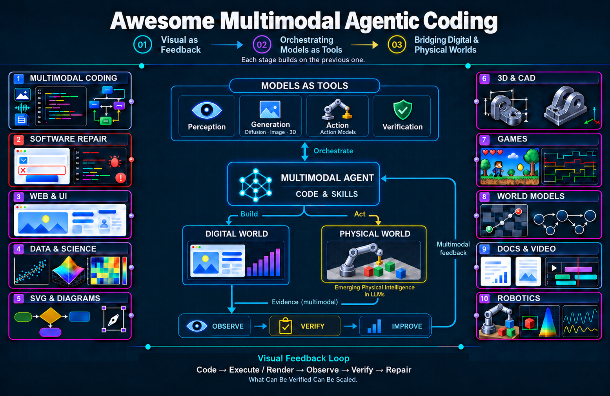
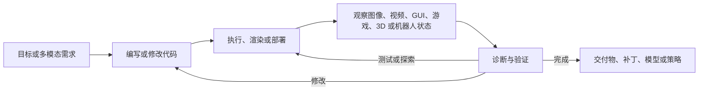

# Awesome Multimodal Agentic Coding

一份关于多模态智能体编程的研究地图：由多模态 Agent 组织不同模型能力，在数字与物理世界中构建、行动并持续改进，覆盖网站、CAD、游戏、仿真与机器人等任务。

**[从这里开始](./docs/READING_GUIDE.zh-CN.md) · [浏览论文](#paper-and-project-list) · [体验 Demo](#selected-cases-and-demos) · [推荐工作](https://github.com/jiangjin1999/awesome-multimodal-agentic-coding/issues/new/choose)**

<div align="center">



<br>

***What Can Be Verified Can Be Scaled.***

**让多模态 Agent 组织不同模型能力，在世界中构建、行动并持续改进。**

[](https://awesome.re)
[](./LICENSE)
[](#contributing)
[](#contact-and-collaboration)
[](#paper-and-project-list)

[](./README.md)
[](./README.zh-CN.md)

**最后更新：2026-10-19**

</div>

<!-- mmac-layout: directions-v4 -->

<a id="start-here"></a>

## Start Here / 阅读地图

可以按**研究问题、资料类型或应用领域**阅读。从[基础调研](#foundations)出发，沿同一方向查看方法、评测和数据，再进入[能力资源](#capabilities-and-infrastructure)与[研究议程](#research-opportunities)。[阅读指南](./docs/READING_GUIDE.zh-CN.md)提供五个入门实例。

每项工作保留一条完整书目记录，其他章节按具体用途链接到它；同一论文的方法、评测与数据贡献因此可以关联，而不重复计数。**Core／Adjacent／Resource** 是范围身份，与研究方向和贡献标签独立。背景综述与应用案例保留各自的阅读角色。

<a id="topic-map"></a>

| 研究方向 | 方法 | 评测 | 数据 |
|---|---|---|---|
| 视觉软件工程与应用复刻 | [2.1](#methods-software) | [3.1](#evaluation-software) | [4.1](#data-software) |
| GUI／软件训练环境合成 | [2.2](#methods-gui-environments) | [3.2](#evaluation-gui-environments) | [4.2](#data-gui-environments) |
| 图表、科学可视化与可编辑图形构建 | [2.3](#methods-graphics) | [3.3](#evaluation-graphics) | [4.3](#data-graphics) |
| 文档与视觉媒体构建 | [2.4](#methods-media) | [3.4](#evaluation-media) | [4.4](#data-media) |
| 程序化 3D 与 CAD 构建 | [2.5](#methods-cad-3d) | [3.5](#evaluation-cad-3d) | [4.5](#data-cad-3d) |
| 物理资产构建与诊断 | [2.6](#methods-physical-assets) | [3.6](#evaluation-physical-assets) | [4.6](#data-physical-assets) |
| 可玩游戏构建、复刻与修复 | [2.7](#methods-games) | [3.7](#evaluation-games) | [4.7](#data-games) |
| 可执行世界模型与仿真程序构建 | [2.8](#methods-world-models) | [3.8](#evaluation-world-models) | [4.8](#data-world-models) |
| Agentic Real-to-Sim | [2.9](#methods-real-to-sim) | [3.9](#evaluation-real-to-sim) | [4.9](#data-real-to-sim) |
| 机器人程序与策略开发 | [2.10](#methods-robot-programs) | [3.10](#evaluation-robot-programs) | [4.10](#data-robot-programs) |
| Real2Sim2Real：任务学习与真实执行 | [2.11](#methods-real2sim2real) | [3.11](#evaluation-real2sim2real) | [4.11](#data-real2sim2real) |
| 从构建与交互经验学习 | [2.12](#methods-experience) | [3.12](#evaluation-experience) | [4.12](#data-experience) |

[1. 基础调研](#foundations) · [2. 方法与系统](#methods-and-systems) · [3. 评测](#benchmarks-and-evaluation) · [4. 数据与学习资源](#data-and-learning-resources) · [5. 能力与基础设施](#capabilities-and-infrastructure) · [6. 研究议程](#research-opportunities)

[评估器可靠性](#section-3-13) · [应用索引](#application-domains) · [社区与实践](#community-and-practice) · [范围与标签](#definition-and-scope)

<a id="motivation"></a>

## 💡 动机

传统的多模态编程通常意味着：**将图像、视频、图表或设计稿作为代码生成的初始输入**。我们的最初理解更进一步：代码作用于数字世界与物理世界，视觉感知则成为改进 Agent 构建结果的反馈。

现在，我们将**多模态 Agent 放在中心**：它理解目标与观测，选择并组合不同模型能力，再根据执行反馈决定构建什么、如何行动，以及下一步改变什么。

> ***我们相信，多模态智能体编程是一种正在形成的新多模态范式：让 Agent 组织不同模型能力，在世界中构建、行动并持续改进。***

**理解的三个递进阶段：**

1. **视觉作为反馈（Visual as Feedback）** — Agent 看见代码执行的结果，用这些观测验证、修复并改进自己构建的内容。
2. **组织模型能力（Orchestrating Models as Tools）** — 多模态 Agent 将感知、生成、动作与验证模型作为工具来组合；反馈不仅指导代码修改，也指导调用哪些模型、如何组合能力。
3. **连接数字世界与物理世界（Bridging Digital & Physical Worlds）** — 这种能力编排连接数字构建、可执行仿真与物理行动，让 Agent 在不同世界中构建、行动并持续改进。

**每个阶段都包含前一阶段，是扩展，而不是替代。** 随着 Agent 能力与作用世界的拓展，视觉反馈闭环依然是基础。

在第三阶段中，**LLM 物理智能的新涌现**是我们尤其关注的研究视角：基于 LLM 的 Agent 如何组织感知、仿真、动作与反馈，发展面向物理世界的能力。

### 模型即工具，代码连接能力

**模型不仅可以充当 Agent 本身，也可以作为工具，提供可复用的原子能力。** 例如，Agent 可以调用扩散模型为数字环境生成视觉资产，或调用动作模型为物理环境提供移动、操作等能力；感知、预测与验证模型也可以参与同一工作流。

| 角色 | 在 Agent 闭环中的作用 |
|---|---|
| **多模态 Agent** | 理解目标与观测，规划任务、选择能力、协调执行，并修订决策。 |
| **模型即工具（Models as Tools）** | 提供感知、图像／视频／3D 生成、预测、动作与评估等能力。 |
| **代码与 Skills** | 将模型调用、资产与工具动作组成可执行工作流，管理状态、检查与恢复；代码既是产物，也是能力组合的媒介。 |
| **数字、仿真与物理世界** | 执行程序与动作，呈现其后果，并返回视觉、时间、空间、交互或具身反馈。 |

“多模态”描述的是**整个 Agent 系统**，不要求把全部能力集中到一个原生多模态模型中。编程 Agent 搭配独立视觉 Critic，同样是一种有效架构；但一次模型调用本身并不构成反馈闭环。

### 视觉反馈闭环仍是核心

第一版的**代码 → 执行／渲染 → 观察 → 验证 → 修复**闭环，是这一更广理解中的核心实例。视觉依然是**反馈，而不只是输入**：Agent 看见自己构建的内容，与其交互，并让观测结果改变后续工作。同一原则也延伸到模型选择、工具使用和可执行工作流的修订，而不只改进最终产物。

这里的持续改进指依据证据进行迭代，不要求更新模型权重；Agent 可以根据世界中的执行结果，调整代码、计划、提示词、能力选择或可复用 Skill。



三个框架是递进的**理解视角**，并非互斥类别，也不是论文的等级排名。应用复刻可以延伸为 Agent 训练环境，重建可以延伸为任务仿真与真实执行；每一步都需要相应的行为、物理或迁移证据。

| 理解框架 | 贯穿各方向的问题 | 阅读路径 |
|---|---|---|
| **Visual as Feedback** | 执行后看到了什么，促成了哪一次修订？反馈质量和修复收益怎样评价？ | [软件](#methods-software) · [图形](#methods-graphics) · [3D](#methods-cad-3d) → [评估器可靠性](#section-3-13) |
| **Models as Tools** | 每个模型提供什么能力，接口怎样对齐，组织它们的 Agent 贡献了什么？ | [媒体](#methods-media) · [物理资产](#methods-physical-assets) → [能力资源](#capabilities-and-infrastructure) |
| **Bridging Digital & Physical Worlds** | 真实观测、仿真与行动之间建立了什么对应？所构建的环境能否改善未见交互或真实任务？ | [Real-to-Sim](#methods-real-to-sim) → [机器人程序](#methods-robot-programs) → [Real2Sim2Real 评测](#evaluation-real2sim2real) |

<a id="definition-and-scope"></a>

## 📌 定义与范围

在这一以 Agent 为中心的理解下，**核心工作列表**聚焦满足以下条件的多模态智能体编程系统：四件事必须发生在**同一条 Agent 轨迹**中。

1. Agent 生成或修改可执行代码，或其他程序化表示；
2. 代码创建或改变一个可执行／可编辑产物，或可执行世界状态；
3. Agent 获得执行后的视觉、时间、空间、交互或具身观测；
4. 该观测改变后续代码或工具动作。

这里的**产物（artifact）**是由代码构建的产品或状态，例如网页、UI、图表、SVG、CAD 模型、3D 场景、游戏、文档、视频、仿真器、数字孪生或机器人策略。

核心纳入判断是：

> **能否在同一条轨迹中追踪到：代码 → 可执行产物 → 执行后的多模态证据 → 后续代码／工具动作？**

Benchmark 可以通过某个明确的 Track、基线方法或已记录的 Agent 配置实现并评测上述闭环，即使其他受评设置并不使用多模态反馈。

相邻基础、模型能力、Skills、工具桥与 Demo 在各自章节补充核心列表。单纯编排模型并不足以构成核心编程闭环：可执行代码或程序化表示必须仍是轨迹的一部分。

### 纳入范围

- 对网页、应用、图表、示意图、3D 场景、CAD 模型、游戏、幻灯片、海报、动画和视频进行迭代生成与修复。
- 在仓库或应用层复现、定位、修复视觉问题，并进行回归验证。
- 视觉编程智能体（visual coding agents）在修改代码时主动浏览、检查截图、采样视频帧、操作 GUI、游玩游戏或观察机器人。
- 由 Agent 编写、并依据多模态观测或交互反例修订代码的可执行世界模型与数字孪生。
- 组合生成、感知、预测或动作模型，并根据执行后的多模态反馈修订工作流的 Agent 程序。
- 专门围绕上述闭环构建的训练方法、数据集和 Benchmark。

| 范围身份 | 阅读角色 |
|---|---|
| **Core** | 已有编码闭环满足上述四项标准；方法或 benchmark 中的具体评测配置都可能具备这一身份。 |
| **Adjacent** | 相关的构建、编排、感知、动作或评测基础，范围身份与 Core 分开。 |
| **Resource** | 可调用模型能力、Skills、工具、引擎与实践资源，不计入 Core 论文数量。 |

<details>
<summary>贡献标签与研究角色标签</summary>

<a id="contribution-tags"></a>

## 🏷️ 标签体系

标签分为两条正交轴：**贡献类型标签**说明一项工作贡献了什么；**研究角色标签**说明这项贡献作用在 Agent 研发闭环的哪个位置。每项工作至少包含一个贡献类型标签，研究角色标签只标记其核心作用环节。

### 贡献类型标签

| 标签 | 含义 |
|---|---|
| `[Method]` | 新的 Agent 方法、框架、模型、算法或优化过程。 |
| `[System]` | 集成式实现，或模型与工具组成的完整系统；这一标签本身不能证明闭环行为。 |
| `[Benchmark]` | 评测任务、环境、协议或 Benchmark Suite。 |
| `[Dataset]` | 作为核心贡献发布了具体的训练、评测或轨迹数据集。 |
| `[Empirical Study]` | 核心贡献是系统性的行为观察、比较、审计或失败分析，而不是新 Agent。 |
| `[Survey]` | Survey、Taxonomy 或 Position Paper。 |

一项工作产生多种实质贡献时，可以同时使用多个贡献类型标签。

### 研究角色标签

| 标签 | 含义 |
|---|---|
| `[Data Curation]` | 构建、合成、过滤、标注、去污染或版本化任务、环境、Demonstration、Preference 或轨迹。这要求数据工程本身是贡献，而不是论文只使用了某个数据集。 |
| `[Training]` | 通过 SFT、蒸馏、偏好优化、RL/RLVR、Heuristic Learning 或其他学习过程更新模型、Policy、Critic、Verifier、Memory、Skill 或 Agent Harness。 |
| `[Inference]` | 通过规划、搜索、反思、记忆、交互、修复、重排或 Test-Time Scaling 改变测试时 Agent 循环。 |
| `[Environment]` | 贡献可复用的可执行基座，例如 Sandbox、Renderer、Simulator、浏览器／游戏 Runtime、Action Interface 或任务环境。 |
| `[Verification]` | 引入 Critic、Judge、Reward、Rubric、Metric 或确定性 Checker，将执行结果转换为分数或可执行的诊断。只做最终评分不等于建立了闭环反馈。 |
| `[Trajectory Analysis]` | 将完整 Action–Observation 历史作为核心研究对象，用于过程特征分析、表征、诊断、失败归因、监控或干预。仅保存日志不足以获得该标签。 |

下面几个区分用来避免标签逐渐失去信息量：

- `[Dataset]` 表示发布了数据集；`[Data Curation]` 表示如何产生可信数据的方法或 Pipeline。一项工作可以同时属于两者。
- `[Benchmark]` 表示测量什么；`[Verification]` 表示如何判断中间状态或最终结果。如果 Benchmark 只使用既有 Verifier，只需要 `[Benchmark]`。
- `[Training]` 必须存在学习更新；仅使用 Prompt、搜索或反思改进的工作属于 `[Inference]`。
- 轨迹只作为训练样本时，使用 `[Training]`；若同时发布数据，再加 `[Dataset]`。只有研究或诊断路径本身时，才使用 `[Trajectory Analysis]`。

下方条目先列贡献类型标签，再在 `·` 分隔符后列研究角色标签。宽口径 Survey 若无法合理归入单一研发环节，可以只保留贡献类型标签。下表展示两条标签轴如何组合：

| 工作 | 贡献类型标签 | 研究角色标签 |
|---|---|---|
| **Learning Only with Images / RRVF** | `[Method]` | `[Training]` `[Inference]` `[Verification]` |
| **Programming with Pixels** | `[Benchmark]` | `[Environment]` `[Verification]` |
| **Rendering-in-the-Loop** | `[Method]` `[Benchmark]` `[Dataset]` | `[Data Curation]` `[Inference]` `[Environment]` `[Verification]` |
| **ReLook** | `[Method]` | `[Training]` `[Inference]` `[Verification]` |

</details>

`arXiv YYYY.MM` 使用来源页的首版提交日期。**验证维度**概括论文实际检查的内容，可能同时包含闭环内反馈和最终评测。

<a id="foundations"></a>

## 1. 基础调研

<a id="section-1-1"></a>

### 1.1 生成和修改什么：表示、程序与资产

**任务定义：** 理解 Agent 实际生成或修改的对象，以及程序、资产和最终观测之间的关系。HTML／CSS、图形程序、参数化 CAD、mesh、场景图和材质具有不同的可编辑性与执行方式。

**边界：** 渲染画面是产物的一种观测；形状、程序结构、交互状态与物理参数需要分别描述。

**关联阅读：** [2.3 图表、科学可视化与可编辑图形构建](#methods-graphics) · [2.5 程序化 3D 与 CAD 构建](#methods-cad-3d) · [5.2 程序、几何、材质与视觉媒体生成／编辑](#section-5-2)

<a id="paper-2606-15932"></a>
<!-- mmac-record: {"id": "2606.15932", "scope": "Survey", "primary": "1.1", "task": null} -->

- `arXiv 2026.06` **Beyond NL2Code: A Structured Survey of Multimodal Code Intelligence**. [[论文]](https://arxiv.org/abs/2606.15932) — `[Survey]` · **背景综述**
  > 综述 UI、科学可视化、结构化图形和新兴 Agentic 场景中的多模态代码智能。

**阅读入口**

- [SceneCraft](#paper-2403-01248) · **Core** · [2.5](#methods-cad-3d)
- [3DCodeVerse](#paper-2610-22341) · **Core** · [2.5](#methods-cad-3d)

<a id="section-1-2"></a>

### 1.2 怎样构建：程序合成、模型生成、检索与组装

**任务定义：** 比较程序合成、生成模型、检索、参数优化和资产组装怎样共同完成构建。重点是各步骤接收什么信息、产出什么对象，以及 Agent 怎样组织它们。

**边界：** 完整 Agent 方法与可被调用的能力模型分别讨论；使用多个模型不直接说明具备动态工具选择。

**关联阅读：** [2.2 GUI／软件训练环境合成](#methods-gui-environments) · [2.6 物理资产构建与诊断](#methods-physical-assets) · [2.9 Agentic Real-to-Sim](#methods-real-to-sim) · [5.2 程序、几何、材质与视觉媒体生成／编辑](#section-5-2) · [5.3 执行、渲染、仿真与自动化接口](#section-5-3)

**阅读入口**

- [Towards Physically Grounded Articulated 3D Assets](#paper-2610-13947) · **Core** · [2.6](#methods-physical-assets)
- [LiteReality-Agent](#paper-2610-01863) · **Core** · [2.9](#methods-real-to-sim)
- [SoftwareGym](#paper-2610-12611) · **Core** · [2.2](#methods-gui-environments)

<a id="section-1-3"></a>

### 1.3 怎样改进：执行、观察、反馈、修复与验证

**任务定义：** 理解执行、观察、诊断、修复和验证组成的改进过程，并区分参考输入、运行反馈、训练奖励与最终评分。

**边界：** 仅保存截图或进行最终视觉打分，不构成该观测推动后续修订的证据；训练时和推理时的反馈路径分别记录。

**关联阅读：** [2.1 视觉软件工程与应用复刻](#methods-software) · [2.12 从构建与交互经验学习](#methods-experience) · [3.13 测试、奖励与评估器可靠性](#section-3-13)

**阅读入口**

- [ReLook](#paper-2510-11498) · **Core** · [2.1](#methods-software)
- [Learning Only with Images](#paper-2507-20766) · **Core** · [2.1](#methods-software)
- [Imperfect Visual Verification for Code Edition](#paper-2606-15693) · **Core** · [3.13](#section-3-13)

<a id="section-1-4"></a>

### 1.4 何时成为环境：状态、动作、重置、任务与奖励

**任务定义：** 理解可执行产物怎样成为供 Agent 行动、规划、训练或评测的环境：需要明确状态、动作、初始化／重置、任务和结果判定。

**边界：** 可加载或可渲染描述运行属性；可用于学习还取决于任务接口、交互覆盖和学习信号。

**关联阅读：** [2.2 GUI／软件训练环境合成](#methods-gui-environments) · [2.8 可执行世界模型与仿真程序构建](#methods-world-models) · [2.11 Real2Sim2Real：任务学习与真实执行](#methods-real2sim2real) · [4.2 GUI／软件训练环境、任务、奖励与操作轨迹](#data-gui-environments)

<a id="paper-2608-28122"></a>
<!-- mmac-record: {"id": "2608.28122", "scope": "Survey", "primary": "1.4", "task": null} -->

- `arXiv 2026.08` **Agentic Artifact Creation: Systems, Evaluation, Principles, and Opportunities**. [[论文]](https://arxiv.org/abs/2608.28122) [[代码]](https://github.com/GeminiLight/awesome-agentic-artifact-creation) — `[Survey]` · **背景综述**
  > 综述有状态产物构建：中间观测会在软件、视觉媒体、3D 等交付物中重新引导后续工作。

**阅读入口**

- [SoftwareGym](#paper-2610-12611) · **Core** · [2.2](#methods-gui-environments)
- [AgentGarten](#paper-2610-12374) · **Core** · [2.8](#methods-world-models)

<a id="methods-and-systems"></a>

<a id="paper-and-project-list"></a>

## 2. 方法与系统

<a id="general"></a>

<a id="software-engineering"></a>

<a id="web-ui-app"></a>

<a id="methods-software"></a>

### 2.1 视觉软件工程与应用复刻

**任务定义：** 根据需求、截图、交互轨迹或运行中的参考应用，生成、复刻和修复软件。目标是恢复可观察的界面与行为，并在修改后保持已有功能。

**边界：** 本方向直接交付软件实现；专为操作型 Agent 提供任务与学习信号的环境构建见 2.2。参考探索、过程检查和提交后的隐藏评测分别比较。

**关联阅读：** [3.1 视觉软件工程与应用复刻评测](#evaluation-software) · [4.1 软件需求、应用观测与开发／复刻轨迹](#data-software) · [2.2 GUI／软件训练环境合成](#methods-gui-environments) · [2.12 从构建与交互经验学习](#methods-experience)

<a id="paper-2609-22000"></a>
<!-- mmac-record: {"id": "2609.22000", "scope": "Core", "primary": "2.1", "task": 1} -->

- `arXiv 2026.09` **RecreationWorld: Scalable and Verifiable Environments for Hybrid Computer-Use Agents**. [[论文]](https://arxiv.org/abs/2609.22000) — `[Method]` `[Benchmark]` · `[Data Curation]` `[Training]` `[Environment]` `[Verification]` · **Core**
  > 在桌面、Android 与 Web 上交替探索参考应用、编写源码、运行与视觉检查，并用通过验证的重建轨迹训练混合交互 Agent。<br>
  > **验证维度：** 构建／启动有效性 · 隐藏行为与视觉断言 · 重建保真度 · GUI—代码切换 · 训练后迁移。

<a id="paper-2507-20766"></a>
<!-- mmac-record: {"id": "2507.20766", "scope": "Core", "primary": "2.1", "task": 1} -->

- `arXiv 2025.07` **Learning Only with Images: Visual Reinforcement Learning with Reasoning, Rendering, and Visual Feedback**. [[论文]](https://arxiv.org/abs/2507.20766) [[代码]](https://github.com/L-O-I/RRVF) — `[Method]` · `[Training]` `[Inference]` `[Verification]` · **Core**
  > 运行生成的图表与网页代码，将目标和渲染结果的差异转为视觉反馈，并指导下一轮代码生成。<br>
  > **验证维度：** 代码与格式有效性 · 渲染视觉相似度 · 语义及元素完整性。

<a id="paper-2607-14075"></a>
<!-- mmac-record: {"id": "2607.14075", "scope": "Core", "primary": "2.1", "task": 1} -->

- `arXiv 2026.07` **VisualRepair: Dynamic Tool Calling and Region Focusing for Visual Software Issue Repair**. [[论文]](https://arxiv.org/abs/2607.14075) — `[Method]` · `[Inference]` · **Core**
  > 在迭代修复截图驱动的软件问题时，动态选择视觉工具并聚焦可疑区域。<br>
  > **验证维度：** 问题解决率 · 仓库测试通过 · 截图问题修复正确性。

<a id="paper-2603-17826"></a>
<!-- mmac-record: {"id": "2603.17826", "scope": "Core", "primary": "2.1", "task": 1} -->

- `arXiv 2026.03` **FailureMem: A Failure-Aware Multimodal Framework for Autonomous Software Repair**. [[论文]](https://arxiv.org/abs/2603.17826) [[代码]](https://github.com/Ruize-Ma/FailureMem) — `[Method]` · `[Inference]` · **Core**
  > 检索既往多模态失败轨迹，指导诊断及后续仓库级修复动作。<br>
  > **验证维度：** SWE-bench Multimodal 解决率 · 仓库测试通过 · 视觉问题修复。

<a id="paper-2602-06090"></a>
<!-- mmac-record: {"id": "2602.06090", "scope": "Core", "primary": "2.1", "task": 1} -->

- `arXiv 2026.02` **SVRepair: Structured Visual Reasoning for Automated Program Repair**. [[论文]](https://arxiv.org/abs/2602.06090) — `[Method]` · `[Inference]` · **Core**
  > 将截图结构化为局部视觉证据，在场景理解、代码定位与补丁生成之间迭代。<br>
  > **验证维度：** 问题解决率 · 仓库测试通过 · 定位与补丁正确性。

<a id="paper-2506-16136"></a>
<!-- mmac-record: {"id": "2506.16136", "scope": "Core", "primary": "2.1", "task": 1} -->

- `arXiv 2025.06` **Seeing is Fixing: Cross-Modal Reasoning with Multimodal LLMs for Visual Software Issue Fixing**. [[论文]](https://arxiv.org/abs/2506.16136) — `[Method]` · `[Inference]` `[Verification]` · **Core**
  > 结合图像到代码理解与代码到图像验证，闭合视觉软件问题修复循环。<br>
  > **验证维度：** Pass@1 · 仓库测试通过 · 视觉补丁验证。

<a id="paper-2411-01606"></a>
<!-- mmac-record: {"id": "2411.01606", "scope": "Core", "primary": "2.1", "task": 1} -->

- `arXiv 2024.11` **DesignRepair: Dual-Stream Design Guideline-Aware Frontend Repair with Large Language Models**. [[论文]](https://arxiv.org/abs/2411.01606) [[代码]](https://github.com/UGAIForge/DesignRepair) — `[Method]` · `[Inference]` `[Verification]` · **Core**
  > 联合推理前端源码和渲染视图，并使用设计规范指导迭代式视觉修复。<br>
  > **验证维度：** 违规检测精确率／召回率 · 修复精确率／召回率 · 感知视觉质量。

<a id="paper-2610-04981"></a>
<!-- mmac-record: {"id": "2610.04981", "scope": "Core", "primary": "2.1", "task": 1} -->

- `arXiv 2026.10` **TeleGen: Improving LLM-Based Web Application Generation via Runtime Telemetry**. [[论文]](https://arxiv.org/abs/2610.04981) [[代码]](https://github.com/commoluo/TeleGen) — `[Method]` · `[Inference]` `[Verification]` · **Core**
  > 以压缩运行遥测和任务反馈修复生成的 Web 应用，在 WebGen-Bench 配置中将 WebVoyager 的截图判定结果传入代码修订。<br>
  > **验证维度：** UI 任务成功率 · 遥测修复消融 · 测试 Pass@2 · 判定审计 · 上下文成本。

<a id="paper-2609-02088"></a>
<!-- mmac-record: {"id": "2609.02088", "scope": "Core", "primary": "2.1", "task": 1} -->

- `arXiv 2026.09` **Rendering-in-the-Loop: An Execution-Driven Agent for Interactive Web Development**. [[论文]](https://arxiv.org/abs/2609.02088) — `[Method]` `[Benchmark]` `[Dataset]` · `[Data Curation]` `[Inference]` `[Environment]` `[Verification]` · **Core**
  > 在真实浏览器中重放参考交互，同时评估行为与渲染，再将多模态运行证据转化为多轮工具辅助代码修复。<br>
  > **验证维度：** 交互执行成功率 · SSIM/OCR/语义视觉保真度 · 修复轮次间提升。

<a id="paper-2608-30530"></a>
<!-- mmac-record: {"id": "2608.30530", "scope": "Core", "primary": "2.1", "task": 1} -->

- `arXiv 2026.08` **WebWorld: The Browser as a World Model for Self-Improving Web Code**. [[论文]](https://arxiv.org/abs/2608.30530) — `[Method]` · `[Data Curation]` `[Training]` `[Inference]` `[Environment]` `[Verification]` · **Core**
  > 将截图证据支持的点评转化为限定范围的 HTML 修复和可重放浏览器契约，仅保留推进目标且不破坏已验证行为的状态转移。<br>
  > **验证维度：** 浏览器重放 · 目标谓词改进 · 已有能力保留 · 验证证书支持的训练轨迹。

<a id="paper-2608-24138"></a>
<!-- mmac-record: {"id": "2608.24138", "scope": "Core", "primary": "2.1", "task": 1} -->

- `arXiv 2026.08` **Rubrics as Visual-Repair Context for Self-Evolving UI-to-Code Generation**. [[论文]](https://arxiv.org/abs/2608.24138) — `[Method]` · `[Inference]` `[Verification]` · **Core**
  > 使用持久化视觉修复 Rubric 选择限定范围的修改，减少多轮 UI 细化中的回归。<br>
  > **验证维度：** 整体视觉保真度 · 五类 UI 分项评分 · 修复轮次间回退。

<a id="paper-2604-19742"></a>
<!-- mmac-record: {"id": "2604.19742", "scope": "Core", "primary": "2.1", "task": 1} -->

- `arXiv 2026.04` **PlayCoder: Making LLM-Generated GUI Code Playable**. [[论文]](https://arxiv.org/abs/2604.19742) [[代码]](https://github.com/Tencent/PlayCoder) — `[Method]` `[Benchmark]` · `[Inference]` `[Environment]` `[Verification]` · **Core**
  > 自动运行并操作生成的 GUI，再把交互失败转化为后续代码修复。<br>
  > **验证维度：** Exec@k · 单元测试 Pass@k · 交互 Play@k · Token 效率。

<a id="paper-2604-05839"></a>
<!-- mmac-record: {"id": "2604.05839", "scope": "Core", "primary": "2.1", "task": 1} -->

- `arXiv 2026.04` **Vision-Guided Iterative Refinement for Frontend Code Generation**. [[论文]](https://arxiv.org/abs/2604.05839) — `[Method]` · `[Inference]` `[Verification]` · **Core**
  > 将前端渲染差异反馈到反复代码修改中，而不是在初次生成后停止。<br>
  > **验证维度：** 视觉任务完成度 · 美学质量 · 代码任务完成度 · 代码质量。

<a id="paper-2604-19750"></a>
<!-- mmac-record: {"id": "2604.19750", "scope": "Core", "primary": "2.1", "task": 1} -->

- `arXiv 2026.03` **Coding with Eyes: Visual Feedback Unlocks Reliable GUI Code Generating and Debugging**. [[论文]](https://arxiv.org/abs/2604.19750) — `[Method]` `[Benchmark]` · `[Inference]` `[Environment]` `[Verification]` · **Core**
  > 在执行驱动的调试闭环中协调视觉理解、GUI 交互、代码生成与重构。<br>
  > **验证维度：** 应用执行 · 元素／颜色／布局断言 · 交互状态正确性。

<a id="paper-2602-05998"></a>
<!-- mmac-record: {"id": "2602.05998", "scope": "Core", "primary": "2.1", "task": 1} -->

- `arXiv 2026.02` **VisRefiner: Learning from Visual Differences for Screenshot-to-Code Generation**. [[论文]](https://arxiv.org/abs/2602.05998) — `[Method]` `[Dataset]` · `[Data Curation]` `[Training]` `[Inference]` `[Verification]` · **Core**
  > 从目标与渲染结果的视觉差异中学习，并将证据用于迭代代码细化。<br>
  > **验证维度：** HTML/CSS 有效性 · 区块／文本／位置／颜色／CLIP 保真度 · 迭代改进。

<a id="paper-2601-04203"></a>
<!-- mmac-record: {"id": "2601.04203", "scope": "Core", "primary": "2.1", "task": 1} -->

- `arXiv 2025.12` **FronTalk: Benchmarking Front-End Development as Conversational Code Generation with Multi-Modal Feedback**. [[论文]](https://arxiv.org/abs/2601.04203) [[代码]](https://github.com/shirley-wu/frontalk) [[项目]](https://frontalk-benchmark.github.io/) — `[Method]` `[Benchmark]` `[Dataset]` · `[Data Curation]` `[Inference]` `[Environment]` `[Verification]` · **Core**
  > 引入多轮视觉前端对话与 AceCoder；后者与渲染网站交互、批评失败并重新生成改进代码。<br>
  > **验证维度：** 交互通过率 · 可用性 · 遗忘／回退率。

<a id="paper-2511-08195"></a>
<!-- mmac-record: {"id": "2511.08195", "scope": "Core", "primary": "2.1", "task": 1} -->

- `arXiv 2025.11` **UI2Code^N: UI-to-Code Generation as Interactive Visual Optimization**. [[论文]](https://arxiv.org/abs/2511.08195) [[代码]](https://github.com/zai-org/UI2Code_N) — `[Method]` · `[Inference]` `[Verification]` · **Core**
  > 将 UI-to-code 重构为执行、视觉检查和反复细化，并以相对视觉反馈进行优化。<br>
  > **验证维度：** 渲染有效性 · 成对视觉偏好 · 起草与润色质量。

<a id="paper-2511-06251"></a>
<!-- mmac-record: {"id": "2511.06251", "scope": "Core", "primary": "2.1", "task": 1} -->

- `arXiv 2025.11` **WebVIA: A Web-based Vision-Language Agentic Framework for Interactive and Verifiable UI-to-Code Generation**. [[论文]](https://arxiv.org/abs/2511.06251) [[代码]](https://github.com/zheny2751-dotcom/WebVIA) [[项目]](https://zheny2751-dotcom.github.io/webvia.github.io/) — `[Method]` `[Benchmark]` `[Dataset]` · `[Data Curation]` `[Inference]` `[Environment]` `[Verification]` · **Core**
  > 通过反复的感知—行动—验证探索源界面，合成可执行交互代码并验证恢复出的行为。<br>
  > **验证维度：** 结构保真度 · 端到端交互完成率 · 动作有效性。

<a id="paper-2510-11498"></a>
<!-- mmac-record: {"id": "2510.11498", "scope": "Core", "primary": "2.1", "task": 1} -->

- `arXiv 2025.10` **ReLook: Vision-Grounded RL with a Multimodal LLM Critic for Agentic Web Coding**. [[论文]](https://arxiv.org/abs/2510.11498) — `[Method]` · `[Training]` `[Inference]` `[Verification]` · **Core**
  > 在训练 Rollout 与带 Critic 设置中，将基于截图的 MLLM 诊断反馈给后续代码修改；快速推理变体会移除外部 Critic。<br>
  > **验证维度：** Valid Render Rate · ArtifactsBench 视觉／交互评分 · 被接受修改的质量提升。

<a id="paper-2509-22644"></a>
<!-- mmac-record: {"id": "2509.22644", "scope": "Core", "primary": "2.1", "task": 1} -->

- `arXiv 2025.09` **WebGen-Agent: Enhancing Interactive Website Generation with Multi-Level Feedback and Step-Level Reinforcement Learning**. [[论文]](https://arxiv.org/abs/2509.22644) [[代码]](https://github.com/mnluzimu/WebGen-Agent) — `[Method]` · `[Training]` `[Inference]` `[Verification]` · **Core**
  > 使用截图、GUI Agent 测试、回溯和步骤级奖励，迭代改进网站代码库。<br>
  > **验证维度：** 截图外观 · GUI Agent 任务成功率 · 最佳状态改进。

<a id="paper-2506-13663"></a>
<!-- mmac-record: {"id": "2506.13663", "scope": "Core", "primary": "2.1", "task": 1} -->

- `arXiv 2025.06` **DesignCoder: Hierarchy-Aware and Self-Correcting UI Code Generation with Large Language Models**. [[论文]](https://arxiv.org/abs/2506.13663) — `[Method]` · `[Inference]` `[Verification]` · **Core**
  > 捕获渲染后的移动端 UI，比较组件级视觉证据，并迭代应用局部代码修复。<br>
  > **验证维度：** MSE／CLIP／SSIM 视觉保真度 · 组件树相似度 · 用户可用性评分。

<a id="paper-2610-09116"></a>
<!-- mmac-record: {"id": "2610.09116", "scope": "Core", "primary": "2.1", "task": 1} -->

- `arXiv 2026.10` **SPLATIFY: Reproduce, Discover, Innovate! From Papers and Ideas to Trainable 3DGS Code**. [[论文]](https://arxiv.org/abs/2610.09116) — `[Method]` `[Benchmark]` · `[Inference]` `[Verification]` · **Core**
  > 将 3D 高斯泼溅论文和想法转成可训练插件，根据渲染图像批评、跨视角高斯诊断与训练曲线反馈修复代码。<br>
  > **验证维度：** 可训练性 · 专家参考渲染质量 · 创新点落实 · 结构／曲线反馈消融 · 搜索成本。

<a id="paper-2610-02617"></a>
<!-- mmac-record: {"id": "2610.02617", "scope": "Adjacent", "primary": "2.1", "task": 1} -->

- `arXiv 2026.10` **WebUIProof: Benchmarking WebUI Code Generators with UI-Agent Execution Harness**. [[论文]](https://arxiv.org/abs/2610.02617) [[代码]](https://github.com/yunyuntsai/webuiproof-benchmark) — `[Method]` `[Benchmark]` `[Dataset]` · `[Data Curation]` `[Training]` `[Environment]` `[Verification]` · **Adjacent**
  > 用结构化交互测试与视觉 UI Agent 评测生成的 Web／3D 界面，将结果级奖励用于训练生成器，而不是对当前产物进行视觉代码修复。<br>
  > **验证维度：** 构建成功率 · 交互完成度 · 元素覆盖 · 人—Agent 判定一致性 · 评测器步骤预算敏感性。

<a id="paper-2609-15078"></a>
<!-- mmac-record: {"id": "2609.15078", "scope": "Adjacent", "primary": "2.1", "task": 1} -->

- `arXiv 2026.09` **Enabling Creative Exploration for Vibe Design Agents**. [[论文]](https://arxiv.org/abs/2609.15078) — `[Method]` `[Empirical Study]` · `[Inference]` `[Verification]` · **Adjacent**
  > 在固定设置的 UI 代码生成前抽样结构化主题与资产方向，并分别衡量渲染多样性、模型裁判偏好及线上用户行为。<br>
  > **验证维度：** 设计方向覆盖 · 截图／DOM 变化 · 成对质量判定 · 线上修正、延迟与完成率。

<a id="paper-2609-16936"></a>
<!-- mmac-record: {"id": "2609.16936", "scope": "Adjacent", "primary": "2.1", "task": 1} -->

- `arXiv 2026.09` **RepoAtlas: Guiding Coding Agents via Evolving Multimodal Repository Views**. [[论文]](https://arxiv.org/abs/2609.16936) — `[Method]` · `[Inference]` `[Verification]` · **Adjacent**
  > 通过动态视觉代码图与定位到源代码的文本帮助 Agent 定位和修复仓库问题，其视觉上下文来自仓库结构，而非应用渲染结果。<br>
  > **验证维度：** SWE-bench Verified 解决率 · Token 成本 · 模型调用数 · 仓库视图选择与刷新。

<a id="paper-2609-18805"></a>
<!-- mmac-record: {"id": "2609.18805", "scope": "Adjacent", "primary": "2.1", "task": 1} -->

- `arXiv 2026.09` **ProgramDistill: From Interactive Web Apps to Verifiable Reference-Guided SWE Tasks**. [[论文]](https://arxiv.org/abs/2609.18805) — `[Method]` `[Benchmark]` · `[Data Curation]` `[Environment]` `[Verification]` `[Trajectory Analysis]` · **Adjacent**
  > 将可运行网页转化为可重放验证的重建任务，通过结构化文本式浏览器观测而非截图输入，研究“观察—编辑—验证”行为。

**相关评测工作**

- [CUA-SWE](#paper-2609-32600) · **Core** · [3.1](#evaluation-software)
- [Programming with Pixels](#paper-2502-18525) · **Core** · [3.1](#evaluation-software)
- [MT-Web2Code](#paper-2608-03474) · **Core** · [3.1](#evaluation-software)
- [InteractWeb-Bench](#paper-2604-27419) · **Core** · [3.1](#evaluation-software)
- [1D-Bench](#paper-2602-18548) · **Core** · [3.1](#evaluation-software)
- [TaoD2C-Bench](#paper-2610-10374) · **Adjacent** · [3.1](#evaluation-software)
- [EngiWorld](#paper-2609-37686) · **Adjacent** · [3.5](#evaluation-cad-3d)
- [IWC-Bench](#paper-2609-15387) · **Adjacent** · [3.1](#evaluation-software)
- [WebCompass](#paper-2604-18224) · **Adjacent** · [3.1](#evaluation-software)
- [ArtifactsBench](#paper-2507-04952) · **Adjacent** · [3.1](#evaluation-software)

**相关方法与系统**

- [Computer-Use Agents as Judges for Generative User Interface](#paper-2511-15567) · **Core** · [3.13](#section-3-13)

**相邻能力与工作流**

- [Atria Dawn](#paper-2609-15818) · **Adjacent** · [5.4](#section-5-4)

**应用阅读：** [OpenLens AI](#application-paper-2509-14778) · [NERFIFY](#application-paper-2603-00805)——研究代码工作流及其评测，保留应用案例身份。

<a id="methods-gui-environments"></a>

### 2.2 GUI／软件训练环境合成

**任务定义：** 构建可供操作型 Agent 训练或评测的软件环境，并连接任务、状态、验证机制和操作轨迹。既包括多样应用合成，也包括针对任务保留必要行为的替代环境。

**边界：** 环境自身质量与下游 Agent 收益分别评价；合成软件到目标应用的迁移属于数字环境迁移。

**关联阅读：** [3.2 GUI／软件训练环境构建与下游效用评测](#evaluation-gui-environments) · [4.2 GUI／软件训练环境、任务、奖励与操作轨迹](#data-gui-environments) · [1.4 何时成为环境：状态、动作、重置、任务与奖励](#section-1-4) · [2.1 视觉软件工程与应用复刻](#methods-software) · [2.12 从构建与交互经验学习](#methods-experience)

<a id="paper-2605-25624"></a>
<!-- mmac-record: {"id": "2605.25624", "scope": "Core", "primary": "2.2", "task": 2} -->

- `arXiv 2026.05` **CUA-Gym: Scaling Verifiable Training Environments and Tasks for Computer-Use Agents**. [[论文]](https://arxiv.org/abs/2605.25624) [[代码]](https://github.com/xlang-ai/CUA-Gym) [[环境]](https://github.com/xlang-ai/CUA-Gym-Hub) [[数据]](https://huggingface.co/datasets/xlangai/CUA-Gym) — `[Method]` `[Dataset]` · `[Data Curation]` `[Training]` `[Environment]` `[Verification]` · **Core**
  > 联合生成可重置的软件状态、任务与可执行奖励，将 rollout 截图判断与程序评分之间的分歧反馈给奖励编写 Agent，修改后重新执行验证。<br>
  > **验证维度：** 初始／目标状态奖励检查 · 独立视觉评分一致性 · 任务可解性 · OSWorld／WebArena 下游迁移 · 区分论文的 32,112 个训练元组与公开发布的 10,910 个任务。

<a id="paper-2610-12611"></a>
<!-- mmac-record: {"id": "2610.12611", "scope": "Core", "primary": "2.2", "task": 2} -->

- `arXiv 2026.10` **SoftwareGym: Scaling Computer-Use Agent Training with Diverse Synthesized Software Environments**. [[论文]](https://arxiv.org/abs/2610.12611) [[代码]](https://github.com/MrKiing-Jin/SoftwareGym) — `[Method]` `[Benchmark]` `[Dataset]` · `[Data Curation]` `[Training]` `[Inference]` `[Environment]` `[Verification]` · **Core**
  > 合成原生 Avalonia 应用，以截图驱动的 GUI 测试轨迹在固定用例下逐轮修复源码，再收集计算机操作训练数据。<br>
  > **验证维度：** 构建／启动有效性 · 固定用例 GUI 完成度与修复消融 · 设计 token 保真 · 120 任务 SoftwareGym-Bench · 244 任务 OSWorld 子集迁移。

<a id="visualization"></a>

<a id="svg-diagrams"></a>

<a id="methods-graphics"></a>

### 2.3 图表、科学可视化与可编辑图形构建

**任务定义：** 构建和编辑图表、科学可视化与结构化图形，使程序、底层数据、视觉编码和交互行为保持一致。精确编辑还要求保留未被要求改变的内容。

**边界：** 图表的数据语义、科学可视化的分析目标与 SVG／TikZ 的结构约束在内部区分；不能只用整体视觉相似度概括成功。

**关联阅读：** [3.3 图表、科学可视化与图形编辑评测](#evaluation-graphics) · [4.3 图表数据、图形程序与编辑记录](#data-graphics) · [2.4 文档与视觉媒体构建](#methods-media) · [3.13 测试、奖励与评估器可靠性](#section-3-13) · [5.5 Skills、工具桥与可复用工作流](#section-5-5)

<a id="paper-2610-08106"></a>
<!-- mmac-record: {"id": "2610.08106", "scope": "Core", "primary": "2.3", "task": 3} -->

- `arXiv 2026.10` **ChartBmkAgent: Harness-Governed Multi-Agent Construction of Chart QA Benchmarks from Sparse Error-Taxonomy Specifications**. [[论文]](https://arxiv.org/abs/2610.08106) — `[Method]` `[Benchmark]` · `[Data Curation]` `[Inference]` `[Verification]` · **Core**
  > 从稀疏错误描述构建诊断性图表问答，以证据门控的多模态批评修订绘图程序，同时保持冻结数据及预定错误机制。<br>
  > **验证维度：** 执行与渲染 · 图表／数据忠实度 · 诊断目标保持 · 捷径排除 · 配对构建与门控消融。

<a id="paper-2609-32413"></a>
<!-- mmac-record: {"id": "2609.32413", "scope": "Core", "primary": "2.3", "task": 3} -->

- `arXiv 2026.09` **IChart2Code: Benchmarking Multimodal Large Language Models for Interactive Chart Code Generation**. [[论文]](https://arxiv.org/abs/2609.32413) — `[Method]` `[Benchmark]` · `[Data Curation]` `[Inference]` `[Environment]` `[Verification]` · **Core**
  > 同时评测图表外观、数据忠实度与交互状态变化，TRAIL 根据浏览器观测轨迹诊断失败并修订 HTML/JavaScript。<br>
  > **验证维度：** 可执行性 · 数据忠实度 · 静态视觉正确性 · 交互正确性 · 人工校准判定。

<a id="paper-2609-15182"></a>
<!-- mmac-record: {"id": "2609.15182", "scope": "Core", "primary": "2.3", "task": 3} -->

- `arXiv 2026.09` **VisInteract: Towards Dynamic Interactive Text-to-Visualization under Imperfect Queries**. [[论文]](https://arxiv.org/abs/2609.15182) — `[Method]` `[Benchmark]` `[Dataset]` · `[Data Curation]` `[Inference]` `[Environment]` `[Verification]` · **Core**
  > 执行 Altair 程序，让模拟用户评阅渲染图表，并将视觉点评与文字澄清反馈用于后续代码搜索，逐步还原不完整需求中的可视化意图。<br>
  > **验证维度：** 可渲染性 · 代码与图表的关键特征满足度 · 意图对齐 · 多轮任务成功率。

<a id="paper-2609-14874"></a>
<!-- mmac-record: {"id": "2609.14874", "scope": "Core", "primary": "2.3", "task": 3} -->

- `arXiv 2026.09` **MedVA: An End-to-End Neuro-Symbolic Agentic System for Medical Volume Visualization**. [[论文]](https://arxiv.org/abs/2609.14874) — `[Method]` `[System]` · `[Inference]` `[Environment]` `[Verification]` · **Core**
  > 构建结构化 JSON 可视化规格，根据渲染器测得的完整场景与独立区域可见性迭代调整 ROI 不透明度，并结合解剖本体检查与多模型分割。<br>
  > **验证维度：** ROI 识别 · 可见性与遮挡约束 · 重渲染后的改进保留 · 专家可用性评估。

<a id="paper-2609-16014"></a>
<!-- mmac-record: {"id": "2609.16014", "scope": "Core", "primary": "2.3", "task": 3} -->

- `arXiv 2026.08` **ViCo: Visual-oriented Coding with Self-Reflection for Chart Replication**. [[论文]](https://arxiv.org/abs/2609.16014) [[仓库]](https://github.com/Xigmoid/ViCo) — `[Method]` · `[Training]` `[Inference]` `[Verification]` · **Core**
  > 训练图表编程 Agent 对比上一轮渲染与参考图，将差异写成明确反思，并通过反事实信用分配指导代码修订、落实反思。<br>
  > **验证维度：** 代码执行成功率 · 语义／布局／风格保真 · 反思落实一致性 · 多轮修订收益。

<a id="paper-2608-10408"></a>
<!-- mmac-record: {"id": "2608.10408", "scope": "Core", "primary": "2.3", "task": 3} -->

- `arXiv 2026.08` **VisEditBench: Can Vision-Language Models Edit Visualization Code from Multimodal Feedback?**. [[论文]](https://arxiv.org/abs/2608.10408) [[仓库（待发布实现）]](https://github.com/vis-nlp/VisEditBench) — `[Method]` `[Benchmark]` `[Dataset]` · `[Data Curation]` `[Inference]` `[Environment]` `[Verification]` · **Core**
  > 提出图表修复与风格迁移任务，并以 VisEditAgent 反复执行、视觉验证和修改候选代码，同时保持数据语义。<br>
  > **验证维度：** 可执行性 · 任务准确率 · 可读性／清晰度 · 视觉质量／相似度 · 最终通过率。

<a id="paper-2605-23527"></a>
<!-- mmac-record: {"id": "2605.23527", "scope": "Core", "primary": "2.3", "task": 3} -->

- `arXiv 2026.05` **LiveFigure: Generating Editable Scientific Illustration with VLM Agents**. [[论文]](https://arxiv.org/abs/2605.23527) [[代码]](https://github.com/tsinghua-fib-lab/LiveFigure) — `[Method]` · `[Inference]` `[Verification]` · **Core**
  > 将可编辑科学 Figure 生成为可执行产物，并用视觉反馈进行诊断和修改。<br>
  > **验证维度：** 视觉设计 · 信息清晰度与可读性 · 内容保真与完整性 · 可编辑性。

<a id="paper-2605-21825"></a>
<!-- mmac-record: {"id": "2605.21825", "scope": "Core", "primary": "2.3", "task": 3} -->

- `arXiv 2026.05` **Toward AI VIS Co-Scientists: A General and End-to-End Agent Harness for Solving Complex Data Visualization Tasks**. [[论文]](https://arxiv.org/abs/2605.21825) — `[Method]` · `[Inference]` `[Environment]` `[Verification]` · **Core**
  > 为复杂可视化工作流提供端到端的规划、执行、观察与修改 Harness。<br>
  > **验证维度：** 浏览器执行与控制台健康 · 控件／联动视图行为 · 视觉与科学正确性。

<a id="paper-2604-01600"></a>
<!-- mmac-record: {"id": "2604.01600", "scope": "Core", "primary": "2.3", "task": 3} -->

- `arXiv 2026.04` **MM-ReCoder: Advancing Chart-to-Code Generation with Reinforcement Learning and Self-Correction**. [[论文]](https://arxiv.org/abs/2604.01600) [[代码]](https://github.com/ZitianTang/MMReCoder) — `[Method]` · `[Training]` `[Inference]` `[Verification]` · **Core**
  > 将多模态强化学习与渲染图表自修正结合，用于迭代改进 Chart Code。<br>
  > **验证维度：** 执行率 · 文本／类型／颜色／布局保真度 · VLM 高层评分。

<a id="paper-2510-23642"></a>
<!-- mmac-record: {"id": "2510.23642", "scope": "Core", "primary": "2.3", "task": 3} -->

- `arXiv 2025.10` **VisCoder2: Building Multi-Language Visualization Coding Agents**. [[论文]](https://arxiv.org/abs/2510.23642) [[代码]](https://github.com/TIGER-AI-Lab/VisCoder2) [[项目]](https://tiger-ai-lab.github.io/VisCoder2/) — `[Method]` `[Dataset]` · `[Data Curation]` `[Training]` `[Inference]` `[Verification]` · **Core**
  > 使用可执行反馈与面向修复的数据，构建跨编程语言的可视化 Coding Agent。<br>
  > **验证维度：** 执行通过 · 指令遵循 · 视觉相似度 · 多轮恢复能力。

<a id="paper-2506-14837"></a>
<!-- mmac-record: {"id": "2506.14837", "scope": "Core", "primary": "2.3", "task": 3} -->

- `arXiv 2025.06` **Improved Iterative Refinement for Chart-to-Code Generation via Structured Instruction**. [[论文]](https://arxiv.org/abs/2506.14837) — `[Method]` · `[Inference]` `[Verification]` · **Core**
  > 将视觉差异反馈结构化为可行动指令，用于反复修改 Chart Code。<br>
  > **验证维度：** VLM 视觉质量 · 文本／布局／类型／颜色保真度 · PSNR／SSIM／MSE。

<a id="paper-2502-17651"></a>
<!-- mmac-record: {"id": "2502.17651", "scope": "Core", "primary": "2.3", "task": 3} -->

- `arXiv 2025.02` **METAL: A Multi-Agent Framework for Chart Generation with Test-Time Scaling**. [[论文]](https://arxiv.org/abs/2502.17651) [[代码]](https://github.com/metal-chart-generation/metal) — `[Method]` · `[Inference]` `[Verification]` · **Core**
  > 通过协作的生成、视觉检查和修改 Agent 扩展测试时图表生成。<br>
  > **验证维度：** 文本／类型／颜色／布局 F1 · 多准则验证得分。

<a id="paper-2502-11140"></a>
<!-- mmac-record: {"id": "2502.11140", "scope": "Core", "primary": "2.3", "task": 3} -->

- `arXiv 2025.02` **Automated Visualization Code Synthesis via Multi-Path Reasoning and Feedback-Driven Optimization**. [[论文]](https://arxiv.org/abs/2502.11140) — `[Method]` · `[Inference]` `[Verification]` · **Core**
  > 执行多条候选可视化程序，评估渲染结果，并将针对性反馈聚合进修订方案。<br>
  > **验证维度：** 无错误执行 · 图表相似度 · 代码正确性。

<a id="paper-2502-00988"></a>
<!-- mmac-record: {"id": "2502.00988", "scope": "Core", "primary": "2.3", "task": 3} -->

- `arXiv 2025.02` **PlotGen: Multi-Agent LLM-based Scientific Data Visualization via Multimodal Feedback**. [[论文]](https://arxiv.org/abs/2502.00988) — `[Method]` · `[Inference]` `[Verification]` · **Core**
  > 协调代码生成以及数值、词汇和视觉反馈 Agent，迭代细化科学 Plot。<br>
  > **验证维度：** 数值保真度 · 文本标注 · 视觉美学 · 人工质量评分。

<a id="paper-2402-11453"></a>
<!-- mmac-record: {"id": "2402.11453", "scope": "Core", "primary": "2.3", "task": 3} -->

- `arXiv 2024.02` **MatPlotAgent: Method and Evaluation for LLM-Based Agentic Scientific Data Visualization**. [[论文]](https://arxiv.org/abs/2402.11453) [[代码]](https://github.com/thunlp/MatPlotAgent) — `[Method]` `[Benchmark]` · `[Inference]` `[Verification]` · **Core**
  > 规划并执行科学绘图代码，再利用多模态反馈改进生成的可视化。<br>
  > **验证维度：** 代码执行 · GPT-4V 视觉评分 · 与人工评审的相关性。

<a id="paper-2610-06852"></a>
<!-- mmac-record: {"id": "2610.06852", "scope": "Core", "primary": "2.3", "task": 3} -->

- `arXiv 2026.10` **One Figure, Every Canvas: Editable Flowchart Relayout via Agentic Pipeline**. [[论文]](https://arxiv.org/abs/2610.06852) — `[Method]` `[Benchmark]` · `[Data Curation]` `[Inference]` `[Verification]` · **Core**
  > 把栅格流程图重排为适应新画布比例的可编辑 draw.io XML，结合图结构、布局约束和渲染视觉点评，纠正解析、风格与摆放。<br>
  > **验证维度：** 关系保持 · 内容无幻觉 · 布局/风格质量 · 可编辑性 · 评审与人工一致性。

<a id="paper-2608-00548"></a>
<!-- mmac-record: {"id": "2608.00548", "scope": "Core", "primary": "2.3", "task": 3} -->

- `arXiv 2026.08` **DrawAI: Agentic Benchmark and Workflow for Making Raster Images Editable**. [[论文]](https://arxiv.org/abs/2608.00548) [[代码]](https://github.com/Renaissance-Mind/DrawAI) [[项目]](https://drawai.renaissancemind.ai/) — `[Method]` `[Benchmark]` · `[Data Curation]` `[Inference]` `[Verification]` · **Core**
  > 通过 Agentic 生成、渲染与修正流程，将 Raster 参考图转成可编辑结构化图形。<br>
  > **验证维度：** 渲染保真度 · 结构可编辑性 · 文本／图像／公式／形状／连接线／表格准则。

<a id="paper-2607-28073"></a>
<!-- mmac-record: {"id": "2607.28073", "scope": "Core", "primary": "2.3", "task": 3} -->

- `arXiv 2026.07` **GVR-Coder: A Visual-Feedback Framework for Structured SVG Generation in Complex Document and Meeting Scenarios**. [[论文]](https://arxiv.org/abs/2607.28073) [[代码]](https://github.com/CurryaNa/GVR-Coder) — `[Method]` `[Dataset]` · `[Data Curation]` `[Training]` `[Inference]` `[Verification]` · **Core**
  > 在复杂文档需求下，为结构化 SVG 程序实现“生成—可视化—细化”循环。<br>
  > **验证维度：** SVG 渲染有效性 · 重叠／连通／溢出／杂乱／对齐／遮挡 · 结构复杂度。

<a id="paper-2607-27699"></a>
<!-- mmac-record: {"id": "2607.27699", "scope": "Core", "primary": "2.3", "task": 3} -->

- `arXiv 2026.07` **RefineSVG: Visual Feedback-Driven Reinforcement Learning for Image-to-SVG Generation**. [[论文]](https://arxiv.org/abs/2607.27699) [[代码]](https://github.com/liuxiaobo66/RefineSVG) — `[Method]` `[Dataset]` · `[Data Curation]` `[Training]` `[Inference]` `[Verification]` · **Core**
  > 渲染初始 SVG，将目标与渲染残差转为纠错信号，并训练 Draft-then-refine 策略。<br>
  > **验证维度：** 渲染有效性 · 像素结构保真度 · 语义对齐 · 代码效率。

<a id="paper-2607-09839"></a>
<!-- mmac-record: {"id": "2607.09839", "scope": "Core", "primary": "2.3", "task": 3} -->

- `arXiv 2026.07` **Exploring Agentic Workflows for Generating High Quality Math Visual Aids**. [[论文]](https://arxiv.org/abs/2607.09839) [[代码]](https://github.com/ashnakhetan/self-improve-math-diagrams) — `[Method]` · `[Inference]` `[Verification]` · **Core**
  > 生成 TikZ Diagram，对渲染图像提出 QA 问题，并把未满足的视觉检查反馈给后续代码再生成。<br>
  > **验证维度：** 基于代码与图像的问答正确性 · 人工一致性 · 教学有效性。

<a id="paper-2603-12597"></a>
<!-- mmac-record: {"id": "2603.12597", "scope": "Core", "primary": "2.3", "task": 3} -->

- `arXiv 2026.03` **Feynman: Knowledge-Infused Diagramming Agent for Scalable Visual Designs**. [[论文]](https://arxiv.org/abs/2603.12597) — `[Method]` `[Dataset]` · `[Data Curation]` `[Inference]` `[Verification]` · **Core**
  > 将领域知识与迭代式 Diagram 构建、视觉检查结合，生成可扩展的可编辑设计。<br>
  > **验证维度：** 程序编译 · 知识与标签正确性 · 视觉对齐与可读性。

<a id="paper-2603-09312"></a>
<!-- mmac-record: {"id": "2603.09312", "scope": "Core", "primary": "2.3", "task": 3} -->

- `arXiv 2026.03` **IntroSVG: Learning from Rendering Feedback for Text-to-SVG Generation via an Introspective Generator-Critic Framework**. [[论文]](https://arxiv.org/abs/2603.09312) — `[Method]` · `[Data Curation]` `[Training]` `[Inference]` `[Verification]` · **Core**
  > 使用 Generator–Critic 循环检查渲染 SVG，并将观察转化为后续程序修改。<br>
  > **验证维度：** CairoSVG 渲染成功 · 视觉质量／FID · 文本语义对齐 · 人工偏好。

<a id="paper-2602-17690"></a>
<!-- mmac-record: {"id": "2602.17690", "scope": "Core", "primary": "2.3", "task": 3} -->

- `arXiv 2026.02` **DesignAsCode: Bridging Structural Editability and Visual Fidelity in Graphic Design Generation**. [[论文]](https://arxiv.org/abs/2602.17690) — `[Method]` · `[Inference]` `[Verification]` · **Core**
  > 通过 Plan–Implement–Reflect 流程和视觉感知反思，修复可执行 HTML/CSS 设计中的渲染缺陷。<br>
  > **验证维度：** 结构有效性 · 对齐／可读性／CLIP · 文本／图像／布局／颜色质量 · 人工美学评分。

<a id="paper-2511-02778"></a>
<!-- mmac-record: {"id": "2511.02778", "scope": "Core", "primary": "2.3", "task": 3} -->

- `arXiv 2025.11` **VCode: a Multimodal Coding Benchmark with SVG as Symbolic Visual Representation**. [[论文]](https://arxiv.org/abs/2511.02778) — `[Method]` `[Benchmark]` · `[Data Curation]` `[Inference]` `[Verification]` · **Core**
  > 以可执行、可编辑的 SVG Code 作为符号化视觉表示，支持并评测其迭代生成。<br>
  > **验证维度：** SVG 渲染成功 · SigLIP 语义保真度 · CodeVQA 推理保持度。

<a id="paper-2508-15222"></a>
<!-- mmac-record: {"id": "2508.15222", "scope": "Core", "primary": "2.3", "task": 3} -->

- `arXiv 2025.08` **See it. Say it. Sorted: Agentic System for Compositional Diagram Generation**. [[论文]](https://arxiv.org/abs/2508.15222) — `[Method]` · `[Inference]` `[Verification]` · **Core**
  > 协调视觉理解与基于代码的 SVG 构建，迭代地将草图转成组合式 Diagram。<br>
  > **验证维度：** 草图结构保真度 · 图元数量与方向 · 空间对齐。

<a id="paper-2610-00374"></a>
<!-- mmac-record: {"id": "2610.00374", "scope": "Adjacent", "primary": "2.3", "task": 3} -->

- `arXiv 2026.09` **Faithful Chart Generation for Multimodal Deep Research: Frame-Evidence Co-Adaptation**. [[论文]](https://arxiv.org/abs/2610.00374) — `[Method]` · `[Inference]` `[Verification]` · **Adjacent**
  > 在生成 ECharts 前让图表框架适配可检索定量证据，在渲染重试中固定已接受数值，并审计数字来源。<br>
  > **验证维度：** 数值忠实度 · 来源可追溯 · 无依据数值比例 · 图表效用 · 报告质量。

<a id="paper-2609-16598"></a>
<!-- mmac-record: {"id": "2609.16598", "scope": "Adjacent", "primary": "2.3", "task": 3} -->

- `arXiv 2026.09` **CATVis: A Collaborative Multi-Agent Workflow for Turbomachinery Simulation Data Visualization**. [[论文]](https://arxiv.org/abs/2609.16598) — `[Method]` `[System]` · `[Inference]` `[Environment]` `[Verification]` · **Adjacent**
  > 通过分阶段规划和错误感知修订，将涡轮机械分析需求转为可执行可视化 DAG，并由交互式人工审阅进一步调整相机与工作流。<br>
  > **验证维度：** 工作流节点增删 · 连线变化 · 参数不匹配 · 所需人工修正。

<a id="paper-2604-05514"></a>
<!-- mmac-record: {"id": "2604.05514", "scope": "Adjacent", "primary": "2.3", "task": 3} -->

- `arXiv 2026.04` **OmniDiagram: Advancing Unified Diagram Code Generation via Visual Interrogation Reward**. [[论文]](https://arxiv.org/abs/2604.05514) [[代码]](https://github.com/Haoyue-Yang/OmniDiagram) — `[Method]` `[Benchmark]` `[Dataset]` · `[Data Curation]` `[Training]` `[Verification]` · **Adjacent**
  > 将渲染 Diagram 的问题式验证用于训练与数据过滤，而不是同一推理轨迹中的下一轮代码修复。

**相关方法与系统**

- [Learning Only with Images](#paper-2507-20766) · **Core** · [2.1](#methods-software)
- [Imperfect Visual Verification for Code Edition](#paper-2606-15693) · **Core** · [3.13](#section-3-13)
- [SIVIA-RSI](#paper-2609-33386) · **Adjacent** · [2.12](#methods-experience)
- [SciVisAgentSkills](#paper-2606-05525) · **Adjacent** · [5.5](#section-5-5)

**相关评测工作**

- [ChartRevise](#paper-2609-38642) · **Core** · [3.3](#evaluation-graphics)
- [RealChart2Code](#paper-2603-25804) · **Core** · [3.3](#evaluation-graphics)
- [ChartEditBench](#paper-2602-15758) · **Core** · [3.3](#evaluation-graphics)
- [SciVisAgentBench](#paper-2603-29139) · **Adjacent** · [3.3](#evaluation-graphics)
- [ArtifactsBench](#paper-2507-04952) · **Adjacent** · [3.1](#evaluation-software)
- [InteractScience](#paper-2510-09724) · **Adjacent** · [3.3](#evaluation-graphics)

<a id="documents-video"></a>

<a id="methods-media"></a>

### 2.4 文档与视觉媒体构建

**任务定义：** 将内容、设计需求或参考媒体转化为可编辑文档、幻灯片、动画及视觉媒体。比较多页结构、时间组织、程序构建和生成模型编排怎样支持修订。

**边界：** 文档版式、程序动画与生成式媒体分组阅读；其可编辑对象和评测指标不同，模型编排系统与单个生成模型也分别归类。

**关联阅读：** [3.4 文档与视觉媒体构建评测](#evaluation-media) · [4.4 文档、媒体素材与构建／编辑过程](#data-media) · [2.3 图表、科学可视化与可编辑图形构建](#methods-graphics) · [2.12 从构建与交互经验学习](#methods-experience) · [5.2 程序、几何、材质与视觉媒体生成／编辑](#section-5-2)

<a id="paper-2609-31451"></a>
<!-- mmac-record: {"id": "2609.31451", "scope": "Core", "primary": "2.4", "task": 4} -->

- `arXiv 2026.09` **TemplateCraft: Agentic Visual Template Generation**. [[论文]](https://arxiv.org/abs/2609.31451) — `[Method]` `[Benchmark]` · `[Data Curation]` `[Inference]` `[Verification]` · **Core**
  > 构建可复用、客户端可执行的图像与视频模板，以多模态试用输出评估定向回滚和修改计划、素材或效果工作流，再重新编译。<br>
  > **验证维度：** 执行成功率 · 模板遵循度 · 风格一致性 · 跨输入复用 · 反馈阶段消融。

<a id="paper-2609-04034"></a>
<!-- mmac-record: {"id": "2609.04034", "scope": "Core", "primary": "2.4", "task": 4} -->

- `arXiv 2026.09` **Editable Visual Design**. [[论文]](https://arxiv.org/abs/2609.04034) [[代码]](https://github.com/yejy53/Editable-Design) — `[Method]` `[System]` · `[Inference]` `[Verification]` · **Core**
  > 将图像模型的视觉模拟与原生 HTML/CSS/SVG 构建结合，再对可编辑分层设计进行渲染、视觉复核和局部代码修补。<br>
  > **验证维度：** DOM／布局确定性检查 · 渲染后的视觉平衡／对齐／可读性 · 一至两轮局部修复 · 原生图层可编辑性。

<a id="paper-2609-03445"></a>
<!-- mmac-record: {"id": "2609.03445", "scope": "Core", "primary": "2.4", "task": 4} -->

- `arXiv 2026.09` **OCR-EDR: Rendering-Aware Diagnosis and Repair for Closed-Loop OCR Improvement**. [[论文]](https://arxiv.org/abs/2609.03445) — `[Method]` `[Benchmark]` `[Dataset]` · `[Data Curation]` `[Inference]` `[Environment]` `[Verification]` · **Core**
  > 将 OCR 文本或公式标记维护为可编辑状态，对每次修正重新渲染，并依据更新图像决定继续编辑或停止。<br>
  > **验证维度：** 诊断准确率 · ExactFix/VisFix · 文本／公式定位 · 渲染等价结果保持 · 更新渲染消融。

<a id="paper-2609-03109"></a>
<!-- mmac-record: {"id": "2609.03109", "scope": "Core", "primary": "2.4", "task": 4} -->

- `arXiv 2026.09` **SlideForge: An LLM Agent for Controllable Editing of Slides as Structured Artifacts**. [[论文]](https://arxiv.org/abs/2609.03109) [[代码]](https://github.com/UIUC-MONET/SLIDEFORGE) — `[Method]` `[System]` `[Benchmark]` · `[Data Curation]` `[Inference]` `[Environment]` `[Verification]` · **Core**
  > 通过 Deck State Graph 连接渲染组件与原生 PPTX 对象，再将视觉验证失败映射回图节点进行局部 Slide 修复。<br>
  > **验证维度：** 指令满足 · 受保护内容保持 · 溢出／对齐／图层 · 风格重构质量 · 原生可编辑性。

<a id="paper-2609-00194"></a>
<!-- mmac-record: {"id": "2609.00194", "scope": "Core", "primary": "2.4", "task": 4} -->

- `arXiv 2026.08` **ReDeck: Step-Level Render-Grounded Refinement for Document-to-Slide Generation**. [[论文]](https://arxiv.org/abs/2609.00194) — `[Method]` `[Benchmark]` · `[Data Curation]` `[Inference]` `[Environment]` `[Verification]` · **Core**
  > 每次源代码编辑后返回渲染几何反馈，并由轮次级 Critic 检查渲染图，以局部问题清单和提交检查防止回退。<br>
  > **验证维度：** ContentQuiz 保真度 · SpatialCheck 无违规率 · Aesthetics · DeckDesign · 溢出／重叠／裁切／画布外违规。

<a id="paper-2608-03298"></a>
<!-- mmac-record: {"id": "2608.03298", "scope": "Core", "primary": "2.4", "task": 4} -->

- `arXiv 2026.08` **SeaSlides: Semantic Abstraction Layer for Agentic Slide Generation**. [[论文]](https://arxiv.org/abs/2608.03298) [[代码]](https://github.com/touying-typ/seaslides) — `[Method]` `[Benchmark]` · `[Data Curation]` `[Inference]` `[Environment]` `[Verification]` · **Core**
  > 编写 HTML 或 Typst Slide，在修复与导出前依次进行构建诊断、脚本检查和渲染视觉审阅。<br>
  > **验证维度：** 构建诊断 · 确定性项目检查 · 内容／风格／可读性 · 源码与产物质量。

<a id="paper-2608-02218"></a>
<!-- mmac-record: {"id": "2608.02218", "scope": "Core", "primary": "2.4", "task": 4} -->

- `arXiv 2026.08` **PosterMELD: Multi-Agent Paper-to-Poster Generation for Controllable Design Diversity with Editable Print-Ready Outputs**. [[论文]](https://arxiv.org/abs/2608.02218) — `[Method]` `[Benchmark]` · `[Data Curation]` `[Inference]` `[Verification]` · **Core**
  > 协调论文理解、布局规划、渲染和视觉修改，生成可编辑、可直接打印的海报。<br>
  > **验证维度：** 可打印率 · 几何／可读性／资产／事实门控 · CHE 美学 · 关键点保真度。

<a id="paper-2606-30296"></a>
<!-- mmac-record: {"id": "2606.30296", "scope": "Core", "primary": "2.4", "task": 4} -->

- `arXiv 2026.06` **ManimAgent: Self-Evolving Multimodal Agents for Visual Education**. [[论文]](https://arxiv.org/abs/2606.30296) [[项目]](https://manimagent.github.io/) — `[Method]` · `[Inference]` `[Verification]` · **Core**
  > 规划教学动画、执行 Manim 代码、检查渲染帧，并在多轮中自我修正。<br>
  > **验证维度：** 人工 Pass@1 · 反思轮次 · 人工质量评分 · 致命错误检查。

<a id="paper-2606-02915"></a>
<!-- mmac-record: {"id": "2606.02915", "scope": "Core", "primary": "2.4", "task": 4} -->

- `arXiv 2026.06` **Any2Poster: Any-Source Poster Generation Across Modalities and Domains**. [[论文]](https://arxiv.org/abs/2606.02915) [[项目]](https://any2poster.github.io/Any2Poster/) — `[Method]` `[Benchmark]` · `[Data Curation]` `[Inference]` `[Verification]` · **Core**
  > 将异构来源转换为代码渲染海报，并用多模态审阅修复视觉缺陷。<br>
  > **验证维度：** BenchQuiz 信息恢复 · 视觉／可读性质量 · 来源忠实度 · 可编辑性。

<a id="paper-2605-15585"></a>
<!-- mmac-record: {"id": "2605.15585", "scope": "Core", "primary": "2.4", "task": 4} -->

- `arXiv 2026.05` **See Before You Code: Learning Visual Priors for Spatially Aware Educational Animation Generation**. [[论文]](https://arxiv.org/abs/2605.15585) — `[Method]` `[Dataset]` · `[Data Curation]` `[Training]` `[Inference]` `[Verification]` · **Core**
  > 在生成 Manim 代码前学习视觉规划先验，并利用渲染结构改进空间修改。<br>
  > **验证维度：** 首次／最终渲染成功 · 内容与教学质量 · 重叠／布局／连续性／视觉一致性。

<a id="paper-2604-18364"></a>
<!-- mmac-record: {"id": "2604.18364", "scope": "Core", "primary": "2.4", "task": 4} -->

- `arXiv 2026.04` **Training and Agentic Inference Strategies for LLM-based Manim Animation Generation**. [[论文]](https://arxiv.org/abs/2604.18364) — `[Method]` · `[Training]` `[Inference]` `[Verification]` · **Core**
  > 研究用于执行、检查和修改生成 Manim 动画的训练及测试时 Agent 循环。<br>
  > **验证维度：** CodeBLEU／CodeBERT · 渲染成功 · SSIM／CLIP 视觉保真度 · 时序相似度。

<a id="paper-2603-22187"></a>
<!-- mmac-record: {"id": "2603.22187", "scope": "Core", "primary": "2.4", "task": 4} -->

- `arXiv 2026.03` **Seeing is Improving: Visual Feedback for Iterative Text Layout Refinement**. [[论文]](https://arxiv.org/abs/2603.22187) [[代码]](https://github.com/FolSpark/VFLM) — `[Method]` `[Dataset]` · `[Data Curation]` `[Training]` `[Inference]` `[Verification]` · **Core**
  > 自适应渲染、视觉反思并修改文本布局代码，直至获得满意的结构化设计。<br>
  > **验证维度：** OCR 文本准确性 · 对齐／重叠／平滑度 · 文本与背景协调 · 语义表达。

<a id="paper-2602-22839"></a>
<!-- mmac-record: {"id": "2602.22839", "scope": "Core", "primary": "2.4", "task": 4} -->

- `arXiv 2026.02` **DeepPresenter: Environment-Grounded Reflection for Agentic Presentation Generation**. [[论文]](https://arxiv.org/abs/2602.22839) [[代码]](https://github.com/icip-cas/PPTAgent) — `[Method]` · `[Inference]` `[Environment]` `[Verification]` · **Core**
  > 让 Presentation Agent 检查渲染后的 Slide 像素，反思渲染缺陷并规划定向 HTML 修改。<br>
  > **验证维度：** 约束满足 · 内容质量 · 风格质量 · 跨演示文稿多样性。

<a id="paper-2512-03042"></a>
<!-- mmac-record: {"id": "2512.03042", "scope": "Core", "primary": "2.4", "task": 4} -->

- `arXiv 2025.12` **PPTArena: A Benchmark for PowerPoint Editing**. [[论文]](https://arxiv.org/abs/2512.03042) [[代码]](https://github.com/michaelofengenden/PPTArena) — `[Method]` `[Benchmark]` · `[Data Curation]` `[Inference]` `[Environment]` `[Verification]` · **Core**
  > 引入真实 Deck 编辑任务与 PPTPilot，后者在迭代式“规划—编辑—检查”循环中验证 PowerPoint 修改。<br>
  > **验证维度：** 指令遵循 · 视觉质量 · 布局／对齐／字体／颜色 · 整份 Deck 一致性。

<a id="paper-2510-05571"></a>
<!-- mmac-record: {"id": "2510.05571", "scope": "Core", "primary": "2.4", "task": 4} -->

- `arXiv 2025.10` **Presenting a Paper is an Art: Self-Improvement Aesthetic Agents for Academic Presentations**. [[论文]](https://arxiv.org/abs/2510.05571) [[代码]](https://github.com/UCSB-AI/EvoPresent) [[项目]](https://evopresent.github.io/) — `[Method]` `[Benchmark]` `[Dataset]` · `[Data Curation]` `[Inference]` `[Verification]` · **Core**
  > 生成 HTML Presentation，并使用评分视觉设计、返回定向调整的美学 Checker 持续迭代。<br>
  > **验证维度：** 内容保真／清晰／叙事／吸引力 · 布局／层级／颜色 · 美学感知。

<a id="paper-2505-21497"></a>
<!-- mmac-record: {"id": "2505.21497", "scope": "Core", "primary": "2.4", "task": 4} -->

- `arXiv 2025.05` **Paper2Poster: Towards Multimodal Poster Automation from Scientific Papers**. [[论文]](https://arxiv.org/abs/2505.21497) [[代码]](https://github.com/Paper2Poster/Paper2Poster) — `[Method]` `[Benchmark]` · `[Data Curation]` `[Inference]` `[Verification]` · **Core**
  > 使用协作 Agent 完成科学内容选择、布局构建、渲染和视觉海报细化。<br>
  > **验证维度：** 视觉质量 · 文本连贯性 · VLM 评审质量 · PaperQuiz 知识传达。

<a id="paper-2505-21660"></a>
<!-- mmac-record: {"id": "2505.21660", "scope": "Core", "primary": "2.4", "task": 4} -->

- `arXiv 2025.05` **PreGenie: An Agentic Framework for High-quality Visual Presentation Generation**. [[论文]](https://arxiv.org/abs/2505.21660) — `[Method]` · `[Inference]` `[Verification]` · **Core**
  > 将 Presentation 规划、可执行 Slide 构建、渲染和多模态质量改进组织成 Agent 工作流。<br>
  > **验证维度：** 页面设计 · 文本连贯性 · 文图相关性 · 内容覆盖。

<a id="paper-2505-17104"></a>
<!-- mmac-record: {"id": "2505.17104", "scope": "Core", "primary": "2.4", "task": 4} -->

- `arXiv 2025.05` **P2P: Automated Paper-to-Poster Generation and Fine-Grained Benchmark**. [[论文]](https://arxiv.org/abs/2505.17104) [[代码]](https://github.com/multimodal-art-projection/P2P) — `[Method]` `[Benchmark]` `[Dataset]` · `[Data Curation]` `[Inference]` `[Verification]` · **Core**
  > 使用专门的 Checker 模块迭代细化 HTML 渲染海报，并发布 P2PInstruct 和 P2PEval。<br>
  > **验证维度：** 通用视觉质量 · 内容与视觉清单保真度 · 人工对齐评分。

<a id="paper-2502-15412"></a>
<!-- mmac-record: {"id": "2502.15412", "scope": "Core", "primary": "2.4", "task": 4} -->

- `arXiv 2025.02` **Textual-to-Visual Iterative Self-Verification for Slide Generation**. [[论文]](https://arxiv.org/abs/2502.15412) — `[Method]` · `[Inference]` `[Verification]` · **Core**
  > 在文本规划与渲染 Slide 验证、修改之间交替，提高视觉 Presentation 质量。<br>
  > **验证维度：** ROUGE 内容保真度 · 对齐／间距 · 逻辑流／文图一致性 · 美观与可读性。

<a id="paper-2610-20571"></a>
<!-- mmac-record: {"id": "2610.20571", "scope": "Adjacent", "primary": "2.4", "task": 4} -->

- `arXiv 2026.10` **Any Time, Any Space: A World-State-Centric Framework for Agentic Video Generation**. [[论文]](https://arxiv.org/abs/2610.20571) [[仓库]](https://github.com/ziplab/ATAS) [[项目]](http://lhmd.top/atas) — `[Method]` `[System]` · `[Inference]` `[Verification]` · **Adjacent**
  > ATAS 将剧本编译为有场景、相机和时间定位的请求，用配准后的场景／事件记忆引导后续镜头，并将成片验收与生成观测是否写入记忆分开。<br>
  > **验证维度：** 四种视频生成底座 · 空间重访与事件重现 · 记忆／验证消融 · 人类评价 · 重试减少与额外计算开销。

<a id="paper-2609-24997"></a>
<!-- mmac-record: {"id": "2609.24997", "scope": "Adjacent", "primary": "2.4", "task": 4} -->

- `arXiv 2026.09` **VideoGen-Agent: Reinforcing Video Generation Agents**. [[论文]](https://arxiv.org/abs/2609.24997) [[项目]](https://andyca111.github.io/VideoGen_Agent/) — `[Method]` `[Benchmark]` · `[Training]` `[Inference]` `[Verification]` · **Adjacent**
  > 训练多模态策略组合检索、仿真、视频生成与视觉验证工具，依据中间观测选择后续调用或重新生成，而非改写底层工具。<br>
  > **验证维度：** 六类 VABench · 工具／奖励消融 · 固定 Agent 下升级生成器 · 人类偏好 · 独立的动作到视频定性扩展，不是机器人执行。

<a id="paper-2610-07250"></a>
<!-- mmac-record: {"id": "2610.07250", "scope": "Adjacent", "primary": "2.4", "task": 4} -->

- `arXiv 2026.10` **Internalizing Agent Experience into Diffusion Model Weights via On-Policy Context Distillation**. [[论文]](https://arxiv.org/abs/2610.07250) [[代码]](https://github.com/Yummytanmo/D-OPCD-CoEvolution) — `[Method]` · `[Training]` `[Inference]` `[Verification]` · **Adjacent**
  > 以图像核验反馈修订扩散模型提示词并演化文本技能，再将部分提示词经验蒸馏进生成器，随后重新适配 Agent 工作流。<br>
  > **验证维度：** 四项图像质量基准 · 直接生成与 Agent 工作流收益 · 提示词／技能消融 · 单次生成器更新与再演化。

**相关评测工作**

- [CineRecon](#paper-2610-16577) · **Core** · [3.5](#evaluation-cad-3d)
- [Animation2Code](#paper-2606-28593) · **Core** · [3.4](#evaluation-media)
- [4DCodeBench](#paper-2610-03715) · **Adjacent** · [3.5](#evaluation-cad-3d)
- [BVB](#paper-2609-15478) · **Adjacent** · [3.5](#evaluation-cad-3d)
- [ArtifactsBench](#paper-2507-04952) · **Adjacent** · [3.1](#evaluation-software)

**相关方法与系统**

- [Designer-RSI](#paper-2609-22086) · **Core** · [2.12](#methods-experience)
- [AutoDesign](#paper-2608-13560) · **Core** · [2.12](#methods-experience)

<a id="3d-cad"></a>

<a id="methods-cad-3d"></a>

### 2.5 程序化 3D 与 CAD 构建

**任务定义：** 从需求、图纸、几何或图像观测形成可执行、可编辑的 CAD 和程序化 3D 表示。比较参数约束、对象分解、场景程序、逆图形与资产组装。

**边界：** CAD 设计约束和一般场景构图分别评价；关节、材料响应等物理可用性集中在 2.6，观测约束的仿真重建见 2.9。

**关联阅读：** [3.5 程序化 3D 与 CAD 基准评测](#evaluation-cad-3d) · [4.5 程序化 3D 与 CAD 数据：需求、程序与资产](#data-cad-3d) · [2.6 物理资产构建与诊断](#methods-physical-assets) · [2.9 Agentic Real-to-Sim](#methods-real-to-sim) · [5.3 执行、渲染、仿真与自动化接口](#section-5-3)

<a id="paper-2610-22341"></a>
<!-- mmac-record: {"id": "2610.22341", "scope": "Core", "primary": "2.5", "task": 5} -->

- `arXiv 2026.10` **3DCodeVerse: Exploring 3D Worlds as Code**. [[论文]](https://arxiv.org/abs/2610.22341) [[代码]](https://github.com/gaoypeng/3dcodeverse) [[项目]](https://3dcodeverse.com/) — `[Method]` `[Dataset]` `[System]` · `[Data Curation]` `[Training]` `[Inference]` `[Environment]` `[Verification]` · **Core**
  > 将跨运行环境的 3D 程序语料与 DAG 编程 Harness 结合，把几何测量和多视图视觉点评转为限定文件范围的定向程序修订。<br>
  > **验证维度：** 执行有效性 · 接触／碰撞与关节扫描检查 · 渲染外观 · 记录完整的修复轨迹 · 人类偏好 · 开放模型微调。

<a id="paper-2610-02021"></a>
<!-- mmac-record: {"id": "2610.02021", "scope": "Core", "primary": "2.5", "task": 5} -->

- `arXiv 2026.10` **Task-Adaptive Grounded 3D-Programmers Using 2D VLMs**. [[论文]](https://arxiv.org/abs/2610.02021) — `[Method]` · `[Inference]` `[Environment]` `[Verification]` · **Core**
  > 3D-Prog 以统一坐标系多视图支撑 Python／OpenUSD 修改，将任务诊断可视化和 Judge 点评传回后续资产生成、编辑轮次。<br>
  > **验证维度：** 几何重建 · 分割／检测 · 关节轴线 · 坐标／反馈消融 · 小规模任务与用户评价。

<a id="paper-2609-26793"></a>
<!-- mmac-record: {"id": "2609.26793", "scope": "Core", "primary": "2.5", "task": 5} -->

- `arXiv 2026.09` **HARMONY: Hierarchical Agentic Reasoning for MONocular Image-to-Scene Synthesis**. [[论文]](https://arxiv.org/abs/2609.26793) [[代码]](https://github.com/ShufanSun/harmony-release) [[项目]](https://cwchenwang.github.io/harmony/) — `[Method]` `[Benchmark]` `[Dataset]` · `[Data Curation]` `[Inference]` `[Environment]` `[Verification]` · **Core**
  > 将 VLM 空间推理与图像、3D 和几何工具结合，通过逐阶段参考图—渲染点评修订渲染器消费的房间、摆放与灯光规格。<br>
  > **验证维度：** 同视角外观 · 合成场景几何 · 摆放／反馈消融 · 人工偏好 · 运行时间。

<a id="paper-2610-11215"></a>
<!-- mmac-record: {"id": "2610.11215", "scope": "Core", "primary": "2.5", "task": 5} -->

- `arXiv 2026.10` **GATOR: Generative and Agentic 3D Object Reconstruction From Casual Images**. [[论文]](https://arxiv.org/abs/2610.11215) [[项目]](https://research.nvidia.com/labs/lpr/gator/) — `[Method]` `[System]` · `[Inference]` `[Environment]` `[Verification]` · **Core**
  > 以带场景位姿的生成式重建初始化 Blender 编辑—渲染—审查闭环，根据输入图像及匹配的候选渲染，保留或回退局部几何与外观修复。<br>
  > **验证维度：** 带位姿几何与表面精度 · 渲染外观 · 修订／时间预算消融 · 资产有效性。

<a id="paper-2610-09127"></a>
<!-- mmac-record: {"id": "2610.09127", "scope": "Core", "primary": "2.5", "task": 5} -->

- `arXiv 2026.10` **CADFather: Autonomous CAD Reconstruction through Coordinated Tool Use**. [[论文]](https://arxiv.org/abs/2610.09127) [[代码]](https://github.com/kulibinai/CADFather) — `[Method]` `[System]` · `[Inference]` `[Environment]` `[Verification]` · **Core**
  > 观察目标与候选的渲染，将网格重建为 CadQuery 风格程序，并在持久候选池中协调学习式提案、几何构造与参数优化。<br>
  > **验证维度：** 执行与闭合有效性 · 体积重叠 · 表面／法线一致性 · 几何距离 · 搜索成本。

<a id="paper-2610-04262"></a>
<!-- mmac-record: {"id": "2610.04262", "scope": "Core", "primary": "2.5", "task": 5} -->

- `arXiv 2026.10` **CADForge: Agentic Single-View CAD Reconstruction with Explicit Geometry Reasoning**. [[论文]](https://arxiv.org/abs/2610.04262) — `[Method]` · `[Inference]` `[Environment]` `[Verification]` · **Core**
  > 通过显式几何计算逐部件重建单视图物体的 CadQuery 程序，再以高亮多视图审查把修正路由回参数推理或代码合成。<br>
  > **验证维度：** CAD 有效性 · 几何距离/F-score · 轮廓对齐 · 感知审查 · 修复效率。

<a id="paper-2610-03799"></a>
<!-- mmac-record: {"id": "2610.03799", "scope": "Core", "primary": "2.5", "task": 5} -->

- `arXiv 2026.10` **StepCAD: Mesh-to-CAD Code Generation via LLM Policy and Geometry-Guided Search**. [[论文]](https://arxiv.org/abs/2610.03799) — `[Method]` `[Dataset]` · `[Data Curation]` `[Training]` `[Inference]` `[Verification]` · **Core**
  > 交替进行 CadQuery 动作生成、执行与中间点云条件化，再通过几何引导的参数和结构搜索细化程序。<br>
  > **验证维度：** 体积 IoU · Chamfer 距离 · 有效实体率 · 中间状态条件化与搜索消融。

<a id="paper-2609-36380"></a>
<!-- mmac-record: {"id": "2609.36380", "scope": "Core", "primary": "2.5", "task": 5} -->

- `arXiv 2026.09` **LEGO-Anything: Coding Agents for 3D Scene Reconstruction**. [[论文]](https://arxiv.org/abs/2609.36380) — `[Method]` `[Benchmark]` · `[Data Curation]` `[Inference]` `[Environment]` `[Verification]` `[Trajectory Analysis]` · **Core**
  > 把场景重建为可执行 Blender 程序，以渲染视图、参考图导出的几何残差和版本控制约束迭代修正，并分别评估产物有效性、几何与外观。<br>
  > **验证维度：** 产物有效性 · 可见表面重建 · 渲染外观 · 编辑回归 · 参考图支撑的残差。

<a id="paper-2609-22688"></a>
<!-- mmac-record: {"id": "2609.22688", "scope": "Core", "primary": "2.5", "task": 5} -->

- `arXiv 2026.09` **Vision2CAD: A Visual Agent Harness for Explicit Geometry Referencing and Localization in Parametric CAD Modeling**. [[论文]](https://arxiv.org/abs/2609.22688) — `[Method]` · `[Inference]` `[Environment]` `[Verification]` · **Core**
  > 通过带 ID 的几何视图与草图坐标转换生成 FreeCAD 操作，并将被拒绝预览的原因反馈给命令选择，同时建立参数化几何引用。<br>
  > **验证维度：** 执行预览接纳 · 几何 mIoU／Chamfer 距离 · 几何引用定位 · 参数编辑后的依赖保持。

<a id="paper-2609-22325"></a>
<!-- mmac-record: {"id": "2609.22325", "scope": "Core", "primary": "2.5", "task": 5} -->

- `arXiv 2026.09` **ReliCAD: From Uncertain LLM Generation to Reliable Parametric CAD Modeling**. [[论文]](https://arxiv.org/abs/2609.22325) — `[Method]` · `[Inference]` `[Environment]` `[Verification]` · **Core**
  > 从显式设计意图生成内核可执行的参数化指令，再结合运行证据与渲染验证，将修复定向到规格、计划或局部建模操作。<br>
  > **验证维度：** 模型有效性 · 几何 IoU／Chamfer 距离 · 设计意图保持 · 多粒度编辑成功 · 验证与修复消融。

<a id="paper-2609-07434"></a>
<!-- mmac-record: {"id": "2609.07434", "scope": "Core", "primary": "2.5", "task": 5} -->

- `arXiv 2026.09` **CIT-CAD: Constraint Intent Tree-based CAD Code Generation and Verification**. [[论文]](https://arxiv.org/abs/2609.07434) — `[Method]` · `[Inference]` `[Verification]` · **Core**
  > 以约束意图树约束 CadQuery 修复，结合代码分析与执行后的空间关系，只接纳减少违约且不破坏已满足约束的修改。<br>
  > **验证维度：** 语法／执行有效性 · 几何 IoU · 构造约束满足率 · 接触／共面／同轴检查 · 已接纳修复的约束不回退。

<a id="paper-2609-11499"></a>
<!-- mmac-record: {"id": "2609.11499", "scope": "Core", "primary": "2.5", "task": 5} -->

- `arXiv 2026.09` **Recursive Code World Models: Building Complex Worlds through Recursive Scene Programs**. [[论文]](https://arxiv.org/abs/2609.11499) — `[Method]` · `[Inference]` `[Verification]` · **Core**
  > 将复杂 Three.js 世界构造成递归场景程序：每个子世界拥有自己的“渲染—观察—改码”闭环，返回的代码还会在父级上下文中重新渲染并联合修复。<br>
  > **验证维度：** PSNR／SSIM · Edge F1 · LPIPS／CLIP 相似度 · 局部细节保真度 · 递归深度与父级回访消融。

<a id="paper-2609-03811"></a>
<!-- mmac-record: {"id": "2609.03811", "scope": "Core", "primary": "2.5", "task": 5} -->

- `arXiv 2026.09` **VisCAD: A Foundation Model Suite with Multimodal Industrial CAD Intelligence**. [[论文]](https://arxiv.org/abs/2609.03811) — `[Method]` `[System]` `[Benchmark]` · `[Data Curation]` `[Training]` `[Inference]` `[Environment]` `[Verification]` · **Core**
  > 生成可执行 FreeCAD 程序，并评测观察六视图渲染后继续改写程序的顺序版本；论文报告该顺序闭环没有提升，而并行视觉重排有效。<br>
  > **验证维度：** FreeCAD 程序执行 · 六视图 Mesh 渲染 · Solid/Surface IoU · 视觉 Judge 分数 · 顺序细化结果。

<a id="paper-2608-26238"></a>
<!-- mmac-record: {"id": "2608.26238", "scope": "Core", "primary": "2.5", "task": 5} -->

- `arXiv 2026.08` **Procedura: Agentic 3D Modeling with Procedural Control**. [[论文]](https://arxiv.org/abs/2608.26238) [[项目主页]](https://spatiaos.github.io/projects/procedura/) — `[Method]` `[Benchmark]` · `[Inference]` `[Verification]` · **Core**
  > 通过带类型的配合约束逐部件构建可编辑 3D 装配程序，再由独立视觉 Critic 基于最新渲染结果约束每次代码修订。<br>
  > **验证维度：** 编译与配合约束 · 网格连通性 · 装配质量评判 · 几何锐利度 · 仿真关节运动。

<a id="paper-2608-24020"></a>
<!-- mmac-record: {"id": "2608.24020", "scope": "Core", "primary": "2.5", "task": 5} -->

- `arXiv 2026.08` **IterCAD: Iterative Program Repair for CAD Code Generation from Orthographic Views**. [[论文]](https://arxiv.org/abs/2608.24020) — `[Method]` `[Dataset]` · `[Data Curation]` `[Training]` `[Inference]` `[Environment]` `[Verification]` · **Core**
  > 使用正交视图证据，在多轮渲染与比较中修复 CAD 程序。<br>
  > **验证维度：** 可执行性 · 体积 IoU · 平均／中位 Chamfer 距离 · 修改／停止判断正确性。

<a id="paper-2608-17975"></a>
<!-- mmac-record: {"id": "2608.17975", "scope": "Core", "primary": "2.5", "task": 5} -->

- `arXiv 2026.08` **aDSL: Agentic 3D Creation via Joint Agent-Program Design**. [[论文]](https://arxiv.org/abs/2608.17975) — `[Method]` · `[Inference]` `[Environment]` · **Core**
  > 联合设计 Agent 工作流与领域专用程序表示，以支持迭代式 3D 创建。<br>
  > **验证维度：** 提示对齐 · 几何与视觉质量 · 文本／图像到形状相似度。

<a id="paper-2608-05248"></a>
<!-- mmac-record: {"id": "2608.05248", "scope": "Core", "primary": "2.5", "task": 5} -->

- `arXiv 2026.08` **WorldClaw: Agentic 3D Open-World Generation at Scale**. [[论文]](https://arxiv.org/abs/2608.05248) [[代码]](https://github.com/Tencent-Hunyuan/Hunyuan3D-WorldClaw) — `[Method]` · `[Inference]` `[Verification]` · **Core**
  > 通过反复代码生成、渲染、视觉审计和场景修正构建大型 3D 世界。<br>
  > **验证维度：** 地形与区域组织 · 内容丰富度与提示对齐 · 自由视点外观 · 场景表示（定性）。

<a id="paper-2608-00084"></a>
<!-- mmac-record: {"id": "2608.00084", "scope": "Core", "primary": "2.5", "task": 5} -->

- `arXiv 2026.07` **From Pixels to PCells: A Neurosymbolic Approach to Photonic Component Creation**. [[论文]](https://arxiv.org/abs/2608.00084) — `[Method]` `[Dataset]` · `[Data Curation]` `[Training]` `[Inference]` `[Environment]` `[Verification]` · **Core**
  > 使用参数化光子 DSL 和确定性视觉 Verifier，驱动反复程序修改与 Verifier 引导训练。<br>
  > **验证维度：** 程序／DSL 合规 · 几何 IoU · 参数响应 · 禁用图元门控。

<a id="paper-2606-13368"></a>
<!-- mmac-record: {"id": "2606.13368", "scope": "Core", "primary": "2.5", "task": 5} -->

- `arXiv 2026.06` **IterCAD: An Iterative Multimodal Agent for Visually-Grounded CAD Generation and Editing**. [[论文]](https://arxiv.org/abs/2606.13368) — `[Method]` `[Benchmark]` · `[Data Curation]` `[Inference]` `[Environment]` `[Verification]` · **Core**
  > 将多模态 Agent 放入 CAD Sandbox，进行反复执行、视觉检查、编辑与恢复。<br>
  > **验证维度：** 无效率 · 轮次结果 AUC · Chamfer 距离 · 拓扑保持度。

<a id="paper-2606-02580"></a>
<!-- mmac-record: {"id": "2606.02580", "scope": "Core", "primary": "2.5", "task": 5} -->

- `arXiv 2026.06` **Thinking in Blender: Staged Executable Inverse Graphics with Vision-Language Models**. [[论文]](https://arxiv.org/abs/2606.02580) — `[Method]` · `[Inference]` `[Verification]` · **Core**
  > 将逆图形推理组织为分阶段可执行 Blender 程序，通过渲染暴露错误以供后续修改。<br>
  > **验证维度：** 像素／感知／语义渲染保真度 · 几何／材质／布局／光照恢复 · 可编辑性。

<a id="paper-2605-17448"></a>
<!-- mmac-record: {"id": "2605.17448", "scope": "Core", "primary": "2.5", "task": 5} -->

- `arXiv 2026.05` **Self-Improving CAD Generation Agents with Finite Element Analysis as Feedback**. [[论文]](https://arxiv.org/abs/2605.17448) — `[Method]` · `[Inference]` `[Verification]` · **Core**
  > 将有限元仿真结果作为反馈，反复改进 CAD 程序。<br>
  > **验证维度：** CAD／STEP 执行 · 应力／位移／模态／屈曲／接触／间隙要求 · 严格与平均需求通过率。

<a id="paper-2604-15184"></a>
<!-- mmac-record: {"id": "2604.15184", "scope": "Core", "primary": "2.5", "task": 5} -->

- `arXiv 2026.04` **Agent-Aided Design for Dynamic CAD Models**. [[论文]](https://arxiv.org/abs/2604.15184) — `[Method]` · `[Inference]` `[Environment]` `[Verification]` · **Core**
  > 通过 Agent 引导的执行反馈，支持动态 CAD 程序的迭代构建与修改。<br>
  > **验证维度：** 编译成功 · 装配约束满足 · 关节／自由度运动 · 视觉相似度。

<a id="paper-2603-26512"></a>
<!-- mmac-record: {"id": "2603.26512", "scope": "Core", "primary": "2.5", "task": 5} -->

- `arXiv 2026.03` **CADSmith: Multi-Agent CAD Generation with Programmatic Geometric Validation**. [[论文]](https://arxiv.org/abs/2603.26512) [[代码]](https://github.com/jabarkle/CADSmith) — `[Method]` `[Benchmark]` · `[Data Curation]` `[Inference]` `[Environment]` `[Verification]` · **Core**
  > 在修复循环中结合 CAD 代码生成、确定性几何验证和视觉审阅。<br>
  > **验证维度：** 封闭实体有效性 · 内核尺寸／拓扑 · Chamfer／F1／体积 IoU · 视觉特征覆盖。

<a id="paper-2603-12238"></a>
<!-- mmac-record: {"id": "2603.12238", "scope": "Core", "primary": "2.5", "task": 5} -->

- `arXiv 2026.03` **SceneAssistant: A Visual Feedback Agent for Open-Vocabulary 3D Scene Generation**. [[论文]](https://arxiv.org/abs/2603.12238) — `[Method]` · `[Inference]` `[Verification]` · **Core**
  > 检查渲染后的 3D 场景，并将物体、布局和外观错误转成后续场景编辑。<br>
  > **验证维度：** 布局正确性 · 物体质量 · 人工偏好。

<a id="paper-2603-29847"></a>
<!-- mmac-record: {"id": "2603.29847", "scope": "Core", "primary": "2.5", "task": 5} -->

- `arXiv 2026.02` **CADReasoner: Iterative Program Editing for CAD Reverse Engineering**. [[论文]](https://arxiv.org/abs/2603.29847) — `[Method]` · `[Inference]` `[Verification]` · **Core**
  > 根据目标与当前重建的几何差异，结合多视角渲染和点云反馈，逐步重写可运行的 CadQuery 程序。<br>
  > **验证维度：** 中位数 Chamfer Distance · volumetric IoU · Invalid Rate · 多步细化中的最佳质量。

<a id="paper-2601-11109"></a>
<!-- mmac-record: {"id": "2601.11109", "scope": "Core", "primary": "2.5", "task": 5} -->

- `arXiv 2026.01` **Vision-as-Inverse-Graphics Agent via Interleaved Multimodal Reasoning**. [[论文]](https://arxiv.org/abs/2601.11109) — `[Method]` · `[Inference]` `[Verification]` · **Core**
  > 交错进行代码生成、渲染和多模态推理，以细化可执行逆图形假设。<br>
  > **验证维度：** 光度／感知／语义保真度 · 多步编辑 · 未编辑元素保持度。

<a id="paper-2508-08228"></a>
<!-- mmac-record: {"id": "2508.08228", "scope": "Core", "primary": "2.5", "task": 5} -->

- `arXiv 2025.08` **LL3M: Large Language 3D Modelers**. [[论文]](https://arxiv.org/abs/2508.08228) [[项目]](https://threedle.github.io/ll3m/) — `[Method]` · `[Inference]` `[Verification]` · **Core**
  > 编写模块化 Blender Python，再通过渲染产物 Critic 与验证 Agent 驱动自动局部修改，之后可继续接收用户编辑指令。<br>
  > **验证维度：** 代码执行错误率 · 复杂 Blender 操作使用量 · 渲染几何／材质／需求一致性。

<a id="paper-2508-01031"></a>
<!-- mmac-record: {"id": "2508.01031", "scope": "Core", "primary": "2.5", "task": 5} -->

- `arXiv 2025.08` **CADDesigner: Conceptual CAD Model Generation with a General-Purpose Agent**. [[论文]](https://arxiv.org/abs/2508.01031) — `[Method]` · `[Inference]` `[Verification]` · **Core**
  > 根据文本或草图生成概念 CAD 程序，并通过迭代视觉反馈和累积设计知识继续改进。<br>
  > **验证维度：** 代码成功率／Pass@1 · IoU／Chamfer／Hausdorff 几何 · 重试与效率。

<a id="paper-2412-13810"></a>
<!-- mmac-record: {"id": "2412.13810", "scope": "Core", "primary": "2.5", "task": 5} -->

- `arXiv 2024.12` **CAD-Assistant: Tool-Augmented VLLMs as Generic CAD Task Solvers**. [[论文]](https://arxiv.org/abs/2412.13810) [[代码]](https://github.com/dimitrismallis/CAD-Assistant) [[项目]](https://cadassistant.github.io/) — `[Method]` · `[Inference]` `[Environment]` · **Core**
  > 生成并执行 FreeCAD 代码动作，检查不断变化的多模态 CAD 状态，并调整后续动作。<br>
  > **验证维度：** 2D／3D CAD 问答准确率 · 图元／约束 F1 · 工具增强任务成功率。

<a id="paper-2410-05340"></a>
<!-- mmac-record: {"id": "2410.05340", "scope": "Core", "primary": "2.5", "task": 5} -->

- `arXiv 2024.10` **Generating CAD Code with Vision-Language Models for 3D Designs**. [[论文]](https://arxiv.org/abs/2410.05340) [[代码]](https://github.com/Kamel773/CAD_Code_Generation) — `[Method]` `[Benchmark]` · `[Data Curation]` `[Inference]` `[Verification]` · **Core**
  > 研究具有可执行反馈和迭代设计修正的视觉 Grounded CAD 代码生成。<br>
  > **验证维度：** CAD 代码执行 · 几何尺寸／拓扑／体积 · 视觉相似度。

<a id="paper-2407-17572"></a>
<!-- mmac-record: {"id": "2407.17572", "scope": "Core", "primary": "2.5", "task": 5} -->

- `arXiv 2024.07` **CityX: Controllable Procedural Content Generation for Unbounded 3D Cities**. [[论文]](https://arxiv.org/abs/2407.17572) [[项目]](https://cityx-lab.github.io/) [[代码]](https://github.com/cityx-lab/CityX-Lab) — `[Method]` · `[Inference]` `[Environment]` `[Verification]` · **Core**
  > 将多模态城市需求转为程序化 Blender 构建代码，并将渲染几何与材质的差异返回 Planner，驱动下一步构建。<br>
  > **验证维度：** Executability Rate（ER@1）· Success Rate（SR@1）· 渲染几何／材质一致性 · 人工美学评分。

<a id="paper-2403-01248"></a>
<!-- mmac-record: {"id": "2403.01248", "scope": "Core", "primary": "2.5", "task": 5} -->

- `arXiv 2024.03` **SceneCraft: An LLM Agent for Synthesizing 3D Scene as Blender Code**. [[论文]](https://arxiv.org/abs/2403.01248) — `[Method]` · `[Inference]` `[Verification]` · **Core**
  > 从场景图生成 Blender 脚本，反复根据渲染图诊断修改布局约束与可复用的场景构建函数。<br>
  > **验证维度：** 空间约束通过分数 · CLIP score · 人工偏好。

<a id="paper-2609-34494"></a>
<!-- mmac-record: {"id": "2609.34494", "scope": "Adjacent", "primary": "2.5", "task": 5} -->

- `arXiv 2026.09` **ConCAD: Constraint-Aware Image-to-CAD Generation with Dual-Granularity Rewards**. [[论文]](https://arxiv.org/abs/2609.34494) — `[Method]` · `[Training]` `[Verification]` · **Adjacent**
  > 以代码约束和执行几何奖励训练图像到 CadQuery 生成，在 B-rep 上评测关系设计意图，而非根据视觉反馈逐轮修复当前产物。<br>
  > **验证维度：** 执行有效性 · 体积重合度 · Chamfer 距离 · B-rep 约束满足度 · 奖励成分消融。

<a id="paper-2608-24169"></a>
<!-- mmac-record: {"id": "2608.24169", "scope": "Adjacent", "primary": "2.5", "task": 5} -->

- `arXiv 2026.08` **ViSculpt: Visual-Centric Agentic Geometry Editing**. [[论文]](https://arxiv.org/abs/2608.24169) — `[Method]` · `[Inference]` `[Verification]` · **Adjacent**
  > 通过 Blender GUI 笔刷动作和前后截图批评编辑已有网格，以保持未修改区域的局部雕刻补充程序化 3D 创作。<br>
  > **验证维度：** 指令遵循与编辑质量 · 原有形态保持 · 盲评用户评分 · 视觉定位与动作抽象消融。

<a id="paper-2606-31252"></a>
<!-- mmac-record: {"id": "2606.31252", "scope": "Adjacent", "primary": "2.5", "task": 5} -->

- `arXiv 2026.06` **Embodied CAD: Solver-Grounded LLM Agents for Parametric B-Rep Assembly Modeling**. [[论文]](https://arxiv.org/abs/2606.31252) — `[Method]` · `[Inference]` `[Environment]` `[Verification]` · **Adjacent**
  > 通过类型化 CAD Skills 构建可编辑 B-Rep 装配，并将求解器诊断、体积、包围盒和拓扑——而非渲染感知反馈——返回 Planner。<br>
  > **验证维度：** 有效／可执行率 · Skill／操作族／精确策略准确率 · 任务完成 · FreeCAD 执行成功。

**相关评测工作**

- [BlenderWorld](#work-blenderworld) · **Core** · [3.5](#evaluation-cad-3d) — 交互式场景创作评测。
- [CineRecon](#paper-2610-16577) · **Core** · [3.5](#evaluation-cad-3d)
- [LMBuild](#paper-2610-04292) · **Core** · [3.5](#evaluation-cad-3d)
- [Code4Scene](#paper-2609-36777) · **Core** · [3.5](#evaluation-cad-3d)
- [OmniMech](#paper-2608-05539) · **Core** · [3.5](#evaluation-cad-3d)
- [3DCodeBench](#paper-2606-01057) · **Core** · [3.5](#evaluation-cad-3d)
- [AssemblyWorld](#paper-2609-40353) · **Adjacent** · [3.5](#evaluation-cad-3d)
- [BrickBench](#paper-2610-12452) · **Adjacent** · [3.5](#evaluation-cad-3d)
- [EngiWorld](#paper-2609-37686) · **Adjacent** · [3.5](#evaluation-cad-3d)
- [4DCodeBench](#paper-2610-03715) · **Adjacent** · [3.5](#evaluation-cad-3d)
- [BVB](#paper-2609-15478) · **Adjacent** · [3.5](#evaluation-cad-3d)
- [CADWorld](#paper-2609-16251) · **Adjacent** · [3.5](#evaluation-cad-3d)
- [ArtifactsBench](#paper-2507-04952) · **Adjacent** · [3.1](#evaluation-software)

**相关方法与系统**

- [Text-to-CAD Evaluation with CADTests](#paper-2605-07807) · **Core** · [3.5](#evaluation-cad-3d)
- [RA-CAD](#paper-2608-05714) · **Adjacent** · [2.12](#methods-experience)

**应用阅读：** [Chat Modeling](#application-paper-2404-01063)——人参与反馈的生物结构程序化建模。

<a id="methods-physical-assets"></a>

### 2.6 物理资产构建与诊断

**任务定义：** 构建具有可用碰撞、关节、材料与形变响应的仿真资产，并用运动或交互探测定位和修复问题。输入可以是设计需求，也可以是参考实例。

**边界：** 几何相似、加载成功和物理可用性分别验证；资产有真实参照时可关联 Real-to-Sim，但物理资产生成并不都包含真实重建。

**关联阅读：** [3.6 物理资产构建与可用性评测](#evaluation-physical-assets) · [4.6 物理资产、参数与诊断交互数据](#data-physical-assets) · [2.5 程序化 3D 与 CAD 构建](#methods-cad-3d) · [2.9 Agentic Real-to-Sim](#methods-real-to-sim) · [2.11 Real2Sim2Real：任务学习与真实执行](#methods-real2sim2real)

<a id="paper-2610-13947"></a>
<!-- mmac-record: {"id": "2610.13947", "scope": "Core", "primary": "2.6", "task": 6} -->

- `arXiv 2026.10` **Towards Physically Grounded Articulated 3D Assets: A Multi-Agent Pipeline and Benchmark**. [[论文]](https://arxiv.org/abs/2610.13947) [[项目]](https://physicalvision.github.io/artisan/) — `[Method]` `[Benchmark]` · `[Inference]` `[Environment]` `[Verification]` · **Core**
  > Artisan 分离设计、编码与审阅，以 Blender 视图和 MuJoCo 运动／稳定性报告修订 Python 资产程序，同时保留预期关节运动和功能。<br>
  > **验证维度：** 几何／外观 · 关节运动碰撞 · 重力稳定性 · 质量／材质估计 · 仿真机器人任务效用 · 交互式人工评价。

<a id="paper-2610-11322"></a>
<!-- mmac-record: {"id": "2610.11322", "scope": "Core", "primary": "2.6", "task": 6} -->

- `arXiv 2026.10` **USDCraft: Geometrically Grounded Programmatic Modeling of Articulated 3D Assets for Simulation**. [[论文]](https://arxiv.org/abs/2610.11322) [[项目]](https://xingyoujun.github.io/usdcraft/) — `[Method]` `[System]` · `[Inference]` `[Environment]` `[Verification]` · **Core**
  > 以可执行程序构建有关节的 USD 资产，根据源与候选的度量几何对比及渲染外观、运动检查，迭代修改部件与关节。<br>
  > **验证维度：** 部件恢复 · 静态／关节运动几何 · 关节轴 · 工具框架消融 · 策略仿真到现实迁移。

<a id="paper-2609-23103"></a>
<!-- mmac-record: {"id": "2609.23103", "scope": "Core", "primary": "2.6", "task": 6} -->

- `arXiv 2026.09` **DiagGen: Agentic Generation of Deformable Assets with Sim-based Diagnostics for Robotic Simulation**. [[论文]](https://arxiv.org/abs/2609.23103) — `[Method]` · `[Inference]` `[Environment]` `[Verification]` · **Core**
  > 用在线视觉诊断 Agent 在 Genesis 中主动测试可形变资产，将观测到的响应故障送回部件分割、材料规格或网格处理阶段，再重跑下游流程。<br>
  > **验证维度：** 部件—材料一致性 · 配对交互合理性 · 受控探测重放 · 修复归因 · 仿真可加载性。

<a id="paper-2609-18620"></a>
<!-- mmac-record: {"id": "2609.18620", "scope": "Core", "primary": "2.6", "task": 6} -->

- `arXiv 2026.09` **DeformSmith: Physics Harness-Guided Hierarchical Generation of Deformable Assets for Robot Manipulation**. [[论文]](https://arxiv.org/abs/2609.18620) — `[Method]` · `[Inference]` `[Environment]` `[Verification]` · **Core**
  > 分层构建可形变资产的物理配置，以仿真探测和机器人接触观测修订材料或动作选择，并通过共同的验证约束筛选结果。<br>
  > **验证维度：** 物理有效性与稳定性 · 形变／材料合理性 · 机器人接触与力预算 · 操作成功率 · 重放一致性。

<a id="paper-2604-10992"></a>
<!-- mmac-record: {"id": "2604.10992", "scope": "Core", "primary": "2.6", "task": 6} -->

- `arXiv 2026.04` **ArtiCAD: Articulated CAD Assembly Design via Multi-Agent Code Generation**. [[论文]](https://arxiv.org/abs/2604.10992) — `[Method]` `[Benchmark]` · `[Data Curation]` `[Inference]` `[Environment]` `[Verification]` · **Core**
  > 生成关节式装配代码，并反复检查执行、几何与视觉正确性。<br>
  > **验证维度：** 脚本执行 · 形状／比例／方向 · 放置／干涉 · 关节运动保真度。

**相关方法与系统**

- [Awomo-SimDataEngine](#paper-2610-02274) · **Core** · [2.8](#methods-world-models)
- [Agentic Robot Creation through Generation, Verification, and Revision](#paper-2610-17881) · **Core** · [2.10](#methods-robot-programs)

**相关评测工作**

- [EngiWorld](#paper-2609-37686) · **Adjacent** · [3.5](#evaluation-cad-3d)

<a id="games"></a>

<a id="methods-games"></a>

### 2.7 可玩游戏构建、复刻与修复

**任务定义：** 根据规格或参考交互构建可玩游戏，结合源码、场景、资产和运行测试持续修复。成功条件包含规则、长期行为、视觉表达和可玩性。

**边界：** 交付游戏与利用游戏学习预测模型具有不同目标；将未知游戏转为规划用世界模型的工作见 2.8。

**关联阅读：** [3.7 游戏行为、可玩性与修复评测](#evaluation-games) · [4.7 游戏需求、代码、资产与运行测试轨迹](#data-games) · [2.8 可执行世界模型与仿真程序构建](#methods-world-models) · [2.12 从构建与交互经验学习](#methods-experience) · [5.5 Skills、工具桥与可复用工作流](#section-5-5)

<a id="paper-2610-08621"></a>
<!-- mmac-record: {"id": "2610.08621", "scope": "Core", "primary": "2.7", "task": 7} -->

- `arXiv 2026.10` **Recursive Game Creator: An Agentic Product-Level Experience-Oriented Game Harness**. [[论文]](https://arxiv.org/abs/2610.08621) — `[Method]` · `[Inference]` `[Environment]` `[Verification]` · **Core**
  > 将策略驱动的试玩采集与视觉体验审查分离，利用绑定版本的轨迹、截图和用户偏好指导反复修改游戏代码及保留检查点。<br>
  > **验证维度：** 运行要求 · 重放证据支撑的体验 · 视觉一致性 · 偏好对齐 · 版本保留 · 测试成本。

<a id="paper-2609-39045"></a>
<!-- mmac-record: {"id": "2609.39045", "scope": "Core", "primary": "2.7", "task": 7} -->

- `arXiv 2026.09` **RSIGame: Autonomous Agentic Game Development with Recursive Self-improvement**. [[论文]](https://arxiv.org/abs/2609.39045) [[代码]](https://github.com/WenyiWU0111/RSIGame) — `[Method]` · `[Data Curation]` `[Training]` `[Inference]` `[Verification]` · **Core**
  > 通过证据驱动的试玩—编辑—复验循环改进 Godot 与 Phaser 项目，以演化清单和回放比较保留最佳版本，并将成功开发经验用于训练。<br>
  > **验证维度：** 回放中的机制与视觉质量 · 诊断证据支撑 · 回归检测 · 版本选择 · 开发成本。

<a id="work-3agamefactory"></a>
<!-- mmac-record: {"id": "system:3agamefactory", "scope": "Core", "primary": "2.7", "task": 7} -->

- `开源系统 2026.09` **3AGameFactory: Open-Source 3A Game Generation Skills and Asset Framework**. [[仓库]](https://github.com/OpenDCAI/GameFactory-3A) — `[System]` · `[Inference]` `[Environment]` `[Verification]` · **Core**
  > 使用 Coding Agent 跨 UE5、Unity、Godot、Blender 与 Three.js 组装可编辑资产、玩法、UI 和引擎代码；渲染资产图与引擎内录制会暴露视觉缺陷，以触发重新生成或定向修复。<br>
  > **验证维度：** 结构／来源门控 · 多视图资产审阅 · 引擎内朝向／比例／穿插／材质／动画检查 · 原生构建／测试与实机画面。

<a id="work-vibegame"></a>
<!-- mmac-record: {"id": "system:vibegame", "scope": "Core", "primary": "2.7", "task": 7} -->

- `技术报告 2026` **VibeGame: Prompt-to-Game Development with AI-Native Engine and Self-Evolving Adversarial Agent Team**. [[论文]](https://github.com/tettethu/VibeGame/blob/main/technical_report.pdf) [[仓库]](https://github.com/tettethu/VibeGame) [[项目]](https://vibegame.tettet.org/) — `[Method]` · `[Inference]` `[Environment]` `[Verification]` · **Core**
  > 使用 AI 原生 Phaser 引擎构建可编辑的 2D 游戏；帧同步试玩与对抗式运行时验证会将观测到的失败反馈到代码、资源和配置修改中。<br>
  > **验证维度：** Schema／静态有效性 · 帧同步运行时行为 · 功能／视觉质量／可玩性（定性）。

<a id="paper-2605-28258"></a>
<!-- mmac-record: {"id": "2605.28258", "scope": "Core", "primary": "2.7", "task": 7} -->

- `arXiv 2026.05` **GUI Agents for Continual Game Generation**. [[论文]](https://arxiv.org/abs/2605.28258) [[项目]](https://continual-game-generation.vercel.app/) — `[Method]` `[Benchmark]` · `[Inference]` `[Environment]` `[Verification]` · **Core**
  > 将游戏 Coding Agent 与 GUI 游玩 Agent 配对，以后者的体验报告驱动持续代码修改。<br>
  > **验证维度：** 玩法 Rubric 通过比例 · GUI 与人工一致性 · 跨代改进。

<a id="paper-2604-18394"></a>
<!-- mmac-record: {"id": "2604.18394", "scope": "Core", "primary": "2.7", "task": 7} -->

- `arXiv 2026.04` **OpenGame: Open Agentic Coding for Games**. [[论文]](https://arxiv.org/abs/2604.18394) [[代码]](https://github.com/leigest519/OpenGame) — `[Method]` `[Benchmark]` · `[Data Curation]` `[Inference]` `[Environment]` `[Verification]` · **Core**
  > 提供开放的 Agentic 游戏创建、运行与迭代改进工作流及评测环境。<br>
  > **验证维度：** 构建正确性 · 视觉质量 · 意图满足度。

<a id="paper-2610-06910"></a>
<!-- mmac-record: {"id": "2610.06910", "scope": "Adjacent", "primary": "2.7", "task": 7} -->

- `arXiv 2026.10` **GAMEGO: Training Game-Dev Agents with Synthetic Trajectories Anchored in Real-World Assets**. [[论文]](https://arxiv.org/abs/2610.06910) [[项目]](https://github.com/Haoyue-Yang/GameGo) — `[Method]` `[Benchmark]` `[Dataset]` · `[Data Curation]` `[Training]` `[Inference]` `[Verification]` · **Adjacent**
  > 将游戏种子转换为精简且有资产依据的需求及可执行 React 开发轨迹，用于模型训练，再对完成的游戏独立开展多模态试玩与质量评估。<br>
  > **验证维度：** 构建／运行准入 · 需求满足 · 视觉／交互质量 · 人类偏好 · 任务压缩与训练消融。

<a id="paper-2610-05033"></a>
<!-- mmac-record: {"id": "2610.05033", "scope": "Adjacent", "primary": "2.7", "task": 7} -->

- `arXiv 2026.10` **Code2Games: Enabling Coding Agents for Gaming World Generation**. [[论文]](https://arxiv.org/abs/2610.05033) — `[Method]` `[Benchmark]` · `[Data Curation]` `[Inference]` `[Environment]` `[Verification]` · **Adjacent**
  > 以持久实体身份连接 Blender 场景结构、视觉引导的玩法摆放与 Unreal Engine 逻辑，并用编译诊断和脚本化玩法测试修复引擎迁移。<br>
  > **验证维度：** 构建可靠性 · 玩法目标 · 交互/物理遵循度 · 视觉与运动质量 · 人工可玩性评分。

**相关评测工作**

- [A2Z GameSpec-Bench](#paper-2609-39564) · **Core** · [3.7](#evaluation-games)
- [GameReplica](#paper-2609-22308) · **Core** · [3.7](#evaluation-games)
- [GameCraft-Bench](#paper-2606-17861) · **Core** · [3.7](#evaluation-games)
- [GameDevBench](#paper-2602-11103) · **Core** · [3.7](#evaluation-games)
- [See, Plan, Snap](#paper-2602-10814) · **Core** · [3.7](#evaluation-games)
- [SWE-Game](#paper-2609-33678) · **Adjacent** · [3.7](#evaluation-games)
- [OpenGameEval](#paper-2610-02563) · **Adjacent** · [3.7](#evaluation-games)
- [World Editing](#paper-2610-02331) · **Adjacent** · [3.7](#evaluation-games)
- [GameLogicBench](#paper-2609-21562) · **Adjacent** · [3.13](#section-3-13)
- [CraftBench-UE](#paper-2609-23142) · **Adjacent** · [3.7](#evaluation-games)
- [Spec2Game](#paper-2610-04253) · **Adjacent** · [3.7](#evaluation-games)
- [GameXpert-Bench](#paper-2608-21833) · **Adjacent** · [3.7](#evaluation-games)
- [ArtifactsBench](#paper-2507-04952) · **Adjacent** · [3.1](#evaluation-software)

<a id="world-models"></a>

<a id="methods-world-models"></a>

### 2.8 可执行世界模型与仿真程序构建

**任务定义：** 构建可执行的世界状态、规则、状态转移或仿真求解程序，并利用观测与交互反例修订，使其支持预测、规划或后续行动。

**边界：** 世界可以是纯数字任务或由需求生成的仿真；真实观测到仿真的对应关系见 2.9。固定场景中的 solver 与场景生成分别比较。

**关联阅读：** [3.8 世界模型的预测、干预与规划效用评测](#evaluation-world-models) · [4.8 世界观测、状态转移与仿真程序数据](#data-world-models) · [2.7 可玩游戏构建、复刻与修复](#methods-games) · [2.9 Agentic Real-to-Sim](#methods-real-to-sim) · [2.12 从构建与交互经验学习](#methods-experience)

<a id="paper-2602-12311"></a>
<!-- mmac-record: {"id": "2602.12311", "scope": "Core", "primary": "2.8", "task": 8} -->

- `arXiv 2026.02` **Perceptual Self-Reflection in Agentic Physics Simulation Code Generation**. [[论文]](https://arxiv.org/abs/2602.12311) — `[Method]` · `[Inference]` `[Verification]` · **Core**
  > 将渲染动画帧交给物理 Validator，使生成的仿真代码能够被诊断并自我修正。<br>
  > **验证维度：** 代码执行 · 帧级任务条件 · 动态物理正确性。

<a id="paper-2609-36593"></a>
<!-- mmac-record: {"id": "2609.36593", "scope": "Core", "primary": "2.8", "task": 8} -->

- `arXiv 2026.09` **Text2Sim: Agentic Physics-Based Simulation Generation with Distilled Expertise**. [[论文]](https://arxiv.org/abs/2609.36593) — `[Method]` `[System]` · `[Inference]` `[Environment]` `[Verification]` · **Core**
  > 组织 Meshy 资产生成与专门的 Genesis 代码 Writer，由独立 Critic 检查帧、视频及物理记录，再结合可复用 Debug Cards 将诊断分派为针对性的源代码修复。<br>
  > **验证维度：** 可执行仿真 · Agent 评判的物理需求 · 视频质量 · 盲测人类偏好 · 角色／经验卡消融，不等于真实世界有效性认证。

<a id="paper-2610-02274"></a>
<!-- mmac-record: {"id": "2610.02274", "scope": "Core", "primary": "2.8", "task": 8} -->

- `arXiv 2026.10` **Awomo-SimDataEngine: Agentic Simulation-ReadyWorld Generation**. [[论文]](https://arxiv.org/abs/2610.02274) — `[Method]` `[Dataset]` · `[Data Curation]` `[Training]` `[Inference]` `[Environment]` `[Verification]` · **Core**
  > 通过记录证据的 Harness 组织资产、场景模型，从仿真运动视频点评修复 URDF 关节，并在机器人示范合成前修订世界构建结果。<br>
  > **验证维度：** 零件几何 · 固定几何的关节绑定 · 场景配准／支撑 · 仿真器导出／重置检查 · 跨仿真器策略数据效用，未测量真实机器人迁移。

<a id="paper-2610-12374"></a>
<!-- mmac-record: {"id": "2610.12374", "scope": "Core", "primary": "2.8", "task": 8} -->

- `arXiv 2026.10` **AgentGarten: Code Worlds for Evolving Agents**. [[论文]](https://arxiv.org/abs/2610.12374) [[代码]](https://github.com/MirroS-Lab/AgentGarten) [[项目]](https://mirros-lab.github.io/agent-garten) [[博客]](https://mirros.ai/blog/worlds-for-evolving-agents) — `[Method]` `[System]` · `[Training]` `[Inference]` `[Environment]` `[Verification]` · **Core**
  > 将可执行世界状态、规则与共享神经渲染器分离，编码 Agent 调用模型工具并以多相机 rollout 检查修复场景程序，部署后的 Agent 再通过玩法笔记积累经验。<br>
  > **验证维度：** 渲染一致性／延迟 · rollout 接触、碰撞与遮挡检查 · 多轮任务表现 · 渲染器消融。

<a id="paper-2609-33208"></a>
<!-- mmac-record: {"id": "2609.33208", "scope": "Core", "primary": "2.8", "task": 8} -->

- `arXiv 2026.09` **WorldAgent: Verification-Guided Agentic Physical World Construction**. [[论文]](https://arxiv.org/abs/2609.33208) — `[Method]` `[Benchmark]` · `[Data Curation]` `[Inference]` `[Environment]` `[Verification]` · **Core**
  > 从结构化规格构建可编辑 Blender 世界，并结合渲染、几何和模拟状态检查修订失败的构建或物理步骤后重新执行。<br>
  > **验证维度：** 尺度/支撑/连通性 · 静态与动态穿透 · 因果行为 · 守恒/稳定性 · 任务对齐。

<a id="paper-2608-27549"></a>
<!-- mmac-record: {"id": "2608.27549", "scope": "Core", "primary": "2.8", "task": 8} -->

- `arXiv 2026.08` **Code as Worlds: Agentic Discovery of Executable World Representations for Physical Reasoning**. [[论文]](https://arxiv.org/abs/2608.27549) — `[Method]` · `[Inference]` `[Environment]` `[Verification]` · **Core**
  > 提出可执行世界假设，进行仿真与渲染，对照多模态证据并修改代码。<br>
  > **验证维度：** 仿真器执行 · 视觉对齐（轮廓／深度／RGB）· 物体 IoU · 轨迹／速度保真度。

<a id="paper-2608-25927"></a>
<!-- mmac-record: {"id": "2608.25927", "scope": "Core", "primary": "2.8", "task": 8} -->

- `arXiv 2026.08` **Code World Model: Coding Agent as World Brain**. [[论文]](https://arxiv.org/abs/2608.25927) [[代码]](https://github.com/buaacyw/code-world-model) [[项目]](https://buaacyw.github.io/cwm/) — `[Method]` `[System]` · `[Inference]` `[Environment]` `[Verification]` · **Core**
  > 将持久、可修改的代码作为“世界大脑”，把状态编译为视觉 Proxy，并让执行结果、测试和世界反馈影响 Agent 的后续决策。<br>
  > **验证维度：** 世界可执行／可控制 · Proxy 对实体运动／布局／相机的遵循 · 时间连续性（定性）。

<a id="paper-2608-25518"></a>
<!-- mmac-record: {"id": "2608.25518", "scope": "Core", "primary": "2.8", "task": 8} -->

- `arXiv 2026.08` **Agentic Game Development as a Verifiable Trajectory Data Engine for Scaling World Models**. [[论文]](https://arxiv.org/abs/2608.25518) [[复现材料]](https://github.com/LanceZPF/cardinal-preview) — `[Method]` `[Benchmark]` `[Dataset]` · `[Data Curation]` `[Training]` `[Inference]` `[Environment]` `[Verification]` · **Core**
  > 提出 AWoMo 与 RLHEV，将渲染证据、引擎检查、人工审阅和修复动作记录为多模态轨迹，用于迭代式世界构建与后训练。<br>
  > **验证维度：** 脚本／引擎有效性 · 碰撞体／导航网格／测试套件检查 · 渲染试玩证据 · 人工验收。

<a id="paper-2608-14490"></a>
<!-- mmac-record: {"id": "2608.14490", "scope": "Core", "primary": "2.8", "task": 8} -->

- `arXiv 2026.08` **Twin: Playing an Unknown Game with a Test-Time Digital Twin**. [[论文]](https://arxiv.org/abs/2608.14490) [[项目]](https://arc-agi-3-twin.vercel.app/) — `[Method]` `[Benchmark]` · `[Inference]` `[Environment]` `[Verification]` · **Core**
  > 从交互反例中学习可执行数字孪生，验证历史状态转移，并在修复后的模型中规划。<br>
  > **验证维度：** 交互日志回放 · 状态转移预测 · 关卡完成 · 动作效率。

<a id="paper-2607-28287"></a>
<!-- mmac-record: {"id": "2607.28287", "scope": "Core", "primary": "2.8", "task": 8} -->

- `arXiv 2026.07` **Tycho: Active Abstraction with Programmatic World Models for ARC-AGI-3**. [[论文]](https://arxiv.org/abs/2607.28287) [[代码]](https://github.com/NIMI-research/Tycho) — `[Method]` `[Benchmark]` · `[Inference]` `[Environment]` `[Verification]` · **Core**
  > 随着新的渲染交互证据到来，构建、测试、修复、使用或绕过可执行游戏假设。<br>
  > **验证维度：** 已知单元准确率与覆盖率 · 结果正确性 · 回放一致性 · 游戏得分／动作效率。

<a id="paper-2607-16355"></a>
<!-- mmac-record: {"id": "2607.16355", "scope": "Core", "primary": "2.8", "task": 8} -->

- `arXiv 2026.07` **PhysAgent: Reflective Agentic Physics Control for Physically Plausible Video Generation**. [[论文]](https://arxiv.org/abs/2607.16355) — `[Method]` · `[Inference]` `[Environment]` `[Verification]` · **Core**
  > 闭合可执行物理程序生成、仿真、分阶段视觉验证与定向程序修复之间的循环。<br>
  > **验证维度：** 视觉质量 · 时间一致性 · 物理合理性 · 提示事件对齐。

<a id="paper-2605-14398"></a>
<!-- mmac-record: {"id": "2605.14398", "scope": "Core", "primary": "2.8", "task": 8} -->

- `arXiv 2026.05` **ChronoAgentic: A Code-based Multi-Agent World Simulator for Physically Grounded Simulation Construction**. [[论文]](https://arxiv.org/abs/2605.14398) — `[Method]` `[Benchmark]` · `[Data Curation]` `[Inference]` `[Environment]` `[Verification]` · **Core**
  > 构建可执行物理仿真器，将渲染证据与确定性检查结合以迭代纠错。<br>
  > **验证维度：** 静态 Lint 有效性 · 语义遵循 · 物理正确性 · 完整视频时序行为。

<a id="paper-2605-05138"></a>
<!-- mmac-record: {"id": "2605.05138", "scope": "Core", "primary": "2.8", "task": 8} -->

- `arXiv 2026.05` **Executable World Models for ARC-AGI-3 in the Era of Coding Agents**. [[论文]](https://arxiv.org/abs/2605.05138) — `[Method]` · `[Inference]` `[Environment]` `[Verification]` · **Core**
  > 随着新游戏观测到来维护、验证和重构 Python 世界模型，再使用它进行规划。<br>
  > **验证维度：** 已记录转移回放 · 预测／观测帧匹配 · Planner 可达性 · 游戏得分。

**相关评测工作**

- [PhysCodeGym](#paper-2610-17288) · **Core** · [3.9](#evaluation-real-to-sim)
- [Video2World](#paper-2610-04432) · **Core** · [3.9](#evaluation-real-to-sim)
- [WorldSolver](#paper-2610-08720) · **Adjacent** · [3.8](#evaluation-world-models)
- [World Editing](#paper-2610-02331) · **Adjacent** · [3.7](#evaluation-games)
- [WorldAuditBench](#paper-2609-40325) · **Adjacent** · [3.8](#evaluation-world-models)

**相关方法与系统**

- [CoWorld Reasoner](#paper-2610-21910) · **Adjacent** · [2.12](#methods-experience)

<a id="methods-real-to-sim"></a>

### 2.9 Agentic Real-to-Sim

**任务定义：** 将真实对象、场景或交互观测转化为可编辑、可执行的仿真表示，并根据几何、视觉或交互差异修订。构建单位包括资产、完整场景与交互 episode。

**边界：** 静态几何、动态物理和交互保真分别报告；真实／合成参考输入也应区分。仿真可运行与真实任务迁移属于不同证据层次。

**关联阅读：** [3.9 面向 Agentic Real-to-Sim 的场景与交互构建评测](#evaluation-real-to-sim) · [4.9 Real-to-Sim 的观测、仿真表示与交互对应](#data-real-to-sim) · [2.6 物理资产构建与诊断](#methods-physical-assets) · [2.8 可执行世界模型与仿真程序构建](#methods-world-models) · [2.11 Real2Sim2Real：任务学习与真实执行](#methods-real2sim2real)

<a id="paper-2610-21498"></a>
<!-- mmac-record: {"id": "2610.21498", "scope": "Core", "primary": "2.9", "task": 9} -->

- `arXiv 2026.10` **GRASE: Geometry-native Real-to-sim Agentic Scene Modeling from Video**. [[论文]](https://arxiv.org/abs/2610.21498) — `[Method]` `[System]` · `[Inference]` `[Environment]` `[Verification]` · **Core**
  > 将深度、分割和 3D 生成模型与 Blender 编辑结合，依据原视频—渲染对照及几何检查，修复房间拓扑、物体布局与局部 mesh 部件。<br>
  > **验证维度：** Replica／Imaginarium 重建 · 多视图渲染 · 几何反馈消融 · 仅静态几何／布局，不含材质动力学或机器人迁移。

<a id="paper-2610-01863"></a>
<!-- mmac-record: {"id": "2610.01863", "scope": "Core", "primary": "2.9", "task": 9} -->

- `arXiv 2026.10` **LiteReality-Agent: An Agentic System for Interactable 3D Indoor Scene Reconstruction**. [[论文]](https://arxiv.org/abs/2610.01863) [[项目]](https://litereality.github.io/agent/) — `[Method]` `[System]` · `[Inference]` `[Environment]` `[Verification]` · **Core**
  > 围绕可执行 Room.py 工作区编排图像与 3D 生成工具，根据校准照片—渲染对比、米制度量及碰撞／支撑检查修订房间和对象程序。<br>
  > **验证维度：** 同视角保真度 · 度量几何 · 支撑／相交检查 · 感知质量评估 · 关节仿真导出。

<a id="paper-2609-36024"></a>
<!-- mmac-record: {"id": "2609.36024", "scope": "Core", "primary": "2.9", "task": 9} -->

- `arXiv 2026.09` **CoDimRecon: Agentic Reconstruction of Sim-Ready 3D Scenes with Deformable Curves, Surfaces, and Volumes**. [[论文]](https://arxiv.org/abs/2609.36024) — `[Method]` · `[Inference]` `[Environment]` `[Verification]` · **Core**
  > 重建包含刚体、关节及线/面/体可变形物体的可编辑场景，以渲染比较和模拟行为测试修订几何、边界条件、数值设置或材料模型。<br>
  > **验证维度：** 重建几何 · 渲染视图保真度 · 静置稳定性 · 受控形变与交互测试。

**相关评测工作**

- [PhysCodeGym](#paper-2610-17288) · **Core** · [3.9](#evaluation-real-to-sim)
- [Video2World](#paper-2610-04432) · **Core** · [3.9](#evaluation-real-to-sim)

**相关方法与系统**

- [Agentic RSR](#paper-2610-10479) · **Core** · [2.11](#methods-real2sim2real)
- [RAPID](#paper-2609-30249) · **Adjacent** · [2.11](#methods-real2sim2real)

<a id="robotics"></a>

<a id="methods-robot-programs"></a>

### 2.10 机器人程序与策略开发

**任务定义：** 让 Agent 生成或修改机器人任务程序、策略及训练代码，并根据视觉、力觉、状态和执行结果修复行为。环境可以已有，也可以直接是真实机器人。

**边界：** 感知、动作模型与控制器的能力来源单独记录；仅有真实机器人执行，不意味着系统完成了 Real2Sim2Real 环境构建链。

**关联阅读：** [3.10 机器人程序与策略的执行评测](#evaluation-robot-programs) · [4.10 机器人演示、执行与程序／策略修复轨迹](#data-robot-programs) · [2.11 Real2Sim2Real：任务学习与真实执行](#methods-real2sim2real) · [2.12 从构建与交互经验学习](#methods-experience) · [5.4 动作、策略、预测与验证能力](#section-5-4)

<a id="paper-2610-20998"></a>
<!-- mmac-record: {"id": "2610.20998", "scope": "Core", "primary": "2.10", "task": 10} -->

- `arXiv 2026.10` **MoCaP: Mobile Code-as-Policies for Zero-Shot Mobile Manipulation from Passive Human Videos**. [[论文]](https://arxiv.org/abs/2610.20998) [[项目]](https://mocap-7.github.io/MoCAP-page/) — `[Method]` `[System]` · `[Inference]` `[Environment]` `[Verification]` · **Core**
  > 从被动人类视频提取空间与接近方向先验，再依据实时 RGB-D 和执行反馈修订短 Python 机器人程序，由感知与运动工具落实机器人自身的约束。<br>
  > **验证维度：** 真实 YOR 导航与两项抓取任务 · 记忆／接近先验消融 · 考虑碰撞的基线 · 单环境可行性，尚非广泛跨家庭泛化。

<a id="paper-2610-17881"></a>
<!-- mmac-record: {"id": "2610.17881", "scope": "Core", "primary": "2.10", "task": 10} -->

- `arXiv 2026.10` **Agentic Robot Creation through Generation, Verification, and Revision**. [[论文]](https://arxiv.org/abs/2610.17881) [[项目]](https://roboforge-project.github.io/) — `[Method]` `[System]` · `[Inference]` `[Environment]` `[Verification]` · **Core**
  > 提出 RoboForge，依据仿真中的身体、关节和接触反馈修订程序化参考运动与奖励配置，再将学得策略部署到经过人工设计修正并制造的机器人上。<br>
  > **验证维度：** 制造前设计检查 · 四种形态／19 项任务仿真 · 运动—奖励修订消融 · 人类行为评分 · 独立的硬件行走与挥手演示。

<a id="paper-2609-30594"></a>
<!-- mmac-record: {"id": "2609.30594", "scope": "Core", "primary": "2.10", "task": 10} -->

- `arXiv 2026.09` **HuGo: LLMs as Whole-Body Policy Code Designers for Humanoid Loco-Manipulation**. [[论文]](https://arxiv.org/abs/2609.30594) [[项目]](https://iconlab.negarmehr.com/HuGo/) — `[Method]` `[System]` · `[Inference]` `[Environment]` `[Verification]` · **Core**
  > 在冻结的全身控制策略上编写高层策略代码，依据执行录像与数值轨迹修订，并验证仿真到实机迁移及真实机器人代码改进。<br>
  > **验证维度：** 留出仿真任务成功率 · 视觉／关键帧消融 · 零样本实机迁移 · 真实执行反馈修订 · 控制器与几何提示的限制。

<a id="paper-2610-09588"></a>
<!-- mmac-record: {"id": "2610.09588", "scope": "Core", "primary": "2.10", "task": 10} -->

- `arXiv 2026.10` **Adaptive Code Generation for Controlling Robots**. [[论文]](https://arxiv.org/abs/2610.09588) — `[Method]` `[System]` · `[Inference]` `[Environment]` `[Verification]` · **Core**
  > 根据融合 RGB／LiDAR 的世界状态变化触发重规划，修订 Python 机器人工作流，并保留虚拟机指令与变量快照以热加载后继续执行。<br>
  > **验证维度：** Gazebo 探索成功率 · 语法可执行性 · 重适应频率 · 定位／终止失败 · 决策延迟。

<a id="paper-2609-23133"></a>
<!-- mmac-record: {"id": "2609.23133", "scope": "Core", "primary": "2.10", "task": 10} -->

- `arXiv 2026.09` **AquaCap: A Training-Free Underwater Embodied Agent with Code-as-Policy**. [[论文]](https://arxiv.org/abs/2609.23133) — `[Method]` `[System]` · `[Inference]` `[Environment]` `[Verification]` · **Core**
  > 用传感器衍生的目标几何与可靠性检查水下动作结果，将抓取失败纠正传入后续 Python 程序与重规划。<br>
  > **验证维度：** 仿真成功率／路径效率 · 感知／记忆消融 · 泳池抓取／搬运（各 20%） · 恢复与超时分析。

<a id="paper-2610-12369"></a>
<!-- mmac-record: {"id": "2610.12369", "scope": "Core", "primary": "2.10", "task": 10} -->

- `arXiv 2026.10` **Embodied Turing Machines: Stateful Code for Robot Recursive Self-Improvement**. [[论文]](https://arxiv.org/abs/2610.12369) — `[Method]` `[System]` · `[Inference]` `[Environment]` `[Verification]` · **Core**
  > 在离线开发中检查失败执行的视频与显式状态，修订感知／控制代码，并保留经独立验证的修改，将共享的纯代码机器人策略用于无需模型推理的在线执行。<br>
  > **验证维度：** 保留任务成功率 · 状态估计精度 · 兼容与回归检查 · 修订验收 · 运行成本。

<a id="paper-2609-35432"></a>
<!-- mmac-record: {"id": "2609.35432", "scope": "Core", "primary": "2.10", "task": 10} -->

- `arXiv 2026.09` **Self-Evolving Coding Agents: From Digital Programs to Physical-World Intelligence**. [[论文]](https://arxiv.org/abs/2609.35432) — `[Method]` `[System]` · `[Training]` `[Inference]` `[Environment]` `[Verification]` · **Core**
  > 通过显式世界程序与策略程序组织感知和学习式动作工具，根据机器人执行证据修改可复用工具代码，并保留轨迹用于独立模型更新。<br>
  > **验证维度：** 冻结动作模型操作 · 版本化工具重放 · 保留种子 · 定量仿真实验 · 受约束实机试验。

<a id="paper-2509-18597"></a>
<!-- mmac-record: {"id": "2509.18597", "scope": "Core", "primary": "2.10", "task": 10} -->

- `arXiv 2025.09` **Robotic Ultra-Long-Horizon Manipulation Skills via Human-guided Lifelong Code Generation**. [[论文]](https://arxiv.org/abs/2509.18597) [[代码]](https://github.com/Ghiara/LYRA) [[项目]](https://ghiara.github.io/LYRA/) — `[Method]` · `[Inference]` `[Verification]` · **Core**
  > 将人类纠错保留为可继承、可检索的机器人技能代码，并独立评测根据 RGB-D 反馈诊断执行结果、迭代修订计划的配置。<br>
  > **验证维度：** 人指导与视觉反馈成功率 · 纠错效率 · 记忆消融 · 长时实机试验。

<a id="paper-2610-08995"></a>
<!-- mmac-record: {"id": "2610.08995", "scope": "Core", "primary": "2.10", "task": 10} -->

- `arXiv 2026.10` **PhysEvo: Astra Can Act, Let It**. [[论文]](https://arxiv.org/abs/2610.08995) — `[Method]` `[System]` · `[Inference]` `[Environment]` `[Verification]` · **Core**
  > 根据对齐的机器人图像、状态与执行轨迹，围绕冻结模型修改行动和诊断工具代码，在开发回合间测试并保留改进，再用固定版本评测。<br>
  > **验证维度：** 保留布局任务成功率 · 行动／观察接口消融 · 修订验收 · 真实机器人技能适应。

<a id="paper-2609-20822"></a>
<!-- mmac-record: {"id": "2609.20822", "scope": "Core", "primary": "2.10", "task": 10} -->

- `arXiv 2026.09` **Coding Agents with an Obstacle-Aware Harness for Safe Robot Manipulation**. [[论文]](https://arxiv.org/abs/2609.20822) — `[Method]` · `[Inference]` `[Environment]` `[Verification]` · **Core**
  > 为 Code-as-policy Agent 增加视觉定位的路径检查与接触约束，并在执行遭遇障碍或未建模物理限制时，根据观测到的停止位姿重新规划后续动作。<br>
  > **验证维度：** 任务成功率 · 避碰率 · 路径净空 · 执行约束下的恢复。

<a id="paper-2609-08220"></a>
<!-- mmac-record: {"id": "2609.08220", "scope": "Core", "primary": "2.10", "task": 10} -->

- `arXiv 2026.09` **Bridging Language and Physics: Automated Design of Continuum Robots with Large Language Models**. [[论文]](https://arxiv.org/abs/2609.08220) [[代码]](https://github.com/UNITES-Lab/AID-SR) — `[Method]` `[Benchmark]` · `[Inference]` `[Environment]` `[Verification]` · **Core**
  > 生成可执行的 MuJoCo XML 机器人设计，观察其仿真物理状态，并把结构化诊断返回 Coding Agent，迭代修复机器人形态。<br>
  > **验证维度：** XML 有效性 · 物理稳定性 · 下游任务成功率 · 仿真到真实的一致性。

<a id="paper-2608-09410"></a>
<!-- mmac-record: {"id": "2608.09410", "scope": "Core", "primary": "2.10", "task": 10} -->

- `arXiv 2026.08` **Skills in Weights, Memory in Code: Hybrid Learning for Memory-Dependent Robot Manipulation**. [[论文]](https://arxiv.org/abs/2608.09410) — `[Method]` · `[Training]` `[Inference]` `[Verification]` · **Core**
  > 根据机器人 Rollout 迭代更新可执行记忆管理启发式，并用多模态阶段验证闭合执行。<br>
  > **验证维度：** 任务成功率 · 累积阶段成功率 · 本体感知／视觉完成检测。

<a id="paper-2607-00272"></a>
<!-- mmac-record: {"id": "2607.00272", "scope": "Core", "primary": "2.10", "task": 10} -->

- `arXiv 2026.06` **ASPIRE: Agentic /Skills Discovery for Robotics**. [[论文]](https://arxiv.org/abs/2607.00272) [[代码]](https://github.com/NVlabs/ASPIRE) [[项目]](https://research.nvidia.com/labs/gear/aspire/) — `[Method]` · `[Training]` `[Inference]` `[Verification]` · **Core**
  > 根据细粒度多模态 Rollout Trace 编写和修复 Code-as-policy，经重新执行验证，并把成功修复提炼为可复用 Skill。<br>
  > **验证维度：** 留出操作成功率 · 扰动鲁棒性 · 导航／任务成功率 · 首次真机成功 Token 数。

<a id="paper-2606-19980"></a>
<!-- mmac-record: {"id": "2606.19980", "scope": "Core", "primary": "2.10", "task": 10} -->

- `arXiv 2026.06` **ENPIRE: Agentic Robot Policy Self-Improvement in the Real World**. [[论文]](https://arxiv.org/abs/2606.19980) — `[Method]` · `[Training]` `[Inference]` `[Verification]` · **Core**
  > 让 Coding Agent 使用视频、力、Proprioception 和自动执行反馈修改机器人策略与训练代码。<br>
  > **验证维度：** Rollout 成功与恢复 · 奖励精确率／召回率 · 推理延迟 · 多模态结果检查。

<a id="paper-2603-22435"></a>
<!-- mmac-record: {"id": "2603.22435", "scope": "Core", "primary": "2.10", "task": 10} -->

- `arXiv 2026.03` **CaP-X: A Framework for Benchmarking and Improving Coding Agents for Robot Manipulation**. [[论文]](https://arxiv.org/abs/2603.22435) — `[Method]` `[Benchmark]` · `[Data Curation]` `[Inference]` `[Environment]` `[Verification]` · **Core**
  > 评测并改进编写操作代码、执行、观察结果和修复失败行为的 Agent。<br>
  > **验证维度：** 编译成功 · 稠密任务奖励 · 任务成功率 · 特权感知与 RGB-D 鲁棒性。

<a id="paper-2603-04466"></a>
<!-- mmac-record: {"id": "2603.04466", "scope": "Core", "primary": "2.10", "task": 10} -->

- `arXiv 2026.03` **Act-Observe-Rewrite: Multimodal Coding Agents as In-Context Policy Learners for Robot Manipulation**. [[论文]](https://arxiv.org/abs/2603.04466) — `[Method]` · `[Inference]` `[Verification]` · **Core**
  > 执行生成的控制器、视觉观察机器人，并依据所得证据重写策略代码。<br>
  > **验证维度：** 控制器编译 · 多次试验任务成功率 · 失败类型恢复。

<a id="paper-2508-02629"></a>
<!-- mmac-record: {"id": "2508.02629", "scope": "Core", "primary": "2.10", "task": 10} -->

- `arXiv 2025.08` **HyCodePolicy: Hybrid Language Controllers for Multimodal Monitoring and Decision in Embodied Agents**. [[论文]](https://arxiv.org/abs/2508.02629) — `[Method]` · `[Inference]` `[Verification]` · **Core**
  > 将可执行策略代码与多模态监控结合，使具身行为能被在线诊断与修改。<br>
  > **验证维度：** 任务／子目标成功率 · VLM 完成判断 · 失败定位与修复效率。

**相关方法与系统**

- [Awomo-SimDataEngine](#paper-2610-02274) · **Core** · [2.8](#methods-world-models)
- [Agentic RSR](#paper-2610-10479) · **Core** · [2.11](#methods-real2sim2real)
- [RAPID](#paper-2609-30249) · **Adjacent** · [2.11](#methods-real2sim2real)

**相邻能力与工作流**

- [World Action Agent](#paper-2609-29964) · **Adjacent** · [5.4](#section-5-4)
- [CarryOn](#paper-2610-21453) · **Adjacent** · [2.12](#methods-experience) — 协调冻结策略并保留恢复技能。
- [ROMA](#paper-2610-06955) · **Adjacent** · [5.1](#section-5-1)
- [BT-Agent](#paper-2610-13862) · **Adjacent** · [5.4](#section-5-4)
- [Recursive Video In-Context Learning for Agentic Robot](#paper-2610-06843) · **Adjacent** · [5.4](#section-5-4)
- [MobiAgent](#paper-2610-03476) · **Adjacent** · [5.4](#section-5-4)
- [Agentic Scene Policies](#paper-2509-19571) · **Adjacent** · [5.4](#section-5-4)

**相关评测工作**

- [RobotWorld](#paper-2610-10409) · **Adjacent** · [3.10](#evaluation-robot-programs)

<a id="methods-real2sim2real"></a>

### 2.11 Real2Sim2Real：任务学习与真实执行

**任务定义：** 把观测约束的环境构建、仿真中的任务／策略开发与真实执行接起来，研究哪些仿真结构和开发经验能够支持现实任务。

**边界：** 分别报告环境质量、仿真表现与真实结果；单向 sim-to-real、完整 Real2Sim2Real 及真实反馈回写是不同设置。

**关联阅读：** [3.11 Real2Sim2Real 的任务效用与真实迁移评测](#evaluation-real2sim2real) · [4.11 Real2Sim2Real 的环境、策略与配对迁移记录](#data-real2sim2real) · [2.9 Agentic Real-to-Sim](#methods-real-to-sim) · [2.10 机器人程序与策略开发](#methods-robot-programs) · [5.4 动作、策略、预测与验证能力](#section-5-4)

<a id="paper-2610-10479"></a>
<!-- mmac-record: {"id": "2610.10479", "scope": "Core", "primary": "2.11", "task": 11} -->

- `arXiv 2026.10` **Agentic RSR: Real-to-Sim-to-Real through Scene Reconstruction and Execution-Grounded Robot Policies**. [[论文]](https://arxiv.org/abs/2610.10479) — `[Method]` `[System]` · `[Inference]` `[Environment]` `[Verification]` · **Core**
  > 连接视觉反馈驱动的 Blender 场景重建与机器人策略开发，将执行后的 RGB 观测和动作结果用于程序修订，再以固定策略测试现实迁移。<br>
  > **验证维度：** 度量重建 · 场景修订消融 · 随机化仿真成功率 · 配对实机迁移。

<a id="paper-2609-30249"></a>
<!-- mmac-record: {"id": "2609.30249", "scope": "Adjacent", "primary": "2.11", "task": 11} -->

- `arXiv 2026.09` **RAPID: Robot Agentic Programming from Demonstrations**. [[论文]](https://arxiv.org/abs/2609.30249) — `[Method]` · `[Inference]` `[Environment]` `[Verification]` · **Adjacent**
  > 从视觉演示推导关系式机器人程序、成功谓词和重建仿真环境，在场景变体中细化原语及组合方式后，以固定程序部署。<br>
  > **验证维度：** 推导谓词验证 · 隐藏任务成功率 · 场景变体泛化 · 实体机器人部署。

<a id="methods-experience"></a>

### 2.12 从构建与交互经验学习

**任务定义：** 将构建、执行、诊断与修复经验用于后续任务能力改进。按更新对象比较模型参数、可复用 Skills、程序记忆和工具／诊断工作流。

**边界：** 单次产物修订与跨任务能力改进分别验证；构建轨迹训练和在生成环境中训练操作策略也具有不同学习对象。

**关联阅读：** [3.12 经验学习与跨任务泛化评测](#evaluation-experience) · [4.12 跨任务构建、修复与技能学习资料](#data-experience) · [2.2 GUI／软件训练环境合成](#methods-gui-environments) · [5.5 Skills、工具桥与可复用工作流](#section-5-5) · [6.5 从构建经验到可迁移能力](#section-6-5)

<a id="paper-2610-22362"></a>
<!-- mmac-record: {"id": "2610.22362", "scope": "Core", "primary": "2.12", "task": 12} -->

- `arXiv 2026.10` **CoDA: Co-Evolution of Data Engines and Action Policies**. [[论文]](https://arxiv.org/abs/2610.22362) — `[Method]` · `[Data Curation]` `[Training]` `[Environment]` `[Verification]` · **Core**
  > 将基于视频的机器人失败诊断转化为可复用的场景生成程序与训练势函数程序，再通过仿真中测得的学习进展持续修订程序和动作策略。<br>
  > **验证维度：** 场景有效性 · 定向／对照难度检验 · 未见物体／布局／任务／类别成功率 · LIBERO-Pro 迁移 · 相同生成预算与记忆／诊断消融；无实机评测。

<a id="paper-2610-21453"></a>
<!-- mmac-record: {"id": "2610.21453", "scope": "Adjacent", "primary": "2.12", "task": 12} -->

- `arXiv 2026.10` **CarryOn: A Dual-Loop Harness for Personalized and Reliable Robot Assistance**. [[论文]](https://arxiv.org/abs/2610.21453) [[项目]](https://vincent2311.github.io/Projects/CarryOn/) [[仓库]](https://github.com/JIA-Lab-research/CarryOn) — `[Method]` `[System]` · `[Inference]` `[Environment]` `[Verification]` · **Adjacent**
  > 协调持久用户／场景记忆、冻结 VLA、几何安全过滤与视觉失败恢复，并通过离线反思修订恢复策略和参数，供后续尝试复用。<br>
  > **验证维度：** 偏好一致的规划 · 场景记忆纠正 · 仿真与实机安全／恢复测试 · 区分累计重试成功率与单次成功率。

<a id="paper-2609-22086"></a>
<!-- mmac-record: {"id": "2609.22086", "scope": "Core", "primary": "2.12", "task": 12} -->

- `arXiv 2026.09` **Designer-RSI: Evolving Procedural Memory from User Traffic for Agentic Graphic Design**. [[论文]](https://arxiv.org/abs/2609.22086) — `[Method]` · `[Training]` `[Inference]` `[Verification]` · **Core**
  > 通过工具操作和中间视觉检查构建可编辑设计，并从带评价的历史轨迹演化可复用 Skill，以匹配上下文的重放筛选更新。<br>
  > **验证维度：** 执行成功率 · 需求完整性 · 美学／批评评分 · 配对重放收益与回退 · Skill 扩展／修订消融。

<a id="paper-2608-13560"></a>
<!-- mmac-record: {"id": "2608.13560", "scope": "Core", "primary": "2.12", "task": 12} -->

- `arXiv 2026.08` **AutoDesign: Meta-Harness Optimization for Long-Horizon Agentic Design**. [[论文]](https://arxiv.org/abs/2608.13560) [[代码]](https://github.com/Yaxin9Luo/AutoDesign) [[项目]](https://autodesign.designanything.ai/) — `[Method]` `[Benchmark]` · `[Data Curation]` `[Training]` `[Inference]` `[Environment]` `[Verification]` · **Core**
  > Meta 优化可执行设计 Harness；其内循环渲染可编辑海报，并使用规则与视觉 Critic 进行局部修改。<br>
  > **验证维度：** 产物与渲染完整性 · 溢出／重叠 · 内容忠实度 · 布局／可读性／美学。

<a id="paper-2610-21910"></a>
<!-- mmac-record: {"id": "2610.21910", "scope": "Adjacent", "primary": "2.12", "task": 12} -->

- `arXiv 2026.10` **CoWorld Reasoner: Agentic Multimodal Reasoning with the Evolving Video World Model-Driven Harness**. [[论文]](https://arxiv.org/abs/2610.21910) — `[Method]` `[System]` · `[Inference]` `[Verification]` · **Adjacent**
  > 让 VLM 选择视频世界模型的操作辅助视觉推理，在开发集反馈下修订工具、Skills 与 Harness 代码，再以固定 Harness 评测。<br>
  > **验证维度：** 七项保留推理基准 · 生成证据与演化消融 · 操作级轨迹 · 预测视频而非物理执行。

<a id="paper-2608-05714"></a>
<!-- mmac-record: {"id": "2608.05714", "scope": "Adjacent", "primary": "2.12", "task": 12} -->

- `arXiv 2026.08` **RA-CAD: Learning Post-Execution Critique for State-Aware Text-to-CAD Generation**. [[论文]](https://arxiv.org/abs/2608.05714) — `[Method]` · `[Training]` `[Inference]` `[Verification]` · **Adjacent**
  > 从完整轨迹中联合学习 CAD 提案、文字执行后批评与重写，用执行器诊断指导修复，并以终端几何奖励优化策略。<br>
  > **验证维度：** 执行有效性 · 基元序列 F1 · 最终几何距离 · 生成／批评策略消融。

<a id="paper-2609-33386"></a>
<!-- mmac-record: {"id": "2609.33386", "scope": "Adjacent", "primary": "2.12", "task": 12} -->

- `arXiv 2026.09` **SIVIA-RSI: Source-Grounded Adaptation of Diagramming Skills**. [[论文]](https://arxiv.org/abs/2609.33386) — `[Method]` `[Empirical Study]` · `[Inference]` `[Verification]` · **Adjacent**
  > 根据关联源段落的视觉批评调整可复用栅格绘图指令，并用全新图像评测每个候选，区分选择偏好与跨论文关系忠实度。<br>
  > **验证维度：** 源证据支撑的关系 · 全候选覆盖 · 全新输出迁移 · 提示词与图像可追溯。

**相关方法与系统**

- [RecreationWorld](#paper-2609-22000) · **Core** · [2.1](#methods-software)
- [Learning Only with Images](#paper-2507-20766) · **Core** · [2.1](#methods-software)
- [SoftwareGym](#paper-2610-12611) · **Core** · [2.2](#methods-gui-environments)
- [WebWorld](#paper-2608-30530) · **Core** · [2.1](#methods-software)
- [VisRefiner](#paper-2602-05998) · **Core** · [2.1](#methods-software)
- [ReLook](#paper-2510-11498) · **Core** · [2.1](#methods-software)
- [WebGen-Agent](#paper-2509-22644) · **Core** · [2.1](#methods-software)
- [ViCo](#paper-2609-16014) · **Core** · [2.3](#methods-graphics)
- [MM-ReCoder](#paper-2604-01600) · **Core** · [2.3](#methods-graphics)
- [VisCoder2](#paper-2510-23642) · **Core** · [2.3](#methods-graphics)
- [RefineSVG](#paper-2607-27699) · **Core** · [2.3](#methods-graphics)
- [From Pixels to PCells](#paper-2608-00084) · **Core** · [2.5](#methods-cad-3d)
- [RSIGame](#paper-2609-39045) · **Core** · [2.7](#methods-games)
- [AgentGarten](#paper-2610-12374) · **Core** · [2.8](#methods-world-models)
- [Agentic Game Development as a Verifiable Trajectory Data Engine for Scaling World Models](#paper-2608-25518) · **Core** · [2.8](#methods-world-models)
- [Embodied Turing Machines](#paper-2610-12369) · **Core** · [2.10](#methods-robot-programs)
- [Self-Evolving Coding Agents](#paper-2609-35432) · **Core** · [2.10](#methods-robot-programs)
- [PhysEvo](#paper-2610-08995) · **Core** · [2.10](#methods-robot-programs)
- [Skills in Weights, Memory in Code](#paper-2608-09410) · **Core** · [2.10](#methods-robot-programs)
- [ASPIRE](#paper-2607-00272) · **Core** · [2.10](#methods-robot-programs)
- [ENPIRE](#paper-2606-19980) · **Core** · [2.10](#methods-robot-programs)
- [Internalizing Agent Experience into Diffusion Model Weights via On-Policy Context Distillation](#paper-2610-07250) · **Adjacent** · [2.4](#methods-media)
- [GAMEGO](#paper-2610-06910) · **Adjacent** · [2.7](#methods-games)

**相邻能力与工作流**

- [MobiAgent](#paper-2610-03476) · **Adjacent** · [5.4](#section-5-4)
- [SciVisAgentSkills](#paper-2606-05525) · **Adjacent** · [5.5](#section-5-5)

<a id="benchmarks-and-evaluation"></a>

## 3. 评测

以下区分独立 benchmark 工作与方法论文中的实验协议。比较分数之前，应对齐任务单位、观测权限、可用工具、评估器独立性与预算。

**面向生产力的评测。** 横跨[软件](#evaluation-software)、[文档与媒体](#evaluation-media)和[程序化 3D／CAD](#evaluation-cad-3d)，关注 Agent 能否满足实际需求并交付可用、可编辑的产物，而不只是生成看起来合理的结果。[BlenderWorld](#work-blenderworld) 的参考驱动 3D 创作任务体现了这一视角。真实工作流程或参考图像本身不等于真实物理硬件验证。

<a id="evaluation-software"></a>

### 3.1 视觉软件工程与应用复刻评测

**任务定义：** 评价软件生成、参考行为恢复与修复的质量，结合执行有效性、视觉结果、多状态行为和回归检查，并记录探索及修改成本。

**边界：** 截图到代码、运行应用复刻和需求驱动开发的输入权限不同；最终 judge 的观察与构建 Agent 的反馈分别记录。

**关联阅读：** [2.1 视觉软件工程与应用复刻](#methods-software) · [4.1 软件需求、应用观测与开发／复刻轨迹](#data-software) · [3.13 测试、奖励与评估器可靠性](#section-3-13)

<a id="paper-2609-32600"></a>
<!-- mmac-record: {"id": "2609.32600", "scope": "Core", "primary": "3.1", "task": 1} -->

- `arXiv 2026.09` **CUA-SWE: When Computer-Use Agents Meet Visual Software Engineering**. [[论文]](https://arxiv.org/abs/2609.32600) — `[Benchmark]` · `[Data Curation]` `[Environment]` `[Verification]` `[Trajectory Analysis]` · **Core**
  > 在 Web、游戏、移动应用和 DevOps 修复中统一源码编辑与截图驱动的计算机操作，用运行时视觉证据指导后续修改，并通过独立测试检查行为与回归。<br>
  > **验证维度：** 目标行为 · 回归保持 · 允许修改范围 · 工具使用合规 · 修改后交互证据。

<a id="paper-2502-18525"></a>
<!-- mmac-record: {"id": "2502.18525", "scope": "Core", "primary": "3.1", "task": 1} -->

- `arXiv 2025.02` **Programming with Pixels: Can Computer-Use Agents do Software Engineering?**. [[论文]](https://arxiv.org/abs/2502.18525) [[代码]](https://github.com/ProgrammingwithPixels/PwP) [[项目]](https://programmingwithpixels.com/) — `[Benchmark]` · `[Environment]` `[Verification]` · **Core**
  > 评测必须观察并操作视觉 IDE、而不能只依赖文本工具接口的 Coding Agent。<br>
  > **验证维度：** 基于执行的任务完成 · 单元测试通过 · IDE 最终状态。

<a id="paper-2608-03474"></a>
<!-- mmac-record: {"id": "2608.03474", "scope": "Core", "primary": "3.1", "task": 1} -->

- `arXiv 2026.08` **MT-Web2Code: Benchmarking Coding Agents on Multi-Turn Regional Reconstruction and Localized Modification**. [[论文]](https://arxiv.org/abs/2608.03474) — `[Benchmark]` · `[Data Curation]` `[Environment]` `[Verification]` · **Core**
  > 评测多轮 Agent 的局部网页重建与修改，而不是一次性截图模仿。<br>
  > **验证维度：** 区域内保真度 · 区域外保持度 · 宏观／微观编辑成功率。

<a id="paper-2604-27419"></a>
<!-- mmac-record: {"id": "2604.27419", "scope": "Core", "primary": "3.1", "task": 1} -->

- `arXiv 2026.04` **InteractWeb-Bench: Can Multimodal Agent Escape Blind Execution in Interactive Website Generation?**. [[论文]](https://arxiv.org/abs/2604.27419) — `[Benchmark]` · `[Data Curation]` `[Environment]` `[Verification]` · **Core**
  > 评测“澄清—实现—验证—提交”闭环：浏览器检查返回失败截图与有依据的诊断，指导 Agent 下一轮代码修改。<br>
  > **验证维度：** 基于 Oracle Slot 的 Task Completion Rate · 多余元素 Hallucination Rate · 功能与视觉需求满足。

<a id="paper-2602-18548"></a>
<!-- mmac-record: {"id": "2602.18548", "scope": "Core", "primary": "3.1", "task": 1} -->

- `arXiv 2026.02` **1D-Bench: A Benchmark for Iterative UI Code Generation with Visual Feedback in Real-World**. [[论文]](https://arxiv.org/abs/2602.18548) — `[Benchmark]` · `[Data Curation]` `[Environment]` `[Verification]` · **Core**
  > 衡量真实环境中多轮视觉反馈和局部代码更新下的 UI Coding 表现。<br>
  > **验证维度：** 渲染成功 · 视觉相似度 · 多轮反馈改进幅度。

<a id="paper-2610-10374"></a>
<!-- mmac-record: {"id": "2610.10374", "scope": "Adjacent", "primary": "3.1", "task": 1} -->

- `arXiv 2026.10` **TaoD2C-Bench: Benchmarking MLLMs for Industrial UI Code Generation Beyond Visual Fidelity**. [[论文]](https://arxiv.org/abs/2610.10374) [[项目]](https://taod2c-bench.github.io/) — `[Benchmark]` `[Dataset]` · `[Data Curation]` `[Environment]` `[Verification]` · **Adjacent**
  > 将工业 UI 需求推断与代码实现分开评测，结合源码和运行时证据检查组件与布局约束，并独立比较最终渲染忠实度。<br>
  > **验证维度：** 组件类型／属性 · 分组／对齐／定位 · 需求推断 · 最终视觉忠实度。

<a id="paper-2609-15387"></a>
<!-- mmac-record: {"id": "2609.15387", "scope": "Adjacent", "primary": "3.1", "task": 1} -->

- `arXiv 2026.09` **IWC-Bench: Evaluating Web Application Generation from a Software Testing Perspective**. [[论文]](https://arxiv.org/abs/2609.15387) — `[Benchmark]` · `[Data Curation]` `[Environment]` `[Verification]` · **Adjacent**
  > 以运行时代码覆盖率引导对生成网页的探索，再依据截图与交互证据评估美观度、可用性和需求对齐；评分不回传到代码修订。<br>
  > **验证维度：** 探索覆盖率 · 视觉美观度 · 可用性 · 验收条件满足度 · 人类偏好一致性。

<a id="paper-2604-18224"></a>
<!-- mmac-record: {"id": "2604.18224", "scope": "Adjacent", "primary": "3.1", "task": 1} -->

- `arXiv 2026.04` **WebCompass: Towards Multimodal Web Coding Evaluation for Code Language Models**. [[论文]](https://arxiv.org/abs/2604.18224) [[代码]](https://github.com/NJU-LINK/WebCompass) — `[Benchmark]` · `[Data Curation]` `[Environment]` `[Verification]` · **Adjacent**
  > 覆盖网页生成、编辑与修复的视觉和交互评测，但不要求同一个 Agent 完成“渲染—观察—再编码”轨迹。

<a id="paper-2507-04952"></a>
<!-- mmac-record: {"id": "2507.04952", "scope": "Adjacent", "primary": "3.1", "task": 1} -->

- `arXiv 2025.07` **ArtifactsBench: Bridging the Visual-Interactive Gap in LLM Code Generation Evaluation**. [[论文]](https://arxiv.org/abs/2507.04952) [[项目]](https://artifactsbenchmark.github.io/) — `[Benchmark]` · `[Data Curation]` `[Environment]` `[Verification]` · **Adjacent**
  > 通过渲染视觉与运行时行为评估已完成的交互产物，但不会把所得反馈返回给后续编码动作。

**Benchmark 工作**

- [RecreationWorld](#paper-2609-22000) · **Core** · [2.1](#methods-software)
- [Rendering-in-the-Loop](#paper-2609-02088) · **Core** · [2.1](#methods-software)
- [PlayCoder](#paper-2604-19742) · **Core** · [2.1](#methods-software)
- [Coding with Eyes](#paper-2604-19750) · **Core** · [2.1](#methods-software)
- [FronTalk](#paper-2601-04203) · **Core** · [2.1](#methods-software)
- [Computer-Use Agents as Judges for Generative User Interface](#paper-2511-15567) · **Core** · [3.13](#section-3-13)
- [WebVIA](#paper-2511-06251) · **Core** · [2.1](#methods-software)
- [SPLATIFY](#paper-2610-09116) · **Core** · [2.1](#methods-software)
- [WebUIProof](#paper-2610-02617) · **Adjacent** · [2.1](#methods-software)
- [EngiWorld](#paper-2609-37686) · **Adjacent** · [3.5](#evaluation-cad-3d)
- [ProgramDistill](#paper-2609-18805) · **Adjacent** · [2.1](#methods-software)

**方法论文中的评测设置**

- [Learning Only with Images](#paper-2507-20766) · **Core** · [2.1](#methods-software)
- [VisualRepair](#paper-2607-14075) · **Core** · [2.1](#methods-software)
- [FailureMem](#paper-2603-17826) · **Core** · [2.1](#methods-software)
- [SVRepair](#paper-2602-06090) · **Core** · [2.1](#methods-software)
- [Seeing is Fixing](#paper-2506-16136) · **Core** · [2.1](#methods-software)
- [DesignRepair](#paper-2411-01606) · **Core** · [2.1](#methods-software)
- [TeleGen](#paper-2610-04981) · **Core** · [2.1](#methods-software)
- [WebWorld](#paper-2608-30530) · **Core** · [2.1](#methods-software)
- [Rubrics as Visual-Repair Context for Self-Evolving UI-to-Code Generation](#paper-2608-24138) · **Core** · [2.1](#methods-software)
- [Vision-Guided Iterative Refinement for Frontend Code Generation](#paper-2604-05839) · **Core** · [2.1](#methods-software)
- [VisRefiner](#paper-2602-05998) · **Core** · [2.1](#methods-software)
- [UI2Code^N](#paper-2511-08195) · **Core** · [2.1](#methods-software)
- [ReLook](#paper-2510-11498) · **Core** · [2.1](#methods-software)
- [WebGen-Agent](#paper-2509-22644) · **Core** · [2.1](#methods-software)
- [DesignCoder](#paper-2506-13663) · **Core** · [2.1](#methods-software)
- [Enabling Creative Exploration for Vibe Design Agents](#paper-2609-15078) · **Adjacent** · [2.1](#methods-software)
- [RepoAtlas](#paper-2609-16936) · **Adjacent** · [2.1](#methods-software)

**相邻能力评测**

- [Atria Dawn](#paper-2609-15818) · **Adjacent** · [5.4](#section-5-4)

**应用阅读：** [OpenLens AI](#application-paper-2509-14778) · [NERFIFY](#application-paper-2603-00805)——研究代码工作流及其评测，保留应用案例身份。

<a id="evaluation-gui-environments"></a>

### 3.2 GUI／软件训练环境构建与下游效用评测

**任务定义：** 评价生成软件是否提供有效任务、稳定交互与可靠学习信号，并检验其对操作型 Agent 训练及目标应用迁移的作用。

**边界：** 固定环境里比较操作 Agent，与固定需求下比较环境构建系统是不同实验；下游模型、数据和训练预算需明确。

**关联阅读：** [2.2 GUI／软件训练环境合成](#methods-gui-environments) · [4.2 GUI／软件训练环境、任务、奖励与操作轨迹](#data-gui-environments) · [3.1 视觉软件工程与应用复刻评测](#evaluation-software) · [3.12 经验学习与跨任务泛化评测](#evaluation-experience) · [3.13 测试、奖励与评估器可靠性](#section-3-13)

**Benchmark 工作**

- [SoftwareGym](#paper-2610-12611) · **Core** · [2.2](#methods-gui-environments)

**方法论文中的评测设置**

- [CUA-Gym](#paper-2605-25624) · **Core** · [2.2](#methods-gui-environments) — 奖励保真度与下游计算机操作迁移。

<a id="evaluation-graphics"></a>

### 3.3 图表、科学可视化与图形编辑评测

**任务定义：** 评价图形程序是否保留数据与结构语义、满足修改要求，并正确实现视觉编码和交互行为。

**边界：** 外观、数据、交互和无关变化保留分别报告；静态图表分数不能替代交互状态验证。

**关联阅读：** [2.3 图表、科学可视化与可编辑图形构建](#methods-graphics) · [4.3 图表数据、图形程序与编辑记录](#data-graphics) · [3.13 测试、奖励与评估器可靠性](#section-3-13)

<a id="paper-2609-38642"></a>
<!-- mmac-record: {"id": "2609.38642", "scope": "Core", "primary": "3.3", "task": 3} -->

- `arXiv 2026.09` **ChartRevise: A Dataset and Evaluation Protocol for Exact Chart Editing via Code**. [[论文]](https://arxiv.org/abs/2609.38642) — `[Dataset]` `[Benchmark]` · `[Data Curation]` `[Training]` `[Verification]` · **Core**
  > 通过修改前后渲染与判定器引导的修复构建程序化图表编辑，并将显式要求、关联更新和无关改动分开衡量编辑精确性。<br>
  > **验证维度：** 执行与渲染 · 要求完成 · 关联更新 · 无关内容保持 · 判定一致性。

<a id="paper-2603-25804"></a>
<!-- mmac-record: {"id": "2603.25804", "scope": "Core", "primary": "3.3", "task": 3} -->

- `arXiv 2026.03` **RealChart2Code: Advancing Chart-to-Code Generation with Real Data and Multi-Task Evaluation**. [[论文]](https://arxiv.org/abs/2603.25804) [[代码]](https://github.com/Speakn0w/RealChart2Code) — `[Benchmark]` · `[Data Curation]` `[Environment]` `[Verification]` · **Core**
  > 使用真实图表及其底层数据，评测生成、编辑与迭代式 Chart-to-code。<br>
  > **验证维度：** 沙箱通过率 · 八维视觉准确性 · 数据模式一致性 · 设计质量。

<a id="paper-2602-15758"></a>
<!-- mmac-record: {"id": "2602.15758", "scope": "Core", "primary": "3.3", "task": 3} -->

- `arXiv 2026.02` **ChartEditBench: Evaluating Grounded Multi-Turn Chart Editing in Multimodal Language Models**. [[论文]](https://arxiv.org/abs/2602.15758) — `[Benchmark]` · `[Data Curation]` `[Environment]` `[Verification]` · **Core**
  > 评测有现实依据的多轮图表编辑，要求每条视觉指令都反映在更新后的图表产物中。<br>
  > **验证维度：** 语法／执行／渲染／结构有效性 · 编辑指令满足度 · 跨轮保持度。

<a id="paper-2603-29139"></a>
<!-- mmac-record: {"id": "2603.29139", "scope": "Adjacent", "primary": "3.3", "task": 3} -->

- `arXiv 2026.03` **SciVisAgentBench: A Benchmark for Evaluating Scientific Data Analysis and Visualization Agents**. [[论文]](https://arxiv.org/abs/2603.29139) [[项目]](https://scivisagentbench.github.io/) — `[Benchmark]` · `[Data Curation]` `[Environment]` `[Verification]` · **Adjacent**
  > 提供严谨、以多模态结果为中心的科学可视化 Agent 评测，但不要求闭环代码修复轨迹。

<a id="paper-2510-09724"></a>
<!-- mmac-record: {"id": "2510.09724", "scope": "Adjacent", "primary": "3.3", "task": 3} -->

- `arXiv 2025.10` **InteractScience: Programmatic and Visually-Grounded Evaluation of Interactive Scientific Demonstration Code Generation**. [[论文]](https://arxiv.org/abs/2510.09724) [[代码]](https://github.com/open-compass/InteractScience) — `[Benchmark]` · `[Data Curation]` `[Environment]` `[Verification]` · **Adjacent**
  > 将程序化交互测试与视觉比较结合来评估科学 Demo 代码，但流程止于评测。

**方法论文中的评测设置**

- [Learning Only with Images](#paper-2507-20766) · **Core** · [2.1](#methods-software)
- [MedVA](#paper-2609-14874) · **Core** · [2.3](#methods-graphics)
- [ViCo](#paper-2609-16014) · **Core** · [2.3](#methods-graphics)
- [LiveFigure](#paper-2605-23527) · **Core** · [2.3](#methods-graphics)
- [Toward AI VIS Co-Scientists](#paper-2605-21825) · **Core** · [2.3](#methods-graphics)
- [MM-ReCoder](#paper-2604-01600) · **Core** · [2.3](#methods-graphics)
- [VisCoder2](#paper-2510-23642) · **Core** · [2.3](#methods-graphics)
- [Improved Iterative Refinement for Chart-to-Code Generation via Structured Instruction](#paper-2506-14837) · **Core** · [2.3](#methods-graphics)
- [METAL](#paper-2502-17651) · **Core** · [2.3](#methods-graphics)
- [Automated Visualization Code Synthesis via Multi-Path Reasoning and Feedback-Driven Optimization](#paper-2502-11140) · **Core** · [2.3](#methods-graphics)
- [PlotGen](#paper-2502-00988) · **Core** · [2.3](#methods-graphics)
- [GVR-Coder](#paper-2607-28073) · **Core** · [2.3](#methods-graphics)
- [RefineSVG](#paper-2607-27699) · **Core** · [2.3](#methods-graphics)
- [Exploring Agentic Workflows for Generating High Quality Math Visual Aids](#paper-2607-09839) · **Core** · [2.3](#methods-graphics)
- [Imperfect Visual Verification for Code Edition](#paper-2606-15693) · **Core** · [3.13](#section-3-13)
- [Feynman](#paper-2603-12597) · **Core** · [2.3](#methods-graphics)
- [IntroSVG](#paper-2603-09312) · **Core** · [2.3](#methods-graphics)
- [DesignAsCode](#paper-2602-17690) · **Core** · [2.3](#methods-graphics)
- [See it. Say it. Sorted](#paper-2508-15222) · **Core** · [2.3](#methods-graphics)
- [Faithful Chart Generation for Multimodal Deep Research](#paper-2610-00374) · **Adjacent** · [2.3](#methods-graphics)
- [SIVIA-RSI](#paper-2609-33386) · **Adjacent** · [2.12](#methods-experience)
- [CATVis](#paper-2609-16598) · **Adjacent** · [2.3](#methods-graphics)

**Benchmark 工作**

- [ChartBmkAgent](#paper-2610-08106) · **Core** · [2.3](#methods-graphics)
- [IChart2Code](#paper-2609-32413) · **Core** · [2.3](#methods-graphics)
- [VisInteract](#paper-2609-15182) · **Core** · [2.3](#methods-graphics)
- [VisEditBench](#paper-2608-10408) · **Core** · [2.3](#methods-graphics)
- [MatPlotAgent](#paper-2402-11453) · **Core** · [2.3](#methods-graphics)
- [One Figure, Every Canvas](#paper-2610-06852) · **Core** · [2.3](#methods-graphics)
- [DrawAI](#paper-2608-00548) · **Core** · [2.3](#methods-graphics)
- [VCode](#paper-2511-02778) · **Core** · [2.3](#methods-graphics)
- [OmniDiagram](#paper-2604-05514) · **Adjacent** · [2.3](#methods-graphics)
- [SciVisAgentSkills](#paper-2606-05525) · **Adjacent** · [5.5](#section-5-5)
- [ArtifactsBench](#paper-2507-04952) · **Adjacent** · [3.1](#evaluation-software)

<a id="evaluation-media"></a>

### 3.4 文档与视觉媒体构建评测

**任务定义：** 评价文档与视觉媒体的内容符合、版式／时间一致、编辑可控性及可执行性，按文档、程序动画和生成式媒体分别选择指标。

**边界：** 原生可编辑结构、渲染成功、视觉偏好和信息保真是不同属性；跨页与跨帧错误需要相应测试。

**关联阅读：** [2.4 文档与视觉媒体构建](#methods-media) · [4.4 文档、媒体素材与构建／编辑过程](#data-media) · [3.3 图表、科学可视化与图形编辑评测](#evaluation-graphics) · [3.13 测试、奖励与评估器可靠性](#section-3-13)

<a id="paper-2606-28593"></a>
<!-- mmac-record: {"id": "2606.28593", "scope": "Core", "primary": "3.4", "task": 4} -->

- `arXiv 2026.06` **Animation2Code: Evaluating Temporal Visual Reasoning in Video-to-Code Generation**. [[论文]](https://arxiv.org/abs/2606.28593) [[项目]](https://anya-ji.github.io/animation2code-website/) — `[Benchmark]` `[Dataset]` · `[Data Curation]` `[Environment]` `[Verification]` · **Core**
  > 评测从视频重建可执行动画时的时间理解与迭代细化。<br>
  > **验证维度：** 渲染有效性 · 外观相似度 · 时序运动相似度 · 人工偏好对齐。

**Benchmark 工作**

- [CineRecon](#paper-2610-16577) · **Core** · [3.5](#evaluation-cad-3d)
- [TemplateCraft](#paper-2609-31451) · **Core** · [2.4](#methods-media)
- [OCR-EDR](#paper-2609-03445) · **Core** · [2.4](#methods-media)
- [SlideForge](#paper-2609-03109) · **Core** · [2.4](#methods-media)
- [AutoDesign](#paper-2608-13560) · **Core** · [2.12](#methods-experience)
- [ReDeck](#paper-2609-00194) · **Core** · [2.4](#methods-media)
- [SeaSlides](#paper-2608-03298) · **Core** · [2.4](#methods-media)
- [PosterMELD](#paper-2608-02218) · **Core** · [2.4](#methods-media)
- [Any2Poster](#paper-2606-02915) · **Core** · [2.4](#methods-media)
- [PPTArena](#paper-2512-03042) · **Core** · [2.4](#methods-media)
- [Presenting a Paper is an Art](#paper-2510-05571) · **Core** · [2.4](#methods-media)
- [Paper2Poster](#paper-2505-21497) · **Core** · [2.4](#methods-media)
- [P2P](#paper-2505-17104) · **Core** · [2.4](#methods-media)
- [VideoGen-Agent](#paper-2609-24997) · **Adjacent** · [2.4](#methods-media)
- [4DCodeBench](#paper-2610-03715) · **Adjacent** · [3.5](#evaluation-cad-3d)
- [BVB](#paper-2609-15478) · **Adjacent** · [3.5](#evaluation-cad-3d)
- [ArtifactsBench](#paper-2507-04952) · **Adjacent** · [3.1](#evaluation-software)

**方法论文中的评测设置**

- [Designer-RSI](#paper-2609-22086) · **Core** · [2.12](#methods-experience)
- [Editable Visual Design](#paper-2609-04034) · **Core** · [2.4](#methods-media)
- [ManimAgent](#paper-2606-30296) · **Core** · [2.4](#methods-media)
- [See Before You Code](#paper-2605-15585) · **Core** · [2.4](#methods-media)
- [Training and Agentic Inference Strategies for LLM-based Manim Animation Generation](#paper-2604-18364) · **Core** · [2.4](#methods-media)
- [Seeing is Improving](#paper-2603-22187) · **Core** · [2.4](#methods-media)
- [DeepPresenter](#paper-2602-22839) · **Core** · [2.4](#methods-media)
- [PreGenie](#paper-2505-21660) · **Core** · [2.4](#methods-media)
- [Textual-to-Visual Iterative Self-Verification for Slide Generation](#paper-2502-15412) · **Core** · [2.4](#methods-media)
- [Any Time, Any Space](#paper-2610-20571) · **Adjacent** · [2.4](#methods-media)
- [Internalizing Agent Experience into Diffusion Model Weights via On-Policy Context Distillation](#paper-2610-07250) · **Adjacent** · [2.4](#methods-media)

<a id="evaluation-cad-3d"></a>

### 3.5 程序化 3D 与 CAD 基准评测

**任务定义：** 评价 CAD 与程序化 3D 的执行、几何、约束、场景符合度和后续编辑能力，并比较工具与搜索成本。

**边界：** 形状距离不能完整描述约束或设计意图；CAD、场景程序和 GUI 操作式建模应采用匹配的输入与动作权限。

**关联阅读：** [2.5 程序化 3D 与 CAD 构建](#methods-cad-3d) · [4.5 程序化 3D 与 CAD 数据：需求、程序与资产](#data-cad-3d) · [3.6 物理资产构建与可用性评测](#evaluation-physical-assets) · [3.13 测试、奖励与评估器可靠性](#section-3-13)

<a id="work-blenderworld"></a>
<!-- mmac-record: {"id": "system:blenderworld", "scope": "Core", "primary": "3.5", "task": 5} -->

- `技术报告 2026.10` **BlenderWorld: Benchmarking Visual Agents for 3D Creation from Real-World References**. [[报告]](https://github.com/QwenLM/BlenderWorld/blob/main/docs/BlenderWorld__Benchmarking_Visual_Agents_for_3D_Creation_from_Real_World_References.pdf) [[代码]](https://github.com/QwenLM/BlenderWorld) [[项目]](https://blenderworld.github.io/) [[数据集]](https://huggingface.co/datasets/Qwen/BlenderWorld) — `[Benchmark]` `[Dataset]` · `[Data Curation]` `[Environment]` `[Verification]` `[Trajectory Analysis]` · **Core**
  > 以 223 项参考驱动的 Blender 创作任务评测 Coding Agent 对可编辑场景的观察与修订，并由独立评测器结合 2,651 条需求检查、自适应多视角渲染与视觉质量判定进行评价。<br>
  > **验证维度：** 可编辑场景结构 · 加权需求满足度 · 多视角视觉质量 · 人类与判定器一致性 · 工具使用与失败轨迹。

<a id="paper-2610-16577"></a>
<!-- mmac-record: {"id": "2610.16577", "scope": "Core", "primary": "3.5", "task": 5} -->

- `arXiv 2026.10` **CineRecon: Benchmarking Frontier Models for Agentic Cinematic Reconstruction**. [[论文]](https://arxiv.org/abs/2610.16577) [[项目]](https://cinerecon.github.io/) — `[Benchmark]` `[Dataset]` · `[Data Curation]` `[Environment]` `[Verification]` · **Core**
  > 评测依据同时间点渲染—参考对照修订 Blender Python 场景的 Agent，在三档外观细节下分别衡量摄像机、静态与动态一致性。<br>
  > **验证维度：** 摄像机／镜头一致性 · 空间与外观保真度 · 动作时序／接触关系 · 人类与判定器一致性 · 迭代修订消融。

<a id="paper-2610-04292"></a>
<!-- mmac-record: {"id": "2610.04292", "scope": "Core", "primary": "3.5", "task": 5} -->

- `arXiv 2026.10` **LMBuild: Evaluating LLM Agents for Generating Buildable and Functional Structures**. [[论文]](https://arxiv.org/abs/2610.04292) [[项目]](https://lumos-jiateng.github.io/LMBuild/) [[代码]](https://github.com/Lumos-Jiateng/LMBuild) — `[Benchmark]` · `[Data Curation]` `[Inference]` `[Environment]` `[Verification]` · **Core**
  > 通过可执行 CSG 和装配操作构建部件化结构，将渲染视图与诊断返回后续复核轮次，并评测结构健全、功能可供性、设计及物理实现。<br>
  > **验证维度：** 装配健全 · 功能部件完整性 · 运动学正确性 · 渲染设计质量 · 物理可操作性。

<a id="paper-2609-36777"></a>
<!-- mmac-record: {"id": "2609.36777", "scope": "Core", "primary": "3.5", "task": 5} -->

- `arXiv 2026.09` **Code4Scene: Benchmarking Coding Agents for Constructing and Editing 3D Scenes**. [[论文]](https://arxiv.org/abs/2609.36777) — `[Benchmark]` · `[Data Curation]` `[Environment]` `[Verification]` `[Trajectory Analysis]` · **Core**
  > 评测带有过程内场景检查的代码驱动 Unreal Engine 构建与参考引导修复，分别衡量原生产物完整性、空间有效性、目标恢复和无关内容保持。<br>
  > **验证维度：** 原生场景可加载性 · 语义对齐 · 支撑/穿透 · 修复精确率与召回率 · 附带修改。

<a id="paper-2608-05539"></a>
<!-- mmac-record: {"id": "2608.05539", "scope": "Core", "primary": "3.5", "task": 5} -->

- `arXiv 2026.08` **OmniMech: All-in-one Multimodal Mechanical Benchmark for 3D Reconstruction**. [[论文]](https://arxiv.org/abs/2608.05539) [[项目]](https://omnimech.dev/) [[代码]](https://omnimech.dev/res/omnimech_code.zip) [[样例]](https://omnimech.dev/res/omnimech_samples.zip) — `[Benchmark]` `[Dataset]` · `[Data Curation]` `[Environment]` `[Verification]` · **Core**
  > 以 25.1 万组机械工程图—CAD 配对数据评测可执行、可编辑的 3D CAD 重建；工具增强 Track 通过渲染、测量、CAD 执行和验证进行迭代改进。<br>
  > **验证维度：** CAD 程序合法性与可执行性 · CD／SIoU／VIoU／Surface F-score · 表面积／体积误差 · 推理／Token／工具调用效率。

<a id="paper-2606-01057"></a>
<!-- mmac-record: {"id": "2606.01057", "scope": "Core", "primary": "3.5", "task": 5} -->

- `arXiv 2026.05` **3DCodeBench: Benchmarking Agentic Procedural 3D Modeling Via Code**. [[论文]](https://arxiv.org/abs/2606.01057) [[项目]](https://www.3dcodebench.com/) — `[Benchmark]` `[Dataset]` · `[Data Curation]` `[Environment]` `[Verification]` · **Core**
  > 使用可执行程序和渲染输出评估，测试 Coding Agent 的程序化 3D 建模能力。<br>
  > **验证维度：** Blender 执行 · 多视图 SigLIP／DINO · Chamfer／Uni3D 几何 · 人工偏好 Elo。

<a id="paper-2605-07807"></a>
<!-- mmac-record: {"id": "2605.07807", "scope": "Core", "primary": "3.5", "task": 5} -->

- `arXiv 2026.05` **Text-to-CAD Evaluation with CADTests**. [[论文]](https://arxiv.org/abs/2605.07807) [[代码]](https://github.com/dimitrismallis/CADTestBench) — `[Method]` `[Benchmark]` `[Dataset]` · `[Data Curation]` `[Inference]` `[Environment]` `[Verification]` · **Core**
  > 用可执行的几何与拓扑测试评估 CAD 生成，对比测试驱动修复与四视图视觉 ReAct 基线；该研究中额外的视觉反馈没有提高性能。<br>
  > **验证维度：** CAD 有效性 · 需求得分与通过率 · 测试健全性与变异覆盖 · 人工一致性 · 视觉与测试反馈比较。

<a id="paper-2609-40353"></a>
<!-- mmac-record: {"id": "2609.40353", "scope": "Adjacent", "primary": "3.5", "task": 5} -->

- `arXiv 2026.09` **AssemblyWorld: Rethinking 3D Assembly with General-Purpose Agents**. [[论文]](https://arxiv.org/abs/2609.40353) [[项目]](https://assemblyworld.github.io/) — `[Benchmark]` · `[Environment]` `[Verification]` `[Trajectory Analysis]` · **Adjacent**
  > 研究 Agent 查看渲染视图、通过 MCP 工具修订既有零件位姿而非编写构建程序的装配任务，揭示近似装配与几何精度之间的差距。<br>
  > **验证维度：** 零件准确率 · 完整装配成功率 · 参考图／视角影响 · 交互与失败轨迹 · 自由空间几何，不证明物理稳定性。

<a id="paper-2610-12452"></a>
<!-- mmac-record: {"id": "2610.12452", "scope": "Adjacent", "primary": "3.5", "task": 5} -->

- `arXiv 2026.10` **BrickBench: Evaluating Agentic Brick Design**. [[论文]](https://arxiv.org/abs/2610.12452) [[代码]](https://github.com/kulits/BrickAgent) [[项目]](https://brickben.ch/) — `[Benchmark]` · `[Data Curation]` `[Environment]` `[Verification]` · **Adjacent**
  > 在规模与库存约束下评测程序化积木装配，分别检查碰撞／稳定性有效性、多视角语义一致性及人类验证的设计偏好。<br>
  > **验证维度：** 零件库存 · 碰撞／稳定性代理 · 视觉需求图 · 成对设计评分 · 人类一致性。

<a id="paper-2609-37686"></a>
<!-- mmac-record: {"id": "2609.37686", "scope": "Adjacent", "primary": "3.5", "task": 5} -->

- `arXiv 2026.09` **EngiWorld: What Can Frontier Agents Deliver in Professional Engineering Environments?**. [[论文]](https://arxiv.org/abs/2609.37686) [[项目]](https://engiworld.github.io) — `[Benchmark]` · `[Data Curation]` `[Environment]` `[Verification]` · **Adjacent**
  > 以产物级几何、物理及跨工具一致性检查评估六类工程领域、26 个软件平台上的 GUI／CLI 工作流，并分析运行时图像访问的影响。<br>
  > **验证维度：** 原生产物有效性 · 几何与物理约束 · 跨工具一致性 · 可行性门控的设计质量。

<a id="paper-2610-03715"></a>
<!-- mmac-record: {"id": "2610.03715", "scope": "Adjacent", "primary": "3.5", "task": 5} -->

- `arXiv 2026.10` **4DCodeBench: Benchmarking Agents on Inverse Graphics of Dynamic Scenes**. [[论文]](https://arxiv.org/abs/2610.03715) — `[Benchmark]` · `[Data Curation]` `[Environment]` `[Verification]` · **Adjacent**
  > 从渲染外观、显式三维几何和运动轨迹评估动态视频的可执行重建，揭示视觉相似与忠实场景动力学之间的差距。<br>
  > **验证维度：** 渲染静态/动态保真度 · 三维几何 · 轨迹 DTW · 运动分布 · 可执行提交有效性。

<a id="paper-2609-15478"></a>
<!-- mmac-record: {"id": "2609.15478", "scope": "Adjacent", "primary": "3.5", "task": 5} -->

- `arXiv 2026.09` **BVB: Benchmarking Agentic Video Understanding via Programmatic Reconstruction in Blender**. [[论文]](https://arxiv.org/abs/2609.15478) — `[Benchmark]` · `[Data Curation]` `[Environment]` `[Verification]` · **Adjacent**
  > 通过可编辑的 Blender 重建评测视频理解：Agent 在编程期间回看源视频帧，生成结束后再比较语义保留程度与感知相似度。<br>
  > **验证维度：** Dual VQA 语义保留 · V-JEPA 潜空间相似度 · 均衡综合评分 · 单场景成本。

<a id="paper-2609-16251"></a>
<!-- mmac-record: {"id": "2609.16251", "scope": "Adjacent", "primary": "3.5", "task": 5} -->

- `arXiv 2026.09` **CADWorld: Computer-Use Benchmark for Long-Horizon Computer-Aided Design**. [[论文]](https://arxiv.org/abs/2609.16251) [[项目主页]](https://cad-world.github.io/) — `[Benchmark]` · `[Data Curation]` `[Environment]` `[Verification]` · **Adjacent**
  > 通过持久化原生 CAD 产物的可执行检查，评测截图驱动的 FreeCAD GUI 工作流，为代码生成研究补充工程过程与约束验证。<br>
  > **验证维度：** 任务特定几何与约束 · 原生产物结构 · 制造／仿真状态 · 任务成功率。

**方法论文中的评测设置**

- [3DCodeVerse](#paper-2610-22341) · **Core** · [2.5](#methods-cad-3d)
- [Task-Adaptive Grounded 3D-Programmers Using 2D VLMs](#paper-2610-02021) · **Core** · [2.5](#methods-cad-3d)
- [GATOR](#paper-2610-11215) · **Core** · [2.5](#methods-cad-3d)
- [CADFather](#paper-2610-09127) · **Core** · [2.5](#methods-cad-3d)
- [CADForge](#paper-2610-04262) · **Core** · [2.5](#methods-cad-3d)
- [StepCAD](#paper-2610-03799) · **Core** · [2.5](#methods-cad-3d)
- [Vision2CAD](#paper-2609-22688) · **Core** · [2.5](#methods-cad-3d)
- [ReliCAD](#paper-2609-22325) · **Core** · [2.5](#methods-cad-3d)
- [CIT-CAD](#paper-2609-07434) · **Core** · [2.5](#methods-cad-3d)
- [Recursive Code World Models](#paper-2609-11499) · **Core** · [2.5](#methods-cad-3d)
- [IterCAD](#paper-2608-24020) · **Core** · [2.5](#methods-cad-3d)
- [aDSL](#paper-2608-17975) · **Core** · [2.5](#methods-cad-3d)
- [WorldClaw](#paper-2608-05248) · **Core** · [2.5](#methods-cad-3d)
- [From Pixels to PCells](#paper-2608-00084) · **Core** · [2.5](#methods-cad-3d)
- [Thinking in Blender](#paper-2606-02580) · **Core** · [2.5](#methods-cad-3d)
- [Self-Improving CAD Generation Agents with Finite Element Analysis as Feedback](#paper-2605-17448) · **Core** · [2.5](#methods-cad-3d)
- [Agent-Aided Design for Dynamic CAD Models](#paper-2604-15184) · **Core** · [2.5](#methods-cad-3d)
- [SceneAssistant](#paper-2603-12238) · **Core** · [2.5](#methods-cad-3d)
- [CADReasoner](#paper-2603-29847) · **Core** · [2.5](#methods-cad-3d)
- [Vision-as-Inverse-Graphics Agent via Interleaved Multimodal Reasoning](#paper-2601-11109) · **Core** · [2.5](#methods-cad-3d)
- [LL3M](#paper-2508-08228) · **Core** · [2.5](#methods-cad-3d)
- [CADDesigner](#paper-2508-01031) · **Core** · [2.5](#methods-cad-3d)
- [CAD-Assistant](#paper-2412-13810) · **Core** · [2.5](#methods-cad-3d)
- [CityX](#paper-2407-17572) · **Core** · [2.5](#methods-cad-3d)
- [SceneCraft](#paper-2403-01248) · **Core** · [2.5](#methods-cad-3d)
- [ConCAD](#paper-2609-34494) · **Adjacent** · [2.5](#methods-cad-3d)
- [RA-CAD](#paper-2608-05714) · **Adjacent** · [2.12](#methods-experience)
- [ViSculpt](#paper-2608-24169) · **Adjacent** · [2.5](#methods-cad-3d)
- [Embodied CAD](#paper-2606-31252) · **Adjacent** · [2.5](#methods-cad-3d)

**Benchmark 工作**

- [HARMONY](#paper-2609-26793) · **Core** · [2.5](#methods-cad-3d)
- [LEGO-Anything](#paper-2609-36380) · **Core** · [2.5](#methods-cad-3d)
- [VisCAD](#paper-2609-03811) · **Core** · [2.5](#methods-cad-3d)
- [Procedura](#paper-2608-26238) · **Core** · [2.5](#methods-cad-3d)
- [IterCAD](#paper-2606-13368) · **Core** · [2.5](#methods-cad-3d)
- [CADSmith](#paper-2603-26512) · **Core** · [2.5](#methods-cad-3d)
- [Generating CAD Code with Vision-Language Models for 3D Designs](#paper-2410-05340) · **Core** · [2.5](#methods-cad-3d)
- [ArtifactsBench](#paper-2507-04952) · **Adjacent** · [3.1](#evaluation-software)

**应用阅读：** [Chat Modeling](#application-paper-2404-01063)——人参与反馈的生物结构程序化建模。

<a id="evaluation-physical-assets"></a>

### 3.6 物理资产构建与可用性评测

**任务定义：** 评价物理资产的结构、关节、碰撞、材料响应和仿真可用性，并检查诊断及修复能否改善交互结果。

**边界：** 加载成功、运动视觉合理和物理响应符合分别检查；单资产实验与场景／任务迁移分别报告。

**关联阅读：** [2.6 物理资产构建与诊断](#methods-physical-assets) · [4.6 物理资产、参数与诊断交互数据](#data-physical-assets) · [3.9 面向 Agentic Real-to-Sim 的场景与交互构建评测](#evaluation-real-to-sim) · [3.11 Real2Sim2Real 的任务效用与真实迁移评测](#evaluation-real2sim2real)

**Benchmark 工作**

- [Towards Physically Grounded Articulated 3D Assets](#paper-2610-13947) · **Core** · [2.6](#methods-physical-assets)
- [ArtiCAD](#paper-2604-10992) · **Core** · [2.6](#methods-physical-assets)
- [EngiWorld](#paper-2609-37686) · **Adjacent** · [3.5](#evaluation-cad-3d)

**方法论文中的评测设置**

- [USDCraft](#paper-2610-11322) · **Core** · [2.6](#methods-physical-assets)
- [DiagGen](#paper-2609-23103) · **Core** · [2.6](#methods-physical-assets)
- [DeformSmith](#paper-2609-18620) · **Core** · [2.6](#methods-physical-assets)
- [Awomo-SimDataEngine](#paper-2610-02274) · **Core** · [2.8](#methods-world-models)
- [Agentic Robot Creation through Generation, Verification, and Revision](#paper-2610-17881) · **Core** · [2.10](#methods-robot-programs)

<a id="evaluation-games"></a>

### 3.7 游戏行为、可玩性与修复评测

**任务定义：** 评价游戏是否实现需求与规则、能否持续游玩，以及修复后是否保持原有行为。结合源码检查、状态断言、回放与实际操作。

**边界：** 外观相似与规则一致独立比较；最终截图可能遗漏短暂违规、事件顺序和长程失败。

**关联阅读：** [2.7 可玩游戏构建、复刻与修复](#methods-games) · [4.7 游戏需求、代码、资产与运行测试轨迹](#data-games) · [3.8 世界模型的预测、干预与规划效用评测](#evaluation-world-models) · [3.13 测试、奖励与评估器可靠性](#section-3-13)

<a id="paper-2609-39564"></a>
<!-- mmac-record: {"id": "2609.39564", "scope": "Core", "primary": "3.7", "task": 7} -->

- `arXiv 2026.09` **A2Z GameSpec-Bench: How Faithfully Can Coding Agents Generate Games from Game Design Specifications?**. [[论文]](https://arxiv.org/abs/2609.39564) [[项目]](https://a2z-gamespec-bench.github.io) — `[Benchmark]` · `[Data Curation]` `[Environment]` `[Verification]` · **Core**
  > 将长篇游戏设计文档转为固定的依赖感知契约，以需求对齐的源码、回放画面和自适应试玩证据驱动后续修订。<br>
  > **验证维度：** 设计文档忠实度 · 需求依赖 · 源码／回放／试玩一致性 · 修订收益。

<a id="paper-2609-22308"></a>
<!-- mmac-record: {"id": "2609.22308", "scope": "Core", "primary": "3.7", "task": 7} -->

- `arXiv 2026.09` **GameReplica: A Benchmark for Black-Box Visual Game Replication by Vision-Language Agents**. [[论文]](https://arxiv.org/abs/2609.22308) — `[Benchmark]` · `[Data Curation]` `[Environment]` `[Verification]` `[Trajectory Analysis]` · **Core**
  > 测试从仅截图探索出发的黑箱游戏复刻，让 Agent 运行、目视检查并修订自己的 HTML 副本，再分别评估实现、规则一致性与外观。<br>
  > **验证维度：** 可执行实现 · 规则一致性 · 视觉保真度 · 难度扩展 · 自检与修复行为。

<a id="paper-2606-17861"></a>
<!-- mmac-record: {"id": "2606.17861", "scope": "Core", "primary": "3.7", "task": 7} -->

- `arXiv 2026.06` **GameCraft-Bench: Can Agents Build Playable Games End-to-End in a Real Game Engine?**. [[论文]](https://arxiv.org/abs/2606.17861) [[代码]](https://github.com/FreedomIntelligence/gamecraft-bench) — `[Benchmark]` · `[Data Curation]` `[Environment]` `[Verification]` · **Core**
  > 评测完整 Godot 游戏，并在 Kimi-K2.6 轨迹中记录截图驱动的项目修复，明确区别于提交后的回放评分。<br>
  > **验证维度：** Godot 项目执行 · 机制／内容回放 · 视觉反馈与呈现。

<a id="paper-2602-11103"></a>
<!-- mmac-record: {"id": "2602.11103", "scope": "Core", "primary": "3.7", "task": 7} -->

- `arXiv 2026.02` **GameDevBench: Evaluating Agentic Capabilities Through Game Development**. [[论文]](https://arxiv.org/abs/2602.11103) [[代码]](https://github.com/waynchi/gamedevbench) — `[Benchmark]` · `[Data Curation]` `[Environment]` `[Verification]` · **Core**
  > 在需要多模态需求、资源、执行和调试的真实游戏引擎项目中评测 Coding Agent。<br>
  > **验证维度：** Godot 任务 Pass@1 · 多模态资产／场景正确性 · Token 与成本效率。

<a id="paper-2602-10814"></a>
<!-- mmac-record: {"id": "2602.10814", "scope": "Core", "primary": "3.7", "task": 7} -->

- `arXiv 2026.02` **See, Plan, Snap: Evaluating Multimodal GUI Agents in Scratch**. [[论文]](https://arxiv.org/abs/2602.10814) — `[Benchmark]` · `[Data Curation]` `[Environment]` `[Verification]` · **Core**
  > 评测通过视觉操作 Scratch，并在 GUI 中创建、执行、检查与调试程序的 Agent。<br>
  > **验证维度：** Scratch VM 运行时测试 · 事件／状态正确性 · 创建／调试／扩展／计算成功率。

<a id="paper-2609-33678"></a>
<!-- mmac-record: {"id": "2609.33678", "scope": "Adjacent", "primary": "3.7", "task": 7} -->

- `arXiv 2026.09` **SWE-Game: Can Coding Agents Build the Games We Want?**. [[论文]](https://arxiv.org/abs/2609.33678) — `[Benchmark]` · `[Data Curation]` `[Environment]` `[Verification]` · **Adjacent**
  > 以可执行参考游戏评测构建、修复、补全及 Godot 到 Unity 移植，将最终状态／回放检查与独立视觉量表、配对无输入对照结合。<br>
  > **验证维度：** 需求对应的机制 · 依赖玩家动作的可玩性 · 修复恢复／行为保持 · 移植就绪 · 视觉判定与人类一致性。

<a id="paper-2610-02563"></a>
<!-- mmac-record: {"id": "2610.02563", "scope": "Adjacent", "primary": "3.7", "task": 7} -->

- `arXiv 2026.10` **OpenGameEval: Benchmarking Agentic Programming and Exploration in a Stateful Game Engine**. [[论文]](https://arxiv.org/abs/2610.02563) [[项目]](https://github.com/Roblox/open-game-eval) — `[Benchmark]` `[Empirical Study]` · `[Environment]` `[Verification]` `[Trajectory Analysis]` · **Adjacent**
  > 通过状态读取与编辑工具测量 Roblox 场景／脚本开发，将修改前的依赖探索与最终场景、模拟客户端—服务端玩法验证分别分析。<br>
  > **验证维度：** 场景断言 · 运行时行为 · 重复尝试可靠性 · 依赖覆盖 · 空操作 Agent 检查有效性。

<a id="paper-2610-02331"></a>
<!-- mmac-record: {"id": "2610.02331", "scope": "Adjacent", "primary": "3.7", "task": 7} -->

- `arXiv 2026.10` **World Editing: Intervening on Executable Worlds at Increasing Depth**. [[论文]](https://arxiv.org/abs/2610.02331) [[项目]](https://vinesmsuic.github.io/IGMWorld/) — `[Benchmark]` · `[Data Curation]` `[Environment]` `[Verification]` · **Adjacent**
  > 按递增干预深度评测 Minecraft 和 Terraria 的修改，检查原生构建、游戏行为、定向回归及新增资产的语义与风格一致性。<br>
  > **验证维度：** 构建与载入门槛 · 行为判据 · 无关属性保持 · 资产一致性 · 干预深度。

<a id="paper-2609-23142"></a>
<!-- mmac-record: {"id": "2609.23142", "scope": "Adjacent", "primary": "3.7", "task": 7} -->

- `arXiv 2026.09` **CraftBench-UE: Deterministic Evaluation for Coding Agents in Unreal Engine**. [[论文]](https://arxiv.org/abs/2609.23142) [[代码]](https://github.com/ramenvr/craftbench-ue) — `[Benchmark]` `[Empirical Study]` · `[Data Curation]` `[Environment]` `[Verification]` `[Trajectory Analysis]` · **Adjacent**
  > 在干净项目中重建保存的 Unreal Engine 提交，以确定性检查验证构建、原生资产和玩法，并对比匹配的 C++／Blueprint 实现及实际开发工作流。<br>
  > **验证维度：** 干净项目重放 · 构建／资产／运行门控 · 匹配交付格式 · 开发状态回读。

<a id="paper-2610-04253"></a>
<!-- mmac-record: {"id": "2610.04253", "scope": "Adjacent", "primary": "3.7", "task": 7} -->

- `arXiv 2026.10` **Spec2Game: Can LLMs Generate Complete Playable Games from Detailed Specifications?**. [[论文]](https://arxiv.org/abs/2610.04253) [[代码]](https://github.com/Aurora1094/Spec2Game-Bench) — `[Benchmark]` · `[Data Curation]` `[Environment]` `[Verification]` · **Adjacent**
  > 结合源码、运行和视觉证据评估受控规格变体上的分阶段 Pygame 生成，区分可执行性、需求实现、代码质量及用户界面质量，生成协议不接收反馈修复。<br>
  > **验证维度：** 可执行性 · 需求检查点 · 代码质量 · 用户可见动态反馈 · 受控规则变体。

<a id="paper-2608-21833"></a>
<!-- mmac-record: {"id": "2608.21833", "scope": "Adjacent", "primary": "3.7", "task": 7} -->

- `arXiv 2026.08` **GameXpert-Bench: How Far Are Coding Agents from Expert Game Development?**. [[论文]](https://arxiv.org/abs/2608.21833) — `[Benchmark]` · `[Data Curation]` `[Environment]` `[Verification]` · **Adjacent**
  > 严谨评测游戏生成、确定性修复和由人工请求驱动的多轮优化，但没有把同轨迹多模态反馈闭环设为 Benchmark 必备条件。

**方法论文中的评测设置**

- [Recursive Game Creator](#paper-2610-08621) · **Core** · [2.7](#methods-games)
- [RSIGame](#paper-2609-39045) · **Core** · [2.7](#methods-games)
- [3AGameFactory](#work-3agamefactory) · **Core** · [2.7](#methods-games)
- [VibeGame](#work-vibegame) · **Core** · [2.7](#methods-games)

**Benchmark 工作**

- [GUI Agents for Continual Game Generation](#paper-2605-28258) · **Core** · [2.7](#methods-games)
- [OpenGame](#paper-2604-18394) · **Core** · [2.7](#methods-games)
- [GAMEGO](#paper-2610-06910) · **Adjacent** · [2.7](#methods-games)
- [GameLogicBench](#paper-2609-21562) · **Adjacent** · [3.13](#section-3-13)
- [Code2Games](#paper-2610-05033) · **Adjacent** · [2.7](#methods-games)
- [ArtifactsBench](#paper-2507-04952) · **Adjacent** · [3.1](#evaluation-software)

<a id="evaluation-world-models"></a>

### 3.8 世界模型的预测、干预与规划效用评测

**任务定义：** 评价可执行世界模型与仿真程序对观测、未见状态转移、干预和规划的支持，关注模型是否真正帮助后续行动。

**边界：** 重放已见轨迹、预测新动作和利用模型完成任务分别测量；真实世界有效性需要额外证据。

**关联阅读：** [2.8 可执行世界模型与仿真程序构建](#methods-world-models) · [4.8 世界观测、状态转移与仿真程序数据](#data-world-models) · [3.7 游戏行为、可玩性与修复评测](#evaluation-games) · [3.9 面向 Agentic Real-to-Sim 的场景与交互构建评测](#evaluation-real-to-sim)

<a id="paper-2610-08720"></a>
<!-- mmac-record: {"id": "2610.08720", "scope": "Adjacent", "primary": "3.8", "task": 8} -->

- `arXiv 2026.10` **WorldSolver: Can LLM Agents Simulate the Physical Dynamics via Solver Generation?**. [[论文]](https://arxiv.org/abs/2610.08720) [[代码]](https://github.com/sirujiang/WorldSolver) — `[Benchmark]` · `[Data Curation]` `[Environment]` `[Verification]` · **Adjacent**
  > 用固定场景脚手架隔离物理求解器代码生成，再根据渲染事件忠实度和连续轨迹物理检查评估冻结后的提交。<br>
  > **验证维度：** 执行有效性 · 事件与交互忠实度 · 时间连贯性 · 守恒/接触残差 · 求解器交付。

<a id="paper-2609-40325"></a>
<!-- mmac-record: {"id": "2609.40325", "scope": "Adjacent", "primary": "3.8", "task": 8} -->

- `arXiv 2026.09` **WorldAuditBench: Interactive 3D World Auditing with Multimodal Agents**. [[论文]](https://arxiv.org/abs/2609.40325) [[项目]](https://ucsb-nlp-chang.github.io/WorldAuditBench/) — `[Benchmark]` · `[Data Curation]` `[Environment]` `[Verification]` · **Adjacent**
  > 评测 Agent 主动探索 Unreal Engine 与 Three.js 世界、取证核验物理、空间、时间和语义异常的能力，输出关联证据的审计报告而非代码修复。<br>
  > **验证维度：** 异常识别 · 探索预算 · 证据获取 · 动作与推理耦合。

**方法论文中的评测设置**

- [Perceptual Self-Reflection in Agentic Physics Simulation Code Generation](#paper-2602-12311) · **Core** · [2.8](#methods-world-models)
- [Text2Sim](#paper-2609-36593) · **Core** · [2.8](#methods-world-models)
- [Awomo-SimDataEngine](#paper-2610-02274) · **Core** · [2.8](#methods-world-models)
- [AgentGarten](#paper-2610-12374) · **Core** · [2.8](#methods-world-models)
- [Code as Worlds](#paper-2608-27549) · **Core** · [2.8](#methods-world-models)
- [Code World Model](#paper-2608-25927) · **Core** · [2.8](#methods-world-models)
- [PhysAgent](#paper-2607-16355) · **Core** · [2.8](#methods-world-models)
- [Executable World Models for ARC-AGI-3 in the Era of Coding Agents](#paper-2605-05138) · **Core** · [2.8](#methods-world-models)
- [CoWorld Reasoner](#paper-2610-21910) · **Adjacent** · [2.12](#methods-experience)

**Benchmark 工作**

- [PhysCodeGym](#paper-2610-17288) · **Core** · [3.9](#evaluation-real-to-sim)
- [Video2World](#paper-2610-04432) · **Core** · [3.9](#evaluation-real-to-sim)
- [WorldAgent](#paper-2609-33208) · **Core** · [2.8](#methods-world-models)
- [Agentic Game Development as a Verifiable Trajectory Data Engine for Scaling World Models](#paper-2608-25518) · **Core** · [2.8](#methods-world-models)
- [Twin](#paper-2608-14490) · **Core** · [2.8](#methods-world-models)
- [Tycho](#paper-2607-28287) · **Core** · [2.8](#methods-world-models)
- [ChronoAgentic](#paper-2605-14398) · **Core** · [2.8](#methods-world-models)
- [World Editing](#paper-2610-02331) · **Adjacent** · [3.7](#evaluation-games)

<a id="evaluation-real-to-sim"></a>

### 3.9 面向 Agentic Real-to-Sim 的场景与交互构建评测

**任务定义：** 评价观测驱动的场景与交互程序构建，分别检查几何／视觉、物理机制、动态事件和未见干预，并记录修复预算。

**边界：** 资产、场景和 episode 使用不同构建单位；视频来源、可见参数和允许工具影响可比性。构建评测与真实策略迁移分开。

**关联阅读：** [2.9 Agentic Real-to-Sim](#methods-real-to-sim) · [4.9 Real-to-Sim 的观测、仿真表示与交互对应](#data-real-to-sim) · [3.6 物理资产构建与可用性评测](#evaluation-physical-assets) · [3.8 世界模型的预测、干预与规划效用评测](#evaluation-world-models) · [3.11 Real2Sim2Real 的任务效用与真实迁移评测](#evaluation-real2sim2real)

<a id="paper-2610-17288"></a>
<!-- mmac-record: {"id": "2610.17288", "scope": "Core", "primary": "3.9", "task": 9} -->

- `arXiv 2026.10` **PhysCodeGym: Benchmarking Coding Agents for Physically Verifiable 4D Reconstruction**. [[论文]](https://arxiv.org/abs/2610.17288) [[代码]](https://github.com/ShaoShuai0605/PhysCodeGym) — `[Benchmark]` `[Dataset]` · `[Data Curation]` `[Environment]` `[Verification]` `[Trajectory Analysis]` · **Core**
  > 评测从视频重建 Blender 世界的 Agent：检查仿真预览并修复场景程序，将视觉相似度与原生物理机制、部分任务的反事实检查分开衡量。<br>
  > **验证维度：** 视觉／事件／运动保真度 · 原生场景物理有效性 · 反事实干预 · 实际完成的修复轨迹 · 执行预算影响。

<a id="paper-2610-04432"></a>
<!-- mmac-record: {"id": "2610.04432", "scope": "Core", "primary": "3.9", "task": 9} -->

- `arXiv 2026.10` **Video2World: Benchmarking Coding Agents for Interactive World Modeling from Embodied Videos**. [[论文]](https://arxiv.org/abs/2610.04432) — `[Benchmark]` · `[Data Curation]` `[Environment]` `[Verification]` · **Core**
  > 评测从具身视频重建环境与机器人控制程序的 Agent，让其检查自身物理 rollout 并修订两类代码，再以隐藏的几何、动力学和任务标准评估。<br>
  > **验证维度：** 构建成功率 · 几何保真度 · 物体运动保真度 · 物理任务进展与成功率。

**方法论文中的评测设置**

- [GRASE](#paper-2610-21498) · **Core** · [2.9](#methods-real-to-sim)
- [LiteReality-Agent](#paper-2610-01863) · **Core** · [2.9](#methods-real-to-sim)
- [CoDimRecon](#paper-2609-36024) · **Core** · [2.9](#methods-real-to-sim)
- [Agentic RSR](#paper-2610-10479) · **Core** · [2.11](#methods-real2sim2real)
- [RAPID](#paper-2609-30249) · **Adjacent** · [2.11](#methods-real2sim2real)

<a id="evaluation-robot-programs"></a>

### 3.10 机器人程序与策略的执行评测

**任务定义：** 评价机器人程序或策略在执行中的任务成功、约束满足、恢复和稳健性，同时记录调试和交互成本。

**边界：** 特权状态与 RGB-D 等感知条件分别比较；仿真、真实硬件和不同机器人平台的结果不直接合并。

**关联阅读：** [2.10 机器人程序与策略开发](#methods-robot-programs) · [4.10 机器人演示、执行与程序／策略修复轨迹](#data-robot-programs) · [3.11 Real2Sim2Real 的任务效用与真实迁移评测](#evaluation-real2sim2real) · [3.12 经验学习与跨任务泛化评测](#evaluation-experience)

<a id="paper-2610-10409"></a>
<!-- mmac-record: {"id": "2610.10409", "scope": "Adjacent", "primary": "3.10", "task": 10} -->

- `arXiv 2026.10` **RobotWorld: Benchmarking Multimodal Agents for Robot Use Across Diverse Tasks and Embodiments**. [[论文]](https://arxiv.org/abs/2610.10409) [[代码]](https://github.com/robotworldai/robotworld) [[项目]](https://robotworldai.github.io/) — `[Benchmark]` · `[Environment]` `[Verification]` `[Trajectory Analysis]` · **Adjacent**
  > 在 84 项仿真任务和多种本体上评测图像、状态驱动的机器人工具使用，区分辅助计算与可选的环境侧控制代码。<br>
  > **验证维度：** 隐藏验收任务成功率 · 行动／非行动预算 · 感知／控制失败 · 跨本体覆盖。

**方法论文中的评测设置**

- [Awomo-SimDataEngine](#paper-2610-02274) · **Core** · [2.8](#methods-world-models)
- [MoCaP](#paper-2610-20998) · **Core** · [2.10](#methods-robot-programs)
- [ACRO](#paper-2610-19677) · **Adjacent** · [5.4](#section-5-4) — 将回退运动计入物理步数预算的仿真与实机恢复评测。
- [Agentic Robot Creation through Generation, Verification, and Revision](#paper-2610-17881) · **Core** · [2.10](#methods-robot-programs)
- [HuGo](#paper-2609-30594) · **Core** · [2.10](#methods-robot-programs)
- [Adaptive Code Generation for Controlling Robots](#paper-2610-09588) · **Core** · [2.10](#methods-robot-programs)
- [AquaCap](#paper-2609-23133) · **Core** · [2.10](#methods-robot-programs)
- [Embodied Turing Machines](#paper-2610-12369) · **Core** · [2.10](#methods-robot-programs)
- [Agentic RSR](#paper-2610-10479) · **Core** · [2.11](#methods-real2sim2real)
- [Self-Evolving Coding Agents](#paper-2609-35432) · **Core** · [2.10](#methods-robot-programs)
- [Robotic Ultra-Long-Horizon Manipulation Skills via Human-guided Lifelong Code Generation](#paper-2509-18597) · **Core** · [2.10](#methods-robot-programs)
- [PhysEvo](#paper-2610-08995) · **Core** · [2.10](#methods-robot-programs)
- [Coding Agents with an Obstacle-Aware Harness for Safe Robot Manipulation](#paper-2609-20822) · **Core** · [2.10](#methods-robot-programs)
- [Skills in Weights, Memory in Code](#paper-2608-09410) · **Core** · [2.10](#methods-robot-programs)
- [ASPIRE](#paper-2607-00272) · **Core** · [2.10](#methods-robot-programs)
- [ENPIRE](#paper-2606-19980) · **Core** · [2.10](#methods-robot-programs)
- [Act-Observe-Rewrite](#paper-2603-04466) · **Core** · [2.10](#methods-robot-programs)
- [HyCodePolicy](#paper-2508-02629) · **Core** · [2.10](#methods-robot-programs)
- [RAPID](#paper-2609-30249) · **Adjacent** · [2.11](#methods-real2sim2real)

**Benchmark 工作**

- [Bridging Language and Physics](#paper-2609-08220) · **Core** · [2.10](#methods-robot-programs)
- [CaP-X](#paper-2603-22435) · **Core** · [2.10](#methods-robot-programs)

**相邻能力评测**

- [World Action Agent](#paper-2609-29964) · **Adjacent** · [5.4](#section-5-4)
- [CarryOn](#paper-2610-21453) · **Adjacent** · [2.12](#methods-experience) — 仿真与实机安全／恢复协议。
- [ROMA](#paper-2610-06955) · **Adjacent** · [5.1](#section-5-1)
- [BT-Agent](#paper-2610-13862) · **Adjacent** · [5.4](#section-5-4)
- [Recursive Video In-Context Learning for Agentic Robot](#paper-2610-06843) · **Adjacent** · [5.4](#section-5-4)
- [MobiAgent](#paper-2610-03476) · **Adjacent** · [5.4](#section-5-4)
- [Agentic Scene Policies](#paper-2509-19571) · **Adjacent** · [5.4](#section-5-4)

<a id="evaluation-real2sim2real"></a>

### 3.11 Real2Sim2Real 的任务效用与真实迁移评测

**任务定义：** 评价仿真构建对真实任务的作用，建立环境、策略／程序版本与仿真—真实结果的配对关系。

**边界：** 分别控制环境和策略变化，并说明真实反馈用于开发、校准还是最终测试；论文级协议不自动形成统一公共 benchmark。

**关联阅读：** [2.11 Real2Sim2Real：任务学习与真实执行](#methods-real2sim2real) · [4.11 Real2Sim2Real 的环境、策略与配对迁移记录](#data-real2sim2real) · [3.9 面向 Agentic Real-to-Sim 的场景与交互构建评测](#evaluation-real-to-sim) · [3.10 机器人程序与策略的执行评测](#evaluation-robot-programs)

**方法论文中的评测设置**

- [Agentic RSR](#paper-2610-10479) · **Core** · [2.11](#methods-real2sim2real)
- [RAPID](#paper-2609-30249) · **Adjacent** · [2.11](#methods-real2sim2real)

<a id="evaluation-experience"></a>

### 3.12 经验学习与跨任务泛化评测

**任务定义：** 评价过程经验是否改善后续任务，并区分收益来自训练数据、模型参数、技能、记忆还是工作流变化。

**边界：** 比较应匹配任务、数据和预算，报告迁移与退化；训练构建者和训练环境中的操作者采用不同协议。

**关联阅读：** [2.12 从构建与交互经验学习](#methods-experience) · [4.12 跨任务构建、修复与技能学习资料](#data-experience) · [3.2 GUI／软件训练环境构建与下游效用评测](#evaluation-gui-environments) · [3.10 机器人程序与策略的执行评测](#evaluation-robot-programs) · [6.5 从构建经验到可迁移能力](#section-6-5)

**Benchmark 工作**

- [RecreationWorld](#paper-2609-22000) · **Core** · [2.1](#methods-software)
- [SoftwareGym](#paper-2610-12611) · **Core** · [2.2](#methods-gui-environments)
- [Agentic Game Development as a Verifiable Trajectory Data Engine for Scaling World Models](#paper-2608-25518) · **Core** · [2.8](#methods-world-models)
- [AutoDesign](#paper-2608-13560) · **Core** · [2.12](#methods-experience)
- [GAMEGO](#paper-2610-06910) · **Adjacent** · [2.7](#methods-games)

**方法论文中的评测设置**

- [Learning Only with Images](#paper-2507-20766) · **Core** · [2.1](#methods-software)
- [WebWorld](#paper-2608-30530) · **Core** · [2.1](#methods-software)
- [CoDA](#paper-2610-22362) · **Core** · [2.12](#methods-experience) — 仿真中的跨任务生成程序复用与策略学习。
- [VisRefiner](#paper-2602-05998) · **Core** · [2.1](#methods-software)
- [ReLook](#paper-2510-11498) · **Core** · [2.1](#methods-software)
- [WebGen-Agent](#paper-2509-22644) · **Core** · [2.1](#methods-software)
- [ViCo](#paper-2609-16014) · **Core** · [2.3](#methods-graphics)
- [MM-ReCoder](#paper-2604-01600) · **Core** · [2.3](#methods-graphics)
- [VisCoder2](#paper-2510-23642) · **Core** · [2.3](#methods-graphics)
- [RefineSVG](#paper-2607-27699) · **Core** · [2.3](#methods-graphics)
- [From Pixels to PCells](#paper-2608-00084) · **Core** · [2.5](#methods-cad-3d)
- [RSIGame](#paper-2609-39045) · **Core** · [2.7](#methods-games)
- [AgentGarten](#paper-2610-12374) · **Core** · [2.8](#methods-world-models)
- [Designer-RSI](#paper-2609-22086) · **Core** · [2.12](#methods-experience)
- [Embodied Turing Machines](#paper-2610-12369) · **Core** · [2.10](#methods-robot-programs)
- [Self-Evolving Coding Agents](#paper-2609-35432) · **Core** · [2.10](#methods-robot-programs)
- [PhysEvo](#paper-2610-08995) · **Core** · [2.10](#methods-robot-programs)
- [Skills in Weights, Memory in Code](#paper-2608-09410) · **Core** · [2.10](#methods-robot-programs)
- [ASPIRE](#paper-2607-00272) · **Core** · [2.10](#methods-robot-programs)
- [ENPIRE](#paper-2606-19980) · **Core** · [2.10](#methods-robot-programs)
- [CoWorld Reasoner](#paper-2610-21910) · **Adjacent** · [2.12](#methods-experience)
- [Internalizing Agent Experience into Diffusion Model Weights via On-Policy Context Distillation](#paper-2610-07250) · **Adjacent** · [2.4](#methods-media)
- [MobiAgent](#paper-2610-03476) · **Adjacent** · [5.4](#section-5-4)
- [RA-CAD](#paper-2608-05714) · **Adjacent** · [2.12](#methods-experience)
- [SIVIA-RSI](#paper-2609-33386) · **Adjacent** · [2.12](#methods-experience)

**相邻能力评测**

- [SciVisAgentSkills](#paper-2606-05525) · **Adjacent** · [5.5](#section-5-5)

<a id="section-3-13"></a>

### 3.13 测试、奖励与评估器可靠性

**任务定义：** 将测试、奖励和评估器本身作为研究对象：是否接受正确结果、拒绝错误实现，以及反馈是否真正改善下一轮构建。

**边界：** 程序判定的确定性不等于任务语义正确；judge 与人工的一致性也不能替代闭环修复收益。

**关联阅读：** [3.1 视觉软件工程与应用复刻评测](#evaluation-software) · [3.3 图表、科学可视化与图形编辑评测](#evaluation-graphics) · [3.5 程序化 3D 与 CAD 基准评测](#evaluation-cad-3d) · [3.7 游戏行为、可玩性与修复评测](#evaluation-games) · [4.12 跨任务构建、修复与技能学习资料](#data-experience) · [6.3 独立验证与可信奖励](#section-6-3)

<a id="paper-2610-22355"></a>
<!-- mmac-record: {"id": "2610.22355", "scope": "Adjacent", "primary": "3.13", "task": 8} -->

- `arXiv 2026.10` **OmniVerifier-C1: Decomposed Graded Verifier for Rule-Governed Generative World Modeling**. [[论文]](https://arxiv.org/abs/2610.22355) [[代码]](https://github.com/Cominclip/OmniVerifier) — `[Method]` · `[Training]` `[Verification]` · **Adjacent**
  > 将视觉要求拆为分项检查并汇总为训练图像生成器的分级奖励，在规则约束视觉任务中借助真实目标参考图减少目标状态推理错误。<br>
  > **验证维度：** 视觉评判泛化 · 图文对齐 · 规则任务正确性 · 单样本／参考图比较与分级／二值奖励对照；参考式奖励需要目标图像。

<a id="paper-2610-15924"></a>
<!-- mmac-record: {"id": "2610.15924", "scope": "Adjacent", "primary": "3.13", "task": 1} -->

- `arXiv 2026.10` **Scalable Weak-to-Strong Verifier Hardening for Agent Environments**. [[论文]](https://arxiv.org/abs/2610.15924) [[项目]](https://verifier-hardening.github.io/) — `[Method]` · `[Environment]` `[Verification]` · **Adjacent**
  > 用较弱模型迭代审计与修复沙箱内 Agent 环境的验证器，在接纳修复前回放合法解并检查新求解尝试。<br>
  > **验证维度：** 留出强模型的攻击成功率 · 合法解有效性 · 迭代／静态修复比较 · 残余漏洞与有限验证覆盖。

<a id="paper-2511-15567"></a>
<!-- mmac-record: {"id": "2511.15567", "scope": "Core", "primary": "3.13", "task": 1} -->

- `arXiv 2025.11` **Computer-Use Agents as Judges for Generative User Interface**. [[论文]](https://arxiv.org/abs/2511.15567) [[代码]](https://github.com/showlab/AUI) [[项目]](https://showlab.github.io/AUI/) — `[Method]` `[Benchmark]` `[Dataset]` · `[Data Curation]` `[Inference]` `[Environment]` `[Verification]` · **Core**
  > 将 Coding Model 与测试生成界面的 Computer-use Agent 配对，并把视觉交互历史返回用于重新设计。<br>
  > **验证维度：** GUI 任务成功率 · 交互可解性 · 验证器与人工一致性。

<a id="paper-2606-15693"></a>
<!-- mmac-record: {"id": "2606.15693", "scope": "Core", "primary": "3.13", "task": 3} -->

- `arXiv 2026.04` **Imperfect Visual Verification for Code Edition: A Case Study on TikZ**. [[论文]](https://arxiv.org/abs/2606.15693) — `[Method]` · `[Inference]` `[Verification]` · **Core**
  > 研究不完美视觉 Verifier 如何评分 TikZ 渲染编辑，以及反馈能否帮助多轮生成得到更好的代码。<br>
  > **验证维度：** 指令应用检测 · 评分准确性 · 反馈有效性 · 人工一致性。

<a id="paper-2609-21562"></a>
<!-- mmac-record: {"id": "2609.21562", "scope": "Adjacent", "primary": "3.13", "task": 7} -->

- `arXiv 2026.09` **GameLogicBench: Evaluating Coding Agents on Runtime Game Logic with Tick-Level State Assertions**. [[论文]](https://arxiv.org/abs/2609.21562) [[代码]](https://github.com/NJU-LINK/GameLogicBench) — `[Benchmark]` · `[Data Curation]` `[Environment]` `[Verification]` · **Adjacent**
  > 以覆盖评测方指定场景的确定性逐 tick 状态断言测试 Godot 玩法代码，并用正确实现与变异实现校准判定器，揭示运行中短暂的规则违规。<br>
  > **验证维度：** 逐 tick 不变量 · 事件顺序 · 多场景可复现性 · 变异拒绝 · 密封网络评测。

**Benchmark 工作**

- [BlenderWorld](#work-blenderworld) · **Core** · [3.5](#evaluation-cad-3d) — 独立场景／视觉判定及人类一致性。
- [Text-to-CAD Evaluation with CADTests](#paper-2605-07807) · **Core** · [3.5](#evaluation-cad-3d)

<a id="data-and-learning-resources"></a>

## 4. 数据与学习资源

这里是学习资料索引，不意味着每篇论文都发布了可下载数据集。**数据集、数据构造、实验资料**分别标注；复用以来源实际发布的内容、许可与依赖为准。

<a id="data-software"></a>

### 4.1 软件需求、应用观测与开发／复刻轨迹

**任务定义：** 组织软件需求、参考界面、交互观测、代码版本与开发／复刻轨迹，支持研究观测怎样进入实现与修复。

**边界：** 截图—代码对、参考探索、构建过程和最终操作轨迹是不同数据单位；过程数据的论文使用与独立发布分别标明。

**关联阅读：** [2.1 视觉软件工程与应用复刻](#methods-software) · [3.1 视觉软件工程与应用复刻评测](#evaluation-software) · [4.2 GUI／软件训练环境、任务、奖励与操作轨迹](#data-gui-environments) · [4.12 跨任务构建、修复与技能学习资料](#data-experience)

**数据构造工作**

- [RecreationWorld](#paper-2609-22000) · **Core** · [2.1](#methods-software)
- [CUA-SWE](#paper-2609-32600) · **Core** · [3.1](#evaluation-software)
- [WebWorld](#paper-2608-30530) · **Core** · [2.1](#methods-software)
- [MT-Web2Code](#paper-2608-03474) · **Core** · [3.1](#evaluation-software)
- [InteractWeb-Bench](#paper-2604-27419) · **Core** · [3.1](#evaluation-software)
- [1D-Bench](#paper-2602-18548) · **Core** · [3.1](#evaluation-software)
- [EngiWorld](#paper-2609-37686) · **Adjacent** · [3.5](#evaluation-cad-3d)
- [IWC-Bench](#paper-2609-15387) · **Adjacent** · [3.1](#evaluation-software)
- [ProgramDistill](#paper-2609-18805) · **Adjacent** · [2.1](#methods-software)
- [WebCompass](#paper-2604-18224) · **Adjacent** · [3.1](#evaluation-software)
- [ArtifactsBench](#paper-2507-04952) · **Adjacent** · [3.1](#evaluation-software)

**数据集工作**

- [Rendering-in-the-Loop](#paper-2609-02088) · **Core** · [2.1](#methods-software)
- [VisRefiner](#paper-2602-05998) · **Core** · [2.1](#methods-software)
- [FronTalk](#paper-2601-04203) · **Core** · [2.1](#methods-software)
- [Computer-Use Agents as Judges for Generative User Interface](#paper-2511-15567) · **Core** · [3.13](#section-3-13)
- [WebVIA](#paper-2511-06251) · **Core** · [2.1](#methods-software)
- [WebUIProof](#paper-2610-02617) · **Adjacent** · [2.1](#methods-software)
- [TaoD2C-Bench](#paper-2610-10374) · **Adjacent** · [3.1](#evaluation-software)

**应用阅读：** [OpenLens AI](#application-paper-2509-14778) · [NERFIFY](#application-paper-2603-00805)——研究代码工作流及其评测，保留应用案例身份。

<a id="data-gui-environments"></a>

### 4.2 GUI／软件训练环境、任务、奖励与操作轨迹

**任务定义：** 组织可执行软件环境、初始状态、重置、动作／观测接口、任务、奖励和操作轨迹，使构建产物能够被反复用于训练或评测。

**边界：** 环境数、任务数和轨迹数分别统计；复用取决于环境版本与运行依赖，论文实验规模不等于公开可下载规模。

**关联阅读：** [2.2 GUI／软件训练环境合成](#methods-gui-environments) · [3.2 GUI／软件训练环境构建与下游效用评测](#evaluation-gui-environments) · [4.1 软件需求、应用观测与开发／复刻轨迹](#data-software) · [4.12 跨任务构建、修复与技能学习资料](#data-experience)

**数据集工作**

- [SoftwareGym](#paper-2610-12611) · **Core** · [2.2](#methods-gui-environments)

- [CUA-Gym](#paper-2605-25624) · **Core** · [2.2](#methods-gui-environments) — 公开 10,910 个含初始化产物与奖励代码的任务包；网页任务需自托管模拟应用服务。

<a id="data-graphics"></a>

### 4.3 图表数据、图形程序与编辑记录

**任务定义：** 连接底层数据、图形程序、渲染、编辑指令与前后版本，并记录交互状态或诊断目标。

**边界：** 精确编辑需要同时描述目标变化、必要联动和应保持部分；用于训练构建者的数据与用于测试图表理解的数据分开。

**关联阅读：** [2.3 图表、科学可视化与可编辑图形构建](#methods-graphics) · [3.3 图表、科学可视化与图形编辑评测](#evaluation-graphics) · [4.12 跨任务构建、修复与技能学习资料](#data-experience) · [3.13 测试、奖励与评估器可靠性](#section-3-13)

**数据构造工作**

- [ChartBmkAgent](#paper-2610-08106) · **Core** · [2.3](#methods-graphics)
- [IChart2Code](#paper-2609-32413) · **Core** · [2.3](#methods-graphics)
- [RealChart2Code](#paper-2603-25804) · **Core** · [3.3](#evaluation-graphics)
- [ChartEditBench](#paper-2602-15758) · **Core** · [3.3](#evaluation-graphics)
- [One Figure, Every Canvas](#paper-2610-06852) · **Core** · [2.3](#methods-graphics)
- [DrawAI](#paper-2608-00548) · **Core** · [2.3](#methods-graphics)
- [IntroSVG](#paper-2603-09312) · **Core** · [2.3](#methods-graphics)
- [VCode](#paper-2511-02778) · **Core** · [2.3](#methods-graphics)
- [SciVisAgentBench](#paper-2603-29139) · **Adjacent** · [3.3](#evaluation-graphics)
- [ArtifactsBench](#paper-2507-04952) · **Adjacent** · [3.1](#evaluation-software)
- [InteractScience](#paper-2510-09724) · **Adjacent** · [3.3](#evaluation-graphics)

**数据集工作**

- [ChartRevise](#paper-2609-38642) · **Core** · [3.3](#evaluation-graphics)
- [VisInteract](#paper-2609-15182) · **Core** · [2.3](#methods-graphics)
- [VisEditBench](#paper-2608-10408) · **Core** · [2.3](#methods-graphics)
- [VisCoder2](#paper-2510-23642) · **Core** · [2.3](#methods-graphics)
- [GVR-Coder](#paper-2607-28073) · **Core** · [2.3](#methods-graphics)
- [RefineSVG](#paper-2607-27699) · **Core** · [2.3](#methods-graphics)
- [Feynman](#paper-2603-12597) · **Core** · [2.3](#methods-graphics)
- [OmniDiagram](#paper-2604-05514) · **Adjacent** · [2.3](#methods-graphics)

<a id="data-media"></a>

### 4.4 文档、媒体素材与构建／编辑过程

**任务定义：** 组织源内容、素材、原生文档或程序、版式／时间结构及修改过程，为文档和视觉媒体构建提供监督与评测资料。

**边界：** 可编辑源文件、最终图片／视频和构建轨迹分别记录；素材许可、依赖与时间对齐影响复用。

**关联阅读：** [2.4 文档与视觉媒体构建](#methods-media) · [3.4 文档与视觉媒体构建评测](#evaluation-media) · [4.3 图表数据、图形程序与编辑记录](#data-graphics) · [4.12 跨任务构建、修复与技能学习资料](#data-experience)

**数据集工作**

- [CineRecon](#paper-2610-16577) · **Core** · [3.5](#evaluation-cad-3d)
- [OCR-EDR](#paper-2609-03445) · **Core** · [2.4](#methods-media)
- [Animation2Code](#paper-2606-28593) · **Core** · [3.4](#evaluation-media)
- [See Before You Code](#paper-2605-15585) · **Core** · [2.4](#methods-media)
- [Seeing is Improving](#paper-2603-22187) · **Core** · [2.4](#methods-media)
- [Presenting a Paper is an Art](#paper-2510-05571) · **Core** · [2.4](#methods-media)
- [P2P](#paper-2505-17104) · **Core** · [2.4](#methods-media)

**数据构造工作**

- [TemplateCraft](#paper-2609-31451) · **Core** · [2.4](#methods-media)
- [SlideForge](#paper-2609-03109) · **Core** · [2.4](#methods-media)
- [AutoDesign](#paper-2608-13560) · **Core** · [2.12](#methods-experience)
- [ReDeck](#paper-2609-00194) · **Core** · [2.4](#methods-media)
- [SeaSlides](#paper-2608-03298) · **Core** · [2.4](#methods-media)
- [PosterMELD](#paper-2608-02218) · **Core** · [2.4](#methods-media)
- [Any2Poster](#paper-2606-02915) · **Core** · [2.4](#methods-media)
- [PPTArena](#paper-2512-03042) · **Core** · [2.4](#methods-media)
- [Paper2Poster](#paper-2505-21497) · **Core** · [2.4](#methods-media)
- [4DCodeBench](#paper-2610-03715) · **Adjacent** · [3.5](#evaluation-cad-3d)
- [BVB](#paper-2609-15478) · **Adjacent** · [3.5](#evaluation-cad-3d)
- [ArtifactsBench](#paper-2507-04952) · **Adjacent** · [3.1](#evaluation-software)

<a id="data-cad-3d"></a>

### 4.5 程序化 3D 与 CAD 数据：需求、程序与资产

**任务定义：** 组织需求／图纸／观测与几何、CAD 或场景程序的对应，并记录中间操作、约束和可编辑结构。

**边界：** 网格、B-rep、参数化程序和场景代码具有不同监督目标；最终几何一致不保证程序设计意图一致。

**关联阅读：** [2.5 程序化 3D 与 CAD 构建](#methods-cad-3d) · [3.5 程序化 3D 与 CAD 基准评测](#evaluation-cad-3d) · [4.6 物理资产、参数与诊断交互数据](#data-physical-assets) · [4.9 Real-to-Sim 的观测、仿真表示与交互对应](#data-real-to-sim)

**数据集工作**

- [BlenderWorld](#work-blenderworld) · **Core** · [3.5](#evaluation-cad-3d) — 已发布的任务需求、参考素材、规格与评分规则。
- [3DCodeVerse](#paper-2610-22341) · **Core** · [2.5](#methods-cad-3d)
- [CineRecon](#paper-2610-16577) · **Core** · [3.5](#evaluation-cad-3d)
- [HARMONY](#paper-2609-26793) · **Core** · [2.5](#methods-cad-3d)
- [StepCAD](#paper-2610-03799) · **Core** · [2.5](#methods-cad-3d)
- [IterCAD](#paper-2608-24020) · **Core** · [2.5](#methods-cad-3d)
- [OmniMech](#paper-2608-05539) · **Core** · [3.5](#evaluation-cad-3d)
- [From Pixels to PCells](#paper-2608-00084) · **Core** · [2.5](#methods-cad-3d)
- [3DCodeBench](#paper-2606-01057) · **Core** · [3.5](#evaluation-cad-3d)
- [Text-to-CAD Evaluation with CADTests](#paper-2605-07807) · **Core** · [3.5](#evaluation-cad-3d)

**数据构造工作**

- [LMBuild](#paper-2610-04292) · **Core** · [3.5](#evaluation-cad-3d)
- [Code4Scene](#paper-2609-36777) · **Core** · [3.5](#evaluation-cad-3d)
- [LEGO-Anything](#paper-2609-36380) · **Core** · [2.5](#methods-cad-3d)
- [VisCAD](#paper-2609-03811) · **Core** · [2.5](#methods-cad-3d)
- [IterCAD](#paper-2606-13368) · **Core** · [2.5](#methods-cad-3d)
- [CADSmith](#paper-2603-26512) · **Core** · [2.5](#methods-cad-3d)
- [Generating CAD Code with Vision-Language Models for 3D Designs](#paper-2410-05340) · **Core** · [2.5](#methods-cad-3d)
- [BrickBench](#paper-2610-12452) · **Adjacent** · [3.5](#evaluation-cad-3d)
- [EngiWorld](#paper-2609-37686) · **Adjacent** · [3.5](#evaluation-cad-3d)
- [4DCodeBench](#paper-2610-03715) · **Adjacent** · [3.5](#evaluation-cad-3d)
- [BVB](#paper-2609-15478) · **Adjacent** · [3.5](#evaluation-cad-3d)
- [CADWorld](#paper-2609-16251) · **Adjacent** · [3.5](#evaluation-cad-3d)
- [ArtifactsBench](#paper-2507-04952) · **Adjacent** · [3.1](#evaluation-software)

<a id="data-physical-assets"></a>

### 4.6 物理资产、参数与诊断交互数据

**任务定义：** 组织资产几何、关节和材料配置，以及探测动作、物理响应、失败与修复记录，用于研究仿真可用性。

**边界：** 程序或 mesh 下载不自动包含材料与诊断记录；物理配置需与仿真器、尺度、初态和探测条件一起使用。

**关联阅读：** [2.6 物理资产构建与诊断](#methods-physical-assets) · [3.6 物理资产构建与可用性评测](#evaluation-physical-assets) · [4.5 程序化 3D 与 CAD 数据：需求、程序与资产](#data-cad-3d) · [4.9 Real-to-Sim 的观测、仿真表示与交互对应](#data-real-to-sim) · [4.10 机器人演示、执行与程序／策略修复轨迹](#data-robot-programs)

**数据构造工作**

- [ArtiCAD](#paper-2604-10992) · **Core** · [2.6](#methods-physical-assets)
- [EngiWorld](#paper-2609-37686) · **Adjacent** · [3.5](#evaluation-cad-3d)

**数据集工作**

- [Awomo-SimDataEngine](#paper-2610-02274) · **Core** · [2.8](#methods-world-models)

**论文描述的实验资料与协议**

- [DiagGen](#paper-2609-23103) · **Core** · [2.6](#methods-physical-assets)
- [USDCraft](#paper-2610-11322) · **Core** · [2.6](#methods-physical-assets)

<a id="data-games"></a>

### 4.7 游戏需求、代码、资产与运行测试轨迹

**任务定义：** 组织游戏需求、代码、场景与资产，以及运行中的状态、动作、事件、回放和开发修复轨迹。

**边界：** 游戏开发轨迹与玩家行动轨迹服务不同学习对象；回放需绑定程序版本和初始条件。

**关联阅读：** [2.7 可玩游戏构建、复刻与修复](#methods-games) · [3.7 游戏行为、可玩性与修复评测](#evaluation-games) · [4.8 世界观测、状态转移与仿真程序数据](#data-world-models) · [4.12 跨任务构建、修复与技能学习资料](#data-experience)

**数据构造工作**

- [RSIGame](#paper-2609-39045) · **Core** · [2.7](#methods-games)
- [A2Z GameSpec-Bench](#paper-2609-39564) · **Core** · [3.7](#evaluation-games)
- [GameReplica](#paper-2609-22308) · **Core** · [3.7](#evaluation-games)
- [GameCraft-Bench](#paper-2606-17861) · **Core** · [3.7](#evaluation-games)
- [OpenGame](#paper-2604-18394) · **Core** · [2.7](#methods-games)
- [GameDevBench](#paper-2602-11103) · **Core** · [3.7](#evaluation-games)
- [See, Plan, Snap](#paper-2602-10814) · **Core** · [3.7](#evaluation-games)
- [SWE-Game](#paper-2609-33678) · **Adjacent** · [3.7](#evaluation-games)
- [World Editing](#paper-2610-02331) · **Adjacent** · [3.7](#evaluation-games)
- [GameLogicBench](#paper-2609-21562) · **Adjacent** · [3.13](#section-3-13)
- [CraftBench-UE](#paper-2609-23142) · **Adjacent** · [3.7](#evaluation-games)
- [Spec2Game](#paper-2610-04253) · **Adjacent** · [3.7](#evaluation-games)
- [Code2Games](#paper-2610-05033) · **Adjacent** · [2.7](#methods-games)
- [GameXpert-Bench](#paper-2608-21833) · **Adjacent** · [3.7](#evaluation-games)
- [ArtifactsBench](#paper-2507-04952) · **Adjacent** · [3.1](#evaluation-software)

**数据集工作**

- [GAMEGO](#paper-2610-06910) · **Adjacent** · [2.7](#methods-games)

<a id="data-world-models"></a>

### 4.8 世界观测、状态转移与仿真程序数据

**任务定义：** 组织世界观测、动作和状态转移，与可执行规则、仿真程序、干预配置和交互反例建立联系。

**边界：** 重放日志、世界构建过程和用于策略学习的演示具有不同用途；数字游戏、生成仿真和真实来源分别标明。

**关联阅读：** [2.8 可执行世界模型与仿真程序构建](#methods-world-models) · [3.8 世界模型的预测、干预与规划效用评测](#evaluation-world-models) · [4.7 游戏需求、代码、资产与运行测试轨迹](#data-games) · [4.9 Real-to-Sim 的观测、仿真表示与交互对应](#data-real-to-sim) · [4.12 跨任务构建、修复与技能学习资料](#data-experience)

**数据集工作**

- [PhysCodeGym](#paper-2610-17288) · **Core** · [3.9](#evaluation-real-to-sim)
- [Awomo-SimDataEngine](#paper-2610-02274) · **Core** · [2.8](#methods-world-models)
- [Agentic Game Development as a Verifiable Trajectory Data Engine for Scaling World Models](#paper-2608-25518) · **Core** · [2.8](#methods-world-models)

**数据构造工作**

- [Video2World](#paper-2610-04432) · **Core** · [3.9](#evaluation-real-to-sim)
- [WorldAgent](#paper-2609-33208) · **Core** · [2.8](#methods-world-models)
- [ChronoAgentic](#paper-2605-14398) · **Core** · [2.8](#methods-world-models)
- [WorldSolver](#paper-2610-08720) · **Adjacent** · [3.8](#evaluation-world-models)
- [World Editing](#paper-2610-02331) · **Adjacent** · [3.7](#evaluation-games)
- [WorldAuditBench](#paper-2609-40325) · **Adjacent** · [3.8](#evaluation-world-models)

**论文描述的实验资料与协议**

- [Twin](#paper-2608-14490) · **Core** · [2.8](#methods-world-models)

<a id="data-real-to-sim"></a>

### 4.9 Real-to-Sim 的观测、仿真表示与交互对应

**任务定义：** 连接来源观测与仿真资产、场景或交互表示，记录坐标、尺度、几何、参数及动作结果的对应。

**边界：** 真实与合成来源、可知与待恢复的物理参数、资产／场景／episode 单位分别记录；使用既有数据不等于发布新数据集。

**关联阅读：** [2.9 Agentic Real-to-Sim](#methods-real-to-sim) · [3.9 面向 Agentic Real-to-Sim 的场景与交互构建评测](#evaluation-real-to-sim) · [4.6 物理资产、参数与诊断交互数据](#data-physical-assets) · [4.8 世界观测、状态转移与仿真程序数据](#data-world-models) · [4.11 Real2Sim2Real 的环境、策略与配对迁移记录](#data-real2sim2real)

**数据集工作**

- [PhysCodeGym](#paper-2610-17288) · **Core** · [3.9](#evaluation-real-to-sim)

**数据构造工作**

- [Video2World](#paper-2610-04432) · **Core** · [3.9](#evaluation-real-to-sim)

**论文描述的实验资料与协议**

- [GRASE](#paper-2610-21498) · **Core** · [2.9](#methods-real-to-sim)
- [CoDimRecon](#paper-2609-36024) · **Core** · [2.9](#methods-real-to-sim)

<a id="data-robot-programs"></a>

### 4.10 机器人演示、执行与程序／策略修复轨迹

**任务定义：** 组织机器人演示、传感观测、任务程序／策略版本、执行结果及失败后的修复过程。

**边界：** 被动人类视频、机器人操作记录和代码修改轨迹分开；动作空间、控制频率、传感条件与硬件影响可复用性。

**关联阅读：** [2.10 机器人程序与策略开发](#methods-robot-programs) · [3.10 机器人程序与策略的执行评测](#evaluation-robot-programs) · [4.11 Real2Sim2Real 的环境、策略与配对迁移记录](#data-real2sim2real) · [4.12 跨任务构建、修复与技能学习资料](#data-experience)

**数据集工作**

- [Awomo-SimDataEngine](#paper-2610-02274) · **Core** · [2.8](#methods-world-models)

**数据构造工作**

- [CaP-X](#paper-2603-22435) · **Core** · [2.10](#methods-robot-programs)
- [MobiAgent](#paper-2610-03476) · **Adjacent** · [5.4](#section-5-4)

**论文描述的实验资料与协议**

- [MoCaP](#paper-2610-20998) · **Core** · [2.10](#methods-robot-programs)
- [ENPIRE](#paper-2606-19980) · **Core** · [2.10](#methods-robot-programs)

<a id="data-real2sim2real"></a>

### 4.11 Real2Sim2Real 的环境、策略与配对迁移记录

**任务定义：** 组织真实演示、重建环境、策略／程序版本、仿真结果和真实执行之间的配对记录，支持迁移分析。

**边界：** 配对记录须说明固定与变化的组件；相关论文中的实验材料与独立发布的可复用数据资源分别描述。

**关联阅读：** [2.11 Real2Sim2Real：任务学习与真实执行](#methods-real2sim2real) · [3.11 Real2Sim2Real 的任务效用与真实迁移评测](#evaluation-real2sim2real) · [4.9 Real-to-Sim 的观测、仿真表示与交互对应](#data-real-to-sim) · [4.10 机器人演示、执行与程序／策略修复轨迹](#data-robot-programs)

**论文描述的实验资料与协议**

- [Agentic RSR](#paper-2610-10479) · **Core** · [2.11](#methods-real2sim2real)
- [RAPID](#paper-2609-30249) · **Adjacent** · [2.11](#methods-real2sim2real)

<a id="data-experience"></a>

### 4.12 跨任务构建、修复与技能学习资料

**任务定义：** 从各任务数据中组织有明确学习用途的构建、诊断、失败、修复与版本更新资料，比较它们怎样改善后续任务能力。

**边界：** 本节作为跨任务索引，区分训练轨迹、静态专家 Skills 和执行中更新的经验；最终成功样本不足以解释修复决策。

**关联阅读：** [2.12 从构建与交互经验学习](#methods-experience) · [3.12 经验学习与跨任务泛化评测](#evaluation-experience) · [4.1 软件需求、应用观测与开发／复刻轨迹](#data-software) · [4.7 游戏需求、代码、资产与运行测试轨迹](#data-games) · [4.10 机器人演示、执行与程序／策略修复轨迹](#data-robot-programs) · [3.13 测试、奖励与评估器可靠性](#section-3-13) · [6.5 从构建经验到可迁移能力](#section-6-5)

**数据构造工作**

- [RecreationWorld](#paper-2609-22000) · **Core** · [2.1](#methods-software)
- [WebWorld](#paper-2608-30530) · **Core** · [2.1](#methods-software)
- [RSIGame](#paper-2609-39045) · **Core** · [2.7](#methods-games)
- [AutoDesign](#paper-2608-13560) · **Core** · [2.12](#methods-experience)
- [CoDA](#paper-2610-22362) · **Core** · [2.12](#methods-experience) — 用生成场景、失败诊断与程序记忆支持迭代策略训练。
- [MobiAgent](#paper-2610-03476) · **Adjacent** · [5.4](#section-5-4)

**数据集工作**

- [SoftwareGym](#paper-2610-12611) · **Core** · [2.2](#methods-gui-environments)
- [VisRefiner](#paper-2602-05998) · **Core** · [2.1](#methods-software)
- [VisCoder2](#paper-2510-23642) · **Core** · [2.3](#methods-graphics)
- [RefineSVG](#paper-2607-27699) · **Core** · [2.3](#methods-graphics)
- [From Pixels to PCells](#paper-2608-00084) · **Core** · [2.5](#methods-cad-3d)
- [Agentic Game Development as a Verifiable Trajectory Data Engine for Scaling World Models](#paper-2608-25518) · **Core** · [2.8](#methods-world-models)
- [GAMEGO](#paper-2610-06910) · **Adjacent** · [2.7](#methods-games)

**论文描述的实验资料与协议**

- [RA-CAD](#paper-2608-05714) · **Adjacent** · [2.12](#methods-experience)
- [Designer-RSI](#paper-2609-22086) · **Core** · [2.12](#methods-experience)
- [CarryOn](#paper-2610-21453) · **Adjacent** · [2.12](#methods-experience) — 论文描述的失败样例与恢复版本链。

<a id="capabilities-and-infrastructure"></a>

## 5. 能力与基础设施

<a id="section-5-1"></a>

### 5.1 感知、定位、测量与状态估计

**任务定义：** 关注为构建提供信息的感知与测量能力，包括分割、深度、定位、几何测量、多模态主动感知和状态估计。

**边界：** 下面的系统论文展示能力如何被组织使用；系统整体不等同于可独立调用的能力模型，坐标系和输出不确定性也需要描述。

**关联阅读：** [2.9 Agentic Real-to-Sim](#methods-real-to-sim) · [2.10 机器人程序与策略开发](#methods-robot-programs) · [6.1 主动证据获取与任务相关保真度](#section-6-1)

<a id="paper-2610-06955"></a>
<!-- mmac-record: {"id": "2610.06955", "scope": "Adjacent", "primary": "5.1", "task": 10} -->

- `arXiv 2026.10` **ROMA: LLM System for Real-World Object-Centric Multi-Sensory Active Perception**. [[论文]](https://arxiv.org/abs/2610.06955) [[项目]](https://gewu-lab.github.io/ROMA/) [[代码]](https://github.com/GeWu-Lab/ROMA) — `[Method]` `[Benchmark]` `[Dataset]` · `[Data Curation]` `[Training]` `[Inference]` `[Environment]` `[Verification]` · **Adjacent**
  > 通过抓取接口选择物体、物理交互和感官模态以获取缺失证据，再调整后续主动感知决策，而非改写策略代码。<br>
  > **验证维度：** 离线感知链准确率 · 独立实机任务 · 定位／抓取失败 · 模态选择 · 交互成本。

**阅读入口**

- [GRASE](#paper-2610-21498) · **Core** · [2.9](#methods-real-to-sim)

**Resource**

| 能力 | 资源与来源 | 输入 → 输出 | 工作流中的作用 |
|---|---|---|---|
| 前馈 4D 感知 | **Gen4P** — *Gen4P: Video Generators are 4D Perceivers* [[论文]](https://arxiv.org/abs/2610.22371) · [[项目]](https://gen4p.github.io/) · [[仓库]](https://github.com/yitongx/Gen4P) | 单目视频 + 时空查询 → 3D 轨迹、几何／深度与相机估计 | 将视频生成器适配为单次编码、按需解码的感知工具，可复用冻结深度适配器；提供场景测量，而非自主行动闭环。安装与使用接口仍在开发中。 |
| 类型化空间决策 | **MJev-Spatial** — *MJev-Spatial: System One Spatial Intelligence via Native Attention Matching* [[论文]](https://arxiv.org/abs/2610.22276) · [[仓库文档]](https://github.com/Fr0zenCrane/MJev-Spatial) · [[权重]](https://huggingface.co/mindlab-research/MJev-Spatial-4B) | 图像 + 空间问题 + 候选约定 → 带评分的选项、标量或图像点 | 用原生注意力匹配代替答案 Token 生成；每次决策单次前向，标量／点位细化可能需多阶段。属于离线评测的感知组件，不是机器人执行证据。 |

<a id="models-as-tools"></a>

<a id="section-5-2"></a>

### 5.2 程序、几何、材质与视觉媒体生成／编辑

**任务定义：** 关注可被 Agent 调用的程序、几何、纹理／材质和视觉媒体生成或编辑能力，按输入、输出和适用约束组织。

**边界：** 独立能力资源无需自身实现 Agent 闭环；几何、表面颜色、PBR 与时变外观分别标注，避免把外观生成解释为物理动力学。

**关联阅读：** [2.4 文档与视觉媒体构建](#methods-media) · [2.5 程序化 3D 与 CAD 构建](#methods-cad-3d) · [2.6 物理资产构建与诊断](#methods-physical-assets)

**Resource**

| 能力 | 资源与来源 | 输入 → 输出 | 在工作流中的作用 |
|---|---|---|---|
| 动态 3D 纹理 | **DynaMesh** — *DynaMesh: Dynamic 3D Texture Generation* [[论文]](https://arxiv.org/abs/2610.05529) · [[项目]](https://threedle.github.io/dynamesh/) | Mesh + 效果提示词 → 固定 mesh 与随时间变化的纹理序列 | 将参考视频与 3D 生成器的时序条件、逐形状适配器结合；几何固定而外观演化，可为资产工作流提供表面效果，不是物理动力学模拟。 |
| 原生 3D 纹理生成 | **Tex-Zero** — *Does Native 3D Texture Generation Necessarily Require 3D Assets for Training?* [[论文]](https://arxiv.org/abs/2609.34621) · [[仓库文档]](https://github.com/wangjiangshan0725/Tex-Zero) | 几何 + 多视图参考图 → 与几何对齐的 3D 表面颜色 | 用图像构造的训练样本学习图像／纹理共享表示，提供不依赖真实带纹理 3D 资产作为训练数据的纹理生成能力。 |
| 3D 材质生成与编辑 | **SUPRA-Tex** — *SUPRA-TEX: 3D Generation with Super-Aligned Texture* [[论文]](https://arxiv.org/abs/2610.22352) · [[项目]](https://supra-3d.github.io/supratex/) · [[仓库文档]](https://github.com/Supra-3D/supra-tex) · [[权重]](https://huggingface.co/supra3d/supra-tex) · [[Demo]](https://huggingface.co/spaces/UniLat3D/Supra-Tex) | 参考图像 + mesh + 相机投影 → 完整表面的可重光照 PBR 材质 | 保留参考图中的文字、Logo 与图案，并补全不可见表面的反照率、金属度和粗糙度。几何由外部提供或上游 Pixal3D 生成；编辑后的二维视图可更新同一 mesh 的材质，为 3D 资产工作流提供外观生成环节。 |

<a id="execution-and-rendering-engines"></a>

<a id="section-5-3"></a>

### 5.3 执行、渲染、仿真与自动化接口

**任务定义：** 关注让程序运行、产生观测和接受操作的接口：浏览器自动化、CAD 执行、3D 渲染、仿真与引擎控制。

**边界：** 引擎、接口桥接与 Agent 工作流分别记录；可执行接口提供动作与观测能力，本身不证明自主修复效果。

**关联阅读：** [1.3 怎样改进：执行、观察、反馈、修复与验证](#section-1-3) · [2.5 程序化 3D 与 CAD 构建](#methods-cad-3d) · [2.8 可执行世界模型与仿真程序构建](#methods-world-models)

**阅读入口**

- [SoftwareGym](#paper-2610-12611) · **Core** · [2.2](#methods-gui-environments)
- [CADFather](#paper-2610-09127) · **Core** · [2.5](#methods-cad-3d)

**Resource**

引擎不只是输出目标：它决定 Agent 能执行什么、能观察什么，以及验证一次修改的成本。一个实用默认原则是：选择**能够表达目标产物并提供可靠观测的最低复杂度引擎**。

> `HTML/CSS → SVG/Canvas → Three.js/Babylon.js → Blender 或 CAD → Godot/Unity/Unreal → 机器人仿真器`

| 层级 | 常见引擎与运行时 | 典型代码表面 | Agent 可见反馈 |
|---|---|---|---|
| 浏览器基础 | [HTML](https://developer.mozilla.org/en-US/docs/Web/HTML) / [CSS](https://developer.mozilla.org/en-US/docs/Web/CSS) / JavaScript · [SVG](https://developer.mozilla.org/en-US/docs/Web/SVG) · [Canvas](https://developer.mozilla.org/en-US/docs/Web/API/Canvas_API) · [WebGL](https://developer.mozilla.org/en-US/docs/Web/API/WebGL_API) / [WebGPU](https://developer.mozilla.org/en-US/docs/Web/API/WebGPU_API) | 标记、样式、DOM、矢量路径、Shader | DOM／可访问性树、截图、事件、控制台／网络日志、像素 |
| 浏览器 2D 与游戏 | [PixiJS](https://pixijs.com/) · [Phaser](https://phaser.io/) | JavaScript/TypeScript 场景与游戏逻辑 | 帧、指针／键盘行为、碰撞、时序、性能 |
| Web 3D | [Three.js](https://threejs.org/docs/) · [Babylon.js](https://doc.babylonjs.com/) · [React Three Fiber](https://r3f.docs.pmnd.rs/getting-started/introduction) | JavaScript/TypeScript 场景图与 Shader | 多视图截图、相机、物体变换、场景状态、GPU 诊断 |
| 数据可视化 | [D3](https://d3js.org/) · [Vega-Lite](https://vega.github.io/vega-lite/) · [Plotly.js](https://plotly.com/javascript/) | 声明式 Spec 或 JavaScript | SVG/Canvas 渲染、数据／比例尺／图例检查、Hover 与交互状态 |
| Diagram 与文档 | [Mermaid](https://mermaid.js.org/) · [Graphviz](https://graphviz.org/documentation/) · [PlantUML](https://plantuml.com/) · [Typst](https://typst.app/docs/) · [TikZ](https://tikz.dev/) | 文本化 Diagram 或页面描述语言 | 解析／编译错误、SVG/PNG/PDF 渲染、布局与页面几何 |
| CAD 与几何 | [OpenSCAD](https://openscad.org/documentation.html) · [CadQuery](https://cadquery.readthedocs.io/en/latest/) · [build123d](https://build123d.readthedocs.io/en/latest/) · [FreeCAD](https://wiki.freecad.org/Power_users_hub) · [Zoo/KCL](https://zoo.dev/docs/kcl) | 参数化脚本、Feature Tree、约束、B-Rep／Mesh 操作 | 几何有效性、拓扑、边界／体积、多视图渲染、STEP/STL 导出 |
| DCC 与程序化 3D | [Blender Python API](https://docs.blender.org/api/current/) | Python、Geometry Nodes、场景与材质图 | 场景图、物体／材质统计、静帧、多视图渲染、动画 |
| 游戏引擎 | [Godot](https://docs.godotengine.org/en/stable/) · [Unity](https://docs.unity3d.com/Manual/index.html) · [Unreal Engine](https://dev.epicgames.com/documentation/en-us/unreal-engine) | 引擎脚本、场景、Prefab／Node、Shader、Blueprint/C++ | 构建／测试日志、截图、输入轨迹、重放、物理与运行时状态 |
| 动画与视频 | [Manim](https://docs.manim.community/) · [Remotion](https://www.remotion.dev/docs/) · [FFmpeg](https://ffmpeg.org/documentation.html) | Python、React/TypeScript、媒体流水线 | 帧、视频、时序、时长／音频检查、渲染和编码错误 |
| 机器人与仿真 | [MuJoCo](https://mujoco.readthedocs.io/en/stable/overview.html) · [Isaac Sim](https://docs.isaacsim.omniverse.nvidia.com/latest/index.html) · [Gazebo](https://gazebosim.org/docs/latest/getstarted/) · [PyBullet](https://github.com/bulletphysics/bullet3) | 机器人模型、控制器、策略、仿真脚本 | 传感器／状态流、接触、轨迹、Rollout 视频、任务结果 |

这些层级相互补充，而不是互斥。例如，Agent 可以修改 CadQuery 模型，在浏览器 Viewer 中检查，在 Blender 中渲染精细视图，再到仿真器中验证装配行为。因此，评估系统时需要同时记录**产物引擎**和**观测通道**。

<a id="section-5-4"></a>

### 5.4 动作、策略、预测与验证能力

**任务定义：** 关注可以被组织进 Agent 系统的动作、策略、预测和验证能力，包括模型服务、控制工具及任务判定。

**边界：** 区分被调用模型的能力与 Agent 的组织贡献；模型微调、程序调整、策略调用和真实反馈采集属于不同操作。

**关联阅读：** [2.10 机器人程序与策略开发](#methods-robot-programs) · [2.11 Real2Sim2Real：任务学习与真实执行](#methods-real2sim2real) · [3.13 测试、奖励与评估器可靠性](#section-3-13)

<a id="paper-2610-19677"></a>
<!-- mmac-record: {"id": "2610.19677", "scope": "Adjacent", "primary": "5.4", "task": 10} -->

- `arXiv 2026.10` **ACRO: Actor–Critic Rollout Orchestration**. [[论文]](https://arxiv.org/abs/2610.19677) — `[Method]` · `[Training]` `[Inference]` `[Verification]` · **Adjacent**
  > 为冻结 VLA 增加学习得到的 Critic 与轨迹回退 Actor，让机器人实际返回更有希望的已访问状态，再从新观测继续执行，而非重写控制代码。<br>
  > **验证维度：** SimplerEnv／RoboCasa 与实机成功率 · 干预及回退运动成本 · 相同物理步数预算 · 恢复消融；物理步数预算不同于墙钟时间预算。

<a id="paper-2609-29964"></a>
<!-- mmac-record: {"id": "2609.29964", "scope": "Adjacent", "primary": "5.4", "task": 10} -->

- `arXiv 2026.09` **World Action Agent: Harnessing VLMs for Robot Manipulation via World Action Rehearsal**. [[论文]](https://arxiv.org/abs/2609.29964) — `[Method]` `[System]` · `[Training]` `[Inference]` `[Environment]` `[Verification]` · **Adjacent**
  > 为 VLM 提供交互局部视图、可编辑的动作预演和示范提炼的技能，通过数值规划工具持续修正操控决策，而不生成策略代码。<br>
  > **验证维度：** LIBERO-Pro／robosuite 仿真 · 冻结技能迁移 · 感知来源变体 · 局部失败恢复 · 保持前沿模型子 Agent 的小模型主控蒸馏。

<a id="paper-2610-13862"></a>
<!-- mmac-record: {"id": "2610.13862", "scope": "Adjacent", "primary": "5.4", "task": 10} -->

- `arXiv 2026.10` **BT-Agent: Deploying Onboard Robot Agents with Behavior Trees and Multi-Fidelity Evaluation**. [[论文]](https://arxiv.org/abs/2610.13862) — `[Method]` `[Benchmark]` · `[Inference]` `[Environment]` `[Verification]` · **Adjacent**
  > 通过固定行为树 Skill 组织感知与物理动作工具，以结构化失败反馈重试或改变任务决策，本地 Guard 则监督经操作员批准的机载运动。<br>
  > **验证维度：** 文本／Habitat 任务对齐 · 感知与运动失败 · 真机任务完成 · Guard 中断 · 接口／反馈消融。

<a id="paper-2610-06843"></a>
<!-- mmac-record: {"id": "2610.06843", "scope": "Adjacent", "primary": "5.4", "task": 10} -->

- `arXiv 2026.10` **Recursive Video In-Context Learning for Agentic Robot**. [[论文]](https://arxiv.org/abs/2610.06843) [[代码]](https://github.com/BWR-hhh/rvicl) — `[Method]` · `[Inference]` `[Verification]` · **Adjacent**
  > 让机器人 Agent 按需查询分层示范视频，与实时相机对比后调整冻结 VLA 和解析动作原语的调用，同时保留底层执行框架。<br>
  > **验证维度：** LIBERO-PRO／Plus 成功率 · 示范访问消融 · 检索预算 · 失败驱动的再次查询。

<a id="paper-2610-03476"></a>
<!-- mmac-record: {"id": "2610.03476", "scope": "Adjacent", "primary": "5.4", "task": 10} -->

- `arXiv 2026.10` **MobiAgent: Dual-Loop Recursive Policy Self-Improvement for Long-Horizon Mobile Manipulation**. [[论文]](https://arxiv.org/abs/2610.03476) [[代码]](https://github.com/kaiknower/MobiAgent) [[项目]](https://kaiknower.github.io/mobiagent/) — `[Method]` `[System]` · `[Data Curation]` `[Training]` `[Inference]` `[Verification]` · **Adjacent**
  > 将视觉规划与反思连接到可复用动作专家，把核验后的部署轨迹转为离线技能策略更新，而不是生成控制代码的修订。<br>
  > **验证维度：** 长时仿真／真实机器人成功率 · 恢复／重规划 · 部署后训练轮次 · 组件消融。

<a id="paper-2509-19571"></a>
<!-- mmac-record: {"id": "2509.19571", "scope": "Adjacent", "primary": "5.4", "task": 10} -->

- `arXiv 2025.09` **Agentic Scene Policies: Unifying Space, Semantics, and Affordances for Robot Action**. [[论文]](https://arxiv.org/abs/2509.19571) [[代码]](https://github.com/montrealrobotics/agentic-scene-policies) [[项目]](https://montrealrobotics.ca/agentic-scene-policies.github.io/) — `[Method]` · `[Inference]` `[Environment]` `[Verification]` · **Adjacent**
  > 将场景接地、空间查询和视觉可供性工具与既有运动规划技能组合，失败后刷新对象地图并重试工具动作。<br>
  > **验证维度：** 真实机器人零样本操作 · 可供性消融 · 移动空间查询 · 感知失败与延迟。

<a id="paper-2609-15818"></a>
<!-- mmac-record: {"id": "2609.15818", "scope": "Adjacent", "primary": "5.4", "task": 1} -->

- `arXiv 2026.09` **Atria Dawn: The Dawn of Agentic Superintelligence**. [[论文]](https://arxiv.org/abs/2609.15818) [[模型卡]](https://huggingface.co/internlm/Atria-Dawn-Preview) [[项目主页]](https://www.atria-asi.ai/) — `[System]` · `[Training]` `[Inference]` · **Adjacent**
  > 通过外部验证的工具交互训练 Agent 模型，展示交互应用与 CAD 生成，为产物构建工作流提供基础，并研究人机协作中的责任分工。

**阅读入口**

- [PhysEvo](#paper-2610-08995) · **Core** · [2.10](#methods-robot-programs)
- [MoCaP](#paper-2610-20998) · **Core** · [2.10](#methods-robot-programs)

**Resource**

| 能力 | 资源与来源 | 输入 → 输出 | 在工作流中的作用 |
|---|---|---|---|
| 机器人策略适配与服务 | **Pi API beta** — Physical Intelligence [[官方发布]](https://www.pi.website/blog/api-beta) | 机器人示范／数据 → 可经托管推理调用的微调策略 | 开发者适配并部署动作模型，再根据真实机器人失败决定下一轮数据采集；属于需申请 beta 的开发者主导工作流，不代表 LLM 自主修复。 |

<a id="skills-and-tool-bridges"></a>

<a id="section-5-5"></a>

### 5.5 Skills、工具桥与可复用工作流

**任务定义：** 关注可复用的过程知识、工具桥与工作流，帮助 Agent 在具体工具中规划、构建、检查和修订。

**边界：** 静态专家编写的 Skill、工具调用接口与执行中学习的技能分别组织；经验改进机制见 2.12。

**关联阅读：** [2.7 可玩游戏构建、复刻与修复](#methods-games) · [2.12 从构建与交互经验学习](#methods-experience) · [4.12 跨任务构建、修复与技能学习资料](#data-experience)

<a id="paper-2606-05525"></a>
<!-- mmac-record: {"id": "2606.05525", "scope": "Adjacent", "primary": "5.5", "task": 12} -->

- `arXiv 2026.06` **SciVisAgentSkills: Design and Evaluation of Agent Skills for Scientific Data Analysis and Visualization**. [[论文]](https://arxiv.org/abs/2606.05525) [[代码]](https://github.com/KuangshiAi/SciVisAgentSkills) — `[Method]` `[Benchmark]` · `[Inference]` `[Environment]` `[Verification]` · **Adjacent**
  > 为 ParaView、napari、VMD 和 TTK 封装专家过程知识并评测长程 SciVis 结果，但不要求同一 Episode 完成渲染—检查—修复。

**Resource**

论文描述方法，Skill 和工具桥则让这些方法能在真实环境中运行。这里用 **Skill** 表示可复用的流程知识——通常由指令以及可选脚本、参考资料和资源组成；它不同于暴露动作与观测能力的 CLI、MCP Server、API 或插件。

> **操作栈：** `Agent Skill → CLI / MCP / API → 引擎或运行时 → 渲染 / 执行 → 观察 → 修改`

下表是实践起点，不代表安全审计或背书。每项资源都通过面向产物的执行或观测支持代码产物闭环。**Official** 表示由底层平台或项目维护；使用 **Community** 集成前应检查源码并在沙箱中运行。

| 能力 | 资源 | 形式与来源 | 对闭环的意义 |
|---|---|---|---|
| 浏览器构建与测试 | [Playwright MCP](https://github.com/microsoft/playwright-mcp) · [Chrome DevTools MCP](https://github.com/ChromeDevTools/chrome-devtools-mcp) | 官方 MCP / CLI + Skills | 暴露可访问性结构、截图、交互、控制台与网络证据，以及性能 Trace。 |
| 人向 Agent 提交视觉缺陷 | [Shotback](https://github.com/DCCA/shotback) | 社区浏览器扩展 + Skill；MIT | 将标注截图与 CSS 选择器、React 组件路径、视口上下文及可读取的失败请求一起交付，并支持前后重截图比较，辅助人工反馈驱动的修复。 |
| 证据驱动的 UI 修复 | [ReproSight](https://github.com/tungcorn/ReproSight) | 社区 CLI；MIT | 向外部 Coding Agent 提供浏览器几何、截图、CSS 源码候选、隔离工作区及目标／回归检查，再交由人工审阅；其主要 Demo 使用确定性的模拟提供器，并非真实模型准确率基准。 |
| 设计到代码与设计回写 | [Figma MCP server](https://developers.figma.com/docs/figma-mcp-server/) | 官方 MCP + Skills | 允许 Agent 检查设计上下文、生成实现代码，并创建或更新原生 Figma 内容。 |
| 文本／图像到 CAD | [text-to-cad](https://github.com/earthtojake/text-to-cad) | 社区 Skill 库 | 覆盖 CAD 生成与编辑、浏览器预览、STEP/DXF/机器人格式、可制造性检查、切片和交付，而不只是一次性几何生成。 |
| 版本化 OpenSCAD 迭代 | [OpenSCAD Agent](https://github.com/iancanderson/openscad-agent) | 社区 Skills；README 声明 MIT | 编写版本化 .scad，对照当前／上一轮 PNG，并导出含 OpenSCAD 警告摘要的 STL；导出诊断不等于独立几何或制造安全检查。 |
| 证据绑定的 OpenSCAD 审查 | [OpenSCAD Workbench](https://github.com/geraldsummers/openscad-workbench) | 社区工作台 + CLI；MIT | 将网格／规格检查与十个渲染视角结合，把 Agent 填写的视觉检查和面向人的展示绑定到当前产物摘要；这些检查不证明制造质量或物理安全。 |
| FreeCAD 内置创作与检查 | [CADAgent (toreleon)](https://github.com/toreleon/CADAgent) | 社区 FreeCAD 分支；Agent 模块 LGPL-2.1-or-later | 提供对话驱动的 Python／.FCStd 工作流、参考图附件、实测几何查询和规格检查；文档能力不等于自主视觉修复基准结果。 |
| 参数化 CAD 执行 | [CadQuery MCP server](https://github.com/CadQuery/cadquery-contrib/tree/master/mcp-server) | 项目托管 MCP | 执行 CadQuery、渲染多视图 SVG、检查拓扑与物理属性，并导出制造格式。 |
| 可测量、可追踪版本的 CAD 迭代 | [agentcad](https://github.com/jdilla1277/agentcad) | 社区 CLI + 可选 MCP；Apache-2.0 | 执行 build123d 或 CadQuery 脚本，返回带版本的 STEP 产物、几何测量、多视图预览、规格检查和几何差异，供后续修改使用。 |
| 参数化 CAD 工作台与审查 | [AgentCAD (n3r)](https://github.com/n3r/AgentCAD) | 社区工作台 + HTTP/MCP；Apache-2.0 | 构建 build123d 零件与装配，以 MCP 图像内容返回多视图 PNG，并提供实测设计规格结果与几何感知的审查流程。 |
| CQ-Editor 技能引导的 CAD 审阅 | [CadQuery AI Agent](https://github.com/naturecodec-stack/Agentic-AI-for-CadQuery) | 社区工作流 + 形状模板；许可证未注明 | v4 工作流执行 CadQuery，将三视图渲染交给多模态审阅器，并将拒绝反馈传回代码生成器；有限轮次的视觉重试最终交由人工批准，缺少渲染时可能跳过审阅。 |
| 托管 CAD Agent 与几何 API | [Zoo developer tools](https://docs.zoo.dev/docs) | 官方 MCP / Agent API / Engine API | 将语言驱动的 KCL 工作流连接到几何执行、快照、检查和调试。 |
| Blender 与程序化 3D | [Blender Lab MCP Server](https://www.blender.org/lab/mcp-server/) · [BlenderMCP 社区 Demo](https://github.com/ahujasid/blender-mcp) | 官方 MCP + 社区 Demo 生态 | 支持 Agent 在 Blender 中检查场景并执行 Python；社区 Demo 展示参考图到场景、Blender 到 Three.js 等工作流。 |
| Blender 编码与多视图检查 | [Claude Blender](https://github.com/minihellboy/claude-blender) | 社区 MCP；MIT | 执行 Blender Python，并向外部 Agent 返回视口／渲染图、多视图拼图与场景差异；接口支持检查与修订，但不是自主修复性能基准。 |
| 保存文件与无界面 Blender 迭代 | [bpy.dev Blender MCP](https://github.com/bpy-dev/blender-mcp) · [工作流](https://bpy.dev/) | Blender Lab MCP 的社区开发预览分支；GPL-3.0 | 增加保存 .blend 的子进程执行、渲染／检查与运行时 API 查询，Agent 可利用返回的渲染继续编辑；超时与输出限制是进程防护，不是操作系统沙箱或修复性能保证。 |
| Blender 场景与生成工具桥 | [Scenario for Blender](https://github.com/scenario-labs/blender-plugin) | 项目维护的实验性扩展 + MCP；GPL-3.0-or-later | 提供视口截图、静帧渲染、场景操作及受开关控制的 Python，并连接托管资产生成；需要 Blender 5.0+ 与 Scenario 凭据。 |
| 可重建 Blender 资产工作流 | [Blender Agent Studio](https://github.com/ifBars/blender-agent-studio) | 社区 Skills + 本地 MCP；MIT | 保留可重建 Python 与可编辑 .blend 资产，提供固定视角审查、局部修复及按交付约定执行的导出／重新导入检查。 |
| Blender 多视图模型诊断 | [trueform](https://github.com/shidenkai0/trueform) | 社区 Skill + MIT 工具包 | 匹配参考相机、渲染轮廓与表面诊断，拒绝让任一必检视图退化的修改，并指导 Agent 下一轮几何编辑。 |
| Coding Agent 通用视觉 QA | [AgentVision](https://github.com/amitpatole/agent-vision) | 社区框架 + Skills | 运行“渲染—感知—报告—修复—再渲染”循环，提供 DOM、对比度、OCR、坐标级问题和 pass/warn/fail 判定。 |
| 视觉回归诊断与审阅 | [Applitools Eyes MCP](https://support.applitools.com/solutions/agentic-testing/) | 厂商维护的 MCP + 商业视觉测试平台 | 向 Coding Agent 返回视觉差异区域、裁剪图和精简 DOM 上下文；保存基线变更需要明确的人工授权。 |
| Blender 到 Three.js 的 3D 创作 | [3dmodel-skill](https://github.com/fletcherholt/3dmodel-skill) | 社区 Claude Code Skill | 固化“生成几何—渲染—检查—修复”的 Blender 模型与交互式 Three.js 浏览器工作流，覆盖产品、爆炸图和 X-ray 视图。 |
| Blender 到浏览器的交付 | [blender-to-web](https://github.com/cth9191/blender-to-web) | 社区 Skill + 可运行参考项目 | 保留“概念—Blender 几何—GLB 导出—Three.js 交互—视觉比较与验证”流程，并提供可编辑源资产和验证记录。 |
| 图像到程序化 Three.js | [img2threejs](https://github.com/img2threejs/img2threejs) | 社区 Skill + 确定性脚本 | 将参考图重建为可编辑的 TypeScript 几何，结合规格检查、参考图与渲染对照及针对性修订。 |
| GLB 到程序化 Three.js | [mesh2threejs](https://github.com/Anbeeld/mesh2threejs) | 社区 CLI + Skills；MIT | 支持源几何派生种子或独立重建，结合匹配视角诊断渲染、几何约束、哈希绑定证据与人工最终视觉批准。 |
| USD 场景创作与验证 | [USD Content Agents](https://github.com/NVIDIA-Omniverse/usd-content-agents) | NVIDIA 维护的 Skills + Agents + CLI | 通过交互式 Coding Agent 支持程序化 USD 编辑、渲染材质审阅、物理调参与有证据的验证，各项能力的成熟度有所不同。 |
| Three.js 与浏览器 3D | [threejs-skills](https://github.com/full-stack-skills/threejs-skills) · [threejs-game-skills](https://github.com/majidmanzarpour/threejs-game-skills) | 社区 Skills | 编码场景、相机、材质、动画、玩法、确定性测试和视觉回归工作流。 |
| 多引擎游戏构建与视觉 QA | [3AGameFactory](https://github.com/OpenDCAI/GameFactory-3A) | 项目托管 Skills + Pipelines + 引擎适配器 | 让 Coding Agent 在 UE5、Unity、Godot、Blender 与 Three.js 中组织资产、玩法和 UI 生成，并要求通过渲染资产审阅、引擎内录制与修复后再验收。 |
| p5.js 视觉创作与审阅 | [ALIGN](https://github.com/wanshuiyin/ALIGN-Agentic-Loop-Image-GeneratioN) | 社区 Skills + 可复现 Demo | 为 Codex 与 Claude Code 封装参考图绘制和方法图工作流：编写 p5.js、渲染、获得独立的像素级审阅、修改程序，并保留决策与版本。 |
| Unity 开发 | [Unity Agent Skills](https://github.com/Unity-Technologies/skills) | 官方 Skills + CLI | 覆盖项目设置、包、UI、Shader、验证以及可重复的编辑器／构建操作。 |
| 浏览器游戏试玩测试 | [Game Playtest](https://github.com/openai/plugins/blob/main/plugins/game-studio/skills/game-playtest/SKILL.md) | OpenAI 维护的 Skill | 组织输入与场景切换测试、基于截图的 Canvas/WebGL 检查、HUD 与相机检查，并输出可复现问题报告，供下一轮修复使用。 |
| Godot 开发 | [Godot MCP](https://github.com/hybridindie/godot-mcp) | 社区 MCP | 支持场景与脚本、项目运行、输入驱动、截图、重放、性能分析和导出。 |
| Godot 构建与运行验证 | [Godot Agent Loop](https://github.com/beremaran/godot-agent-loop) | 社区 MCP + 构建／调试／验证／交付 Skills | 以 MCP 图像内容返回运行时 PNG，提供有界输入场景、测试及独立验证；Skills 区分保存的项目修改与临时试玩状态。截图需要带显示上下文的 Godot 4.7+ 运行环境。 |
| Godot 视觉试玩 | [Ziva 试玩工作流](https://ziva.sh/blogs/ai-agent-playtest-godot-game) · [试玩文档](https://ziva.sh/docs/playtest) | 官方文档／博客 + 商业插件 | 完整试玩 Agent 检查现场状态与截图，返回结论、复现步骤及重放证据；它本身不编辑项目，修复需交回开发 Agent。厂商演示不等于独立基准证据。 |
| Unreal 开发 | [Unreal MCP](https://github.com/ZiggyMar/unreal-mcp) | 社区 MCP | 以索引化、Token 高效的方式检查和编辑 Unreal 项目与 Blueprint。 |
| Diagram-as-code | [Mermaid MCP server](https://mermaid.ai/docs/ai/mcp-server) | 官方 MCP | 验证 Diagram 语法并返回可供检查与修复的 SVG/PNG 渲染。 |
| 程序化视频 | [Remotion](https://github.com/remotion-dev/remotion) | 官方框架 + Skills | 将 React 代码转化为可检查的视频帧和视频，从而支持逐帧渲染与迭代纠错。 |
| Agent 视频编辑与媒体工具 | [Diffusion Studio](https://github.com/diffusionstudio/editor) · [Skills](https://github.com/diffusionstudio/skills) | 项目维护的编辑器 + CLI/MCP + Skills；编辑器 MPL-2.0 / Skills MIT | 将可编辑 SolidJS/TSX 合成与画布、时间线同步，连接素材分析、媒体生成、源码修改和渲染；Agent 工作流需要桌面应用，模型调用可能消耗付费额度。 |
| 数学动画 | [Manim MCP](https://github.com/paulnegz/manim-mcp) | 社区 MCP | 把文本、生成的 Manim 代码、渲染视频与后续修正连接成一条工作流。 |
| 数学动画编排与审阅 | [Manim Video Lab](https://github.com/ApliroAI/manim-video-lab) | 社区 Agent Skill；MIT | 使用 Docker 内的 Manim/FFmpeg 管线，结合明确的分镜约定、视频或采样帧审阅、带时间定位的代码修复，以及有限轮次的再渲染与再审阅。 |
| SVG 优先的动画与预览检查 | [manimate](https://github.com/bassimeledath/manimate) | 社区 Agent Skill；MIT | 引导 Manim 场景生成，先检查 SVG 资产网格与中间帧，再在有限重试内修复源码、重新渲染，最后组装视频。 |

> **安全提示：** 许多集成能够在浏览器、CAD、DCC 工具和游戏引擎中执行代码。评估社区工具时，应检查源码、固定版本、限制文件系统与网络权限，并使用隔离的项目副本。

<a id="research-opportunities"></a>

<a id="research-frontiers"></a>

## 6. 研究议程

以下问题是本仓库从相关工作中归纳的研究议程，关注方向之间的联系和评测需求，不将某一方向笼统描述为没有前人工作。

<a id="section-6-1"></a>

### 6.1 主动证据获取与任务相关保真度

**任务定义：** 研究固定观察与构建预算下，下一次探索、视角或物理探测应如何选择，以及哪些细节对目标任务最有用。

**边界：** 主动感知已有独立研究基础；这里关注新增证据怎样改变构建决策和下游效用，需要同时衡量收益与采集成本。

**关联阅读：** [2.1 视觉软件工程与应用复刻](#methods-software) · [2.9 Agentic Real-to-Sim](#methods-real-to-sim) · [3.9 面向 Agentic Real-to-Sim 的场景与交互构建评测](#evaluation-real-to-sim) · [5.1 感知、定位、测量与状态估计](#section-5-1)

**阅读入口**

- [WebVIA](#paper-2511-06251) · **Core** · [2.1](#methods-software)
- [ROMA](#paper-2610-06955) · **Adjacent** · [5.1](#section-5-1)
- [GRASE](#paper-2610-21498) · **Core** · [2.9](#methods-real-to-sim)

<a id="section-6-2"></a>

### 6.2 从已见回放到未见交互

**任务定义：** 研究在已见轨迹上成立的程序，能否支持新动作、新初态、对象关系变化和物理干预，并明确哪些验证能揭示失效。

**边界：** 已有状态预测和部分反事实检查提供起点；进一步比较的是覆盖范围与泛化条件，而非仅增加回放数量。

**关联阅读：** [2.8 可执行世界模型与仿真程序构建](#methods-world-models) · [2.9 Agentic Real-to-Sim](#methods-real-to-sim) · [3.8 世界模型的预测、干预与规划效用评测](#evaluation-world-models) · [3.9 面向 Agentic Real-to-Sim 的场景与交互构建评测](#evaluation-real-to-sim)

**阅读入口**

- [Twin](#paper-2608-14490) · **Core** · [2.8](#methods-world-models)
- [Tycho](#paper-2607-28287) · **Core** · [2.8](#methods-world-models)
- [PhysCodeGym](#paper-2610-17288) · **Core** · [3.9](#evaluation-real-to-sim)

<a id="section-6-3"></a>

### 6.3 独立验证与可信奖励

**任务定义：** 研究如何发现构建者与评估器共享的错误假设，以及怎样使测试与奖励可靠地区分真实完成、表面满足和错误实现。

**边界：** 独立验证、mutant 和人工校准已有实例；还需区分判定准确性的提升与实际修复／训练收益。

**关联阅读：** [3.13 测试、奖励与评估器可靠性](#section-3-13) · [3.2 GUI／软件训练环境构建与下游效用评测](#evaluation-gui-environments) · [4.12 跨任务构建、修复与技能学习资料](#data-experience)

**阅读入口**

- [Text-to-CAD Evaluation with CADTests](#paper-2605-07807) · **Core** · [3.5](#evaluation-cad-3d)
- [GameLogicBench](#paper-2609-21562) · **Adjacent** · [3.13](#section-3-13)
- [Imperfect Visual Verification for Code Edition](#paper-2606-15693) · **Core** · [3.13](#section-3-13)

<a id="section-6-4"></a>

### 6.4 错误归因、工具选择与修复决策

**任务定义：** 研究失败来自规格、代码、几何、材料、工具接口还是感知误差，以及何时应该补观测、改程序、换工具或回退构建阶段。

**边界：** 系统调用了多个工具并不足以回答归因问题；需要配对故障、修复动作和重新执行结果。

**关联阅读：** [2.6 物理资产构建与诊断](#methods-physical-assets) · [2.9 Agentic Real-to-Sim](#methods-real-to-sim) · [3.6 物理资产构建与可用性评测](#evaluation-physical-assets) · [4.6 物理资产、参数与诊断交互数据](#data-physical-assets)

**阅读入口**

- [VisualRepair](#paper-2607-14075) · **Core** · [2.1](#methods-software)
- [DiagGen](#paper-2609-23103) · **Core** · [2.6](#methods-physical-assets)
- [CoDimRecon](#paper-2609-36024) · **Core** · [2.9](#methods-real-to-sim)

<a id="section-6-5"></a>

### 6.5 从构建经验到可迁移能力

**任务定义：** 研究哪些构建经验能够跨任务、场景和工具复用，以及轨迹训练、技能、记忆和工作流更新各自带来什么能力。

**边界：** 固定数据、工具和计算预算，区分构建者与操作者的学习，并报告失败或退化，才能支持能力迁移的归因。

**关联阅读：** [2.12 从构建与交互经验学习](#methods-experience) · [3.12 经验学习与跨任务泛化评测](#evaluation-experience) · [4.12 跨任务构建、修复与技能学习资料](#data-experience) · [5.5 Skills、工具桥与可复用工作流](#section-5-5)

**阅读入口**

- [RecreationWorld](#paper-2609-22000) · **Core** · [2.1](#methods-software)
- [AutoDesign](#paper-2608-13560) · **Core** · [2.12](#methods-experience)
- [ASPIRE](#paper-2607-00272) · **Core** · [2.10](#methods-robot-programs)

<a id="adjacent-foundations"></a>

## Adjacent 阅读索引

Adjacent 论文已经归入上面的具体方向；此索引汇总其完整记录，范围身份保持独立。

- [2.1 视觉软件工程与应用复刻](#methods-software)：[WebUIProof](#paper-2610-02617) · [Enabling Creative Exploration for Vibe Design Agents](#paper-2609-15078) · [RepoAtlas](#paper-2609-16936) · [ProgramDistill](#paper-2609-18805)

- [2.3 图表、科学可视化与可编辑图形构建](#methods-graphics)：[Faithful Chart Generation for Multimodal Deep Research](#paper-2610-00374) · [CATVis](#paper-2609-16598) · [OmniDiagram](#paper-2604-05514)

- [2.4 文档与视觉媒体构建](#methods-media)：[Any Time, Any Space](#paper-2610-20571) · [VideoGen-Agent](#paper-2609-24997) · [Internalizing Agent Experience into Diffusion Model Weights via On-Policy Context Distillation](#paper-2610-07250)

- [2.5 程序化 3D 与 CAD 构建](#methods-cad-3d)：[ConCAD](#paper-2609-34494) · [ViSculpt](#paper-2608-24169) · [Embodied CAD](#paper-2606-31252)

- [2.7 可玩游戏构建、复刻与修复](#methods-games)：[GAMEGO](#paper-2610-06910) · [Code2Games](#paper-2610-05033)

- [2.11 Real2Sim2Real：任务学习与真实执行](#methods-real2sim2real)：[RAPID](#paper-2609-30249)

- [2.12 从构建与交互经验学习](#methods-experience)：[CoWorld Reasoner](#paper-2610-21910) · [RA-CAD](#paper-2608-05714) · [SIVIA-RSI](#paper-2609-33386)

- [3.1 视觉软件工程与应用复刻评测](#evaluation-software)：[TaoD2C-Bench](#paper-2610-10374) · [IWC-Bench](#paper-2609-15387) · [WebCompass](#paper-2604-18224) · [ArtifactsBench](#paper-2507-04952)

- [3.3 图表、科学可视化与图形编辑评测](#evaluation-graphics)：[SciVisAgentBench](#paper-2603-29139) · [InteractScience](#paper-2510-09724)

- [3.5 程序化 3D 与 CAD 基准评测](#evaluation-cad-3d)：[AssemblyWorld](#paper-2609-40353) · [BrickBench](#paper-2610-12452) · [EngiWorld](#paper-2609-37686) · [4DCodeBench](#paper-2610-03715) · [BVB](#paper-2609-15478) · [CADWorld](#paper-2609-16251)

- [3.7 游戏行为、可玩性与修复评测](#evaluation-games)：[SWE-Game](#paper-2609-33678) · [OpenGameEval](#paper-2610-02563) · [World Editing](#paper-2610-02331) · [CraftBench-UE](#paper-2609-23142) · [Spec2Game](#paper-2610-04253) · [GameXpert-Bench](#paper-2608-21833)

- [3.8 世界模型的预测、干预与规划效用评测](#evaluation-world-models)：[WorldSolver](#paper-2610-08720) · [WorldAuditBench](#paper-2609-40325)

- [3.10 机器人程序与策略的执行评测](#evaluation-robot-programs)：[RobotWorld](#paper-2610-10409)

- [3.13 测试、奖励与评估器可靠性](#section-3-13)：[GameLogicBench](#paper-2609-21562)

- [5.1 感知、定位、测量与状态估计](#section-5-1)：[ROMA](#paper-2610-06955)

- [5.4 动作、策略、预测与验证能力](#section-5-4)：[World Action Agent](#paper-2609-29964) · [BT-Agent](#paper-2610-13862) · [Recursive Video In-Context Learning for Agentic Robot](#paper-2610-06843) · [MobiAgent](#paper-2610-03476) · [Agentic Scene Policies](#paper-2509-19571) · [Atria Dawn](#paper-2609-15818)

- [5.5 Skills、工具桥与可复用工作流](#section-5-5)：[SciVisAgentSkills](#paper-2606-05525)

<a id="application-domains"></a>

## 🌐 应用领域

任务地图描述**构建什么**；这一互补索引描述**用在哪里**。不同领域有各自的视觉证据和验证要求。

| 领域 | 代码构建的产物 | 代表资源 |
|---|---|---|
| [医学与生物可视化](#medical-visualization) | 解剖浏览器、程序化生物结构、医学研究图表 | Human Atlas · Chat Modeling · OpenLens AI · MCP-Slicer |
| [建筑与建造](#architecture-construction) | 程序化建筑与构造几何 | CraftBot |
| [教育与解释性媒体](#education-explanatory-media) | 可执行数学动画与可视化课程 | ManimAgent |
| [科研复现与神经渲染](#scientific-reproduction) | 可训练的渲染实现与重建视图 | NERFIFY |

<a id="medical-visualization"></a>

### 🩺 医学可视化与仿真

连接 **3D 解剖、科学可视化、动画与可执行仿真**的跨任务应用维度。可编辑代码可以将解剖资产与医学描述转化为交互式学习产物。值得探索的任务包括解剖结构探索、操作流程教学动画和生物力学仿真；验证需要区分软件行为与解剖、临床正确性。

- **Human Atlas** — ashemag。**社区 Demo · 交互式解剖。** [[GitHub]](https://github.com/ashemag/human-atlas) [[在线体验]](https://human-atlas-seven.vercel.app/)
  > 基于 React / Three.js 的解剖浏览器，将 BodyParts3D 的 2,234 个网格组织成可选择、搜索与展开的交互视图，覆盖 15 个解剖系统。
  >
  > *验证维度：* 项目记录的网格完整性、解剖名称与概念映射、展开布局无重叠、搜索／选择行为，以及桌面和移动端交互检查。

应用代码采用 MIT 许可证；BodyParts3D 解剖数据须保留 CC BY 4.0 署名。Human Atlas 是**教育用途的浏览器，而非诊断或手术工具**。

<a id="application-paper-2509-14778"></a>

- `arXiv 2025.09` **OpenLens AI: Fully Autonomous Research Agent for Health Infomatics** — Cheng & Suo。**研究工作流。** [[论文]](https://arxiv.org/abs/2509.14778) [[代码]](https://github.com/jarrycyx/openlens-ai)
  > 生成健康信息学分析代码与 LaTeX 稿件，利用 VLM 对图表和编译页面的反馈，决定后续代码修复与排版改进。<br>
  > **验证维度：** 代码执行 · 图表清晰度／正确性 · 编译页面布局 · 证据可追溯性。
<a id="application-paper-2404-01063"></a>

- `arXiv 2024.04` **Chat Modeling: Natural Language-based Procedural Modeling of Biological Structures without Training** — Jia、Wang 与 Viola。**人参与闭环的研究。** [[论文]](https://arxiv.org/abs/2404.01063) [[更新版项目]](https://yunhaiwang.net/vis2026/ChatModeling_website/ChatModeling.html)
  > 将生物结构建模需求转为可解释执行的程序化配方，由用户检查生成的 3D 结构并交互修订。<br>
  > **验证维度：** 配方语法与执行 · 用户对建模结果的评估 · 结构生物学专家评价。
- **MCP-Slicer** — zhaoyouj。**第三方工具桥。** [[代码与示例]](https://github.com/zhaoyouj/mcp-slicer)
  > 将 3D Slicer 中的 Python 执行与切片／3D 视图截图连接起来，让 Agent 检查并修订代码创建的医学场景。<br>
  > **观测通道：** MRML 场景节点 · 切片视图截图 · 3D 视图截图。

软件、视觉与临床验证是不同层次：渲染成功或 Agent 认可，不代表解剖准确、患者安全或临床有效；医学研究数据也需要相应的隐私保护。MCP-Slicer 是第三方集成，其作者不建议用于生产环境。

<a id="architecture-construction"></a>

### 🏛️ 建筑与建造

设计需求、图纸与参考照片可以转化为可编辑的建筑程序；这一领域同时关注视觉还原、空间关系与建造约束。

- **CraftBot** — Luka Piskorec。**代码优先的研究项目与社区工作流。** [[代码、实验与论文草稿]](https://github.com/lukapiskorec/craftbot)
  > 根据建筑参考编写 Blender Python，逐版本渲染，结合视觉检查报告与几何检查修改建筑程序。<br>
  > **验证维度：** 构件缺失／错位 · 参考与需求一致性 · 几何重叠与接触关系。

<a id="education-explanatory-media"></a>

### 🎓 教育与解释性媒体

可执行课程通过运动与交互呈现抽象概念；反馈不仅关注画面效果，也关注解释是否准确、易读。

- `2026-10-09` **Interactive educational 3D jet engine** — chacha (@maker_evan)。**社区 Demo · 浏览器解释性媒体。** [[原帖]](https://x.com/maker_evan/status/2108459952683811167)
  > 展示模型按交互式 3D 喷气发动机需求生成的浏览器案例；作者的费用估算和画面效果不构成受控性能对比或工程解释准确性证据。

- **[ManimAgent](#paper-2606-30296)**.**研究工作流。** [[代码]](https://github.com/jwj1342/Paper2Manim) [[任务分类条目]](#documents-video)
  > 根据渲染帧审阅修订可执行 Manim 动画，并将成功与失败的改进经验用于后续任务。<br>
  > **验证维度：** 逻辑流程 · 布局／遮挡 · 准确性 · 人工 Pass@1。

<a id="scientific-reproduction"></a>

### 🔬 科研复现与神经渲染

研究实现本身也能生成可检查的视觉产物；基于渲染结果的调试将论文复现与代码修复连接起来，而不止于获得一个可运行仓库。

<a id="application-paper-2603-00805"></a>

- `arXiv 2026.02` **NERFIFY: A Multi-Agent Framework for Turning NeRF Papers into Code** — Jain 等。**研究方法与 Benchmark。** [[论文]](https://arxiv.org/abs/2603.00805)
  > 根据论文构建可训练的 Nerfstudio 实现，通过渲染诊断与 VLM 引导的补丁持续改进代码。<br>
  > **验证维度：** 可执行性 · PSNR／SSIM · 低质量图像区域 · 跨视角几何一致性。

论文提出了覆盖 30 篇 NeRF 论文的 **Nerfify-Bench**。

关联方向：[2.1 视觉软件工程与应用复刻](#methods-software) · [3.1 视觉软件工程与应用复刻评测](#evaluation-software) · [4.1 软件需求、应用观测与开发／复刻轨迹](#data-software) · [2.4 文档与视觉媒体构建](#methods-media) · [2.5 程序化 3D 与 CAD 构建](#methods-cad-3d)

<a id="community-and-practice"></a>

## 社区与实践

<a id="selected-cases-and-demos"></a>

## 🎬 精选 Case 与 Demo

以下例子让不同任务中的编程闭环变得具体可见。我们优先选择作者或官方来源，并标注证据强度：一个案例可能是有价值的**产业概念验证**、**社区 Demo**或**相邻创作信号**，但并不因此自动成为核心闭环研究。

| 任务 | 案例与来源 | 重点观察 | 证据标签 |
|---|---|---|---|
| 视觉软件工程 | **Programming with Pixels** — Aggarwal & Welleck [[项目 + Demo]](https://programmingwithpixels.com/) | Computer-use Agent 观察 VS Code，通过点击与输入修改 UI 代码，并检查实时预览，而不是只依赖文本工具。 | 闭环研究 Demo |
| Web 与 UI 重建 | **WebVIA** — Zhen et al. [[项目 + 案例]](https://zheny2751-dotcom.github.io/webvia.github.io/) | Agent 探索源网页的多种状态，生成可执行 HTML/CSS/JS，再用点击、输入和导航验证行为。 | 闭环研究 Demo |
| 原生设计系统 | **Agents, meet the Figma canvas** — Figma [[官方博客 + Demo]](https://www.figma.com/blog/the-figma-canvas-is-now-open-to-agents/) | Coding Agent 使用真实组件与变量创建或编辑原生 Figma 图层，截图并通过文档明确描述的自修复循环继续迭代。 | 官方产品工作流 |
| 数据可视化 | **VisCoder2** — TIGER AI Lab [[项目 + 案例研究]](https://tiger-ai-lab.github.io/VisCoder2/) | 案例覆盖 Python、Vega-Lite、Mermaid、SVG、LaTeX 等语言，同时展示执行恢复成功与视觉修复失败的情况。 | 闭环研究 Demo |
| 程序化图像与方法图创作 | **ALIGN** — wanshuiyin [[仓库 + 交互式 Gallery]](https://github.com/wanshuiyin/ALIGN-Agentic-Loop-Image-GeneratioN) | Coding Agent 将图像构造成可编辑的 p5.js 程序；独立审阅者检查渲染像素，Critique 在有记录的多轮轨迹中驱动后续代码修改。 | 闭环社区 Demo |
| Raster 到可编辑图形 | **DrawAI Workbench** — Renaissance Mind [[仓库 + Demo]](https://github.com/Renaissance-Mind/DrawAI) | 将论文图、幻灯片和 Diagram 等 Raster 输入转成可编辑 SVG/PPTX；Workbench 暴露中间产物与验证，而不只给最终图像。 | 闭环研究 Demo |
| 文本、草图与扫描到 CAD | **CAD-Assistant** — Mallis et al. [[项目 + 视频]](https://cadassistant.github.io/) | Agent 编写并执行 FreeCAD 动作、观察不断变化的模型，并依据手绘命令或 3D Scan 证据调整后续代码。 | 闭环研究 Demo |
| 程序化 3D | **3DCodeBench** — 3DCodeBench team [[交互式 Gallery]](https://www.3dcodebench.com/) | Agent 执行 Blender 程序、读取错误、重试、多轮细化并视觉自评；网站提供可拖拽 3D 示例。 | 闭环研究 Demo |
| 持续游戏生成 | **Play2Code gallery** — GUI Agents for Continual Game Generation [[可玩 Demo]](https://continual-game-generation.vercel.app/) | GUI Agent 游玩生成的浏览器游戏，将体验轨迹返回给 Coding Agent，后者继续修改游戏。 | 闭环研究 Demo |
| 浏览器游戏训练产物 | **GameGoCoder 3.8 gallery** — Yang et al. [[试玩 + 源码归档]](https://haoyue-yang.github.io/GameGo/games/) | 可检查精选生成游戏及其可下载源码归档；Gallery 是所选 13 项任务中的 12 个成功产物，不是未筛选的完整评测集。 | 精选研究产物 |
| 游戏引擎编程与自验证 | **GPT-6 Astra × Playco Playbot** — OpenAI & Playco [[官方案例]](https://openai.com/index/playco-game-prototyping-with-astra/) | Playbot 连接 Unity 与 Godot；Astra 编辑场景、游玩并测试游戏、验证修改、发现 Bug，再继续改进可玩产物。OpenAI 报告的客户结果为人工修复减少 50%。 | 官方产品案例 |
| 游戏移植与 GPU 修复 | **Speedrun your game port with agentic coding** — Apple [[WWDC26 视频 + Transcript]](https://developer.apple.com/videos/play/wwdc2026/357/) | Agent 移植 MiniEngine、捕获并检查 GPU Trace、修复明显错误的光照和纹理，再依据参考 Capture 验证修复后的渲染。 | 官方工程工作流 |
| 可执行世界模型 | **TWIN interactive replay** — TWIN team [[项目 + Replay]](https://arc-agi-3-twin.vercel.app/) | Agent 为未知游戏编写 Python Twin，对照交互历史验证状态转移，修复首个不一致，并在修订后的模型中规划。 | 闭环研究 Demo |
| 多格式设计 | **AutoDesign Open Research Demo** — Luo et al. [[项目 + 产物]](https://autodesign.designanything.ai/) | 同一篇论文被转成可编辑海报、Slide Deck、研究网站和旁白视频；每次 Rollout 保留可执行产物、渲染、诊断与局部修复。 | 闭环研究 Demo |
| 机器人 Code-as-policy | **ASPIRE task gallery** — NVIDIA GEAR et al. [[项目 + 88 个 Demo]](https://research.nvidia.com/labs/gear/aspire/) | Baseline 与修复后 Rollout 对应 Fix Code：Agent 检查多模态 Trace、重写策略、重新运行，并把验证后的修复保存为可复用 Skill。 | 闭环研究 Demo |
| 交互物理与材质提示词 | **Banana Jelly** — NinjaCodex / @N1njaCodex [[作者原帖 + 提示词]](https://x.com/N1njaCodex/status/2107187133173678156) | 单文件 HTML/WebGPU/WGSL 配方结合柔性植物、半透明材质和拾取／碰撞交互，并指定调试钩子与可重复浏览器断言；QA 要求不等于已通过测试。 | 署名社区提示词 |
| 资产生成与网页集成提示词 | **Wild Atlas** — IamAlam / @_IamAlam [[作者原帖 + 提示词]](https://x.com/_IamAlam/status/2107480596926939638) | 将百科应用分为界面、统一风格动物资产及卡片／旋转／信息面板交互三个阶段；旋转展示不代表已公开完整 3D 场景。 | 署名社区提示词 |
| 文学世界与交互媒体 | **Invisible Cities** — Piotr Migdał [[作者博客]](https://quesma.com/blog/invisible-cities-one-shot/) · [[Astra 源码]](https://github.com/stared/invisible-cities-astra) · [[Opus 源码]](https://github.com/stared/invisible-cities-opus-5.5) | 同一个开放式需求生成卡尔维诺城市的两种程序化 Three.js 演绎；作者比较设计与执行体验，而非提供受控的视觉修复基准。 | 作者报告的创作案例 |
| 交互水面与材质提示词 | **Villa Jelly** — Vib3Coded / @vib3coded [[作者原帖 + 提示词]](https://x.com/vib3coded/status/2107617476473164210) | 指定单文件 WebGPU/WGSL 别墅微缩场景，结合波浪、浮力、拖船、可弯棕榈树与可重复的浏览器 QA 接口；要求执行的检查不等于已发布测试报告。 | 署名社区提示词 |
| 程序化自然与模型生成资产 | **SeedThree** — SkyeShark [[源码 + 工作流]](https://github.com/SkyeShark/SeedThree) · [[在线 Demo]](https://skyeshark.github.io/SeedThree/) | 将可编辑植物预设与生成纹理／音频、PBR 贴图推导、风动画、LOD 和 GLB 导出结合；是模型工具协作案例，并非已验证的植物学或自动修复基准。 | 作者报告的创作案例 |
| 角色建模与步行动画 | **Blender 哥布林比较** — Cong Le / @CongLe [[作者原帖]](https://x.com/CongLe/status/2109268147068862675) | 展示六种模型在相同哥布林／步行动画需求和 15 分钟预算下的独立会话产物；作者也报告了步行失败，但没有发布源码或经审计的生成轨迹。 | 作者报告的比较 Demo |

<a id="perspectives"></a>

## ✍️ 观点、博客与产业信号

本节收集带明确作者归属的非同行评审信号，以实践案例补充研究文献，涵盖多模态反馈、模型工具编排和数字—物理世界连接。

- `2026-10-13` **Kanishka Rao / Google — Gemini 4 Argon for Robotics.** [[官方博客]](https://developers.googleblog.com/gemini-4-argon-for-robotics)
  > *与本主题的关联：* 展示模型工具调用、视频世界模型引导、MuJoCo 数字孪生构建与硬件反馈修订；文中的代表性提示词和厂商案例应区分生成视频、仿真及真实机器人结果，不等同于独立验证。

- `2026-09-14` **Tim Hinds / Applitools — Bridging the “Probabilistic Validation Gap”: Deterministic Visual AI Guardrails for the Agentic SDLC.** [[官方博客]](https://applitools.com/blog/probabilistic-validation-gap-agentic-sdlc/)
  > *与本主题的关联：* “Probabilistic Validation Gap” 强调把视觉差异坐标与 DOM 上下文返回给 Coding Agent，同时保留基线变更的人工审核；文中的产品主张属于产业观点，而非独立 Benchmark 结论。

- `2026-09-03` **OpenAI — GPT-6 Astra 与 Playco 游戏原型案例。** [[官方发布]](https://openai.com/index/gpt-6-astra/) [[Playco 案例]](https://openai.com/index/playco-game-prototyping-with-astra/) [[模型指南]](https://developers.openai.com/api/docs/models/gpt-6-astra)
  > Astra can “create a website, and run frontend QA checks to make sure all the features on that site work.”
  >
  > *与本主题的关联：* 官方发布强调其对网站、游戏、应用和渲染结果的视觉判断；Playco 案例则把闭环具体化为 Unity／Godot 场景编辑、游玩测试、验证、发现 Bug 和继续改进。

- `2026-08-27` **Z.ai / AutoClaw Team — GLM-5.3-Flash: More Intelligence with Less Compute.** [[官方博客]](https://autoclaw.z.ai/blog/model/glm-5.3-flash/) [[模型卡]](https://huggingface.co/zai-org/GLM-5.3-Flash)
  > “Vision therefore becomes part of execution and verification rather than a separate input capability.”
  >
  > *与本主题的关联：* 模型被明确描述为能够检查渲染结果、判断下一步行动，并在文档、界面等视觉产物上继续改进。

- `2026-08-02` **Andrej Karpathy — 长时程 Three.js 实验与评论。** [[X]](https://x.com/karpathy/status/2083749667410727319?s=20) — **本仓库的直接启发来源。**
  > *方向信号：* 大型视觉程序的生成成本正在快速下降，但如何高效地观看、游玩、审计和修复这些程序，仍是核心瓶颈。

<a id="surveys-and-related-collections"></a>

### 综述与相关合集

[Agentic Artifact Creation](#paper-2608-28122) · [Beyond NL2Code](#paper-2606-15932)

### 相关 Awesome Lists

- [**Awesome Multimodal LLM for Code**](https://github.com/xjywhu/Awesome-Multimodal-LLM-for-Code) — 最接近的宽口径合集，同时覆盖一次性与 Agentic 多模态代码生成。
- [**Awesome Agentic Artifact Creation**](https://github.com/GeminiLight/awesome-agentic-artifact-creation) — 更广的产物中心合集，覆盖代码、视觉媒体、音频、视频和 3D。
- [**Awesome Agentic Coding Papers**](https://github.com/archersama/awesome-agentic-coding-papers) — Coding Agent 研究合集，对多模态执行反馈的强调较少。
- [**Awesome Code Agents**](https://github.com/EuniAI/awesome-code-agents) — 按产物和环境组织 Coding Agent，包括 Web、CAD、3D、图形和游戏。
- [**Awesome Agentic MLLMs**](https://github.com/HJYao00/Awesome-Agentic-MLLMs) — 通用多模态 Agent 方法、Benchmark 与数据集。
- [**Awesome Multimodal Agent**](https://github.com/OpenEnvision/Awesome-Multimodal-Agent) — 覆盖视觉 Agent、Agentic AIGC、CAD 与 3D 的宽口径合集。
- [**Awesome Multimodal Agent Benchmarks**](https://github.com/PhiloLabs/awesome-multimodal-agent-benchmarks) — 以多模态 Agent Benchmark 为核心的资源。
- [**Awesome LLM SWE-bench**](https://github.com/wasiahmad/Awesome-LLM-SWE-Bench) — 仓库级软件工程 Agent 与 SWE-bench 生态。
- [**Awesome Issue Solving**](https://github.com/ZhonghaoJiang/Awesome-Issue-Solving) — Issue 理解、定位、补丁与评测资源。

<a id="contact-and-collaboration"></a>
<a id="contributing"></a>

## 🤝 联系、合作与贡献

如果你也对这个方向感兴趣——无论是在探索多模态智能体编程、视觉反馈驱动的 Agent、可执行视觉产物，还是相关 Benchmark——**都欢迎交流、分享资源与开展研究合作**。

- **邮箱：** [jiangjin@stu.pku.edu.cn](mailto:jiangjin@stu.pku.edu.cn)
- **微信：** 扫描下方二维码添加好友。


欢迎[推荐论文、工具或 Demo](https://github.com/jiangjin1999/awesome-multimodal-agentic-coding/issues/new/choose)，也可查看[贡献指南](./CONTRIBUTING.zh-CN.md)。中英文提交均可，提供链接与简短说明即可开始。

欢迎补充遗漏论文、修正链接或讨论分类位置。新增论文时，请提供一句话摘要，并简要说明执行后的多模态反馈如何改变后续代码或工具动作。

最简纳入判断是：

```text
生成或修改代码
        +
代码创建或改变可执行／可编辑产物
        +
执行、渲染、部署该产物，或与其交互
        +
同一轨迹中的执行后多模态观测改变后续代码／工具动作
        =
核心多模态智能体编程
```

如果要提交大批条目、新增任务分类或修改 Taxonomy，请先发起 Issue。

<a id="citation"></a>

## 📝 引用

如果本仓库对你的研究有所帮助，欢迎引用：

```bibtex
@misc{jiang2026awesomemultimodalagenticcoding,
  author       = {Jiang, Jin},
  title        = {Awesome Multimodal Agentic Coding},
  year         = {2026},
  publisher    = {GitHub},
  howpublished = {\url{https://github.com/jiangjin1999/awesome-multimodal-agentic-coding}}
}
```

## 📄 许可证

本仓库基于 [MIT License](./LICENSE) 发布。链接指向的论文、代码、数据集与第三方媒体仍遵循各自的许可证。
