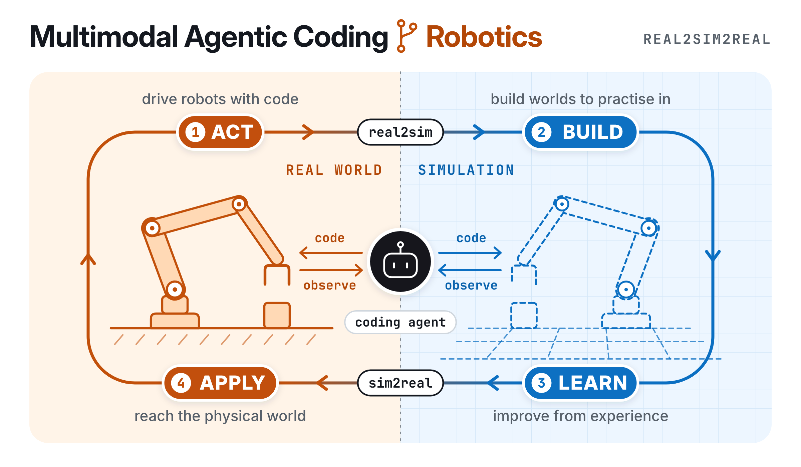
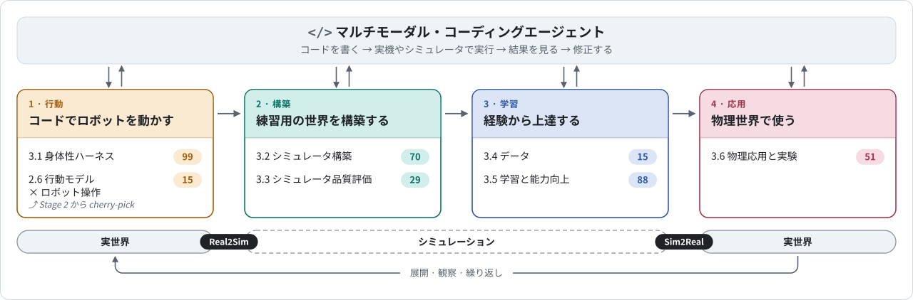
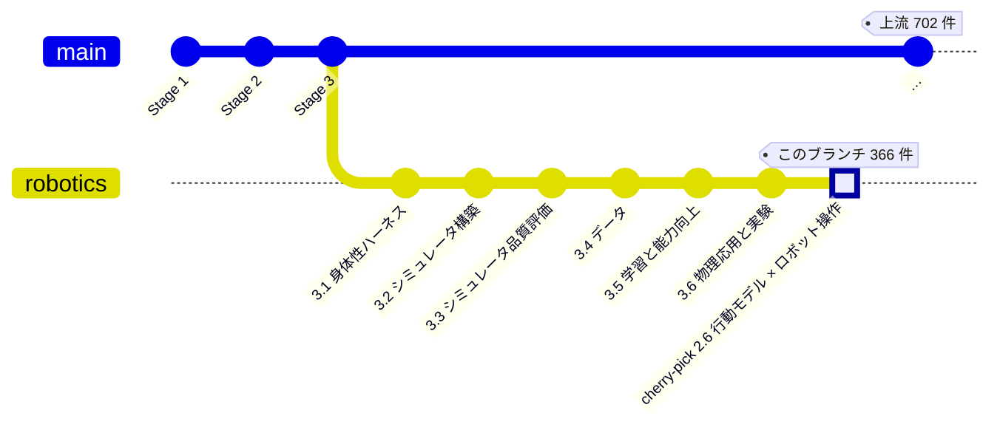
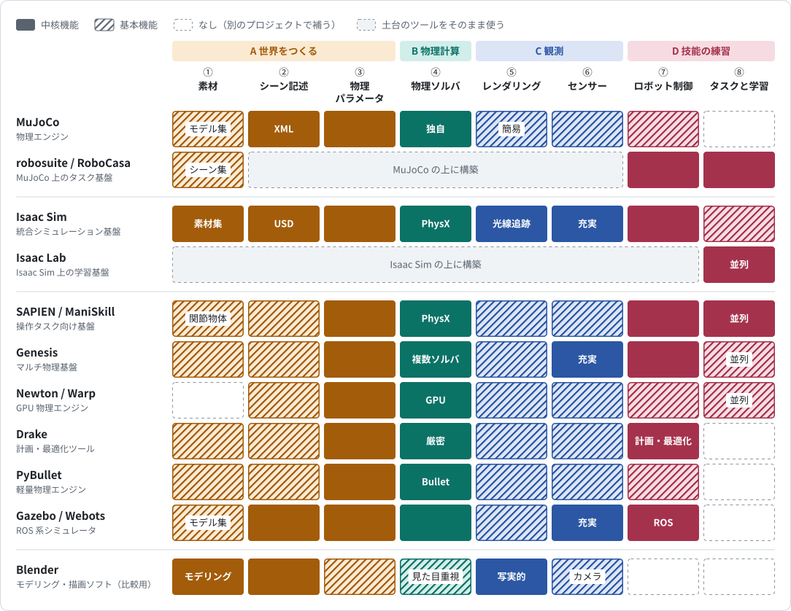
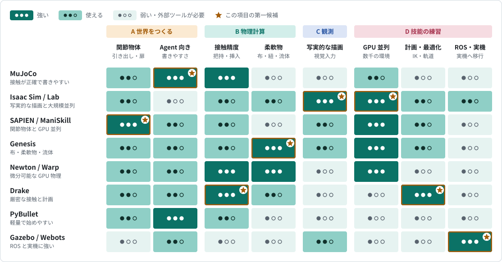

<!-- Generated by scripts/build_readme.py in jiangjin1999/awesome-multimodal-agentic-coding from data/*.yaml — edit the data upstream, not this file. -->

<div align="center">

# Awesome Multimodal Agentic Coding ⎇ Robotics

<picture>
  <source media="(prefers-color-scheme: dark)" srcset="https://raw.githubusercontent.com/jiangjin1999/awesome-multimodal-agentic-coding/main/assets/robotics/hero/hero-dark.png">
  
</picture>

ロボットのためのマルチモーダル・コーディングエージェント：コードを書いて行動し、練習用のシミュレータを構築し、観察した結果からシミュレーションと現実の中で改善していきます。

[](https://awesome.re) [](https://github.com/jiangjin1999/awesome-multimodal-agentic-coding) [](#contents) [](https://github.com/jiangjin1999/awesome-multimodal-agentic-coding-robotics/commits/main) [](./LICENSE)

[English](./README.md) · [简体中文](./README.zh-CN.md) · **日本語**

</div>

```console
$ git checkout -b robotics awesome-multimodal-agentic-coding/stage-3
Switched to a new branch 'robotics'
```

> [!NOTE]
> この日本語版は機械支援翻訳です。論文タイトルは原文のままです。誤りを見つけた場合は Issue でお知らせください。

## 概要

マルチモーダルなコーディングエージェントは、コードを書くことでロボットを動かせます。知覚・計画・制御を呼び出し、実機やシミュレータでプログラムを実行し、結果を見てコードを修正します。同じエージェントが練習用のシミュレータを構築し、そこで集めた経験から上達することもできます。

このリストはその **Real2Sim2Real ループ**を四つのステップに分けます。各ステップは上流マップ Stage 3 の節（と Stage 2 から cherry-pick した 2.6）をまとめたものです。ロボットで**行動**し、練習用の世界を**構築**し、経験から**学習**し、学んだことを物理世界で**応用**します。

<a id="contents"></a>

## 分類

<picture>
  <source media="(prefers-color-scheme: dark)" srcset="https://raw.githubusercontent.com/jiangjin1999/awesome-multimodal-agentic-coding/main/assets/robotics/robotics-map-ja-dark.svg">
  
</picture>

各行は上図のループの一ステップです。節番号は上流と同じで、括弧内は項目数です。

| ステップ | 節 |
|---|---|
| **1 · 行動**<br>コードでロボットを動かす | **[3.1 身体性ハーネス](#s3-1)** (98)<br>[ツールと制御インターフェース](#s3-1-tools-interfaces) (41) · [既存ポリシーへの委任](#s3-1-delegation) (11) · [エージェント能力の評価](#s3-1-capability-eval) (32) · [スキル・ブリッジ・ランタイム資源](#s3-1-skills-runtime) (14)<br>**[2.6 行動モデル × ロボット操作](#s2-6)** (15) <sub>⤴ Stage 2 から cherry-pick</sub> |
| **2 · 構築**<br>練習用の世界を構築する | **[3.2 シミュレータ構築](#s3-2)** (70)<br>**[3.3 シミュレータ品質評価](#s3-3)** (29) |
| **3 · 学習**<br>経験から上達する | **[3.4 データ](#s3-4)** (15)<br>[Real](#s3-4-real-data) (4) · [Sim](#s3-4-sim-data) (7) · [Real+Sim](#s3-4-mixed-data) (4)<br>**[3.5 学習と能力向上](#s3-5)** (88)<br>[プログラムとポリシーの開発](#s3-5-program-policy) (26) · [経験・記憶・スキル学習](#s3-5-experience-skill) (51) · [コーディングエージェントの事後学習](#s3-5-post-training) (11) |
| **4 · 応用**<br>物理世界で使う | **[3.6 物理応用と実験](#s3-6)** (51)<br>[ロボットのインタラクションと操作](#s3-6-robot-interaction) (13) · [科学実験（AI4Science）](#s3-6-experiments) (27) · [物理設計・製造・検証](#s3-6-physical-design) (11) |

🧭 [シミュレーションエンジン一覧](#s3-engines)

⎇ [このブランチの由来](#branch) · [連絡とコントリビュート](#contact) · [引用](#citation) · [上流：三段階の全体マップ](https://github.com/jiangjin1999/awesome-multimodal-agentic-coding)

<a id="branch"></a>

## ⎇ このブランチの由来

このリポジトリは、三段階からなる研究マップ [Awesome Multimodal Agentic Coding](https://github.com/jiangjin1999/awesome-multimodal-agentic-coding) のロボティクス・ブランチです。**Stage 3 · デジタルと物理世界の架け橋** を独立したリポジトリとして checkout し、Stage 2 から **2.6 行動モデル × ロボット操作** を cherry-pick しています。

節番号と論文アンカーは上流から引き継いでいるため、ここでの 3.1 は上流の 3.1 と同じです。Stage 1・2 の研究へのリンクは上流に戻ります。すべての項目は上流で編集され、ここに同期されます。



<a id="stage-3"></a>

## Stage 3 · デジタルと物理世界の架け橋

ループはシミュレーションと現実へ広がります。エージェントは**現実世界で行動し観察し**、実観測からシミュレータを構築し、シミュレーションで練習して強くなります——Real2Sim2Real です。本段階は研究課題ごとに整理しており、検証可能な環境を構築 → インタラクション経験を収集 → エージェントを改善、という流れです。

**まず読む:** [Code as Policies](#paper-2209-07753) · [Democratizing Robot-Use Agents](#paper-2611-01560) · [Real2Gym](#paper-2609-37089) · [Agentic RSR](#paper-2610-10479) · [Eureka](#paper-2310-12931)

<a id="s3-1"></a>

### 3.1 身体性ハーネス

<a id="s3-1-tools-interfaces"></a>

#### ツールと制御インターフェース

<!-- mmac-record: {"id": "2611.29377", "scope": "Adjacent", "primary": "3.1", "stage": 3, "type": "paper"} -->

- <a id="paper-2611-29377"></a>`2026.11` **[Contact Harness: Enabling VLM Agents to Perform Contact-Rich Manipulation](https://arxiv.org/abs/2611.29377)** [[プロジェクトページ]](https://ntumars.github.io/ContactHarness/) [[コード]](https://github.com/NTUMARS/Contact-Harness) [[データセット]](https://huggingface.co/datasets/ntumars/Contact-4)
  > 視覚・力覚と利用可能な触覚から接触状態を判断し、動作中の力フィードバックで運動を調整する。<br>
  > 🖥️ **シミュレーション** MuJoCo（Franka Panda） · 🦾 **実機** Rokae、Franka

<!-- mmac-record: {"id": "2611.01560", "scope": "Core", "primary": "3.1", "stage": 3, "type": "paper"} -->

- <a id="paper-2611-01560"></a>`2026.11` **[Democratizing Robot-Use Agents: A Unified Harness with Open Models](https://arxiv.org/abs/2611.01560)** [[コード]](https://github.com/Open-RUA/uni-robot-agent) [[プロジェクトページ]](https://openrua.ai/uni-robot-agent)
  > Qwen3.8-Flash-Next と GPT-6 Astra が統一インターフェースで知覚・運動ツールを呼び、幾何チェックと動作結果の観察から次の操作を調整する。<br>
  > 🖥️ **シミュレーション** Isaac Sim（ARX X5） · 🦾 **実機** ARX AC One

<!-- mmac-record: {"id": "2611.27182", "scope": "Core", "primary": "3.1", "stage": 3, "type": "paper"} -->

- <a id="paper-2611-27182"></a>`2026.11` **[Tripwire: Robot Agents that Program Their Own Interrupts under Human Disturbance](https://arxiv.org/abs/2611.27182)**
  > 固定したロボット方策に視覚監視の割り込みプログラムを付け、状況に応じて書き換える。<br>
  > 🖥️ **シミュレーション** MuJoCo（PandaOmron） · 🦾 **実機** UFACTORY xArm 7

<!-- mmac-record: {"id": "2611.01112", "scope": "Core", "primary": "3.1", "stage": 3, "type": "paper"} -->

- <a id="paper-2611-01112"></a>`2026.10` **[Auriga Technical Report: A Task-Agnostic Agent Harness for Zero-Shot Embodied Manipulation](https://arxiv.org/abs/2611.01112)** [[プロジェクトページ]](https://auriga.stelledge.com/) [[コード]](https://github.com/lose4578/Auriga)
  > タスクに関する信念、三次元測定、軌跡プレビュー、共通の実行インターフェースの上で、モデルがツールを選ぶか複数ステップの Python を書く。<br>
  > 🖥️ **シミュレーション** Isaac Sim + MuJoCo（ARX X5、Franka Panda）

<!-- mmac-record: {"id": "2610.13862", "scope": "Adjacent", "primary": "3.1", "stage": 3, "type": "paper"} -->

- <a id="paper-2610-13862"></a>`2026.10` **[BT-Agent: Deploying Onboard Robot Agents with Behavior Trees and Multi-Fidelity Evaluation](https://arxiv.org/abs/2610.13862)**
  > 固定の行動木スキルで知覚・物理行動ツールをまとめ、構造化された失敗情報で再試行や判断変更を行う。ローカルのガードが操作者の承認を得た機上運動を監督する。<br>
  > 🖥️ **シミュレーション** Habitat + MuJoCo（Boston Dynamics Spot） · 🦾 **実機** Boston Dynamics Spot

<!-- mmac-record: {"id": "2610.29702", "scope": "Adjacent", "primary": "3.1", "stage": 3, "type": "paper"} -->

- <a id="paper-2610-29702"></a>`2026.10` **[CausGround: Causal Interaction Grounding for Adaptive Embodied Planning](https://arxiv.org/abs/2610.29702)** [[プロジェクトページ]](https://causground.github.io/)
  > RGB 観測から物体単位の因果機構を表し、行動の前提条件と効果を検索して、重みを固定したプランナーのスキル選択を導く。シミュレーション、記録済みスキルの再生、定性的なロボット実演で検証する。<br>
  > 🖥️ **シミュレーション** Unity + MuJoCo（Franka Panda）

<!-- mmac-record: {"id": "2610.01939", "scope": "Core", "primary": "3.1", "stage": 3, "type": "paper"} -->

- <a id="paper-2610-01939"></a>`2026.10` **[Fewer Tokens, Better Action: GPT-6 Astra Robot Agents with 14% Higher Success Rate but 65% Fewer Tokens](https://arxiv.org/abs/2610.01939)**
  > Agent が Python セル内でロボットの基本操作、局所的な確認、再試行を組み合わせ、戻すコンテキスト量を減らす。小型コードモデルの強化学習も検討する。<br>
  > 🖥️ **シミュレーション** MuJoCo + SAPIEN（Franka Panda、AgileX ALOHA）

<!-- mmac-record: {"id": "2610.23479", "scope": "Core", "primary": "3.1", "stage": 3, "type": "paper"} -->

- <a id="paper-2610-23479"></a>`2026.10` **[HexaShell: A Universal Harness for Robot Coding Agents in Simulation and the Real World](https://arxiv.org/abs/2610.23479)** [[コード]](https://github.com/HexaFuture/HexaShell)
  > ロボットプログラミング Agent が各ラウンドで Python を書き、共通の運動・知覚・状態ツールを呼び出す。過去の実行記録から抽出したタスクスキルも再利用できる。<br>
  > 🖥️ **シミュレーション** Isaac Sim + SAPIEN + MuJoCo（ARX X5、Franka Panda） · 🦾 **実機** AgileX PiPER-X

<!-- mmac-record: {"id": "2610.02459", "scope": "Core", "primary": "3.1", "stage": 3, "type": "paper"} -->

- <a id="paper-2610-02459"></a>`2026.10` **[OpenRUA: Robot-Use Agents Are Zero-Shot Visuomotor Policies](https://arxiv.org/abs/2610.02459)** [[コード]](https://github.com/terminalworld/OpenRUA)
  > 既存の Coding Agent に端末、ROS 2 の文書、ロボットの作業環境だけを与え、ロボット固有のインターフェースを直接プログラミングするゼロショット能力を調べる。<br>
  > 🖥️ **シミュレーション** MuJoCo + Isaac Sim（Franka Panda）

<!-- mmac-record: {"id": "2610.06843", "scope": "Adjacent", "primary": "3.1", "stage": 3, "type": "paper"} -->

- <a id="paper-2610-06843"></a>`2026.10` **[Recursive Video In-Context Learning for Agentic Robot](https://arxiv.org/abs/2610.06843)** [[コード]](https://github.com/BWR-hhh/rvicl) [[プロジェクトページ]](https://bwr-hhh.github.io/rvicl/)
  > ロボット Agent が階層化された実演動画を必要に応じて参照し、実時間のカメラ映像と比較して、重みを固定した VLA と解析的な基本動作の呼び出しを調整する。低レベルの実行基盤は維持する。<br>
  > 🖥️ **シミュレーション** MuJoCo（Franka Panda）

<!-- mmac-record: {"id": "2610.04929", "scope": "Adjacent", "primary": "3.1", "stage": 3, "type": "paper"} -->

- <a id="paper-2610-04929"></a>`2026.10` **[RobotUse: Allocating Computation, Context, and Decisions](https://arxiv.org/abs/2610.04929)** [[プロジェクトページ]](https://robotuse-team.github.io/) [[コード]](https://github.com/robotuse-team/RobotUse)
  > 物理的な行動を中心に計算、コンテキスト、意思決定を構成し、永続的な実行マニュアルにロボット Agent のタスク経験を蓄積する。<br>
  > 🖥️ **シミュレーション** Isaac Lab（Franka Panda） · 🦾 **実機** Franka Panda

<!-- mmac-record: {"id": "2610.12457", "scope": "Adjacent", "primary": "3.1", "stage": 3, "type": "paper"} -->

- <a id="paper-2610-12457"></a>`2026.10` **[SpatialHarness: Test-Time Spatial Scaffolding for Fine Robotic Manipulation](https://arxiv.org/abs/2610.12457)** [[プロジェクトページ]](https://emilia113.github.io/SpatialHarness/) [[データセット]](https://huggingface.co/datasets/yzy05/SpatialHarness)
  > 実際の実行と同期する模擬シーンを維持し、タスクに応じて補助視点をレンダリングすることで、重みを固定したマルチモーダルロボット方策に空間的な手掛かりを与える。<br>
  > 🖥️ **シミュレーション** MuJoCo（Franka FR3） · 🦾 **実機** Franka FR3

<!-- mmac-record: {"id": "2610.30043", "scope": "Adjacent", "primary": "3.1", "stage": 3, "type": "paper"} -->

- <a id="paper-2610-30043"></a>`2026.10` **[TARSphere: A Robot-Oriented Full-Stack Framework for Long-Horizon Embodied Agents in Evolving Physical and Social Environments](https://arxiv.org/abs/2610.30043)** [[コード]](https://github.com/xuyicheng-zju/TARSphere) [[プロジェクトページ]](https://xuyicheng-zju.github.io/TARSphere/)
  > 重みを固定したマルチモーダルモデルに、階層的な実行可能スキル、タスク記憶、実行フィードバックを与え、長期的なロボット行動と環境変化への対処を構成する。<br>
  > 🖥️ **シミュレーション** Isaac Sim（Unitree G1）

<!-- mmac-record: {"id": "2609.12541", "scope": "Core", "primary": "3.1", "stage": 3, "type": "paper"} -->

- <a id="paper-2609-12541"></a>`2026.09` **[Agent as Policy for Robotic Manipulation](https://arxiv.org/abs/2609.12541)** [[データセット]](https://huggingface.co/datasets/Agent-as-Policy/agent-as-policy) [[コード]](https://github.com/agent-as-policy-2026/agent-as-policy)
  > 汎用 Agent が視覚的な証拠を継続的に読み、プログラムと運動指令を生成し、物理的な実行結果に応じて次の行動を調整する。<br>
  > 🖥️ **シミュレーション** MuJoCo（I2RT YAM） · 🦾 **実機** I2RT YAM

<!-- mmac-record: {"id": "2609.20822", "scope": "Core", "primary": "3.1", "stage": 3, "type": "paper"} -->

- <a id="paper-2609-20822"></a>`2026.09` **[Coding Agents with an Obstacle-Aware Harness for Safe Robot Manipulation](https://arxiv.org/abs/2609.20822)**
  > Code-as-policy Agent に視覚位置推定に基づく経路確認と接触制約を追加する。障害物や未モデル化の物理的制約に遭遇した場合、観測した停止姿勢から後続動作を再計画する。<br>
  > 🖥️ **シミュレーション** MuJoCo（Franka Panda） · 🦾 **実機** AgileX PiPER-X

<!-- mmac-record: {"id": "2609.38078", "scope": "Adjacent", "primary": "3.1", "stage": 3, "type": "paper"} -->

- <a id="paper-2609-38078"></a>`2026.09` **[MotorMind: Scaffolding General Vision Language Models for Zero-Shot Robot Manipulation](https://arxiv.org/abs/2609.38078)**
  > 中間レベルの動作、決定的な制御、非同期監視を介して汎用 VLM とロボットアームを接続し、推論頻度と実行の信頼性の関係を調べる。<br>
  > 🖥️ **シミュレーション** MuJoCo（Franka Panda） · 🦾 **実機** xArm6

<!-- mmac-record: {"id": "2609.29389", "scope": "Adjacent", "primary": "3.1", "stage": 3, "type": "paper"} -->

- <a id="paper-2609-29389"></a>`2026.09` **[Robo-Harness K1: Harnessing Robot-Use Agents via Perception Augmentation](https://arxiv.org/abs/2609.29389)**
  > 3D 知覚を Robot-Use Agent が呼び出せるツールとして提供し、視覚エンコーダーを再学習せずに幾何学的な位置推定能力を高める。<br>
  > 🖥️ **シミュレーション** MuJoCo + SAPIEN（Franka Panda、UR5e、KUKA iiwa、AgileX ALOHA）

<!-- mmac-record: {"id": "2610.14018", "scope": "Adjacent", "primary": "3.1", "stage": 3, "type": "paper"} -->

- <a id="paper-2610-14018"></a>`2026.09` **[RoboHarness: A Simple Harness Outperforms VLA and World Action Models](https://arxiv.org/abs/2610.14018)** [[コード]](https://github.com/BinceQu/RoboHarness)
  > LLM Agent に視覚幾何の操作パネルを与え、単純なツールインターフェースがゼロショットのロボット操作を支えられるか調べる。<br>
  > 🖥️ **シミュレーション** MuJoCo + Isaac Sim（Franka Panda、Galaxea R1 Pro、ARX X5）

<!-- mmac-record: {"id": "2609.10522", "scope": "Adjacent", "primary": "3.1", "stage": 3, "type": "paper"} -->

- <a id="paper-2609-10522"></a>`2026.09` **[Show-Harness: Just a VLM Agent Can Play Robots](https://arxiv.org/abs/2609.10522)** [[プロジェクトページ]](https://showlab.github.io/Show-Harness) [[コード]](https://github.com/showlab/Show-Harness) [[モデル]](https://huggingface.co/showlab/Show-Harness-VLMs) [[データセット]](https://huggingface.co/datasets/showlab/Show-Harness-Data)
  > 簡潔な意味的動作インターフェースで汎用 VLM とロボットインタープリターを接続し、デジタル Agent 型の対話を物理制御に移す条件を検討する。<br>
  > 🖥️ **シミュレーション** Isaac Lab + SAPIEN（Franka Panda） · 🦾 **実機** Franka FR3、AgileX PiPER

<!-- mmac-record: {"id": "2609.22966", "scope": "Adjacent", "primary": "3.1", "stage": 3, "type": "paper"} -->

- <a id="paper-2609-22966"></a>`2026.09` **[Transferring the Intelligence of VLMs to Robotic Control](https://arxiv.org/abs/2609.22966)** [[プロジェクトページ]](https://robodawn.top/) [[コード]](https://github.com/Hugo-AGI/RoboDawn) [[デモ]](https://robodawn.top/results)
  > RoboDawn は離散的な動作コマンドと文脈内の実演を使い、固定した VLM が実行結果を見ながらロボットを操作できるようにする。<br>
  > 🖥️ **シミュレーション** SAPIEN + Isaac Sim · 🦾 **実機** Franka、AgileX PiPER

<!-- mmac-record: {"id": "2609.29964", "scope": "Adjacent", "primary": "3.1", "stage": 3, "type": "paper"} -->

- <a id="paper-2609-29964"></a>`2026.09` **[World Action Agent: Harnessing VLMs for Robot Manipulation via World Action Rehearsal](https://arxiv.org/abs/2609.29964)**
  > VLM に操作対象の局所視点、編集可能な動作プレビュー、実演から抽出したスキルを与える。方策コードを生成せず、数値計画ツールによって操作判断を継続的に修正する。<br>
  > 🖥️ **シミュレーション** MuJoCo（Franka Panda）

<!-- mmac-record: {"id": "chemautoagent", "scope": "Adjacent", "primary": "3.1", "stage": 3, "type": "paper"} -->

- <a id="paper-chemautoagent"></a>`2026.08` **[ChemAutoAgent: A Multi-Agent System for Evidence-Controlled Laboratory Instrument Driver Generation from Text-Based Manuals](https://www.mdpi.com/2076-3417/16/16/8291)** [[バージョン履歴]](https://www.mdpi.com/2076-3417/16/16/8291/notes)
  > 出典付きの機器マニュアルから Agent がドライバーを生成し、決定的なプロトコルの骨格とハードウェア試験を使って誤りを修正する。その後、再利用可能なインターフェースを実験 Agent に提供する。

<!-- mmac-record: {"id": "2608.03924", "scope": "Adjacent", "primary": "3.1", "stage": 3, "type": "paper"} -->

- <a id="paper-2608-03924"></a>`2026.08` **[ETA: A New Agentic Paradigm for Embodied Tasks](https://arxiv.org/abs/2608.03924)**
  > OpenETA を介して観察、対象の指定、運動の機能を Codex などのデジタル Agent に接続し、軽量なインターフェースによる物理タスクの実行を研究する。<br>
  > 🖥️ **シミュレーション** MuJoCo（Franka Panda） · 🦾 **実機** UR5e

<!-- mmac-record: {"id": "2607.05369", "scope": "Adjacent", "primary": "3.1", "stage": 3, "type": "paper"} -->

- <a id="paper-2607-05369"></a>`2026.07` **[GaP: A Graph-as-Policy Multi-Agent Self-Learning Harness For Variational Automation Tasks](https://arxiv.org/abs/2607.05369)** [[プロジェクトページ]](https://graph-robots.github.io/gap) [[コード]](https://github.com/graph-robots/graph-as-policy)
  > 複数の Agent が知覚・計画・制御ノードを接続する計算グラフを記述し、組み合わせ可能なロボットスキルライブラリで多様な自動化タスクを支える。<br>
  > 🖥️ **シミュレーション** MuJoCo（Franka Panda） · 🦾 **実機** Franka

<!-- mmac-record: {"id": "2607.16636", "scope": "Adjacent", "primary": "3.1", "stage": 3, "type": "paper"} -->

- <a id="paper-2607-16636"></a>`2026.07` **[PhyAgentOS: A Self-Evolving Operating System for Embodied Agents with Decoupled Cognitive Planning and Physical Execution](https://arxiv.org/abs/2607.16636)** [[コード]](https://github.com/PhyAgentOS/PhyAgentOS)
  > ファイルで表す状態契約によって Agent の推論とロボットの実行を分離し、ツール呼び出し、状態記録、経験の更新を実行層の間でつなぐ。<br>
  > 🖥️ **シミュレーション** MuJoCo + Isaac Sim · 🦾 **実機** Franka FR3、XLeRobot、AgileX PiPER、Dobot Nova 2、Unitree Go2、Unitree G1

<!-- mmac-record: {"id": "2607.11119", "scope": "Adjacent", "primary": "3.1", "stage": 3, "type": "paper"} -->

- <a id="paper-2607-11119"></a>`2026.07` **[VIA: Visual Interface Agent for Robot Control](https://arxiv.org/abs/2607.11119)**
  > 視覚エージェントが画面上で仮想グリッパーの姿勢を調整し、ウェイポイントをロボットの制御器へ送る。<br>
  > 🖥️ **シミュレーション** Franka Panda · 🦾 **実機** Stretch 4

<!-- mmac-record: {"id": "2605.26637", "scope": "Adjacent", "primary": "3.1", "stage": 3, "type": "paper"} -->

- <a id="paper-2605-26637"></a>`2026.05` **[Enabling Extensible Embodied Capabilities with Tools](https://arxiv.org/abs/2605.26637)**
  > Embodied Tool Protocol を提案し、ロボットの知覚・推論・実行機能を登録、発見、呼び出し可能なツールに統一することで、Agent が既存の能力を組み合わせられるようにする。<br>
  > 🖥️ **シミュレーション** AI2-THOR + Habitat + CoppeliaSim（Franka Panda）

<!-- mmac-record: {"id": "2512.05955", "scope": "Adjacent", "primary": "3.1", "stage": 3, "type": "paper"} -->

- <a id="paper-2512-05955"></a>`2025.12` **[SIMPACT: Simulation-Enabled Action Planning using Vision-Language Models](https://arxiv.org/abs/2512.05955)** [[プロジェクトページ]](https://simpact-bot.github.io/) [[コード]](https://github.com/ShaoxiongYao/simpact)
  > 物理シミュレーションの描画された軌跡を使って操作動作を修正し、実際のロボットで実行する。<br>
  > 🖥️ **シミュレーション** MuJoCo + Warp + PyBullet · 🦾 **実機** Franka FR3

<!-- mmac-record: {"id": "2511.00917", "scope": "Core", "primary": "3.1", "stage": 3, "type": "paper"} -->

- <a id="paper-2511-00917"></a>`2025.11` **[MAESTRO: Orchestrating Robotics Modules with Coding Agents for Zero-Shot Generalist Robots](https://arxiv.org/abs/2511.00917)** [[コード]](https://github.com/penn-pal-lab/maestro) [[プロジェクトページ]](https://maestro-robot.github.io)
  > VLM がロボットプログラムを書いて知覚・計画・制御モジュールを構成し、視覚と実行のフィードバックで結果の検証と失敗からの復帰を行う。<br>
  > 🦾 **実機** Franka Panda、Unitree Go2-W、AgileX PiPER

<!-- mmac-record: {"id": "2510.21302", "scope": "Adjacent", "primary": "3.1", "stage": 3, "type": "paper"} -->

- <a id="paper-2510-21302"></a>`2025.10` **[Towards Reliable Code-as-Policies: A Neuro-Symbolic Framework for Embodied Task Planning](https://arxiv.org/abs/2510.21302)**
  > ロボット方策のコード生成と記号的検証を組み合わせ、探索プログラムによって不足する観測を補い、行動条件を検証する。<br>
  > 🖥️ **シミュレーション** CoppeliaSim（Franka Panda） · 🦾 **実機** Franka FR3

<!-- mmac-record: {"id": "2505.07532", "scope": "Adjacent", "primary": "3.1", "stage": 3, "type": "paper"} -->

- <a id="paper-2505-07532"></a>`2025.05` **[RAI: Flexible Agent Framework for Embodied AI](https://arxiv.org/abs/2505.07532)**
  > モジュール化したツールインターフェースで言語モデル、複数 Agent、ROS、シミュレーションを接続し、ロボット Agent に再利用可能な実行基盤を提供する。<br>
  > 🖥️ **シミュレーション** O3DE（Husarion ROSbot XL） · 🦾 **実機** Husarion ROSbot XL

<!-- mmac-record: {"id": "2503.21969", "scope": "Core", "primary": "3.1", "stage": 3, "type": "paper"} -->

- <a id="paper-2503-21969"></a>`2025.03` **[Robotic Long-Horizon Manipulation with Progressive In-Context Code Generation and Episodic Feedback](https://arxiv.org/abs/2503.21969)**
  > 段階的なコンテキストからロボットプログラムを生成し、各回の実行後に視覚レポーターが結果を要約して再計画を導く。<br>
  > 🖥️ **シミュレーション** PyBullet + MuJoCo（UR5e、Franka Panda） · 🦾 **実機** Franka

<!-- mmac-record: {"id": "2412.04455", "scope": "Adjacent", "primary": "3.1", "stage": 3, "type": "paper"} -->

- <a id="paper-2412-04455"></a>`2024.12` **[Code-as-Monitor: Constraint-aware Visual Programming for Reactive and Proactive Robotic Failure Detection](https://arxiv.org/abs/2412.04455)** [[プロジェクトページ]](https://zhoues.github.io/Code-as-Monitor/)
  > VLM が実行可能な時空間制約の監視プログラムを記述し、視覚追跡によってロボット実行中の失敗や潜在的な違反を確認する。<br>
  > 🖥️ **シミュレーション** CoppeliaSim + PyBullet + Isaac Sim（Franka Panda、UR5、Fetch） · 🦾 **実機** UR5、LEAP Hand

<!-- mmac-record: {"id": "2410.06472", "scope": "Adjacent", "primary": "3.1", "stage": 3, "type": "paper"} -->

- <a id="paper-2410-06472"></a>`2024.10` **[Enabling Novel Mission Operations and Interactions with ROSA: The Robot Operating System Agent](https://arxiv.org/abs/2410.06472)**
  > ROS の照会、診断、操作を言語 Agent が呼び出せるツールとしてまとめ、異なるロボット基盤で自然言語によるタスク操作を支援する。<br>
  > 🖥️ **シミュレーション** Isaac Sim（NVIDIA Nova Carter） · 🦾 **実機** JPL EELS、Boston Dynamics Spot

<!-- mmac-record: {"id": "bounded-motion", "scope": "Adjacent", "primary": "3.1", "stage": 3, "type": "paper"} -->

- <a id="paper-bounded-motion"></a>`2024.10` **[Language-guided Manipulator Motion Planning with Bounded Task Space](https://proceedings.mlr.press/v270/oelerich25a.html)** [[プロジェクトページ]](https://www.acin.tuwien.ac.at/42d2/)
  > 言語モデルが視覚情報に基づいて Python を書き、制約付き経路プランナーを呼び出す。BoundMPC が滑らかな軌道を実行し、意味的な推論とロボットの運動制約をつなぐ。

<!-- mmac-record: {"id": "2312.04474", "scope": "Adjacent", "primary": "3.1", "stage": 3, "type": "paper"} -->

- <a id="paper-2312-04474"></a>`2023.12` **[Chain of Code: Reasoning with a Language Model-Augmented Code Emulator](https://arxiv.org/abs/2312.04474)** [[プロジェクトページ]](https://chain-of-code.github.io) [[デモ]](https://colab.research.google.com/github/google-research/google-research/blob/master/code_as_policies/coc_demo.ipynb)
  > 明示的なプログラムロジックをインタープリターで実行し、未定義の意味的な計算を言語モデルによる模擬実行に任せる。ロボット実験でコードとモデル呼び出しの組み合わせを示す。<br>
  > 🦾 **実機** UR5

<!-- mmac-record: {"id": "2306.09523", "scope": "Adjacent", "primary": "3.1", "stage": 3, "type": "paper"} -->

- <a id="paper-2306-09523"></a>`2023.06` **[Tell Me Where to Go: A Composable Framework for Context-Aware Embodied Robot Navigation](https://arxiv.org/abs/2306.09523)**
  > 生成した Python の中間層で言語推論、視覚的な環境記述、移動ロボットのナビゲーション API を接続し、文脈に依存する移動指示に対応する。<br>
  > 🦾 **実機** Boston Dynamics Spot

<!-- mmac-record: {"id": "2305.11176", "scope": "Adjacent", "primary": "3.1", "stage": 3, "type": "paper"} -->

- <a id="paper-2305-11176"></a>`2023.05` **[Instruct2Act: Mapping Multi-modality Instructions to Robotic Actions with Large Language Model](https://arxiv.org/abs/2305.11176)** [[コード]](https://github.com/OpenGVLab/Instruct2Act)
  > LLM が Python プログラムを生成して SAM、CLIP、動作 API を呼び出し、マルチモーダルな指示を知覚・計画・実行の流れにまとめる。<br>
  > 🖥️ **シミュレーション** PyBullet（UR5）

<!-- mmac-record: {"id": "2306.17582", "scope": "Adjacent", "primary": "3.1", "stage": 3, "type": "paper"} -->

- <a id="paper-2306-17582"></a>`2023.02` **[ChatGPT for Robotics: Design Principles and Model Abilities](https://arxiv.org/abs/2306.17582)** [[プロジェクトページ]](https://www.microsoft.com/en-us/research/publication/chatgpt-for-robotics-design-principles-and-model-abilities/)
  > 関数ライブラリ、プロンプト設計、人との対話を用いて、ChatGPT がロボットアーム、ドローン、移動ロボットのタスクプログラムを記述・修正する。<br>
  > 🖥️ **シミュレーション** AirSim + Habitat · 🦾 **実機** DJI Tello

<!-- mmac-record: {"id": "2209.07753", "scope": "Adjacent", "primary": "3.1", "stage": 3, "type": "paper"} -->

- <a id="paper-2209-07753"></a>`2022.09` **[Code as Policies: Language Model Programs for Embodied Control](https://arxiv.org/abs/2209.07753)** [[プロジェクトページ]](https://code-as-policies.github.io) [[コード]](https://github.com/google-research/google-research/tree/master/code_as_policies) [[デモ]](https://huggingface.co/spaces/jackyliang42/code-as-policies)
  > 言語モデルが Python 方策を再帰的に生成し、知覚結果、幾何計算、制御 API を組み合わせる、ロボット Code-as-Policy の初期的な基盤。プログラム内のフィードバックは、コードを書くモデルが実行結果からプログラムを書き直すことを意味しない。<br>
  > 🖥️ **シミュレーション** PyBullet（UR5e） · 🦾 **実機** UR5e、Everyday Robots

<!-- mmac-record: {"id": "2209.11302", "scope": "Adjacent", "primary": "3.1", "stage": 3, "type": "paper"} -->

- <a id="paper-2209-11302"></a>`2022.09` **[ProgPrompt: Generating Situated Robot Task Plans using Large Language Models](https://arxiv.org/abs/2209.11302)** [[プロジェクトページ]](http://progprompt.github.io) [[コード]](https://github.com/NVlabs/progprompt-vh)
  > 利用可能な動作、物体、アサーションを使って手続き的なプロンプトを構成し、前提条件の確認と復帰処理を行えるロボットタスク計画を言語モデルに生成させる。<br>
  > 🖥️ **シミュレーション** Unity · 🦾 **実機** Franka Panda

<a id="s3-1-delegation"></a>

#### 既存ポリシーへの委任

<!-- mmac-record: {"id": "2611.03585", "scope": "Adjacent", "primary": "3.1", "stage": 3, "type": "paper"} -->

- <a id="paper-2611-03585"></a>`2026.11` **[Seeing Through the Illusion: Test-Time Scaling for World Action Models](https://arxiv.org/abs/2611.03585)**
  > 行動の有効性、想像した運動の逆動力学的一貫性、タスク進捗を組み合わせて固定の世界・行動モデルの候補軌跡を選び、行動チャンク実行後に新しい観測で再計画する。<br>
  > 🖥️ **シミュレーション** MuJoCo + Isaac Lab（Franka Panda）

<!-- mmac-record: {"id": "system:the-harness-corl2026", "scope": "Adjacent", "primary": "3.1", "stage": 3, "type": "paper"} -->

- <a id="paper-system-the-harness-corl2026"></a>`2026.11` **[The Harness: One Agent Harness for Anything that Acts](https://web.eecs.umich.edu/~stellayu/publication/2026harnessCoRLL.html)** [[論文]](https://web.eecs.umich.edu/~stellayu/publication/doc/2026harnessCoRLL.pdf)
  > エージェントが書くプログラム、範囲を限定した VLA スキル、高速な反応ガードを共通の階層制御へ組み合わせる。<br>
  > 🖥️ **シミュレーション** Isaac Sim（ARX X5）

<!-- mmac-record: {"id": "2611.34778", "scope": "Core", "primary": "3.1", "stage": 3, "type": "paper"} -->

- <a id="paper-2611-34778"></a>`2026.11` **[Toward Agentic Robotics: A Large-Scale Study of Harness Design for Robot-Use Agents](https://arxiv.org/abs/2611.34778)**
  > ロボット方策のハーネスを比較し、試行で改良した Python、固定した行動方策、失敗時の視覚に基づく復旧を組み合わせる。<br>
  > 🖥️ **シミュレーション** MuJoCo + SAPIEN + Isaac Sim · 🦾 **実機** YAM

<!-- mmac-record: {"id": "2610.21453", "scope": "Adjacent", "primary": "3.1", "stage": 3, "type": "paper"} -->

- <a id="paper-2610-21453"></a>`2026.10` **[CarryOn: A Dual-Loop Harness for Personalized and Reliable Robot Assistance](https://arxiv.org/abs/2610.21453)** [[コード]](https://github.com/JIA-Lab-research/CarryOn) [[プロジェクトページ]](https://vincent2311.github.io/Projects/CarryOn/)
  > 持続する利用者・場面記憶、固定 VLA、幾何的な安全フィルタ、視覚的な失敗回復を連携させる。オフラインの振り返りで回復方策とパラメータを修正し、次の試行へ再利用する。<br>
  > 🖥️ **シミュレーション** MuJoCo + Isaac Lab（Franka Panda） · 🦾 **実機** Franka FR3

<!-- mmac-record: {"id": "2610.19600", "scope": "Adjacent", "primary": "3.1", "stage": 3, "type": "paper"} -->

- <a id="paper-2610-19600"></a>`2026.10` **[Cracking Mobile Manipulation: From Failure Diagnosis to Agentic Robot System](https://arxiv.org/abs/2610.19600)** [[プロジェクトページ]](https://github.com/PKU-VaLuE-Lab/Cracking-Mobile-Manipulation)
  > 移動マニピュレーションの失敗診断に基づき、固定 VLA に視覚記憶と幾何ツールを組み合わせる。<br>
  > 🖥️ **シミュレーション** MuJoCo + Isaac Sim · 🦾 **実機** Astribot S1

<!-- mmac-record: {"id": "2610.42053", "scope": "Adjacent", "primary": "3.1", "stage": 3, "type": "paper"} -->

- <a id="paper-2610-42053"></a>`2026.10` **[REA: A Routed Embodied Agent Runtime for Asynchronous Brain-Cerebellum Control](https://arxiv.org/abs/2610.42053)** [[プロジェクトページ]](https://mikeeeeeeeeeeeeee.github.io/REA/)
  > 高速なロボット実行と非同期のモデル判断・経路選択を分離し、方策から戻る境界で視覚的な結果を確認して固定コード方策と行動モデルを調整する。<br>
  > 🖥️ **シミュレーション** MuJoCo + SAPIEN + Isaac Sim（Franka Panda、AgileX ALOHA、Galaxea R1 Pro） · 🦾 **実機** Unitree G1

<!-- mmac-record: {"id": "2609.29166", "scope": "Core", "primary": "3.1", "stage": 3, "type": "paper"} -->

- <a id="paper-2609-29166"></a>`2026.09` **[HarnessPAI: An Evolving Harness for Physical AI](https://arxiv.org/abs/2609.29166)** [[プロジェクトページ]](https://darwin-agent.github.io/HarnessPAI) [[コード]](https://github.com/Darwin-Agent/HarnessPAI)
  > 実行可能なコードで下位の行動プリミティブをまとめ、相互作用のフィードバックでロボットプログラムを進化させる。安定したプログラムは下流方策の訓練データも生成できる。<br>
  > 🖥️ **シミュレーション** MuJoCo（Franka Panda）

<!-- mmac-record: {"id": "2608.11246", "scope": "Adjacent", "primary": "3.1", "stage": 3, "type": "paper"} -->

- <a id="paper-2608-11246"></a>`2026.08` **[Towards the Harness of Embodied Agents](https://arxiv.org/abs/2608.11246)** [[プロジェクトページ]](https://eit-hai.github.io/thea) [[コード]](https://github.com/EIT-HAI/Thea)
  > 持続的なシーングラフと、成功・失敗理由を含む実行結果で、ロボットの能力をエージェントが理解して呼び出せるツールにまとめる。<br>
  > 🦾 **実機** Astribot S1、AgileX Cobot Magic、Unitree G1

<!-- mmac-record: {"id": "2607.08448", "scope": "Adjacent", "primary": "3.1", "stage": 3, "type": "paper"} -->

- <a id="paper-2607-08448"></a>`2026.07` **[Harness VLA: Steering Frozen VLAs into Reliable Manipulation Primitives via Memory-Guided Agents](https://arxiv.org/abs/2607.08448)** [[コード]](https://github.com/RLinf/RPent)
  > コーディングエージェントに、固定 VLA と解析的な行動プリミティブを組み合わせさせる。<br>
  > 🖥️ **シミュレーション** MuJoCo + SAPIEN（Franka Panda、AgileX ALOHA） · 🦾 **実機** Franka

<!-- mmac-record: {"id": "2207.05608", "scope": "Adjacent", "primary": "3.1", "stage": 3, "type": "paper"} -->

- <a id="paper-2207-05608"></a>`2022.07` **[Inner Monologue: Embodied Reasoning through Planning with Language Models](https://arxiv.org/abs/2207.05608)** [[プロジェクトページ]](https://innermonologue.github.io/)
  > 知覚・成否判定・人からのフィードバックを言語化し、ロボットのスキル実行を再計画する。<br>
  > 🖥️ **シミュレーション** PyBullet · 🦾 **実機** UR5e、Everyday Robots

<!-- mmac-record: {"id": "2204.01691", "scope": "Adjacent", "primary": "3.1", "stage": 3, "type": "paper"} -->

- <a id="paper-2204-01691"></a>`2022.04` **[Do As I Can, Not As I Say: Grounding Language in Robotic Affordances](https://arxiv.org/abs/2204.01691)** [[プロジェクトページ]](https://say-can.github.io/) [[コード]](https://github.com/google-research/google-research/tree/master/saycan)
  > SayCan は言語モデルによるタスクとの関連度と、現在の状態に基づく実行可能性のスコアを組み合わせ、学習済みのロボットスキルを選ぶ。<br>
  > 🦾 **実機** Everyday Robots

<a id="s3-1-capability-eval"></a>

#### エージェント能力の評価

<!-- mmac-record: {"id": "system:aa-robotics-sim", "scope": "Core", "primary": "3.1", "stage": 3, "type": "paper"} -->

- <a id="paper-system-aa-robotics-sim"></a>`2026.11` **[Can language models drive a humanoid robot? Introducing AA-Robotics-Sim v0.1](https://artificialanalysis.ai/articles/aa-robotics-sim)**
  > 最先端モデルが模擬人型ロボットの Python 制御コードを書き、指令の合間に頭部カメラ画像を確かめ、練習中に書いたメモとコードを新しいシーンで使い回す。<br>
  > 🖥️ **シミュレーション** Isaac Sim + Isaac Lab（Unitree G1）

<!-- mmac-record: {"id": "2611.12177", "scope": "Adjacent", "primary": "3.1", "stage": 3, "type": "paper"} -->

- <a id="paper-2611-12177"></a>`2026.11` **[Embodied First Exam](https://arxiv.org/abs/2611.12177)**
  > 異なるロボット形態で汎用エージェントの具身タスク能力を調べ、観測権限、リセット予算、実行時計が異なる方式を明示的に比較する。<br>
  > 🖥️ **シミュレーション** MuJoCo + Isaac Sim + SAPIEN

<!-- mmac-record: {"id": "2611.16009", "scope": "Adjacent", "primary": "3.1", "stage": 3, "type": "paper"} -->

- <a id="paper-2611-16009"></a>`2026.11` **[JustRUA: A Controlled Study of GPT-6 Robot-Use Agents](https://arxiv.org/abs/2611.16009)** [[プロジェクトページ]](https://zefanw.github.io/JustRUA/) [[コード]](https://github.com/ZefanW/JustRUA) [[デモ]](https://huggingface.co/spaces/ZefanW/robodojo-replay-explorer)
  > RoboDojoのシミュレーションで、エピソードの全履歴、短い動作、深度情報、座標を求めるコードが汎用エージェントの操作性能に与える影響を比較する。<br>
  > 🖥️ **シミュレーション** Isaac Sim（ARX X5）

<!-- mmac-record: {"id": "2611.08209", "scope": "Adjacent", "primary": "3.1", "stage": 3, "type": "paper"} -->

- <a id="paper-2611-08209"></a>`2026.11` **[RoboARCade: Benchmarking Agentic Robot Control](https://arxiv.org/abs/2611.08209)** [[プロジェクトページ]](http://roboarcade.org)
  > ランダム化した長期 MuJoCo タスクで視覚ロボット制御エージェントを評価し、インターフェース、文脈内実演、試行をまたぐ文章手順の最適化を別々に比較する。<br>
  > 🖥️ **シミュレーション** MuJoCo + Blender（Franka Panda、I2RT YAM）

<!-- mmac-record: {"id": "2611.02497", "scope": "Adjacent", "primary": "3.1", "stage": 3, "type": "paper"} -->

- <a id="paper-2611-02497"></a>`2026.11` **[RoboColosseum: Evaluating Physical Intelligence at Scale In-The-Wild](https://arxiv.org/abs/2611.02497)** [[リポジトリ]](https://github.com/RoboColosseum) [[プロジェクトページ]](https://robocolosseum.ai/)
  > 拠点をまたぐ条件をそろえた実機の盲検試験で固定エージェントと VLA を比較し、別の適応トラックでロボットごとの順位変化を分析する。<br>
  > 🦾 **実機** SO-101、I2RT YAM、Franka Panda、Unitree G1

<!-- mmac-record: {"id": "2610.00854", "scope": "Adjacent", "primary": "3.1", "stage": 3, "type": "paper"} -->

- <a id="paper-2610-00854"></a>`2026.10` **[Are Frontier VLM Agents Ready to Be Robot Generalists? An Empirical Study with the Embodied Agent Arena](https://arxiv.org/abs/2610.00854)** [[プロジェクトページ]](https://embodied-agent-arena.github.io/embodied-agent-arena/) [[コード]](https://github.com/embodied-agent-arena/embodied-agent-arena) [[データセット]](https://huggingface.co/datasets/uuu-Quant/Embodied-Agent-Arena)
  > 統一予算と元タスクのインターフェースで先端 VLM エージェントのロボット汎用性を比較し、プログラムを動かす修復と物理タスクの達成を区別する。<br>
  > 🖥️ **シミュレーション** MuJoCo + SAPIEN + PyBullet + CoppeliaSim + Isaac Sim

<!-- mmac-record: {"id": "2610.07594", "scope": "Adjacent", "primary": "3.1", "stage": 3, "type": "paper"} -->

- <a id="paper-2610-07594"></a>`2026.10` **[BiGym 2.0: Benchmarking Learned and Agent-Developed Policies for Humanoid Household Manipulation](https://arxiv.org/abs/2610.07594)** [[コード]](https://github.com/swirl-uk/BiGym2)
  > 同じ機上観測と全身制御器の下で、人型ロボットの学習方策とエージェント作成プログラムを比較し、仮想環境での人間の VR 実演を公開する。<br>
  > 🖥️ **シミュレーション** MuJoCo（Unitree G1）

<!-- mmac-record: {"id": "2610.27039", "scope": "Adjacent", "primary": "3.1", "stage": 3, "type": "paper"} -->

- <a id="paper-2610-27039"></a>`2026.10` **[Embodied Playground: A Long-Horizon Agentic Robotics Benchmark for Physical, Strategic, and Spatial Reasoning](https://arxiv.org/abs/2610.27039)** [[プロジェクトページ]](https://winniechen2002.github.io/Agent-bench-website/) [[コード]](https://github.com/Winniechen2002/Embodied-Playground)
  > 長期ロボットタスクで、エージェントが物理・空間・方策の推論を連携させ、実行フィードバックの下で進捗を維持する能力を評価する。<br>
  > 🖥️ **シミュレーション** MuJoCo + Isaac Lab + SAPIEN（Franka Panda、Franka FR3、Sharpa Wave、ALOHA）

<!-- mmac-record: {"id": "2610.16238", "scope": "Adjacent", "primary": "3.1", "stage": 3, "type": "paper"} -->

- <a id="paper-2610-16238"></a>`2026.10` **[Embodied Skill Bench: Benchmarking How Well Agents with Embodied Skills Perform on Physical Tasks](https://arxiv.org/abs/2610.16238)** [[コード]](https://github.com/HanZhi306/EmbodiedSkill-Bench) [[コード]](https://github.com/FBddcz/embodied-jev)
  > ネイティブ制御、スキルのみ、エージェントによるスキルの選択・修正という三条件で、具身スキルが物理タスクに実際に役立つかを評価する。<br>
  > 🖥️ **シミュレーション** MuJoCo（Franka Panda）

<!-- mmac-record: {"id": "2610.30051", "scope": "Adjacent", "primary": "3.1", "stage": 3, "type": "paper"} -->

- <a id="paper-2610-30051"></a>`2026.10` **[From Reasoning to Action: Benchmarking Frontier AI Models on LIBERO-10 Robot Manipulation Tasks](https://arxiv.org/abs/2610.30051)** [[コード]](https://github.com/IRVLUTD/LLM_LIBERO) [[プロジェクトページ]](https://irvlutd.github.io/LLM-LIBERO/)
  > 統一した閉ループと制御インターフェースで先端モデルの LIBERO-10 操作を比較し、モデル変更とインターフェース変更の影響を分離する。<br>
  > 🖥️ **シミュレーション** MuJoCo（Franka Panda）

<!-- mmac-record: {"id": "2610.22471", "scope": "Adjacent", "primary": "3.1", "stage": 3, "type": "paper"} -->

- <a id="paper-2610-22471"></a>`2026.10` **[Has GPT-6-Astra Achieved Embodied Intelligence?](https://arxiv.org/abs/2610.22471)** [[記事]](https://sensenova.ai/has-gpt-6-astra-achieved-embodied-intelligence) [[コード]](https://github.com/OpenSenseNova/SenseNova-RoboRSI) [[データセット]](https://huggingface.co/datasets/sensenova/SenseNova-RoboRSI-Log) [[データセット]](https://huggingface.co/datasets/sensenova/SenseNova-RoboRSI-Packages)
  > 十二の具身ベンチマークで実演を使う直接制御と VLA 行動レビューを研究する。操作予算を増やす効果と、八つの実機構成でのゼロショット試験を別々に評価する。<br>
  > 🖥️ **シミュレーション** Isaac Sim + MuJoCo + Habitat（ARX X5、Franka Panda） · 🦾 **実機** Franka FR3、Franka Panda、AgileX PiPER、Tianji M6S、Galaxea R1 Pro、xArm7、Unitree G1

<!-- mmac-record: {"id": "2610.34527", "scope": "Adjacent", "primary": "3.1", "stage": 3, "type": "paper"} -->

- <a id="paper-2610-34527"></a>`2026.10` **[LLM4Robot-Bench: How Far Can GPT-6 Astra Go in Robotic Manipulation? A Hierarchical, Paired Sim-Real Benchmark](https://arxiv.org/abs/2610.34527)** [[コード]](https://github.com/LLM4Robot/LLM4Robot-Bench) [[プロジェクトページ]](https://llm4robot.github.io/bench/)
  > 対応する仮想・実機の双腕タスクで、GPT-6 Astra の幾何整合、力調節、接触の組み替えを測る。ベンチマークの旧名は PhysLadder。<br>
  > 🖥️ **シミュレーション** Isaac Sim（ARX R5） · 🦾 **実機** ARX R5

<!-- mmac-record: {"id": "2610.34649", "scope": "Core", "primary": "3.1", "stage": 3, "type": "paper"} -->

- <a id="paper-2610-34649"></a>`2026.10` **[RobotAgentBench: Towards Open-world Robot Autonomy](https://arxiv.org/abs/2610.34649)** [[プロジェクトページ]](https://aetherlabsai.github.io/RobotAgentBench/) [[コード]](https://github.com/AetherLabsAI/RobotAgentBench) [[データセット]](https://huggingface.co/datasets/AetherLabs-AI/RobotAgentBench-assets) [[デモ]](https://aetherlabsai.github.io/RobotAgentBench/#demo) [[モデル]](https://huggingface.co/AetherLabs-AI/InternVLA-A1.5-RAB) [[データセット]](https://huggingface.co/datasets/AetherLabs-AI/RobotAgentBench-TrainingData)
  > 与えられた目標の達成率だけでなく、タスク発見、状況推論、物理実行、回復を通じてオープンワールドのロボットエージェントを評価する。<br>
  > 🖥️ **シミュレーション** Isaac Sim（AgiBot G1） · 🦾 **実機** AgiBot G1

<!-- mmac-record: {"id": "2610.10409", "scope": "Adjacent", "primary": "3.1", "stage": 3, "type": "paper"} -->

- <a id="paper-2610-10409"></a>`2026.10` **[RobotWorld: Benchmarking Multimodal Agents for Robot Use Across Diverse Tasks and Embodiments](https://arxiv.org/abs/2610.10409)** [[コード]](https://github.com/robotworldai/robotworld) [[プロジェクトページ]](https://robotworldai.github.io/)
  > 84 の仮想タスクと複数の身体構成で、画像・状態に基づくロボットのツール使用を評価し、補助計算と任意の環境側制御コードを区別する。<br>
  > 🖥️ **シミュレーション** Isaac Sim + Isaac Lab + Isaac Gym + MuJoCo

<!-- mmac-record: {"id": "2610.31670", "scope": "Adjacent", "primary": "3.1", "stage": 3, "type": "paper"} -->

- <a id="paper-2610-31670"></a>`2026.10` **[Sensorimotor Alignment: A Platonic Proxy for Embodied Policy Success](https://arxiv.org/abs/2610.31670)** [[コード]](https://github.com/yunfeixie233/sensorimotor-alignment) [[プロジェクトページ]](https://yunfeixie233.github.io/s2/)
  > 知覚埋め込みと記録された運動軌跡の近傍構造の一致を測り、高価な閉ループ評価の前に具身モデルを選別するためのオフライン代理指標を提供する。<br>
  > 🖥️ **シミュレーション** SAPIEN（WidowX 250、AgileX ALOHA）

<!-- mmac-record: {"id": "2610.25287", "scope": "Adjacent", "primary": "3.1", "stage": 3, "type": "paper"} -->

- <a id="paper-2610-25287"></a>`2026.10` **[The Bitter Lesson Comes to Robotics](https://arxiv.org/abs/2610.25287)**
  > 実際のロボットアームで汎用マルチモーダルモデルの制御インターフェースを介したタスク実行を比較し、モデル、ツール、実行設定の影響を調べる。<br>
  > 🖥️ **シミュレーション** Isaac Sim（ARX X5）

<!-- mmac-record: {"id": "system:aa-robotics", "scope": "Core", "primary": "3.1", "stage": 3, "type": "paper"} -->

- <a id="paper-system-aa-robotics"></a>`2026.10` **[Welcome to the era of embodied AI: Introducing AA-Robotics v0.1](https://artificialanalysis.ai/articles/aa-robotics)**
  > コーディングエージェントがコードを書いて実行し、HTTP 経由で実機の6軸アームを動かし、4台のカメラ映像を確かめてから卓上タスクをゼロショットで提出する。<br>
  > 🦾 **実機** Hiwonder NexArm

<!-- mmac-record: {"id": "2609.24170", "scope": "Adjacent", "primary": "3.1", "stage": 3, "type": "paper"} -->

- <a id="paper-2609-24170"></a>`2026.09` **[An Unexpected Robot Policy: Early Evaluations of GPT-6 Astra on RoboDojo and Beyond](https://arxiv.org/abs/2609.24170)**
  > RoboDojoで、重みを固定した言語モデルがカメラ映像と動作目標ツールを使ってロボットを直接操作する能力を評価する。<br>
  > 🖥️ **シミュレーション** Isaac Sim

<!-- mmac-record: {"id": "2609.33807", "scope": "Core", "primary": "3.1", "stage": 3, "type": "paper"} -->

- <a id="paper-2609-33807"></a>`2026.09` **[CodeActionBench: Evaluating Agentic Code-as-Policy for Embodied Manipulation](https://arxiv.org/abs/2609.33807)** [[プロジェクトページ]](https://codeactionbench.org/) [[コード]](https://github.com/lyhkk/CodeActionBench)
  > RoboTwin 2.0 の双腕シミュレーションで Python 操作プログラムを実行し、画像、ロボット状態、接触情報から方策を修正する。非公開の検収器が最終状態と完了宣言を独立に検査する。<br>
  > 🖥️ **シミュレーション** SAPIEN（AgileX ALOHA）

<!-- mmac-record: {"id": "2609.01404", "scope": "Adjacent", "primary": "3.1", "stage": 3, "type": "paper"} -->

- <a id="paper-2609-01404"></a>`2026.09` **[Evaluating Multimodal LLMs as Generalist Vision-Language-Action Agents for Drone Control: Commanding, Approaching, Tracking and Searching](https://arxiv.org/abs/2609.01404)** [[コード]](https://github.com/naver-ai/DroneCATS) [[データセット]](https://huggingface.co/datasets/naver-ai/DroneCATS-Pilot-54K)
  > シミュレータと実際の Tello 飛行で、画像条件付き行動と指揮役・下位エージェントの協調を評価し、遅延と到達宣言の誤りを分析する。<br>
  > 🖥️ **シミュレーション** AirSim + Isaac Sim · 🦾 **実機** DJI Tello

<!-- mmac-record: {"id": "2609.39507", "scope": "Adjacent", "primary": "3.1", "stage": 3, "type": "paper"} -->

- <a id="paper-2609-39507"></a>`2026.09` **[LIBERO-Agent: Evaluating General-Purpose Agents for Direct Embodied Manipulation](https://arxiv.org/abs/2609.39507)** [[コード]](https://github.com/dzj441/Libero-Agent)
  > LIBERO を、汎用エージェントが能動的に観測を調べ、自分のツールを使い、ネイティブ行動を発行できる対話的なテスト環境へ変える。<br>
  > 🖥️ **シミュレーション** MuJoCo（Franka Panda）

<!-- mmac-record: {"id": "2609.40325", "scope": "Adjacent", "primary": "3.1", "stage": 3, "type": "paper"} -->

- <a id="paper-2609-40325"></a>`2026.09` **[WorldAuditBench: Interactive 3D World Auditing with Multimodal Agents](https://arxiv.org/abs/2609.40325)** [[プロジェクトページ]](https://ucsb-nlp-chang.github.io/WorldAuditBench/) [[コード]](https://github.com/UCSB-NLP-Chang/WorldAuditBench)
  > 対話世界を能動的に探索して異常を見つけ、証拠を示す能力を測る。物理、空間、時間、意味の問題を扱う。<br>
  > 🖥️ **シミュレーション** Unreal Engine + Three.js

<!-- mmac-record: {"id": "2608.17129", "scope": "Adjacent", "primary": "3.1", "stage": 3, "type": "paper"} -->

- <a id="paper-2608-17129"></a>`2026.08` **[MG-VQA: Manipulation Grounded Visual Question Answering with VLMs](https://arxiv.org/abs/2608.17129)** [[コード]](https://github.com/vineet2104/MG-VQA) [[データセット]](https://huggingface.co/datasets/bhatvineet/mg-vqa-bench)
  > 視覚言語エージェントが物を動かし、把持の失敗から立て直しながら、質問に必要な隠れた手がかりを見つけられるかを測る。<br>
  > 🖥️ **シミュレーション** PyBullet（Universal Robots UR5）

<!-- mmac-record: {"id": "2607.04434", "scope": "Resource", "primary": "3.1", "stage": 3, "type": "resource"} -->

- <a id="paper-2607-04434"></a>`2026.07` **[RoboDojo: A Unified Sim-and-Real Benchmark for Comprehensive Evaluation of Generalist Robot Manipulation Policies](https://arxiv.org/abs/2607.04434)** [[プロジェクトページ]](http://robodojo-benchmark.com/) [[コード]](https://github.com/RoboDojo-Benchmark/RoboDojo) [[プロジェクトページ]](https://robodojo-benchmark.com/) [[リーダーボード]](https://robodojo-benchmark.com/leaderboard)
  > 統一した仮想・実機操作の評価手順を提供し、CaPtain などのコーディングエージェント研究でタスク・環境をまたぐ性能の検査に使われている。

<!-- mmac-record: {"id": "2604.25788", "scope": "Resource", "primary": "3.1", "stage": 3, "type": "resource"} -->

- <a id="paper-2604-25788"></a>`2026.04` **[KinDER: A Physical Reasoning Benchmark for Robot Learning and Planning](https://arxiv.org/abs/2604.25788)** [[プロジェクトページ]](https://prpl-group.com/kinder-site/) [[コード]](https://github.com/Princeton-Robot-Planning-and-Learning/kindergarden)
  > リセット可能な物理推論タスク、パラメトリックなスキル、統一評価インターフェースを提供し、汎用コーディングエージェントによるタスク・運動計画の研究で直接利用されている。

<!-- mmac-record: {"id": "2603.22435", "scope": "Core", "primary": "3.1", "stage": 3, "type": "paper"} -->

- <a id="paper-2603-22435"></a>`2026.03` **[CaP-X: A Framework for Benchmarking and Improving Coding Agents for Robot Manipulation](https://arxiv.org/abs/2603.22435)**
  > 操作コードを作成・実行し、結果を観察して失敗した動作を修復するエージェントを評価・改善する。<br>
  > 🖥️ **シミュレーション** MuJoCo + Isaac Sim（Franka Panda） · 🦾 **実機** Franka Panda、AgiBot G1

<!-- mmac-record: {"id": "2601.19510", "scope": "Adjacent", "primary": "3.1", "stage": 3, "type": "paper"} -->

- <a id="paper-2601-19510"></a>`2026.01` **[ALRM: Agentic LLM for Robotic Manipulation](https://arxiv.org/abs/2601.19510)**
  > 同じ ReAct 枠組みで制御コード生成と段階的なツール呼び出しを比較し、多様な言語表現の操作タスクを提供する。<br>
  > 🖥️ **シミュレーション** Gazebo（WidowX 250）

<!-- mmac-record: {"id": "2601.20334", "scope": "Adjacent", "primary": "3.1", "stage": 3, "type": "paper"} -->

- <a id="paper-2601-20334"></a>`2026.01` **[Demonstration-Free Robotic Control via LLM Agents](https://arxiv.org/abs/2601.20334)** [[コード]](https://github.com/robiemusketeer/faea-sim)
  > ソフトウェア工学向けのエージェント枠組みをロボット制御へ直接つなぎ、特権的な環境状態を読める設定で実演なしの実行を評価する。<br>
  > 🖥️ **シミュレーション** MuJoCo + SAPIEN（Franka Panda、Sawyer）

<!-- mmac-record: {"id": "2510.03827", "scope": "Resource", "primary": "3.1", "stage": 3, "type": "resource"} -->

- <a id="paper-2510-03827"></a>`2025.10` **[LIBERO-PRO: Towards Robust and Fair Evaluation of Vision-Language-Action Models Beyond Memorization](https://arxiv.org/abs/2510.03827)** [[コード]](https://github.com/Zxy-MLlab/LIBERO-PRO)
  > 物体、配置、指示、タスク目標、環境に変化を加え、ロボット方策の汎化を検証する。<br>
  > 🖥️ **シミュレーション** MuJoCo

<!-- mmac-record: {"id": "2402.14623", "scope": "Adjacent", "primary": "3.1", "stage": 3, "type": "paper"} -->

- <a id="paper-2402-14623"></a>`2024.02` **[RoboScript: Code Generation for Free-Form Manipulation Tasks across Real and Simulation](https://arxiv.org/abs/2402.14623)**
  > ロボットのコード生成を ROS、知覚、運動ツールへ接続し、仮想・実機タスクで実行可能性と配備時の差を調べる。<br>
  > 🖥️ **シミュレーション** Gazebo（Franka Panda、UR5） · 🦾 **実機** Franka Panda、UR5

<!-- mmac-record: {"id": "2311.11183", "scope": "Adjacent", "primary": "3.1", "stage": 3, "type": "paper"} -->

- <a id="paper-2311-11183"></a>`2023.11` **[Deploying and Evaluating LLMs to Program Service Mobile Robots](https://arxiv.org/abs/2311.11183)** [[プロジェクトページ]](https://amrl.cs.utexas.edu/codebotler/) [[コード]](https://github.com/ut-amrl/codebotler)
  > CodeBotler と RoboEval を提案し、Python 内の専用言語でサービスロボットのプログラムを生成して、動作順序、条件分岐、タスク実行を評価する。

<!-- mmac-record: {"id": "2306.03310", "scope": "Resource", "primary": "3.1", "stage": 3, "type": "resource"} -->

- <a id="paper-2306-03310"></a>`2023.06` **[LIBERO: Benchmarking Knowledge Transfer for Lifelong Robot Learning](https://arxiv.org/abs/2306.03310)** [[プロジェクトページ]](https://libero-project.github.io)
  > リセット可能な長期ロボット学習タスク、統一インターフェース、実演を提供し、Code-as-Policy エージェントや事後学習研究の実行・評価基盤として使われる。

<a id="s3-1-skills-runtime"></a>

#### スキル・ブリッジ・ランタイム資源

<!-- mmac-record: {"id": "reading:kanishka-rao-google-gemini-4-argon-for-robotics", "scope": "Reading", "primary": "3.1", "stage": 3, "type": "reading"} -->

- <a id="paper-reading-kanishka-rao-google-gemini-4-argon-for-robotics"></a>`2026.10` **[Kanishka Rao / Google — Gemini 4 Argon for Robotics](https://developers.googleblog.com/gemini-4-argon-for-robotics)**
  > モデルのツール呼び出し、動画世界モデルによる誘導、MuJoCo デジタルツインの構築、ハードウェアのフィードバックによる修正を示す。代表的なプロンプトと提供企業の事例では、生成動画、シミュレーション、実機結果を区別する必要があり、独立した検証とは同一視できない。

<!-- mmac-record: {"id": "kinex", "scope": "Resource", "primary": "3.1", "stage": 3, "type": "resource"} -->

- <a id="paper-kinex"></a>`2026.10` **[Kinex](https://github.com/stacx-lab/kinex)**
  > 機器、ツール、スキル、セッション実行をコーディングエージェント向けのロボット実行層へまとめ、仮想環境と実機への適応インターフェースを提供する。

<!-- mmac-record: {"id": "qwen-mhs", "scope": "Resource", "primary": "3.1", "stage": 3, "type": "resource"} -->

- <a id="paper-qwen-mhs"></a>`2026.09` **[Qwen-MM-Plugins — MHS](https://github.com/QwenLM/Qwen-MM-Plugins)** [[プロジェクトページ]](https://qwenlm.github.io/qwen-mm-plugins-hub/plugins/mhs/cookbook/)
  > 物理ハードウェアの操作をマルチモーダルエージェントのプラグインとしてまとめ、Qwen などのモデルに現実の機器を接続する能力を提供する。

<!-- mmac-record: {"id": "safe-lab-agents", "scope": "Resource", "primary": "3.1", "stage": 3, "type": "resource"} -->

- <a id="paper-safe-lab-agents"></a>`2026.07` **[Safe Lab Agents](https://github.com/MaxNaeg/safe_lab_agents)** [[プロジェクトページ]](https://safe-lab-agents.org/)
  > ホスト側の MCP と Python インターフェースを通じ、隔離環境のコーディングエージェントが走査・分析スクリプトを作り、実験ツールを呼び、構造化した過程記録を保存できるようにする。

<!-- mmac-record: {"id": "2505.03728", "scope": "Resource", "primary": "3.1", "stage": 3, "type": "resource"} -->

- <a id="paper-2505-03728"></a>`2025.05` **[PyRoki: A Modular Toolkit for Robot Kinematic Optimization](https://arxiv.org/abs/2505.03728)** [[プロジェクトページ]](https://pyroki-toolkit.github.io) [[コード]](https://github.com/chungmin99/pyroki)
  > 組み合わせ可能なロボット運動学最適化インターフェースで、エージェントの目標やプログラムを受け、一部のハーネスに下位の求解能力を提供する。

<!-- mmac-record: {"id": "dimos", "scope": "Resource", "primary": "3.1", "stage": 3, "type": "resource"} -->

- <a id="paper-dimos"></a>**[DimOS](https://github.com/dimensionalOS/dimos)**
  > Python モジュール、知覚ストリーム、ロボット制御インターフェースで、エージェントが編成できる基盤を作り、CLI とツール呼び出しを提供する。

<!-- mmac-record: {"id": "nvidia-robot-skills", "scope": "Resource", "primary": "3.1", "stage": 3, "type": "resource"} -->

- <a id="paper-nvidia-robot-skills"></a>**[NVIDIA Agent Skills — Physical AI and Robotics](https://github.com/NVIDIA/skills)**
  > コーディングエージェント向けのロボット、シミュレーション、Isaac のスキルを提供し、タスク作成、データ処理、デジタルツイン、検証を呼び出せる手順知識へ整理する。

<!-- mmac-record: {"id": "phys-0", "scope": "Resource", "primary": "3.1", "stage": 3, "type": "resource"} -->

- <a id="paper-phys-0"></a>**[phys-0](https://jvboid.dev/projects/phys-0)** [[コード]](https://github.com/JacobFV/chem-0) [[コード]](https://github.com/JacobFV/phys-0)
  > 統一した記録付きツールでエージェント、編集可能な物理場面、SO-101 アーム、実験台の観測を結び、同じ手順で仮想・実操作を探究する。

<!-- mmac-record: {"id": "robouse", "scope": "Resource", "primary": "3.1", "stage": 3, "type": "resource"} -->

- <a id="paper-robouse"></a>**[Robo Use](https://github.com/benchflow-ai/robouse)**
  > 統一 CLI とエピソードサービスにより、コーディングエージェントがロボットの仮想タスクへ接続し、行動を提出して結果を読めるようにする。

<!-- mmac-record: {"id": "robotics-agent-skills", "scope": "Resource", "primary": "3.1", "stage": 3, "type": "resource"} -->

- <a id="paper-robotics-agent-skills"></a>**[Robotics Agent Skills](https://github.com/arpitg1304/robotics-agent-skills)**
  > 再利用可能なスキルファイルで ROS の開発・診断とロボット作業の知識を提供し、エージェントによるツールやプロジェクト操作を支援する。

<!-- mmac-record: {"id": "ros-mcp-server", "scope": "Resource", "primary": "3.1", "stage": 3, "type": "resource"} -->

- <a id="paper-ros-mcp-server"></a>**[ROS MCP Server](https://github.com/robotmcp/ros-mcp-server)**
  > Codex、Claude Code などへ ROS のトピック、サービス、アクション、センサ画像を公開し、状態の読み取りと制御の呼び出しを可能にする。

<!-- mmac-record: {"id": "rosclaw", "scope": "Resource", "primary": "3.1", "stage": 3, "type": "resource"} -->

- <a id="paper-rosclaw"></a>**[ROSClaw](https://github.com/ros-claw/rosclaw)**
  > Codex や Claude などを ROS ワークスペースへ接続し、実行結果と状態インターフェースでロボットタスクとプログラム実行を整理する。

<!-- mmac-record: {"id": "vbot-lab", "scope": "Resource", "primary": "3.1", "stage": 3, "type": "resource"} -->

- <a id="paper-vbot-lab"></a>**[VBOT Lab](https://github.com/VitaDynamics/vbot-lab)**
  > API、型定義、プログラム例、スキルを通じ、VBOT ロボット向けのアプリ開発環境をコーディングエージェントへ提供する。

<!-- mmac-record: {"id": "res:webots-mcp", "scope": "Resource", "primary": "3.1", "stage": 3, "type": "resource"} -->

- <a id="paper-res-webots-mcp"></a>**[Webots MCP](https://github.com/MHasaan/webotMCP)**
  > 場面編集、制御コード、ロボット動作、多視点画像、運動軌跡、接触イベントを公開する。シミュレータの真値と反応制御は、学習型の知覚・計画と区別する。

*関連:* [Meituan-Robotics-0](#paper-2611-08577) · [AR-WAM](#paper-2609-23578) · [RoboLab](#paper-2604-09860)

<p align="right"><a href="#contents"></a></p>

<a id="s3-2"></a>

### 3.2 シミュレータ構築

**入力**

| 入力元 | 入力データ | 中心となる問い | よくある場面 | 作品 |
|---|---|---|---|---|
| Generative | テキスト記述 | 記述だけから、要件を満たし物理的に成り立つ世界を作れるか？ | 部屋、卓上タスク、物理現象 | [Holodeck](#paper-2312-09067) · [SceneSmith](#paper-2602-09153) · [GenSim](#paper-2310-01361) · [RoboGen](#paper-2311-01455) · [Text2Sim](#paper-2609-36593) · [Gym-Anything](#paper-2610-40565) |
| Sim2Sim | アセット・シミュレーションファイル | 既存のモデルやシーンに物理を補い、別のエンジンへ移し、バリエーションを増やせるか？ | 物体アセット、卓上、部屋 | [UniPhysGen](#paper-2607-13586) · [EmbodiedGen V2](#paper-2607-07459) · [SimFoundry](#paper-2606-28276)（バリエーション拡張の段階） |
|  | シミュレーションのレンダリング映像 | 正解が分かっているシミュレーション映像から、元の世界を書き戻せるか？（主に手法のテストと学習に使う） | 物理現象、卓上、合成された動的シーン | [CUE](#paper-2611-02691)（sim-to-sim テスト）· [SceneAgent](#paper-2610-34745)（合成動的シーン）· [4DCodeBench](https://github.com/jiangjin1999/awesome-multimodal-agentic-coding/blob/main/README.ja.md#paper-2610-03715) · [MPMWorlds](#paper-2606-01538)（後の 2 件は 3.3） |
| Real2Sim | 単一画像 | 写真 1 枚では裏側・スケール・関節が見えない。シミュレーション可能な物体を復元できるか？ | 単一物体 | [DiagGen](#paper-2609-23103) · [Gen2Sim](#paper-2310-18308) · [PhysX-Omni](#paper-2605-21572) · [RoboTwin](#paper-2409-02920) |
|  | RGB-D・3D スキャン | 実スケールの完全な形状から、インタラクション可能な物体とシーンに分解できるか？ | 部屋、卓上 | [LiteReality](#paper-2610-01863) · [SceneAgent](#paper-2610-34745) · [Lucida](#paper-2608-30821) · [GRS](#paper-2410-15536) |
|  | 操作者のいない動画 | 映像だけから、形状、さらには物体がひとりでにどう動くかまで復元できるか？ | 部屋、物理現象、関節物体 | [GRASE](#paper-2610-21498) · [Plumb](#paper-system-plumb) · [FACT](#paper-2609-37067) · [Code as Worlds](#paper-2608-27549) |
|  | 人の操作動画 | 人が一度やるのを見て、ロボットがまねて練習できる環境を作れるか？ | 卓上操作、実験台 | [Video2Sim2Real](#paper-2606-08828) · [Real2Gym](#paper-2609-37089) · [LabWorld](#paper-2610-36592) · [RoboSimStudio](#paper-2610-18835) |
|  | ロボット操作動画＋軌跡 | ロボットの動作が分かっているとき、その操作をシミュレーションでそのまま再生できるか？ | 卓上操作 | [WorldMirror](#paper-2610-31834) · [Agentic Real2Sim](#paper-2607-19190) · [Vid2Sid](#paper-2602-19359) |
|  | ロボットの能動的インタラクション | 自分で試して、摩擦や反発係数などのパラメータを正確に測れるか？ | 卓上操作 | [CUE](#paper-2611-02691) · [D-World](#paper-2610-17114) · [Phys2Real](#paper-2510-11689) |

<picture>
  <source media="(prefers-color-scheme: dark)" srcset="https://raw.githubusercontent.com/jiangjin1999/awesome-multimodal-agentic-coding/main/assets/stage-chart/stage-chart-ja-dark.svg">
  
</picture>

全 68 件をステップごとに対応させた完全版（検査と修正、バリエーション拡張を含む）は [Simulator construction: every work, step by step](https://github.com/jiangjin1999/awesome-multimodal-agentic-coding/blob/main/stage3/simulator-construction.md)（英語・中国語）にあります。

<!-- mmac-record: {"id": "2611.10602", "scope": "Adjacent", "primary": "3.2", "stage": 3, "type": "paper"} -->

- <a id="paper-2611-10602"></a>`2026.11` **[Agentic discrete-event simulation for manufacturing system design: an open 3D simulator, a benchmark and an industrial case](https://arxiv.org/abs/2611.10602)** [[コード]](https://github.com/simulean/SimuLean)
  > SimuLean は、検証済みの製造システムモデリング部品を Agent に提供する。<br>
  > 🖥️ **シミュレーション** Unity

<!-- mmac-record: {"id": "2611.02691", "scope": "Core", "primary": "3.2", "stage": 3, "type": "paper"} -->

- <a id="paper-2611-02691"></a>`2026.11` **[Closing the Dynamics Gap through Self-Directed Robotic Interaction](https://arxiv.org/abs/2611.02691)** [[プロジェクトページ]](https://cue-dynamics.github.io/)
  > 自律的な打撃探索から力学的な証拠を得て、Agent が軌道計測の構築、シミュレーションパラメーターの推定、次の実験の選択を行う。<br>
  > 🖥️ **シミュレーション** MuJoCo

<!-- mmac-record: {"id": "2611.31002", "scope": "Core", "primary": "3.2", "stage": 3, "type": "paper"} -->

- <a id="paper-2611-31002"></a>`2026.11` **[RoboUniverse-10K: Toward the Scaling Era of Agentic Robotics via Real-to-Sim Environments](https://arxiv.org/abs/2611.31002)** [[プロジェクトページ]](https://lab.einsia.ai/robo-universe/) [[コード]](https://github.com/Einsia/RoboUniverse-10K) [[データセット]](https://huggingface.co/datasets/Einsia/RoboUniverse-10K) [[モデル]](https://huggingface.co/Einsia/RoboUniverse-35B-A3B)
  > 実機ロボットの動画から初期化と採点が可能な Isaac Sim タスクを構築し、描画結果の比較と物理シミュレーションに基づいてシーンのコードを修正する。<br>
  > 🖥️ **シミュレーション** Isaac Sim（Franka Panda、AgileX PiPER） · 🦾 **実機** Franka

<!-- mmac-record: {"id": "2611.11344", "scope": "Adjacent", "primary": "3.2", "stage": 3, "type": "paper"} -->

- <a id="paper-2611-11344"></a>`2026.11` **[Spatial Harness: Grounding Spatial Reasoning in Executable World States with Physics Engines](https://arxiv.org/abs/2611.11344)** [[コード]](https://github.com/tmlr-group/Spatial-Harness)
  > 実行可能な代理シーンによって、空間推論を明示的な幾何状態に結び付ける。<br>
  > 🖥️ **シミュレーション** MuJoCo

<!-- mmac-record: {"id": "2610.30679", "scope": "Adjacent", "primary": "3.2", "stage": 3, "type": "paper"} -->

- <a id="paper-2610-30679"></a>`2026.10` **[AgentDreamer: Agentic 3D Motion Reasoning for Text-Controllable Physics Simulation](https://arxiv.org/abs/2610.30679)** [[プロジェクトページ]](http://cv.snu.ac.kr/research/AgentDreamer/)
  > 注釈付きのシーン幾何と言語をパラメトリックな 3D 運動関数に変換し、微分可能な MPM シミュレーターで固定された目標軌道に合わせる。<br>
  > 🖥️ **シミュレーション** MPM

<!-- mmac-record: {"id": "2610.10479", "scope": "Core", "primary": "3.2", "stage": 3, "type": "paper"} -->

- <a id="paper-2610-10479"></a>`2026.10` **[Agentic RSR: Real-to-Sim-to-Real through Scene Reconstruction and Execution-Grounded Robot Policies](https://arxiv.org/abs/2610.10479)**
  > 参照動画に基づくシーン修正と操作方策の開発を一つのタスクでつなぎ、シミュレーションから実機へ移せるプログラムを構築する。<br>
  > 🖥️ **シミュレーション** Blender + MuJoCo（AgileX PiPER、Franka FR3） · 🦾 **実機** AgileX PiPER、Franka FR3

<!-- mmac-record: {"id": "2610.02274", "scope": "Core", "primary": "3.2", "stage": 3, "type": "paper"} -->

- <a id="paper-2610-02274"></a>`2026.10` **[Awomo-SimDataEngine: Agentic Simulation-Ready World Generation](https://arxiv.org/abs/2610.02274)**
  > アセット生成、単一画像からの再構成、テキストによるシーン計画、再生可能な実演をつなぎ、モジュール単位の検証と限定的な修正でシミュレーション可能な世界を得る。<br>
  > 🖥️ **シミュレーション** Isaac Sim + MuJoCo（Franka Panda、AgileX PiPER、AgiBot G1、AgiBot G2）

<!-- mmac-record: {"id": "2610.17114", "scope": "Core", "primary": "3.2", "stage": 3, "type": "paper"} -->

- <a id="paper-2610-17114"></a>`2026.10` **[D-World: An Explicit World-Language-Action Model with Recursive Self-Improvement under Dual Control](https://arxiv.org/abs/2610.17114)**
  > ロボットが行動しながら、実測値を使って自ら記述した明示的なデジタルツインを補正する。<br>
  > 🖥️ **シミュレーション** MuJoCo + Blender

<!-- mmac-record: {"id": "2610.40754", "scope": "Core", "primary": "3.2", "stage": 3, "type": "paper"} -->

- <a id="paper-2610-40754"></a>`2026.10` **[DyCraft: An Agentic System for Long-Horizon 4D Scene Generation](https://arxiv.org/abs/2610.40754)** [[プロジェクトページ]](https://dy-craft.github.io/) [[コード]](https://github.com/jefftan969/dycraft) [[データセット]](https://huggingface.co/datasets/jefftan969/dycraft-films)
  > 絵コンテとフレームごとの診断でプログラム修正を導き、長時間のアニメーションシーンを構築する。<br>
  > 🖥️ **シミュレーション** Blender（Unitree G1）

<!-- mmac-record: {"id": "2610.21498", "scope": "Core", "primary": "3.2", "stage": 3, "type": "paper"} -->

- <a id="paper-2610-21498"></a>`2026.10` **[GRASE: Geometry-native Real-to-sim Agentic Scene Modeling from Video](https://arxiv.org/abs/2610.21498)**
  > 入力動画と継続的に照合し、部屋の外形、物体の姿勢、局所部品を段階的に修正して、編集可能な静的幾何を再構成する。<br>
  > 🖥️ **シミュレーション** Blender

<!-- mmac-record: {"id": "2610.40565", "scope": "Core", "primary": "3.2", "stage": 3, "type": "paper"} -->

- <a id="paper-2610-40565"></a>`2026.10` **[Gym-Anything for Robotics: Scaling physical simulations with digital agents](https://arxiv.org/abs/2610.40565)** [[プロジェクトページ]](https://gym-anything.github.io/robotics) [[コード]](https://github.com/gym-anything/robotics)
  > シミュレーター自体を Coding Agent のタスクとし、独立した物理監査によってシーン、力学、検証の証拠を繰り返し修正する。<br>
  > 🖥️ **シミュレーション** MuJoCo + Newton（Franka FR3、UR10e、Unitree G1）

<!-- mmac-record: {"id": "2610.36592", "scope": "Adjacent", "primary": "3.2", "stage": 3, "type": "paper"} -->

- <a id="paper-2610-36592"></a>`2026.10` **[LabWorld: Learning Interactive 4D Worlds for Scientific Experimentation](https://arxiv.org/abs/2610.36592)**
  > 実験動画から編集可能なアセット、シーン、軌道、イベントを構築し、操作イベントを時空間制約に変換する。

<!-- mmac-record: {"id": "2610.33060", "scope": "Core", "primary": "3.2", "stage": 3, "type": "paper"} -->

- <a id="paper-2610-33060"></a>`2026.10` **[MARC: Mechanism-Aware Reflective Correction for Articulated Object Code Generation](https://arxiv.org/abs/2610.33060)** [[プロジェクトページ]](https://demianmusk.github.io/MARC-Home/)
  > 関節機構のコードで運動学グラフを共有し、接続単位の数値診断で閉ループ機構や連動運動の誤りを特定して、修正後に同じ経路を再試験する。

<!-- mmac-record: {"id": "system:plumb", "scope": "Resource", "primary": "3.2", "stage": 3, "type": "resource"} -->

- <a id="paper-system-plumb"></a>`2026.10` **[Plumb: Coding Agents with 3D Perception Rebuild Physical Scenes from Video](https://yubel426.github.io/Plumb/)** [[コード]](https://github.com/Inception3D/Plumb)
  > 動画の追跡・深度・カメラ計測を Coding Agent に渡し、再生可能な MuJoCo モデルによって動的シーンを再構成する。

<!-- mmac-record: {"id": "2610.18835", "scope": "Core", "primary": "3.2", "stage": 3, "type": "paper"} -->

- <a id="paper-2610-18835"></a>`2026.10` **[RoboSimStudio: An Interactive Toolkit for Human and Agent Rapid Real2Sim of Robot Manipulation Tasks](https://arxiv.org/abs/2610.18835)** [[プロジェクトページ]](https://robosimstudio.github.io) [[コード]](https://github.com/robosimstudio/robosimstudio)
  > 編集可能なソルバー、接触モデル、パラメーターを使って動画から複数の物理現象を構築し、実際の失敗からシーン制約を修正する例を示す。<br>
  > 🖥️ **シミュレーション** MuJoCo + Newton

<!-- mmac-record: {"id": "2610.34745", "scope": "Core", "primary": "3.2", "stage": 3, "type": "paper"} -->

- <a id="paper-2610-34745"></a>`2026.10` **[SceneAgent: An Agentic Pipeline from 3D and 4D Captures to Simulation Environments](https://arxiv.org/abs/2610.34745)** [[プロジェクトページ]](https://computationalrobotics.seas.harvard.edu/SceneAgent/)
  > 3D/4D の計測を対話可能なシミュレーションにまとめ、段階的な視覚確認と修正によって物体再構成、関節、材料の挙動を統合する。<br>
  > 🖥️ **シミュレーション** Isaac Lab（Franka Panda、Sharpa Wave、Dexmate Vega） · 🦾 **実機** Franka Panda、Sharpa Wave

<!-- mmac-record: {"id": "2610.32978", "scope": "Adjacent", "primary": "3.2", "stage": 3, "type": "paper"} -->

- <a id="paper-2610-32978"></a>`2026.10` **[SceneBloom: Agentic Indoor Environment Generation with Realistic and Diverse Layouts for Embodied Learning](https://arxiv.org/abs/2610.32978)** [[コード]](https://github.com/Tinaliu0123/scenebloom) [[プロジェクトページ]](https://tinaliu0123.github.io/scenebloom/)
  > まずアセットの識別情報を含む視覚的な配置案を生成し、関係制約によって幾何学的に成立する 3D の部屋へ変換する。<br>
  > 🖥️ **シミュレーション** Habitat

<!-- mmac-record: {"id": "2610.13947", "scope": "Core", "primary": "3.2", "stage": 3, "type": "paper"} -->

- <a id="paper-2610-13947"></a>`2026.10` **[Towards Physically Grounded Articulated 3D Assets: A Multi-Agent Pipeline and Benchmark](https://arxiv.org/abs/2610.13947)** [[プロジェクトページ]](https://physicalvision.github.io/artisan/) [[コード]](https://github.com/physicalvision/artisan) [[データセット]](https://huggingface.co/datasets/mastercai/Artisan-Benchmark)
  > 設計・コーディング・レビューの Agent と MuJoCo による確認を組み合わせ、動作し、安定して立ち、目的の機能を保つ関節アセットへ修正する。<br>
  > 🖥️ **シミュレーション** MuJoCo + SAPIEN（Franka Panda、AgileX ALOHA）

<!-- mmac-record: {"id": "2610.11322", "scope": "Core", "primary": "3.2", "stage": 3, "type": "paper"} -->

- <a id="paper-2610-11322"></a>`2026.10` **[USDCraft: Geometrically Grounded Programmatic Modeling of Articulated 3D Assets for Simulation](https://arxiv.org/abs/2610.11322)** [[プロジェクトページ]](https://xingyoujun.github.io/usdcraft/) [[コード]](https://github.com/NVlabs/USDCraft)
  > 実行可能なプログラムで関節を持つ USD アセットを再構成し、観測済みなのに欠けている表面と、まだ観測されていない空間を分けて扱う。<br>
  > 🖥️ **シミュレーション** Isaac Sim · 🦾 **実機** UR7e

<!-- mmac-record: {"id": "2610.31834", "scope": "Core", "primary": "3.2", "stage": 3, "type": "paper"} -->

- <a id="paper-2610-31834"></a>`2026.10` **[WorldMirror: Agentic Real-to-Sim Generation of Interactive Worlds from In-the-Wild Robot Demonstrations](https://arxiv.org/abs/2610.31834)** [[プロジェクトページ]](https://worldmirror-page.github.io/)
  > 実機ロボットの動画と記録軌道から、カメラに整合する編集可能な世界を再構成する。元の軌道を直接再生できるよう、段階ごとに検証・修正する。<br>
  > 🖥️ **シミュレーション** Isaac Sim（Franka Panda）

<!-- mmac-record: {"id": "2611.00513", "scope": "Core", "primary": "3.2", "stage": 3, "type": "paper"} -->

- <a id="paper-2611-00513"></a>`2026.10` **[WorldSketch: Sketching World Models for Zero-Shot Mobile Manipulation](https://arxiv.org/abs/2611.00513)**
  > RGB-D とタスクから修正可能な最小限の運動学スケッチを構築し、幾何プランナーがそれに基づいて接触と全身運動を選択する。<br>
  > 🖥️ **シミュレーション** MuJoCo（Franka Panda）

<!-- mmac-record: {"id": "2609.36024", "scope": "Core", "primary": "3.2", "stage": 3, "type": "paper"} -->

- <a id="paper-2609-36024"></a>`2026.09` **[CoDimRecon: Agentic Reconstruction of Sim-Ready 3D Scenes with Deformable Curves, Surfaces, and Volumes](https://arxiv.org/abs/2609.36024)** [[プロジェクトページ]](https://shuzhaoxie.github.io/CoDimRecon/)
  > 幾何情報と生成した参照画像で編集可能なシーン再構成を導き、線状・面状・体積を持つ軟体をそれぞれシミュレーション可能な形で構築する。<br>
  > 🖥️ **シミュレーション** Blender + MuJoCo

<!-- mmac-record: {"id": "2609.18620", "scope": "Core", "primary": "3.2", "stage": 3, "type": "paper"} -->

- <a id="paper-2609-18620"></a>`2026.09` **[DeformSmith: Physics Harness-Guided Hierarchical Generation of Deformable Assets for Robot Manipulation](https://arxiv.org/abs/2609.18620)** [[プロジェクトページ]](https://can-lee.github.io/DeformSmith_web/)
  > 幾何、物理モデル、材料を階層的に構築し、制約付きの物理的な試行とロボットとの相互作用によって変形可能なアセットを修正する。<br>
  > 🖥️ **シミュレーション** SAPIEN（RealMan RM65）

<!-- mmac-record: {"id": "2609.23103", "scope": "Core", "primary": "3.2", "stage": 3, "type": "paper"} -->

- <a id="paper-2609-23103"></a>`2026.09` **[DiagGen: Agentic Generation of Deformable Assets with Sim-based Diagnostics for Robotic Simulation](https://arxiv.org/abs/2609.23103)** [[プロジェクトページ]](https://diaggen.github.io/) [[コード]](https://github.com/diaggen/diaggen)
  > 診断 Agent が生成アセットを能動的につかんだり揺さぶったりし、挙動の異常を担当する生成段階へ返す。<br>
  > 🖥️ **シミュレーション** Genesis（AIRBOT Play） · 🦾 **実機** AIRBOT Play

<!-- mmac-record: {"id": "2609.37067", "scope": "Adjacent", "primary": "3.2", "stage": 3, "type": "paper"} -->

- <a id="paper-2609-37067"></a>`2026.09` **[FACT: Fidelity-Aware Construction of Articulated Twins](https://arxiv.org/abs/2609.37067)**
  > 関節を持つデジタルツインを幾何・接触・動力学の忠実度という三段階に分け、局所計測とシミュレーション残差によって Agent のモデル修正を導く。<br>
  > 🖥️ **シミュレーション** MuJoCo

<!-- mmac-record: {"id": "2609.05927", "scope": "Adjacent", "primary": "3.2", "stage": 3, "type": "paper"} -->

- <a id="paper-2609-05927"></a>`2026.09` **[GIF: Agentic Generation of Interactive and Functional Object Compositions for Robot Learning](https://arxiv.org/abs/2609.05927)** [[プロジェクトページ]](https://fufumeichi.github.io/gif-project-page/)
  > 画像と 3D モデルから独立した物体を生成し、細かな接触関係を修正して、ロボット訓練に利用できる操作シーンを構築する。<br>
  > 🖥️ **シミュレーション** MuJoCo + Isaac Sim（Franka） · 🦾 **実機** Franka

<!-- mmac-record: {"id": "2609.37089", "scope": "Core", "primary": "3.2", "stage": 3, "type": "paper"} -->

- <a id="paper-2609-37089"></a>`2026.09` **[Real2Gym: Building Gyms from Videos, Bringing Skills to Robots](https://arxiv.org/abs/2609.37089)** [[プロジェクトページ]](https://real2gym.github.io/) [[コード]](https://github.com/real2gym/Real2Gym) [[コード]](https://github.com/real2gym/R2G_Agent)
  > 人やロボットの実演を、視覚的に整合し物理的に実行できる Gym 環境へ変換し、実行結果でシーンと動作を修正する。<br>
  > 🖥️ **シミュレーション** MuJoCo + Blender（Franka） · 🦾 **実機** Franka

<!-- mmac-record: {"id": "2609.05594", "scope": "Adjacent", "primary": "3.2", "stage": 3, "type": "paper"} -->

- <a id="paper-2609-05594"></a>`2026.09` **[SceneMosaic: Efficient and Diverse Simulation-Ready Scene Generation via Hybrid Agentic Layout Evolution](https://arxiv.org/abs/2609.05594)** [[コード]](https://github.com/rxjfighting/SceneMosaic) [[プロジェクトページ]](https://rxjfighting.github.io/SceneMosaic/)
  > まず一枚の画像から素早く再構成し、Agent が領域ごとに配置を調整して、複数のシミュレーション可能なシーンを組み立てる。

<!-- mmac-record: {"id": "2609.36593", "scope": "Core", "primary": "3.2", "stage": 3, "type": "paper"} -->

- <a id="paper-2609-36593"></a>`2026.09` **[Text2Sim: Agentic Physics-Based Simulation Generation with Distilled Expertise](https://arxiv.org/abs/2609.36593)**
  > 物理過程の要件をシーン、物体、動作、レンダリングのプログラムに分解し、実行の証拠に基づいて対象を絞って修正する。<br>
  > 🖥️ **シミュレーション** Genesis

<!-- mmac-record: {"id": "2609.33208", "scope": "Core", "primary": "3.2", "stage": 3, "type": "paper"} -->

- <a id="paper-2609-33208"></a>`2026.09` **[WorldAgent: Verification-Guided Agentic Physical World Construction](https://arxiv.org/abs/2609.33208)**
  > 物語、実体、空間関係、カメラを世界の仕様として記述し、幾何とシミュレーションの確認によって物理世界を継続的に修正する。<br>
  > 🖥️ **シミュレーション** Blender

<!-- mmac-record: {"id": "2608.18840", "scope": "Adjacent", "primary": "3.2", "stage": 3, "type": "paper"} -->

- <a id="paper-2608-18840"></a>`2026.08` **[Beyond Placement and Articulation: Usage-Driven Code Scenes for Embodied Interaction](https://arxiv.org/abs/2608.18840)**
  > プログラムで部屋、可動アセット、使用規則を同時に構築し、「ボタンを押すと照明が点く」といった部品間の相互作用を実現する。<br>
  > 🖥️ **シミュレーション** Blender + Isaac Sim

<!-- mmac-record: {"id": "2608.27549", "scope": "Core", "primary": "3.2", "stage": 3, "type": "paper"} -->

- <a id="paper-2608-27549"></a>`2026.08` **[Code as Worlds: Agentic Discovery of Executable World Representations for Physical Reasoning](https://arxiv.org/abs/2608.27549)** [[プロジェクトページ]](https://mirros-lab.github.io/code-as-world) [[コード]](https://github.com/MirroS-Lab/Code-as-World)
  > 文章や動画を実行可能な世界プログラムとして解釈し、投影像と観測の差を使って物体、状態、外観を反復的に修正する。<br>
  > 🖥️ **シミュレーション** MuJoCo

<!-- mmac-record: {"id": "2610.01863", "scope": "Core", "primary": "3.2", "stage": 3, "type": "paper"} -->

- <a id="paper-2610-01863"></a>`2026.08` **[LiteReality-Agent: An Agentic System for Interactable 3D Indoor Scene Reconstruction](https://arxiv.org/abs/2610.01863)** [[プロジェクトページ]](https://litereality.github.io/agent/) [[コード]](https://github.com/LiteReality/LiteReality-Agent)
  > RGB-D による部屋の再構成を実行可能な Room.py として記述し、観察、編集、確認によって継続的に改善する。<br>
  > 🖥️ **シミュレーション** Blender + MuJoCo（Franka Panda）

<!-- mmac-record: {"id": "2608.30821", "scope": "Adjacent", "primary": "3.2", "stage": 3, "type": "paper"} -->

- <a id="paper-2608-30821"></a>`2026.08` **[Lucida: Parse, Generate, and Place for Composable Real-to-Sim Scene Modeling](https://arxiv.org/abs/2608.30821)** [[プロジェクトページ]](https://lucida-r2s.github.io/) [[デモ]](https://lucida-r2s.github.io/#main-result)
  > 各物体の複数視点の証拠を集約し、GizmoAct が画像の確認と姿勢編集を繰り返してシーンを整合させる。

<!-- mmac-record: {"id": "2607.19190", "scope": "Core", "primary": "3.2", "stage": 3, "type": "paper"} -->

- <a id="paper-2607-19190"></a>`2026.07` **[Agentic Real2Sim: Physics-based World Modeling with Vision-Language Agents](https://arxiv.org/abs/2607.19190)** [[プロジェクトページ]](https://agentic-real2sim.github.io/) [[コード]](https://github.com/agentic-real2sim/agentic_real2sim)
  > 視覚言語 Agent が知覚、物理的な事前知識、再生の最適化を組み合わせ、実際のロボットとの相互作用を動作可能なデジタルツインへ変換する。<br>
  > 🖥️ **シミュレーション** MuJoCo（AIRBOT Play） · 🦾 **実機** AIRBOT Play

<!-- mmac-record: {"id": "2607.07459", "scope": "Resource", "primary": "3.2", "stage": 3, "type": "resource"} -->

- <a id="paper-2607-07459"></a>`2026.07` **[EmbodiedGen V2: An Agentic, Simulation-Ready 3D World Engine for Embodied AI](https://arxiv.org/abs/2607.07459)** [[プロジェクトページ]](https://horizonrobotics.github.io/EmbodiedGen/) [[コード]](https://github.com/HorizonRobotics/EmbodiedGen) [[データセット]](https://huggingface.co/datasets/HorizonRobotics/EmbodiedGenData)
  > 統一された物理アセット表現、シーングラフによる配置、状態を持つ編集を使い、タスクの意図を実行可能な 3D 世界へ変換する。

<!-- mmac-record: {"id": "2607.21522", "scope": "Adjacent", "primary": "3.2", "stage": 3, "type": "paper"} -->

- <a id="paper-2607-21522"></a>`2026.07` **[GS-Agent: Creating 4D Physical Worlds With Generative Simulation](https://arxiv.org/abs/2607.21522)** [[プロジェクトページ]](https://umass-embodied-agi.github.io/gs-agent/)
  > Agent が物体、材料、運動、カメラのプログラムを書き、物理エンジンで実行して動的な世界を修正する。<br>
  > 🖥️ **シミュレーション** Genesis

<!-- mmac-record: {"id": "2607.01766", "scope": "Adjacent", "primary": "3.2", "stage": 3, "type": "paper"} -->

- <a id="paper-2607-01766"></a>`2026.07` **[SimWorlds: A Multi-Agent System for Dynamic 3D Scene Creation](https://arxiv.org/abs/2607.01766)** [[プロジェクトページ]](https://dynsimworlds.github.io/)
  > 固定した構築段階とシーンの規約で Blender プログラミングを制約し、レンダリングのレビューとエンジン状態の確認を組み合わせて動的な世界を修正する。<br>
  > 🖥️ **シミュレーション** Blender

<!-- mmac-record: {"id": "2607.13586", "scope": "Adjacent", "primary": "3.2", "stage": 3, "type": "paper"} -->

- <a id="paper-2607-13586"></a>`2026.07` **[UniPhysGen: Unified Physical Grounding for Simulation-Ready 3D Assets](https://arxiv.org/abs/2607.13586)** [[コード]](https://github.com/breezexian/UniPhysGen) [[データセット]](https://huggingface.co/datasets/spatialverse/UniPhys-Bench)
  > アセットの分解と物理的な意味の学習により、シミュレーション可能な関節アセットを生成する。<br>
  > 🖥️ **シミュレーション** MuJoCo + Isaac Sim

<!-- mmac-record: {"id": "2606.14168", "scope": "Adjacent", "primary": "3.2", "stage": 3, "type": "paper"} -->

- <a id="paper-2606-14168"></a>`2026.06` **[MUSE: Agentic 3D Scene Authoring via Memory-Grounded Incremental Requirement Satisfaction](https://arxiv.org/abs/2606.14168)** [[プロジェクトページ]](https://xujay111.github.io/muse_githubio/)
  > シーン要件を個別に検証できる目標へ分解し、局所編集の際にすでに正しい内容を保護する。

<!-- mmac-record: {"id": "2606.04226", "scope": "Adjacent", "primary": "3.2", "stage": 3, "type": "paper"} -->

- <a id="paper-2606-04226"></a>`2026.06` **[PerceptTwin: Semantic Scene Reconstruction for Iterative LLM Planning and Verification](https://arxiv.org/abs/2606.04226)** [[プロジェクトページ]](https://percept-twin.github.io/) [[コード]](https://github.com/Velythyl/PerceptTwin)
  > ロボットの知覚から得たオープン語彙の地図を操作可能なシーンへ変換し、タスク計画の点検と修正に用いる。<br>
  > 🖥️ **シミュレーション** AI2-THOR

<!-- mmac-record: {"id": "2606.28276", "scope": "Adjacent", "primary": "3.2", "stage": 3, "type": "paper"} -->

- <a id="paper-2606-28276"></a>`2026.06` **[SimFoundry: Modular and Automated Scene Generation for Policy Learning and Evaluation](https://arxiv.org/abs/2606.28276)** [[コード]](https://github.com/NVlabs/SimFoundry) [[プロジェクトページ]](https://research.nvidia.com/labs/gear/simfoundry/)
  > 現実の動画を対話可能なデジタルツインへ変換し、物体・配置・タスクの三つの軸で訓練用の派生環境を生成する。<br>
  > 🖥️ **シミュレーション** PyBullet + Isaac Lab · 🦾 **実機** Franka Panda

<!-- mmac-record: {"id": "2606.08828", "scope": "Adjacent", "primary": "3.2", "stage": 3, "type": "paper"} -->

- <a id="paper-2606-08828"></a>`2026.06` **[Video2Sim2Real: Full-Stack Autonomous Dexterous Skill Acquisition from a Single Human Video](https://arxiv.org/abs/2606.08828)** [[プロジェクトページ]](https://video2sim2real.github.io/) [[コード]](https://github.com/video2sim2real/video2sim2real)
  > 一本の人間の動画からシミュレーション可能なデジタルツインを作り、リターゲットした動作を修正して、実機へ移す器用な操作方策を学習する。<br>
  > 🖥️ **シミュレーション** Isaac Gym（Kinova Gen3、LEAP Hand） · 🦾 **実機** Kinova Gen3、LEAP Hand

<!-- mmac-record: {"id": "2605.15187", "scope": "Adjacent", "primary": "3.2", "stage": 3, "type": "paper"} -->

- <a id="paper-2605-15187"></a>`2026.05` **[Articraft: An Agentic System for Scalable Articulated 3D Asset Generation](https://arxiv.org/abs/2605.15187)** [[プロジェクトページ]](https://articraft3d.github.io/) [[コード]](https://github.com/articraftresearch/Articraft)
  > 制約された SDK で実行可能な関節アセットのプログラムを書き、構造の確認と幾何プローブによって反復的に修正する。<br>
  > 🖥️ **シミュレーション** Isaac Sim

<!-- mmac-record: {"id": "2605.14398", "scope": "Core", "primary": "3.2", "stage": 3, "type": "paper"} -->

- <a id="paper-2605-14398"></a>`2026.05` **[ChronoAgentic: A Code-based Multi-Agent World Simulator for Physically Grounded Simulation Construction](https://arxiv.org/abs/2605.14398)** [[プロジェクトページ]](https://uwsbel.github.io/chrono-agentic-website/)
  > 人が確認できる物理シミュレーション計画から出発し、独立した PyChrono プログラムを生成・実行して段階的に修正する。<br>
  > 🖥️ **シミュレーション** Chrono

<!-- mmac-record: {"id": "2605.09586", "scope": "Adjacent", "primary": "3.2", "stage": 3, "type": "paper"} -->

- <a id="paper-2605-09586"></a>`2026.05` **[DeformMaster: An Interactive Physics-Neural World Model for Deformable Objects from Videos](https://arxiv.org/abs/2605.09586)** [[プロジェクトページ]](https://can-lee.github.io/deformmaster-web/) [[コード]](https://github.com/CAN-Lee/DeformMaster) [[データセット]](https://huggingface.co/datasets/Canlee/DeformMaster-Assets)
  > 実際の相互作用を記録した動画から実行可能な軟体力学を最適化し、物理シミュレーションの展開、ニューラル残差、ガウス表現による外観を結合する。<br>
  > 🖥️ **シミュレーション** Warp

<!-- mmac-record: {"id": "2605.21572", "scope": "Adjacent", "primary": "3.2", "stage": 3, "type": "paper"} -->

- <a id="paper-2605-21572"></a>`2026.05` **[PhysX-Omni: Unified Simulation-Ready Physical 3D Generation for Rigid, Deformable, and Articulated Objects](https://arxiv.org/abs/2605.21572)** [[プロジェクトページ]](https://physx-omni.github.io/) [[コード]](https://github.com/ziangcao0312/PhysX-Omni) [[データセット]](https://huggingface.co/datasets/PhysX-Omni/PhysXVerse)
  > テンプレートのランレングス符号化によって VLM が高解像度の幾何と物理属性を直接予測し、複数種のシミュレーション可能なアセットを統一的に生成する。

<!-- mmac-record: {"id": "2605.19587", "scope": "Adjacent", "primary": "3.2", "stage": 3, "type": "paper"} -->

- <a id="paper-2605-19587"></a>`2026.05` **[SceneCode: Executable World Programs for Editable Indoor Scenes with Articulated Objects](https://arxiv.org/abs/2605.19587)** [[コード]](https://github.com/wangpuyi/SceneCode) [[プロジェクトページ]](https://scene-code.github.io/)
  > 部屋にある各物体を実行可能な部品プログラムへさらに分解し、関節と物理属性を持つシーンへコンパイルする。<br>
  > 🖥️ **シミュレーション** Blender + MuJoCo

<!-- mmac-record: {"id": "2605.09423", "scope": "Core", "primary": "3.2", "stage": 3, "type": "paper"} -->

- <a id="paper-2605-09423"></a>`2026.05` **[SimWorld Studio: Automatic Environment Generation with Evolving Coding Agent for Embodied Agent Learning](https://arxiv.org/abs/2605.09423)** [[コード]](https://github.com/SimWorld-AI/SimWorld-Studio)
  > Coding Agent が UE5 でタスク環境を継続的に開発し、学習者の成績に応じて後続の訓練シーンを調整する。<br>
  > 🖥️ **シミュレーション** Unreal Engine

<!-- mmac-record: {"id": "2604.10992", "scope": "Core", "primary": "3.2", "stage": 3, "type": "paper"} -->

- <a id="paper-2604-10992"></a>`2026.04` **[ArtiCAD: Articulated CAD Assembly Design via Multi-Agent Code Generation](https://arxiv.org/abs/2604.10992)** [[プロジェクトページ]](https://shui-yuan.github.io/articad/)
  > 部品間の接続仕様をあらかじめ定め、複数 Agent によるコード生成、組み立て、ロールバックを通じて可動 CAD を構築する。<br>
  > 🖥️ **シミュレーション** FreeCAD

<!-- mmac-record: {"id": "2604.09860", "scope": "Core", "primary": "3.2", "stage": 3, "type": "paper"} -->

- <a id="paper-2604-09860"></a>`2026.04` **[RoboLab: A High-Fidelity Simulation Benchmark for Analysis of Task Generalist Policies](https://arxiv.org/abs/2604.09860)** [[プロジェクトページ]](https://research.nvidia.com/labs/srl/projects/robolab/) [[コード]](https://github.com/NVlabs/RoboLab)
  > 実行可能な空間制約で操作シーンを作り、物理検査に基づいて不安定な配置を修正し、汎用ロボット方策を評価する。<br>
  > 🖥️ **シミュレーション** Isaac Lab（Franka Panda）

<!-- mmac-record: {"id": "2602.12311", "scope": "Core", "primary": "3.2", "stage": 3, "type": "paper"} -->

- <a id="paper-2602-12311"></a>`2026.02` **[Perceptual Self-Reflection in Agentic Physics Simulation Code Generation](https://arxiv.org/abs/2602.12311)**
  > レンダリングしたアニメーションのフレームを物理 Validator に渡し、生成したシミュレーションコードの診断と自己修正を可能にする。

<!-- mmac-record: {"id": "2602.10116", "scope": "Adjacent", "primary": "3.2", "stage": 3, "type": "paper"} -->

- <a id="paper-2602-10116"></a>`2026.02` **[SAGE: Scalable Agentic 3D Scene Generation for Embodied AI](https://arxiv.org/abs/2602.10116)** [[プロジェクトページ]](https://research.nvidia.com/labs/dir/sage/) [[コード]](https://github.com/NVlabs/sage) [[データセット]](https://huggingface.co/datasets/nvidia/SAGE-10k)
  > 組み合わせ可能なシーンツールと二つの critic を使い、ロボットタスクを安定した対話可能な 3D シーンへ変換する。<br>
  > 🖥️ **シミュレーション** Isaac Sim（Franka Panda）

<!-- mmac-record: {"id": "2602.09153", "scope": "Core", "primary": "3.2", "stage": 3, "type": "paper"} -->

- <a id="paper-2602-09153"></a>`2026.02` **[SceneSmith: Agentic Generation of Simulation-Ready Indoor Scenes](https://arxiv.org/abs/2602.09153)** [[プロジェクトページ]](https://scenesmith.github.io/) [[コード]](https://github.com/nepfaff/scenesmith) [[データセット]](https://huggingface.co/datasets/nepfaff/scenesmith-example-scenes)
  > 建築、家具、小物の順に段階的に生成し、物理シミュレーションへ直接投入できる密な室内シーンを構築する。<br>
  > 🖥️ **シミュレーション** Drake（KUKA iiwa）

<!-- mmac-record: {"id": "2602.19359", "scope": "Adjacent", "primary": "3.2", "stage": 3, "type": "paper"} -->

- <a id="paper-2602-19359"></a>`2026.02` **[Vid2Sid: Videos Can Help Close the Sim2Real Gap](https://arxiv.org/abs/2602.19359)**
  > VLM が対になったシミュレーション動画と実動画を比べ、摩擦・減衰・剛性などの物理パラメータの更新案と理由を示す。<br>
  > 🖥️ **シミュレーション** MuJoCo

<!-- mmac-record: {"id": "2510.11689", "scope": "Adjacent", "primary": "3.2", "stage": 3, "type": "paper"} -->

- <a id="paper-2510-11689"></a>`2025.10` **[Phys2Real: Fusing VLM Priors with Interactive Online Adaptation for Uncertainty-Aware Sim-to-Real Manipulation](https://arxiv.org/abs/2510.11689)** [[プロジェクトページ]](https://phys2real.github.io/) [[コード]](https://github.com/phys2real/phys2real)
  > VLM が推定した物理パラメータの事前分布とオンライン推定を、アンサンブルの不確かさで融合し、real-to-sim-to-real の強化学習に用いる。<br>
  > 🖥️ **シミュレーション** Isaac Lab · 🦾 **実機** UFactory xArm

<!-- mmac-record: {"id": "2509.20414", "scope": "Adjacent", "primary": "3.2", "stage": 3, "type": "paper"} -->

- <a id="paper-2509-20414"></a>`2025.09` **[SceneWeaver: All-in-One 3D Scene Synthesis with an Extensible and Self-Reflective Agent](https://arxiv.org/abs/2509.20414)** [[コード]](https://github.com/Scene-Weaver/SceneWeaver) [[プロジェクトページ]](https://scene-weaver.github.io/)
  > 現在のシーンで最も解決が必要な問題に応じて構築ツールを選び、レンダリングと幾何のフィードバックで室内環境を段階的に改善する。<br>
  > 🖥️ **シミュレーション** Blender

<!-- mmac-record: {"id": "2411.01775", "scope": "Adjacent", "primary": "3.2", "stage": 3, "type": "paper"} -->

- <a id="paper-2411-01775"></a>`2024.11` **[Eurekaverse: Environment Curriculum Generation via Large Language Models](https://arxiv.org/abs/2411.01775)** [[プロジェクトページ]](https://eureka-research.github.io/eurekaverse/) [[コード]](https://github.com/eureka-research/eurekaverse)
  > 四足歩行方策の学習成績に応じて実行可能な地形コードを反復生成し、適応能力を養うパルクールのカリキュラムを作る。<br>
  > 🖥️ **シミュレーション** Isaac Gym（Unitree Go1） · 🦾 **実機** Unitree Go1

<!-- mmac-record: {"id": "2410.13882", "scope": "Core", "primary": "3.2", "stage": 3, "type": "paper"} -->

- <a id="paper-2410-13882"></a>`2024.10` **[Articulate-Anything: Automatic Modeling of Articulated Objects via a Vision-Language Foundation Model](https://arxiv.org/abs/2410.13882)** [[プロジェクトページ]](https://articulate-anything.github.io/) [[コード]](https://github.com/vlongle/articulate-anything)
  > VLM が URDF にコンパイルできる Python を書き、参照資料とシミュレーション中の運動を比較して関節アセットを繰り返し修正する。<br>
  > 🖥️ **シミュレーション** PyBullet + SAPIEN + MuJoCo（Franka Panda） · 🦾 **実機** Franka Panda

<!-- mmac-record: {"id": "2410.15536", "scope": "Adjacent", "primary": "3.2", "stage": 3, "type": "paper"} -->

- <a id="paper-2410-15536"></a>`2024.10` **[GRS: Generating Robotic Simulation Tasks from Real-World Images](https://arxiv.org/abs/2410.15536)**
  > 一枚の RGB-D 画像から実行可能なロボットタスクとテストを生成し、エラーの振り分けによってシミュレーションとテストのどちらを修正するか選択する。

<!-- mmac-record: {"id": "2409.17652", "scope": "Adjacent", "primary": "3.2", "stage": 3, "type": "paper"} -->

- <a id="paper-2409-17652"></a>`2024.09` **[FactorSim: Generative Simulation via Factorized Representation](https://arxiv.org/abs/2409.17652)** [[プロジェクトページ]](https://cs.stanford.edu/~sunfanyun/factorsim/) [[コード]](https://github.com/sunfanyunn/FactorSim)
  > 因子化 POMDP により各段階で必要なコードのコンテキストを制限し、言語による仕様から完全なシミュレーションを生成する。<br>
  > 🖥️ **シミュレーション** PyBullet

<!-- mmac-record: {"id": "2409.02920", "scope": "Adjacent", "primary": "3.2", "stage": 3, "type": "paper"} -->

- <a id="paper-2409-02920"></a>`2024.09` **[RoboTwin: Dual-Arm Robot Benchmark with Generative Digital Twins](https://arxiv.org/abs/2409.02920)** [[プロジェクトページ]](https://robotwin-benchmark.github.io/early-version/) [[コード]](https://github.com/RoboTwin-Platform/RoboTwin/tree/early_version)
  > 一枚の実画像から物体のデジタルツインを生成し、機能に対応した座標系を基準に双腕のエキスパート軌道プログラムを生成する。<br>
  > 🖥️ **シミュレーション** SAPIEN（AgileX Cobot Magic） · 🦾 **実機** AgileX Cobot Magic

<!-- mmac-record: {"id": "2406.08474", "scope": "Adjacent", "primary": "3.2", "stage": 3, "type": "paper"} -->

- <a id="paper-2406-08474"></a>`2024.06` **[Real2Code: Reconstruct Articulated Objects via Code Generation](https://arxiv.org/abs/2406.08474)** [[プロジェクトページ]](https://real2code.github.io/) [[コード]](https://github.com/MandiZhao/real2code)
  > 部品のバウンディングボックスで視覚再構成とコード生成をつなぎ、そのままシミュレーションできる物体の関節構造を予測する。<br>
  > 🖥️ **シミュレーション** Blender + MuJoCo

<!-- mmac-record: {"id": "2405.15568", "scope": "Adjacent", "primary": "3.2", "stage": 3, "type": "paper"} -->

- <a id="paper-2405-15568"></a>`2024.05` **[OMNI-EPIC: Open-endedness via Models of human Notions of Interestingness with Environments Programmed in Code](https://arxiv.org/abs/2405.15568)** [[プロジェクトページ]](https://dub.sh/omniepic) [[コード]](https://github.com/maxencefaldor/omni-epic)
  > タスクのアーカイブと学習フィードバックを利用し、新しい環境、報酬、成功判定のコードを継続的に記述する。<br>
  > 🖥️ **シミュレーション** PyBullet

<!-- mmac-record: {"id": "2312.09067", "scope": "Adjacent", "primary": "3.2", "stage": 3, "type": "paper"} -->

- <a id="paper-2312-09067"></a>`2023.12` **[Holodeck: Language Guided Generation of 3D Embodied AI Environments](https://arxiv.org/abs/2312.09067)** [[コード]](https://github.com/allenai/Holodeck) [[プロジェクトページ]](https://yueyang1996.github.io/holodeck/)
  > 文章中の部屋の要件を建築構造、物体一覧、空間制約へ分解し、移動可能な室内環境として組み立てる。<br>
  > 🖥️ **シミュレーション** AI2-THOR

<!-- mmac-record: {"id": "2311.01455", "scope": "Adjacent", "primary": "3.2", "stage": 3, "type": "paper"} -->

- <a id="paper-2311-01455"></a>`2023.11` **[RoboGen: Towards Unleashing Infinite Data for Automated Robot Learning via Generative Simulation](https://arxiv.org/abs/2311.01455)** [[プロジェクトページ]](https://robogen-ai.github.io/) [[コード]](https://github.com/Genesis-Embodied-AI/RoboGen)
  > LLM がタスクを提案し、シーンを組み合わせ、学習アルゴリズムを選び、多数のロボットスキル訓練課題を作る。<br>
  > 🖥️ **シミュレーション** Genesis（Franka Panda）

<!-- mmac-record: {"id": "2310.18308", "scope": "Adjacent", "primary": "3.2", "stage": 3, "type": "paper"} -->

- <a id="paper-2310-18308"></a>`2023.10` **[Gen2Sim: Scaling up Robot Learning in Simulation with Generative Models](https://arxiv.org/abs/2310.18308)** [[プロジェクトページ]](https://gen2sim.github.io/) [[コード]](https://github.com/pushkalkatara/Gen2Sim)
  > 物体画像を物理属性付きのアセットに変換し、LLM がタスク分解と報酬のプログラムを生成する。<br>
  > 🖥️ **シミュレーション** Isaac Gym（Franka Panda）

<!-- mmac-record: {"id": "2310.01361", "scope": "Adjacent", "primary": "3.2", "stage": 3, "type": "paper"} -->

- <a id="paper-2310-01361"></a>`2023.10` **[GenSim: Generating Robotic Simulation Tasks via Large Language Models](https://arxiv.org/abs/2310.01361)** [[コード]](https://github.com/liruiw/GenSim) [[プロジェクトページ]](https://liruiw.github.io/gensim) [[デモ]](https://huggingface.co/spaces/Gen-Sim/Gen-Sim)
  > タスク記述を実行可能なロボットタスクのクラスに変換し、シミュレーションタスク集と実演データを拡張する。<br>
  > 🖥️ **シミュレーション** PyBullet（UR5e） · 🦾 **実機** xArm7

<!-- mmac-record: {"id": "res:aha-3d", "scope": "Resource", "primary": "3.2", "stage": 3, "type": "resource"} -->

- <a id="paper-res-aha-3d"></a>**[AHa-3D: Agentic Tool Use for Real2Sim with GPT-6 Astra](https://github.com/KevinXu02/aha-3d)** [[ドキュメント]](https://github.com/KevinXu02/aha-3d/blob/main/docs/GETTING_STARTED.md)
  > KevinXu02 のワークフローは幾何、セグメンテーション、運動のツールを組み合わせ、Coding Agent がシーンを記述して段階ごとに視覚確認する。office の例では Gallery/X-ray による修正を示し、各モデルと外部アセットは個別に設定する。

<!-- mmac-record: {"id": "mujoco-workbench", "scope": "Resource", "primary": "3.2", "stage": 3, "type": "resource"} -->

- <a id="paper-mujoco-workbench"></a>**[mujoco-workbench](https://github.com/Hebbian-Robotics/mujoco-workbench)**
  > CLI と Agent Skills により、MuJoCo シーンの迅速な構築と確認を支援する。

*関連:* [CoEnv](#paper-2604-05484)

<p align="right"><a href="#contents"></a></p>

<a id="s3-3"></a>

### 3.3 シミュレータ品質評価

| 番号 | レベル | 中心となる問い | 作品 |
|---|---|---|---|
| P0 | 実行可能性 | 動くか？運動はエンジンが計算しているか？ | 専用の作品はまだない |
| L0a | シーン：要件 | 要件にある物体、属性、関係、作り方をすべて満たしているか？ | [SceneEval](#paper-2503-14756) † · [LEGO-Eval](#paper-2511-03001) † · [SceneCritic](#paper-2604-13035) † · [Code4Scene](https://github.com/jiangjin1999/awesome-multimodal-agentic-coding/blob/main/README.ja.md#paper-2609-36777) |
| L0b | シーン：参照 | 外観と幾何（スケール、形状、位置）は参照と一致するか？ | [IR3D-Bench](https://github.com/jiangjin1999/awesome-multimodal-agentic-coding/blob/main/README.ja.md#paper-2506-23329) · [BlenderGym](https://github.com/jiangjin1999/awesome-multimodal-agentic-coding/blob/main/README.ja.md#paper-2504-01786) · [BlenderWorld](https://github.com/jiangjin1999/awesome-multimodal-agentic-coding/blob/main/README.ja.md#paper-system-blenderworld) · [Parametric CAD Bench v3](https://github.com/jiangjin1999/awesome-multimodal-agentic-coding/blob/main/README.ja.md#paper-2611-02659) · [BVB](https://github.com/jiangjin1999/awesome-multimodal-agentic-coding/blob/main/README.ja.md#paper-2609-15478) · [Frontier3DBench](https://github.com/jiangjin1999/awesome-multimodal-agentic-coding/blob/main/README.ja.md#paper-2611-09017) |
| L1 | 静的な妥当性 | 静止した状態で、倒れず、通り抜けられるか？ | [GREP](#paper-2611-05802) † · [SceneTeract](#paper-2603-29798) † |
| L2a | インタラクション：単発 | 1回操作したとき、動くべき部分は動くか？反応は正しいか？ | [ScIntBench](#paper-2610-37326) · [Articulated Simulation Physics](#paper-2605-19136) † · [WorldCoder-Bench](#paper-2606-01869) |
| L2b | インタラクション：連続 | タスクに沿って続けて操作したり、ランダムに、あるいは抜け穴を狙って操作したりしても、状態と数値は保たれるか？ | [WorldCoder-Bench](#paper-2606-01869) · [Lab2Sim](#paper-2611-02928) |
| L3a | 動態：再現 | 参照に現れた条件のもとで、過程と結果は参照と一致するか？（画面と軌跡だけを比べる場合、手書きのアニメーションでも高得点になりうる） | [ExeWorldBench](#paper-2610-15166) · [4DCodeBench](https://github.com/jiangjin1999/awesome-multimodal-agentic-coding/blob/main/README.ja.md#paper-2610-03715) · [VisPhyWorld](#paper-2602-13294) · [Physics-Inspired Animations](#paper-2602-10840) · [PhyRubric](#paper-2611-13576) † · [Latent Prediction Error](#paper-2611-01815) · [Video2World](#paper-2610-04432) · [Real2Sim Benchmark](#paper-real2sim-benchmark) |
| L3b-1 | 動態：反実仮想 | 条件を変えて（坂をより急に、球をより重く）再実行すると、結果は正しく変わるか？ | [PhysCodeGym](#paper-2610-17288) · [PhysCodeBench](#paper-2604-23580) · [WorldSolver](#paper-2610-08720) · [Polynomial Invariants](#paper-2609-13194) † |
| L3b-2 | 動態：定量 | 質量や摩擦などのパラメータは実測と一致するか？最初の数秒だけから、その後を予測できるか？（誤ったパラメータが打ち消し合えば軌跡は合わせられるが、この2つはごまかせない） | [IRIS](#paper-2603-16432) · [Δynamics](#paper-2605-20576) · [MPMWorlds](#paper-2606-01538) |
| L4a | 下流：評価 | 同じ方策群の性能と順位は、シミュレーションと現実世界で一致するか？ | [SIMPLER](#paper-2405-05941) · [YUBI-Real2Sim](#paper-2610-17521) · [X2Real](#paper-2609-27449) · [PolaRiS](#paper-2512-16881) · [H2RBench](#paper-2609-24778) · [Genie Sim Benchmark](#paper-2611-15020) |
| L4b | 下流：学習 | シミュレーションで学習した方策は、現実世界でも有効か？ | 評価研究はまだない |

P0 は前提となる関門で、合否だけを判定します。ほかの各レベルは異なる失敗モードを調べるもので、合計点にはなりません。† は評価器、つまり主な貢献が評価ツールである作品を示します。各作品は論文が主張する主な貢献で配置しており、WorldCoder-Bench は L2a と L2b の両方に当たります。詳しい説明は英語版 [Simulator quality evaluation: a fidelity ladder](https://github.com/jiangjin1999/awesome-multimodal-agentic-coding/blob/main/stage3/simulator-evaluation.md) を参照してください。

<!-- mmac-record: {"id": "2611.15020", "scope": "Adjacent", "primary": "3.3", "stage": 3, "type": "paper"} -->

- <a id="paper-2611-15020"></a>`2026.11` **[Genie Sim Benchmark: Real-to-Sim Fidelity and Evaluation](https://arxiv.org/abs/2611.15020)** [[コード]](https://github.com/AgibotTech/genie_sim)
  > ロボットとタスクの22組について実機とシミュレーションのスコアを比較し、関節運動と接触応答の診断を組み合わせてシミュレータの忠実度を評価する。<br>
  > 🖥️ **シミュレーション** MuJoCo + Isaac Sim（AgiBot G1、AgiBot G2、ARX X5） · 🦾 **実機** AgiBot G1、AgiBot G2、ARX X5

<!-- mmac-record: {"id": "2611.05802", "scope": "Adjacent", "primary": "3.3", "stage": 3, "type": "paper"} -->

- <a id="paper-2611-05802"></a>`2026.11` **[GREP: Grounding Generated Room Evaluation in Principles](https://arxiv.org/abs/2611.05802)**
  > 生成した部屋を点検する評価 Agent を提案する。シーンに応じて能動的に問題を探し、幾何ツールと観察視点を選び、物理的な妥当性、視覚的な調和、日常利用の論理を採点・診断する。報告は生成システムによるシーン修正にも利用できる。<br>
  > 🖥️ **シミュレーション** Blender

<!-- mmac-record: {"id": "2611.02928", "scope": "Core", "primary": "3.3", "stage": 3, "type": "paper"} -->

- <a id="paper-2611-02928"></a>`2026.11` **[Lab2Sim: Turning Real-World Experiment Videos into Interactive Virtual Experiments](https://arxiv.org/abs/2611.02928)** [[プロジェクトページ]](https://black1948.github.io/lab2sim) [[デモ]](https://black1948.github.io/lab2sim/#demo)
  > ウェブ上の実験を段階的に再生し、画面と状態を実写動画と照合して操作の再現性を評価する。独立した検証器の診断に基づいて、器具の素材や状態機械を修正する。

<!-- mmac-record: {"id": "2611.13576", "scope": "Adjacent", "primary": "3.3", "stage": 3, "type": "paper"} -->

- <a id="paper-2611-13576"></a>`2026.11` **[PhyRubric: Rubric-Grounded Diagnostic Evaluation of Physical Commonsense in Text-to-Video Generation](https://arxiv.org/abs/2611.13576)** [[コード]](https://github.com/chenyil6/phyRubric) [[データセット]](https://huggingface.co/datasets/kittyhy/PhyRubric-Bench) [[データセット]](https://huggingface.co/datasets/kittyhy/PhyRubric-Train) [[モデル]](https://huggingface.co/kittyhy/PhyRubric-Judge)
  > 記述に対して事前に定めた評価基準を使い、生成動画に見られる物理的な常識の誤りを項目ごとに診断する。

<!-- mmac-record: {"id": "2611.01815", "scope": "Adjacent", "primary": "3.3", "stage": 3, "type": "paper"} -->

- <a id="paper-2611-01815"></a>`2026.11` **[When Does Latent Prediction Error Support Physical Surprise Claims in Video World Models?](https://arxiv.org/abs/2611.01815)** [[コード]](https://github.com/3-ml/jepa-surprise)
  > 動画世界モデル本来の予測誤差が、物理的な違反と外観の変化を区別できるか、また固定した閾値を新しいシーンへ転用できるかを検証する。<br>
  > 🖥️ **シミュレーション** Kubric

<!-- mmac-record: {"id": "2610.15166", "scope": "Adjacent", "primary": "3.3", "stage": 3, "type": "paper"} -->

- <a id="paper-2610-15166"></a>`2026.10` **[ExeWorldBench: Benchmarking Code-Based Executable 3D World Modeling](https://arxiv.org/abs/2610.15166)** [[プロジェクトページ]](https://helen1p.github.io/ExeWorldBench/) [[データセット]](https://huggingface.co/datasets/HelenPeng/ExeWorldBench)
  > 視覚的な参照や高水準の目標から、Coding Agent が動作する 3D 世界を記述する。単一の機械機構から多段階の連動システム、目標に沿う世界設計へとタスクを拡張し、構造・運動・因果関係の理解を実行可能な成果物にできるか調べる。<br>
  > 🖥️ **シミュレーション** Blender

<!-- mmac-record: {"id": "2610.17288", "scope": "Core", "primary": "3.3", "stage": 3, "type": "paper"} -->

- <a id="paper-2610-17288"></a>`2026.10` **[PhysCodeGym: Benchmarking Coding Agents for Physically Verifiable 4D Reconstruction](https://arxiv.org/abs/2610.17288)** [[コード]](https://github.com/ShaoShuai0605/PhysCodeGym)
  > Coding Agent が物理過程の動画を観察し、Blender のシーンプログラムを自律的に記述・実行・修正して、剛体、液体、変形体、風による現象を再構成する。映像比較に加えてプログラムとシーンの物理機構を確認し、一部のタスクでは条件を変えて再シミュレーションする。<br>
  > 🖥️ **シミュレーション** Blender

<!-- mmac-record: {"id": "2610.37326", "scope": "Adjacent", "primary": "3.3", "stage": 3, "type": "paper"} -->

- <a id="paper-2610-37326"></a>`2026.10` **[ScIntBench: Physical Interaction Plausibility in 3D Scene Generation](https://arxiv.org/abs/2610.37326)** [[プロジェクトページ]](https://scintbench.github.io/)
  > テキストから生成した室内シーンを物理シミュレーションに入れ、統一手順で押す、開閉する、表面を探るなどの動作を行い、実際に操作できるか確認する。配置や静止状態が妥当に見えても、動かした際の使用可能性は保証されないことを調べる。<br>
  > 🖥️ **シミュレーション** Isaac Sim + Blender（Franka Panda）

<!-- mmac-record: {"id": "2610.04432", "scope": "Core", "primary": "3.3", "stage": 3, "type": "paper"} -->

- <a id="paper-2610-04432"></a>`2026.10` **[Video2World: Benchmarking Coding Agents for Interactive World Modeling from Embodied Videos](https://arxiv.org/abs/2610.04432)** [[プロジェクトページ]](https://aetherlabsai.github.io/Video2World) [[コード]](https://github.com/AetherLabsAI/Video2World) [[ドキュメント]](https://github.com/AetherLabsAI/Video2World/blob/main/docs/benchmark.md) [[データセット]](https://huggingface.co/datasets/AetherLabs-AI/Video2World) [[交差実行の診断]](https://arxiv.org/html/2610.04432#S10.SS1) [[データの出典と動画の選定]](https://arxiv.org/html/2610.04432#S8.SS1)
  > ロボットまたは人の実演動画を、一貫したソフトウェア開発タスクに変換する。Agent は模擬環境と対応するロボット動作を作り、実行フィードバックで反復修正する。生成世界が空間構造、動的過程、操作タスクを再現できるかを最終的に確認する。<br>
  > 🖥️ **シミュレーション** SAPIEN + Isaac Sim + MuJoCo（Franka Panda、ARX X5、xArm7、AgiBot G1）

<!-- mmac-record: {"id": "2610.08720", "scope": "Adjacent", "primary": "3.3", "stage": 3, "type": "paper"} -->

- <a id="paper-2610-08720"></a>`2026.10` **[WorldSolver: Can LLM Agents Simulate the Physical Dynamics via Solver Generation?](https://arxiv.org/abs/2610.08720)** [[コード]](https://github.com/sirujiang/WorldSolver)
  > 古典的な物理シミュレーション問題をプログラミング課題にする。シーンと実行 API を備えたコードのひな形を Agent に与え、時間発展を決めるソルバーを補完させる。実行の成功、対象現象の再現度、物理的な妥当性をそれぞれ確認する。

<!-- mmac-record: {"id": "2610.17521", "scope": "Adjacent", "primary": "3.3", "stage": 3, "type": "paper"} -->

- <a id="paper-2610-17521"></a>`2026.10` **[YUBI-Real2Sim: 3DGS Scene Verification for Reliable Policy Evaluation](https://arxiv.org/abs/2610.17521)** [[コード]](https://github.com/airoa-org/yubi-real2sim) [[データセット]](https://huggingface.co/datasets/airoa-org/yubi-real2sim-assets) [[プロジェクトページ]](https://research.airoa.io/publications/yubi-real2sim/)
  > 実機ロボットのシーンを 3D ガウス表現で再構成し、MuJoCo に接続して方策を試験する。実環境と模擬環境の対応実験で、穴や浮遊アーティファクトなどの再構成の欠陥が方策の成績や順位に与える影響を調べ、実機評価の一部を代替できるか検討する。<br>
  > 🖥️ **シミュレーション** MuJoCo（Franka FR3、TX-G2） · 🦾 **実機** Franka FR3、TX-G2

<!-- mmac-record: {"id": "2609.24778", "scope": "Adjacent", "primary": "3.3", "stage": 3, "type": "paper"} -->

- <a id="paper-2609-24778"></a>`2026.09` **[H2RBench: A Real-to-Sim Benchmark for Evaluating Human-to-Robot Transfer](https://arxiv.org/abs/2609.24778)** [[プロジェクトページ]](https://davidz2851.github.io/h2rbench.github.io/) [[コード]](https://github.com/xiaochy/H2RBench)
  > 四つの real-to-sim タスクで人間から機械への転移手法を比較し、シミュレーション上の順位が実機の順位を予測できるかを確かめる。<br>
  > 🖥️ **シミュレーション** Isaac Lab（Franka Panda） · 🦾 **実機** Franka Panda

<!-- mmac-record: {"id": "2609.27449", "scope": "Adjacent", "primary": "3.3", "stage": 3, "type": "paper"} -->

- <a id="paper-2609-27449"></a>`2026.09` **[X2Real: an eXtensive simulation benchmark for real-world generalist policies](https://arxiv.org/abs/2609.27449)** [[コード]](https://github.com/X-Square-Robot/x2real) [[プロジェクトページ]](https://x2robot.com/en/pages/x2real)
  > 実機に合わせてシミュレーションの見た目と物理を校正し、44 の長期タスクでシミュレーションの評価が実機の評価に追従するかを確かめる。<br>
  > 🖥️ **シミュレーション** Isaac Lab（Franka、ArtiXon Arm-6A、ARX R5、Quanta X1）

<!-- mmac-record: {"id": "2609.13194", "scope": "Adjacent", "primary": "3.3", "stage": 3, "type": "paper"} -->

- <a id="paper-2609-13194"></a>`2026.08` **[Diagnosing Faults in Reinforcement Learning Simulators with Canonical Polynomial Invariants](https://arxiv.org/abs/2609.13194)** [[プロジェクトページ]](https://www.github.com/TesfayZ/algebraicRLtest.git)
  > 軌跡から多項式の不変量を復元し、シミュレータがどの物理的制約に違反しているか、どのパラメータが原因かを特定する。<br>
  > 🖥️ **シミュレーション** MuJoCo

<!-- mmac-record: {"id": "2606.01538", "scope": "Adjacent", "primary": "3.3", "stage": 3, "type": "paper"} -->

- <a id="paper-2606-01538"></a>`2026.06` **[MPMWorlds: Material-Point-Method Simulations for Inferring and Extrapolating Physical Dynamics](https://arxiv.org/abs/2606.01538)**
  > 変形体、流体、複数の材料を含む二次元 MPM データを構築し、観測済みの動画と詳細度の異なるシーン情報から後続の過程を予測させる。シミュレーションプログラムの生成・実行と、未来動画の直接生成を比較し、物理推論と長期外挿の違いを調べる。<br>
  > 🖥️ **シミュレーション** Taichi

<!-- mmac-record: {"id": "2606.01869", "scope": "Adjacent", "primary": "3.3", "stage": 3, "type": "paper"} -->

- <a id="paper-2606-01869"></a>`2026.06` **[WorldCoder-Bench: Benchmarking Physically Grounded 3D World Synthesis](https://arxiv.org/abs/2606.01869)** [[データセット]](https://huggingface.co/datasets/shuolucs/WorldCoder-Bench)
  > 自然言語から、ブラウザーで動く対話型 3D プログラムを生成する課題を設け、シミュレーション、レンダリング、アプリを扱う。StateProbe はプログラムを実行して操作と隠れた状態要件を確認し、見た目は正常でも操作ロジックや状態変化が誤った成果物を検出する。<br>
  > 🖥️ **シミュレーション** Three.js

<!-- mmac-record: {"id": "2605.19136", "scope": "Adjacent", "primary": "3.3", "stage": 3, "type": "paper"} -->

- <a id="paper-2605-19136"></a>`2026.05` **[Automatically Improving Simulation Physics for Articulated Objects](https://arxiv.org/abs/2605.19136)**
  > 関節アセットの「インタラクション準備度」を定義して評価枠組みを示し、VLM の事前知識とシミュレータからのフィードバックで物理特性を反復修正する。<br>
  > 🖥️ **シミュレーション** Isaac Lab（Franka Panda）

<!-- mmac-record: {"id": "2605.20576", "scope": "Adjacent", "primary": "3.3", "stage": 3, "type": "paper"} -->

- <a id="paper-2605-20576"></a>`2026.05` **[Δynamics: Language-Based Representation for Inferring Rigid-Body Dynamics From Videos](https://arxiv.org/abs/2605.20576)**
  > 視覚言語モデルを訓練し、動画の運動から物体形状、初期状態、物理属性、カメラパラメーターを推定して、完全なシーン設定を構造化テキストで出力する。物理エンジンで再シミュレーションし、サンプリングと探索で一致を改善して、言語表現による動画理解と剛体力学再構成の接続を研究する。<br>
  > 🖥️ **シミュレーション** MuJoCo + Blender

<!-- mmac-record: {"id": "2604.23580", "scope": "Adjacent", "primary": "3.3", "stage": 3, "type": "paper"} -->

- <a id="paper-2604-23580"></a>`2026.04` **[PhysCodeBench: Benchmarking Physics-Aware Symbolic Simulation of 3D Scenes via Self-Corrective Multi-Agent Refinement](https://arxiv.org/abs/2604.23580)**
  > 自然言語による物理現象の記述をシミュレーションコード生成の課題とし、プログラムの動作、画面の要件充足、物理的なアサーションを確認する。生成と物理的な誤りの修正を分担する複数 Agent の流れも提案し、対象を絞った修正が物理精度を高めるか調べる。<br>
  > 🖥️ **シミュレーション** Genesis + MuJoCo

<!-- mmac-record: {"id": "2604.13035", "scope": "Adjacent", "primary": "3.3", "stage": 3, "type": "paper"} -->

- <a id="paper-2604-13035"></a>`2026.04` **[SceneCritic: A Symbolic Evaluator for 3D Indoor Scene Synthesis](https://arxiv.org/abs/2604.13035)** [[プロジェクトページ]](https://lab-spell.github.io/SceneCritic) [[コード]](https://github.com/DIASENGUPTA/SceneCritic)
  > 既存の室内データから空間常識と制約を整理し、配置と物体関係を直接確認する記号的評価器を構築する。妥当な配置と違反する関係を具体的に示し、規則、テキストモデル、視覚モデルのフィードバックがシーン修正に与える影響を比較する。

<!-- mmac-record: {"id": "2603.16432", "scope": "Adjacent", "primary": "3.3", "stage": 3, "type": "paper"} -->

- <a id="paper-2603-16432"></a>`2026.03` **[IRIS: A Real-World Benchmark for Inverse Recovery and Identification of Physical Dynamic Systems from Monocular Video](https://arxiv.org/abs/2603.16432)**
  > 独立した物理計測と不確実性の注釈を備える実際の動的動画を提供し、物理パラメーターや支配方程式を推定させる。統一手順で推定精度、パラメーターの識別可能性、復元モデルによる後続時間や異なる条件での運動の説明能力を確認する。

<!-- mmac-record: {"id": "2603.29798", "scope": "Adjacent", "primary": "3.3", "stage": 3, "type": "paper"} -->

- <a id="paper-2603-29798"></a>`2026.03` **[SceneTeract: Probing and Improving Agent-Aware Activity Reasoning in 3D Indoor Scenes](https://arxiv.org/abs/2603.29798)**
  > 室内シーン、活動、実行者の身体条件を入力し、活動を物体に対する具体的な動作へ分解する。到達範囲、操作空間、経路が動作を許すか確認して失敗理由を返し、その検証フィードバックで視覚言語モデルを訓練して、活動を支えられるシーンの判定を改善する。

<!-- mmac-record: {"id": "2602.10840", "scope": "Adjacent", "primary": "3.3", "stage": 3, "type": "paper"} -->

- <a id="paper-2602-10840"></a>`2026.02` **[Training and Benchmarking Code Generation for Physics-Inspired Animations](https://arxiv.org/abs/2602.10840)**
  > さまざまな物理概念を含むアニメーションの記述を集め、実行可能なコードで現象を表す LLM を訓練・評価する。視覚言語モデルによる動画確認と視覚報酬を使う強化学習も行う。対象は物理に着想を得たアニメーションの表現品質であり、力学ソルバーの厳密な検証ではない。

<!-- mmac-record: {"id": "2602.13294", "scope": "Adjacent", "primary": "3.3", "stage": 3, "type": "paper"} -->

- <a id="paper-2602-13294"></a>`2026.02` **[VisPhyWorld: Probing Physical Reasoning via Code-Driven Video Reconstruction](https://arxiv.org/abs/2602.13294)** [[コード]](https://github.com/TIGER-AI-Lab/VisPhyWorld)
  > マルチモーダルモデルが観察した物理動画を実行可能なシミュレーターコードにし、世界の理解を検査・修正できるプログラムとして表す。VisPhyBench は制御されたシーンで外観と運動の再構成を比較し、視覚情報から妥当な物理過程を復元できるか調べる。<br>
  > 🖥️ **シミュレーション** Three.js + P5.js

<!-- mmac-record: {"id": "2512.16881", "scope": "Adjacent", "primary": "3.3", "stage": 3, "type": "paper"} -->

- <a id="paper-2512-16881"></a>`2025.12` **[PolaRiS: Scalable Real-to-Sim Evaluations for Generalist Robot Policies](https://arxiv.org/abs/2512.16881)** [[プロジェクトページ]](https://polaris-evals.github.io/) [[コード]](https://github.com/arhanjain/PolaRiS) [[データセット]](https://huggingface.co/datasets/owhan/PolaRiS-Hub)
  > 短い動画スキャンからニューラル再構成で対話可能な評価シーンを作り、汎用方策の実機評価と対にして比較する。<br>
  > 🖥️ **シミュレーション** Isaac Sim（Franka Panda） · 🦾 **実機** Franka Panda

<!-- mmac-record: {"id": "2511.03001", "scope": "Adjacent", "primary": "3.3", "stage": 3, "type": "paper"} -->

- <a id="paper-2511-03001"></a>`2025.11` **[Apples on the Table? Evaluating Text-Guided 3D Scene Synthesis via Fine-Grained Constraint Verification](https://arxiv.org/abs/2511.03001)**
  > テキストからの 3D シーン生成に向け、人が制約を注釈した LEGO データと参照シーン、LEGO-Eval を提供する。評価器は記述を物体、属性、相対位置などの要件に分解し、ツールで個別に照合して、生成シーンが満たす条件と欠落を示す。<br>
  > 🖥️ **シミュレーション** AI2-THOR

<!-- mmac-record: {"id": "2503.14756", "scope": "Adjacent", "primary": "3.3", "stage": 3, "type": "paper"} -->

- <a id="paper-2503-14756"></a>`2025.03` **[SceneEval: Evaluating Semantic Coherence in Text-Conditioned 3D Indoor Scene Synthesis](https://arxiv.org/abs/2503.14756)**
  > テキスト条件の室内シーン生成に対する詳細な評価枠組みと注釈付きテストセットを構築する。明示された物体・属性・関係に加え、通常は記述されない支持、衝突、通行の要件を確認し、説明可能な品質診断を行う。

<!-- mmac-record: {"id": "2405.05941", "scope": "Adjacent", "primary": "3.3", "stage": 3, "type": "paper"} -->

- <a id="paper-2405-05941"></a>`2024.05` **[Evaluating Real-World Robot Manipulation Policies in Simulation](https://arxiv.org/abs/2405.05941)**
  > 高コストで再現が難しい実機方策の評価に対し、一般的な実ロボット設定に対応した模擬環境を構築して、視覚と制御の差を減らす。同じ方策を実機とシミュレーションで比較し、実際の成績と環境変化への感度を模擬環境が反映できるか確認する。<br>
  > 🖥️ **シミュレーション** SAPIEN（Google Robot、WidowX 250） · 🦾 **実機** Google Robot、WidowX 250

<!-- mmac-record: {"id": "real2sim-benchmark", "scope": "Adjacent", "primary": "3.3", "stage": 3, "type": "paper"} -->

- <a id="paper-real2sim-benchmark"></a>**[Real2Sim Benchmark](https://www.real2sim.bot/)**
  > Coding Agent に実機ロボットの動画、カメラ校正、動作記録を与え、対応する模擬シーンを再構成させる。提出後はシーンを固定し、レンダリング、実動作の再生、固定されたロボット方策の閉ループ性能をそれぞれ比較して、外観と利用価値を確認する。<br>
  > 🖥️ **シミュレーション** Franka Panda

*関連:* [Frontier3DBench](https://github.com/jiangjin1999/awesome-multimodal-agentic-coding/blob/main/README.ja.md#paper-2611-09017) · [RoboBuilder](#paper-2611-23855) · [4DCodeBench](https://github.com/jiangjin1999/awesome-multimodal-agentic-coding/blob/main/README.ja.md#paper-2610-03715) · [BlenderWorld](https://github.com/jiangjin1999/awesome-multimodal-agentic-coding/blob/main/README.ja.md#paper-system-blenderworld) · [BVB](https://github.com/jiangjin1999/awesome-multimodal-agentic-coding/blob/main/README.ja.md#paper-2609-15478) · [Code4Scene](https://github.com/jiangjin1999/awesome-multimodal-agentic-coding/blob/main/README.ja.md#paper-2609-36777) · [Parametric CAD Bench v3](https://github.com/jiangjin1999/awesome-multimodal-agentic-coding/blob/main/README.ja.md#paper-2611-02659) · [IR3D-Bench](https://github.com/jiangjin1999/awesome-multimodal-agentic-coding/blob/main/README.ja.md#paper-2506-23329) · [BlenderGym](https://github.com/jiangjin1999/awesome-multimodal-agentic-coding/blob/main/README.ja.md#paper-2504-01786)

<p align="right"><a href="#contents"></a></p>

<a id="s3-4"></a>

### 3.4 データ

📖 **解説：**[DROID のデータを 1 本読む](https://jiangjin1999.github.io/awesome-multimodal-agentic-coding/stage3/droid-data/index.ja.html)：実際の記録 2 本を使って、データの構成と軌跡の数値の意味を読み解きます。[English](https://jiangjin1999.github.io/awesome-multimodal-agentic-coding/stage3/droid-data/index.en.html) · [简体中文](https://jiangjin1999.github.io/awesome-multimodal-agentic-coding/stage3/droid-data/)

<table>
<thead>
<tr><th>出所</th><th>種類</th><th>映像</th><th>軌跡</th><th>作品</th></tr>
</thead>
<tbody>
<tr><td rowspan="3" align="center"><b>Real</b></td><td rowspan="2" nowrap>実演</td><td>実機の多視点ステレオ RGB</td><td>人の遠隔操作</td><td><a href="#paper-2403-12945">DROID</a></td></tr>
<tr><td>実機の RGB-D カメラ 1 台</td><td>エージェントによる実機操作</td><td><a href="#paper-2406-18915">Manipulate-Anything</a></td></tr>
<tr><td nowrap>人の動画</td><td>一人称の単眼 RGB</td><td>人の手首の姿勢と開閉（ロボットの動作ではない）</td><td><a href="#paper-2611-06817">Open-HumanWAM</a></td></tr>
</tbody>
<tbody>
<tr><td rowspan="3" align="center"><b>Sim</b></td><td rowspan="2" nowrap>実演</td><td>レンダリングした RGB</td><td>プランナー、ソルバー、またはエージェントが書いたプログラム</td><td><a href="#paper-2307-14535">Scaling Up and Distilling Down</a> · <a href="#paper-2506-18088">RoboTwin 2.0</a> · <a href="#paper-2609-27308">EmbodiedSWE</a> · <a href="#paper-2610-07969">EmbodiedSmith</a> ↻ · <a href="#paper-2610-22362">CoDA</a> ↻</td></tr>
<tr><td>複数の RGB-D カメラを統合した点群</td><td>計画・強化学習のソルバー</td><td><a href="#paper-2410-03645">GenSim2</a></td></tr>
<tr><td nowrap>実演 + 失敗ラベル</td><td>レンダリングした多視点 RGB</td><td>意図的に注入した失敗</td><td><a href="#paper-2607-23704">LabRobFail</a></td></tr>
</tbody>
<tbody>
<tr><td rowspan="3" align="center"><b>Real+Sim</b></td><td nowrap>実演</td><td>合成した頭部視点 1 本</td><td>動画から推定した疑似動作</td><td><a href="#paper-2611-05163">RoboTryOn</a></td></tr>
<tr><td nowrap>環境 + 実演</td><td>実際の動画から複製した環境でレンダリングし、実写の見た目に変える</td><td>複製した環境の中で求解</td><td><a href="#paper-2609-35318">DexAgent</a> · <a href="#paper-2611-05320">PyRUA-DataFarm</a></td></tr>
<tr><td nowrap>環境 + 動画</td><td>実際の動画をもとに書いたシミュレーションプログラムからレンダリング</td><td>なし</td><td><a href="#paper-2611-12411">PhysOPSD</a></td></tr>
</tbody>
</table>

実演＝映像＋ロボットの動作。↻ は閉ループ（生成器が学習のフィードバックから自らを書き換える）を示します。

<a id="s3-4-real-data"></a>

#### Real

<!-- mmac-record: {"id": "2611.06817", "scope": "Adjacent", "primary": "3.4", "stage": 3, "type": "paper"} -->

- <a id="paper-2611-06817"></a>`2026.11` **[Open-HumanWAM: An Open Recipe for Scaling Human and Robot Experience for Embodied Foundation Models](https://arxiv.org/abs/2611.06817)** [[プロジェクトページ]](https://dagroup-pku.github.io/open-humanwam/) [[コード]](https://github.com/DAGroup-PKU/HumanNet/tree/Open-HumanWAM) [[データセット]](https://huggingface.co/datasets/DAGroup-PKU/Open-HumanWAM-50K) [[コレクション]](https://huggingface.co/collections/DAGroup-PKU/open-humanwam)
  > 一人称の人の動画 5 万時間を整理して世界・動作モデルを事前学習し、ロボットで事後学習する。映像：一人称の単眼 RGB。軌跡：両手首の 3D 姿勢と開閉度を共通の動作空間にそろえたもの。注釈：言語による説明。<br>
  > 🖥️ **シミュレーション** SAPIEN + Isaac Sim（AgileX ALOHA、ARX X5） · 🦾 **実機** AgileX Cobot Magic

<!-- mmac-record: {"id": "2611.17060", "scope": "Adjacent", "primary": "3.4", "stage": 3, "type": "paper"} -->

- <a id="paper-2611-17060"></a>`2026.11` **[Ropedia Xperience 2: A Gold Standard for Scaling Physical AI Environments and Behaviors](https://arxiv.org/abs/2611.17060)** [[プロジェクトページ]](https://ropedia.com/xperience/2-research/) [[データセット]](https://huggingface.co/datasets/ropedia-ai/Ropedia-Xperience-2)
  > メートル尺度の3Dスキャンと一人称視点のタスク記録を組み合わせ、インタラクティブなシミュレーションとロボットの全身軌道生成に再利用する方法を示す。

<!-- mmac-record: {"id": "2406.18915", "scope": "Adjacent", "primary": "3.4", "stage": 3, "type": "paper"} -->

- <a id="paper-2406-18915"></a>`2024.06` **[Manipulate-Anything: Automating Real-World Robots using Vision-Language Models](https://arxiv.org/abs/2406.18915)** [[プロジェクトページ]](https://robot-ma.github.io/) [[コード]](https://github.com/Robot-MA/manipulate-anything)
  > VLM エージェントが実機を操作してサブタスクの成否を自ら確認し、行動模倣用の実演を自動生成する。映像：実機は正面の RGB-D カメラ 1 台で、点群から多視点を再レンダリング（シミュレーションでは RGB-D カメラ 4 台）。軌跡：6 自由度のグリッパ姿勢と開閉のウェイポイント。注釈：言語指示。<br>
  > 🖥️ **シミュレーション** CoppeliaSim（Franka Panda） · 🦾 **実機** Franka Panda

<!-- mmac-record: {"id": "2403.12945", "scope": "Resource", "primary": "3.4", "stage": 3, "type": "resource"} -->

- <a id="paper-2403-12945"></a>`2024.03` **[DROID: A Large-Scale In-The-Wild Robot Manipulation Dataset](https://arxiv.org/abs/2403.12945)** [[プロジェクトページ]](https://droid-dataset.github.io/) [[デモ]](https://droid-dataset.github.io/visualizer) [[ハードウェアコード]](https://github.com/droid-dataset/droid) [[方策学習コード]](https://github.com/droid-dataset/droid_policy_learning) [[ドキュメント]](https://droid-dataset.github.io/droid/)
  > 564 シーン・84 タスクで Franka を遠隔操作し、7.6 万本の軌跡（350 時間）を収集。映像：外部 2 台と手首 1 台のステレオカメラの RGB（生データはカメラ較正付きで深度を計算可能）。軌跡：関節・手先の状態と動作。注釈：1 本ごとに 3 つの言語指示。<br>
  > 🦾 **実機** Franka Panda

<a id="s3-4-sim-data"></a>

#### Sim

<!-- mmac-record: {"id": "2610.22362", "scope": "Core", "primary": "3.4", "stage": 3, "type": "paper"} -->

- <a id="paper-2610-22362"></a>`2026.10` **[CoDA: Co-Evolution of Data Engines and Action Policies](https://arxiv.org/abs/2610.22362)** [[プロジェクトページ]](https://plan-lab.github.io/projects/coda/)
  > データエンジンと方策が共進化する。VLM による方策の失敗診断を生成プログラムにして狙いを定めた環境を作り、段階的な密な報酬に変える。映像：正面と手首の RGB。軌跡：10 Hz の 7 次元の手先変位とグリッパ指令。プランナーによる実演も加える。<br>
  > 🖥️ **シミュレーション** MuJoCo（Franka Panda）

<!-- mmac-record: {"id": "2610.07969", "scope": "Core", "primary": "3.4", "stage": 3, "type": "paper"} -->

- <a id="paper-2610-07969"></a>`2026.10` **[EmbodiedSmith: Scaling Embodied Data through Recursive Self-Improvement Flywheel in Simulation](https://arxiv.org/abs/2610.07969)**
  > エージェントがアセット・シーン・タスクを一体で生成し、シーン生成とタスク生成を互いに修正させる自己改善型のシミュレーションデータエンジン。移動マニピュレータ、ヒューマノイド、多指ハンド、柔軟物や流体に対応する。映像と軌跡：時刻をそろえた映像、ロボットと物体の状態、制御動作。注釈：実行段階と成否の記録。<br>
  > 🖥️ **シミュレーション** Isaac Sim（Franka FR3、Sharpa Wave）

<!-- mmac-record: {"id": "2609.27308", "scope": "Core", "primary": "3.4", "stage": 3, "type": "paper"} -->

- <a id="paper-2609-27308"></a>`2026.09` **[EmbodiedSWE: Coding Agents for Long Horizon Dexterous Robotics](https://arxiv.org/abs/2609.27308)** [[コード]](https://github.com/EmbodiedSWE/EmbodiedSWE)
  > コーディングエージェントがシミュレーションで長期の器用な操作タスクを解き、採点を通った解を物理パラメータと見た目の条件に沿って大量の実演へ拡張する。これで微調整した VLA が実機で長いタスクを 1 つ達成する。映像：外部と手首のレンダリング RGB。軌跡：関節位置、グリッパ状態、関節目標の動作。<br>
  > 🖥️ **シミュレーション** Isaac Lab + Newton（Franka Panda、xArm7、Kinova Gen3、Unitree G1） · 🦾 **実機** Franka Panda

<!-- mmac-record: {"id": "2607.23704", "scope": "Adjacent", "primary": "3.4", "stage": 3, "type": "paper"} -->

- <a id="paper-2607-23704"></a>`2026.07` **[LabRobFail: A Benchmark for Robotic Failure Analysis in Chemical Self-driving Laboratory](https://arxiv.org/abs/2607.23704)** [[コード]](https://github.com/Su-ISE-2001/LabRobFail) [[コード]](https://github.com/Su-ISE-2001/SciRobo)
  > シミュレーションの化学実験室で制御・物理・意味の 3 レベルの失敗を注入し、2 万本超の軌跡（70 以上のタスク場面、11 種の失敗タイプ）を構築して失敗診断 VLM を学習する。映像：同期した多視点 RGB 動画。注釈：タスク指示、失敗の有無と時刻、種類、深刻度、修正案。

<!-- mmac-record: {"id": "2506.18088", "scope": "Adjacent", "primary": "3.4", "stage": 3, "type": "paper"} -->

- <a id="paper-2506-18088"></a>`2025.06` **[RoboTwin 2.0: A Scalable Data Generator and Benchmark with Strong Domain Randomization for Robust Bimanual Robotic Manipulation](https://arxiv.org/abs/2506.18088)** [[コード]](https://github.com/RoboTwin-Platform/RoboTwin) [[コード]](https://github.com/robotwin-Platform/robotwin) [[コード]](https://github.com/robotwin-Platform/robotwin/) [[プロジェクトページ]](https://robotwin-platform.github.io/) [[プロジェクトページ]](https://robotwin-platform.github.io/doc/) [[データセット]](https://huggingface.co/datasets/TianxingChen/RoboTwin2.0)
  > MLLM がタスクのコードを書いてシミュレーションで試行・修正し、5 種類のドメインランダム化と組み合わせて、5 種類の双腕ロボット・50 タスクで 10 万本超の専門家軌跡を生成する。映像：頭部と両手首カメラの多視点 RGB（深度と点群も出力可）。軌跡：関節角と手先姿勢。注釈：言語指示。<br>
  > 🖥️ **シミュレーション** SAPIEN（AgileX ALOHA、AgileX PiPER、ARX X5、Franka Panda、UR5）

<!-- mmac-record: {"id": "2410.03645", "scope": "Adjacent", "primary": "3.4", "stage": 3, "type": "paper"} -->

- <a id="paper-2410-03645"></a>`2024.10` **[GenSim2: Scaling Robot Data Generation with Multi-modal and Reasoning LLMs](https://arxiv.org/abs/2410.03645)** [[プロジェクトページ]](https://gensim2.github.io/) [[コード]](https://github.com/GenSim2/gensim2)
  > LLM が最大 100 の関節物体タスクを書き、計画・強化学習のソルバーが実演を大量生成して点群方策を学習し、実機へゼロショット転移する。映像：複数の RGB-D カメラを統合した点群。軌跡：固有受容状態と動作。注釈：言語指示。<br>
  > 🖥️ **シミュレーション** SAPIEN（Franka Panda） · 🦾 **実機** Franka FR3

<!-- mmac-record: {"id": "2307.14535", "scope": "Adjacent", "primary": "3.4", "stage": 3, "type": "paper"} -->

- <a id="paper-2307-14535"></a>`2023.07` **[Scaling Up and Distilling Down: Language-Guided Robot Skill Acquisition](https://arxiv.org/abs/2307.14535)** [[プロジェクトページ]](https://www.cs.columbia.edu/~huy/scalingup/) [[コード]](https://github.com/columbia-ai-robotics/scalingup)
  > LLM がタスクを計画して成功判定のコードを書き、サンプリング型プランナーにシミュレーション内を探索させ、成功軌跡を視覚運動方策に蒸留する。映像：全体視点と手首の RGB。軌跡：固有受容状態と手先の動作。注釈：言語と成否。各タスク 500 本以上の成功軌跡。<br>
  > 🖥️ **シミュレーション** MuJoCo（UR5e） · 🦾 **実機** UR5e

<a id="s3-4-mixed-data"></a>

#### Real+Sim

<!-- mmac-record: {"id": "2611.12411", "scope": "Core", "primary": "3.4", "stage": 3, "type": "paper"} -->

- <a id="paper-2611-12411"></a>`2026.11` **[PhysOPSD: Code as Privilege for Physically Plausible Video Generation](https://arxiv.org/abs/2611.12411)** [[プロジェクトページ]](https://haroldchen19.github.io/PhysOPSD-site/)
  > コーディングエージェントが実際の参照動画の物理過程を検証可能なシミュレーションプログラムに書き直し、動画生成モデルの事後学習用の特権情報として PhysOPSD-3K を構築する。各サンプルはプログラム、抽象度の異なるレンダリング下書き、実行結果に基づくプロンプト、物理パラメータからなり、物理パラメータを変えた対の変種を持つ。<br>
  > 🖥️ **シミュレーション** Blender + Genesis + MuJoCo

<!-- mmac-record: {"id": "2611.05320", "scope": "Adjacent", "primary": "3.4", "stage": 3, "type": "paper"} -->

- <a id="paper-2611-05320"></a>`2026.11` **[PyRUA-DataFarm: LLM Agent as a Cost-Efficient Teleoperator for Real-Ready Robot Data](https://arxiv.org/abs/2611.05320)** [[プロジェクトページ]](https://dagroup-pku.github.io/PyRUA-Lean/DataFarm) [[コード]](https://github.com/DAGroup-PKU/PyRUA-Lean/tree/DataFarm)
  > コーディングエージェントが遠隔操作者の代わりを務める。実機の較正エピソード 1 本からシミュレーションでタスクを再構築してシーン・専門家コントローラ・成功判定を書き、実画像を条件とする動画モデルで実写の映像にする。映像：頭部と両手首の同期した 3 視点。軌跡：シミュレーションによる正確な関節動作。<br>
  > 🖥️ **シミュレーション** SAPIEN + Isaac Sim

<!-- mmac-record: {"id": "2611.05163", "scope": "Adjacent", "primary": "3.4", "stage": 3, "type": "paper"} -->

- <a id="paper-2611-05163"></a>`2026.11` **[RoboTryOn: Synthesizing Dexterous Robot Demonstrations from Human Videos via Virtual Try-On](https://arxiv.org/abs/2611.05163)** [[プロジェクトページ]](https://ryan-seungyong-lee.github.io/RoboTryOn) [[コード]](https://github.com/ryan-seungyong-lee/RoboTryOn) [[モデル]](https://huggingface.co/RyanL22/RoboTryOn) [[デモ]](https://huggingface.co/spaces/RyanL22/RoboTryOn)
  > ロボットの頭部カメラ位置から撮った人の実演を、仮想試着の要領で対象ロボットの動画に変換し、深度特徴を使う逆動力学モデルと手首補正で疑似動作を推定する。学習した方策を 2 種類の実機プラットフォームで評価する。映像：合成した頭部視点 1 本。軌跡：推定した腕と多指ハンドの動作。<br>
  > 🦾 **実機** OpenArm、Inspire RH56F1、Rainbow RB-Y1、WujiHand2

<!-- mmac-record: {"id": "2609.35318", "scope": "Core", "primary": "3.4", "stage": 3, "type": "paper"} -->

- <a id="paper-2609-35318"></a>`2026.09` **[DexAgent: An Agentic Human2Sim2Robot Framework for Dexterous Manipulation with Self-Evolving Tool Library](https://arxiv.org/abs/2609.35318)** [[プロジェクトページ]](https://dexagent1.github.io/) [[プロジェクトページ]](https://dexagent123.github.io/) [[コード]](https://github.com/dexagent1/DexAgent)
  > 一人称の人の動画 1 本から、エージェントが物体の性質に基づいてシミュレーションでシーンを再構成し、多指ハンドの軌跡を最適化し、物体とロボットの状態を変えてデータを生成する。ツールライブラリは使うほど拡張される。映像：視点を変えたシミュレーションのレンダリングを、実写に近づけるよう再テクスチャ。軌跡：多指ハンドと腕の動作。<br>
  > 🖥️ **シミュレーション** Blender + MuJoCo + Isaac Sim（Sharpa Wave） · 🦾 **実機** I2RT YAM、Sharpa Wave

*関連:* [Contact Harness](#paper-2611-29377) · [RoboUniverse-10K](#paper-2611-31002) · [MG-VQA](#paper-2608-17129)

<p align="right"><a href="#contents"></a></p>

<a id="s3-5"></a>

### 3.5 学習と能力向上

<a id="s3-5-program-policy"></a>

#### プログラムとポリシーの開発

<!-- mmac-record: {"id": "2610.09588", "scope": "Core", "primary": "3.5", "stage": 3, "type": "paper"} -->

- <a id="paper-2610-09588"></a>`2026.10` **[Adaptive Code Generation for Controlling Robots](https://arxiv.org/abs/2610.09588)**
  > 世界の状態が変わった後に、ロボットのワークフローを実行中に更新する。<br>
  > 🖥️ **シミュレーション** Gazebo

<!-- mmac-record: {"id": "2610.23288", "scope": "Core", "primary": "3.5", "stage": 3, "type": "paper"} -->

- <a id="paper-2610-23288"></a>`2026.10` **[CoEvolve: Self-Evolving Code Policies from Skills to Strategies for Humanoid Robots](https://arxiv.org/abs/2610.23288)** [[コード]](https://github.com/Innovationlzc/CoEvolve)
  > 固定した人型ロボットのスキルを使い、チームの戦略を進化させる。<br>
  > 🖥️ **シミュレーション** MuJoCo（Unitree G1）

<!-- mmac-record: {"id": "2610.12369", "scope": "Core", "primary": "3.5", "stage": 3, "type": "paper"} -->

- <a id="paper-2610-12369"></a>`2026.10` **[Embodied Turing Machines: Stateful Code for Robot Recursive Self-Improvement](https://arxiv.org/abs/2610.12369)**
  > 明示的な状態を持つプログラムを開発し、配備して実行する。<br>
  > 🖥️ **シミュレーション** Isaac Sim（ARX X5）

<!-- mmac-record: {"id": "2610.36533", "scope": "Core", "primary": "3.5", "stage": 3, "type": "paper"} -->

- <a id="paper-2610-36533"></a>`2026.10` **[RoboAuto: Autonomous Robot Program Search through Multi-Level Physical Understanding](https://arxiv.org/abs/2610.36533)** [[プロジェクトページ]](https://roboauto-ai.github.io/)
  > 段階的な物理診断によってプログラムを探索する。<br>
  > 🖥️ **シミュレーション** MuJoCo + SAPIEN（Franka Panda、AgileX ALOHA） · 🦾 **実機** Trossen WidowX AI

<!-- mmac-record: {"id": "2610.18792", "scope": "Core", "primary": "3.5", "stage": 3, "type": "paper"} -->

- <a id="paper-2610-18792"></a>`2026.10` **[SEAR: Self-Evolving Agentic Robotics](https://arxiv.org/abs/2610.18792)**
  > ロボットの自己改善における複数の方式を比較する。<br>
  > 🖥️ **シミュレーション** MuJoCo + Isaac Lab（Franka Panda） · 🦾 **実機** I2RT YAM、Flexiv、Sharpa Wave

<!-- mmac-record: {"id": "2609.30233", "scope": "Adjacent", "primary": "3.5", "stage": 3, "type": "paper"} -->

- <a id="paper-2609-30233"></a>`2026.09` **[Coding Agents for Generalized Task and Motion Planning Problems](https://arxiv.org/abs/2609.30233)** [[コード]](https://github.com/tomsilver/robocode)
  > タスク計画と運動計画を解くプログラムを記述する。<br>
  > 🖥️ **シミュレーション** MuJoCo（Franka Panda）

<!-- mmac-record: {"id": "2609.30594", "scope": "Core", "primary": "3.5", "stage": 3, "type": "paper"} -->

- <a id="paper-2609-30594"></a>`2026.09` **[HuGo: LLMs as Whole-Body Policy Code Designers for Humanoid Loco-Manipulation](https://arxiv.org/abs/2609.30594)** [[プロジェクトページ]](https://iconlab.negarmehr.com/HuGo/)
  > 人型ロボットの高水準の方策プログラムを設計する。<br>
  > 🖥️ **シミュレーション** Isaac Sim（Unitree G1） · 🦾 **実機** Unitree G1

<!-- mmac-record: {"id": "2609.24145", "scope": "Adjacent", "primary": "3.5", "stage": 3, "type": "paper"} -->

- <a id="paper-2609-24145"></a>`2026.09` **[MimicAgent: Quadruped Skills via Prompt-to-Trajectory Generation](https://arxiv.org/abs/2609.24145)** [[プロジェクトページ]](https://luckykantnayak.github.io/mimic-agent/) [[コード]](https://github.com/Luckykantnayak/mimicagent-humnaoid)
  > 四足歩行方策の訓練に向けた参照運動を生成する。<br>
  > 🖥️ **シミュレーション** MuJoCo（Unitree Go2-W）

<!-- mmac-record: {"id": "2609.38982", "scope": "Core", "primary": "3.5", "stage": 3, "type": "paper"} -->

- <a id="paper-2609-38982"></a>`2026.09` **[SimEX: Simulation-Integrated Robotics AutoResearch](https://arxiv.org/abs/2609.38982)** [[プロジェクトページ]](https://robo-simex.github.io/)
  > シミュレーションでの開発と少量の実機フィードバックを組み合わせる。<br>
  > 🖥️ **シミュレーション** MuJoCo + Isaac Sim · 🦾 **実機** I2RT YAM

<!-- mmac-record: {"id": "2608.16978", "scope": "Core", "primary": "3.5", "stage": 3, "type": "paper"} -->

- <a id="paper-2608-16978"></a>`2026.08` **[VLCP: Vision Language Control Policy Closed-Loop Code Replanning for Robot Manipulation](https://arxiv.org/abs/2608.16978)**
  > 各エピソードの実行後の画像を見て、ロボット制御プログラムを書き直す。<br>
  > 🖥️ **シミュレーション** MuJoCo（Franka Panda）

<!-- mmac-record: {"id": "2608.07555", "scope": "Adjacent", "primary": "3.5", "stage": 3, "type": "paper"} -->

- <a id="paper-2608-07555"></a>`2026.08` **[You Don't Need To Stay in The Loop: An Agentic Robotics Loop for Robot-Policy Improvement](https://arxiv.org/abs/2608.07555)**
  > 反復可能なロボット方策の研究開発サイクルを構成する。<br>
  > 🖥️ **シミュレーション** MuJoCo（Franka Panda）

<!-- mmac-record: {"id": "2606.19980", "scope": "Core", "primary": "3.5", "stage": 3, "type": "paper"} -->

- <a id="paper-2606-19980"></a>`2026.06` **[ENPIRE: Agentic Robot Policy Self-Improvement in the Real World](https://arxiv.org/abs/2606.19980)** [[プロジェクトページ]](https://research.nvidia.com/labs/gear/enpire/) [[コード]](https://github.com/NVlabs/ENPIRE)
  > 実際の試験から得た証拠を使ってロボット方策を開発する。<br>
  > 🖥️ **シミュレーション** MuJoCo（Franka Panda） · 🦾 **実機** I2RT YAM

<!-- mmac-record: {"id": "2606.08610", "scope": "Core", "primary": "3.5", "stage": 3, "type": "paper"} -->

- <a id="paper-2606-08610"></a>`2026.06` **[HARBOR: A Harness Framework for Agentic Robot Reinforcement Learning](https://arxiv.org/abs/2606.08610)**
  > ロボット強化学習の研究開発を Agent の作業環境として構成する。<br>
  > 🖥️ **シミュレーション** Isaac Lab + SAPIEN + Genesis + MuJoCo（Shadow Hand） · 🦾 **実機** Franka、xArm UF850、Allegro Hand

<!-- mmac-record: {"id": "2606.16458", "scope": "Core", "primary": "3.5", "stage": 3, "type": "paper"} -->

- <a id="paper-2606-16458"></a>`2026.06` **[RHO: Your Coding Agent is Secretly a Roboticist](https://arxiv.org/abs/2606.16458)** [[プロジェクトページ]](https://rho-robotics.github.io) [[コード]](https://github.com/KE7/HELIX)
  > 配備前に、再利用可能なロボット方策のコードライブラリを探索する。<br>
  > 🖥️ **シミュレーション** MuJoCo（Franka Panda）

<!-- mmac-record: {"id": "2604.05484", "scope": "Core", "primary": "3.5", "stage": 3, "type": "paper"} -->

- <a id="paper-2604-05484"></a>`2026.04` **[CoEnv: Code-Driven Exploration in Real-to-Sim Digital Twins for Multi-Arm Manipulation](https://arxiv.org/abs/2604.05484)** [[プロジェクトページ]](https://faceong.github.io/CoEnv/) [[コード]](https://github.com/MARS-EAI/CoEnv)
  > CoEx は実環境から再構成したデジタルツインで多腕ロボットのプログラムを改良し、実機に展開する。<br>
  > 🖥️ **シミュレーション** SAPIEN · 🦾 **実機** Franka FR3、AgileX PiPER

<!-- mmac-record: {"id": "2603.04466", "scope": "Core", "primary": "3.5", "stage": 3, "type": "paper"} -->

- <a id="paper-2603-04466"></a>`2026.03` **[Act-Observe-Rewrite: Multimodal Coding Agents as In-Context Policy Learners for Robot Manipulation](https://arxiv.org/abs/2603.04466)**
  > 実行と視覚のフィードバックに基づいて制御プログラムを書き換える。<br>
  > 🖥️ **シミュレーション** MuJoCo（UR5e）

<!-- mmac-record: {"id": "2508.02629", "scope": "Core", "primary": "3.5", "stage": 3, "type": "paper"} -->

- <a id="paper-2508-02629"></a>`2025.08` **[HyCodePolicy: Hybrid Language Controllers for Multimodal Monitoring and Decision in Embodied Agents](https://arxiv.org/abs/2508.02629)**
  > 実行可能な方策とマルチモーダルな監視を組み合わせる。<br>
  > 🖥️ **シミュレーション** SAPIEN（AgileX ALOHA）

<!-- mmac-record: {"id": "2503.13660", "scope": "Adjacent", "primary": "3.5", "stage": 3, "type": "paper"} -->

- <a id="paper-2503-13660"></a>`2025.03` **[INPROVF: Leveraging Large Language Models to Repair High-level Robot Controllers from Assumption Violations](https://arxiv.org/abs/2503.13660)**
  > 形式検証の反例を使ってロボットのコントローラーを修正する。

<!-- mmac-record: {"id": "2410.18893", "scope": "Adjacent", "primary": "3.5", "stage": 3, "type": "paper"} -->

- <a id="paper-2410-18893"></a>`2024.10` **[Creating and Repairing Robot Programs in Open-World Domains](https://arxiv.org/abs/2410.18893)**
  > プログラムの修正時に、すでに完了したタスクの手順を再利用する。

<!-- mmac-record: {"id": "2409.01652", "scope": "Adjacent", "primary": "3.5", "stage": 3, "type": "paper"} -->

- <a id="paper-2409-01652"></a>`2024.09` **[ReKep: Spatio-Temporal Reasoning of Relational Keypoint Constraints for Robotic Manipulation](https://arxiv.org/abs/2409.01652)** [[プロジェクトページ]](https://rekep-robot.github.io/) [[コード]](https://github.com/huangwl18/ReKep)
  > プログラムで表した幾何制約によりオンラインの操作を導く。<br>
  > 🖥️ **シミュレーション** Isaac Sim · 🦾 **実機** Franka

<!-- mmac-record: {"id": "2406.01967", "scope": "Adjacent", "primary": "3.5", "stage": 3, "type": "paper"} -->

- <a id="paper-2406-01967"></a>`2024.06` **[DrEureka: Language Model Guided Sim-To-Real Transfer](https://arxiv.org/abs/2406.01967)** [[プロジェクトページ]](https://eureka-research.github.io/dr-eureka/) [[コード]](https://github.com/eureka-research/DrEureka)
  > 生成した報酬とドメインランダム化を使い、実環境への転移を支援する。<br>
  > 🖥️ **シミュレーション** Isaac Gym（Unitree Go1、LEAP Hand） · 🦾 **実機** Unitree Go1、LEAP Hand

<!-- mmac-record: {"id": "2402.04764", "scope": "Adjacent", "primary": "3.5", "stage": 3, "type": "paper"} -->

- <a id="paper-2402-04764"></a>`2024.02` **[Code as Reward: Empowering Reinforcement Learning with VLMs](https://arxiv.org/abs/2402.04764)**
  > 視覚によるタスク理解を報酬コードへコンパイルする。<br>
  > 🖥️ **シミュレーション** MuJoCo（Sawyer）

<!-- mmac-record: {"id": "2310.12931", "scope": "Adjacent", "primary": "3.5", "stage": 3, "type": "paper"} -->

- <a id="paper-2310-12931"></a>`2023.10` **[Eureka: Human-Level Reward Design via Coding Large Language Models](https://arxiv.org/abs/2310.12931)** [[プロジェクトページ]](https://eureka-research.github.io/) [[コード]](https://github.com/eureka-research/Eureka)
  > 方策の訓練フィードバックを使って報酬プログラムを探索する。<br>
  > 🖥️ **シミュレーション** Isaac Gym（Shadow Hand、Franka Panda、Allegro Hand、ANYmal）

<!-- mmac-record: {"id": "2309.11489", "scope": "Adjacent", "primary": "3.5", "stage": 3, "type": "paper"} -->

- <a id="paper-2309-11489"></a>`2023.09` **[Text2Reward: Reward Shaping with Language Models for Reinforcement Learning](https://arxiv.org/abs/2309.11489)** [[プロジェクトページ]](https://text-to-reward.github.io/) [[コード]](https://github.com/xlang-ai/text2reward)
  > 報酬の設計をコード生成タスクとして扱う。<br>
  > 🖥️ **シミュレーション** SAPIEN + MuJoCo（Franka Panda、Sawyer） · 🦾 **実機** Franka Panda

<!-- mmac-record: {"id": "2306.08647", "scope": "Adjacent", "primary": "3.5", "stage": 3, "type": "paper"} -->

- <a id="paper-2306-08647"></a>`2023.06` **[Language to Rewards for Robotic Skill Synthesis](https://arxiv.org/abs/2306.08647)** [[プロジェクトページ]](https://language-to-reward.github.io/) [[コード]](https://github.com/google-deepmind/language_to_reward_2023)
  > 生成した報酬によってロボットスキルの目標を表す。<br>
  > 🖥️ **シミュレーション** MuJoCo（Franka Panda、Shadow Hand）

<!-- mmac-record: {"id": "autoresearch-robotics", "scope": "Resource", "primary": "3.5", "stage": 3, "type": "resource"} -->

- <a id="paper-autoresearch-robotics"></a>**[autoresearch-robotics](https://github.com/jellyheadandrew/autoresearch-robotics)**
  > コミュニティによるロボット強化学習の研究開発例を提供する。

<a id="s3-5-experience-skill"></a>

#### 経験・記憶・スキル学習

<!-- mmac-record: {"id": "2611.16872", "scope": "Core", "primary": "3.5", "stage": 3, "type": "paper"} -->

- <a id="paper-2611-16872"></a>`2026.11` **[ACE-CaP-0: Real-World Code-as-Policies in the Era of Experience](https://arxiv.org/abs/2611.16872)** [[プロジェクトページ]](https://acerobotics2025.github.io/ACE-CaP/)
  > 必要に応じて実演を求め、シミュレーションを使って自律実行できるロボットプログラムを磨く。<br>
  > 🦾 **実機** AgileX PIPER X

<!-- mmac-record: {"id": "reading:lance-martin-anthropic-the-components-of-agent-memory", "scope": "Reading", "primary": "3.5", "stage": 3, "type": "reading"} -->

- <a id="paper-reading-lance-martin-anthropic-the-components-of-agent-memory"></a>`2026.11` **[Lance Martin / Anthropic — The components of agent memory](https://www.anthropic.com/research/components-of-agent-memory)**
  > 選択的なメモ、元の軌跡に基づく記憶の訂正、オフラインの整理によって経験と後続の行動をつなぐ。Pokémon と文書の例は著者名付きの開発上の観察であり、記憶更新はモデル訓練と区別される。

<!-- mmac-record: {"id": "2611.14432", "scope": "Core", "primary": "3.5", "stage": 3, "type": "paper"} -->

- <a id="paper-2611-14432"></a>`2026.11` **[One Policy for 100 Household Tasks: Our Solution for the 2026 BEHAVIOR Challenge](https://arxiv.org/abs/2611.14432)**
  > 家庭内タスクの VLA とタスク専用の Coding Agent の練習セッションを組み合わせ、評価前にセッションを固定する。<br>
  > 🖥️ **シミュレーション** Isaac Sim（Galaxea R1 Pro）

<!-- mmac-record: {"id": "2611.06768", "scope": "Core", "primary": "3.5", "stage": 3, "type": "paper"} -->

- <a id="paper-2611-06768"></a>`2026.11` **[PyRUA-REAL: Robot Exploration and Adaptive Learning through RSI in the Real World](https://arxiv.org/abs/2611.06768)** [[プロジェクトページ]](https://dagroup-pku.github.io/PyRUA-Lean/real/) [[コード]](https://github.com/DAGroup-PKU/PyRUA-Lean/tree/REAL)
  > 実機ロボットの探索から再利用可能なコードを学ぶ。<br>
  > 🖥️ **シミュレーション** Isaac Sim（ARX X5） · 🦾 **実機** Franka

<!-- mmac-record: {"id": "2611.12885", "scope": "Adjacent", "primary": "3.5", "stage": 3, "type": "paper"} -->

- <a id="paper-2611-12885"></a>`2026.11` **[World In-Context Learning for Agentic Robot Manipulation](https://arxiv.org/abs/2611.12885)** [[プロジェクトページ]](https://ArcheOne-AI.github.io/RoboScript) [[プロジェクトページ]](https://archeone-ai.github.io/RoboScript/) [[コード]](https://github.com/ArcheOne-AI/RoboScript)
  > 基盤モデルのパラメーターを固定したまま、シミュレーションでの予行によって転移可能なタスク記憶を形成する。<br>
  > 🖥️ **シミュレーション** SAPIEN（AgileX ALOHA） · 🦾 **実機** AgileX PiPER

<!-- mmac-record: {"id": "2610.20474", "scope": "Core", "primary": "3.5", "stage": 3, "type": "paper"} -->

- <a id="paper-2610-20474"></a>`2026.10` **[AdaRSI: On-Demand Recursive Self-Improvement for Embodied Agents](https://arxiv.org/abs/2610.20474)**
  > まずロボットの Harness を改善し、失敗が続く実行工程に絞って専用方策を適応させる。<br>
  > 🖥️ **シミュレーション** MuJoCo · 🦾 **実機** AGIBOT A3U、SO-ARM101

<!-- mmac-record: {"id": "2610.18874", "scope": "Adjacent", "primary": "3.5", "stage": 3, "type": "paper"} -->

- <a id="paper-2610-18874"></a>`2026.10` **[ChunkAct: Action Chunking for Agentic Robotics](https://arxiv.org/abs/2610.18874)**
  > 外部記憶を自律実行可能な動作ブロックへコンパイルする。<br>
  > 🖥️ **シミュレーション** MuJoCo（Franka Panda）

<!-- mmac-record: {"id": "2610.09228", "scope": "Core", "primary": "3.5", "stage": 3, "type": "paper"} -->

- <a id="paper-2610-09228"></a>`2026.10` **[Co-Evolving Robot Orchestrators and Policies through Deployment](https://arxiv.org/abs/2610.09228)** [[プロジェクトページ]](https://robo-cop.pages.dev/)
  > Robo-COP はロボットプログラムを修正し、運用中に得た経験から VLA 方策を更新する。<br>
  > 🖥️ **シミュレーション** Isaac Lab

<!-- mmac-record: {"id": "2610.25114", "scope": "Core", "primary": "3.5", "stage": 3, "type": "paper"} -->

- <a id="paper-2610-25114"></a>`2026.10` **[Compile Once, Run Cheap: Frozen, Portable Skills for Embodied Agents, and What Recursive Self-Improvement Adds](https://arxiv.org/abs/2610.25114)** [[コード]](https://github.com/Orillusion/embodied-skill-rsi)
  > オフラインでスキルを構築し、固定して再利用する。<br>
  > 🖥️ **シミュレーション** SAPIEN（AgileX ALOHA）

<!-- mmac-record: {"id": "2610.18867", "scope": "Core", "primary": "3.5", "stage": 3, "type": "paper"} -->

- <a id="paper-2610-18867"></a>`2026.10` **[EmbodiedEvo: Self-Evolving Coding Agent For Physical Intelligence](https://arxiv.org/abs/2610.18867)**
  > 実行可能なスキルと診断経験をそれぞれ蓄積する。<br>
  > 🖥️ **シミュレーション** Isaac Sim（ARX X5）

<!-- mmac-record: {"id": "2610.10498", "scope": "Core", "primary": "3.5", "stage": 3, "type": "paper"} -->

- <a id="paper-2610-10498"></a>`2026.10` **[EmbodiedRSI: Active Continual Robot Learning Through Hypothesis-Guided Co-Evolution](https://arxiv.org/abs/2610.10498)**
  > 明示的な仮説に基づいてロボットの探索を選択する。<br>
  > 🖥️ **シミュレーション** MuJoCo（Franka Panda） · 🦾 **実機** SO-101

<!-- mmac-record: {"id": "2610.29560", "scope": "Core", "primary": "3.5", "stage": 3, "type": "paper"} -->

- <a id="paper-2610-29560"></a>`2026.10` **[From VLM Planners to Robotic Agents: Self-Evolving Harnesses for History-Dependent Manipulation](https://arxiv.org/abs/2610.29560)**
  > 履歴に依存するタスクに向け、Harness のコンテキストを改善する。

<!-- mmac-record: {"id": "2610.14224", "scope": "Adjacent", "primary": "3.5", "stage": 3, "type": "paper"} -->

- <a id="paper-2610-14224"></a>`2026.10` **[Harness^2: Recursive Agent Harnessing for an Open World](https://arxiv.org/abs/2610.14224)** [[コード]](https://github.com/google-research/harness2)
  > タスク内とタスク間の両方で Harness を進化させる。

<!-- mmac-record: {"id": "2610.23098", "scope": "Core", "primary": "3.5", "stage": 3, "type": "paper"} -->

- <a id="paper-2610-23098"></a>`2026.10` **[InstAgent: A Recursively Self-Improving Agent Operating System for Heterogeneous Robot Collaboration](https://arxiv.org/abs/2610.23098)**
  > 異種ロボットのチームに向け、修正済みの協調プログラムを保持する。<br>
  > 🖥️ **シミュレーション** Habitat

<!-- mmac-record: {"id": "2610.03476", "scope": "Adjacent", "primary": "3.5", "stage": 3, "type": "paper"} -->

- <a id="paper-2610-03476"></a>`2026.10` **[MobiAgent: Dual-Loop Recursive Policy Self-Improvement for Long-Horizon Mobile Manipulation](https://arxiv.org/abs/2610.03476)** [[コード]](https://github.com/kaiknower/MobiAgent) [[プロジェクトページ]](https://kaiknower.github.io/mobiagent/) [[モデル]](https://huggingface.co/Liukaikai/MobiAgent)
  > 視覚的な計画と内省を再利用可能な動作エキスパートにつなぎ、検証済みの運用軌跡をオフラインのスキル方策更新に利用する。生成した制御コードの修正とは区別される。<br>
  > 🖥️ **シミュレーション** MuJoCo + Isaac Sim（Franka Panda、Galaxea R1 Pro） · 🦾 **実機** Astribot S1

<!-- mmac-record: {"id": "2610.08995", "scope": "Core", "primary": "3.5", "stage": 3, "type": "paper"} -->

- <a id="paper-2610-08995"></a>`2026.10` **[PhysEvo: Astra Can Act, Let It](https://arxiv.org/abs/2610.08995)**
  > モデルを固定したままロボット用ツールを改善する。<br>
  > 🖥️ **シミュレーション** Isaac Sim（ARX X5） · 🦾 **実機** AgileX PiPER

<!-- mmac-record: {"id": "2610.02204", "scope": "Adjacent", "primary": "3.5", "stage": 3, "type": "paper"} -->

- <a id="paper-2610-02204"></a>`2026.10` **[Reconstruct, Practice, Go Real: Guided Self-Improvement for Embodied Agents](https://arxiv.org/abs/2610.02204)** [[プロジェクトページ]](https://rpg-robot.github.io/)
  > 再構成した練習環境を使って具身 Agent を改善する。<br>
  > 🖥️ **シミュレーション** MuJoCo

<!-- mmac-record: {"id": "2610.01178", "scope": "Core", "primary": "3.5", "stage": 3, "type": "paper"} -->

- <a id="paper-2610-01178"></a>`2026.10` **[Recova: Agent-Guided Failure Recovery for Autonomous Robotic Manipulation](https://arxiv.org/abs/2610.01178)** [[プロジェクトページ]](https://www.liuisabella.com/Recova)
  > まずデジタルツインで復帰を練習し、その後に実機タスクを実行する。<br>
  > 🖥️ **シミュレーション** MuJoCo（Franka Panda）

<!-- mmac-record: {"id": "2610.42141", "scope": "Core", "primary": "3.5", "stage": 3, "type": "paper"} -->

- <a id="paper-2610-42141"></a>`2026.10` **[RoboArchitect: Automating the Design of Robotic Agents with Persistent Memory](https://arxiv.org/abs/2610.42141)** [[コード]](https://github.com/roboarchitect-ai/RoboArchitect) [[プロジェクトページ]](https://roboarchitect-ai.github.io/)
  > 永続記憶とロボット制御コードを進化させる。<br>
  > 🖥️ **シミュレーション** MuJoCo + SAPIEN（Franka Panda、WidowX 250、Google Robot）

<!-- mmac-record: {"id": "2610.02717", "scope": "Adjacent", "primary": "3.5", "stage": 3, "type": "paper"} -->

- <a id="paper-2610-02717"></a>`2026.10` **[RoboBridge: A Self-Evolving Embodied Agent Framework for Sim-to-Real Transfer](https://arxiv.org/abs/2610.02717)**
  > ロボットの言語化されたスキルを実機へ移し、試行結果の検証を通じて更新する。<br>
  > 🖥️ **シミュレーション** MuJoCo

<!-- mmac-record: {"id": "2610.12424", "scope": "Core", "primary": "3.5", "stage": 3, "type": "paper"} -->

- <a id="paper-2610-12424"></a>`2026.10` **[RoboRSI: Stable, Efficient, and Reusable Robot Self-Evolution in Complex Real-World Environments](https://arxiv.org/abs/2610.12424)** [[記事]](https://lab.noematrix.ai/blog/2-roborsi/) [[コード]](https://github.com/nssmd/RoboRSI)
  > スキル階層をたどって失敗の原因を診断し、再利用できるロボットスキルを修正・蓄積する。<br>
  > 🖥️ **シミュレーション** MuJoCo + SAPIEN · 🦾 **実機** WheelSingleArm M1、AgileX PiPER

<!-- mmac-record: {"id": "2610.22496", "scope": "Core", "primary": "3.5", "stage": 3, "type": "paper"} -->

- <a id="paper-2610-22496"></a>`2026.10` **[Scaling Online Exploration for Robot Agents](https://arxiv.org/abs/2610.22496)** [[コード]](https://github.com/robot-agent-exploration/rax) [[コード]](https://github.com/robot-agent-exploration/skills-lib) [[データセット]](https://huggingface.co/datasets/robot-agent-exploration/robot-session-logs) [[プロジェクトページ]](https://robot-agent-exploration.com/)
  > 探索に使える予算がロボットの経験に変わる仕組みを研究する。<br>
  > 🖥️ **シミュレーション** MuJoCo + Isaac Sim（Franka Panda、ARX X5、Galaxea R1 Pro） · 🦾 **実機** Franka FR3

<!-- mmac-record: {"id": "2610.02788", "scope": "Core", "primary": "3.5", "stage": 3, "type": "paper"} -->

- <a id="paper-2610-02788"></a>`2026.10` **[Skill2Real: Agentic Skill Learning for Zero-Shot Sim-to-Real Robot Manipulation](https://arxiv.org/abs/2610.02788)** [[プロジェクトページ]](https://skill2real.github.io/) [[コード]](https://skill2real.github.io/assets/tasks/programs/two_cans_recovery.py)
  > 共通のロボット API を通じて、検証済みの階層的コードスキルをシミュレーションから実機へ移す。<br>
  > 🖥️ **シミュレーション** MuJoCo（Franka Panda） · 🦾 **実機** UR5e

<!-- mmac-record: {"id": "2610.22736", "scope": "Adjacent", "primary": "3.5", "stage": 3, "type": "paper"} -->

- <a id="paper-2610-22736"></a>`2026.10` **[Spatial Memory by Agents, for Agents](https://arxiv.org/abs/2610.22736)** [[プロジェクトページ]](https://ba-fa-3344.github.io/)
  > 別の Agent が利用する空間記憶を記述する。

<!-- mmac-record: {"id": "2609.39207", "scope": "Core", "primary": "3.5", "stage": 3, "type": "paper"} -->

- <a id="paper-2609-39207"></a>`2026.09` **[ASENA: Self-evolving Agents for Embodied Navigation](https://arxiv.org/abs/2609.39207)** [[プロジェクトページ]](https://research.nvidia.com/labs/gear/asena)
  > ナビゲーションの修正を後続の環境に活用する。<br>
  > 🖥️ **シミュレーション** Habitat · 🦾 **実機** Unitree G1

<!-- mmac-record: {"id": "2609.40306", "scope": "Adjacent", "primary": "3.5", "stage": 3, "type": "paper"} -->

- <a id="paper-2609-40306"></a>`2026.09` **[DynaHarness: A Dynamic Physical Harness for Self-Evolving Robot Agents](https://arxiv.org/abs/2609.40306)** [[プロジェクトページ]](https://denghaoyuan123.github.io/Dynaharness_page/)
  > 物理的な実行契約によって Harness の進化を制約する。<br>
  > 🖥️ **シミュレーション** MuJoCo（Franka Panda）

<!-- mmac-record: {"id": "2609.37359", "scope": "Core", "primary": "3.5", "stage": 3, "type": "paper"} -->

- <a id="paper-2609-37359"></a>`2026.09` **[Encore: Few-Shot Agentic Discovery of Manipulation Strategies](https://arxiv.org/abs/2609.37359)** [[プロジェクトページ]](https://yifank.github.io/encore/) [[コード]](https://github.com/YIFANK/encore)
  > 少数の実演から操作の手順を抽出し、試行を重ねてロボットプログラムを改良する。<br>
  > 🖥️ **シミュレーション** MuJoCo + Isaac Sim · 🦾 **実機** Trossen WidowX AI

<!-- mmac-record: {"id": "2609.19138", "scope": "Adjacent", "primary": "3.5", "stage": 3, "type": "paper"} -->

- <a id="paper-2609-19138"></a>`2026.09` **[In-Context Robot Learning with VLM Agents](https://arxiv.org/abs/2609.19138)** [[プロジェクトページ]](https://cheng-haha.github.io/GPT-Policy/) [[コード]](https://github.com/cheng-haha/GPT-Policy) [[データセット]](https://huggingface.co/datasets/SII-CDZ/gpt-policy-robodojo-contexts)
  > 重みを固定した視覚言語モデルを、実演と実行時のフィードバックでロボットのタスクに適応させる。<br>
  > 🖥️ **シミュレーション** Isaac Sim

<!-- mmac-record: {"id": "2609.39018", "scope": "Core", "primary": "3.5", "stage": 3, "type": "paper"} -->

- <a id="paper-2609-39018"></a>`2026.09` **[Make Code as Policy Great Again: Frontier Agents Write, Call, and Evolve Robot Tools](https://arxiv.org/abs/2609.39018)**
  > Agent が自分自身の実行ツールを記述し、進化させる。<br>
  > 🖥️ **シミュレーション** Isaac Sim（ARX X5） · 🦾 **実機** AgileX PiPER-X

<!-- mmac-record: {"id": "2609.29394", "scope": "Core", "primary": "3.5", "stage": 3, "type": "paper"} -->

- <a id="paper-2609-29394"></a>`2026.09` **[RACaP: Agentic Reasoning, Acting, and Coding as Policies for Evolvable Robot Learning](https://arxiv.org/abs/2609.29394)**
  > オンラインの意思決定と進化可能なロボット API を分離する。<br>
  > 🖥️ **シミュレーション** MuJoCo（Franka Panda）

<!-- mmac-record: {"id": "2609.33378", "scope": "Adjacent", "primary": "3.5", "stage": 3, "type": "paper"} -->

- <a id="paper-2609-33378"></a>`2026.09` **[Recursive Harness Distillation across Agents for Robot Manipulation](https://arxiv.org/abs/2609.33378)**
  > 外部 Harness の指針を Agent 間で転移する。<br>
  > 🖥️ **シミュレーション** SAPIEN（WidowX 250） · 🦾 **実機** Franka Panda

<!-- mmac-record: {"id": "2609.32862", "scope": "Core", "primary": "3.5", "stage": 3, "type": "paper"} -->

- <a id="paper-2609-32862"></a>`2026.09` **[RoboFoundry: System-as-Policy Evolution for Self-Learning Embodied Agents](https://arxiv.org/abs/2609.32862)** [[プロジェクトページ]](https://jingsongliang.com/robofoundry)
  > ロボットの支援システムを進化可能な方策として扱う。<br>
  > 🖥️ **シミュレーション** MuJoCo + Habitat（Franka Panda） · 🦾 **実機** AgileX Cobot Magic、Unitree G1

<!-- mmac-record: {"id": "2609.37583", "scope": "Adjacent", "primary": "3.5", "stage": 3, "type": "paper"} -->

- <a id="paper-2609-37583"></a>`2026.09` **[RoboHarn-Evo: Evolving Hierarchical Physical Knowledge for Self-Improving Robotic Manipulation](https://arxiv.org/abs/2609.37583)** [[コード]](https://github.com/RUCKBReasoning/RoboHarn-Evo)
  > 物理的な相互作用から階層的な知識を蓄積する。<br>
  > 🖥️ **シミュレーション** Isaac Sim（ARX X5） · 🦾 **実機** AgileX Cobot Magic

<!-- mmac-record: {"id": "2609.39304", "scope": "Core", "primary": "3.5", "stage": 3, "type": "paper"} -->

- <a id="paper-2609-39304"></a>`2026.09` **[Scale and Selection: What Makes Automatic Harness Evolution Work for Visual-Interface Robot Agents](https://arxiv.org/abs/2609.39304)**
  > Harness の最適化における規模と選別を研究する。<br>
  > 🖥️ **シミュレーション** MuJoCo（Franka Panda）

<!-- mmac-record: {"id": "2609.35432", "scope": "Core", "primary": "3.5", "stage": 3, "type": "paper"} -->

- <a id="paper-2609-35432"></a>`2026.09` **[Self-Evolving Coding Agents: From Digital Programs to Physical-World Intelligence](https://arxiv.org/abs/2609.35432)**
  > 明示的な世界モデルと方策コードによってロボット用ツールを改善する。<br>
  > 🖥️ **シミュレーション** MuJoCo + Isaac Sim + SAPIEN（Franka Panda、ARX X5） · 🦾 **実機** AgileX PiPER-X

<!-- mmac-record: {"id": "2609.31760", "scope": "Core", "primary": "3.5", "stage": 3, "type": "paper"} -->

- <a id="paper-2609-31760"></a>`2026.09` **[What Stops Recursive Self-Improvement in Robotics? Lessons from 123 Rounds of Agentic Skill Discovery](https://arxiv.org/abs/2609.31760)**
  > コードやスキルを繰り返し修正しても、タスク成功が累積的に改善しない場合がある理由を分析する。<br>
  > 🖥️ **シミュレーション** MuJoCo（Franka Panda）

<!-- mmac-record: {"id": "2608.11350", "scope": "Adjacent", "primary": "3.5", "stage": 3, "type": "paper"} -->

- <a id="paper-2608-11350"></a>`2026.08` **[Self-Evolving Embodied Agents via Skill-Harness Evolution](https://arxiv.org/abs/2608.11350)**
  > スキルと実行 Harness を共に進化させる。

<!-- mmac-record: {"id": "2608.09410", "scope": "Core", "primary": "3.5", "stage": 3, "type": "paper"} -->

- <a id="paper-2608-09410"></a>`2026.08` **[Skills in Weights, Memory in Code: Hybrid Learning for Memory-Dependent Robot Manipulation](https://arxiv.org/abs/2608.09410)**
  > 学習によるスキルとプログラム形式の記憶を組み合わせる。<br>
  > 🦾 **実機** SO-101

<!-- mmac-record: {"id": "2608.16590", "scope": "Core", "primary": "3.5", "stage": 3, "type": "paper"} -->

- <a id="paper-2608-16590"></a>`2026.08` **[Zetta $ζ$: An Efficient Closed-Loop Embodied Harness for Self-Evolving Physical Intelligence](https://arxiv.org/abs/2608.16590)**
  > 固定した動作方策の周辺で、監視器と復帰スキルを進化させる。<br>
  > 🖥️ **シミュレーション** MuJoCo（Franka Panda）

<!-- mmac-record: {"id": "2607.23784", "scope": "Adjacent", "primary": "3.5", "stage": 3, "type": "paper"} -->

- <a id="paper-2607-23784"></a>`2026.07` **[A Few Words Go a Long Way: Language Guided Robot Policy Synthesis](https://arxiv.org/abs/2607.23784)** [[プロジェクトページ]](https://robo-architect.github.io/) [[コード]](https://github.com/robo-architect/architect-franka)
  > 言語による訂正を使ってロボットプログラムを改善する。<br>
  > 🦾 **実機** Franka Panda

<!-- mmac-record: {"id": "2607.00272", "scope": "Core", "primary": "3.5", "stage": 3, "type": "paper"} -->

- <a id="paper-2607-00272"></a>`2026.06` **[ASPIRE: Agentic /Skills Discovery for Robotics](https://arxiv.org/abs/2607.00272)** [[デモ]](https://research.nvidia.com/labs/gear/aspire/) [[コード]](https://github.com/NVlabs/ASPIRE)
  > 検証済みのコード修正をスキルとして抽出する。<br>
  > 🖥️ **シミュレーション** MuJoCo + Isaac Sim（Franka Panda、Galaxea R1 Pro） · 🦾 **実機** I2RT YAM

<!-- mmac-record: {"id": "2606.19419", "scope": "Core", "primary": "3.5", "stage": 3, "type": "paper"} -->

- <a id="paper-2606-19419"></a>`2026.06` **[Playful Agentic Robot Learning](https://arxiv.org/abs/2606.19419)** [[プロジェクトページ]](https://playful-rats.github.io/) [[コード]](https://github.com/Playful-RATs/rats)
  > タスクを指定しない探索を、永続的なコードスキルへ変換する。<br>
  > 🖥️ **シミュレーション** MuJoCo（Franka Panda）

<!-- mmac-record: {"id": "2605.10332", "scope": "Adjacent", "primary": "3.5", "stage": 3, "type": "paper"} -->

- <a id="paper-2605-10332"></a>`2026.05` **[EmbodiSkill: Skill-Aware Reflection for Self-Evolving Embodied Agents](https://arxiv.org/abs/2605.10332)** [[コード]](https://github.com/air-embodied-brain/EmbodiSkill)
  > 失敗を引き起こした具体的なスキルに内省を対応付ける。<br>
  > 🖥️ **シミュレーション** Habitat

<!-- mmac-record: {"id": "2603.02623", "scope": "Adjacent", "primary": "3.5", "stage": 3, "type": "paper"} -->

- <a id="paper-2603-02623"></a>`2026.03` **[Uni-Skill: Building Self-Evolving Skill Repository for Generalizable Robotic Manipulation](https://arxiv.org/abs/2603.02623)**
  > 継続的に進化できるロボットスキルのリポジトリを維持する。<br>
  > 🖥️ **シミュレーション** CoppeliaSim（Franka Panda） · 🦾 **実機** Franka

<!-- mmac-record: {"id": "2509.18597", "scope": "Core", "primary": "3.5", "stage": 3, "type": "paper"} -->

- <a id="paper-2509-18597"></a>`2025.09` **[Robotic Ultra-Long-Horizon Manipulation Skills via Human-guided Lifelong Code Generation](https://arxiv.org/abs/2509.18597)** [[プロジェクトページ]](https://ghiara.github.io/LYRA/) [[コード]](https://github.com/Ghiara/LYRA)
  > 人による誤りの訂正を、長期的なタスクを担うコードスキルとして蓄積する。<br>
  > 🖥️ **シミュレーション** PyBullet + MuJoCo（UR5e、Franka Panda、Sawyer） · 🦾 **実機** Franka FR3

<!-- mmac-record: {"id": "2406.18746", "scope": "Adjacent", "primary": "3.5", "stage": 3, "type": "paper"} -->

- <a id="paper-2406-18746"></a>`2024.06` **[Lifelong Robot Library Learning: Bootstrapping Composable and Generalizable Skills for Embodied Control with Language Models](https://arxiv.org/abs/2406.18746)** [[プロジェクトページ]](https://gtziafas.github.io/LRLL_project)
  > 組み合わせ可能なロボット制御プログラムのライブラリを継続的に蓄積する。<br>
  > 🖥️ **シミュレーション** PyBullet + Gazebo（UR5e） · 🦾 **実機** Kinova Jaco

<!-- mmac-record: {"id": "2406.03757", "scope": "Adjacent", "primary": "3.5", "stage": 3, "type": "paper"} -->

- <a id="paper-2406-03757"></a>`2024.06` **[RoboCoder: Robotic Learning from Basic Skills to General Tasks with Large Language Models](https://arxiv.org/abs/2406.03757)**
  > 基礎スキルを再利用して複雑なロボットタスクを組み立てる。<br>
  > 🖥️ **シミュレーション** Isaac Gym（Franka Panda、Kinova）

<!-- mmac-record: {"id": "2405.19758", "scope": "Adjacent", "primary": "3.5", "stage": 3, "type": "paper"} -->

- <a id="paper-2405-19758"></a>`2024.05` **[InterPreT: Interactive Predicate Learning from Language Feedback for Generalizable Task Planning](https://arxiv.org/abs/2405.19758)** [[プロジェクトページ]](https://interpret-robot.github.io) [[コード]](https://github.com/hmz-15/interactive-predicate-learning)
  > 言語による訂正から、実行可能な計画用の述語を学ぶ。<br>
  > 🦾 **実機** Franka Panda

<!-- mmac-record: {"id": "2305.16744", "scope": "Adjacent", "primary": "3.5", "stage": 3, "type": "paper"} -->

- <a id="paper-2305-16744"></a>`2023.05` **[Demo2Code: From Summarizing Demonstrations to Synthesizing Code via Extended Chain-of-Thought](https://arxiv.org/abs/2305.16744)** [[プロジェクトページ]](https://portal-cornell.github.io/demo2code/) [[コード]](https://github.com/portal-cornell/demo2code)
  > 実演からタスクを要約し、ロボットプログラムを合成する。

<!-- mmac-record: {"id": "2305.16291", "scope": "Adjacent", "primary": "3.5", "stage": 3, "type": "paper"} -->

- <a id="paper-2305-16291"></a>`2023.05` **[Voyager: An Open-Ended Embodied Agent with Large Language Models](https://arxiv.org/abs/2305.16291)** [[プロジェクトページ]](https://voyager.minedojo.org/) [[コード]](https://github.com/MineDojo/Voyager)
  > 構造化された状態フィードバックと自己検証を使い、再利用できる Minecraft のコードスキルを蓄積する。<br>
  > 🖥️ **シミュレーション** Minecraft

<!-- mmac-record: {"id": "res:physicalrsi", "scope": "Resource", "primary": "3.5", "stage": 3, "type": "resource"} -->

- <a id="paper-res-physicalrsi"></a>**[PhysicalRSI 1.0: Recursive Self-Harness for Scaling Embodied Skills](https://mmlab.hk/research/PhysicalRSI)** [[コード]](https://github.com/PhysicalRSI/PhysicalRSI)
  > 組み合わせ可能なスキルと環境アダプターを提供し、評価によって新しいハーネス構成を選択・継承する。

<a id="s3-5-post-training"></a>

#### コーディングエージェントの事後学習

<!-- mmac-record: {"id": "2611.18562", "scope": "Adjacent", "primary": "3.5", "stage": 3, "type": "paper"} -->

- <a id="paper-2611-18562"></a>`2026.11` **[Training Reasoning Models in Simulation to Natively Use Real Robots](https://arxiv.org/abs/2611.18562)** [[プロジェクトページ]](https://mit-han-lab.github.io/pear-blog/) [[コード]](https://github.com/mit-han-lab/pear) [[モデル]](https://huggingface.co/mit-han-lab/Qwen3.8-27B-PEAR)
  > 推論モデルをシミュレーション内で強化学習し、実機のロボット操作に転用する。<br>
  > 🖥️ **シミュレーション** MuJoCo + Isaac Sim + Isaac Lab（Franka、ARX） · 🦾 **実機** YAM

<!-- mmac-record: {"id": "2610.30136", "scope": "Adjacent", "primary": "3.5", "stage": 3, "type": "paper"} -->

- <a id="paper-2610-30136"></a>`2026.10` **[Agentic World Action Models](https://arxiv.org/abs/2610.30136)** [[プロジェクトページ]](https://agentic-wam.github.io/) [[モデル]](https://huggingface.co/miniFranka/agentic-wam-pretrain-yamego3k-soup-e1) [[コード]](https://github.com/ZhuoyangLiu2005/agentic-wam)
  > プログラム、予測動画、ロボット動作を共同でモデル化する。<br>
  > 🖥️ **シミュレーション** SAPIEN（AgileX ALOHA） · 🦾 **実機** I2RT YAM、Tianji、Sharpa Wave

<!-- mmac-record: {"id": "2610.28589", "scope": "Core", "primary": "3.5", "stage": 3, "type": "paper"} -->

- <a id="paper-2610-28589"></a>`2026.10` **[AgenticRoboRL: Bringing Coding-Agent Post-Training to Agentic Robotics](https://arxiv.org/abs/2610.28589)** [[コード]](https://github.com/L-CodingSpace/AgenticRoboRL) [[プロジェクトページ]](https://l-codingspace.github.io/AgenticRoboRL/)
  > 異なる Harness をまたいでロボットの計画モデルを事後学習する。<br>
  > 🖥️ **シミュレーション** MuJoCo（Franka Panda）

<!-- mmac-record: {"id": "2610.40799", "scope": "Core", "primary": "3.5", "stage": 3, "type": "paper"} -->

- <a id="paper-2610-40799"></a>`2026.10` **[CaPtain: A Pipeline for Post-Training Code-as-Policy Robot Agents](https://arxiv.org/abs/2610.40799)** [[コード]](https://github.com/waltstephen/CaPtain) [[コード]](https://github.com/waltstephen/CaPtain-Harness) [[データセット]](https://huggingface.co/datasets/YijiaFan/CaPtain-SFT-Data) [[プロジェクトページ]](https://waltstephen.github.io/captain/)
  > ロボットコードを通して行動する小型モデルを訓練する。<br>
  > 🖥️ **シミュレーション** MuJoCo + Isaac Sim + SAPIEN（Franka Panda、ARX X5、AgileX ALOHA、WidowX 250） · 🦾 **実機** XR1

<!-- mmac-record: {"id": "2610.36013", "scope": "Adjacent", "primary": "3.5", "stage": 3, "type": "paper"} -->

- <a id="paper-2610-36013"></a>`2026.10` **[OmniBrain-0: A Unified Agentic Model for Embodied Intelligence](https://arxiv.org/abs/2610.36013)** [[コード]](https://github.com/luo-yc17/OmniBrain-0) [[プロジェクトページ]](https://public-bots.github.io/OmniBrain-0/)
  > 操作とナビゲーションのエキスパートを小型のマルチモーダル Agent に蒸留して専用ツールを調整する。評価基準に沿った実行フィードバックを注意事項と検証済み軌跡に変換し、継続学習に利用する。<br>
  > 🖥️ **シミュレーション** MuJoCo + SAPIEN + Habitat（Franka Panda、AgileX ALOHA）

<!-- mmac-record: {"id": "2610.35817", "scope": "Adjacent", "primary": "3.5", "stage": 3, "type": "paper"} -->

- <a id="paper-2610-35817"></a>`2026.10` **[Pretraining Knows What, Simulation Teaches How: Compositional Generalization for Agentic Robotics](https://arxiv.org/abs/2610.35817)** [[プロジェクトページ]](https://zero-real.github.io/)
  > シミュレーションでの自らの成功軌跡だけで、小型オープン VLM Agent に運動制御を身につけさせる。<br>
  > 🖥️ **シミュレーション** Isaac Sim + Isaac Lab（I2RT YAM、Franka） · 🦾 **実機** I2RT YAM

<!-- mmac-record: {"id": "2610.41216", "scope": "Adjacent", "primary": "3.5", "stage": 3, "type": "paper"} -->

- <a id="paper-2610-41216"></a>`2026.10` **[TinyAstral: Transferring Self-Evolving Harnesses to Tiny Generalist Manipulation Agents](https://arxiv.org/abs/2610.41216)** [[プロジェクトページ]](https://garfield-kh.github.io/TinyAstral/) [[コード]](https://github.com/Garfield-kh/TinyAstral) [[モデル]](https://huggingface.co/kehong/TinyAstral-weights) [[データセット]](https://huggingface.co/datasets/kehong/TinyAstral-SFT)
  > 改善した教師 Harness を小型モデルの訓練に利用する。<br>
  > 🖥️ **シミュレーション** MuJoCo + SAPIEN（Franka Panda、AgileX ALOHA、WidowX 250、Google Robot） · 🦾 **実機** SO-101

<!-- mmac-record: {"id": "2607.13818", "scope": "Adjacent", "primary": "3.5", "stage": 3, "type": "paper"} -->

- <a id="paper-2607-13818"></a>`2026.07` **[Learning Robust Execution in Robotic Manipulation with Agentic Reinforcement Learning](https://arxiv.org/abs/2607.13818)**
  > 固定したロボット方策の上で、再試行と復旧をいつ行うかを学習する。<br>
  > 🖥️ **シミュレーション** MuJoCo

<!-- mmac-record: {"id": "2606.18363", "scope": "Adjacent", "primary": "3.5", "stage": 3, "type": "paper"} -->

- <a id="paper-2606-18363"></a>`2026.06` **[Guava: Distilling Frontier VLMs into a Compact Agent through a Robotic Manipulation Harness](https://arxiv.org/abs/2606.18363)**
  > ロボット Harness を介して先端モデルの能力を蒸留する。<br>
  > 🖥️ **シミュレーション** MuJoCo（Franka Panda） · 🦾 **実機** Franka FR3

<!-- mmac-record: {"id": "2501.04268", "scope": "Adjacent", "primary": "3.5", "stage": 3, "type": "paper"} -->

- <a id="paper-2501-04268"></a>`2025.01` **[Robotic Programmer: Video Instructed Policy Code Generation for Robotic Manipulation](https://arxiv.org/abs/2501.04268)**
  > 実際の動画からコードの教師データを合成し、ロボットプログラミングモデルを訓練する。<br>
  > 🖥️ **シミュレーション** CoppeliaSim + MuJoCo（Franka Panda） · 🦾 **実機** Franka Panda

<!-- mmac-record: {"id": "2402.16117", "scope": "Adjacent", "primary": "3.5", "stage": 3, "type": "paper"} -->

- <a id="paper-2402-16117"></a>`2024.02` **[RoboCodeX: Multimodal Code Generation for Robotic Behavior Synthesis](https://arxiv.org/abs/2402.16117)**
  > ロボットの行動プログラムを生成するマルチモーダルモデルを訓練する。<br>
  > 🖥️ **シミュレーション** Gazebo（Franka Panda、UR5） · 🦾 **実機** Franka Panda、UR5

*関連:* [BlenderFORGE](https://github.com/jiangjin1999/awesome-multimodal-agentic-coding/blob/main/README.ja.md#paper-2611-10768) · [Toward Agentic Robotics](#paper-2611-34778)

<p align="right"><a href="#contents"></a></p>

<a id="s3-6"></a>

### 3.6 物理応用と実験

関連するデジタルデモ · [Google DeepMind — Agentic cheminformatics](https://deepmind.google/blog/agentic-cheminformatics-with-google-antigravity/)

<a id="s3-6-robot-interaction"></a>

#### ロボットのインタラクションと操作

<!-- mmac-record: {"id": "2611.08321", "scope": "Adjacent", "primary": "3.6", "stage": 3, "type": "paper"} -->

- <a id="paper-2611-08321"></a>`2026.11` **[ControlAnything: Generative UI and On-Demand Device Integration for Mixed-Reality Hand Interaction by a Coding Agent](https://arxiv.org/abs/2611.08321)** [[コード]](https://github.com/Apolotary/controlanything)
  > ジェスチャーと機器をつなぐ操作インターフェースを生成する。

<!-- mmac-record: {"id": "2611.07881", "scope": "Adjacent", "primary": "3.6", "stage": 3, "type": "paper"} -->

- <a id="paper-2611-07881"></a>`2026.11` **[TactileLab: Sim-to-Real Dexterous Robot Manipulation with Efficient Shear-Sensitive Tactile Simulation](https://arxiv.org/abs/2611.07881)** [[プロジェクトページ]](https://yijionglin.github.io/tactilelab/)
  > 実環境と模擬環境で対応付けた触覚表現を使い、シミュレーションで訓練した操作方策を転移する。<br>
  > 🖥️ **シミュレーション** Isaac Lab（LEAP Hand） · 🦾 **実機** LEAP Hand

<!-- mmac-record: {"id": "2611.03268", "scope": "Adjacent", "primary": "3.6", "stage": 3, "type": "paper"} -->

- <a id="paper-2611-03268"></a>`2026.11` **[VerifLM: Physically Verified Image-Edit-Guided Goal Pose Generation for Robotic Manipulation](https://arxiv.org/abs/2611.03268)** [[プロジェクトページ]](https://veriflm.github.io/VerifLM-webpage/) [[コード]](https://github.com/trustworthyrobotics/VerifLM) [[デモ]](https://youtu.be/HTQgtDVdVBo)
  > VLM が編集した目標画像を 6 自由度の目標姿勢に変換し、MuJoCo で衝突・貫通・安定性を確かめる。<br>
  > 🖥️ **シミュレーション** MuJoCo

<!-- mmac-record: {"id": "2610.12549", "scope": "Core", "primary": "3.6", "stage": 3, "type": "paper"} -->

- <a id="paper-2610-12549"></a>`2026.10` **[Fly-by-Code: Embodied Coding Agents for Aerial Manipulation with Active Visual and Physical Feedback](https://arxiv.org/abs/2610.12549)** [[プロジェクトページ]](https://fly-by-code.github.io/)
  > 能動的な観察と物理的な試行を使い、空中操作のプログラムを記述する。<br>
  > 🖥️ **シミュレーション** Isaac Lab

<!-- mmac-record: {"id": "2610.31841", "scope": "Core", "primary": "3.6", "stage": 3, "type": "paper"} -->

- <a id="paper-2610-31841"></a>`2026.10` **[FORCA: A Force-Aware Coding Agent for Contact-Rich Robot Manipulation](https://arxiv.org/abs/2610.31841)** [[プロジェクトページ]](https://tanoom.github.io/forca/)
  > 視覚と力の軌跡を組み合わせ、接触操作のコードを修正する。<br>
  > 🦾 **実機** UR5e

<!-- mmac-record: {"id": "2610.20998", "scope": "Core", "primary": "3.6", "stage": 3, "type": "paper"} -->

- <a id="paper-2610-20998"></a>`2026.10` **[MoCaP: Mobile Code-as-Policies for Zero-Shot Mobile Manipulation from Passive Human Videos](https://arxiv.org/abs/2610.20998)** [[プロジェクトページ]](https://mocap-7.github.io/MoCAP-page/) [[コード]](https://github.com/MoCAP-7/MoCAP)
  > 人の動画から得た事前知識を移動ロボットのプログラムに利用する。<br>
  > 🦾 **実機** YOR

<!-- mmac-record: {"id": "2609.23133", "scope": "Core", "primary": "3.6", "stage": 3, "type": "paper"} -->

- <a id="paper-2609-23133"></a>`2026.09` **[AquaCap: A Training-Free Underwater Embodied Agent with Code-as-Policy](https://arxiv.org/abs/2609.23133)**
  > 実行フィードバックに基づいて水中ロボットのプログラムを調整する。<br>
  > 🖥️ **シミュレーション** Stonefish（BlueROV2、Reach Alpha 5）

<!-- mmac-record: {"id": "2609.30249", "scope": "Adjacent", "primary": "3.6", "stage": 3, "type": "paper"} -->

- <a id="paper-2609-30249"></a>`2026.09` **[RAPID: Robot Agentic Programming from Demonstrations](https://arxiv.org/abs/2609.30249)** [[プロジェクトページ]](https://yuyaoliu.me/projects/rapid) [[コード]](https://github.com/nature21/RAPID)
  > 一度の視覚的な実演から、再利用可能な関係ベースのロボットプログラムと検証環境を導く。<br>
  > 🖥️ **シミュレーション** MuJoCo（Franka FR3） · 🦾 **実機** Franka FR3

<!-- mmac-record: {"id": "2503.23875", "scope": "Core", "primary": "3.6", "stage": 3, "type": "paper"} -->

- <a id="paper-2503-23875"></a>`2025.03` **[GenSwarm: Scalable Multi-Robot Code-Policy Generation and Deployment via Language Models](https://arxiv.org/abs/2503.23875)** [[コード]](https://github.com/WindyLab/GenSwarm)
  > 複数ロボットのプログラム形式の方策を生成・修正し、配備する。

<!-- mmac-record: {"id": "2403.07832", "scope": "Adjacent", "primary": "3.6", "stage": 3, "type": "paper"} -->

- <a id="paper-2403-07832"></a>`2024.03` **[DeliGrasp: Inferring Object Properties with LLMs for Adaptive Grasp Policies](https://arxiv.org/abs/2403.07832)** [[プロジェクトページ]](https://deligrasp.github.io) [[コード]](https://github.com/deligrasp/deligrasp)
  > 物体属性の推定を適応的な把持に利用する。<br>
  > 🦾 **実機** UR5

<!-- mmac-record: {"id": "2310.13065", "scope": "Adjacent", "primary": "3.6", "stage": 3, "type": "paper"} -->

- <a id="paper-2310-13065"></a>`2023.10` **[Creative Robot Tool Use with Large Language Models](https://arxiv.org/abs/2310.13065)** [[プロジェクトページ]](https://creative-robotool.github.io/)
  > プログラムによってロボットによる物理的な道具の使用を構成する。<br>
  > 🦾 **実機** Kinova Gen3、Unitree Go1

<!-- mmac-record: {"id": "2307.05973", "scope": "Adjacent", "primary": "3.6", "stage": 3, "type": "paper"} -->

- <a id="paper-2307-05973"></a>`2023.07` **[VoxPoser: Composable 3D Value Maps for Robotic Manipulation with Language Models](https://arxiv.org/abs/2307.05973)** [[プロジェクトページ]](https://voxposer.github.io) [[コード]](https://github.com/huangwl18/VoxPoser)
  > コードで三次元の価値マップを組み合わせ、操作を計画する。<br>
  > 🖥️ **シミュレーション** SAPIEN（Franka Panda） · 🦾 **実機** Franka Panda

<!-- mmac-record: {"id": "demo:nvidia-factory-operations-blueprint", "scope": "Demo", "primary": "3.6", "stage": 3, "type": "demo"} -->

- <a id="paper-demo-nvidia-factory-operations-blueprint"></a>**[NVIDIA — Factory Operations Blueprint](https://developer.nvidia.com/blog/how-nvidia-factory-operations-blueprint-coordinates-ai-agents-to-investigate-production-issues/)**
  > 管理 Agent が視覚検査、時系列分析、車両群の専門 Agent を調整する。搬送は Isaac Sim／ROS 2 で実演され、実機への接続、承認、人による再作業は配備時に必要となる。

<a id="s3-6-experiments"></a>

#### 科学実験（AI4Science）

<!-- mmac-record: {"id": "2610.41383", "scope": "Adjacent", "primary": "3.6", "stage": 3, "type": "paper"} -->

- <a id="paper-2610-41383"></a>`2026.10` **[BioAgent: Self-Directed Skill Acquisition and Capability Growth for Long-Horizon Laboratory Protocols](https://arxiv.org/abs/2610.41383)**
  > 指導と実装によって実験室で必要なスキルを補う。

<!-- mmac-record: {"id": "2610.37649", "scope": "Core", "primary": "3.6", "stage": 3, "type": "paper"} -->

- <a id="paper-2610-37649"></a>`2026.10` **[Can LLMs Uncover Hidden Physical Laws through Free Exploration?](https://arxiv.org/abs/2610.37649)** [[コード]](https://github.com/EnVision-Research/LongChang) [[プロジェクトページ]](https://zhenyangcs.github.io/LongChang-website/)
  > 模擬的な物理法則に対する開放的な探索を評価する。<br>
  > 🖥️ **シミュレーション** MuJoCo

<!-- mmac-record: {"id": "2610.35385", "scope": "Adjacent", "primary": "3.6", "stage": 3, "type": "paper"} -->

- <a id="paper-2610-35385"></a>`2026.10` **[EmbodiedLab: Benchmarking Embodied Agents That Act to Know](https://arxiv.org/abs/2610.35385)** [[コード]](https://github.com/HexaFuture/EmbodiedLab) [[プロジェクトページ]](https://hexafuture.ai/benchmarks/embodiedlab/)
  > 行動を通じて科学的な証拠を得る Agent を評価する。<br>
  > 🖥️ **シミュレーション** Isaac Sim（Franka Panda）

<!-- mmac-record: {"id": "2610.41717", "scope": "Adjacent", "primary": "3.6", "stage": 3, "type": "paper"} -->

- <a id="paper-2610-41717"></a>`2026.10` **[Evaluating Instrument-Centered AI Agents for Table-Top Science Experiments](https://arxiv.org/abs/2610.41717)** [[コード]](https://github.com/caidish/instrMCP) [[コード]](https://github.com/caidish/qdevbench)
  > プログラム可能な計測器ツールを使って実験推論を評価する。

<!-- mmac-record: {"id": "2610.23826", "scope": "Adjacent", "primary": "3.6", "stage": 3, "type": "paper"} -->

- <a id="paper-2610-23826"></a>`2026.10` **[Self-Building Labs](https://arxiv.org/abs/2610.23826)** [[プロジェクトページ]](https://self-building-labs.github.io/)
  > 実験装置をプログラム可能な研究対象に含める。<br>
  > 🦾 **実機** xArm5、Opentrons OT-2

<!-- mmac-record: {"id": "2609.18435", "scope": "Adjacent", "primary": "3.6", "stage": 3, "type": "paper"} -->

- <a id="paper-2609-18435"></a>`2026.09` **[WetRobo: A Reproducible Robot Kit for Coding Agents in Biological Laboratories](https://arxiv.org/abs/2609.18435)** [[コード]](https://github.com/tsudalab/WetRobo)
  > プログラミング Agent が利用できる実験室ロボットのキットを提供する。<br>
  > 🖥️ **シミュレーション** MuJoCo（AgileX PiPER） · 🦾 **実機** AgileX PiPER

<!-- mmac-record: {"id": "2608.01690", "scope": "Adjacent", "primary": "3.6", "stage": 3, "type": "paper"} -->

- <a id="paper-2608-01690"></a>`2026.08` **[ProtoAct: Turning Wet-Lab Protocols into Embodied Robotic Actions](https://arxiv.org/abs/2608.01690)**
  > 実験プロトコルをロボットの動作へコンパイルする。<br>
  > 🖥️ **シミュレーション** Isaac Sim

<!-- mmac-record: {"id": "2607.23045", "scope": "Adjacent", "primary": "3.6", "stage": 3, "type": "paper"} -->

- <a id="paper-2607-23045"></a>`2026.07` **[Stress-testing large language model agents in a robotic chemistry laboratory](https://arxiv.org/abs/2607.23045)**
  > ロボット実験室のワークフローでプログラミング Agent を評価する。

<!-- mmac-record: {"id": "2606.27231", "scope": "Adjacent", "primary": "3.6", "stage": 3, "type": "paper"} -->

- <a id="paper-2606-27231"></a>`2026.06` **[A hardware-safety-gated system for LLM-written native ARTIQ control code on a trapped-ion platform](https://arxiv.org/abs/2606.27231)** [[コード]](https://gitlab.oit.duke.edu/dw346/artiq_mcp)
  > LLM エージェントが MCP を通じてイオントラップ実験用のネイティブ ARTIQ Python を書き、LLM を使わない安全ゲートが各スクリプトをシミュレーションで装置の上限と照合してからハードウェアに渡す。<br>
  > 🖥️ **シミュレーション** dax.sim

<!-- mmac-record: {"id": "2606.31763", "scope": "Adjacent", "primary": "3.6", "stage": 3, "type": "paper"} -->

- <a id="paper-2606-31763"></a>`2026.06` **[A Self-Evolving Agentic System for Automated Generation and Execution of Biological Protocols](https://arxiv.org/abs/2606.31763)**
  > 自然言語の要求を SOP と液体ハンドリング装置のコードに変換し、コロニー PCR やシーケンスなどのウェット実験の結果からプロトコルを修正する。

<!-- mmac-record: {"id": "bespoke-instrument", "scope": "Resource", "primary": "3.6", "stage": 3, "type": "resource"} -->

- <a id="paper-bespoke-instrument"></a>`2026.05` **[AI-designed and AI-implemented control systems for bespoke scientific instrumentation: application to scanning microscopy](https://pubs.rsc.org/en/content/articlelanding/2026/dd/d6dd00177g)** [[論文]](https://www.repository.cam.ac.uk/items/cb2e6fef-94c4-4fe9-903a-aaa198da8f4f) [[コード]](https://github.com/Okarl96/shem_gui)
  > 人の監督下で計測器の制御コードを開発する。

<!-- mmac-record: {"id": "2603.08801", "scope": "Adjacent", "primary": "3.6", "stage": 3, "type": "paper"} -->

- <a id="paper-2603-08801"></a>`2026.03` **[Large Language Model-Assisted Superconducting Qubit Experiments](https://arxiv.org/abs/2603.08801)** [[コード]](https://github.com/clelandlab/HAL)
  > 計画役と開発役の LLM が実験室の知識文書に従い、超伝導量子ビットの制御ハードウェアで Python を書いて実行する。

<!-- mmac-record: {"id": "2602.15294", "scope": "Core", "primary": "3.6", "stage": 3, "type": "paper"} -->

- <a id="paper-2602-15294"></a>`2026.02` **[EAA: Automating materials characterization with vision language model agents](https://arxiv.org/abs/2602.15294)** [[コード]](https://github.com/AdvancedPhotonSource/EAA)
  > 視覚言語モデルのエージェントが装置ツールを呼び出し Python を書いて Advanced Photon Source で X 線顕微鏡実験を行い、返ってきた画像を見て次の操作を決める。

<!-- mmac-record: {"id": "2601.05356", "scope": "Adjacent", "primary": "3.6", "stage": 3, "type": "paper"} -->

- <a id="paper-2601-05356"></a>`2026.01` **[PRISM: Protocol Refinement through Intelligent Simulation Modeling](https://arxiv.org/abs/2601.05356)** [[コード]](https://github.com/ramanathanlab/PRISM) [[論文]](https://pubs.rsc.org/en/content/articlelanding/2026/dd/d6dd00004e)
  > Web から集めた手順をエージェントがロボットのプロトコルに変換し、NVIDIA Omniverse のデジタルツインで試験してシミュレータのエラーから修正したうえで、実機に実行させる。<br>
  > 🖥️ **シミュレーション** NVIDIA Omniverse · 🦾 **実機** Opentrons OT-2、PF400

<!-- mmac-record: {"id": "2509.24978", "scope": "Core", "primary": "3.6", "stage": 3, "type": "paper"} -->

- <a id="paper-2509-24978"></a>`2025.09` **[Agentic Exploration of Physics Models](https://arxiv.org/abs/2509.24978)** [[コード]](https://github.com/MaxNaeg/SciExplorer)
  > プログラムによる数値実験を通じて物理モデルを探索する。

<!-- mmac-record: {"id": "2509.25651", "scope": "Adjacent", "primary": "3.6", "stage": 3, "type": "paper"} -->

- <a id="paper-2509-25651"></a>`2025.09` **[AutoLabs: cognitive multi-agent systems with self-correction for autonomous chemical experimentation](https://arxiv.org/abs/2509.25651)** [[コード]](https://github.com/pnnl/autolabs)
  > 確認済みの、実験室で実行可能なプロトコルを生成する。

<!-- mmac-record: {"id": "2507.01485", "scope": "Core", "primary": "3.6", "stage": 3, "type": "paper"} -->

- <a id="paper-2507-01485"></a>`2025.07` **[BioMARS: A Multi-Agent Robotic System for Autonomous Biological Experiments](https://arxiv.org/abs/2507.01485)** [[コード]](https://github.com/AlexandreQ27/BioMARS)
  > 生物学者エージェントがプロトコルを起草し、技術者エージェントがロボットのプリミティブコードに変換し、視覚検査エージェントが実行を監視して誤りがあれば再計画を起動する。

<!-- mmac-record: {"id": "2505.17985", "scope": "Adjacent", "primary": "3.6", "stage": 3, "type": "paper"} -->

- <a id="paper-2505-17985"></a>`2025.05` **[AI-Driven Robotics for Optics](https://arxiv.org/abs/2505.17985)** [[コード]](https://github.com/sachin4594/OptSetGen)
  > ファインチューニングした LLM が自由空間光学系を設計し、別の LLM が xArm7 で部品を配置する Python を書き、カメラによる確認とビームに基づく調整を組み合わせる。<br>
  > 🦾 **実機** xArm7

<!-- mmac-record: {"id": "2505.14030", "scope": "Adjacent", "primary": "3.6", "stage": 3, "type": "paper"} -->

- <a id="paper-2505-14030"></a>`2025.05` **[AutoBio: A Simulation and Benchmark for Robotic Automation in Digital Biology Laboratory](https://arxiv.org/abs/2505.14030)** [[コード]](https://github.com/autobio-bench/AutoBio) [[データセット]](https://huggingface.co/autobio-bench)
  > MuJoCo にねじ山、デテント、準静的な液体モデルを加え、生物実験室の 16 タスクでロボットを評価する。<br>
  > 🖥️ **シミュレーション** MuJoCo（UR5e、Aloha）

<!-- mmac-record: {"id": "2505.22634", "scope": "Adjacent", "primary": "3.6", "stage": 3, "type": "paper"} -->

- <a id="paper-2505-22634"></a>`2025.05` **[LabUtopia: High-Fidelity Simulation and Hierarchical Benchmark for Scientific Embodied Agents](https://arxiv.org/abs/2505.22634)** [[プロジェクトページ]](https://rui-li023.github.io/labutopia-site) [[コード]](https://github.com/Rui-li023/LabUtopia) [[データセット]](https://huggingface.co/datasets/Ruinwalker/LabUtopia-Dataset)
  > 化学エンジンと手続き的な実験室シーンを備えたシミュレータを Isaac Sim 上に構築し、科学向け身体性エージェントの 5 段階ベンチマークを提供する。<br>
  > 🖥️ **シミュレーション** Isaac Sim（Franka Panda、Fetch、Clearpath Ridgeback）

<!-- mmac-record: {"id": "2501.10385", "scope": "Adjacent", "primary": "3.6", "stage": 3, "type": "paper"} -->

- <a id="paper-2501-10385"></a>`2024.12` **[Evaluating large language model agents for automation of atomic force microscopy](https://www.nature.com/articles/s41467-025-64105-7)** [[論文]](https://arxiv.org/abs/2501.10385) [[コード]](https://github.com/M3RG-IITD/AILA)
  > マルチエージェント LLM フレームワーク AILA が Nanosurf AFM の API を呼ぶ Python コードを書いて実際の顕微鏡実験を行い、AFMBench の 100 タスクで評価する。

<!-- mmac-record: {"id": "chemagents", "scope": "Adjacent", "primary": "3.6", "stage": 3, "type": "paper"} -->

- <a id="paper-chemagents"></a>`2024.07` **[A Multiagent-Driven Robotic AI Chemist Enabling Autonomous Chemical Research On Demand](https://doi.org/10.1021/jacs.4c17738)**
  > API を呼び出すプログラムの生成によってロボット化学研究を調整する。

<!-- mmac-record: {"id": "2401.06949", "scope": "Adjacent", "primary": "3.6", "stage": 3, "type": "paper"} -->

- <a id="paper-2401-06949"></a>`2024.01` **[ORGANA: A Robotic Assistant for Automated Chemistry Experimentation and Characterization](https://arxiv.org/abs/2401.06949)** [[プロジェクトページ]](https://ac-rad.github.io/organa/) [[コード]](https://github.com/ac-rad/organa)
  > 化学者と対話して実験目標を定め、CLAIRify が生成した XDL を通してロボットの手順を計画し、測定結果を予想と照合する。<br>
  > 🦾 **実機** Franka Panda

<!-- mmac-record: {"id": "2304.05332", "scope": "Adjacent", "primary": "3.6", "stage": 3, "type": "paper"} -->

- <a id="paper-2304-05332"></a>`2023.04` **[Autonomous chemical research with large language models](https://arxiv.org/abs/2304.05332)** [[コード]](https://github.com/gomesgroup/coscientist)
  > 言語モデルを使って自動化された化学実験を構成する。<br>
  > 🦾 **実機** Opentrons OT-2

<!-- mmac-record: {"id": "2304.10267", "scope": "Adjacent", "primary": "3.6", "stage": 3, "type": "paper"} -->

- <a id="paper-2304-10267"></a>`2023.04` **[LLMs can generate robotic scripts from goal-oriented instructions in biological laboratory automation](https://arxiv.org/abs/2304.10267)** [[コード]](https://github.com/labauto/Inagaki_2023_GPT4OT2)
  > GPT-4 が手順指示または目標指向の指示から Opentrons OT-2 の Python スクリプトを書き、Opentrons シミュレータのエラーをもとに修正する。<br>
  > 🖥️ **シミュレーション** Opentrons simulator（Opentrons OT-2）

<!-- mmac-record: {"id": "2303.14100", "scope": "Adjacent", "primary": "3.6", "stage": 3, "type": "paper"} -->

- <a id="paper-2303-14100"></a>`2023.03` **[Errors are Useful Prompts: Instruction Guided Task Programming with Verifier-Assisted Iterative Prompting](https://arxiv.org/abs/2303.14100)** [[プロジェクトページ]](https://ac-rad.github.io/clairify/) [[コード]](https://github.com/ac-rad/xdl-generation)
  > CLAIRify は LLM で XDL の化学実験計画を生成し、検証器のエラーを返して計画が妥当になるまで直し、タスク・動作計画を通してロボットアームで実行する。<br>
  > 🦾 **実機** Franka Panda

<!-- mmac-record: {"id": "xray-scientist", "scope": "Adjacent", "primary": "3.6", "stage": 3, "type": "paper"} -->

- <a id="paper-xray-scientist"></a>**[An agentic artificially intelligent X-ray scientist](https://www.nature.com/articles/s42256-026-01261-5)** [[コード]](https://github.com/zhantaochen/llm4xray)
  > 実験 Agent を X 線装置に接続する。

*関連:* [Lab2Sim](#paper-2611-02928) · [LabWorld](#paper-2610-36592) · [ChemAutoAgent](#paper-chemautoagent) · [LabRobFail](#paper-2607-23704) · [Safe Lab Agents](#paper-safe-lab-agents)

<a id="s3-6-physical-design"></a>

#### 物理設計・製造・検証

<!-- mmac-record: {"id": "2611.26503", "scope": "Core", "primary": "3.6", "stage": 3, "type": "paper"} -->

- <a id="paper-2611-26503"></a>`2026.11` **[JARVIS: An Agent That Designs, Builds, and Tests Circuit Boards on Its Own](https://arxiv.org/abs/2611.26503)**
  > 単一基板の実験で設計・製造・試験を自動実行し、実測結果からデジタルツインを校正して KiCad の設計を改める。<br>
  > 🖥️ **シミュレーション** OPAL-RT

<!-- mmac-record: {"id": "2611.08175", "scope": "Core", "primary": "3.6", "stage": 3, "type": "paper"} -->

- <a id="paper-2611-08175"></a>`2026.11` **[PCBRouteAgent: How Close Are LLM Agents to Becoming PCB Routing Engineers?](https://arxiv.org/abs/2611.08175)** [[プロジェクトページ]](https://chip-ai-agent.github.io/research/pcbrouteagent) [[コード]](https://github.com/chip-ai-agent/PCBRouteAgent)
  > KiCad 本来の実行フィードバックに基づいて PCB 配線の指針を修正し、基板の接続性を改善する。

<!-- mmac-record: {"id": "2611.13344", "scope": "Core", "primary": "3.6", "stage": 3, "type": "paper"} -->

- <a id="paper-2611-13344"></a>`2026.11` **[PneuGen: Task-Driven Agentic Co-Design of Soft Pneumatic Robots](https://arxiv.org/abs/2611.13344)**
  > 実行可能な設計プログラムとシミュレーションによる批評を使い、空気圧で動くソフトロボットの形態と駆動を反復的に共同設計する。<br>
  > 🖥️ **シミュレーション** SOFA

<!-- mmac-record: {"id": "2611.23855", "scope": "Core", "primary": "3.6", "stage": 3, "type": "paper"} -->

- <a id="paper-2611-23855"></a>`2026.11` **[RoboBuilder: Agentic Robot Co-Design with Real-world Video Feedback in the Loop](https://arxiv.org/abs/2611.23855)** [[プロジェクトページ]](https://ghadinehme.com/robobuilder.github.io/) [[コード]](https://github.com/ghadinehme/RoboBuilder) [[データセット]](https://huggingface.co/datasets/DeCoDELab/RoboBuilder)
  > ロボットの機構とモータープログラムを共同設計し、人が組み立てて試験した失敗動画から設計とシミュレータを修正する。<br>
  > 🖥️ **シミュレーション** MuJoCo

<!-- mmac-record: {"id": "2610.17881", "scope": "Core", "primary": "3.6", "stage": 3, "type": "paper"} -->

- <a id="paper-2610-17881"></a>`2026.10` **[Agentic Robot Creation through Generation, Verification, and Revision](https://arxiv.org/abs/2610.17881)** [[プロジェクトページ]](https://roboforge-project.github.io/)
  > ロボットの形態と実行可能な行動を共同で開発する。<br>
  > 🖥️ **シミュレーション** Isaac Lab（Unitree Go2）

<!-- mmac-record: {"id": "2610.31651", "scope": "Core", "primary": "3.6", "stage": 3, "type": "paper"} -->

- <a id="paper-2610-31651"></a>`2026.10` **[BrickWright: Agentic Creation of Physically Feasible Brick Builds](https://arxiv.org/abs/2610.31651)** [[プロジェクトページ]](https://avalovelace1.github.io/brickwright/) [[コード]](https://github.com/avalovelace1/brickwright)
  > プログラムで作成したブロック設計の構造的な実現可能性を確認する。

<!-- mmac-record: {"id": "2609.08220", "scope": "Core", "primary": "3.6", "stage": 3, "type": "paper"} -->

- <a id="paper-2609-08220"></a>`2026.09` **[Bridging Language and Physics: Automated Design of Continuum Robots with Large Language Models](https://arxiv.org/abs/2609.08220)** [[コード]](https://github.com/UNITES-Lab/AID-SR)
  > 物理的なフィードバックによって連続体ロボットの設計を改善する。<br>
  > 🖥️ **シミュレーション** MuJoCo

<!-- mmac-record: {"id": "2605.17448", "scope": "Core", "primary": "3.6", "stage": 3, "type": "paper"} -->

- <a id="paper-2605-17448"></a>`2026.05` **[Self-Improving CAD Generation Agents with Finite Element Analysis as Feedback](https://arxiv.org/abs/2605.17448)** [[コード]](https://github.com/3dlg-hcvc/s2o)
  > 視覚と有限要素解析のフィードバックによって CAD 設計を改善する。<br>
  > 🖥️ **シミュレーション** CadQuery + CalculiX

<!-- mmac-record: {"id": "2408.14307", "scope": "Adjacent", "primary": "3.6", "stage": 3, "type": "paper"} -->

- <a id="paper-2408-14307"></a>`2024.08` **[LLM-3D Print: Large Language Models To Monitor and Control 3D Printing](https://arxiv.org/abs/2408.14307)** [[コード]](https://github.com/BaratiLab/LLM-3D-Print-Large-Language-Models-To-Monitor-and-Control-3D-Printing)
  > 印刷画像のフィードバックを実際の製造制御に接続する。<br>
  > 🦾 **実機** Creality Ender-3

<!-- mmac-record: {"id": "agentic-fdm-printing", "scope": "Resource", "primary": "3.6", "stage": 3, "type": "resource"} -->

- <a id="paper-agentic-fdm-printing"></a>**[Agentic AI for FDM 3D Printing Process Control](https://github.com/jabarkle/AgenticAI-FDM-Printing)** [[コード]](https://github.com/BaratiLab/LLM-3D-Print-Large-Language-Models-To-Monitor-and-Control-3D-Printing)
  > 再利用を重視した Agent の 3D 印刷ワークフローを記録する。

<!-- mmac-record: {"id": "ai-cad", "scope": "Resource", "primary": "3.6", "stage": 3, "type": "resource"} -->

- <a id="paper-ai-cad"></a>**[ai-cad](https://github.com/BorjaLL/ai-cad)** [[結果]](https://github.com/BorjaLL/ai-cad/blob/1ef2bf72de799006d069498d3ee146dae2e4f075/data/fits-measured.json)
  > パラメトリック CAD と、人による印刷物の試し合わせをつなぐ。

<p align="right"><a href="#contents"></a></p>

<a id="s3-engines"></a>

### シミュレーションエンジン一覧

行を横に見ると、そのツールがシミュレータのどの工程を担うかがわかります。対応範囲はおおまかな判断で、役割分担を示すためのものです。厳密な評価ではありません。

<picture>
  <source media="(prefers-color-scheme: dark)" srcset="https://raw.githubusercontent.com/jiangjin1999/awesome-multimodal-agentic-coding/main/assets/engine-map/engine-map-ja-dark.svg">
  
</picture>

次の図は、各ツールがどの点で特に強いかを比べたものです。評価はおおまかな判断で、★ は各項目の第一候補です。

<picture>
  <source media="(prefers-color-scheme: dark)" srcset="https://raw.githubusercontent.com/jiangjin1999/awesome-multimodal-agentic-coding/main/assets/engine-map/engine-strengths-ja-dark.svg">
  
</picture>

<details>
<summary>ツールのドキュメントとサンプル</summary>

[MuJoCo](https://mujoco.readthedocs.io/en/stable/overview.html) · [PyBullet](https://pybullet.org/) · [Bullet](https://github.com/bulletphysics/bullet3) · [Drake](https://drake.mit.edu/) · [Genesis](https://genesis-world.readthedocs.io/en/latest/) · [Newton](https://newton-physics.github.io/newton/) · [Warp](https://nvidia.github.io/warp/) · [Isaac Sim](https://docs.isaacsim.omniverse.nvidia.com/latest/index.html) · [Isaac Lab](https://isaac-sim.github.io/IsaacLab/) · [Isaac Gym](https://github.com/isaac-sim/IsaacGymEnvs) · [SAPIEN](https://github.com/haosulab/SAPIEN) · [ManiSkill](https://maniskill.readthedocs.io/en/latest/) · [Gazebo](https://gazebosim.org/docs/latest/getstarted/) · [Webots](https://cyberbotics.com/) · [GS-Agent のサンプルスクリプト](https://github.com/UMass-Embodied-AGI/gs-agent/tree/gh-pages/static/code)

</details>

<p align="right"><a href="#contents"></a></p>

<a id="cherry-picked"></a>

## Stage 2 から cherry-pick

上流の [Stage 2 · モデルをツールとして編成する](https://github.com/jiangjin1999/awesome-multimodal-agentic-coding/blob/main/README.ja.md#stage-2) から `git cherry-pick` した節です。エージェントが VLA や学習済み方策などのロボット行動モデルをツールとして呼び出します。Stage 2 の残りは上流にあります。

<a id="s2-6"></a>

### 2.6 行動モデル × ロボット操作

<!-- mmac-record: {"id": "2611.08577", "scope": "Adjacent", "primary": "2.6", "stage": 2, "type": "paper"} -->

- <a id="paper-2611-08577"></a>`2026.11` **[Meituan-Robotics-0: A Vision-Language-Action Foundation Model for Desktop Manipulation](https://arxiv.org/abs/2611.08577)** [[プロジェクトページ]](https://meituan-robotics.github.io/Meituan-Robotics-0/) [[コード]](https://github.com/Meituan-Robotics/Meituan-Robotics-0) [[モデル]](https://huggingface.co/MeituanRobotics/Meituan-Robotics-0) [[データセット]](https://huggingface.co/datasets/MeituanRobotics/RoboDesk)
  > 複数のロボット構成で卓上操作向け VLA を学習し、視覚イベントの記憶を使ってサブタスクを一時停止・再開・再計画する。

<!-- mmac-record: {"id": "2611.05275", "scope": "Adjacent", "primary": "2.6", "stage": 2, "type": "paper"} -->

- <a id="paper-2611-05275"></a>`2026.11` **[Route Anything: A Study of Model and Policy Routing for General-Purpose AI Systems](https://arxiv.org/abs/2611.05275)** [[コード]](https://github.com/InfRec-Cardinal/route-anything) [[データセット]](https://huggingface.co/datasets/Lance1573/route-anything-data)
  > 統一した品質・費用の基準で異種モデルとロボット方策の選択を研究する。場面に応じた固定方策の選択で推論時間を減らせるが、選んだ方策自体は修正しない。

<!-- mmac-record: {"id": "2610.19677", "scope": "Adjacent", "primary": "2.6", "stage": 2, "type": "paper"} -->

- <a id="paper-2610-19677"></a>`2026.10` **[ACRO: Actor–Critic Rollout Orchestration](https://arxiv.org/abs/2610.19677)**
  > 凍結 VLA に学習した批評器と軌跡を戻す Actor を加え、ロボットを実際に有望な既訪問状態へ戻して、新しい観測から続行する。制御コードの書き直しではない。

<!-- mmac-record: {"id": "2610.34186", "scope": "Adjacent", "primary": "2.6", "stage": 2, "type": "paper"} -->

- <a id="paper-2610-34186"></a>`2026.10` **[HuGe: Scaling Humanoid Generalist Vision-Language-Action Models with Egocentric Experience](https://arxiv.org/abs/2610.34186)** [[コード]](https://github.com/yliu-cs/HuGe) [[プロジェクトページ]](https://yliu-cs.github.io/HuGe/)
  > 人の一人称視点の経験を、人型ロボットの観測および SONIC の動作潜在表現と対応付けて段階的な VLA 訓練に使い、固定した全身コントローラーで動作を実行する。

<!-- mmac-record: {"id": "2610.23334", "scope": "Adjacent", "primary": "2.6", "stage": 2, "type": "paper"} -->

- <a id="paper-2610-23334"></a>`2026.10` **[LAW: Unifying Language, Action, and World Modeling for Agentic Physical Intelligence](https://arxiv.org/abs/2610.23334)** [[コード]](https://github.com/hey-cjj/LAW) [[プロジェクトページ]](https://hey-cjj.github.io/LAW-project/) [[データセット]](https://huggingface.co/datasets/KAITANG2003/LAW-RoboTwin-VLM-Training) [[コード]](https://github.com/hey-cjj/CogWAM) [[コレクション]](https://huggingface.co/collections/KAITANG2003/law)
  > 共通の基盤を持つ VLM エキスパートが世界・動作モデルを調整し、サブタスク計画、動作価値の推定、非同期の進捗確認を分担する。新しい視覚観測に応じてロボットの判断を更新する。

<!-- mmac-record: {"id": "2610.12832", "scope": "Adjacent", "primary": "2.6", "stage": 2, "type": "paper"} -->

- <a id="paper-2610-12832"></a>`2026.10` **[VLMs are Native Action Models: Unleashing the Manipulation Capabilities of VLMs with Explicit Action-Space Grounding](https://arxiv.org/abs/2610.12832)** [[プロジェクトページ]](https://general-robo.github.io/EASG/) [[コード]](https://github.com/General-Robo/EASG)
  > 手首カメラ画像にグリッパー中心の座標軸を重ね、視覚言語モデルがロボットの動きをテキストで直接予測できるようにする。<br>
  > 🖥️ **シミュレーション** MuJoCo · 🦾 **実機** Universal Robots UR3、Flexiv

<!-- mmac-record: {"id": "2609.23578", "scope": "Adjacent", "primary": "2.6", "stage": 2, "type": "paper"} -->

- <a id="paper-2609-23578"></a>`2026.09` **[AR-WAM: A Visual-Conditioned Agent-Ready World Action Model for Robotic Manipulation](https://arxiv.org/abs/2609.23578)** [[プロジェクトページ]](https://ar-wam.github.io/) [[コード]](https://github.com/AR-WAM/AR-WAM) [[プロジェクトページ]](https://www.modelscope.cn/datasets/Jasonggg15/AR-WAM-RoboTwin-Dataset)
  > 対象のバウンディングボックスとスキルトークンで世界行動モデルを呼び出し、エージェントが実行結果に応じて失敗から立て直す。<br>
  > 🖥️ **シミュレーション** SAPIEN · 🦾 **実機** Astribot S1

<!-- mmac-record: {"id": "2509.19571", "scope": "Adjacent", "primary": "2.6", "stage": 2, "type": "paper"} -->

- <a id="paper-2509-19571"></a>`2025.09` **[Agentic Scene Policies: Unifying Space, Semantics, and Affordances for Robot Action](https://arxiv.org/abs/2509.19571)** [[コード]](https://github.com/montrealrobotics/agentic-scene-policies) [[プロジェクトページ]](https://montrealrobotics.ca/agentic-scene-policies.github.io/)
  > 場面の接地、空間質問、視覚的アフォーダンスのツールを既存の運動計画スキルと組み合わせ、失敗後に物体地図を更新してツール操作を再試行する。

<a id="s2-6-models"></a>

#### 呼び出し可能なモデル

<!-- mmac-record: {"id": "res:alpajudge", "scope": "Resource", "primary": "2.6", "stage": 2, "type": "resource"} -->

- <a id="paper-res-alpajudge"></a>**[AlpaJudge](https://huggingface.co/nvidia/alpajudge)** [[コード]](https://github.com/NVlabs/alpajudge)
  > 参考回答を使うモデルと、視覚情報に基づく参考なしモデルの重みを提供し、データ選別や推論報酬に使える。理由の品質は軌跡・衝突指標と併記すべきであり、運転動作の検証とは同一でない。

<!-- mmac-record: {"id": "res:alpamayo-2-edge", "scope": "Resource", "primary": "2.6", "stage": 2, "type": "resource"} -->

- <a id="paper-res-alpamayo-2-edge"></a>**[Alpamayo 2 Edge](https://huggingface.co/nvidia/Alpamayo2-Edge)** [[コード]](https://github.com/NVlabs/alpamayo2-edge)
  > VLM の主幹と拡散型行動エキスパートを結び、公開重みと推論コードで軌跡生成・シミュレーション評価を行える。配備時の遅延、協力先の実車デモ、仮想環境の成績は別々に解釈する。

<!-- mmac-record: {"id": "res:bridgewam", "scope": "Resource", "primary": "2.6", "stage": 2, "type": "resource"} -->

- <a id="paper-res-bridgewam"></a>**[BridgeWAM](https://arxiv.org/abs/2610.14746)** [[コード]](https://github.com/jxfang04/BridgeWAM-code) [[モデル]](https://huggingface.co/BridgeWAM/bridgewam)
  > 潜在ブリッジクエリで動画エキスパートの特徴を圧縮し、軽量な行動エキスパートへ渡す。通常推論では未来動画を生成しない。仮想・実機操作で評価されたモデル能力であり、LLM 主導のコード修復ではない。

<!-- mmac-record: {"id": "res:gemini-robotics-2-5", "scope": "Resource", "primary": "2.6", "stage": 2, "type": "resource"} -->

- <a id="paper-res-gemini-robotics-2-5"></a>**[Gemini Robotics 2.5](https://deepmind.google/blog/gemini-robotics-2-5-accelerates-real-world-physical-intelligence/)**
  > Google は Apollo 2 の工場試験での ER・行動モデルの役割と、Argon を使うシミュレーション・データ開発を報告している。利用は協力先向けで、公式の実機結果と開発説明は公開再現可能な評価と区別する。

<!-- mmac-record: {"id": "res:pi-api-beta", "scope": "Resource", "primary": "2.6", "stage": 2, "type": "resource"} -->

- <a id="paper-res-pi-api-beta"></a>**[Pi API beta](https://www.pi.website/blog/api-beta)** [[プロジェクトページ]](https://www.pi.website/waitlist)
  > 開発者が行動モデルを適応・配備し、実ロボットの失敗から次のデータ収集を決める。申請制ベータの開発者主導手順であり、LLM の自律修復を意味しない。

<!-- mmac-record: {"id": "res:vla-corrector", "scope": "Resource", "primary": "2.6", "stage": 2, "type": "resource"} -->

- <a id="paper-res-vla-corrector"></a>**[VLA-Corrector: Lightweight Detect-and-Correct Inference for Adaptive Action Horizon](https://arxiv.org/abs/2607.01804)** [[コード]](https://github.com/ZJU-OmniAI/vla-corrector)
  > 行動をチャンク単位で出す VLA 向けの約 40M パラメータの外部訂正器。シミュレーションと AgileX PiPER で評価され、コードを提供するが、訓練済み訂正器の重みと実演データは含まれない。

<!-- mmac-record: {"id": "res:when-black-box-robot-policies-fail-online-sensor-diagnosis-and-repair-with-a-transparent-surrogate", "scope": "Resource", "primary": "2.6", "stage": 2, "type": "resource"} -->

- <a id="paper-res-when-black-box-robot-policies-fail-online-sensor-diagnosis-and-repair-with-a-transparent-surrogate"></a>**[When Black-Box Robot Policies Fail: Online Sensor Diagnosis and Repair with a Transparent Surrogate](https://arxiv.org/abs/2610.36852)**
  > センサーストリーム、固定した方策の動作、正常歩行の参照から、故障診断と修復済みの方策入力を得る。MBD／PRR は加法的な代理モデルでセンサーを診断・補正し、方策の勾配を必要としない。検証は模擬四足ロボットに限られ、LLM による編成や実機配備は示していない。

*関連:* [REA](#paper-2610-42053) · [Harness VLA](#paper-2607-08448) · [The Harness](#paper-system-the-harness-corl2026) · [CarryOn](#paper-2610-21453) · [Seeing Through the Illusion](#paper-2611-03585)

<p align="right"><a href="#contents"></a></p>

<a id="contact"></a>

## 連絡とコントリビュート

このブランチは上流のデータから生成されています。推薦・修正・プルリクエストは[上流](https://github.com/jiangjin1999/awesome-multimodal-agentic-coding)へお願いします。

研究の推薦、誤りの指摘、議論を歓迎します。[論文・ツール・デモを推薦する](https://github.com/jiangjin1999/awesome-multimodal-agentic-coding/issues/new/choose)か、[コントリビュートガイド](https://github.com/jiangjin1999/awesome-multimodal-agentic-coding/blob/main/CONTRIBUTING.ja.md)をご覧ください。[メール](mailto:jiangjin@stu.pku.edu.cn)または WeChat でもご連絡いただけます：


<a id="citation"></a>

## 引用

このリポジトリが役に立った場合は、以下を引用してください:

```bibtex
@misc{jiang2026awesomemultimodalagenticcoding,
  author       = {Jiang, Jin},
  title        = {Awesome Multimodal Agentic Coding},
  year         = {2026},
  publisher    = {GitHub},
  howpublished = {\url{https://github.com/jiangjin1999/awesome-multimodal-agentic-coding}}
}
```

## ライセンス

本リポジトリは [MIT ライセンス](./LICENSE) で公開しています。リンク先の論文・コード・データセット・メディアはそれぞれのライセンスに従います。

## 謝辞

Liangcai Gao、Wenshan Wu、Haolin Yang、Yu Chen の皆様に感謝します。

<p align="center"><sub>⎇ 同期元 <a href="https://github.com/jiangjin1999/awesome-multimodal-agentic-coding/tree/main"><code>upstream@main</code></a> · 2026-11-27</sub></p>
