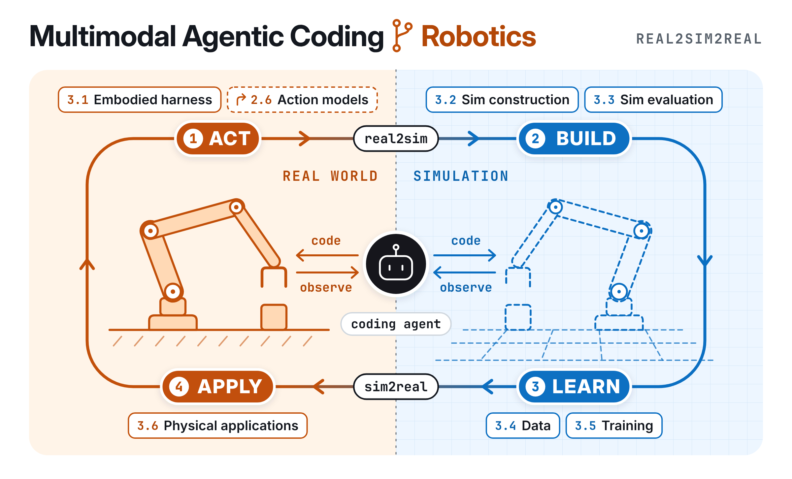
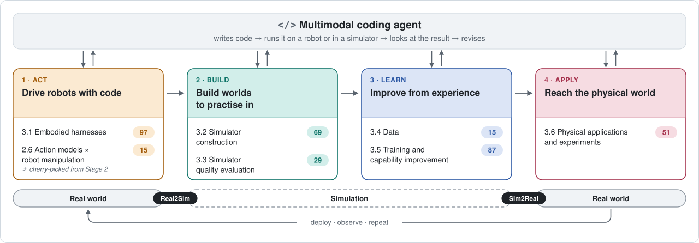
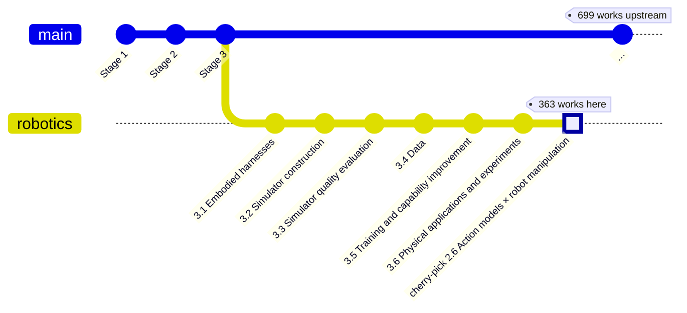

<!-- Generated by scripts/build_readme.py in jiangjin1999/awesome-multimodal-agentic-coding from data/*.yaml — edit the data upstream, not this file. -->

<div align="center">

# Awesome Multimodal Agentic Coding ⎇ Robotics

<picture>
  <source media="(prefers-color-scheme: dark)" srcset="https://raw.githubusercontent.com/jiangjin1999/awesome-multimodal-agentic-coding/main/assets/robotics/hero/hero-dark.png">
  
</picture>

Multimodal coding agents for robots: they write code to act, build the simulators they practise in, and improve from what they observe, in simulation and reality.

[](https://awesome.re) [](https://github.com/jiangjin1999/awesome-multimodal-agentic-coding) [](#contents) [](https://github.com/jiangjin1999/awesome-multimodal-agentic-coding-robotics/commits/main) [](./LICENSE)

**English** · [简体中文](./README.zh-CN.md) · [日本語](./README.ja.md)

</div>

```console
$ git checkout -b robotics awesome-multimodal-agentic-coding/stage-3
Switched to a new branch 'robotics'
```

## Overview

A multimodal coding agent can drive a robot by writing code. It calls perception, planning and control, runs the program on hardware or in a simulator, looks at the result, and revises the code. The same agent can build the simulators it practises in and improve from the experience it collects there.

This list follows that **Real2Sim2Real loop** in four steps. Each step groups sections of Stage 3 of the upstream map, plus 2.6 cherry-picked from Stage 2: **act** on robots, **build** worlds to practise in, **learn** from experience, and **apply** what was learned in the physical world.

<a id="contents"></a>

## Taxonomy

<picture>
  <source media="(prefers-color-scheme: dark)" srcset="https://raw.githubusercontent.com/jiangjin1999/awesome-multimodal-agentic-coding/main/assets/robotics/robotics-map-en-dark.svg">
  
</picture>

Each row is a step of the loop above. Section numbers are the upstream ones; the counts are entries.

| Step | Sections |
|---|---|
| **1 · ACT**<br>Drive robots with code | **[3.1 Embodied harnesses](#s3-1)** (97)<br>[Tools and control interfaces](#s3-1-tools-interfaces) (41) · [Delegation to existing policies](#s3-1-delegation) (10) · [Agent capability evaluation](#s3-1-capability-eval) (32) · [Skills, bridges and runtime resources](#s3-1-skills-runtime) (14)<br>**[2.6 Action models × robot manipulation](#s2-6)** (15) <sub>⤴ cherry-picked from Stage 2</sub> |
| **2 · BUILD**<br>Build worlds to practise in | **[3.2 Simulator construction](#s3-2)** (69)<br>**[3.3 Simulator quality evaluation](#s3-3)** (29) |
| **3 · LEARN**<br>Improve from experience | **[3.4 Data](#s3-4)** (15)<br>[Real](#s3-4-real-data) (4) · [Sim](#s3-4-sim-data) (7) · [Real+Sim](#s3-4-mixed-data) (4)<br>**[3.5 Training and capability improvement](#s3-5)** (87)<br>[Program and policy development](#s3-5-program-policy) (26) · [Experience, memory and skill learning](#s3-5-experience-skill) (51) · [Post-training the coding agent](#s3-5-post-training) (10) |
| **4 · APPLY**<br>Reach the physical world | **[3.6 Physical applications and experiments](#s3-6)** (51)<br>[Robot interaction and manipulation](#s3-6-robot-interaction) (13) · [Scientific experiments (AI4Science)](#s3-6-experiments) (27) · [Physical design, fabrication and validation](#s3-6-physical-design) (11) |

🧭 [Simulation engines at a glance](#s3-engines)

⎇ [Where this branch comes from](#branch) · [Contact and contributing](#contact) · [Citation](#citation) · [Upstream: the full three-stage map](https://github.com/jiangjin1999/awesome-multimodal-agentic-coding)

<a id="branch"></a>

## ⎇ Where this branch comes from

This repository is the robotics branch of [Awesome Multimodal Agentic Coding](https://github.com/jiangjin1999/awesome-multimodal-agentic-coding), a research map in three stages. It checks out **Stage 3 · Bridging Digital & Physical Worlds** as a repository of its own and cherry-picks **2.6 Action models × robot manipulation** from Stage 2.

Section numbers and paper anchors are inherited from upstream, so 3.1 here is 3.1 there, and links to works in Stages 1 and 2 lead back upstream. Every entry is edited upstream and synced here.



<a id="stage-3"></a>

## Stage 3 · Bridging Digital & Physical Worlds

The loop reaches simulation and reality: the agent **acts and observes in the real world**, builds simulators from real observations, and practises in simulation to become stronger — Real2Sim2Real. Works are organized by research question: build verifiable environments → collect interaction experience → improve the agent.

**Start with:** [Code as Policies](#paper-2209-07753) · [Democratizing Robot-Use Agents](#paper-2611-01560) · [Real2Gym](#paper-2609-37089) · [Agentic RSR](#paper-2610-10479) · [Eureka](#paper-2310-12931)

<a id="s3-1"></a>

### 3.1 Embodied harnesses

<a id="s3-1-tools-interfaces"></a>

#### Tools and control interfaces

<!-- mmac-record: {"id": "2611.29377", "scope": "Adjacent", "primary": "3.1", "stage": 3, "type": "paper"} -->

- <a id="paper-2611-29377"></a>`2026.11` **[Contact Harness: Enabling VLM Agents to Perform Contact-Rich Manipulation](https://arxiv.org/abs/2611.29377)** [[Project page]](https://ntumars.github.io/ContactHarness/) [[Code]](https://github.com/NTUMARS/Contact-Harness) [[Dataset]](https://huggingface.co/datasets/ntumars/Contact-4)
  > Combines vision, force and available touch for contact-state decisions, with force feedback regulating each motion during execution.<br>
  > 🖥️ **Sim** MuJoCo (Franka Panda) · 🦾 **Real** Rokae, Franka

<!-- mmac-record: {"id": "2611.01560", "scope": "Core", "primary": "3.1", "stage": 3, "type": "paper"} -->

- <a id="paper-2611-01560"></a>`2026.11` **[Democratizing Robot-Use Agents: A Unified Harness with Open Models](https://arxiv.org/abs/2611.01560)** [[Code]](https://github.com/Open-RUA/uni-robot-agent) [[Project page]](https://openrua.ai/uni-robot-agent)
  > Connects Qwen3.8-Flash-Next and GPT-6 Astra to shared perception and motion tools so agents can run geometric checks, inspect action outcomes, and adjust their next move.<br>
  > 🖥️ **Sim** Isaac Sim (ARX X5) · 🦾 **Real** ARX AC One

<!-- mmac-record: {"id": "2611.27182", "scope": "Core", "primary": "3.1", "stage": 3, "type": "paper"} -->

- <a id="paper-2611-27182"></a>`2026.11` **[Tripwire: Robot Agents that Program Their Own Interrupts under Human Disturbance](https://arxiv.org/abs/2611.27182)**
  > Programs and rewrites visual interruption monitors around frozen robot policies.<br>
  > 🖥️ **Sim** MuJoCo (PandaOmron) · 🦾 **Real** UFACTORY xArm 7

<!-- mmac-record: {"id": "2611.01112", "scope": "Core", "primary": "3.1", "stage": 3, "type": "paper"} -->

- <a id="paper-2611-01112"></a>`2026.10` **[Auriga Technical Report: A Task-Agnostic Agent Harness for Zero-Shot Embodied Manipulation](https://arxiv.org/abs/2611.01112)** [[Project page]](https://auriga.stelledge.com/) [[Code]](https://github.com/lose4578/Auriga)
  > Coordinates perception tools, generated programs and staged robot actions through one preview-and-execution gateway, using fresh images and measured discrepancies to revise operations within a single simulation episode.<br>
  > 🖥️ **Sim** Isaac Sim + MuJoCo (ARX X5, Franka Panda)

<!-- mmac-record: {"id": "2610.13862", "scope": "Adjacent", "primary": "3.1", "stage": 3, "type": "paper"} -->

- <a id="paper-2610-13862"></a>`2026.10` **[BT-Agent: Deploying Onboard Robot Agents with Behavior Trees and Multi-Fidelity Evaluation](https://arxiv.org/abs/2610.13862)**
  > Composes perception and physical-action tools through fixed behavior-tree skills, using structured failures to retry or change task decisions while local guards supervise operator-approved onboard motion.<br>
  > 🖥️ **Sim** Habitat + MuJoCo (Boston Dynamics Spot) · 🦾 **Real** Boston Dynamics Spot

<!-- mmac-record: {"id": "2610.29702", "scope": "Adjacent", "primary": "3.1", "stage": 3, "type": "paper"} -->

- <a id="paper-2610-29702"></a>`2026.10` **[CausGround: Causal Interaction Grounding for Adaptive Embodied Planning](https://arxiv.org/abs/2610.29702)** [[Project page]](https://causground.github.io/)
  > Grounds RGB observations in object-level causal mechanisms and retrieves action preconditions and effects to guide a frozen planner’s skill selection, with simulation, recorded-skill replay, and qualitative robot demonstrations.<br>
  > 🖥️ **Sim** Unity + MuJoCo (Franka Panda)

<!-- mmac-record: {"id": "2610.01939", "scope": "Core", "primary": "3.1", "stage": 3, "type": "paper"} -->

- <a id="paper-2610-01939"></a>`2026.10` **[Fewer Tokens, Better Action: GPT-6 Astra Robot Agents with 14% Higher Success Rate but 65% Fewer Tokens](https://arxiv.org/abs/2610.01939)**
  > Batches robot primitives, computation, conditions and local retries inside Python cells, returning selected outputs to the model.<br>
  > 🖥️ **Sim** MuJoCo + SAPIEN (Franka Panda, AgileX ALOHA)

<!-- mmac-record: {"id": "2610.23479", "scope": "Core", "primary": "3.1", "stage": 3, "type": "paper"} -->

- <a id="paper-2610-23479"></a>`2026.10` **[HexaShell: A Universal Harness for Robot Coding Agents in Simulation and the Real World](https://arxiv.org/abs/2610.23479)** [[Code]](https://github.com/HexaFuture/HexaShell)
  > Lets a robot coding agent write a Python cell each turn against shared motion, perception and state tools, with optional task skills drafted from earlier runs.<br>
  > 🖥️ **Sim** Isaac Sim + SAPIEN + MuJoCo (ARX X5, Franka Panda) · 🦾 **Real** AgileX PiPER-X

<!-- mmac-record: {"id": "2610.02459", "scope": "Core", "primary": "3.1", "stage": 3, "type": "paper"} -->

- <a id="paper-2610-02459"></a>`2026.10` **[OpenRUA: Robot-Use Agents Are Zero-Shot Visuomotor Policies](https://arxiv.org/abs/2610.02459)** [[Code]](https://github.com/terminalworld/OpenRUA)
  > Gives an existing coding agent a terminal, ROS 2 documentation and a robot workspace for writing perception and motion programs.<br>
  > 🖥️ **Sim** MuJoCo + Isaac Sim (Franka Panda)

<!-- mmac-record: {"id": "2610.06843", "scope": "Adjacent", "primary": "3.1", "stage": 3, "type": "paper"} -->

- <a id="paper-2610-06843"></a>`2026.10` **[Recursive Video In-Context Learning for Agentic Robot](https://arxiv.org/abs/2610.06843)** [[Code]](https://github.com/BWR-hhh/rvicl) [[Project page]](https://bwr-hhh.github.io/rvicl/)
  > Lets robot agents query a hierarchical demonstration on demand and compare it with live camera views to adapt frozen VLA and analytic primitive calls, while retaining the underlying execution harness.<br>
  > 🖥️ **Sim** MuJoCo (Franka Panda)

<!-- mmac-record: {"id": "2610.04929", "scope": "Adjacent", "primary": "3.1", "stage": 3, "type": "paper"} -->

- <a id="paper-2610-04929"></a>`2026.10` **[RobotUse: Allocating Computation, Context, and Decisions](https://arxiv.org/abs/2610.04929)** [[Project page]](https://robotuse-team.github.io/) [[Code]](https://github.com/robotuse-team/RobotUse)
  > Allocates physical task decisions and detailed interactions to subagents while the parent receives compact results and constraints.<br>
  > 🖥️ **Sim** Isaac Lab (Franka Panda) · 🦾 **Real** Franka Panda

<!-- mmac-record: {"id": "2610.12457", "scope": "Adjacent", "primary": "3.1", "stage": 3, "type": "paper"} -->

- <a id="paper-2610-12457"></a>`2026.10` **[SpatialHarness: Test-Time Spatial Scaffolding for Fine Robotic Manipulation](https://arxiv.org/abs/2610.12457)** [[Project page]](https://emilia113.github.io/SpatialHarness/) [[Dataset]](https://huggingface.co/datasets/yzy05/SpatialHarness)
  > Maintains a simulation scene synchronized with real execution and renders task-specific auxiliary viewpoints.<br>
  > 🖥️ **Sim** MuJoCo (Franka FR3) · 🦾 **Real** Franka FR3

<!-- mmac-record: {"id": "2610.30043", "scope": "Adjacent", "primary": "3.1", "stage": 3, "type": "paper"} -->

- <a id="paper-2610-30043"></a>`2026.10` **[TARSphere: A Robot-Oriented Full-Stack Framework for Long-Horizon Embodied Agents in Evolving Physical and Social Environments](https://arxiv.org/abs/2610.30043)** [[Code]](https://github.com/xuyicheng-zju/TARSphere) [[Project page]](https://xuyicheng-zju.github.io/TARSphere/)
  > Organizes long-horizon robot action using hierarchical executable skills, task memory and execution feedback around a frozen model.<br>
  > 🖥️ **Sim** Isaac Sim (Unitree G1)

<!-- mmac-record: {"id": "2609.12541", "scope": "Core", "primary": "3.1", "stage": 3, "type": "paper"} -->

- <a id="paper-2609-12541"></a>`2026.09` **[Agent as Policy for Robotic Manipulation](https://arxiv.org/abs/2609.12541)** [[Dataset]](https://huggingface.co/datasets/Agent-as-Policy/agent-as-policy) [[Code]](https://github.com/agent-as-policy-2026/agent-as-policy)
  > Lets a general agent inspect visual evidence, write programs and issue motion requests throughout a manipulation episode.<br>
  > 🖥️ **Sim** MuJoCo (I2RT YAM) · 🦾 **Real** I2RT YAM

<!-- mmac-record: {"id": "2609.20822", "scope": "Core", "primary": "3.1", "stage": 3, "type": "paper"} -->

- <a id="paper-2609-20822"></a>`2026.09` **[Coding Agents with an Obstacle-Aware Harness for Safe Robot Manipulation](https://arxiv.org/abs/2609.20822)**
  > Equips code-as-policy agents with visually grounded route checks and contact constraints, replanning from the observed stopped pose when execution encounters an obstacle or an unmodeled physical constraint.<br>
  > 🖥️ **Sim** MuJoCo (Franka Panda) · 🦾 **Real** AgileX PiPER-X

<!-- mmac-record: {"id": "2609.38078", "scope": "Adjacent", "primary": "3.1", "stage": 3, "type": "paper"} -->

- <a id="paper-2609-38078"></a>`2026.09` **[MotorMind: Scaffolding General Vision Language Models for Zero-Shot Robot Manipulation](https://arxiv.org/abs/2609.38078)**
  > Combines mid-level parameterized actions, deterministic control and asynchronous monitoring around a frozen VLM.<br>
  > 🖥️ **Sim** MuJoCo (Franka Panda) · 🦾 **Real** xArm6

<!-- mmac-record: {"id": "2609.29389", "scope": "Adjacent", "primary": "3.1", "stage": 3, "type": "paper"} -->

- <a id="paper-2609-29389"></a>`2026.09` **[Robo-Harness K1: Harnessing Robot-Use Agents via Perception Augmentation](https://arxiv.org/abs/2609.29389)**
  > Provides depth, spatial measurement and grasp-candidate tools to a robot-use agent without retraining its visual encoder.<br>
  > 🖥️ **Sim** MuJoCo + SAPIEN (Franka Panda, UR5e, KUKA iiwa, AgileX ALOHA)

<!-- mmac-record: {"id": "2610.14018", "scope": "Adjacent", "primary": "3.1", "stage": 3, "type": "paper"} -->

- <a id="paper-2610-14018"></a>`2026.09` **[RoboHarness: A Simple Harness Outperforms VLA and World Action Models](https://arxiv.org/abs/2610.14018)** [[Code]](https://github.com/BinceQu/RoboHarness)
  > Gives an LLM a visual-geometric control panel for zero-shot manipulation using existing robot tools.<br>
  > 🖥️ **Sim** MuJoCo + Isaac Sim (Franka Panda, Galaxea R1 Pro, ARX X5)

<!-- mmac-record: {"id": "2609.10522", "scope": "Adjacent", "primary": "3.1", "stage": 3, "type": "paper"} -->

- <a id="paper-2609-10522"></a>`2026.09` **[Show-Harness: Just a VLM Agent Can Play Robots](https://arxiv.org/abs/2609.10522)** [[Project page]](https://showlab.github.io/Show-Harness) [[Code]](https://github.com/showlab/Show-Harness) [[Model]](https://huggingface.co/showlab/Show-Harness-VLMs) [[Dataset]](https://huggingface.co/datasets/showlab/Show-Harness-Data)
  > Connects a general VLM to a robot interpreter through a compact semantic action interface.<br>
  > 🖥️ **Sim** Isaac Lab + SAPIEN (Franka Panda) · 🦾 **Real** Franka FR3, AgileX PiPER

<!-- mmac-record: {"id": "2609.22966", "scope": "Adjacent", "primary": "3.1", "stage": 3, "type": "paper"} -->

- <a id="paper-2609-22966"></a>`2026.09` **[Transferring the Intelligence of VLMs to Robotic Control](https://arxiv.org/abs/2609.22966)** [[Project page]](https://robodawn.top/) [[Code]](https://github.com/Hugo-AGI/RoboDawn) [[Demo]](https://robodawn.top/results)
  > RoboDawn grounds frozen VLM control through discrete motion commands and in-context demonstrations.<br>
  > 🖥️ **Sim** SAPIEN + Isaac Sim · 🦾 **Real** Franka, AgileX PiPER

<!-- mmac-record: {"id": "2609.29964", "scope": "Adjacent", "primary": "3.1", "stage": 3, "type": "paper"} -->

- <a id="paper-2609-29964"></a>`2026.09` **[World Action Agent: Harnessing VLMs for Robot Manipulation via World Action Rehearsal](https://arxiv.org/abs/2609.29964)**
  > Gives VLMs interaction-centered views, editable action rehearsals, and demonstration-derived skills to revise manipulation decisions through numerical planning tools without generating policy code.<br>
  > 🖥️ **Sim** MuJoCo (Franka Panda)

<!-- mmac-record: {"id": "chemautoagent", "scope": "Adjacent", "primary": "3.1", "stage": 3, "type": "paper"} -->

- <a id="paper-chemautoagent"></a>`2026.08` **[ChemAutoAgent: A Multi-Agent System for Evidence-Controlled Laboratory Instrument Driver Generation from Text-Based Manuals](https://www.mdpi.com/2076-3417/16/16/8291)** [[Version notes]](https://www.mdpi.com/2076-3417/16/16/8291/notes)
  > Builds instrument drivers from source-linked manuals within deterministic protocol scaffolds, repairing them through hardware tests.

<!-- mmac-record: {"id": "2608.03924", "scope": "Adjacent", "primary": "3.1", "stage": 3, "type": "paper"} -->

- <a id="paper-2608-03924"></a>`2026.08` **[ETA: A New Agentic Paradigm for Embodied Tasks](https://arxiv.org/abs/2608.03924)**
  > Connects digital agents to observation, target marking and motion through a lightweight embodied interface.<br>
  > 🖥️ **Sim** MuJoCo (Franka Panda) · 🦾 **Real** UR5e

<!-- mmac-record: {"id": "2607.05369", "scope": "Adjacent", "primary": "3.1", "stage": 3, "type": "paper"} -->

- <a id="paper-2607-05369"></a>`2026.07` **[GaP: A Graph-as-Policy Multi-Agent Self-Learning Harness For Variational Automation Tasks](https://arxiv.org/abs/2607.05369)** [[Project page]](https://graph-robots.github.io/gap) [[Code]](https://github.com/graph-robots/graph-as-policy)
  > Builds typed computation graphs connecting perception, planning and control skills, then rehearses and revises the graph in simulation.<br>
  > 🖥️ **Sim** MuJoCo (Franka Panda) · 🦾 **Real** Franka

<!-- mmac-record: {"id": "2607.16636", "scope": "Adjacent", "primary": "3.1", "stage": 3, "type": "paper"} -->

- <a id="paper-2607-16636"></a>`2026.07` **[PhyAgentOS: A Self-Evolving Operating System for Embodied Agents with Decoupled Cognitive Planning and Physical Execution](https://arxiv.org/abs/2607.16636)** [[Code]](https://github.com/PhyAgentOS/PhyAgentOS)
  > Separates cognitive planning from physical execution through file-based state contracts, tools and persistent execution records.<br>
  > 🖥️ **Sim** MuJoCo + Isaac Sim · 🦾 **Real** Franka FR3, XLeRobot, AgileX PiPER, Dobot Nova 2, Unitree Go2, Unitree G1

<!-- mmac-record: {"id": "2607.11119", "scope": "Adjacent", "primary": "3.1", "stage": 3, "type": "paper"} -->

- <a id="paper-2607-11119"></a>`2026.07` **[VIA: Visual Interface Agent for Robot Control](https://arxiv.org/abs/2607.11119)**
  > Lets visual agents refine virtual gripper poses and send waypoints to robot controllers.<br>
  > 🖥️ **Sim** Franka Panda · 🦾 **Real** Stretch 4

<!-- mmac-record: {"id": "2605.26637", "scope": "Adjacent", "primary": "3.1", "stage": 3, "type": "paper"} -->

- <a id="paper-2605-26637"></a>`2026.05` **[Enabling Extensible Embodied Capabilities with Tools](https://arxiv.org/abs/2605.26637)**
  > Defines an Embodied Tool Protocol for registering, discovering and invoking perception, reasoning and execution capabilities.<br>
  > 🖥️ **Sim** AI2-THOR + Habitat + CoppeliaSim (Franka Panda)

<!-- mmac-record: {"id": "2512.05955", "scope": "Adjacent", "primary": "3.1", "stage": 3, "type": "paper"} -->

- <a id="paper-2512-05955"></a>`2025.12` **[SIMPACT: Simulation-Enabled Action Planning using Vision-Language Models](https://arxiv.org/abs/2512.05955)** [[Project page]](https://simpact-bot.github.io/) [[Code]](https://github.com/ShaoxiongYao/simpact)
  > Uses rendered physics rollouts to refine manipulation actions before real-robot execution.<br>
  > 🖥️ **Sim** MuJoCo + Warp + PyBullet · 🦾 **Real** Franka FR3

<!-- mmac-record: {"id": "2511.00917", "scope": "Core", "primary": "3.1", "stage": 3, "type": "paper"} -->

- <a id="paper-2511-00917"></a>`2025.11` **[MAESTRO: Orchestrating Robotics Modules with Coding Agents for Zero-Shot Generalist Robots](https://arxiv.org/abs/2511.00917)** [[Code]](https://github.com/penn-pal-lab/maestro) [[Project page]](https://maestro-robot.github.io)
  > Orchestrates perception, planning and control modules through generated programs, checking visual and execution feedback for recovery.<br>
  > 🦾 **Real** Franka Panda, Unitree Go2-W, AgileX PiPER

<!-- mmac-record: {"id": "2510.21302", "scope": "Adjacent", "primary": "3.1", "stage": 3, "type": "paper"} -->

- <a id="paper-2510-21302"></a>`2025.10` **[Towards Reliable Code-as-Policies: A Neuro-Symbolic Framework for Embodied Task Planning](https://arxiv.org/abs/2510.21302)**
  > Combines code-policy generation with symbolic verification and exploratory programs that obtain missing observations.<br>
  > 🖥️ **Sim** CoppeliaSim (Franka Panda) · 🦾 **Real** Franka FR3

<!-- mmac-record: {"id": "2505.07532", "scope": "Adjacent", "primary": "3.1", "stage": 3, "type": "paper"} -->

- <a id="paper-2505-07532"></a>`2025.05` **[RAI: Flexible Agent Framework for Embodied AI](https://arxiv.org/abs/2505.07532)**
  > Connects language models, agents, ROS and simulators through modular tools and reusable robot runtime components.<br>
  > 🖥️ **Sim** O3DE (Husarion ROSbot XL) · 🦾 **Real** Husarion ROSbot XL

<!-- mmac-record: {"id": "2503.21969", "scope": "Core", "primary": "3.1", "stage": 3, "type": "paper"} -->

- <a id="paper-2503-21969"></a>`2025.03` **[Robotic Long-Horizon Manipulation with Progressive In-Context Code Generation and Episodic Feedback](https://arxiv.org/abs/2503.21969)**
  > Uses progressive in-context examples to generate robot programs, then a visual reporter summarizes each episode for replanning.<br>
  > 🖥️ **Sim** PyBullet + MuJoCo (UR5e, Franka Panda) · 🦾 **Real** Franka

<!-- mmac-record: {"id": "2412.04455", "scope": "Adjacent", "primary": "3.1", "stage": 3, "type": "paper"} -->

- <a id="paper-2412-04455"></a>`2024.12` **[Code-as-Monitor: Constraint-aware Visual Programming for Reactive and Proactive Robotic Failure Detection](https://arxiv.org/abs/2412.04455)** [[Project page]](https://zhoues.github.io/Code-as-Monitor/)
  > Generates executable spatial and temporal constraint monitors, using visual tracking to detect failures or impending violations.<br>
  > 🖥️ **Sim** CoppeliaSim + PyBullet + Isaac Sim (Franka Panda, UR5, Fetch) · 🦾 **Real** UR5, LEAP Hand

<!-- mmac-record: {"id": "2410.06472", "scope": "Adjacent", "primary": "3.1", "stage": 3, "type": "paper"} -->

- <a id="paper-2410-06472"></a>`2024.10` **[Enabling Novel Mission Operations and Interactions with ROSA: The Robot Operating System Agent](https://arxiv.org/abs/2410.06472)**
  > Exposes ROS queries, diagnosis and operations as callable tools for language agents across robot platforms.<br>
  > 🖥️ **Sim** Isaac Sim (NVIDIA Nova Carter) · 🦾 **Real** JPL EELS, Boston Dynamics Spot

<!-- mmac-record: {"id": "bounded-motion", "scope": "Adjacent", "primary": "3.1", "stage": 3, "type": "paper"} -->

- <a id="paper-bounded-motion"></a>`2024.10` **[Language-guided Manipulator Motion Planning with Bounded Task Space](https://proceedings.mlr.press/v270/oelerich25a.html)** [[Project page]](https://www.acin.tuwien.ac.at/42d2/)
  > Generates Python calls to a constrained path planner; BoundMPC then realizes smooth robot trajectories.

<!-- mmac-record: {"id": "2312.04474", "scope": "Adjacent", "primary": "3.1", "stage": 3, "type": "paper"} -->

- <a id="paper-2312-04474"></a>`2023.12` **[Chain of Code: Reasoning with a Language Model-Augmented Code Emulator](https://arxiv.org/abs/2312.04474)** [[Project page]](https://chain-of-code.github.io) [[Demo]](https://colab.research.google.com/github/google-research/google-research/blob/master/code_as_policies/coc_demo.ipynb)
  > Executes explicit program logic in an interpreter and asks a language model to emulate unresolved semantic operations.<br>
  > 🦾 **Real** UR5

<!-- mmac-record: {"id": "2306.09523", "scope": "Adjacent", "primary": "3.1", "stage": 3, "type": "paper"} -->

- <a id="paper-2306-09523"></a>`2023.06` **[Tell Me Where to Go: A Composable Framework for Context-Aware Embodied Robot Navigation](https://arxiv.org/abs/2306.09523)**
  > Uses generated Python as an intermediate layer between language reasoning, visual scene descriptions and mobile navigation.<br>
  > 🦾 **Real** Boston Dynamics Spot

<!-- mmac-record: {"id": "2305.11176", "scope": "Adjacent", "primary": "3.1", "stage": 3, "type": "paper"} -->

- <a id="paper-2305-11176"></a>`2023.05` **[Instruct2Act: Mapping Multi-modality Instructions to Robotic Actions with Large Language Model](https://arxiv.org/abs/2305.11176)** [[Code]](https://github.com/OpenGVLab/Instruct2Act)
  > Generates Python to connect SAM, CLIP and action APIs, turning multimodal instructions into perception, planning and execution.<br>
  > 🖥️ **Sim** PyBullet (UR5)

<!-- mmac-record: {"id": "2306.17582", "scope": "Adjacent", "primary": "3.1", "stage": 3, "type": "paper"} -->

- <a id="paper-2306-17582"></a>`2023.02` **[ChatGPT for Robotics: Design Principles and Model Abilities](https://arxiv.org/abs/2306.17582)** [[Project page]](https://www.microsoft.com/en-us/research/publication/chatgpt-for-robotics-design-principles-and-model-abilities/)
  > Combines robot function libraries, prompting and human dialogue to generate and revise programs for arms, drones and mobile robots.<br>
  > 🖥️ **Sim** AirSim + Habitat · 🦾 **Real** DJI Tello

<!-- mmac-record: {"id": "2209.07753", "scope": "Adjacent", "primary": "3.1", "stage": 3, "type": "paper"} -->

- <a id="paper-2209-07753"></a>`2022.09` **[Code as Policies: Language Model Programs for Embodied Control](https://arxiv.org/abs/2209.07753)** [[Project page]](https://code-as-policies.github.io) [[Code]](https://github.com/google-research/google-research/tree/master/code_as_policies) [[Demo]](https://huggingface.co/spaces/jackyliang42/code-as-policies)
  > Recursively generates Python policies that combine perception results, geometric calculations and robot APIs.<br>
  > 🖥️ **Sim** PyBullet (UR5e) · 🦾 **Real** UR5e, Everyday Robots

<!-- mmac-record: {"id": "2209.11302", "scope": "Adjacent", "primary": "3.1", "stage": 3, "type": "paper"} -->

- <a id="paper-2209-11302"></a>`2022.09` **[ProgPrompt: Generating Situated Robot Task Plans using Large Language Models](https://arxiv.org/abs/2209.11302)** [[Project page]](http://progprompt.github.io) [[Code]](https://github.com/NVlabs/progprompt-vh)
  > Generates program-like plans using available objects, actions and assertions, with recovery steps when action preconditions fail.<br>
  > 🖥️ **Sim** Unity · 🦾 **Real** Franka Panda

<a id="s3-1-delegation"></a>

#### Delegation to existing policies

<!-- mmac-record: {"id": "2611.03585", "scope": "Adjacent", "primary": "3.1", "stage": 3, "type": "paper"} -->

- <a id="paper-2611-03585"></a>`2026.11` **[Seeing Through the Illusion: Test-Time Scaling for World Action Models](https://arxiv.org/abs/2611.03585)**
  > Selects frozen world–action model rollouts by combining action validity, inverse-dynamics agreement with imagined motion, and task progress, then executes the chosen action chunk and replans from fresh observations.<br>
  > 🖥️ **Sim** MuJoCo + Isaac Lab (Franka Panda)

<!-- mmac-record: {"id": "system:the-harness-corl2026", "scope": "Adjacent", "primary": "3.1", "stage": 3, "type": "paper"} -->

- <a id="paper-system-the-harness-corl2026"></a>`2026.11` **[The Harness: One Agent Harness for Anything that Acts](https://web.eecs.umich.edu/~stellayu/publication/2026harnessCoRLL.html)** [[Paper]](https://web.eecs.umich.edu/~stellayu/publication/doc/2026harnessCoRLL.pdf)
  > Combines agent-written programs, bounded VLA skills and reactive guards in a shared control hierarchy.<br>
  > 🖥️ **Sim** Isaac Sim (ARX X5)

<!-- mmac-record: {"id": "2610.21453", "scope": "Adjacent", "primary": "3.1", "stage": 3, "type": "paper"} -->

- <a id="paper-2610-21453"></a>`2026.10` **[CarryOn: A Dual-Loop Harness for Personalized and Reliable Robot Assistance](https://arxiv.org/abs/2610.21453)** [[Code]](https://github.com/JIA-Lab-research/CarryOn) [[Project page]](https://vincent2311.github.io/Projects/CarryOn/)
  > Coordinates persistent user/scene memory, a frozen VLA, geometric shielding, and visual failure recovery, while offline reflection revises recovery strategies and parameters for later attempts.<br>
  > 🖥️ **Sim** MuJoCo + Isaac Lab (Franka Panda) · 🦾 **Real** Franka FR3

<!-- mmac-record: {"id": "2610.19600", "scope": "Adjacent", "primary": "3.1", "stage": 3, "type": "paper"} -->

- <a id="paper-2610-19600"></a>`2026.10` **[Cracking Mobile Manipulation: From Failure Diagnosis to Agentic Robot System](https://arxiv.org/abs/2610.19600)** [[Project page]](https://github.com/PKU-VaLuE-Lab/Cracking-Mobile-Manipulation)
  > Failure-guided visual memory and geometric tools improve a fixed mobile-manipulation VLA.<br>
  > 🖥️ **Sim** MuJoCo + Isaac Sim · 🦾 **Real** Astribot S1

<!-- mmac-record: {"id": "2610.42053", "scope": "Adjacent", "primary": "3.1", "stage": 3, "type": "paper"} -->

- <a id="paper-2610-42053"></a>`2026.10` **[REA: A Routed Embodied Agent Runtime for Asynchronous Brain-Cerebellum Control](https://arxiv.org/abs/2610.42053)** [[Project page]](https://mikeeeeeeeeeeeeee.github.io/REA/)
  > Separates fast robot execution from asynchronous model judging and route selection, coordinating fixed code policies and action models with visual outcome checks at policy-return boundaries.<br>
  > 🖥️ **Sim** MuJoCo + SAPIEN + Isaac Sim (Franka Panda, AgileX ALOHA, Galaxea R1 Pro) · 🦾 **Real** Unitree G1

<!-- mmac-record: {"id": "2609.29166", "scope": "Core", "primary": "3.1", "stage": 3, "type": "paper"} -->

- <a id="paper-2609-29166"></a>`2026.09` **[HarnessPAI: An Evolving Harness for Physical AI](https://arxiv.org/abs/2609.29166)** [[Project page]](https://darwin-agent.github.io/HarnessPAI) [[Code]](https://github.com/Darwin-Agent/HarnessPAI)
  > Synthesizes programs over perception and motion primitives, then evolves them across rollouts and extracts reusable skills.<br>
  > 🖥️ **Sim** MuJoCo (Franka Panda)

<!-- mmac-record: {"id": "2608.11246", "scope": "Adjacent", "primary": "3.1", "stage": 3, "type": "paper"} -->

- <a id="paper-2608-11246"></a>`2026.08` **[Towards the Harness of Embodied Agents](https://arxiv.org/abs/2608.11246)** [[Project page]](https://eit-hai.github.io/thea) [[Code]](https://github.com/EIT-HAI/Thea)
  > Uses a persistent scene graph and semantically meaningful tool returns to organize robot abilities and task progress.<br>
  > 🦾 **Real** Astribot S1, AgileX Cobot Magic, Unitree G1

<!-- mmac-record: {"id": "2607.08448", "scope": "Adjacent", "primary": "3.1", "stage": 3, "type": "paper"} -->

- <a id="paper-2607-08448"></a>`2026.07` **[Harness VLA: Steering Frozen VLAs into Reliable Manipulation Primitives via Memory-Guided Agents](https://arxiv.org/abs/2607.08448)** [[Code]](https://github.com/RLinf/RPent)
  > Lets a coding agent combine analytic motion primitives with calls to a frozen VLA, assigning language subgoals, budgets and stopping conditions.<br>
  > 🖥️ **Sim** MuJoCo + SAPIEN (Franka Panda, AgileX ALOHA) · 🦾 **Real** Franka

<!-- mmac-record: {"id": "2207.05608", "scope": "Adjacent", "primary": "3.1", "stage": 3, "type": "paper"} -->

- <a id="paper-2207-05608"></a>`2022.07` **[Inner Monologue: Embodied Reasoning through Planning with Language Models](https://arxiv.org/abs/2207.05608)** [[Project page]](https://innermonologue.github.io/)
  > Uses language feedback from perception, success detection or people to replan robot skills.<br>
  > 🖥️ **Sim** PyBullet · 🦾 **Real** UR5e, Everyday Robots

<!-- mmac-record: {"id": "2204.01691", "scope": "Adjacent", "primary": "3.1", "stage": 3, "type": "paper"} -->

- <a id="paper-2204-01691"></a>`2022.04` **[Do As I Can, Not As I Say: Grounding Language in Robotic Affordances](https://arxiv.org/abs/2204.01691)** [[Project page]](https://say-can.github.io/) [[Code]](https://github.com/google-research/google-research/tree/master/saycan)
  > SayCan combines language-model relevance and state-conditioned affordance scores to select pretrained robot skills.<br>
  > 🦾 **Real** Everyday Robots

<a id="s3-1-capability-eval"></a>

#### Agent capability evaluation

<!-- mmac-record: {"id": "system:aa-robotics-sim", "scope": "Core", "primary": "3.1", "stage": 3, "type": "paper"} -->

- <a id="paper-system-aa-robotics-sim"></a>`2026.11` **[Can language models drive a humanoid robot? Introducing AA-Robotics-Sim v0.1](https://artificialanalysis.ai/articles/aa-robotics-sim)**
  > Frontier models write Python for a simulated humanoid, check head-camera frames between commands, and reuse practice-written notes and code in fresh scenes.<br>
  > 🖥️ **Sim** Isaac Sim + Isaac Lab (Unitree G1)

<!-- mmac-record: {"id": "2611.12177", "scope": "Adjacent", "primary": "3.1", "stage": 3, "type": "paper"} -->

- <a id="paper-2611-12177"></a>`2026.11` **[Embodied First Exam](https://arxiv.org/abs/2611.12177)**
  > Tests general-purpose agents across robot embodiments while varying observation access, reset budgets and execution timing.<br>
  > 🖥️ **Sim** MuJoCo + Isaac Sim + SAPIEN

<!-- mmac-record: {"id": "2611.16009", "scope": "Adjacent", "primary": "3.1", "stage": 3, "type": "paper"} -->

- <a id="paper-2611-16009"></a>`2026.11` **[JustRUA: A Controlled Study of GPT-6 Robot-Use Agents](https://arxiv.org/abs/2611.16009)** [[Project page]](https://zefanw.github.io/JustRUA/) [[Code]](https://github.com/ZefanW/JustRUA) [[Demo]](https://huggingface.co/spaces/ZefanW/robodojo-replay-explorer)
  > Studies how episode history, short motions, geometry and coordinate-solving code shape a general-purpose agent’s RoboDojo manipulation performance.<br>
  > 🖥️ **Sim** Isaac Sim (ARX X5)

<!-- mmac-record: {"id": "2611.08209", "scope": "Adjacent", "primary": "3.1", "stage": 3, "type": "paper"} -->

- <a id="paper-2611-08209"></a>`2026.11` **[RoboARCade: Benchmarking Agentic Robot Control](https://arxiv.org/abs/2611.08209)** [[Project page]](http://roboarcade.org)
  > Benchmarks visual robot-control agents on randomized long-horizon MuJoCo tasks, separating interface effects, in-context demonstrations and cross-trial text-harness optimization.<br>
  > 🖥️ **Sim** MuJoCo + Blender (Franka Panda, I2RT YAM)

<!-- mmac-record: {"id": "2611.02497", "scope": "Adjacent", "primary": "3.1", "stage": 3, "type": "paper"} -->

- <a id="paper-2611-02497"></a>`2026.11` **[RoboColosseum: Evaluating Physical Intelligence at Scale In-The-Wild](https://arxiv.org/abs/2611.02497)** [[Repository]](https://github.com/RoboColosseum) [[Project page]](https://robocolosseum.ai/)
  > Compares frozen agents and VLA policies through matched, blinded real-robot trials across sites, with a separate adaptation track and explicit embodiment-dependent ranking analysis.<br>
  > 🦾 **Real** SO-101, I2RT YAM, Franka Panda, Unitree G1

<!-- mmac-record: {"id": "2610.00854", "scope": "Adjacent", "primary": "3.1", "stage": 3, "type": "paper"} -->

- <a id="paper-2610-00854"></a>`2026.10` **[Are Frontier VLM Agents Ready to Be Robot Generalists? An Empirical Study with the Embodied Agent Arena](https://arxiv.org/abs/2610.00854)** [[Project page]](https://embodied-agent-arena.github.io/embodied-agent-arena/) [[Code]](https://github.com/embodied-agent-arena/embodied-agent-arena) [[Dataset]](https://huggingface.co/datasets/uuu-Quant/Embodied-Agent-Arena)
  > Compares frontier VLM robot agents under shared budgets and source-task interfaces.<br>
  > 🖥️ **Sim** MuJoCo + SAPIEN + PyBullet + CoppeliaSim + Isaac Sim

<!-- mmac-record: {"id": "2610.07594", "scope": "Adjacent", "primary": "3.1", "stage": 3, "type": "paper"} -->

- <a id="paper-2610-07594"></a>`2026.10` **[BiGym 2.0: Benchmarking Learned and Agent-Developed Policies for Humanoid Household Manipulation](https://arxiv.org/abs/2610.07594)** [[Code]](https://github.com/swirl-uk/BiGym2)
  > Compares learned and agent-developed humanoid policies under matched onboard observations and whole-body controllers.<br>
  > 🖥️ **Sim** MuJoCo (Unitree G1)

<!-- mmac-record: {"id": "2610.27039", "scope": "Adjacent", "primary": "3.1", "stage": 3, "type": "paper"} -->

- <a id="paper-2610-27039"></a>`2026.10` **[Embodied Playground: A Long-Horizon Agentic Robotics Benchmark for Physical, Strategic, and Spatial Reasoning](https://arxiv.org/abs/2610.27039)** [[Project page]](https://winniechen2002.github.io/Agent-bench-website/) [[Code]](https://github.com/Winniechen2002/Embodied-Playground)
  > Tests coordination of physical, strategic and spatial reasoning in long-horizon robot tasks.<br>
  > 🖥️ **Sim** MuJoCo + Isaac Lab + SAPIEN (Franka Panda, Franka FR3, Sharpa Wave, ALOHA)

<!-- mmac-record: {"id": "2610.16238", "scope": "Adjacent", "primary": "3.1", "stage": 3, "type": "paper"} -->

- <a id="paper-2610-16238"></a>`2026.10` **[Embodied Skill Bench: Benchmarking How Well Agents with Embodied Skills Perform on Physical Tasks](https://arxiv.org/abs/2610.16238)** [[Code]](https://github.com/HanZhi306/EmbodiedSkill-Bench) [[Code]](https://github.com/FBddcz/embodied-jev)
  > Compares native control, skill-only execution and agent selection or modification of embodied skills.<br>
  > 🖥️ **Sim** MuJoCo (Franka Panda)

<!-- mmac-record: {"id": "2610.30051", "scope": "Adjacent", "primary": "3.1", "stage": 3, "type": "paper"} -->

- <a id="paper-2610-30051"></a>`2026.10` **[From Reasoning to Action: Benchmarking Frontier AI Models on LIBERO-10 Robot Manipulation Tasks](https://arxiv.org/abs/2610.30051)** [[Code]](https://github.com/IRVLUTD/LLM_LIBERO) [[Project page]](https://irvlutd.github.io/LLM-LIBERO/)
  > Compares frontier models on LIBERO-10 using a shared interaction loop and control interface.<br>
  > 🖥️ **Sim** MuJoCo (Franka Panda)

<!-- mmac-record: {"id": "2610.22471", "scope": "Adjacent", "primary": "3.1", "stage": 3, "type": "paper"} -->

- <a id="paper-2610-22471"></a>`2026.10` **[Has GPT-6-Astra Achieved Embodied Intelligence?](https://arxiv.org/abs/2610.22471)** [[Article]](https://sensenova.ai/has-gpt-6-astra-achieved-embodied-intelligence) [[Code]](https://github.com/OpenSenseNova/SenseNova-RoboRSI) [[Dataset]](https://huggingface.co/datasets/sensenova/SenseNova-RoboRSI-Log) [[Dataset]](https://huggingface.co/datasets/sensenova/SenseNova-RoboRSI-Packages)
  > Studies demonstration-informed direct control and VLA-action review across twelve embodied benchmarks, separating gains from extended interaction budgets from zero-shot trials on eight real robot configurations.<br>
  > 🖥️ **Sim** Isaac Sim + MuJoCo + Habitat (ARX X5, Franka Panda) · 🦾 **Real** Franka FR3, Franka Panda, AgileX PiPER, Tianji M6S, Galaxea R1 Pro, xArm7, Unitree G1

<!-- mmac-record: {"id": "2610.34527", "scope": "Adjacent", "primary": "3.1", "stage": 3, "type": "paper"} -->

- <a id="paper-2610-34527"></a>`2026.10` **[LLM4Robot-Bench: How Far Can GPT-6 Astra Go in Robotic Manipulation? A Hierarchical, Paired Sim-Real Benchmark](https://arxiv.org/abs/2610.34527)** [[Code]](https://github.com/LLM4Robot/LLM4Robot-Bench) [[Project page]](https://llm4robot.github.io/bench/)
  > Originally released as PhysLadder, this benchmark tests GPT-6 Astra on geometric alignment, force regulation and contact reconfiguration in matched simulated and real dual-arm tasks.<br>
  > 🖥️ **Sim** Isaac Sim (ARX R5) · 🦾 **Real** ARX R5

<!-- mmac-record: {"id": "2610.34649", "scope": "Core", "primary": "3.1", "stage": 3, "type": "paper"} -->

- <a id="paper-2610-34649"></a>`2026.10` **[RobotAgentBench: Towards Open-world Robot Autonomy](https://arxiv.org/abs/2610.34649)** [[Project page]](https://aetherlabsai.github.io/RobotAgentBench/) [[Code]](https://github.com/AetherLabsAI/RobotAgentBench) [[Dataset]](https://huggingface.co/datasets/AetherLabs-AI/RobotAgentBench-assets) [[Demo]](https://aetherlabsai.github.io/RobotAgentBench/#demo) [[Model]](https://huggingface.co/AetherLabs-AI/InternVLA-A1.5-RAB) [[Dataset]](https://huggingface.co/datasets/AetherLabs-AI/RobotAgentBench-TrainingData)
  > Benchmarks household robot autonomy with code-based, learned and hybrid executors, including visual-feedback-driven program execution and reusable control-tool refinement in its coding-agent configurations.<br>
  > 🖥️ **Sim** Isaac Sim (AgiBot G1) · 🦾 **Real** AgiBot G1

<!-- mmac-record: {"id": "2610.10409", "scope": "Adjacent", "primary": "3.1", "stage": 3, "type": "paper"} -->

- <a id="paper-2610-10409"></a>`2026.10` **[RobotWorld: Benchmarking Multimodal Agents for Robot Use Across Diverse Tasks and Embodiments](https://arxiv.org/abs/2610.10409)** [[Code]](https://github.com/robotworldai/robotworld) [[Project page]](https://robotworldai.github.io/)
  > Evaluates image- and state-grounded robot tool use across 84 simulated tasks and diverse embodiments, separating auxiliary computation from optional environment-side control code.<br>
  > 🖥️ **Sim** Isaac Sim + Isaac Lab + Isaac Gym + MuJoCo

<!-- mmac-record: {"id": "2610.31670", "scope": "Adjacent", "primary": "3.1", "stage": 3, "type": "paper"} -->

- <a id="paper-2610-31670"></a>`2026.10` **[Sensorimotor Alignment: A Platonic Proxy for Embodied Policy Success](https://arxiv.org/abs/2610.31670)** [[Code]](https://github.com/yunfeixie233/sensorimotor-alignment) [[Project page]](https://yunfeixie233.github.io/s2/)
  > Measures alignment between sensory embeddings and recorded motion neighborhoods as an offline proxy for prioritizing embodied models before costly closed-loop evaluation.<br>
  > 🖥️ **Sim** SAPIEN (WidowX 250, AgileX ALOHA)

<!-- mmac-record: {"id": "2610.25287", "scope": "Adjacent", "primary": "3.1", "stage": 3, "type": "paper"} -->

- <a id="paper-2610-25287"></a>`2026.10` **[The Bitter Lesson Comes to Robotics](https://arxiv.org/abs/2610.25287)**
  > Studies general multimodal models operating physical robot arms through control interfaces.<br>
  > 🖥️ **Sim** Isaac Sim (ARX X5)

<!-- mmac-record: {"id": "system:aa-robotics", "scope": "Core", "primary": "3.1", "stage": 3, "type": "paper"} -->

- <a id="paper-system-aa-robotics"></a>`2026.10` **[Welcome to the era of embodied AI: Introducing AA-Robotics v0.1](https://artificialanalysis.ai/articles/aa-robotics)**
  > Coding agents write and run code that drives a real six-axis arm over HTTP, review four camera views, and submit zero-shot tabletop attempts.<br>
  > 🦾 **Real** Hiwonder NexArm

<!-- mmac-record: {"id": "2609.24170", "scope": "Adjacent", "primary": "3.1", "stage": 3, "type": "paper"} -->

- <a id="paper-2609-24170"></a>`2026.09` **[An Unexpected Robot Policy: Early Evaluations of GPT-6 Astra on RoboDojo and Beyond](https://arxiv.org/abs/2609.24170)**
  > Evaluates fixed language models as direct robot policies using camera views and motion-target tools in RoboDojo.<br>
  > 🖥️ **Sim** Isaac Sim

<!-- mmac-record: {"id": "2609.33807", "scope": "Core", "primary": "3.1", "stage": 3, "type": "paper"} -->

- <a id="paper-2609-33807"></a>`2026.09` **[CodeActionBench: Evaluating Agentic Code-as-Policy for Embodied Manipulation](https://arxiv.org/abs/2609.33807)** [[Project page]](https://codeactionbench.org/) [[Code]](https://github.com/lyhkk/CodeActionBench)
  > Agents execute Python manipulation programs in RoboTwin 2.0 simulation and use camera views, robot state, and contact feedback to revise their policies. A hidden verifier checks the final state independently of the agent’s completion claim.<br>
  > 🖥️ **Sim** SAPIEN (AgileX ALOHA)

<!-- mmac-record: {"id": "2609.01404", "scope": "Adjacent", "primary": "3.1", "stage": 3, "type": "paper"} -->

- <a id="paper-2609-01404"></a>`2026.09` **[Evaluating Multimodal LLMs as Generalist Vision-Language-Action Agents for Drone Control: Commanding, Approaching, Tracking and Searching](https://arxiv.org/abs/2609.01404)** [[Code]](https://github.com/naver-ai/DroneCATS) [[Dataset]](https://huggingface.co/datasets/naver-ai/DroneCATS-Pilot-54K)
  > Evaluates image-conditioned drone actions and commander–sub-agent coordination across simulators and real Tello flights, exposing latency and arrival-declaration failures.<br>
  > 🖥️ **Sim** AirSim + Isaac Sim · 🦾 **Real** DJI Tello

<!-- mmac-record: {"id": "2609.39507", "scope": "Adjacent", "primary": "3.1", "stage": 3, "type": "paper"} -->

- <a id="paper-2609-39507"></a>`2026.09` **[LIBERO-Agent: Evaluating General-Purpose Agents for Direct Embodied Manipulation](https://arxiv.org/abs/2609.39507)** [[Code]](https://github.com/dzj441/Libero-Agent)
  > Turns LIBERO into an interactive setting where general agents inspect observations, use their own tools and issue native actions.<br>
  > 🖥️ **Sim** MuJoCo (Franka Panda)

<!-- mmac-record: {"id": "2609.40325", "scope": "Adjacent", "primary": "3.1", "stage": 3, "type": "paper"} -->

- <a id="paper-2609-40325"></a>`2026.09` **[WorldAuditBench: Interactive 3D World Auditing with Multimodal Agents](https://arxiv.org/abs/2609.40325)** [[Project page]](https://ucsb-nlp-chang.github.io/WorldAuditBench/) [[Code]](https://github.com/UCSB-NLP-Chang/WorldAuditBench)
  > Measures an agent’s ability to explore interactive worlds and substantiate anomalies with evidence.<br>
  > 🖥️ **Sim** Unreal Engine + Three.js

<!-- mmac-record: {"id": "2608.17129", "scope": "Adjacent", "primary": "3.1", "stage": 3, "type": "paper"} -->

- <a id="paper-2608-17129"></a>`2026.08` **[MG-VQA: Manipulation Grounded Visual Question Answering with VLMs](https://arxiv.org/abs/2608.17129)** [[Code]](https://github.com/vineet2104/MG-VQA) [[Dataset]](https://huggingface.co/datasets/bhatvineet/mg-vqa-bench)
  > Tests whether VLM agents can move clutter, recover from failed grasps, and uncover the evidence needed to answer a question.<br>
  > 🖥️ **Sim** PyBullet (Universal Robots UR5)

<!-- mmac-record: {"id": "2607.04434", "scope": "Resource", "primary": "3.1", "stage": 3, "type": "resource"} -->

- <a id="paper-2607-04434"></a>`2026.07` **[RoboDojo: A Unified Sim-and-Real Benchmark for Comprehensive Evaluation of Generalist Robot Manipulation Policies](https://arxiv.org/abs/2607.04434)** [[Project page]](http://robodojo-benchmark.com/) [[Code]](https://github.com/RoboDojo-Benchmark/RoboDojo) [[Project page]](https://robodojo-benchmark.com/) [[Leaderboard]](https://robodojo-benchmark.com/leaderboard)
  > Offers paired simulation and real-robot protocols for manipulation across tasks and environments.

<!-- mmac-record: {"id": "2604.25788", "scope": "Resource", "primary": "3.1", "stage": 3, "type": "resource"} -->

- <a id="paper-2604-25788"></a>`2026.04` **[KinDER: A Physical Reasoning Benchmark for Robot Learning and Planning](https://arxiv.org/abs/2604.25788)** [[Project page]](https://prpl-group.com/kinder-site/) [[Code]](https://github.com/Princeton-Robot-Planning-and-Learning/kindergarden)
  > Provides resettable physical-reasoning tasks, parameterized skills and an evaluation interface for planning and learning.

<!-- mmac-record: {"id": "2603.22435", "scope": "Core", "primary": "3.1", "stage": 3, "type": "paper"} -->

- <a id="paper-2603-22435"></a>`2026.03` **[CaP-X: A Framework for Benchmarking and Improving Coding Agents for Robot Manipulation](https://arxiv.org/abs/2603.22435)**
  > Benchmarks and improves agents that write manipulation code, execute it, observe outcomes, and repair failed behaviors.<br>
  > 🖥️ **Sim** MuJoCo + Isaac Sim (Franka Panda) · 🦾 **Real** Franka Panda, AgiBot G1

<!-- mmac-record: {"id": "2601.19510", "scope": "Adjacent", "primary": "3.1", "stage": 3, "type": "paper"} -->

- <a id="paper-2601-19510"></a>`2026.01` **[ALRM: Agentic LLM for Robotic Manipulation](https://arxiv.org/abs/2601.19510)**
  > Compares control-code generation with stepwise tool use within a shared ReAct manipulation framework.<br>
  > 🖥️ **Sim** Gazebo (WidowX 250)

<!-- mmac-record: {"id": "2601.20334", "scope": "Adjacent", "primary": "3.1", "stage": 3, "type": "paper"} -->

- <a id="paper-2601-20334"></a>`2026.01` **[Demonstration-Free Robotic Control via LLM Agents](https://arxiv.org/abs/2601.20334)** [[Code]](https://github.com/robiemusketeer/faea-sim)
  > Connects a software-engineering agent framework directly to robot control without demonstrations.<br>
  > 🖥️ **Sim** MuJoCo + SAPIEN (Franka Panda, Sawyer)

<!-- mmac-record: {"id": "2510.03827", "scope": "Resource", "primary": "3.1", "stage": 3, "type": "resource"} -->

- <a id="paper-2510-03827"></a>`2025.10` **[LIBERO-PRO: Towards Robust and Fair Evaluation of Vision-Language-Action Models Beyond Memorization](https://arxiv.org/abs/2510.03827)** [[Code]](https://github.com/Zxy-MLlab/LIBERO-PRO)
  > Tests robot-policy generalization under object, placement, language, task-goal, and environment shifts.<br>
  > 🖥️ **Sim** MuJoCo

<!-- mmac-record: {"id": "2402.14623", "scope": "Adjacent", "primary": "3.1", "stage": 3, "type": "paper"} -->

- <a id="paper-2402-14623"></a>`2024.02` **[RoboScript: Code Generation for Free-Form Manipulation Tasks across Real and Simulation](https://arxiv.org/abs/2402.14623)**
  > Connects free-form robot code generation to ROS, perception and motion tools across simulation and real hardware.<br>
  > 🖥️ **Sim** Gazebo (Franka Panda, UR5) · 🦾 **Real** Franka Panda, UR5

<!-- mmac-record: {"id": "2311.11183", "scope": "Adjacent", "primary": "3.1", "stage": 3, "type": "paper"} -->

- <a id="paper-2311-11183"></a>`2023.11` **[Deploying and Evaluating LLMs to Program Service Mobile Robots](https://arxiv.org/abs/2311.11183)** [[Project page]](https://amrl.cs.utexas.edu/codebotler/) [[Code]](https://github.com/ut-amrl/codebotler)
  > CodeBotler generates service-robot programs in a Python-embedded language; RoboEval tests action order, conditions and task execution.

<!-- mmac-record: {"id": "2306.03310", "scope": "Resource", "primary": "3.1", "stage": 3, "type": "resource"} -->

- <a id="paper-2306-03310"></a>`2023.06` **[LIBERO: Benchmarking Knowledge Transfer for Lifelong Robot Learning](https://arxiv.org/abs/2306.03310)** [[Project page]](https://libero-project.github.io)
  > Provides resettable manipulation tasks, demonstrations and shared interfaces for studying lifelong transfer.

<a id="s3-1-skills-runtime"></a>

#### Skills, bridges and runtime resources

<!-- mmac-record: {"id": "reading:kanishka-rao-google-gemini-4-argon-for-robotics", "scope": "Reading", "primary": "3.1", "stage": 3, "type": "reading"} -->

- <a id="paper-reading-kanishka-rao-google-gemini-4-argon-for-robotics"></a>`2026.10` **[Kanishka Rao / Google — Gemini 4 Argon for Robotics](https://developers.googleblog.com/gemini-4-argon-for-robotics)**
  > *Topic link:* Illustrates model-tool use, video-world-model steering, MuJoCo twin construction, and hardware-feedback refinement across generated video, simulation, and real robots; these are attributed vendor demonstrations, not independent validation.

<!-- mmac-record: {"id": "kinex", "scope": "Resource", "primary": "3.1", "stage": 3, "type": "resource"} -->

- <a id="paper-kinex"></a>`2026.10` **[Kinex](https://github.com/stacx-lab/kinex)**
  > Organizes devices, tools, skills and session execution into a robot runtime with simulation and hardware adapters.

<!-- mmac-record: {"id": "qwen-mhs", "scope": "Resource", "primary": "3.1", "stage": 3, "type": "resource"} -->

- <a id="paper-qwen-mhs"></a>`2026.09` **[Qwen-MM-Plugins — MHS](https://github.com/QwenLM/Qwen-MM-Plugins)** [[Project page]](https://qwenlm.github.io/qwen-mm-plugins-hub/plugins/mhs/cookbook/)
  > Packages physical-device operations as multimodal-agent plugins with documented hardware workflows.

<!-- mmac-record: {"id": "safe-lab-agents", "scope": "Resource", "primary": "3.1", "stage": 3, "type": "resource"} -->

- <a id="paper-safe-lab-agents"></a>`2026.07` **[Safe Lab Agents](https://github.com/MaxNaeg/safe_lab_agents)** [[Project page]](https://safe-lab-agents.org/)
  > Lets isolated coding agents write scan and analysis scripts and call laboratory tools through host-side MCP and Python interfaces.

<!-- mmac-record: {"id": "2505.03728", "scope": "Resource", "primary": "3.1", "stage": 3, "type": "resource"} -->

- <a id="paper-2505-03728"></a>`2025.05` **[PyRoki: A Modular Toolkit for Robot Kinematic Optimization](https://arxiv.org/abs/2505.03728)** [[Project page]](https://pyroki-toolkit.github.io) [[Code]](https://github.com/chungmin99/pyroki)
  > Provides composable kinematic optimization interfaces that realize agent-selected targets and motion programs.

<!-- mmac-record: {"id": "dimos", "scope": "Resource", "primary": "3.1", "stage": 3, "type": "resource"} -->

- <a id="paper-dimos"></a>**[DimOS](https://github.com/dimensionalOS/dimos)**
  > Combines Python modules, perception streams and robot control interfaces into a runtime that agents can orchestrate.

<!-- mmac-record: {"id": "nvidia-robot-skills", "scope": "Resource", "primary": "3.1", "stage": 3, "type": "resource"} -->

- <a id="paper-nvidia-robot-skills"></a>**[NVIDIA Agent Skills — Physical AI and Robotics](https://github.com/NVIDIA/skills)**
  > Provides procedural skills for robot development, Isaac simulation, data pipelines and digital-twin validation.

<!-- mmac-record: {"id": "phys-0", "scope": "Resource", "primary": "3.1", "stage": 3, "type": "resource"} -->

- <a id="paper-phys-0"></a>**[phys-0](https://jvboid.dev/projects/phys-0)** [[Code]](https://github.com/JacobFV/chem-0) [[Code]](https://github.com/JacobFV/phys-0)
  > Connects editable physical scenes, a SO-101 arm and laboratory observations through logged agent tools.

<!-- mmac-record: {"id": "robouse", "scope": "Resource", "primary": "3.1", "stage": 3, "type": "resource"} -->

- <a id="paper-robouse"></a>**[Robo Use](https://github.com/benchflow-ai/robouse)**
  > Exposes robot simulation tasks, actions and episode results through a shared CLI and service interface.

<!-- mmac-record: {"id": "robotics-agent-skills", "scope": "Resource", "primary": "3.1", "stage": 3, "type": "resource"} -->

- <a id="paper-robotics-agent-skills"></a>**[Robotics Agent Skills](https://github.com/arpitg1304/robotics-agent-skills)**
  > Provides reusable skill files for ROS development, diagnosis and robotics workflows.

<!-- mmac-record: {"id": "ros-mcp-server", "scope": "Resource", "primary": "3.1", "stage": 3, "type": "resource"} -->

- <a id="paper-ros-mcp-server"></a>**[ROS MCP Server](https://github.com/robotmcp/ros-mcp-server)**
  > Exposes ROS topics, services, actions and sensor images to coding-agent clients through MCP.

<!-- mmac-record: {"id": "rosclaw", "scope": "Resource", "primary": "3.1", "stage": 3, "type": "resource"} -->

- <a id="paper-rosclaw"></a>**[ROSClaw](https://github.com/ros-claw/rosclaw)**
  > Connects coding agents to ROS workspaces through execution receipts, state interfaces and robot programs.

<!-- mmac-record: {"id": "vbot-lab", "scope": "Resource", "primary": "3.1", "stage": 3, "type": "resource"} -->

- <a id="paper-vbot-lab"></a>**[VBOT Lab](https://github.com/VitaDynamics/vbot-lab)**
  > Provides API definitions, examples and skills for coding agents developing applications on VBOT robots.

<!-- mmac-record: {"id": "res:webots-mcp", "scope": "Resource", "primary": "3.1", "stage": 3, "type": "resource"} -->

- <a id="paper-res-webots-mcp"></a>**[Webots MCP](https://github.com/MHasaan/webotMCP)**
  > Exposes scene editing, controller code, robot commands, multiview screenshots, motion traces and contact events to agents; ground-truth simulator readouts and reactive controls are distinguished from learned perception and planning.

*See also:* [Meituan-Robotics-0](#paper-2611-08577) · [AR-WAM](#paper-2609-23578)

<p align="right"><a href="#contents"></a></p>

<a id="s3-2"></a>

### 3.2 Simulator construction

**Input**

| Source | Input data | Core question | Typical scenes | Works |
|---|---|---|---|---|
| Generative | Text description | From a description alone, can it build a world that meets the requirements and holds up physically? | Rooms, tabletop tasks, physical phenomena | [Holodeck](#paper-2312-09067) · [SceneSmith](#paper-2602-09153) · [GenSim](#paper-2310-01361) · [RoboGen](#paper-2311-01455) · [Text2Sim](#paper-2609-36593) · [Gym-Anything](#paper-2610-40565) |
| Sim2Sim | Asset and simulation files | Can existing models or scenes gain physics, move to another engine, or be expanded into variants? | Object assets, tabletops, rooms | [UniPhysGen](#paper-2607-13586) · [EmbodiedGen V2](#paper-2607-07459) · [SimFoundry](#paper-2606-28276) (variant-expansion stage) |
|  | Simulation renders | Given simulated footage whose ground truth is known, can it write the original world back? (Mainly used to test and train methods) | Physical phenomena, tabletops, synthetic dynamic scenes | [CUE](#paper-2611-02691) (sim-to-sim tests) · [SceneAgent](#paper-2610-34745) (synthetic dynamic scenes) · [4DCodeBench](https://github.com/jiangjin1999/awesome-multimodal-agentic-coding/blob/main/README.md#paper-2610-03715) · [MPMWorlds](#paper-2606-01538) (the last two are in 3.3) |
| Real2Sim | Single image | One photo hides the back, the scale, and the joints: can it recover a simulatable object? | Single objects | [DiagGen](#paper-2609-23103) · [Gen2Sim](#paper-2310-18308) · [PhysX-Omni](#paper-2605-21572) · [RoboTwin](#paper-2409-02920) |
|  | RGB-D and 3D scans | With complete geometry at true scale, can it be split into interactive objects and scenes? | Rooms, tabletops | [LiteReality](#paper-2610-01863) · [SceneAgent](#paper-2610-34745) · [Lucida](#paper-2608-30821) · [GRS](#paper-2410-15536) |
|  | Video without an operator | From footage alone, can it recover the geometry, and even how objects move on their own? | Rooms, physical phenomena, articulated objects | [GRASE](#paper-2610-21498) · [Plumb](#paper-system-plumb) · [FACT](#paper-2609-37067) · [Code as Worlds](#paper-2608-27549) |
|  | Human manipulation video | After watching a person do it once, can it build an environment where a robot can practise the task? | Tabletop manipulation, lab benches | [Video2Sim2Real](#paper-2606-08828) · [Real2Gym](#paper-2609-37089) · [LabWorld](#paper-2610-36592) · [RoboSimStudio](#paper-2610-18835) |
|  | Robot manipulation video + trajectories | With the robot's actions known, can the episode be replayed exactly in simulation? | Tabletop manipulation | [WorldMirror](#paper-2610-31834) · [Agentic Real2Sim](#paper-2607-19190) · [Vid2Sid](#paper-2602-19359) |
|  | Active robot interaction | By trying things itself, can it measure parameters such as friction and restitution accurately? | Tabletop manipulation | [CUE](#paper-2611-02691) · [D-World](#paper-2610-17114) · [Phys2Real](#paper-2510-11689) |

<picture>
  <source media="(prefers-color-scheme: dark)" srcset="https://raw.githubusercontent.com/jiangjin1999/awesome-multimodal-agentic-coding/main/assets/stage-chart/stage-chart-en-dark.svg">
  
</picture>

All 68 works, step by step, including verification & revision and variant expansion: [Simulator construction: every work, step by step](https://github.com/jiangjin1999/awesome-multimodal-agentic-coding/blob/main/stage3/simulator-construction.md).

<!-- mmac-record: {"id": "2611.10602", "scope": "Adjacent", "primary": "3.2", "stage": 3, "type": "paper"} -->

- <a id="paper-2611-10602"></a>`2026.11` **[Agentic discrete-event simulation for manufacturing system design: an open 3D simulator, a benchmark and an industrial case](https://arxiv.org/abs/2611.10602)** [[Code]](https://github.com/simulean/SimuLean)
  > SimuLean gives agents verified modeling components for manufacturing simulation.<br>
  > 🖥️ **Sim** Unity

<!-- mmac-record: {"id": "2611.02691", "scope": "Core", "primary": "3.2", "stage": 3, "type": "paper"} -->

- <a id="paper-2611-02691"></a>`2026.11` **[Closing the Dynamics Gap through Self-Directed Robotic Interaction](https://arxiv.org/abs/2611.02691)** [[Project page]](https://cue-dynamics.github.io/)
  > An agent designs physical probes, measures their outcomes and calibrates an executable model.<br>
  > 🖥️ **Sim** MuJoCo

<!-- mmac-record: {"id": "2611.31002", "scope": "Core", "primary": "3.2", "stage": 3, "type": "paper"} -->

- <a id="paper-2611-31002"></a>`2026.11` **[RoboUniverse-10K: Toward the Scaling Era of Agentic Robotics via Real-to-Sim Environments](https://arxiv.org/abs/2611.31002)** [[Project page]](https://lab.einsia.ai/robo-universe/) [[Code]](https://github.com/Einsia/RoboUniverse-10K) [[Dataset]](https://huggingface.co/datasets/Einsia/RoboUniverse-10K) [[Model]](https://huggingface.co/Einsia/RoboUniverse-35B-A3B)
  > Builds resettable, scored Isaac Sim tasks from robot videos and revises scene code using render comparisons and physics rollouts.<br>
  > 🖥️ **Sim** Isaac Sim (Franka Panda, AgileX PiPER) · 🦾 **Real** Franka

<!-- mmac-record: {"id": "2611.11344", "scope": "Adjacent", "primary": "3.2", "stage": 3, "type": "paper"} -->

- <a id="paper-2611-11344"></a>`2026.11` **[Spatial Harness: Grounding Spatial Reasoning in Executable World States with Physics Engines](https://arxiv.org/abs/2611.11344)** [[Code]](https://github.com/tmlr-group/Spatial-Harness)
  > An executable proxy scene grounds spatial reasoning in explicit geometry.<br>
  > 🖥️ **Sim** MuJoCo

<!-- mmac-record: {"id": "2610.30679", "scope": "Adjacent", "primary": "3.2", "stage": 3, "type": "paper"} -->

- <a id="paper-2610-30679"></a>`2026.10` **[AgentDreamer: Agentic 3D Motion Reasoning for Text-Controllable Physics Simulation](https://arxiv.org/abs/2610.30679)** [[Project page]](http://cv.snu.ac.kr/research/AgentDreamer/)
  > Translates annotated scene geometry and language into parametric 3D motion functions, then fits a differentiable MPM simulator to the fixed trajectories.<br>
  > 🖥️ **Sim** MPM

<!-- mmac-record: {"id": "2610.10479", "scope": "Core", "primary": "3.2", "stage": 3, "type": "paper"} -->

- <a id="paper-2610-10479"></a>`2026.10` **[Agentic RSR: Real-to-Sim-to-Real through Scene Reconstruction and Execution-Grounded Robot Policies](https://arxiv.org/abs/2610.10479)**
  > Scene reconstruction and executable policy development share a task-specific sim-to-real workflow.<br>
  > 🖥️ **Sim** Blender + MuJoCo (AgileX PiPER, Franka FR3) · 🦾 **Real** AgileX PiPER, Franka FR3

<!-- mmac-record: {"id": "2610.02274", "scope": "Core", "primary": "3.2", "stage": 3, "type": "paper"} -->

- <a id="paper-2610-02274"></a>`2026.10` **[Awomo-SimDataEngine: Agentic Simulation-Ready World Generation](https://arxiv.org/abs/2610.02274)**
  > Asset generation, image reconstruction and text-based layout meet in a verified simulation data engine.<br>
  > 🖥️ **Sim** Isaac Sim + MuJoCo (Franka Panda, AgileX PiPER, AgiBot G1, AgiBot G2)

<!-- mmac-record: {"id": "2610.17114", "scope": "Core", "primary": "3.2", "stage": 3, "type": "paper"} -->

- <a id="paper-2610-17114"></a>`2026.10` **[D-World: An Explicit World-Language-Action Model with Recursive Self-Improvement under Dual Control](https://arxiv.org/abs/2610.17114)**
  > Real action measurements continually correct an agent-authored digital twin.<br>
  > 🖥️ **Sim** MuJoCo + Blender

<!-- mmac-record: {"id": "2610.40754", "scope": "Core", "primary": "3.2", "stage": 3, "type": "paper"} -->

- <a id="paper-2610-40754"></a>`2026.10` **[DyCraft: An Agentic System for Long-Horizon 4D Scene Generation](https://arxiv.org/abs/2610.40754)** [[Project page]](https://dy-craft.github.io/) [[Code]](https://github.com/jefftan969/dycraft) [[Dataset]](https://huggingface.co/datasets/jefftan969/dycraft-films)
  > Storyboards and frame-level diagnostics guide code repair for long-horizon animated scenes.<br>
  > 🖥️ **Sim** Blender (Unitree G1)

<!-- mmac-record: {"id": "2610.21498", "scope": "Core", "primary": "3.2", "stage": 3, "type": "paper"} -->

- <a id="paper-2610-21498"></a>`2026.10` **[GRASE: Geometry-native Real-to-sim Agentic Scene Modeling from Video](https://arxiv.org/abs/2610.21498)**
  > Video-aligned rendering guides local revision of editable room geometry.<br>
  > 🖥️ **Sim** Blender

<!-- mmac-record: {"id": "2610.40565", "scope": "Core", "primary": "3.2", "stage": 3, "type": "paper"} -->

- <a id="paper-2610-40565"></a>`2026.10` **[Gym-Anything for Robotics: Scaling physical simulations with digital agents](https://arxiv.org/abs/2610.40565)** [[Project page]](https://gym-anything.github.io/robotics) [[Code]](https://github.com/gym-anything/robotics)
  > Coding agents construct physical simulators and revise them using independent audits.<br>
  > 🖥️ **Sim** MuJoCo + Newton (Franka FR3, UR10e, Unitree G1)

<!-- mmac-record: {"id": "2610.36592", "scope": "Adjacent", "primary": "3.2", "stage": 3, "type": "paper"} -->

- <a id="paper-2610-36592"></a>`2026.10` **[LabWorld: Learning Interactive 4D Worlds for Scientific Experimentation](https://arxiv.org/abs/2610.36592)**
  > Laboratory videos become editable assets, trajectories and spatially constrained events.

<!-- mmac-record: {"id": "2610.33060", "scope": "Core", "primary": "3.2", "stage": 3, "type": "paper"} -->

- <a id="paper-2610-33060"></a>`2026.10` **[MARC: Mechanism-Aware Reflective Correction for Articulated Object Code Generation](https://arxiv.org/abs/2610.33060)** [[Project page]](https://demianmusk.github.io/MARC-Home/)
  > Connection-level diagnostics help agents repair executable mechanisms with loops and coupled motion.

<!-- mmac-record: {"id": "system:plumb", "scope": "Resource", "primary": "3.2", "stage": 3, "type": "resource"} -->

- <a id="paper-system-plumb"></a>`2026.10` **[Plumb: Coding Agents with 3D Perception Rebuild Physical Scenes from Video](https://yubel426.github.io/Plumb/)** [[Code]](https://github.com/Inception3D/Plumb)
  > A coding agent uses measured video geometry to reconstruct replayable MuJoCo scenes.

<!-- mmac-record: {"id": "2610.18835", "scope": "Core", "primary": "3.2", "stage": 3, "type": "paper"} -->

- <a id="paper-2610-18835"></a>`2026.10` **[RoboSimStudio: An Interactive Toolkit for Human and Agent Rapid Real2Sim of Robot Manipulation Tasks](https://arxiv.org/abs/2610.18835)** [[Project page]](https://robosimstudio.github.io) [[Code]](https://github.com/robosimstudio/robosimstudio)
  > Editable multiphysics models connect video-based construction with robot interaction feedback.<br>
  > 🖥️ **Sim** MuJoCo + Newton

<!-- mmac-record: {"id": "2610.34745", "scope": "Core", "primary": "3.2", "stage": 3, "type": "paper"} -->

- <a id="paper-2610-34745"></a>`2026.10` **[SceneAgent: An Agentic Pipeline from 3D and 4D Captures to Simulation Environments](https://arxiv.org/abs/2610.34745)** [[Project page]](https://computationalrobotics.seas.harvard.edu/SceneAgent/)
  > An agent assembles captured geometry and dynamic observations into interactive simulation scenes.<br>
  > 🖥️ **Sim** Isaac Lab (Franka Panda, Sharpa Wave, Dexmate Vega) · 🦾 **Real** Franka Panda, Sharpa Wave

<!-- mmac-record: {"id": "2610.32978", "scope": "Adjacent", "primary": "3.2", "stage": 3, "type": "paper"} -->

- <a id="paper-2610-32978"></a>`2026.10` **[SceneBloom: Agentic Indoor Environment Generation with Realistic and Diverse Layouts for Embodied Learning](https://arxiv.org/abs/2610.32978)** [[Code]](https://github.com/Tinaliu0123/scenebloom) [[Project page]](https://tinaliu0123.github.io/scenebloom/)
  > Visual layout proposals are compiled into geometrically feasible indoor environments.<br>
  > 🖥️ **Sim** Habitat

<!-- mmac-record: {"id": "2610.13947", "scope": "Core", "primary": "3.2", "stage": 3, "type": "paper"} -->

- <a id="paper-2610-13947"></a>`2026.10` **[Towards Physically Grounded Articulated 3D Assets: A Multi-Agent Pipeline and Benchmark](https://arxiv.org/abs/2610.13947)** [[Project page]](https://physicalvision.github.io/artisan/) [[Code]](https://github.com/physicalvision/artisan) [[Dataset]](https://huggingface.co/datasets/mastercai/Artisan-Benchmark)
  > Agent teams revise articulated assets using motion, collision and stability evidence.<br>
  > 🖥️ **Sim** MuJoCo + SAPIEN (Franka Panda, AgileX ALOHA)

<!-- mmac-record: {"id": "2610.11322", "scope": "Core", "primary": "3.2", "stage": 3, "type": "paper"} -->

- <a id="paper-2610-11322"></a>`2026.10` **[USDCraft: Geometrically Grounded Programmatic Modeling of Articulated 3D Assets for Simulation](https://arxiv.org/abs/2610.11322)** [[Project page]](https://xingyoujun.github.io/usdcraft/) [[Code]](https://github.com/NVlabs/USDCraft)
  > Programs reconstruct articulated USD assets while distinguishing missing observed surfaces from unseen space.<br>
  > 🖥️ **Sim** Isaac Sim · 🦾 **Real** UR7e

<!-- mmac-record: {"id": "2610.31834", "scope": "Core", "primary": "3.2", "stage": 3, "type": "paper"} -->

- <a id="paper-2610-31834"></a>`2026.10` **[WorldMirror: Agentic Real-to-Sim Generation of Interactive Worlds from In-the-Wild Robot Demonstrations](https://arxiv.org/abs/2610.31834)** [[Project page]](https://worldmirror-page.github.io/)
  > Recorded robot demonstrations guide construction of editable worlds that support direct trajectory replay.<br>
  > 🖥️ **Sim** Isaac Sim (Franka Panda)

<!-- mmac-record: {"id": "2611.00513", "scope": "Core", "primary": "3.2", "stage": 3, "type": "paper"} -->

- <a id="paper-2611-00513"></a>`2026.10` **[WorldSketch: Sketching World Models for Zero-Shot Mobile Manipulation](https://arxiv.org/abs/2611.00513)**
  > A task-specific kinematic sketch connects RGB-D observations to geometric action planning.<br>
  > 🖥️ **Sim** MuJoCo (Franka Panda)

<!-- mmac-record: {"id": "2609.36024", "scope": "Core", "primary": "3.2", "stage": 3, "type": "paper"} -->

- <a id="paper-2609-36024"></a>`2026.09` **[CoDimRecon: Agentic Reconstruction of Sim-Ready 3D Scenes with Deformable Curves, Surfaces, and Volumes](https://arxiv.org/abs/2609.36024)** [[Project page]](https://shuzhaoxie.github.io/CoDimRecon/)
  > Editable reconstruction separates line, surface and volume models for deformable simulation.<br>
  > 🖥️ **Sim** Blender + MuJoCo

<!-- mmac-record: {"id": "2609.18620", "scope": "Core", "primary": "3.2", "stage": 3, "type": "paper"} -->

- <a id="paper-2609-18620"></a>`2026.09` **[DeformSmith: Physics Harness-Guided Hierarchical Generation of Deformable Assets for Robot Manipulation](https://arxiv.org/abs/2609.18620)** [[Project page]](https://can-lee.github.io/DeformSmith_web/)
  > Layered physical tests guide construction and repair of deformable assets.<br>
  > 🖥️ **Sim** SAPIEN (RealMan RM65)

<!-- mmac-record: {"id": "2609.23103", "scope": "Core", "primary": "3.2", "stage": 3, "type": "paper"} -->

- <a id="paper-2609-23103"></a>`2026.09` **[DiagGen: Agentic Generation of Deformable Assets with Sim-based Diagnostics for Robotic Simulation](https://arxiv.org/abs/2609.23103)** [[Project page]](https://diaggen.github.io/) [[Code]](https://github.com/diaggen/diaggen)
  > Active manipulation probes route asset defects back to their generating stages.<br>
  > 🖥️ **Sim** Genesis (AIRBOT Play) · 🦾 **Real** AIRBOT Play

<!-- mmac-record: {"id": "2609.37067", "scope": "Adjacent", "primary": "3.2", "stage": 3, "type": "paper"} -->

- <a id="paper-2609-37067"></a>`2026.09` **[FACT: Fidelity-Aware Construction of Articulated Twins](https://arxiv.org/abs/2609.37067)**
  > Geometry, contact and response fidelity are developed as distinct stages of articulated-twin construction.<br>
  > 🖥️ **Sim** MuJoCo

<!-- mmac-record: {"id": "2609.05927", "scope": "Adjacent", "primary": "3.2", "stage": 3, "type": "paper"} -->

- <a id="paper-2609-05927"></a>`2026.09` **[GIF: Agentic Generation of Interactive and Functional Object Compositions for Robot Learning](https://arxiv.org/abs/2609.05927)** [[Project page]](https://fufumeichi.github.io/gif-project-page/)
  > Generated object combinations are refined for functional contact relationships.<br>
  > 🖥️ **Sim** MuJoCo + Isaac Sim (Franka) · 🦾 **Real** Franka

<!-- mmac-record: {"id": "2609.37089", "scope": "Core", "primary": "3.2", "stage": 3, "type": "paper"} -->

- <a id="paper-2609-37089"></a>`2026.09` **[Real2Gym: Building Gyms from Videos, Bringing Skills to Robots](https://arxiv.org/abs/2609.37089)** [[Project page]](https://real2gym.github.io/) [[Code]](https://github.com/real2gym/Real2Gym) [[Code]](https://github.com/real2gym/R2G_Agent)
  > Human or robot demonstrations become visually aligned, executable task environments.<br>
  > 🖥️ **Sim** MuJoCo + Blender (Franka) · 🦾 **Real** Franka

<!-- mmac-record: {"id": "2609.05594", "scope": "Adjacent", "primary": "3.2", "stage": 3, "type": "paper"} -->

- <a id="paper-2609-05594"></a>`2026.09` **[SceneMosaic: Efficient and Diverse Simulation-Ready Scene Generation via Hybrid Agentic Layout Evolution](https://arxiv.org/abs/2609.05594)** [[Code]](https://github.com/rxjfighting/SceneMosaic) [[Project page]](https://rxjfighting.github.io/SceneMosaic/)
  > Local layout units make simulation-ready scene variation more efficient.

<!-- mmac-record: {"id": "2609.36593", "scope": "Core", "primary": "3.2", "stage": 3, "type": "paper"} -->

- <a id="paper-2609-36593"></a>`2026.09` **[Text2Sim: Agentic Physics-Based Simulation Generation with Distilled Expertise](https://arxiv.org/abs/2609.36593)**
  > A planner delegates simulation modules and directs repairs using execution evidence.<br>
  > 🖥️ **Sim** Genesis

<!-- mmac-record: {"id": "2609.33208", "scope": "Core", "primary": "3.2", "stage": 3, "type": "paper"} -->

- <a id="paper-2609-33208"></a>`2026.09` **[WorldAgent: Verification-Guided Agentic Physical World Construction](https://arxiv.org/abs/2609.33208)**
  > World specifications make physical scene construction and revision addressable by object and time.<br>
  > 🖥️ **Sim** Blender

<!-- mmac-record: {"id": "2608.18840", "scope": "Adjacent", "primary": "3.2", "stage": 3, "type": "paper"} -->

- <a id="paper-2608-18840"></a>`2026.08` **[Beyond Placement and Articulation: Usage-Driven Code Scenes for Embodied Interaction](https://arxiv.org/abs/2608.18840)**
  > Usage requirements become articulated rooms with executable interaction rules.<br>
  > 🖥️ **Sim** Blender + Isaac Sim

<!-- mmac-record: {"id": "2608.27549", "scope": "Core", "primary": "3.2", "stage": 3, "type": "paper"} -->

- <a id="paper-2608-27549"></a>`2026.08` **[Code as Worlds: Agentic Discovery of Executable World Representations for Physical Reasoning](https://arxiv.org/abs/2608.27549)** [[Project page]](https://mirros-lab.github.io/code-as-world) [[Code]](https://github.com/MirroS-Lab/Code-as-World)
  > Executable world hypotheses connect multimodal evidence to inspectable representations.<br>
  > 🖥️ **Sim** MuJoCo

<!-- mmac-record: {"id": "2610.01863", "scope": "Core", "primary": "3.2", "stage": 3, "type": "paper"} -->

- <a id="paper-2610-01863"></a>`2026.08` **[LiteReality-Agent: An Agentic System for Interactable 3D Indoor Scene Reconstruction](https://arxiv.org/abs/2610.01863)** [[Project page]](https://litereality.github.io/agent/) [[Code]](https://github.com/LiteReality/LiteReality-Agent)
  > An editable room program unifies scan geometry, generated assets and reconstruction feedback.<br>
  > 🖥️ **Sim** Blender + MuJoCo (Franka Panda)

<!-- mmac-record: {"id": "2608.30821", "scope": "Adjacent", "primary": "3.2", "stage": 3, "type": "paper"} -->

- <a id="paper-2608-30821"></a>`2026.08` **[Lucida: Parse, Generate, and Place for Composable Real-to-Sim Scene Modeling](https://arxiv.org/abs/2608.30821)** [[Project page]](https://lucida-r2s.github.io/) [[Demo]](https://lucida-r2s.github.io/#main-result)
  > A visual editing agent aligns generated assets to measured scene evidence.

<!-- mmac-record: {"id": "2607.19190", "scope": "Core", "primary": "3.2", "stage": 3, "type": "paper"} -->

- <a id="paper-2607-19190"></a>`2026.07` **[Agentic Real2Sim: Physics-based World Modeling with Vision-Language Agents](https://arxiv.org/abs/2607.19190)** [[Project page]](https://agentic-real2sim.github.io/) [[Code]](https://github.com/agentic-real2sim/agentic_real2sim)
  > Robot episodes are reconstructed and refined through recorded-trajectory replay.<br>
  > 🖥️ **Sim** MuJoCo (AIRBOT Play) · 🦾 **Real** AIRBOT Play

<!-- mmac-record: {"id": "2607.07459", "scope": "Resource", "primary": "3.2", "stage": 3, "type": "resource"} -->

- <a id="paper-2607-07459"></a>`2026.07` **[EmbodiedGen V2: An Agentic, Simulation-Ready 3D World Engine for Embodied AI](https://arxiv.org/abs/2607.07459)** [[Project page]](https://horizonrobotics.github.io/EmbodiedGen/) [[Code]](https://github.com/HorizonRobotics/EmbodiedGen) [[Dataset]](https://huggingface.co/datasets/HorizonRobotics/EmbodiedGenData)
  > Physical assets, relational placement and stateful editing form a reusable world-building pipeline.

<!-- mmac-record: {"id": "2607.21522", "scope": "Adjacent", "primary": "3.2", "stage": 3, "type": "paper"} -->

- <a id="paper-2607-21522"></a>`2026.07` **[GS-Agent: Creating 4D Physical Worlds With Generative Simulation](https://arxiv.org/abs/2607.21522)** [[Project page]](https://umass-embodied-agi.github.io/gs-agent/)
  > Generative simulation connects scene language to editable physical programs.<br>
  > 🖥️ **Sim** Genesis

<!-- mmac-record: {"id": "2607.01766", "scope": "Adjacent", "primary": "3.2", "stage": 3, "type": "paper"} -->

- <a id="paper-2607-01766"></a>`2026.07` **[SimWorlds: A Multi-Agent System for Dynamic 3D Scene Creation](https://arxiv.org/abs/2607.01766)** [[Project page]](https://dynsimworlds.github.io/)
  > A staged coding system builds editable scenes that include animated and simulated processes.<br>
  > 🖥️ **Sim** Blender

<!-- mmac-record: {"id": "2607.13586", "scope": "Adjacent", "primary": "3.2", "stage": 3, "type": "paper"} -->

- <a id="paper-2607-13586"></a>`2026.07` **[UniPhysGen: Unified Physical Grounding for Simulation-Ready 3D Assets](https://arxiv.org/abs/2607.13586)** [[Code]](https://github.com/breezexian/UniPhysGen) [[Dataset]](https://huggingface.co/datasets/spatialverse/UniPhys-Bench)
  > Asset decomposition and learned physical grounding produce articulated simulation assets.<br>
  > 🖥️ **Sim** MuJoCo + Isaac Sim

<!-- mmac-record: {"id": "2606.14168", "scope": "Adjacent", "primary": "3.2", "stage": 3, "type": "paper"} -->

- <a id="paper-2606-14168"></a>`2026.06` **[MUSE: Agentic 3D Scene Authoring via Memory-Grounded Incremental Requirement Satisfaction](https://arxiv.org/abs/2606.14168)** [[Project page]](https://xujay111.github.io/muse_githubio/)
  > An architect–builder–inspector workflow incrementally realizes editable indoor requirements.

<!-- mmac-record: {"id": "2606.04226", "scope": "Adjacent", "primary": "3.2", "stage": 3, "type": "paper"} -->

- <a id="paper-2606-04226"></a>`2026.06` **[PerceptTwin: Semantic Scene Reconstruction for Iterative LLM Planning and Verification](https://arxiv.org/abs/2606.04226)** [[Project page]](https://percept-twin.github.io/) [[Code]](https://github.com/Velythyl/PerceptTwin)
  > An object-centric reconstruction adds executable affordances for checking robot plans.<br>
  > 🖥️ **Sim** AI2-THOR

<!-- mmac-record: {"id": "2606.28276", "scope": "Adjacent", "primary": "3.2", "stage": 3, "type": "paper"} -->

- <a id="paper-2606-28276"></a>`2026.06` **[SimFoundry: Modular and Automated Scene Generation for Policy Learning and Evaluation](https://arxiv.org/abs/2606.28276)** [[Code]](https://github.com/NVlabs/SimFoundry) [[Project page]](https://research.nvidia.com/labs/gear/simfoundry/)
  > Real-video reconstruction expands into task-conditioned digital cousins for policy evaluation and training.<br>
  > 🖥️ **Sim** PyBullet + Isaac Lab · 🦾 **Real** Franka Panda

<!-- mmac-record: {"id": "2606.08828", "scope": "Adjacent", "primary": "3.2", "stage": 3, "type": "paper"} -->

- <a id="paper-2606-08828"></a>`2026.06` **[Video2Sim2Real: Full-Stack Autonomous Dexterous Skill Acquisition from a Single Human Video](https://arxiv.org/abs/2606.08828)** [[Project page]](https://video2sim2real.github.io/) [[Code]](https://github.com/video2sim2real/video2sim2real)
  > Builds a simulation-ready digital twin from one human video, refines retargeted motion and trains a dexterous policy for real transfer.<br>
  > 🖥️ **Sim** Isaac Gym (Kinova Gen3, LEAP Hand) · 🦾 **Real** Kinova Gen3, LEAP Hand

<!-- mmac-record: {"id": "2605.15187", "scope": "Adjacent", "primary": "3.2", "stage": 3, "type": "paper"} -->

- <a id="paper-2605-15187"></a>`2026.05` **[Articraft: An Agentic System for Scalable Articulated 3D Asset Generation](https://arxiv.org/abs/2605.15187)** [[Project page]](https://articraft3d.github.io/) [[Code]](https://github.com/articraftresearch/Articraft)
  > A single editable part program is tested with geometric and articulation probes before export.<br>
  > 🖥️ **Sim** Isaac Sim

<!-- mmac-record: {"id": "2605.14398", "scope": "Core", "primary": "3.2", "stage": 3, "type": "paper"} -->

- <a id="paper-2605-14398"></a>`2026.05` **[ChronoAgentic: A Code-based Multi-Agent World Simulator for Physically Grounded Simulation Construction](https://arxiv.org/abs/2605.14398)** [[Project page]](https://uwsbel.github.io/chrono-agentic-website/)
  > A coding agent uses visual and numerical execution reports to build Chrono simulations.<br>
  > 🖥️ **Sim** Chrono

<!-- mmac-record: {"id": "2605.09586", "scope": "Adjacent", "primary": "3.2", "stage": 3, "type": "paper"} -->

- <a id="paper-2605-09586"></a>`2026.05` **[DeformMaster: An Interactive Physics-Neural World Model for Deformable Objects from Videos](https://arxiv.org/abs/2605.09586)** [[Project page]](https://can-lee.github.io/deformmaster-web/) [[Code]](https://github.com/CAN-Lee/DeformMaster) [[Dataset]](https://huggingface.co/datasets/Canlee/DeformMaster-Assets)
  > A differentiable deformable model recovers material behavior and contact from video.<br>
  > 🖥️ **Sim** Warp

<!-- mmac-record: {"id": "2605.21572", "scope": "Adjacent", "primary": "3.2", "stage": 3, "type": "paper"} -->

- <a id="paper-2605-21572"></a>`2026.05` **[PhysX-Omni: Unified Simulation-Ready Physical 3D Generation for Rigid, Deformable, and Articulated Objects](https://arxiv.org/abs/2605.21572)** [[Project page]](https://physx-omni.github.io/) [[Code]](https://github.com/ziangcao0312/PhysX-Omni) [[Dataset]](https://huggingface.co/datasets/PhysX-Omni/PhysXVerse)
  > A multimodal asset model predicts geometry together with articulated and physical structure.

<!-- mmac-record: {"id": "2605.19587", "scope": "Adjacent", "primary": "3.2", "stage": 3, "type": "paper"} -->

- <a id="paper-2605-19587"></a>`2026.05` **[SceneCode: Executable World Programs for Editable Indoor Scenes with Articulated Objects](https://arxiv.org/abs/2605.19587)** [[Code]](https://github.com/wangpuyi/SceneCode) [[Project page]](https://scene-code.github.io/)
  > Room planning and part-level programs produce editable scenes with physical asset metadata.<br>
  > 🖥️ **Sim** Blender + MuJoCo

<!-- mmac-record: {"id": "2605.09423", "scope": "Core", "primary": "3.2", "stage": 3, "type": "paper"} -->

- <a id="paper-2605-09423"></a>`2026.05` **[SimWorld Studio: Automatic Environment Generation with Evolving Coding Agent for Embodied Agent Learning](https://arxiv.org/abs/2605.09423)** [[Code]](https://github.com/SimWorld-AI/SimWorld-Studio)
  > Environment construction and policy-learning feedback jointly shape simulated task curricula.<br>
  > 🖥️ **Sim** Unreal Engine

<!-- mmac-record: {"id": "2604.10992", "scope": "Core", "primary": "3.2", "stage": 3, "type": "paper"} -->

- <a id="paper-2604-10992"></a>`2026.04` **[ArtiCAD: Articulated CAD Assembly Design via Multi-Agent Code Generation](https://arxiv.org/abs/2604.10992)** [[Project page]](https://shui-yuan.github.io/articad/)
  > Part-local CAD programs and explicit connectors support repairable articulated assembly.<br>
  > 🖥️ **Sim** FreeCAD

<!-- mmac-record: {"id": "2602.12311", "scope": "Core", "primary": "3.2", "stage": 3, "type": "paper"} -->

- <a id="paper-2602-12311"></a>`2026.02` **[Perceptual Self-Reflection in Agentic Physics Simulation Code Generation](https://arxiv.org/abs/2602.12311)**
  > Feeds rendered animation frames to a physics validator so that generated simulation code can be diagnosed and self-corrected.

<!-- mmac-record: {"id": "2602.10116", "scope": "Adjacent", "primary": "3.2", "stage": 3, "type": "paper"} -->

- <a id="paper-2602-10116"></a>`2026.02` **[SAGE: Scalable Agentic 3D Scene Generation for Embodied AI](https://arxiv.org/abs/2602.10116)** [[Project page]](https://research.nvidia.com/labs/dir/sage/) [[Code]](https://github.com/NVlabs/sage) [[Dataset]](https://huggingface.co/datasets/nvidia/SAGE-10k)
  > Visual and physical critics guide the generation of diverse robot-learning scenes.<br>
  > 🖥️ **Sim** Isaac Sim (Franka Panda)

<!-- mmac-record: {"id": "2602.09153", "scope": "Core", "primary": "3.2", "stage": 3, "type": "paper"} -->

- <a id="paper-2602-09153"></a>`2026.02` **[SceneSmith: Agentic Generation of Simulation-Ready Indoor Scenes](https://arxiv.org/abs/2602.09153)** [[Project page]](https://scenesmith.github.io/) [[Code]](https://github.com/nepfaff/scenesmith) [[Dataset]](https://huggingface.co/datasets/nepfaff/scenesmith-example-scenes)
  > Hierarchical agents generate physical scenes from architecture down to small objects.<br>
  > 🖥️ **Sim** Drake (KUKA iiwa)

<!-- mmac-record: {"id": "2602.19359", "scope": "Adjacent", "primary": "3.2", "stage": 3, "type": "paper"} -->

- <a id="paper-2602-19359"></a>`2026.02` **[Vid2Sid: Videos Can Help Close the Sim2Real Gap](https://arxiv.org/abs/2602.19359)**
  > A VLM compares paired simulated and real videos and proposes physics-parameter updates with rationales.<br>
  > 🖥️ **Sim** MuJoCo

<!-- mmac-record: {"id": "2510.11689", "scope": "Adjacent", "primary": "3.2", "stage": 3, "type": "paper"} -->

- <a id="paper-2510-11689"></a>`2025.10` **[Phys2Real: Fusing VLM Priors with Interactive Online Adaptation for Uncertainty-Aware Sim-to-Real Manipulation](https://arxiv.org/abs/2510.11689)** [[Project page]](https://phys2real.github.io/) [[Code]](https://github.com/phys2real/phys2real)
  > Fuses VLM-inferred physical-parameter priors with online estimation under ensemble uncertainty for real-to-sim-to-real RL.<br>
  > 🖥️ **Sim** Isaac Lab · 🦾 **Real** UFactory xArm

<!-- mmac-record: {"id": "2509.20414", "scope": "Adjacent", "primary": "3.2", "stage": 3, "type": "paper"} -->

- <a id="paper-2509-20414"></a>`2025.09` **[SceneWeaver: All-in-One 3D Scene Synthesis with an Extensible and Self-Reflective Agent](https://arxiv.org/abs/2509.20414)** [[Code]](https://github.com/Scene-Weaver/SceneWeaver) [[Project page]](https://scene-weaver.github.io/)
  > Persistent scene state supports iterative generation, completion and local editing.<br>
  > 🖥️ **Sim** Blender

<!-- mmac-record: {"id": "2411.01775", "scope": "Adjacent", "primary": "3.2", "stage": 3, "type": "paper"} -->

- <a id="paper-2411-01775"></a>`2024.11` **[Eurekaverse: Environment Curriculum Generation via Large Language Models](https://arxiv.org/abs/2411.01775)** [[Project page]](https://eureka-research.github.io/eurekaverse/) [[Code]](https://github.com/eureka-research/eurekaverse)
  > Policy-learning outcomes drive an expanding curriculum of procedurally coded terrains.<br>
  > 🖥️ **Sim** Isaac Gym (Unitree Go1) · 🦾 **Real** Unitree Go1

<!-- mmac-record: {"id": "2410.13882", "scope": "Core", "primary": "3.2", "stage": 3, "type": "paper"} -->

- <a id="paper-2410-13882"></a>`2024.10` **[Articulate-Anything: Automatic Modeling of Articulated Objects via a Vision-Language Foundation Model](https://arxiv.org/abs/2410.13882)** [[Project page]](https://articulate-anything.github.io/) [[Code]](https://github.com/vlongle/articulate-anything)
  > Image and motion feedback guide code that reconstructs articulated objects.<br>
  > 🖥️ **Sim** PyBullet + SAPIEN + MuJoCo (Franka Panda) · 🦾 **Real** Franka Panda

<!-- mmac-record: {"id": "2410.15536", "scope": "Adjacent", "primary": "3.2", "stage": 3, "type": "paper"} -->

- <a id="paper-2410-15536"></a>`2024.10` **[GRS: Generating Robotic Simulation Tasks from Real-World Images](https://arxiv.org/abs/2410.15536)**
  > Real RGB-D scenes seed executable robot tasks whose code and tests are iteratively repaired.

<!-- mmac-record: {"id": "2409.17652", "scope": "Adjacent", "primary": "3.2", "stage": 3, "type": "paper"} -->

- <a id="paper-2409-17652"></a>`2024.09` **[FactorSim: Generative Simulation via Factorized Representation](https://arxiv.org/abs/2409.17652)** [[Project page]](https://cs.stanford.edu/~sunfanyun/factorsim/) [[Code]](https://github.com/sunfanyunn/FactorSim)
  > Factored state and transition models help generate task environments with limited context.<br>
  > 🖥️ **Sim** PyBullet

<!-- mmac-record: {"id": "2409.02920", "scope": "Adjacent", "primary": "3.2", "stage": 3, "type": "paper"} -->

- <a id="paper-2409-02920"></a>`2024.09` **[RoboTwin: Dual-Arm Robot Benchmark with Generative Digital Twins](https://arxiv.org/abs/2409.02920)** [[Project page]](https://robotwin-benchmark.github.io/early-version/) [[Code]](https://github.com/RoboTwin-Platform/RoboTwin/tree/early_version)
  > Reconstructed assets and language-generated motion programs produce bimanual demonstrations.<br>
  > 🖥️ **Sim** SAPIEN (AgileX Cobot Magic) · 🦾 **Real** AgileX Cobot Magic

<!-- mmac-record: {"id": "2406.08474", "scope": "Adjacent", "primary": "3.2", "stage": 3, "type": "paper"} -->

- <a id="paper-2406-08474"></a>`2024.06` **[Real2Code: Reconstruct Articulated Objects via Code Generation](https://arxiv.org/abs/2406.08474)** [[Project page]](https://real2code.github.io/) [[Code]](https://github.com/MandiZhao/real2code)
  > Multiview reconstruction and a specialized code model recover articulated object descriptions.<br>
  > 🖥️ **Sim** Blender + MuJoCo

<!-- mmac-record: {"id": "2405.15568", "scope": "Adjacent", "primary": "3.2", "stage": 3, "type": "paper"} -->

- <a id="paper-2405-15568"></a>`2024.05` **[OMNI-EPIC: Open-endedness via Models of human Notions of Interestingness with Environments Programmed in Code](https://arxiv.org/abs/2405.15568)** [[Project page]](https://dub.sh/omniepic) [[Code]](https://github.com/maxencefaldor/omni-epic)
  > An archive of task outcomes supports open-ended generation of executable learning environments.<br>
  > 🖥️ **Sim** PyBullet

<!-- mmac-record: {"id": "2312.09067", "scope": "Adjacent", "primary": "3.2", "stage": 3, "type": "paper"} -->

- <a id="paper-2312-09067"></a>`2023.12` **[Holodeck: Language Guided Generation of 3D Embodied AI Environments](https://arxiv.org/abs/2312.09067)** [[Code]](https://github.com/allenai/Holodeck) [[Project page]](https://yueyang1996.github.io/holodeck/)
  > Language-guided spatial constraints turn retrieved assets into interactive indoor environments.<br>
  > 🖥️ **Sim** AI2-THOR

<!-- mmac-record: {"id": "2311.01455", "scope": "Adjacent", "primary": "3.2", "stage": 3, "type": "paper"} -->

- <a id="paper-2311-01455"></a>`2023.11` **[RoboGen: Towards Unleashing Infinite Data for Automated Robot Learning via Generative Simulation](https://arxiv.org/abs/2311.01455)** [[Project page]](https://robogen-ai.github.io/) [[Code]](https://github.com/Genesis-Embodied-AI/RoboGen)
  > Task, environment and supervision generation automate diverse simulated robot-skill learning.<br>
  > 🖥️ **Sim** Genesis (Franka Panda)

<!-- mmac-record: {"id": "2310.18308", "scope": "Adjacent", "primary": "3.2", "stage": 3, "type": "paper"} -->

- <a id="paper-2310-18308"></a>`2023.10` **[Gen2Sim: Scaling up Robot Learning in Simulation with Generative Models](https://arxiv.org/abs/2310.18308)** [[Project page]](https://gen2sim.github.io/) [[Code]](https://github.com/pushkalkatara/Gen2Sim)
  > Image-derived physical assets and generated rewards support simulated manipulation learning.<br>
  > 🖥️ **Sim** Isaac Gym (Franka Panda)

<!-- mmac-record: {"id": "2310.01361", "scope": "Adjacent", "primary": "3.2", "stage": 3, "type": "paper"} -->

- <a id="paper-2310-01361"></a>`2023.10` **[GenSim: Generating Robotic Simulation Tasks via Large Language Models](https://arxiv.org/abs/2310.01361)** [[Code]](https://github.com/liruiw/GenSim) [[Project page]](https://liruiw.github.io/gensim) [[Demo]](https://huggingface.co/spaces/Gen-Sim/Gen-Sim)
  > Executable task generation scales demonstration collection and downstream robot-policy training.<br>
  > 🖥️ **Sim** PyBullet (UR5e) · 🦾 **Real** xArm7

<!-- mmac-record: {"id": "res:aha-3d", "scope": "Resource", "primary": "3.2", "stage": 3, "type": "resource"} -->

- <a id="paper-res-aha-3d"></a>**[AHa-3D: Agentic Tool Use for Real2Sim with GPT-6 Astra](https://github.com/KevinXu02/aha-3d)** [[Documentation]](https://github.com/KevinXu02/aha-3d/blob/main/docs/GETTING_STARTED.md)
  > KevinXu02's workflow combines geometry, segmentation and motion tools with coding-agent scene authoring and staged visual reviews; the office walkthrough includes Gallery/X-ray refinement, with separate third-party model requirements.

<!-- mmac-record: {"id": "mujoco-workbench", "scope": "Resource", "primary": "3.2", "stage": 3, "type": "resource"} -->

- <a id="paper-mujoco-workbench"></a>**[mujoco-workbench](https://github.com/Hebbian-Robotics/mujoco-workbench)**
  > A CLI and agent skills support rapid construction and inspection of MuJoCo scenes.

*See also:* [CoEnv](#paper-2604-05484)

<p align="right"><a href="#contents"></a></p>

<a id="s3-3"></a>

### 3.3 Simulator quality evaluation

| No. | Level | Core question | Works |
|---|---|---|---|
| P0 | Executability | Does it run? Is the motion computed by the engine? | No dedicated work yet |
| L0a | Scene: semantic | Are the objects, attributes, relations and construction methods in the requirements all satisfied? | [SceneEval](#paper-2503-14756) † · [LEGO-Eval](#paper-2511-03001) † · [SceneCritic](#paper-2604-13035) † · [Code4Scene](https://github.com/jiangjin1999/awesome-multimodal-agentic-coding/blob/main/README.md#paper-2609-36777) |
| L0b | Scene: reconstruction | Do appearance and geometry (scale, shape, position) match the reference? | [IR3D-Bench](https://github.com/jiangjin1999/awesome-multimodal-agentic-coding/blob/main/README.md#paper-2506-23329) · [BlenderGym](https://github.com/jiangjin1999/awesome-multimodal-agentic-coding/blob/main/README.md#paper-2504-01786) · [BlenderWorld](https://github.com/jiangjin1999/awesome-multimodal-agentic-coding/blob/main/README.md#paper-system-blenderworld) · [Parametric CAD Bench v3](https://github.com/jiangjin1999/awesome-multimodal-agentic-coding/blob/main/README.md#paper-2611-02659) · [BVB](https://github.com/jiangjin1999/awesome-multimodal-agentic-coding/blob/main/README.md#paper-2609-15478) · [Frontier3DBench](https://github.com/jiangjin1999/awesome-multimodal-agentic-coding/blob/main/README.md#paper-2611-09017) |
| L1 | Static plausibility | Left at rest, does it stand stably and can things get through? | [GREP](#paper-2611-05802) † · [SceneTeract](#paper-2603-29798) † |
| L2a | Interaction: single-step | After one action, can what should move actually move, and is the response right? | [ScIntBench](#paper-2610-37326) · [Articulated Simulation Physics](#paper-2605-19136) † · [WorldCoder-Bench](#paper-2606-01869) |
| L2b | Interaction: sequential | Through task sequences and random or adversarial actions, do state and numbers hold up? | [WorldCoder-Bench](#paper-2606-01869) · [Lab2Sim](#paper-2611-02928) |
| L3a | Dynamics: reproduction | Under conditions seen in the reference, do the process and outcome match it? (When only frames and trajectories are compared, hand-written animation can also score well.) | [ExeWorldBench](#paper-2610-15166) · [4DCodeBench](https://github.com/jiangjin1999/awesome-multimodal-agentic-coding/blob/main/README.md#paper-2610-03715) · [VisPhyWorld](#paper-2602-13294) · [Physics-Inspired Animations](#paper-2602-10840) · [PhyRubric](#paper-2611-13576) † · [Latent Prediction Error](#paper-2611-01815) · [Video2World](#paper-2610-04432) · [Real2Sim Benchmark](#paper-real2sim-benchmark) |
| L3b-1 | Dynamics: counterfactual | Rerun under changed conditions (a steeper ramp, a heavier ball): does the result change correctly? | [PhysCodeGym](#paper-2610-17288) · [PhysCodeBench](#paper-2604-23580) · [WorldSolver](#paper-2610-08720) · [Polynomial Invariants](#paper-2609-13194) † |
| L3b-2 | Dynamics: quantitative | Do parameters such as mass and friction match measurements? Given the first few seconds, can it predict what follows? (Wrong parameters can cancel out to fit a trajectory, but not to pass these two tests.) | [IRIS](#paper-2603-16432) · [Δynamics](#paper-2605-20576) · [MPMWorlds](#paper-2606-01538) |
| L4a | Downstream: evaluation | Do the same policies perform and rank the same in simulation and in the real world? | [SIMPLER](#paper-2405-05941) · [YUBI-Real2Sim](#paper-2610-17521) · [X2Real](#paper-2609-27449) · [PolaRiS](#paper-2512-16881) · [H2RBench](#paper-2609-24778) · [Genie Sim Benchmark](#paper-2611-15020) |
| L4b | Downstream: training | Do policies trained in simulation still work in the real world? | No evaluation work yet |

P0 is a pass-or-fail gate; the other levels each check a different failure mode and do not add up to a score. † marks evaluators, works whose main contribution is an evaluation tool. Each work is placed by its main claimed contribution; WorldCoder-Bench covers both L2a and L2b. Full explanation: [Simulator quality evaluation: a fidelity ladder](https://github.com/jiangjin1999/awesome-multimodal-agentic-coding/blob/main/stage3/simulator-evaluation.md).

<!-- mmac-record: {"id": "2611.15020", "scope": "Adjacent", "primary": "3.3", "stage": 3, "type": "paper"} -->

- <a id="paper-2611-15020"></a>`2026.11` **[Genie Sim Benchmark: Real-to-Sim Fidelity and Evaluation](https://arxiv.org/abs/2611.15020)** [[Code]](https://github.com/AgibotTech/genie_sim)
  > Tests simulator fidelity by comparing real and simulated scores for 22 robot–task pairs, alongside diagnostics for joint motion and contact response.<br>
  > 🖥️ **Sim** MuJoCo + Isaac Sim (AgiBot G1, AgiBot G2, ARX X5) · 🦾 **Real** AgiBot G1, AgiBot G2, ARX X5

<!-- mmac-record: {"id": "2611.05802", "scope": "Adjacent", "primary": "3.3", "stage": 3, "type": "paper"} -->

- <a id="paper-2611-05802"></a>`2026.11` **[GREP: Grounding Generated Room Evaluation in Principles](https://arxiv.org/abs/2611.05802)**
  > An evaluation agent diagnoses generated rooms using scene-specific principles and active inspection.<br>
  > 🖥️ **Sim** Blender

<!-- mmac-record: {"id": "2611.02928", "scope": "Core", "primary": "3.3", "stage": 3, "type": "paper"} -->

- <a id="paper-2611-02928"></a>`2026.11` **[Lab2Sim: Turning Real-World Experiment Videos into Interactive Virtual Experiments](https://arxiv.org/abs/2611.02928)** [[Project page]](https://black1948.github.io/lab2sim) [[Demo]](https://black1948.github.io/lab2sim/#demo)
  > Benchmarks interactive browser reconstructions of filmed experiments and uses a separate verifier to compare replayed states with video evidence before revising assets or state-machine logic.

<!-- mmac-record: {"id": "2611.13576", "scope": "Adjacent", "primary": "3.3", "stage": 3, "type": "paper"} -->

- <a id="paper-2611-13576"></a>`2026.11` **[PhyRubric: Rubric-Grounded Diagnostic Evaluation of Physical Commonsense in Text-to-Video Generation](https://arxiv.org/abs/2611.13576)** [[Code]](https://github.com/chenyil6/phyRubric) [[Dataset]](https://huggingface.co/datasets/kittyhy/PhyRubric-Bench) [[Dataset]](https://huggingface.co/datasets/kittyhy/PhyRubric-Train) [[Model]](https://huggingface.co/kittyhy/PhyRubric-Judge)
  > Diagnoses visible physical-commonsense failures in generated videos through caption-specific rubrics.

<!-- mmac-record: {"id": "2611.01815", "scope": "Adjacent", "primary": "3.3", "stage": 3, "type": "paper"} -->

- <a id="paper-2611-01815"></a>`2026.11` **[When Does Latent Prediction Error Support Physical Surprise Claims in Video World Models?](https://arxiv.org/abs/2611.01815)** [[Code]](https://github.com/3-ml/jepa-surprise)
  > Tests whether a video world model’s native prediction error distinguishes physical violations from appearance changes and whether a fixed threshold transfers to new scenes.<br>
  > 🖥️ **Sim** Kubric

<!-- mmac-record: {"id": "2610.15166", "scope": "Adjacent", "primary": "3.3", "stage": 3, "type": "paper"} -->

- <a id="paper-2610-15166"></a>`2026.10` **[ExeWorldBench: Benchmarking Code-Based Executable 3D World Modeling](https://arxiv.org/abs/2610.15166)** [[Project page]](https://helen1p.github.io/ExeWorldBench/) [[Dataset]](https://huggingface.co/datasets/HelenPeng/ExeWorldBench)
  > Evaluates executable worlds spanning isolated mechanisms, coupled systems and goal-driven design.<br>
  > 🖥️ **Sim** Blender

<!-- mmac-record: {"id": "2610.17288", "scope": "Core", "primary": "3.3", "stage": 3, "type": "paper"} -->

- <a id="paper-2610-17288"></a>`2026.10` **[PhysCodeGym: Benchmarking Coding Agents for Physically Verifiable 4D Reconstruction](https://arxiv.org/abs/2610.17288)** [[Code]](https://github.com/ShaoShuai0605/PhysCodeGym)
  > Tests coding agents that reconstruct physical video phenomena as executable Blender scenes.<br>
  > 🖥️ **Sim** Blender

<!-- mmac-record: {"id": "2610.37326", "scope": "Adjacent", "primary": "3.3", "stage": 3, "type": "paper"} -->

- <a id="paper-2610-37326"></a>`2026.10` **[ScIntBench: Physical Interaction Plausibility in 3D Scene Generation](https://arxiv.org/abs/2610.37326)** [[Project page]](https://scintbench.github.io/)
  > Tests whether generated indoor scenes support prescribed physical interactions.<br>
  > 🖥️ **Sim** Isaac Sim + Blender (Franka Panda)

<!-- mmac-record: {"id": "2610.04432", "scope": "Core", "primary": "3.3", "stage": 3, "type": "paper"} -->

- <a id="paper-2610-04432"></a>`2026.10` **[Video2World: Benchmarking Coding Agents for Interactive World Modeling from Embodied Videos](https://arxiv.org/abs/2610.04432)** [[Project page]](https://aetherlabsai.github.io/Video2World) [[Code]](https://github.com/AetherLabsAI/Video2World) [[Documentation]](https://github.com/AetherLabsAI/Video2World/blob/main/docs/benchmark.md) [[Dataset]](https://huggingface.co/datasets/AetherLabs-AI/Video2World) [[Cross-execution diagnostics]](https://arxiv.org/html/2610.04432#S10.SS1) [[Data sources and video selection]](https://arxiv.org/html/2610.04432#S8.SS1)
  > Evaluates joint reconstruction of simulated environments and robot behavior from embodied videos.<br>
  > 🖥️ **Sim** SAPIEN + Isaac Sim + MuJoCo (Franka Panda, ARX X5, xArm7, AgiBot G1)

<!-- mmac-record: {"id": "2610.08720", "scope": "Adjacent", "primary": "3.3", "stage": 3, "type": "paper"} -->

- <a id="paper-2610-08720"></a>`2026.10` **[WorldSolver: Can LLM Agents Simulate the Physical Dynamics via Solver Generation?](https://arxiv.org/abs/2610.08720)** [[Code]](https://github.com/sirujiang/WorldSolver)
  > Asks language-model agents to implement the dynamics solver within a prepared simulation framework.

<!-- mmac-record: {"id": "2610.17521", "scope": "Adjacent", "primary": "3.3", "stage": 3, "type": "paper"} -->

- <a id="paper-2610-17521"></a>`2026.10` **[YUBI-Real2Sim: 3DGS Scene Verification for Reliable Policy Evaluation](https://arxiv.org/abs/2610.17521)** [[Code]](https://github.com/airoa-org/yubi-real2sim) [[Dataset]](https://huggingface.co/datasets/airoa-org/yubi-real2sim-assets) [[Project page]](https://research.airoa.io/publications/yubi-real2sim/)
  > Studies whether reconstructed 3DGS scenes preserve real robot policy rankings.<br>
  > 🖥️ **Sim** MuJoCo (Franka FR3, TX-G2) · 🦾 **Real** Franka FR3, TX-G2

<!-- mmac-record: {"id": "2609.24778", "scope": "Adjacent", "primary": "3.3", "stage": 3, "type": "paper"} -->

- <a id="paper-2609-24778"></a>`2026.09` **[H2RBench: A Real-to-Sim Benchmark for Evaluating Human-to-Robot Transfer](https://arxiv.org/abs/2609.24778)** [[Project page]](https://davidz2851.github.io/h2rbench.github.io/) [[Code]](https://github.com/xiaochy/H2RBench)
  > Uses four real-to-sim tasks to test whether simulated rankings of human-to-robot transfer methods predict real-robot rankings.<br>
  > 🖥️ **Sim** Isaac Lab (Franka Panda) · 🦾 **Real** Franka Panda

<!-- mmac-record: {"id": "2609.27449", "scope": "Adjacent", "primary": "3.3", "stage": 3, "type": "paper"} -->

- <a id="paper-2609-27449"></a>`2026.09` **[X2Real: an eXtensive simulation benchmark for real-world generalist policies](https://arxiv.org/abs/2609.27449)** [[Code]](https://github.com/X-Square-Robot/x2real) [[Project page]](https://x2robot.com/en/pages/x2real)
  > Calibrates simulation visuals and physics to real hardware and checks whether simulated scores track real-robot scores.<br>
  > 🖥️ **Sim** Isaac Lab (Franka, ArtiXon Arm-6A, ARX R5, Quanta X1)

<!-- mmac-record: {"id": "2609.13194", "scope": "Adjacent", "primary": "3.3", "stage": 3, "type": "paper"} -->

- <a id="paper-2609-13194"></a>`2026.08` **[Diagnosing Faults in Reinforcement Learning Simulators with Canonical Polynomial Invariants](https://arxiv.org/abs/2609.13194)** [[Project page]](https://www.github.com/TesfayZ/algebraicRLtest.git)
  > Recovers polynomial invariants from trajectories to locate which physical constraint a simulator violates and which parameter causes it.<br>
  > 🖥️ **Sim** MuJoCo

<!-- mmac-record: {"id": "2606.01538", "scope": "Adjacent", "primary": "3.3", "stage": 3, "type": "paper"} -->

- <a id="paper-2606-01538"></a>`2026.06` **[MPMWorlds: Material-Point-Method Simulations for Inferring and Extrapolating Physical Dynamics](https://arxiv.org/abs/2606.01538)**
  > Compares program-based physical inference with video prediction in synthetic 2D material-point worlds.<br>
  > 🖥️ **Sim** Taichi

<!-- mmac-record: {"id": "2606.01869", "scope": "Adjacent", "primary": "3.3", "stage": 3, "type": "paper"} -->

- <a id="paper-2606-01869"></a>`2026.06` **[WorldCoder-Bench: Benchmarking Physically Grounded 3D World Synthesis](https://arxiv.org/abs/2606.01869)** [[Dataset]](https://huggingface.co/datasets/shuolucs/WorldCoder-Bench)
  > Tests whether generated interactive 3D programs satisfy executable world contracts.<br>
  > 🖥️ **Sim** Three.js

<!-- mmac-record: {"id": "2605.19136", "scope": "Adjacent", "primary": "3.3", "stage": 3, "type": "paper"} -->

- <a id="paper-2605-19136"></a>`2026.05` **[Automatically Improving Simulation Physics for Articulated Objects](https://arxiv.org/abs/2605.19136)**
  > Defines interaction-readiness for articulated assets, evaluates it, and refines physical properties with VLM priors and simulator feedback.<br>
  > 🖥️ **Sim** Isaac Lab (Franka Panda)

<!-- mmac-record: {"id": "2605.20576", "scope": "Adjacent", "primary": "3.3", "stage": 3, "type": "paper"} -->

- <a id="paper-2605-20576"></a>`2026.05` **[Δynamics: Language-Based Representation for Inferring Rigid-Body Dynamics From Videos](https://arxiv.org/abs/2605.20576)**
  > Represents video-inferred rigid-body systems as structured simulator configurations.<br>
  > 🖥️ **Sim** MuJoCo + Blender

<!-- mmac-record: {"id": "2604.23580", "scope": "Adjacent", "primary": "3.3", "stage": 3, "type": "paper"} -->

- <a id="paper-2604-23580"></a>`2026.04` **[PhysCodeBench: Benchmarking Physics-Aware Symbolic Simulation of 3D Scenes via Self-Corrective Multi-Agent Refinement](https://arxiv.org/abs/2604.23580)**
  > Evaluates simulation code for described physical phenomena and studies targeted multi-agent correction.<br>
  > 🖥️ **Sim** Genesis + MuJoCo

<!-- mmac-record: {"id": "2604.13035", "scope": "Adjacent", "primary": "3.3", "stage": 3, "type": "paper"} -->

- <a id="paper-2604-13035"></a>`2026.04` **[SceneCritic: A Symbolic Evaluator for 3D Indoor Scene Synthesis](https://arxiv.org/abs/2604.13035)** [[Project page]](https://lab-spell.github.io/SceneCritic) [[Code]](https://github.com/DIASENGUPTA/SceneCritic)
  > Provides explainable symbolic assessment of indoor layouts and feedback for revision.

<!-- mmac-record: {"id": "2603.16432", "scope": "Adjacent", "primary": "3.3", "stage": 3, "type": "paper"} -->

- <a id="paper-2603-16432"></a>`2026.03` **[IRIS: A Real-World Benchmark for Inverse Recovery and Identification of Physical Dynamic Systems from Monocular Video](https://arxiv.org/abs/2603.16432)**
  > Benchmarks inverse identification of physical systems using real videos and independent measurements.

<!-- mmac-record: {"id": "2603.29798", "scope": "Adjacent", "primary": "3.3", "stage": 3, "type": "paper"} -->

- <a id="paper-2603-29798"></a>`2026.03` **[SceneTeract: Probing and Improving Agent-Aware Activity Reasoning in 3D Indoor Scenes](https://arxiv.org/abs/2603.29798)**
  > Tests whether a scene can support an activity for a specified body and uses verification feedback to improve activity reasoning.

<!-- mmac-record: {"id": "2602.10840", "scope": "Adjacent", "primary": "3.3", "stage": 3, "type": "paper"} -->

- <a id="paper-2602-10840"></a>`2026.02` **[Training and Benchmarking Code Generation for Physics-Inspired Animations](https://arxiv.org/abs/2602.10840)**
  > Trains and evaluates language models that express physical concepts through executable animations.

<!-- mmac-record: {"id": "2602.13294", "scope": "Adjacent", "primary": "3.3", "stage": 3, "type": "paper"} -->

- <a id="paper-2602-13294"></a>`2026.02` **[VisPhyWorld: Probing Physical Reasoning via Code-Driven Video Reconstruction](https://arxiv.org/abs/2602.13294)** [[Code]](https://github.com/TIGER-AI-Lab/VisPhyWorld)
  > Probes physical reasoning by reconstructing controlled videos as simulator programs.<br>
  > 🖥️ **Sim** Three.js + P5.js

<!-- mmac-record: {"id": "2512.16881", "scope": "Adjacent", "primary": "3.3", "stage": 3, "type": "paper"} -->

- <a id="paper-2512-16881"></a>`2025.12` **[PolaRiS: Scalable Real-to-Sim Evaluations for Generalist Robot Policies](https://arxiv.org/abs/2512.16881)** [[Project page]](https://polaris-evals.github.io/) [[Code]](https://github.com/arhanjain/PolaRiS) [[Dataset]](https://huggingface.co/datasets/owhan/PolaRiS-Hub)
  > Reconstructs interactive evaluation scenes from short video scans and pairs them with real evaluations of generalist policies.<br>
  > 🖥️ **Sim** Isaac Sim (Franka Panda) · 🦾 **Real** Franka Panda

<!-- mmac-record: {"id": "2511.03001", "scope": "Adjacent", "primary": "3.3", "stage": 3, "type": "paper"} -->

- <a id="paper-2511-03001"></a>`2025.11` **[Apples on the Table? Evaluating Text-Guided 3D Scene Synthesis via Fine-Grained Constraint Verification](https://arxiv.org/abs/2511.03001)**
  > Evaluates text-guided scenes by verifying fine-grained requirements individually.<br>
  > 🖥️ **Sim** AI2-THOR

<!-- mmac-record: {"id": "2503.14756", "scope": "Adjacent", "primary": "3.3", "stage": 3, "type": "paper"} -->

- <a id="paper-2503-14756"></a>`2025.03` **[SceneEval: Evaluating Semantic Coherence in Text-Conditioned 3D Indoor Scene Synthesis](https://arxiv.org/abs/2503.14756)**
  > Provides fine-grained semantic and static checks for text-conditioned indoor scene generation.

<!-- mmac-record: {"id": "2405.05941", "scope": "Adjacent", "primary": "3.3", "stage": 3, "type": "paper"} -->

- <a id="paper-2405-05941"></a>`2024.05` **[Evaluating Real-World Robot Manipulation Policies in Simulation](https://arxiv.org/abs/2405.05941)**
  > Studies whether simulation can predict real-world manipulation policy performance.<br>
  > 🖥️ **Sim** SAPIEN (Google Robot, WidowX 250) · 🦾 **Real** Google Robot, WidowX 250

<!-- mmac-record: {"id": "real2sim-benchmark", "scope": "Adjacent", "primary": "3.3", "stage": 3, "type": "paper"} -->

- <a id="paper-real2sim-benchmark"></a>**[Real2Sim Benchmark](https://www.real2sim.bot/)**
  > Tests reconstruction of robot episodes through frozen-scene rendering, action replay and policy execution.<br>
  > 🖥️ **Sim** Franka Panda

*See also:* [Frontier3DBench](https://github.com/jiangjin1999/awesome-multimodal-agentic-coding/blob/main/README.md#paper-2611-09017) · [RoboBuilder](#paper-2611-23855) · [4DCodeBench](https://github.com/jiangjin1999/awesome-multimodal-agentic-coding/blob/main/README.md#paper-2610-03715) · [BlenderWorld](https://github.com/jiangjin1999/awesome-multimodal-agentic-coding/blob/main/README.md#paper-system-blenderworld) · [BVB](https://github.com/jiangjin1999/awesome-multimodal-agentic-coding/blob/main/README.md#paper-2609-15478) · [Code4Scene](https://github.com/jiangjin1999/awesome-multimodal-agentic-coding/blob/main/README.md#paper-2609-36777) · [Parametric CAD Bench v3](https://github.com/jiangjin1999/awesome-multimodal-agentic-coding/blob/main/README.md#paper-2611-02659) · [IR3D-Bench](https://github.com/jiangjin1999/awesome-multimodal-agentic-coding/blob/main/README.md#paper-2506-23329) · [BlenderGym](https://github.com/jiangjin1999/awesome-multimodal-agentic-coding/blob/main/README.md#paper-2504-01786)

<p align="right"><a href="#contents"></a></p>

<a id="s3-4"></a>

### 3.4 Data

📖 **Walkthrough:** [Reading one DROID episode](https://jiangjin1999.github.io/awesome-multimodal-agentic-coding/stage3/droid-data/index.en.html) — explore two real recordings, their files, and the meaning of each trajectory value. [简体中文](https://jiangjin1999.github.io/awesome-multimodal-agentic-coding/stage3/droid-data/) · [日本語](https://jiangjin1999.github.io/awesome-multimodal-agentic-coding/stage3/droid-data/index.ja.html)

<table>
<thead>
<tr><th>Source</th><th>Type</th><th>Frames</th><th>Trajectory</th><th>Works</th></tr>
</thead>
<tbody>
<tr><td rowspan="3" align="center"><b>Real</b></td><td rowspan="2" nowrap>Demonstrations</td><td>Multi-view stereo RGB on the real robot</td><td>Teleoperated by a person</td><td><a href="#paper-2403-12945">DROID</a></td></tr>
<tr><td>One RGB-D camera on the real robot</td><td>An agent operating the real robot</td><td><a href="#paper-2406-18915">Manipulate-Anything</a></td></tr>
<tr><td nowrap>Human video</td><td>First-person monocular RGB</td><td>Wrist pose and grip of human hands, not robot actions</td><td><a href="#paper-2611-06817">Open-HumanWAM</a></td></tr>
</tbody>
<tbody>
<tr><td rowspan="3" align="center"><b>Sim</b></td><td rowspan="2" nowrap>Demonstrations</td><td>Rendered RGB</td><td>Planners, solvers, or programs written by an agent</td><td><a href="#paper-2307-14535">Scaling Up and Distilling Down</a> · <a href="#paper-2506-18088">RoboTwin 2.0</a> · <a href="#paper-2609-27308">EmbodiedSWE</a> · <a href="#paper-2610-07969">EmbodiedSmith</a> ↻ · <a href="#paper-2610-22362">CoDA</a> ↻</td></tr>
<tr><td>Point clouds fused from RGB-D cameras</td><td>Planning and RL solvers</td><td><a href="#paper-2410-03645">GenSim2</a></td></tr>
<tr><td nowrap>Demonstrations<br>+ failure labels</td><td>Rendered multi-view RGB</td><td>Failures injected on purpose</td><td><a href="#paper-2607-23704">LabRobFail</a></td></tr>
</tbody>
<tbody>
<tr><td rowspan="3" align="center"><b>Real+Sim</b></td><td nowrap>Demonstrations</td><td>One synthesized head-camera view</td><td>Pseudo-actions inferred from the video</td><td><a href="#paper-2611-05163">RoboTryOn</a></td></tr>
<tr><td nowrap>Environment<br>+ demonstrations</td><td>Rendered in an environment replicated from real video, then given a real appearance</td><td>Solved in the replicated environment</td><td><a href="#paper-2609-35318">DexAgent</a> · <a href="#paper-2611-05320">PyRUA-DataFarm</a></td></tr>
<tr><td nowrap>Environment + video</td><td>Rendered from a simulation program written from a real video</td><td>None</td><td><a href="#paper-2611-12411">PhysOPSD</a></td></tr>
</tbody>
</table>

Demonstrations = frames + robot actions. ↻ marks a closed loop: the generator rewrites itself from training feedback.

<a id="s3-4-real-data"></a>

#### Real

<!-- mmac-record: {"id": "2611.06817", "scope": "Adjacent", "primary": "3.4", "stage": 3, "type": "paper"} -->

- <a id="paper-2611-06817"></a>`2026.11` **[Open-HumanWAM: An Open Recipe for Scaling Human and Robot Experience for Embodied Foundation Models](https://arxiv.org/abs/2611.06817)** [[Project page]](https://dagroup-pku.github.io/open-humanwam/) [[Code]](https://github.com/DAGroup-PKU/HumanNet/tree/Open-HumanWAM) [[Dataset]](https://huggingface.co/datasets/DAGroup-PKU/Open-HumanWAM-50K) [[Collection]](https://huggingface.co/collections/DAGroup-PKU/open-humanwam)
  > Curates 50,000 hours of first-person human video to pretrain a world–action model, then post-trains it on robots. Frames: first-person monocular RGB; trajectory: 3D wrist poses and grip openness of both hands, mapped to one shared action space; labels: language descriptions.<br>
  > 🖥️ **Sim** SAPIEN + Isaac Sim (AgileX ALOHA, ARX X5) · 🦾 **Real** AgileX Cobot Magic

<!-- mmac-record: {"id": "2611.17060", "scope": "Adjacent", "primary": "3.4", "stage": 3, "type": "paper"} -->

- <a id="paper-2611-17060"></a>`2026.11` **[Ropedia Xperience 2: A Gold Standard for Scaling Physical AI Environments and Behaviors](https://arxiv.org/abs/2611.17060)** [[Project page]](https://ropedia.com/xperience/2-research/) [[Dataset]](https://huggingface.co/datasets/ropedia-ai/Ropedia-Xperience-2)
  > Pairs metric 3D scans with egocentric task recordings and demonstrates how to reuse them for interactive simulation and whole-body robot trajectories.

<!-- mmac-record: {"id": "2406.18915", "scope": "Adjacent", "primary": "3.4", "stage": 3, "type": "paper"} -->

- <a id="paper-2406-18915"></a>`2024.06` **[Manipulate-Anything: Automating Real-World Robots using Vision-Language Models](https://arxiv.org/abs/2406.18915)** [[Project page]](https://robot-ma.github.io/) [[Code]](https://github.com/Robot-MA/manipulate-anything)
  > A VLM agent operates the real robot, checks each sub-task itself, and generates demonstrations for behaviour cloning. Frames: one front RGB-D camera on the real robot, with extra views re-rendered from its point cloud (four RGB-D cameras in simulation); trajectory: waypoints of 6-DoF gripper pose and gripper state; labels: language instructions.<br>
  > 🖥️ **Sim** CoppeliaSim (Franka Panda) · 🦾 **Real** Franka Panda

<!-- mmac-record: {"id": "2403.12945", "scope": "Resource", "primary": "3.4", "stage": 3, "type": "resource"} -->

- <a id="paper-2403-12945"></a>`2024.03` **[DROID: A Large-Scale In-The-Wild Robot Manipulation Dataset](https://arxiv.org/abs/2403.12945)** [[Project page]](https://droid-dataset.github.io/) [[Demo]](https://droid-dataset.github.io/visualizer) [[Hardware code]](https://github.com/droid-dataset/droid) [[Policy training code]](https://github.com/droid-dataset/droid_policy_learning) [[Documentation]](https://droid-dataset.github.io/droid/)
  > 76k teleoperated Franka trajectories (350 hours) across 564 scenes and 84 tasks. Frames: RGB from two external and one wrist stereo camera, with camera calibration and depth-ready stereo in the raw release; trajectory: joint and end-effector states and actions; labels: three language instructions per episode.<br>
  > 🦾 **Real** Franka Panda

<a id="s3-4-sim-data"></a>

#### Sim

<!-- mmac-record: {"id": "2610.22362", "scope": "Core", "primary": "3.4", "stage": 3, "type": "paper"} -->

- <a id="paper-2610-22362"></a>`2026.10` **[CoDA: Co-Evolution of Data Engines and Action Policies](https://arxiv.org/abs/2610.22362)** [[Project page]](https://plan-lab.github.io/projects/coda/)
  > A data engine and a policy co-evolve: VLM diagnoses of policy failures become generation programs for targeted environments and are turned into staged dense rewards. Frames: front and wrist RGB; trajectory: 7-D end-effector deltas and gripper commands at 10 Hz; a planner adds demonstrations.<br>
  > 🖥️ **Sim** MuJoCo (Franka Panda)

<!-- mmac-record: {"id": "2610.07969", "scope": "Core", "primary": "3.4", "stage": 3, "type": "paper"} -->

- <a id="paper-2610-07969"></a>`2026.10` **[EmbodiedSmith: Scaling Embodied Data through Recursive Self-Improvement Flywheel in Simulation](https://arxiv.org/abs/2610.07969)**
  > An agent generates assets, scenes and tasks in one pipeline and lets scene and task generation revise each other, forming a self-improving simulation data engine that covers mobile manipulators, humanoids, dexterous hands, deformables and fluids. Frames and trajectory: time-aligned frames, robot and object states, and control actions; labels: execution stages and success logs.<br>
  > 🖥️ **Sim** Isaac Sim (Franka FR3, Sharpa Wave)

<!-- mmac-record: {"id": "2609.27308", "scope": "Core", "primary": "3.4", "stage": 3, "type": "paper"} -->

- <a id="paper-2609-27308"></a>`2026.09` **[EmbodiedSWE: Coding Agents for Long Horizon Dexterous Robotics](https://arxiv.org/abs/2609.27308)** [[Code]](https://github.com/EmbodiedSWE/EmbodiedSWE)
  > Coding agents solve long-horizon dexterous tasks in simulation, and solutions that pass the grader are expanded across physical parameters and visual conditions into many demonstrations; a VLA finetuned on them completes one long task on a real robot. Frames: rendered external and wrist RGB; trajectory: joint positions, gripper state and joint-target actions.<br>
  > 🖥️ **Sim** Isaac Lab + Newton (Franka Panda, xArm7, Kinova Gen3, Unitree G1) · 🦾 **Real** Franka Panda

<!-- mmac-record: {"id": "2607.23704", "scope": "Adjacent", "primary": "3.4", "stage": 3, "type": "paper"} -->

- <a id="paper-2607-23704"></a>`2026.07` **[LabRobFail: A Benchmark for Robotic Failure Analysis in Chemical Self-driving Laboratory](https://arxiv.org/abs/2607.23704)** [[Code]](https://github.com/Su-ISE-2001/LabRobFail) [[Code]](https://github.com/Su-ISE-2001/SciRobo)
  > Injects failures at the control, physics and semantic levels in a simulated chemistry lab, building over 20,000 trajectories (70+ task scenarios, 11 failure types) to train a failure-diagnosis VLM. Frames: synchronized multi-view RGB video; labels: task instruction, whether and when it failed, failure type, severity and correction.

<!-- mmac-record: {"id": "2506.18088", "scope": "Adjacent", "primary": "3.4", "stage": 3, "type": "paper"} -->

- <a id="paper-2506-18088"></a>`2025.06` **[RoboTwin 2.0: A Scalable Data Generator and Benchmark with Strong Domain Randomization for Robust Bimanual Robotic Manipulation](https://arxiv.org/abs/2506.18088)** [[Code]](https://github.com/RoboTwin-Platform/RoboTwin) [[Code]](https://github.com/robotwin-Platform/robotwin) [[Code]](https://github.com/robotwin-Platform/robotwin/) [[Project page]](https://robotwin-platform.github.io/) [[Project page]](https://robotwin-platform.github.io/doc/) [[Dataset]](https://huggingface.co/datasets/TianxingChen/RoboTwin2.0)
  > An MLLM writes task code and refines it by running it in simulation; with five kinds of domain randomization, it produces over 100,000 expert trajectories for 50 tasks on five dual-arm robots. Frames: multi-view RGB from head and wrist cameras, with optional depth and point clouds; trajectory: joint angles and end-effector poses; labels: language instructions.<br>
  > 🖥️ **Sim** SAPIEN (AgileX ALOHA, AgileX PiPER, ARX X5, Franka Panda, UR5)

<!-- mmac-record: {"id": "2410.03645", "scope": "Adjacent", "primary": "3.4", "stage": 3, "type": "paper"} -->

- <a id="paper-2410-03645"></a>`2024.10` **[GenSim2: Scaling Robot Data Generation with Multi-modal and Reasoning LLMs](https://arxiv.org/abs/2410.03645)** [[Project page]](https://gensim2.github.io/) [[Code]](https://github.com/GenSim2/gensim2)
  > LLMs write up to 100 articulated-object tasks, and planning and RL solvers generate demonstrations at scale to train a point-cloud policy that transfers zero-shot to a real robot. Frames: point clouds fused from several RGB-D cameras; trajectory: proprioception and actions; labels: language instructions.<br>
  > 🖥️ **Sim** SAPIEN (Franka Panda) · 🦾 **Real** Franka FR3

<!-- mmac-record: {"id": "2307.14535", "scope": "Adjacent", "primary": "3.4", "stage": 3, "type": "paper"} -->

- <a id="paper-2307-14535"></a>`2023.07` **[Scaling Up and Distilling Down: Language-Guided Robot Skill Acquisition](https://arxiv.org/abs/2307.14535)** [[Project page]](https://www.cs.columbia.edu/~huy/scalingup/) [[Code]](https://github.com/columbia-ai-robotics/scalingup)
  > An LLM plans tasks and writes success-check code, driving sampling-based planners to explore in simulation; the successful trajectories are distilled into a visuomotor policy. Frames: global and wrist RGB; trajectory: proprioception and end-effector actions; labels: language and success; at least 500 successful trajectories per task.<br>
  > 🖥️ **Sim** MuJoCo (UR5e) · 🦾 **Real** UR5e

<a id="s3-4-mixed-data"></a>

#### Real+Sim

<!-- mmac-record: {"id": "2611.12411", "scope": "Core", "primary": "3.4", "stage": 3, "type": "paper"} -->

- <a id="paper-2611-12411"></a>`2026.11` **[PhysOPSD: Code as Privilege for Physically Plausible Video Generation](https://arxiv.org/abs/2611.12411)** [[Project page]](https://haroldchen19.github.io/PhysOPSD-site/)
  > A coding agent rewrites the physics in a real reference video as a verifiable simulation program, building PhysOPSD-3K as privileged context for post-training video generators. Each sample holds the program, rendered drafts at several levels of abstraction, a prompt grounded on the executed outcome and the physical parameters, with paired variants that change those parameters.<br>
  > 🖥️ **Sim** Blender + Genesis + MuJoCo

<!-- mmac-record: {"id": "2611.05320", "scope": "Adjacent", "primary": "3.4", "stage": 3, "type": "paper"} -->

- <a id="paper-2611-05320"></a>`2026.11` **[PyRUA-DataFarm: LLM Agent as a Cost-Efficient Teleoperator for Real-Ready Robot Data](https://arxiv.org/abs/2611.05320)** [[Project page]](https://dagroup-pku.github.io/PyRUA-Lean/DataFarm) [[Code]](https://github.com/DAGroup-PKU/PyRUA-Lean/tree/DataFarm)
  > A coding agent takes over the teleoperator: from one real calibration episode it rebuilds the task in simulation, writing the scene, an expert controller and a success judge, and a video model conditioned on real images renders each rollout as photographic video. Frames: synchronized head and two wrist views; trajectory: exact joint actions from simulation.<br>
  > 🖥️ **Sim** SAPIEN + Isaac Sim

<!-- mmac-record: {"id": "2611.05163", "scope": "Adjacent", "primary": "3.4", "stage": 3, "type": "paper"} -->

- <a id="paper-2611-05163"></a>`2026.11` **[RoboTryOn: Synthesizing Dexterous Robot Demonstrations from Human Videos via Virtual Try-On](https://arxiv.org/abs/2611.05163)** [[Project page]](https://ryan-seungyong-lee.github.io/RoboTryOn) [[Code]](https://github.com/ryan-seungyong-lee/RoboTryOn) [[Model]](https://huggingface.co/RyanL22/RoboTryOn) [[Demo]](https://huggingface.co/spaces/RyanL22/RoboTryOn)
  > Turns human demonstrations, filmed from the robot head camera's position, into videos of the target robot by virtual try-on, then infers pseudo-actions with a depth-aware inverse dynamics model and wrist correction; the trained policies are evaluated on two real robot platforms. Frames: one synthesized head-camera view; trajectory: inferred arm and dexterous-hand actions.<br>
  > 🦾 **Real** OpenArm, Inspire RH56F1, Rainbow RB-Y1, WujiHand2

<!-- mmac-record: {"id": "2609.35318", "scope": "Core", "primary": "3.4", "stage": 3, "type": "paper"} -->

- <a id="paper-2609-35318"></a>`2026.09` **[DexAgent: An Agentic Human2Sim2Robot Framework for Dexterous Manipulation with Self-Evolving Tool Library](https://arxiv.org/abs/2609.35318)** [[Project page]](https://dexagent1.github.io/) [[Project page]](https://dexagent123.github.io/) [[Code]](https://github.com/dexagent1/DexAgent)
  > Starting from one first-person human video, an agent rebuilds the scene in simulation from object properties, optimizes a dexterous-hand trajectory, and varies object and robot states to generate data, growing its tool library as it goes. Frames: simulation renders from varied viewpoints, retextured to look real; trajectory: dexterous hand and arm actions.<br>
  > 🖥️ **Sim** Blender + MuJoCo + Isaac Sim (Sharpa Wave) · 🦾 **Real** I2RT YAM, Sharpa Wave

*See also:* [Contact Harness](#paper-2611-29377) · [RoboUniverse-10K](#paper-2611-31002) · [MG-VQA](#paper-2608-17129)

<p align="right"><a href="#contents"></a></p>

<a id="s3-5"></a>

### 3.5 Training and capability improvement

<a id="s3-5-program-policy"></a>

#### Program and policy development

<!-- mmac-record: {"id": "2610.09588", "scope": "Core", "primary": "3.5", "stage": 3, "type": "paper"} -->

- <a id="paper-2610-09588"></a>`2026.10` **[Adaptive Code Generation for Controlling Robots](https://arxiv.org/abs/2610.09588)**
  > Hot-reloads robot workflows after world-state changes.<br>
  > 🖥️ **Sim** Gazebo

<!-- mmac-record: {"id": "2610.23288", "scope": "Core", "primary": "3.5", "stage": 3, "type": "paper"} -->

- <a id="paper-2610-23288"></a>`2026.10` **[CoEvolve: Self-Evolving Code Policies from Skills to Strategies for Humanoid Robots](https://arxiv.org/abs/2610.23288)** [[Code]](https://github.com/Innovationlzc/CoEvolve)
  > Evolves team strategies over fixed humanoid skills.<br>
  > 🖥️ **Sim** MuJoCo (Unitree G1)

<!-- mmac-record: {"id": "2610.12369", "scope": "Core", "primary": "3.5", "stage": 3, "type": "paper"} -->

- <a id="paper-2610-12369"></a>`2026.10` **[Embodied Turing Machines: Stateful Code for Robot Recursive Self-Improvement](https://arxiv.org/abs/2610.12369)**
  > Develops stateful code for model-free deployment.<br>
  > 🖥️ **Sim** Isaac Sim (ARX X5)

<!-- mmac-record: {"id": "2610.36533", "scope": "Core", "primary": "3.5", "stage": 3, "type": "paper"} -->

- <a id="paper-2610-36533"></a>`2026.10` **[RoboAuto: Autonomous Robot Program Search through Multi-Level Physical Understanding](https://arxiv.org/abs/2610.36533)** [[Project page]](https://roboauto-ai.github.io/)
  > Searches programs using staged physical diagnostics.<br>
  > 🖥️ **Sim** MuJoCo + SAPIEN (Franka Panda, AgileX ALOHA) · 🦾 **Real** Trossen WidowX AI

<!-- mmac-record: {"id": "2610.18792", "scope": "Core", "primary": "3.5", "stage": 3, "type": "paper"} -->

- <a id="paper-2610-18792"></a>`2026.10` **[SEAR: Self-Evolving Agentic Robotics](https://arxiv.org/abs/2610.18792)**
  > Compares several modes of agentic robot improvement.<br>
  > 🖥️ **Sim** MuJoCo + Isaac Lab (Franka Panda) · 🦾 **Real** I2RT YAM, Flexiv, Sharpa Wave

<!-- mmac-record: {"id": "2609.30233", "scope": "Adjacent", "primary": "3.5", "stage": 3, "type": "paper"} -->

- <a id="paper-2609-30233"></a>`2026.09` **[Coding Agents for Generalized Task and Motion Planning Problems](https://arxiv.org/abs/2609.30233)** [[Code]](https://github.com/tomsilver/robocode)
  > Programs solvers for task-and-motion planning.<br>
  > 🖥️ **Sim** MuJoCo (Franka Panda)

<!-- mmac-record: {"id": "2609.30594", "scope": "Core", "primary": "3.5", "stage": 3, "type": "paper"} -->

- <a id="paper-2609-30594"></a>`2026.09` **[HuGo: LLMs as Whole-Body Policy Code Designers for Humanoid Loco-Manipulation](https://arxiv.org/abs/2609.30594)** [[Project page]](https://iconlab.negarmehr.com/HuGo/)
  > Designs high-level humanoid policy code.<br>
  > 🖥️ **Sim** Isaac Sim (Unitree G1) · 🦾 **Real** Unitree G1

<!-- mmac-record: {"id": "2609.24145", "scope": "Adjacent", "primary": "3.5", "stage": 3, "type": "paper"} -->

- <a id="paper-2609-24145"></a>`2026.09` **[MimicAgent: Quadruped Skills via Prompt-to-Trajectory Generation](https://arxiv.org/abs/2609.24145)** [[Project page]](https://luckykantnayak.github.io/mimic-agent/) [[Code]](https://github.com/Luckykantnayak/mimicagent-humnaoid)
  > Generates reference motion for quadruped policy training.<br>
  > 🖥️ **Sim** MuJoCo (Unitree Go2-W)

<!-- mmac-record: {"id": "2609.38982", "scope": "Core", "primary": "3.5", "stage": 3, "type": "paper"} -->

- <a id="paper-2609-38982"></a>`2026.09` **[SimEX: Simulation-Integrated Robotics AutoResearch](https://arxiv.org/abs/2609.38982)** [[Project page]](https://robo-simex.github.io/)
  > Combines simulation research with limited physical feedback.<br>
  > 🖥️ **Sim** MuJoCo + Isaac Sim · 🦾 **Real** I2RT YAM

<!-- mmac-record: {"id": "2608.16978", "scope": "Core", "primary": "3.5", "stage": 3, "type": "paper"} -->

- <a id="paper-2608-16978"></a>`2026.08` **[VLCP: Vision Language Control Policy Closed-Loop Code Replanning for Robot Manipulation](https://arxiv.org/abs/2608.16978)**
  > Rewrites robot controllers from visual feedback within each episode.<br>
  > 🖥️ **Sim** MuJoCo (Franka Panda)

<!-- mmac-record: {"id": "2608.07555", "scope": "Adjacent", "primary": "3.5", "stage": 3, "type": "paper"} -->

- <a id="paper-2608-07555"></a>`2026.08` **[You Don't Need To Stay in The Loop: An Agentic Robotics Loop for Robot-Policy Improvement](https://arxiv.org/abs/2608.07555)**
  > Organizes a repeatable loop for policy development.<br>
  > 🖥️ **Sim** MuJoCo (Franka Panda)

<!-- mmac-record: {"id": "2606.19980", "scope": "Core", "primary": "3.5", "stage": 3, "type": "paper"} -->

- <a id="paper-2606-19980"></a>`2026.06` **[ENPIRE: Agentic Robot Policy Self-Improvement in the Real World](https://arxiv.org/abs/2606.19980)** [[Project page]](https://research.nvidia.com/labs/gear/enpire/) [[Code]](https://github.com/NVlabs/ENPIRE)
  > Develops robot policies from physical trial evidence.<br>
  > 🖥️ **Sim** MuJoCo (Franka Panda) · 🦾 **Real** I2RT YAM

<!-- mmac-record: {"id": "2606.08610", "scope": "Core", "primary": "3.5", "stage": 3, "type": "paper"} -->

- <a id="paper-2606-08610"></a>`2026.06` **[HARBOR: A Harness Framework for Agentic Robot Reinforcement Learning](https://arxiv.org/abs/2606.08610)**
  > Makes robot RL development an agent workspace.<br>
  > 🖥️ **Sim** Isaac Lab + SAPIEN + Genesis + MuJoCo (Shadow Hand) · 🦾 **Real** Franka, xArm UF850, Allegro Hand

<!-- mmac-record: {"id": "2606.16458", "scope": "Core", "primary": "3.5", "stage": 3, "type": "paper"} -->

- <a id="paper-2606-16458"></a>`2026.06` **[RHO: Your Coding Agent is Secretly a Roboticist](https://arxiv.org/abs/2606.16458)** [[Project page]](https://rho-robotics.github.io) [[Code]](https://github.com/KE7/HELIX)
  > Searches reusable policy repositories before deployment.<br>
  > 🖥️ **Sim** MuJoCo (Franka Panda)

<!-- mmac-record: {"id": "2604.05484", "scope": "Core", "primary": "3.5", "stage": 3, "type": "paper"} -->

- <a id="paper-2604-05484"></a>`2026.04` **[CoEnv: Code-Driven Exploration in Real-to-Sim Digital Twins for Multi-Arm Manipulation](https://arxiv.org/abs/2604.05484)** [[Project page]](https://faceong.github.io/CoEnv/) [[Code]](https://github.com/MARS-EAI/CoEnv)
  > CoEx refines multi-arm robot programs in reconstructed digital twins before deployment.<br>
  > 🖥️ **Sim** SAPIEN · 🦾 **Real** Franka FR3, AgileX PiPER

<!-- mmac-record: {"id": "2603.04466", "scope": "Core", "primary": "3.5", "stage": 3, "type": "paper"} -->

- <a id="paper-2603-04466"></a>`2026.03` **[Act-Observe-Rewrite: Multimodal Coding Agents as In-Context Policy Learners for Robot Manipulation](https://arxiv.org/abs/2603.04466)**
  > Learns control programs from execution and visual feedback.<br>
  > 🖥️ **Sim** MuJoCo (UR5e)

<!-- mmac-record: {"id": "2508.02629", "scope": "Core", "primary": "3.5", "stage": 3, "type": "paper"} -->

- <a id="paper-2508-02629"></a>`2025.08` **[HyCodePolicy: Hybrid Language Controllers for Multimodal Monitoring and Decision in Embodied Agents](https://arxiv.org/abs/2508.02629)**
  > Combines executable policies with multimodal monitoring.<br>
  > 🖥️ **Sim** SAPIEN (AgileX ALOHA)

<!-- mmac-record: {"id": "2503.13660", "scope": "Adjacent", "primary": "3.5", "stage": 3, "type": "paper"} -->

- <a id="paper-2503-13660"></a>`2025.03` **[INPROVF: Leveraging Large Language Models to Repair High-level Robot Controllers from Assumption Violations](https://arxiv.org/abs/2503.13660)**
  > Uses formal counterexamples to repair robot controllers.

<!-- mmac-record: {"id": "2410.18893", "scope": "Adjacent", "primary": "3.5", "stage": 3, "type": "paper"} -->

- <a id="paper-2410-18893"></a>`2024.10` **[Creating and Repairing Robot Programs in Open-World Domains](https://arxiv.org/abs/2410.18893)**
  > Repairs programs while preserving completed work.

<!-- mmac-record: {"id": "2409.01652", "scope": "Adjacent", "primary": "3.5", "stage": 3, "type": "paper"} -->

- <a id="paper-2409-01652"></a>`2024.09` **[ReKep: Spatio-Temporal Reasoning of Relational Keypoint Constraints for Robotic Manipulation](https://arxiv.org/abs/2409.01652)** [[Project page]](https://rekep-robot.github.io/) [[Code]](https://github.com/huangwl18/ReKep)
  > Programs geometric constraints for online manipulation.<br>
  > 🖥️ **Sim** Isaac Sim · 🦾 **Real** Franka

<!-- mmac-record: {"id": "2406.01967", "scope": "Adjacent", "primary": "3.5", "stage": 3, "type": "paper"} -->

- <a id="paper-2406-01967"></a>`2024.06` **[DrEureka: Language Model Guided Sim-To-Real Transfer](https://arxiv.org/abs/2406.01967)** [[Project page]](https://eureka-research.github.io/dr-eureka/) [[Code]](https://github.com/eureka-research/DrEureka)
  > Uses generated rewards and randomization for sim-to-real.<br>
  > 🖥️ **Sim** Isaac Gym (Unitree Go1, LEAP Hand) · 🦾 **Real** Unitree Go1, LEAP Hand

<!-- mmac-record: {"id": "2402.04764", "scope": "Adjacent", "primary": "3.5", "stage": 3, "type": "paper"} -->

- <a id="paper-2402-04764"></a>`2024.02` **[Code as Reward: Empowering Reinforcement Learning with VLMs](https://arxiv.org/abs/2402.04764)**
  > Compiles visual task understanding into reusable reward code.<br>
  > 🖥️ **Sim** MuJoCo (Sawyer)

<!-- mmac-record: {"id": "2310.12931", "scope": "Adjacent", "primary": "3.5", "stage": 3, "type": "paper"} -->

- <a id="paper-2310-12931"></a>`2023.10` **[Eureka: Human-Level Reward Design via Coding Large Language Models](https://arxiv.org/abs/2310.12931)** [[Project page]](https://eureka-research.github.io/) [[Code]](https://github.com/eureka-research/Eureka)
  > Searches reward programs using policy-training feedback.<br>
  > 🖥️ **Sim** Isaac Gym (Shadow Hand, Franka Panda, Allegro Hand, ANYmal)

<!-- mmac-record: {"id": "2309.11489", "scope": "Adjacent", "primary": "3.5", "stage": 3, "type": "paper"} -->

- <a id="paper-2309-11489"></a>`2023.09` **[Text2Reward: Reward Shaping with Language Models for Reinforcement Learning](https://arxiv.org/abs/2309.11489)** [[Project page]](https://text-to-reward.github.io/) [[Code]](https://github.com/xlang-ai/text2reward)
  > Makes reward shaping a code-generation problem.<br>
  > 🖥️ **Sim** SAPIEN + MuJoCo (Franka Panda, Sawyer) · 🦾 **Real** Franka Panda

<!-- mmac-record: {"id": "2306.08647", "scope": "Adjacent", "primary": "3.5", "stage": 3, "type": "paper"} -->

- <a id="paper-2306-08647"></a>`2023.06` **[Language to Rewards for Robotic Skill Synthesis](https://arxiv.org/abs/2306.08647)** [[Project page]](https://language-to-reward.github.io/) [[Code]](https://github.com/google-deepmind/language_to_reward_2023)
  > Expresses desired robot skills through generated rewards.<br>
  > 🖥️ **Sim** MuJoCo (Franka Panda, Shadow Hand)

<!-- mmac-record: {"id": "autoresearch-robotics", "scope": "Resource", "primary": "3.5", "stage": 3, "type": "resource"} -->

- <a id="paper-autoresearch-robotics"></a>**[autoresearch-robotics](https://github.com/jellyheadandrew/autoresearch-robotics)**
  > Provides a community robot-RL development example.

<a id="s3-5-experience-skill"></a>

#### Experience, memory and skill learning

<!-- mmac-record: {"id": "2611.16872", "scope": "Core", "primary": "3.5", "stage": 3, "type": "paper"} -->

- <a id="paper-2611-16872"></a>`2026.11` **[ACE-CaP-0: Real-World Code-as-Policies in the Era of Experience](https://arxiv.org/abs/2611.16872)** [[Project page]](https://acerobotics2025.github.io/ACE-CaP/)
  > Refines robot programs with requested demonstrations and on-demand simulation.<br>
  > 🦾 **Real** AgileX PIPER X

<!-- mmac-record: {"id": "reading:lance-martin-anthropic-the-components-of-agent-memory", "scope": "Reading", "primary": "3.5", "stage": 3, "type": "reading"} -->

- <a id="paper-reading-lance-martin-anthropic-the-components-of-agent-memory"></a>`2026.11` **[Lance Martin / Anthropic — The components of agent memory](https://www.anthropic.com/research/components-of-agent-memory)**
  > *Topic link:* Connects experience to later actions through selective notes, transcript-grounded memory correction and offline consolidation; Pokémon and document examples are attributed engineering observations, with memory updates distinct from model training.

<!-- mmac-record: {"id": "2611.14432", "scope": "Core", "primary": "3.5", "stage": 3, "type": "paper"} -->

- <a id="paper-2611-14432"></a>`2026.11` **[One Policy for 100 Household Tasks: Our Solution for the 2026 BEHAVIOR Challenge](https://arxiv.org/abs/2611.14432)**
  > Combines a learned household VLA with task-specific coding-agent practice sessions that are frozen before evaluation.<br>
  > 🖥️ **Sim** Isaac Sim (Galaxea R1 Pro)

<!-- mmac-record: {"id": "2611.06768", "scope": "Core", "primary": "3.5", "stage": 3, "type": "paper"} -->

- <a id="paper-2611-06768"></a>`2026.11` **[PyRUA-REAL: Robot Exploration and Adaptive Learning through RSI in the Real World](https://arxiv.org/abs/2611.06768)** [[Project page]](https://dagroup-pku.github.io/PyRUA-Lean/real/) [[Code]](https://github.com/DAGroup-PKU/PyRUA-Lean/tree/REAL)
  > Learns reusable robot code from physical exploration.<br>
  > 🖥️ **Sim** Isaac Sim (ARX X5) · 🦾 **Real** Franka

<!-- mmac-record: {"id": "2611.12885", "scope": "Adjacent", "primary": "3.5", "stage": 3, "type": "paper"} -->

- <a id="paper-2611-12885"></a>`2026.11` **[World In-Context Learning for Agentic Robot Manipulation](https://arxiv.org/abs/2611.12885)** [[Project page]](https://ArcheOne-AI.github.io/RoboScript) [[Project page]](https://archeone-ai.github.io/RoboScript/) [[Code]](https://github.com/ArcheOne-AI/RoboScript)
  > Uses simulator rehearsal to build transferable task memory while the foundation model stays frozen.<br>
  > 🖥️ **Sim** SAPIEN (AgileX ALOHA) · 🦾 **Real** AgileX PiPER

<!-- mmac-record: {"id": "2610.20474", "scope": "Core", "primary": "3.5", "stage": 3, "type": "paper"} -->

- <a id="paper-2610-20474"></a>`2026.10` **[AdaRSI: On-Demand Recursive Self-Improvement for Embodied Agents](https://arxiv.org/abs/2610.20474)**
  > Refines robot harnesses before selectively adapting persistent execution bottlenecks.<br>
  > 🖥️ **Sim** MuJoCo · 🦾 **Real** AGIBOT A3U, SO-ARM101

<!-- mmac-record: {"id": "2610.18874", "scope": "Adjacent", "primary": "3.5", "stage": 3, "type": "paper"} -->

- <a id="paper-2610-18874"></a>`2026.10` **[ChunkAct: Action Chunking for Agentic Robotics](https://arxiv.org/abs/2610.18874)**
  > Compiles memory into autonomous action chunks.<br>
  > 🖥️ **Sim** MuJoCo (Franka Panda)

<!-- mmac-record: {"id": "2610.09228", "scope": "Core", "primary": "3.5", "stage": 3, "type": "paper"} -->

- <a id="paper-2610-09228"></a>`2026.10` **[Co-Evolving Robot Orchestrators and Policies through Deployment](https://arxiv.org/abs/2610.09228)** [[Project page]](https://robo-cop.pages.dev/)
  > Robo-COP revises robot programs and learns VLA policies from deployment.<br>
  > 🖥️ **Sim** Isaac Lab

<!-- mmac-record: {"id": "2610.25114", "scope": "Core", "primary": "3.5", "stage": 3, "type": "paper"} -->

- <a id="paper-2610-25114"></a>`2026.10` **[Compile Once, Run Cheap: Frozen, Portable Skills for Embodied Agents, and What Recursive Self-Improvement Adds](https://arxiv.org/abs/2610.25114)** [[Code]](https://github.com/Orillusion/embodied-skill-rsi)
  > Builds skills offline for inexpensive frozen reuse.<br>
  > 🖥️ **Sim** SAPIEN (AgileX ALOHA)

<!-- mmac-record: {"id": "2610.18867", "scope": "Core", "primary": "3.5", "stage": 3, "type": "paper"} -->

- <a id="paper-2610-18867"></a>`2026.10` **[EmbodiedEvo: Self-Evolving Coding Agent For Physical Intelligence](https://arxiv.org/abs/2610.18867)**
  > Separates executable skills from diagnostic lessons.<br>
  > 🖥️ **Sim** Isaac Sim (ARX X5)

<!-- mmac-record: {"id": "2610.10498", "scope": "Core", "primary": "3.5", "stage": 3, "type": "paper"} -->

- <a id="paper-2610-10498"></a>`2026.10` **[EmbodiedRSI: Active Continual Robot Learning Through Hypothesis-Guided Co-Evolution](https://arxiv.org/abs/2610.10498)**
  > Chooses robot experiments using explicit hypotheses.<br>
  > 🖥️ **Sim** MuJoCo (Franka Panda) · 🦾 **Real** SO-101

<!-- mmac-record: {"id": "2610.29560", "scope": "Core", "primary": "3.5", "stage": 3, "type": "paper"} -->

- <a id="paper-2610-29560"></a>`2026.10` **[From VLM Planners to Robotic Agents: Self-Evolving Harnesses for History-Dependent Manipulation](https://arxiv.org/abs/2610.29560)**
  > Adapts harness context for history-dependent tasks.

<!-- mmac-record: {"id": "2610.14224", "scope": "Adjacent", "primary": "3.5", "stage": 3, "type": "paper"} -->

- <a id="paper-2610-14224"></a>`2026.10` **[Harness^2: Recursive Agent Harnessing for an Open World](https://arxiv.org/abs/2610.14224)** [[Code]](https://github.com/google-research/harness2)
  > Evolves harnesses within and across tasks.

<!-- mmac-record: {"id": "2610.23098", "scope": "Core", "primary": "3.5", "stage": 3, "type": "paper"} -->

- <a id="paper-2610-23098"></a>`2026.10` **[InstAgent: A Recursively Self-Improving Agent Operating System for Heterogeneous Robot Collaboration](https://arxiv.org/abs/2610.23098)**
  > Retains repaired programs for heterogeneous robot teams.<br>
  > 🖥️ **Sim** Habitat

<!-- mmac-record: {"id": "2610.03476", "scope": "Adjacent", "primary": "3.5", "stage": 3, "type": "paper"} -->

- <a id="paper-2610-03476"></a>`2026.10` **[MobiAgent: Dual-Loop Recursive Policy Self-Improvement for Long-Horizon Mobile Manipulation](https://arxiv.org/abs/2610.03476)** [[Code]](https://github.com/kaiknower/MobiAgent) [[Project page]](https://kaiknower.github.io/mobiagent/) [[Model]](https://huggingface.co/Liukaikai/MobiAgent)
  > Combines visual planning and reflection with reusable action experts, recycling verified deployment rollouts into offline skill-policy updates rather than generated control-code revisions.<br>
  > 🖥️ **Sim** MuJoCo + Isaac Sim (Franka Panda, Galaxea R1 Pro) · 🦾 **Real** Astribot S1

<!-- mmac-record: {"id": "2610.08995", "scope": "Core", "primary": "3.5", "stage": 3, "type": "paper"} -->

- <a id="paper-2610-08995"></a>`2026.10` **[PhysEvo: Astra Can Act, Let It](https://arxiv.org/abs/2610.08995)**
  > Improves robot tools while keeping the model frozen.<br>
  > 🖥️ **Sim** Isaac Sim (ARX X5) · 🦾 **Real** AgileX PiPER

<!-- mmac-record: {"id": "2610.02204", "scope": "Adjacent", "primary": "3.5", "stage": 3, "type": "paper"} -->

- <a id="paper-2610-02204"></a>`2026.10` **[Reconstruct, Practice, Go Real: Guided Self-Improvement for Embodied Agents](https://arxiv.org/abs/2610.02204)** [[Project page]](https://rpg-robot.github.io/)
  > Uses reconstructed practice environments to improve agents.<br>
  > 🖥️ **Sim** MuJoCo

<!-- mmac-record: {"id": "2610.01178", "scope": "Core", "primary": "3.5", "stage": 3, "type": "paper"} -->

- <a id="paper-2610-01178"></a>`2026.10` **[Recova: Agent-Guided Failure Recovery for Autonomous Robotic Manipulation](https://arxiv.org/abs/2610.01178)** [[Project page]](https://www.liuisabella.com/Recova)
  > Practices recovery in digital twins before real execution.<br>
  > 🖥️ **Sim** MuJoCo (Franka Panda)

<!-- mmac-record: {"id": "2610.42141", "scope": "Core", "primary": "3.5", "stage": 3, "type": "paper"} -->

- <a id="paper-2610-42141"></a>`2026.10` **[RoboArchitect: Automating the Design of Robotic Agents with Persistent Memory](https://arxiv.org/abs/2610.42141)** [[Code]](https://github.com/roboarchitect-ai/RoboArchitect) [[Project page]](https://roboarchitect-ai.github.io/)
  > Evolves persistent memory and robot-control code.<br>
  > 🖥️ **Sim** MuJoCo + SAPIEN (Franka Panda, WidowX 250, Google Robot)

<!-- mmac-record: {"id": "2610.02717", "scope": "Adjacent", "primary": "3.5", "stage": 3, "type": "paper"} -->

- <a id="paper-2610-02717"></a>`2026.10` **[RoboBridge: A Self-Evolving Embodied Agent Framework for Sim-to-Real Transfer](https://arxiv.org/abs/2610.02717)**
  > Transfers and refines textual robot skills using verified rollouts.<br>
  > 🖥️ **Sim** MuJoCo

<!-- mmac-record: {"id": "2610.12424", "scope": "Core", "primary": "3.5", "stage": 3, "type": "paper"} -->

- <a id="paper-2610-12424"></a>`2026.10` **[RoboRSI: Stable, Efficient, and Reusable Robot Self-Evolution in Complex Real-World Environments](https://arxiv.org/abs/2610.12424)** [[Article]](https://lab.noematrix.ai/blog/2-roborsi/) [[Code]](https://github.com/nssmd/RoboRSI)
  > Revises reusable robot skills through hierarchical failure diagnosis.<br>
  > 🖥️ **Sim** MuJoCo + SAPIEN · 🦾 **Real** WheelSingleArm M1, AgileX PiPER

<!-- mmac-record: {"id": "2610.22496", "scope": "Core", "primary": "3.5", "stage": 3, "type": "paper"} -->

- <a id="paper-2610-22496"></a>`2026.10` **[Scaling Online Exploration for Robot Agents](https://arxiv.org/abs/2610.22496)** [[Code]](https://github.com/robot-agent-exploration/rax) [[Code]](https://github.com/robot-agent-exploration/skills-lib) [[Dataset]](https://huggingface.co/datasets/robot-agent-exploration/robot-session-logs) [[Project page]](https://robot-agent-exploration.com/)
  > Studies how exploration becomes reusable robot experience.<br>
  > 🖥️ **Sim** MuJoCo + Isaac Sim (Franka Panda, ARX X5, Galaxea R1 Pro) · 🦾 **Real** Franka FR3

<!-- mmac-record: {"id": "2610.02788", "scope": "Core", "primary": "3.5", "stage": 3, "type": "paper"} -->

- <a id="paper-2610-02788"></a>`2026.10` **[Skill2Real: Agentic Skill Learning for Zero-Shot Sim-to-Real Robot Manipulation](https://arxiv.org/abs/2610.02788)** [[Project page]](https://skill2real.github.io/) [[Code]](https://skill2real.github.io/assets/tasks/programs/two_cans_recovery.py)
  > Transfers validated hierarchical code skills through a shared robot API.<br>
  > 🖥️ **Sim** MuJoCo (Franka Panda) · 🦾 **Real** UR5e

<!-- mmac-record: {"id": "2610.22736", "scope": "Adjacent", "primary": "3.5", "stage": 3, "type": "paper"} -->

- <a id="paper-2610-22736"></a>`2026.10` **[Spatial Memory by Agents, for Agents](https://arxiv.org/abs/2610.22736)** [[Project page]](https://ba-fa-3344.github.io/)
  > Programs the spatial memory used by another agent.

<!-- mmac-record: {"id": "2609.39207", "scope": "Core", "primary": "3.5", "stage": 3, "type": "paper"} -->

- <a id="paper-2609-39207"></a>`2026.09` **[ASENA: Self-evolving Agents for Embodied Navigation](https://arxiv.org/abs/2609.39207)** [[Project page]](https://research.nvidia.com/labs/gear/asena)
  > Retains navigation repairs for subsequent environments.<br>
  > 🖥️ **Sim** Habitat · 🦾 **Real** Unitree G1

<!-- mmac-record: {"id": "2609.40306", "scope": "Adjacent", "primary": "3.5", "stage": 3, "type": "paper"} -->

- <a id="paper-2609-40306"></a>`2026.09` **[DynaHarness: A Dynamic Physical Harness for Self-Evolving Robot Agents](https://arxiv.org/abs/2609.40306)** [[Project page]](https://denghaoyuan123.github.io/Dynaharness_page/)
  > Grounds harness evolution in physical execution contracts.<br>
  > 🖥️ **Sim** MuJoCo (Franka Panda)

<!-- mmac-record: {"id": "2609.37359", "scope": "Core", "primary": "3.5", "stage": 3, "type": "paper"} -->

- <a id="paper-2609-37359"></a>`2026.09` **[Encore: Few-Shot Agentic Discovery of Manipulation Strategies](https://arxiv.org/abs/2609.37359)** [[Project page]](https://yifank.github.io/encore/) [[Code]](https://github.com/YIFANK/encore)
  > Turns a few demonstrations into robot programs refined through trial runs.<br>
  > 🖥️ **Sim** MuJoCo + Isaac Sim · 🦾 **Real** Trossen WidowX AI

<!-- mmac-record: {"id": "2609.19138", "scope": "Adjacent", "primary": "3.5", "stage": 3, "type": "paper"} -->

- <a id="paper-2609-19138"></a>`2026.09` **[In-Context Robot Learning with VLM Agents](https://arxiv.org/abs/2609.19138)** [[Project page]](https://cheng-haha.github.io/GPT-Policy/) [[Code]](https://github.com/cheng-haha/GPT-Policy) [[Dataset]](https://huggingface.co/datasets/SII-CDZ/gpt-policy-robodojo-contexts)
  > Adapts fixed VLMs to robot tasks using demonstrations and execution feedback.<br>
  > 🖥️ **Sim** Isaac Sim

<!-- mmac-record: {"id": "2609.39018", "scope": "Core", "primary": "3.5", "stage": 3, "type": "paper"} -->

- <a id="paper-2609-39018"></a>`2026.09` **[Make Code as Policy Great Again: Frontier Agents Write, Call, and Evolve Robot Tools](https://arxiv.org/abs/2609.39018)**
  > Lets agents write and evolve the tools they execute.<br>
  > 🖥️ **Sim** Isaac Sim (ARX X5) · 🦾 **Real** AgileX PiPER-X

<!-- mmac-record: {"id": "2609.29394", "scope": "Core", "primary": "3.5", "stage": 3, "type": "paper"} -->

- <a id="paper-2609-29394"></a>`2026.09` **[RACaP: Agentic Reasoning, Acting, and Coding as Policies for Evolvable Robot Learning](https://arxiv.org/abs/2609.29394)**
  > Separates online decisions from an evolving robot API.<br>
  > 🖥️ **Sim** MuJoCo (Franka Panda)

<!-- mmac-record: {"id": "2609.33378", "scope": "Adjacent", "primary": "3.5", "stage": 3, "type": "paper"} -->

- <a id="paper-2609-33378"></a>`2026.09` **[Recursive Harness Distillation across Agents for Robot Manipulation](https://arxiv.org/abs/2609.33378)**
  > Transfers external harness guidance between agents.<br>
  > 🖥️ **Sim** SAPIEN (WidowX 250) · 🦾 **Real** Franka Panda

<!-- mmac-record: {"id": "2609.32862", "scope": "Core", "primary": "3.5", "stage": 3, "type": "paper"} -->

- <a id="paper-2609-32862"></a>`2026.09` **[RoboFoundry: System-as-Policy Evolution for Self-Learning Embodied Agents](https://arxiv.org/abs/2609.32862)** [[Project page]](https://jingsongliang.com/robofoundry)
  > Treats the robot support system as an evolving policy.<br>
  > 🖥️ **Sim** MuJoCo + Habitat (Franka Panda) · 🦾 **Real** AgileX Cobot Magic, Unitree G1

<!-- mmac-record: {"id": "2609.37583", "scope": "Adjacent", "primary": "3.5", "stage": 3, "type": "paper"} -->

- <a id="paper-2609-37583"></a>`2026.09` **[RoboHarn-Evo: Evolving Hierarchical Physical Knowledge for Self-Improving Robotic Manipulation](https://arxiv.org/abs/2609.37583)** [[Code]](https://github.com/RUCKBReasoning/RoboHarn-Evo)
  > Accumulates hierarchical knowledge from physical interaction.<br>
  > 🖥️ **Sim** Isaac Sim (ARX X5) · 🦾 **Real** AgileX Cobot Magic

<!-- mmac-record: {"id": "2609.39304", "scope": "Core", "primary": "3.5", "stage": 3, "type": "paper"} -->

- <a id="paper-2609-39304"></a>`2026.09` **[Scale and Selection: What Makes Automatic Harness Evolution Work for Visual-Interface Robot Agents](https://arxiv.org/abs/2609.39304)**
  > Studies scale and selection in harness optimization.<br>
  > 🖥️ **Sim** MuJoCo (Franka Panda)

<!-- mmac-record: {"id": "2609.35432", "scope": "Core", "primary": "3.5", "stage": 3, "type": "paper"} -->

- <a id="paper-2609-35432"></a>`2026.09` **[Self-Evolving Coding Agents: From Digital Programs to Physical-World Intelligence](https://arxiv.org/abs/2609.35432)**
  > Improves robot tools through explicit world and policy code.<br>
  > 🖥️ **Sim** MuJoCo + Isaac Sim + SAPIEN (Franka Panda, ARX X5) · 🦾 **Real** AgileX PiPER-X

<!-- mmac-record: {"id": "2609.31760", "scope": "Core", "primary": "3.5", "stage": 3, "type": "paper"} -->

- <a id="paper-2609-31760"></a>`2026.09` **[What Stops Recursive Self-Improvement in Robotics? Lessons from 123 Rounds of Agentic Skill Discovery](https://arxiv.org/abs/2609.31760)**
  > Analyzes why repeated code and skill improvements can fail to produce cumulative task success.<br>
  > 🖥️ **Sim** MuJoCo (Franka Panda)

<!-- mmac-record: {"id": "2608.11350", "scope": "Adjacent", "primary": "3.5", "stage": 3, "type": "paper"} -->

- <a id="paper-2608-11350"></a>`2026.08` **[Self-Evolving Embodied Agents via Skill-Harness Evolution](https://arxiv.org/abs/2608.11350)**
  > Evolves skills and the harness together.

<!-- mmac-record: {"id": "2608.09410", "scope": "Core", "primary": "3.5", "stage": 3, "type": "paper"} -->

- <a id="paper-2608-09410"></a>`2026.08` **[Skills in Weights, Memory in Code: Hybrid Learning for Memory-Dependent Robot Manipulation](https://arxiv.org/abs/2608.09410)**
  > Combines learned skills with programmable memory.<br>
  > 🦾 **Real** SO-101

<!-- mmac-record: {"id": "2608.16590", "scope": "Core", "primary": "3.5", "stage": 3, "type": "paper"} -->

- <a id="paper-2608-16590"></a>`2026.08` **[Zetta $ζ$: An Efficient Closed-Loop Embodied Harness for Self-Evolving Physical Intelligence](https://arxiv.org/abs/2608.16590)**
  > Evolves monitors and recovery around a frozen policy.<br>
  > 🖥️ **Sim** MuJoCo (Franka Panda)

<!-- mmac-record: {"id": "2607.23784", "scope": "Adjacent", "primary": "3.5", "stage": 3, "type": "paper"} -->

- <a id="paper-2607-23784"></a>`2026.07` **[A Few Words Go a Long Way: Language Guided Robot Policy Synthesis](https://arxiv.org/abs/2607.23784)** [[Project page]](https://robo-architect.github.io/) [[Code]](https://github.com/robo-architect/architect-franka)
  > Uses language corrections to improve robot programs.<br>
  > 🦾 **Real** Franka Panda

<!-- mmac-record: {"id": "2607.00272", "scope": "Core", "primary": "3.5", "stage": 3, "type": "paper"} -->

- <a id="paper-2607-00272"></a>`2026.06` **[ASPIRE: Agentic /Skills Discovery for Robotics](https://arxiv.org/abs/2607.00272)** [[Demo]](https://research.nvidia.com/labs/gear/aspire/) [[Code]](https://github.com/NVlabs/ASPIRE)
  > Turns verified code repairs into reusable skills.<br>
  > 🖥️ **Sim** MuJoCo + Isaac Sim (Franka Panda, Galaxea R1 Pro) · 🦾 **Real** I2RT YAM

<!-- mmac-record: {"id": "2606.19419", "scope": "Core", "primary": "3.5", "stage": 3, "type": "paper"} -->

- <a id="paper-2606-19419"></a>`2026.06` **[Playful Agentic Robot Learning](https://arxiv.org/abs/2606.19419)** [[Project page]](https://playful-rats.github.io/) [[Code]](https://github.com/Playful-RATs/rats)
  > Turns task-free exploration into persistent code skills.<br>
  > 🖥️ **Sim** MuJoCo (Franka Panda)

<!-- mmac-record: {"id": "2605.10332", "scope": "Adjacent", "primary": "3.5", "stage": 3, "type": "paper"} -->

- <a id="paper-2605-10332"></a>`2026.05` **[EmbodiSkill: Skill-Aware Reflection for Self-Evolving Embodied Agents](https://arxiv.org/abs/2605.10332)** [[Code]](https://github.com/air-embodied-brain/EmbodiSkill)
  > Links reflection to the skills responsible for failures.<br>
  > 🖥️ **Sim** Habitat

<!-- mmac-record: {"id": "2603.02623", "scope": "Adjacent", "primary": "3.5", "stage": 3, "type": "paper"} -->

- <a id="paper-2603-02623"></a>`2026.03` **[Uni-Skill: Building Self-Evolving Skill Repository for Generalizable Robotic Manipulation](https://arxiv.org/abs/2603.02623)**
  > Maintains an evolving repository of robot skills.<br>
  > 🖥️ **Sim** CoppeliaSim (Franka Panda) · 🦾 **Real** Franka

<!-- mmac-record: {"id": "2509.18597", "scope": "Core", "primary": "3.5", "stage": 3, "type": "paper"} -->

- <a id="paper-2509-18597"></a>`2025.09` **[Robotic Ultra-Long-Horizon Manipulation Skills via Human-guided Lifelong Code Generation](https://arxiv.org/abs/2509.18597)** [[Project page]](https://ghiara.github.io/LYRA/) [[Code]](https://github.com/Ghiara/LYRA)
  > Retains human corrections as long-horizon code skills.<br>
  > 🖥️ **Sim** PyBullet + MuJoCo (UR5e, Franka Panda, Sawyer) · 🦾 **Real** Franka FR3

<!-- mmac-record: {"id": "2406.18746", "scope": "Adjacent", "primary": "3.5", "stage": 3, "type": "paper"} -->

- <a id="paper-2406-18746"></a>`2024.06` **[Lifelong Robot Library Learning: Bootstrapping Composable and Generalizable Skills for Embodied Control with Language Models](https://arxiv.org/abs/2406.18746)** [[Project page]](https://gtziafas.github.io/LRLL_project)
  > Accumulates a library of composable control programs.<br>
  > 🖥️ **Sim** PyBullet + Gazebo (UR5e) · 🦾 **Real** Kinova Jaco

<!-- mmac-record: {"id": "2406.03757", "scope": "Adjacent", "primary": "3.5", "stage": 3, "type": "paper"} -->

- <a id="paper-2406-03757"></a>`2024.06` **[RoboCoder: Robotic Learning from Basic Skills to General Tasks with Large Language Models](https://arxiv.org/abs/2406.03757)**
  > Builds complex tasks from reusable basic skills.<br>
  > 🖥️ **Sim** Isaac Gym (Franka Panda, Kinova)

<!-- mmac-record: {"id": "2405.19758", "scope": "Adjacent", "primary": "3.5", "stage": 3, "type": "paper"} -->

- <a id="paper-2405-19758"></a>`2024.05` **[InterPreT: Interactive Predicate Learning from Language Feedback for Generalizable Task Planning](https://arxiv.org/abs/2405.19758)** [[Project page]](https://interpret-robot.github.io) [[Code]](https://github.com/hmz-15/interactive-predicate-learning)
  > Learns planning predicates from language corrections.<br>
  > 🦾 **Real** Franka Panda

<!-- mmac-record: {"id": "2305.16744", "scope": "Adjacent", "primary": "3.5", "stage": 3, "type": "paper"} -->

- <a id="paper-2305-16744"></a>`2023.05` **[Demo2Code: From Summarizing Demonstrations to Synthesizing Code via Extended Chain-of-Thought](https://arxiv.org/abs/2305.16744)** [[Project page]](https://portal-cornell.github.io/demo2code/) [[Code]](https://github.com/portal-cornell/demo2code)
  > Turns demonstrations into reusable robot programs.

<!-- mmac-record: {"id": "2305.16291", "scope": "Adjacent", "primary": "3.5", "stage": 3, "type": "paper"} -->

- <a id="paper-2305-16291"></a>`2023.05` **[Voyager: An Open-Ended Embodied Agent with Large Language Models](https://arxiv.org/abs/2305.16291)** [[Project page]](https://voyager.minedojo.org/) [[Code]](https://github.com/MineDojo/Voyager)
  > Builds reusable Minecraft code skills from structured-state feedback and self-verification.<br>
  > 🖥️ **Sim** Minecraft

<!-- mmac-record: {"id": "res:physicalrsi", "scope": "Resource", "primary": "3.5", "stage": 3, "type": "resource"} -->

- <a id="paper-res-physicalrsi"></a>**[PhysicalRSI 1.0: Recursive Self-Harness for Scaling Embodied Skills](https://mmlab.hk/research/PhysicalRSI)** [[Code]](https://github.com/PhysicalRSI/PhysicalRSI)
  > Provides composable skills and evaluation-gated harness evolution across environment adapters.

<a id="s3-5-post-training"></a>

#### Post-training the coding agent

<!-- mmac-record: {"id": "2611.18562", "scope": "Adjacent", "primary": "3.5", "stage": 3, "type": "paper"} -->

- <a id="paper-2611-18562"></a>`2026.11` **[Training Reasoning Models in Simulation to Natively Use Real Robots](https://arxiv.org/abs/2611.18562)** [[Project page]](https://mit-han-lab.github.io/pear-blog/) [[Code]](https://github.com/mit-han-lab/pear) [[Model]](https://huggingface.co/mit-han-lab/Qwen3.8-27B-PEAR)
  > Post-trains a reasoning model in simulation to operate real robots.<br>
  > 🖥️ **Sim** MuJoCo + Isaac Sim + Isaac Lab (Franka, ARX) · 🦾 **Real** YAM

<!-- mmac-record: {"id": "2610.30136", "scope": "Adjacent", "primary": "3.5", "stage": 3, "type": "paper"} -->

- <a id="paper-2610-30136"></a>`2026.10` **[Agentic World Action Models](https://arxiv.org/abs/2610.30136)** [[Project page]](https://agentic-wam.github.io/) [[Model]](https://huggingface.co/miniFranka/agentic-wam-pretrain-yamego3k-soup-e1) [[Code]](https://github.com/ZhuoyangLiu2005/agentic-wam)
  > Models programs, predicted video and robot actions together.<br>
  > 🖥️ **Sim** SAPIEN (AgileX ALOHA) · 🦾 **Real** I2RT YAM, Tianji, Sharpa Wave

<!-- mmac-record: {"id": "2610.28589", "scope": "Core", "primary": "3.5", "stage": 3, "type": "paper"} -->

- <a id="paper-2610-28589"></a>`2026.10` **[AgenticRoboRL: Bringing Coding-Agent Post-Training to Agentic Robotics](https://arxiv.org/abs/2610.28589)** [[Code]](https://github.com/L-CodingSpace/AgenticRoboRL) [[Project page]](https://l-codingspace.github.io/AgenticRoboRL/)
  > Post-trains robot planners across different harnesses.<br>
  > 🖥️ **Sim** MuJoCo (Franka Panda)

<!-- mmac-record: {"id": "2610.40799", "scope": "Core", "primary": "3.5", "stage": 3, "type": "paper"} -->

- <a id="paper-2610-40799"></a>`2026.10` **[CaPtain: A Pipeline for Post-Training Code-as-Policy Robot Agents](https://arxiv.org/abs/2610.40799)** [[Code]](https://github.com/waltstephen/CaPtain) [[Code]](https://github.com/waltstephen/CaPtain-Harness) [[Dataset]](https://huggingface.co/datasets/YijiaFan/CaPtain-SFT-Data) [[Project page]](https://waltstephen.github.io/captain/)
  > Trains a small model to act through robot code.<br>
  > 🖥️ **Sim** MuJoCo + Isaac Sim + SAPIEN (Franka Panda, ARX X5, AgileX ALOHA, WidowX 250) · 🦾 **Real** XR1

<!-- mmac-record: {"id": "2610.36013", "scope": "Adjacent", "primary": "3.5", "stage": 3, "type": "paper"} -->

- <a id="paper-2610-36013"></a>`2026.10` **[OmniBrain-0: A Unified Agentic Model for Embodied Intelligence](https://arxiv.org/abs/2610.36013)** [[Code]](https://github.com/luo-yc17/OmniBrain-0) [[Project page]](https://public-bots.github.io/OmniBrain-0/)
  > Consolidates manipulation and navigation experts into a compact multimodal agent that coordinates specialist tools, while rubric-guided feedback supplies reminders and verified trajectories for further learning.<br>
  > 🖥️ **Sim** MuJoCo + SAPIEN + Habitat (Franka Panda, AgileX ALOHA)

<!-- mmac-record: {"id": "2610.35817", "scope": "Adjacent", "primary": "3.5", "stage": 3, "type": "paper"} -->

- <a id="paper-2610-35817"></a>`2026.10` **[Pretraining Knows What, Simulation Teaches How: Compositional Generalization for Agentic Robotics](https://arxiv.org/abs/2610.35817)** [[Project page]](https://zero-real.github.io/)
  > Teaches a small open VLM agent motion control from its own successes in simulation.<br>
  > 🖥️ **Sim** Isaac Sim + Isaac Lab (I2RT YAM, Franka) · 🦾 **Real** I2RT YAM

<!-- mmac-record: {"id": "2610.41216", "scope": "Adjacent", "primary": "3.5", "stage": 3, "type": "paper"} -->

- <a id="paper-2610-41216"></a>`2026.10` **[TinyAstral: Transferring Self-Evolving Harnesses to Tiny Generalist Manipulation Agents](https://arxiv.org/abs/2610.41216)** [[Project page]](https://garfield-kh.github.io/TinyAstral/) [[Code]](https://github.com/Garfield-kh/TinyAstral) [[Model]](https://huggingface.co/kehong/TinyAstral-weights) [[Dataset]](https://huggingface.co/datasets/kehong/TinyAstral-SFT)
  > Transfers a refined teacher harness to a small agent.<br>
  > 🖥️ **Sim** MuJoCo + SAPIEN (Franka Panda, AgileX ALOHA, WidowX 250, Google Robot) · 🦾 **Real** SO-101

<!-- mmac-record: {"id": "2606.18363", "scope": "Adjacent", "primary": "3.5", "stage": 3, "type": "paper"} -->

- <a id="paper-2606-18363"></a>`2026.06` **[Guava: Distilling Frontier VLMs into a Compact Agent through a Robotic Manipulation Harness](https://arxiv.org/abs/2606.18363)**
  > Distills a frontier model through a robot harness.<br>
  > 🖥️ **Sim** MuJoCo (Franka Panda) · 🦾 **Real** Franka FR3

<!-- mmac-record: {"id": "2501.04268", "scope": "Adjacent", "primary": "3.5", "stage": 3, "type": "paper"} -->

- <a id="paper-2501-04268"></a>`2025.01` **[Robotic Programmer: Video Instructed Policy Code Generation for Robotic Manipulation](https://arxiv.org/abs/2501.04268)**
  > Uses real videos to train a robot code generator.<br>
  > 🖥️ **Sim** CoppeliaSim + MuJoCo (Franka Panda) · 🦾 **Real** Franka Panda

<!-- mmac-record: {"id": "2402.16117", "scope": "Adjacent", "primary": "3.5", "stage": 3, "type": "paper"} -->

- <a id="paper-2402-16117"></a>`2024.02` **[RoboCodeX: Multimodal Code Generation for Robotic Behavior Synthesis](https://arxiv.org/abs/2402.16117)**
  > Trains a multimodal model to write robot behaviors.<br>
  > 🖥️ **Sim** Gazebo (Franka Panda, UR5) · 🦾 **Real** Franka Panda, UR5

*See also:* [BlenderFORGE](https://github.com/jiangjin1999/awesome-multimodal-agentic-coding/blob/main/README.md#paper-2611-10768)

<p align="right"><a href="#contents"></a></p>

<a id="s3-6"></a>

### 3.6 Physical applications and experiments

Related digital demo · [Google DeepMind — Agentic cheminformatics](https://deepmind.google/blog/agentic-cheminformatics-with-google-antigravity/)

<a id="s3-6-robot-interaction"></a>

#### Robot interaction and manipulation

<!-- mmac-record: {"id": "2611.08321", "scope": "Adjacent", "primary": "3.6", "stage": 3, "type": "paper"} -->

- <a id="paper-2611-08321"></a>`2026.11` **[ControlAnything: Generative UI and On-Demand Device Integration for Mixed-Reality Hand Interaction by a Coding Agent](https://arxiv.org/abs/2611.08321)** [[Code]](https://github.com/Apolotary/controlanything)
  > Generates interfaces that connect hand gestures to devices.

<!-- mmac-record: {"id": "2611.07881", "scope": "Adjacent", "primary": "3.6", "stage": 3, "type": "paper"} -->

- <a id="paper-2611-07881"></a>`2026.11` **[TactileLab: Sim-to-Real Dexterous Robot Manipulation with Efficient Shear-Sensitive Tactile Simulation](https://arxiv.org/abs/2611.07881)** [[Project page]](https://yijionglin.github.io/tactilelab/)
  > Transfers simulation-trained manipulation policies using paired real/sim tactile representations.<br>
  > 🖥️ **Sim** Isaac Lab (LEAP Hand) · 🦾 **Real** LEAP Hand

<!-- mmac-record: {"id": "2611.03268", "scope": "Adjacent", "primary": "3.6", "stage": 3, "type": "paper"} -->

- <a id="paper-2611-03268"></a>`2026.11` **[VerifLM: Physically Verified Image-Edit-Guided Goal Pose Generation for Robotic Manipulation](https://arxiv.org/abs/2611.03268)** [[Project page]](https://veriflm.github.io/VerifLM-webpage/) [[Code]](https://github.com/trustworthyrobotics/VerifLM) [[Demo]](https://youtu.be/HTQgtDVdVBo)
  > Turns a VLM-edited goal image into a 6-DoF goal pose that is checked for collision, penetration and stability in MuJoCo.<br>
  > 🖥️ **Sim** MuJoCo

<!-- mmac-record: {"id": "2610.12549", "scope": "Core", "primary": "3.6", "stage": 3, "type": "paper"} -->

- <a id="paper-2610-12549"></a>`2026.10` **[Fly-by-Code: Embodied Coding Agents for Aerial Manipulation with Active Visual and Physical Feedback](https://arxiv.org/abs/2610.12549)** [[Project page]](https://fly-by-code.github.io/)
  > Uses active sensing to program aerial manipulation.<br>
  > 🖥️ **Sim** Isaac Lab

<!-- mmac-record: {"id": "2610.31841", "scope": "Core", "primary": "3.6", "stage": 3, "type": "paper"} -->

- <a id="paper-2610-31841"></a>`2026.10` **[FORCA: A Force-Aware Coding Agent for Contact-Rich Robot Manipulation](https://arxiv.org/abs/2610.31841)** [[Project page]](https://tanoom.github.io/forca/)
  > Uses vision and force traces to repair contact code.<br>
  > 🦾 **Real** UR5e

<!-- mmac-record: {"id": "2610.20998", "scope": "Core", "primary": "3.6", "stage": 3, "type": "paper"} -->

- <a id="paper-2610-20998"></a>`2026.10` **[MoCaP: Mobile Code-as-Policies for Zero-Shot Mobile Manipulation from Passive Human Videos](https://arxiv.org/abs/2610.20998)** [[Project page]](https://mocap-7.github.io/MoCAP-page/) [[Code]](https://github.com/MoCAP-7/MoCAP)
  > Transfers human-video priors to mobile robot programs.<br>
  > 🦾 **Real** YOR

<!-- mmac-record: {"id": "2609.23133", "scope": "Core", "primary": "3.6", "stage": 3, "type": "paper"} -->

- <a id="paper-2609-23133"></a>`2026.09` **[AquaCap: A Training-Free Underwater Embodied Agent with Code-as-Policy](https://arxiv.org/abs/2609.23133)**
  > Adapts underwater programs using execution feedback.<br>
  > 🖥️ **Sim** Stonefish (BlueROV2, Reach Alpha 5)

<!-- mmac-record: {"id": "2609.30249", "scope": "Adjacent", "primary": "3.6", "stage": 3, "type": "paper"} -->

- <a id="paper-2609-30249"></a>`2026.09` **[RAPID: Robot Agentic Programming from Demonstrations](https://arxiv.org/abs/2609.30249)** [[Project page]](https://yuyaoliu.me/projects/rapid) [[Code]](https://github.com/nature21/RAPID)
  > Infers reusable relational robot programs and a verification environment from one visual demonstration.<br>
  > 🖥️ **Sim** MuJoCo (Franka FR3) · 🦾 **Real** Franka FR3

<!-- mmac-record: {"id": "2503.23875", "scope": "Core", "primary": "3.6", "stage": 3, "type": "paper"} -->

- <a id="paper-2503-23875"></a>`2025.03` **[GenSwarm: Scalable Multi-Robot Code-Policy Generation and Deployment via Language Models](https://arxiv.org/abs/2503.23875)** [[Code]](https://github.com/WindyLab/GenSwarm)
  > Generates and deploys multi-robot code policies.

<!-- mmac-record: {"id": "2403.07832", "scope": "Adjacent", "primary": "3.6", "stage": 3, "type": "paper"} -->

- <a id="paper-2403-07832"></a>`2024.03` **[DeliGrasp: Inferring Object Properties with LLMs for Adaptive Grasp Policies](https://arxiv.org/abs/2403.07832)** [[Project page]](https://deligrasp.github.io) [[Code]](https://github.com/deligrasp/deligrasp)
  > Combines object-property estimates with adaptive grasping.<br>
  > 🦾 **Real** UR5

<!-- mmac-record: {"id": "2310.13065", "scope": "Adjacent", "primary": "3.6", "stage": 3, "type": "paper"} -->

- <a id="paper-2310-13065"></a>`2023.10` **[Creative Robot Tool Use with Large Language Models](https://arxiv.org/abs/2310.13065)** [[Project page]](https://creative-robotool.github.io/)
  > Programs robots to solve tasks with physical tools.<br>
  > 🦾 **Real** Kinova Gen3, Unitree Go1

<!-- mmac-record: {"id": "2307.05973", "scope": "Adjacent", "primary": "3.6", "stage": 3, "type": "paper"} -->

- <a id="paper-2307-05973"></a>`2023.07` **[VoxPoser: Composable 3D Value Maps for Robotic Manipulation with Language Models](https://arxiv.org/abs/2307.05973)** [[Project page]](https://voxposer.github.io) [[Code]](https://github.com/huangwl18/VoxPoser)
  > Builds spatial value maps for manipulation.<br>
  > 🖥️ **Sim** SAPIEN (Franka Panda) · 🦾 **Real** Franka Panda

<!-- mmac-record: {"id": "demo:nvidia-factory-operations-blueprint", "scope": "Demo", "primary": "3.6", "stage": 3, "type": "demo"} -->

- <a id="paper-demo-nvidia-factory-operations-blueprint"></a>**[NVIDIA — Factory Operations Blueprint](https://developer.nvidia.com/blog/how-nvidia-factory-operations-blueprint-coordinates-ai-agents-to-investigate-production-issues/)**
  > A manager coordinates visual inspection, time-series analysis and fleet specialists; transport is demonstrated in Isaac Sim/ROS 2, while physical integration, approval and human rework remain deployment steps.

<a id="s3-6-experiments"></a>

#### Scientific experiments (AI4Science)

<!-- mmac-record: {"id": "2610.41383", "scope": "Adjacent", "primary": "3.6", "stage": 3, "type": "paper"} -->

- <a id="paper-2610-41383"></a>`2026.10` **[BioAgent: Self-Directed Skill Acquisition and Capability Growth for Long-Horizon Laboratory Protocols](https://arxiv.org/abs/2610.41383)**
  > Adds laboratory skills through teaching and implementation.

<!-- mmac-record: {"id": "2610.37649", "scope": "Core", "primary": "3.6", "stage": 3, "type": "paper"} -->

- <a id="paper-2610-37649"></a>`2026.10` **[Can LLMs Uncover Hidden Physical Laws through Free Exploration?](https://arxiv.org/abs/2610.37649)** [[Code]](https://github.com/EnVision-Research/LongChang) [[Project page]](https://zhenyangcs.github.io/LongChang-website/)
  > Tests open-ended investigation of simulated physical laws.<br>
  > 🖥️ **Sim** MuJoCo

<!-- mmac-record: {"id": "2610.35385", "scope": "Adjacent", "primary": "3.6", "stage": 3, "type": "paper"} -->

- <a id="paper-2610-35385"></a>`2026.10` **[EmbodiedLab: Benchmarking Embodied Agents That Act to Know](https://arxiv.org/abs/2610.35385)** [[Code]](https://github.com/HexaFuture/EmbodiedLab) [[Project page]](https://hexafuture.ai/benchmarks/embodiedlab/)
  > Evaluates agents that act to obtain scientific evidence.<br>
  > 🖥️ **Sim** Isaac Sim (Franka Panda)

<!-- mmac-record: {"id": "2610.41717", "scope": "Adjacent", "primary": "3.6", "stage": 3, "type": "paper"} -->

- <a id="paper-2610-41717"></a>`2026.10` **[Evaluating Instrument-Centered AI Agents for Table-Top Science Experiments](https://arxiv.org/abs/2610.41717)** [[Code]](https://github.com/caidish/instrMCP) [[Code]](https://github.com/caidish/qdevbench)
  > Tests instrument-centered reasoning through programmable tools.

<!-- mmac-record: {"id": "2610.23826", "scope": "Adjacent", "primary": "3.6", "stage": 3, "type": "paper"} -->

- <a id="paper-2610-23826"></a>`2026.10` **[Self-Building Labs](https://arxiv.org/abs/2610.23826)** [[Project page]](https://self-building-labs.github.io/)
  > Makes experimental apparatus part of the program.<br>
  > 🦾 **Real** xArm5, Opentrons OT-2

<!-- mmac-record: {"id": "2609.18435", "scope": "Adjacent", "primary": "3.6", "stage": 3, "type": "paper"} -->

- <a id="paper-2609-18435"></a>`2026.09` **[WetRobo: A Reproducible Robot Kit for Coding Agents in Biological Laboratories](https://arxiv.org/abs/2609.18435)** [[Code]](https://github.com/tsudalab/WetRobo)
  > Provides a laboratory kit for coding-agent experimentation.<br>
  > 🖥️ **Sim** MuJoCo (AgileX PiPER) · 🦾 **Real** AgileX PiPER

<!-- mmac-record: {"id": "2608.01690", "scope": "Adjacent", "primary": "3.6", "stage": 3, "type": "paper"} -->

- <a id="paper-2608-01690"></a>`2026.08` **[ProtoAct: Turning Wet-Lab Protocols into Embodied Robotic Actions](https://arxiv.org/abs/2608.01690)**
  > Compiles laboratory protocols into robot actions.<br>
  > 🖥️ **Sim** Isaac Sim

<!-- mmac-record: {"id": "2607.23045", "scope": "Adjacent", "primary": "3.6", "stage": 3, "type": "paper"} -->

- <a id="paper-2607-23045"></a>`2026.07` **[Stress-testing large language model agents in a robotic chemistry laboratory](https://arxiv.org/abs/2607.23045)**
  > Tests coding agents on laboratory workflows.

<!-- mmac-record: {"id": "2606.27231", "scope": "Adjacent", "primary": "3.6", "stage": 3, "type": "paper"} -->

- <a id="paper-2606-27231"></a>`2026.06` **[A hardware-safety-gated system for LLM-written native ARTIQ control code on a trapped-ion platform](https://arxiv.org/abs/2606.27231)** [[Code]](https://gitlab.oit.duke.edu/dw346/artiq_mcp)
  > An LLM agent writes native ARTIQ Python for a trapped-ion experiment through MCP; a safety gate that uses no LLM checks each script in simulation against device bounds before it reaches hardware.<br>
  > 🖥️ **Sim** dax.sim

<!-- mmac-record: {"id": "2606.31763", "scope": "Adjacent", "primary": "3.6", "stage": 3, "type": "paper"} -->

- <a id="paper-2606-31763"></a>`2026.06` **[A Self-Evolving Agentic System for Automated Generation and Execution of Biological Protocols](https://arxiv.org/abs/2606.31763)**
  > Turns natural-language requests into SOPs and device code for liquid-handling robots, then refines protocols from wet-lab results such as colony PCR and sequencing.

<!-- mmac-record: {"id": "bespoke-instrument", "scope": "Resource", "primary": "3.6", "stage": 3, "type": "resource"} -->

- <a id="paper-bespoke-instrument"></a>`2026.05` **[AI-designed and AI-implemented control systems for bespoke scientific instrumentation: application to scanning microscopy](https://pubs.rsc.org/en/content/articlelanding/2026/dd/d6dd00177g)** [[Paper]](https://www.repository.cam.ac.uk/items/cb2e6fef-94c4-4fe9-903a-aaa198da8f4f) [[Code]](https://github.com/Okarl96/shem_gui)
  > Develops instrument-control code with human oversight.

<!-- mmac-record: {"id": "2603.08801", "scope": "Adjacent", "primary": "3.6", "stage": 3, "type": "paper"} -->

- <a id="paper-2603-08801"></a>`2026.03` **[Large Language Model-Assisted Superconducting Qubit Experiments](https://arxiv.org/abs/2603.08801)** [[Code]](https://github.com/clelandlab/HAL)
  > A planner and a developer LLM write and run Python on superconducting-qubit control hardware, guided by laboratory knowledge documents.

<!-- mmac-record: {"id": "2602.15294", "scope": "Core", "primary": "3.6", "stage": 3, "type": "paper"} -->

- <a id="paper-2602-15294"></a>`2026.02` **[EAA: Automating materials characterization with vision language model agents](https://arxiv.org/abs/2602.15294)** [[Code]](https://github.com/AdvancedPhotonSource/EAA)
  > Vision-language-model agents call instrument tools and write Python to run X-ray microscopy at the Advanced Photon Source, reading returned images to choose the next action.

<!-- mmac-record: {"id": "2601.05356", "scope": "Adjacent", "primary": "3.6", "stage": 3, "type": "paper"} -->

- <a id="paper-2601-05356"></a>`2026.01` **[PRISM: Protocol Refinement through Intelligent Simulation Modeling](https://arxiv.org/abs/2601.05356)** [[Code]](https://github.com/ramanathanlab/PRISM) [[Paper]](https://pubs.rsc.org/en/content/articlelanding/2026/dd/d6dd00004e)
  > Agents turn web-sourced procedures into robot protocols, test them in an NVIDIA Omniverse digital twin and revise them from simulator errors before real instruments run them.<br>
  > 🖥️ **Sim** NVIDIA Omniverse · 🦾 **Real** Opentrons OT-2, PF400

<!-- mmac-record: {"id": "2509.24978", "scope": "Core", "primary": "3.6", "stage": 3, "type": "paper"} -->

- <a id="paper-2509-24978"></a>`2025.09` **[Agentic Exploration of Physics Models](https://arxiv.org/abs/2509.24978)** [[Code]](https://github.com/MaxNaeg/SciExplorer)
  > Uses programmed numerical experiments to study physics.

<!-- mmac-record: {"id": "2509.25651", "scope": "Adjacent", "primary": "3.6", "stage": 3, "type": "paper"} -->

- <a id="paper-2509-25651"></a>`2025.09` **[AutoLabs: cognitive multi-agent systems with self-correction for autonomous chemical experimentation](https://arxiv.org/abs/2509.25651)** [[Code]](https://github.com/pnnl/autolabs)
  > Produces checked, hardware-ready laboratory protocols.

<!-- mmac-record: {"id": "2507.01485", "scope": "Core", "primary": "3.6", "stage": 3, "type": "paper"} -->

- <a id="paper-2507-01485"></a>`2025.07` **[BioMARS: A Multi-Agent Robotic System for Autonomous Biological Experiments](https://arxiv.org/abs/2507.01485)** [[Code]](https://github.com/AlexandreQ27/BioMARS)
  > A biologist agent drafts protocols, a technician agent compiles them into robot primitive code, and a vision inspector checks execution and triggers replanning on errors.

<!-- mmac-record: {"id": "2505.17985", "scope": "Adjacent", "primary": "3.6", "stage": 3, "type": "paper"} -->

- <a id="paper-2505-17985"></a>`2025.05` **[AI-Driven Robotics for Optics](https://arxiv.org/abs/2505.17985)** [[Code]](https://github.com/sachin4594/OptSetGen)
  > A fine-tuned LLM designs free-space optical setups, and a second LLM writes Python that drives an xArm7 to place components, with camera checks and beam-based alignment.<br>
  > 🦾 **Real** xArm7

<!-- mmac-record: {"id": "2505.14030", "scope": "Adjacent", "primary": "3.6", "stage": 3, "type": "paper"} -->

- <a id="paper-2505-14030"></a>`2025.05` **[AutoBio: A Simulation and Benchmark for Robotic Automation in Digital Biology Laboratory](https://arxiv.org/abs/2505.14030)** [[Code]](https://github.com/autobio-bench/AutoBio) [[Dataset]](https://huggingface.co/autobio-bench)
  > Extends MuJoCo with screw threads, detents and a quasi-static liquid model to benchmark robots on 16 biology-laboratory tasks.<br>
  > 🖥️ **Sim** MuJoCo (UR5e, Aloha)

<!-- mmac-record: {"id": "2505.22634", "scope": "Adjacent", "primary": "3.6", "stage": 3, "type": "paper"} -->

- <a id="paper-2505-22634"></a>`2025.05` **[LabUtopia: High-Fidelity Simulation and Hierarchical Benchmark for Scientific Embodied Agents](https://arxiv.org/abs/2505.22634)** [[Project page]](https://rui-li023.github.io/labutopia-site) [[Code]](https://github.com/Rui-li023/LabUtopia) [[Dataset]](https://huggingface.co/datasets/Ruinwalker/LabUtopia-Dataset)
  > Builds an Isaac Sim laboratory simulator with a chemistry engine, procedural lab scenes and a five-level benchmark for scientific embodied agents.<br>
  > 🖥️ **Sim** Isaac Sim (Franka Panda, Fetch, Clearpath Ridgeback)

<!-- mmac-record: {"id": "2501.10385", "scope": "Adjacent", "primary": "3.6", "stage": 3, "type": "paper"} -->

- <a id="paper-2501-10385"></a>`2024.12` **[Evaluating large language model agents for automation of atomic force microscopy](https://www.nature.com/articles/s41467-025-64105-7)** [[Paper]](https://arxiv.org/abs/2501.10385) [[Code]](https://github.com/M3RG-IITD/AILA)
  > AILA, a multi-agent LLM framework, writes Python against a Nanosurf AFM API to run real microscopy tasks; AFMBench provides 100 tasks for evaluation.

<!-- mmac-record: {"id": "chemagents", "scope": "Adjacent", "primary": "3.6", "stage": 3, "type": "paper"} -->

- <a id="paper-chemagents"></a>`2024.07` **[A Multiagent-Driven Robotic AI Chemist Enabling Autonomous Chemical Research On Demand](https://doi.org/10.1021/jacs.4c17738)**
  > Coordinates robot chemistry through generated API programs.

<!-- mmac-record: {"id": "2401.06949", "scope": "Adjacent", "primary": "3.6", "stage": 3, "type": "paper"} -->

- <a id="paper-2401-06949"></a>`2024.01` **[ORGANA: A Robotic Assistant for Automated Chemistry Experimentation and Characterization](https://arxiv.org/abs/2401.06949)** [[Project page]](https://ac-rad.github.io/organa/) [[Code]](https://github.com/ac-rad/organa)
  > Talks with chemists to fix experiment goals, plans robot procedures through CLAIRify-generated XDL, and checks measured results against expectations.<br>
  > 🦾 **Real** Franka Panda

<!-- mmac-record: {"id": "2304.05332", "scope": "Adjacent", "primary": "3.6", "stage": 3, "type": "paper"} -->

- <a id="paper-2304-05332"></a>`2023.04` **[Autonomous chemical research with large language models](https://arxiv.org/abs/2304.05332)** [[Code]](https://github.com/gomesgroup/coscientist)
  > Connects language reasoning to automated chemistry.<br>
  > 🦾 **Real** Opentrons OT-2

<!-- mmac-record: {"id": "2304.10267", "scope": "Adjacent", "primary": "3.6", "stage": 3, "type": "paper"} -->

- <a id="paper-2304-10267"></a>`2023.04` **[LLMs can generate robotic scripts from goal-oriented instructions in biological laboratory automation](https://arxiv.org/abs/2304.10267)** [[Code]](https://github.com/labauto/Inagaki_2023_GPT4OT2)
  > GPT-4 writes Opentrons OT-2 Python scripts from step-by-step or goal-oriented instructions and repairs them from Opentrons simulator errors.<br>
  > 🖥️ **Sim** Opentrons simulator (Opentrons OT-2)

<!-- mmac-record: {"id": "2303.14100", "scope": "Adjacent", "primary": "3.6", "stage": 3, "type": "paper"} -->

- <a id="paper-2303-14100"></a>`2023.03` **[Errors are Useful Prompts: Instruction Guided Task Programming with Verifier-Assisted Iterative Prompting](https://arxiv.org/abs/2303.14100)** [[Project page]](https://ac-rad.github.io/clairify/) [[Code]](https://github.com/ac-rad/xdl-generation)
  > CLAIRify generates XDL chemistry plans with an LLM, feeds verifier errors back until the plan is valid, then executes it on a robot arm through task and motion planning.<br>
  > 🦾 **Real** Franka Panda

<!-- mmac-record: {"id": "xray-scientist", "scope": "Adjacent", "primary": "3.6", "stage": 3, "type": "paper"} -->

- <a id="paper-xray-scientist"></a>**[An agentic artificially intelligent X-ray scientist](https://www.nature.com/articles/s42256-026-01261-5)** [[Code]](https://github.com/zhantaochen/llm4xray)
  > Connects an experimental agent to X-ray instruments.

*See also:* [Lab2Sim](#paper-2611-02928) · [LabWorld](#paper-2610-36592) · [ChemAutoAgent](#paper-chemautoagent) · [LabRobFail](#paper-2607-23704) · [Safe Lab Agents](#paper-safe-lab-agents)

<a id="s3-6-physical-design"></a>

#### Physical design, fabrication and validation

<!-- mmac-record: {"id": "2611.26503", "scope": "Core", "primary": "3.6", "stage": 3, "type": "paper"} -->

- <a id="paper-2611-26503"></a>`2026.11` **[JARVIS: An Agent That Designs, Builds, and Tests Circuit Boards on Its Own](https://arxiv.org/abs/2611.26503)**
  > Builds and tests a circuit board, then revises its KiCad design and digital twin from measurements in a single-board demonstration.<br>
  > 🖥️ **Sim** OPAL-RT

<!-- mmac-record: {"id": "2611.08175", "scope": "Core", "primary": "3.6", "stage": 3, "type": "paper"} -->

- <a id="paper-2611-08175"></a>`2026.11` **[PCBRouteAgent: How Close Are LLM Agents to Becoming PCB Routing Engineers?](https://arxiv.org/abs/2611.08175)** [[Project page]](https://chip-ai-agent.github.io/research/pcbrouteagent) [[Code]](https://github.com/chip-ai-agent/PCBRouteAgent)
  > Revises PCB routing guides from native KiCad execution feedback to improve board connectivity.

<!-- mmac-record: {"id": "2611.13344", "scope": "Core", "primary": "3.6", "stage": 3, "type": "paper"} -->

- <a id="paper-2611-13344"></a>`2026.11` **[PneuGen: Task-Driven Agentic Co-Design of Soft Pneumatic Robots](https://arxiv.org/abs/2611.13344)**
  > Iteratively co-designs soft pneumatic robot geometry and actuation through executable design programs and simulation critique.<br>
  > 🖥️ **Sim** SOFA

<!-- mmac-record: {"id": "2611.23855", "scope": "Core", "primary": "3.6", "stage": 3, "type": "paper"} -->

- <a id="paper-2611-23855"></a>`2026.11` **[RoboBuilder: Agentic Robot Co-Design with Real-world Video Feedback in the Loop](https://arxiv.org/abs/2611.23855)** [[Project page]](https://ghadinehme.com/robobuilder.github.io/) [[Code]](https://github.com/ghadinehme/RoboBuilder) [[Dataset]](https://huggingface.co/datasets/DeCoDELab/RoboBuilder)
  > Co-designs robot hardware and motor programs, then revises designs and simulators from real failure videos with human assembly and testing.<br>
  > 🖥️ **Sim** MuJoCo

<!-- mmac-record: {"id": "2610.17881", "scope": "Core", "primary": "3.6", "stage": 3, "type": "paper"} -->

- <a id="paper-2610-17881"></a>`2026.10` **[Agentic Robot Creation through Generation, Verification, and Revision](https://arxiv.org/abs/2610.17881)** [[Project page]](https://roboforge-project.github.io/)
  > Co-develops robot bodies and executable behavior.<br>
  > 🖥️ **Sim** Isaac Lab (Unitree Go2)

<!-- mmac-record: {"id": "2610.31651", "scope": "Core", "primary": "3.6", "stage": 3, "type": "paper"} -->

- <a id="paper-2610-31651"></a>`2026.10` **[BrickWright: Agentic Creation of Physically Feasible Brick Builds](https://arxiv.org/abs/2610.31651)** [[Project page]](https://avalovelace1.github.io/brickwright/) [[Code]](https://github.com/avalovelace1/brickwright)
  > Checks programmatic brick designs for structural feasibility.

<!-- mmac-record: {"id": "2609.08220", "scope": "Core", "primary": "3.6", "stage": 3, "type": "paper"} -->

- <a id="paper-2609-08220"></a>`2026.09` **[Bridging Language and Physics: Automated Design of Continuum Robots with Large Language Models](https://arxiv.org/abs/2609.08220)** [[Code]](https://github.com/UNITES-Lab/AID-SR)
  > Uses physics feedback to improve continuum-robot designs.<br>
  > 🖥️ **Sim** MuJoCo

<!-- mmac-record: {"id": "2605.17448", "scope": "Core", "primary": "3.6", "stage": 3, "type": "paper"} -->

- <a id="paper-2605-17448"></a>`2026.05` **[Self-Improving CAD Generation Agents with Finite Element Analysis as Feedback](https://arxiv.org/abs/2605.17448)** [[Code]](https://github.com/3dlg-hcvc/s2o)
  > Uses visual and finite-element feedback to improve CAD.<br>
  > 🖥️ **Sim** CadQuery + CalculiX

<!-- mmac-record: {"id": "2408.14307", "scope": "Adjacent", "primary": "3.6", "stage": 3, "type": "paper"} -->

- <a id="paper-2408-14307"></a>`2024.08` **[LLM-3D Print: Large Language Models To Monitor and Control 3D Printing](https://arxiv.org/abs/2408.14307)** [[Code]](https://github.com/BaratiLab/LLM-3D-Print-Large-Language-Models-To-Monitor-and-Control-3D-Printing)
  > Closes the loop between print images and printer control.<br>
  > 🦾 **Real** Creality Ender-3

<!-- mmac-record: {"id": "agentic-fdm-printing", "scope": "Resource", "primary": "3.6", "stage": 3, "type": "resource"} -->

- <a id="paper-agentic-fdm-printing"></a>**[Agentic AI for FDM 3D Printing Process Control](https://github.com/jabarkle/AgenticAI-FDM-Printing)** [[Code]](https://github.com/BaratiLab/LLM-3D-Print-Large-Language-Models-To-Monitor-and-Control-3D-Printing)
  > Documents a reused agentic 3D-printing workflow.

<!-- mmac-record: {"id": "ai-cad", "scope": "Resource", "primary": "3.6", "stage": 3, "type": "resource"} -->

- <a id="paper-ai-cad"></a>**[ai-cad](https://github.com/BorjaLL/ai-cad)** [[Results]](https://github.com/BorjaLL/ai-cad/blob/1ef2bf72de799006d069498d3ee146dae2e4f075/data/fits-measured.json)
  > Connects parametric CAD to manual print-fit feedback.

<p align="right"><a href="#contents"></a></p>

<a id="s3-engines"></a>

### Simulation engines at a glance

Read across a row to see which steps of a simulator each tool handles. Coverage is a broad judgment that shows the division of labour, not a precise score.

<picture>
  <source media="(prefers-color-scheme: dark)" srcset="https://raw.githubusercontent.com/jiangjin1999/awesome-multimodal-agentic-coding/main/assets/engine-map/engine-map-en-dark.svg">
  
</picture>

The next figure compares where each tool is especially strong. Ratings are broad judgments; ★ marks the top pick for each column.

<picture>
  <source media="(prefers-color-scheme: dark)" srcset="https://raw.githubusercontent.com/jiangjin1999/awesome-multimodal-agentic-coding/main/assets/engine-map/engine-strengths-en-dark.svg">
  
</picture>

<details>
<summary>Tool documentation and examples</summary>

[MuJoCo](https://mujoco.readthedocs.io/en/stable/overview.html) · [PyBullet](https://pybullet.org/) · [Bullet](https://github.com/bulletphysics/bullet3) · [Drake](https://drake.mit.edu/) · [Genesis](https://genesis-world.readthedocs.io/en/latest/) · [Newton](https://newton-physics.github.io/newton/) · [Warp](https://nvidia.github.io/warp/) · [Isaac Sim](https://docs.isaacsim.omniverse.nvidia.com/latest/index.html) · [Isaac Lab](https://isaac-sim.github.io/IsaacLab/) · [Isaac Gym](https://github.com/isaac-sim/IsaacGymEnvs) · [SAPIEN](https://github.com/haosulab/SAPIEN) · [ManiSkill](https://maniskill.readthedocs.io/en/latest/) · [Gazebo](https://gazebosim.org/docs/latest/getstarted/) · [Webots](https://cyberbotics.com/) · [GS-Agent example scripts](https://github.com/UMass-Embodied-AGI/gs-agent/tree/gh-pages/static/code)

</details>

<p align="right"><a href="#contents"></a></p>

<a id="cherry-picked"></a>

## Cherry-picked from Stage 2

Picked with `git cherry-pick` from upstream [Stage 2 · Orchestrating Models as Tools](https://github.com/jiangjin1999/awesome-multimodal-agentic-coding/blob/main/README.md#stage-2): agents that call robot action models, such as VLAs and learned policies, as tools. The rest of Stage 2 stays upstream.

<a id="s2-6"></a>

### 2.6 Action models × robot manipulation

<!-- mmac-record: {"id": "2611.08577", "scope": "Adjacent", "primary": "2.6", "stage": 2, "type": "paper"} -->

- <a id="paper-2611-08577"></a>`2026.11` **[Meituan-Robotics-0: A Vision-Language-Action Foundation Model for Desktop Manipulation](https://arxiv.org/abs/2611.08577)** [[Project page]](https://meituan-robotics.github.io/Meituan-Robotics-0/) [[Code]](https://github.com/Meituan-Robotics/Meituan-Robotics-0) [[Model]](https://huggingface.co/MeituanRobotics/Meituan-Robotics-0) [[Dataset]](https://huggingface.co/datasets/MeituanRobotics/RoboDesk)
  > Trains a desktop manipulation VLA across robot embodiments and uses visual event memory to pause, resume, or replan its subtasks.

<!-- mmac-record: {"id": "2611.05275", "scope": "Adjacent", "primary": "2.6", "stage": 2, "type": "paper"} -->

- <a id="paper-2611-05275"></a>`2026.11` **[Route Anything: A Study of Model and Policy Routing for General-Purpose AI Systems](https://arxiv.org/abs/2611.05275)** [[Code]](https://github.com/InfRec-Cardinal/route-anything) [[Dataset]](https://huggingface.co/datasets/Lance1573/route-anything-data)
  > Studies routing among heterogeneous models and robot policies under matched quality–cost comparisons; scene-conditioned selection saves policy time without editing the selected policies.

<!-- mmac-record: {"id": "2610.19677", "scope": "Adjacent", "primary": "2.6", "stage": 2, "type": "paper"} -->

- <a id="paper-2610-19677"></a>`2026.10` **[ACRO: Actor–Critic Rollout Orchestration](https://arxiv.org/abs/2610.19677)**
  > Wraps a frozen VLA with a learned critic and trajectory-retraction actor that physically returns the robot to a promising visited state before resuming from a fresh observation, rather than rewriting control code.

<!-- mmac-record: {"id": "2610.34186", "scope": "Adjacent", "primary": "2.6", "stage": 2, "type": "paper"} -->

- <a id="paper-2610-34186"></a>`2026.10` **[HuGe: Scaling Humanoid Generalist Vision-Language-Action Models with Egocentric Experience](https://arxiv.org/abs/2610.34186)** [[Code]](https://github.com/yliu-cs/HuGe) [[Project page]](https://yliu-cs.github.io/HuGe/)
  > Aligns egocentric human experience with humanoid observations and SONIC action latents for staged VLA training, connecting large-scale motion data to a frozen whole-body controller.

<!-- mmac-record: {"id": "2610.23334", "scope": "Adjacent", "primary": "2.6", "stage": 2, "type": "paper"} -->

- <a id="paper-2610-23334"></a>`2026.10` **[LAW: Unifying Language, Action, and World Modeling for Agentic Physical Intelligence](https://arxiv.org/abs/2610.23334)** [[Code]](https://github.com/hey-cjj/LAW) [[Project page]](https://hey-cjj.github.io/LAW-project/) [[Dataset]](https://huggingface.co/datasets/KAITANG2003/LAW-RoboTwin-VLM-Training) [[Code]](https://github.com/hey-cjj/CogWAM) [[Collection]](https://huggingface.co/collections/KAITANG2003/law)
  > Coordinates a world-action model with shared-backbone VLM experts for subtask planning, action valuation, and asynchronous progress checks, adapting robot decisions to fresh visual observations without rewriting policy code.

<!-- mmac-record: {"id": "2610.12832", "scope": "Adjacent", "primary": "2.6", "stage": 2, "type": "paper"} -->

- <a id="paper-2610-12832"></a>`2026.10` **[VLMs are Native Action Models: Unleashing the Manipulation Capabilities of VLMs with Explicit Action-Space Grounding](https://arxiv.org/abs/2610.12832)** [[Project page]](https://general-robo.github.io/EASG/) [[Code]](https://github.com/General-Robo/EASG)
  > Overlays a gripper-centered action frame on wrist images so a VLM can directly predict robot motion as text.<br>
  > 🖥️ **Sim** MuJoCo · 🦾 **Real** Universal Robots UR3, Flexiv

<!-- mmac-record: {"id": "2609.23578", "scope": "Adjacent", "primary": "2.6", "stage": 2, "type": "paper"} -->

- <a id="paper-2609-23578"></a>`2026.09` **[AR-WAM: A Visual-Conditioned Agent-Ready World Action Model for Robotic Manipulation](https://arxiv.org/abs/2609.23578)** [[Project page]](https://ar-wam.github.io/) [[Code]](https://github.com/AR-WAM/AR-WAM) [[Project page]](https://www.modelscope.cn/datasets/Jasonggg15/AR-WAM-RoboTwin-Dataset)
  > Uses target boxes and skill tokens to let an interchangeable agent direct a world action model and recover from failures.<br>
  > 🖥️ **Sim** SAPIEN · 🦾 **Real** Astribot S1

<!-- mmac-record: {"id": "2509.19571", "scope": "Adjacent", "primary": "2.6", "stage": 2, "type": "paper"} -->

- <a id="paper-2509-19571"></a>`2025.09` **[Agentic Scene Policies: Unifying Space, Semantics, and Affordances for Robot Action](https://arxiv.org/abs/2509.19571)** [[Code]](https://github.com/montrealrobotics/agentic-scene-policies) [[Project page]](https://montrealrobotics.ca/agentic-scene-policies.github.io/)
  > Composes scene grounding, spatial queries, and vision-based affordance tools with existing motion-planning skills, refreshing object maps and retrying tool actions after failures.

<a id="s2-6-models"></a>

#### Callable models

<!-- mmac-record: {"id": "res:alpajudge", "scope": "Resource", "primary": "2.6", "stage": 2, "type": "resource"} -->

- <a id="paper-res-alpajudge"></a>**[AlpaJudge](https://huggingface.co/nvidia/alpajudge)** [[Code]](https://github.com/NVlabs/alpajudge)
  > Provides separate reference-based and visual reference-free checkpoints for data selection and reasoning rewards; rationale quality complements trajectory and collision metrics rather than certifying driving behavior.

<!-- mmac-record: {"id": "res:alpamayo-2-edge", "scope": "Resource", "primary": "2.6", "stage": 2, "type": "resource"} -->

- <a id="paper-res-alpamayo-2-edge"></a>**[Alpamayo 2 Edge](https://huggingface.co/nvidia/Alpamayo2-Edge)** [[Code]](https://github.com/NVlabs/alpamayo2-edge)
  > Combines a VLM backbone with a diffusion action expert; released weights and inference code support trajectory generation and simulation evaluation. Deployment latency and partner vehicle demonstrations have separate evidence from simulation scores.

<!-- mmac-record: {"id": "res:bridgewam", "scope": "Resource", "primary": "2.6", "stage": 2, "type": "resource"} -->

- <a id="paper-res-bridgewam"></a>**[BridgeWAM](https://arxiv.org/abs/2610.14746)** [[Code]](https://github.com/jxfang04/BridgeWAM-code) [[Model]](https://huggingface.co/BridgeWAM/bridgewam)
  > Compresses video-expert features into latent bridge queries for a lightweight action expert; the default inference path skips future-video generation. Evaluated in simulation and real manipulation, as a reusable model capability rather than LLM-led code repair.

<!-- mmac-record: {"id": "res:gemini-robotics-2-5", "scope": "Resource", "primary": "2.6", "stage": 2, "type": "resource"} -->

- <a id="paper-res-gemini-robotics-2-5"></a>**[Gemini Robotics 2.5](https://deepmind.google/blog/gemini-robotics-2-5-accelerates-real-world-physical-intelligence/)**
  > Google reports ER/action-model coordination in an Apollo 2 factory pilot and Argon-assisted simulation/data development. Access is rolling out to partners; vendor hardware results and development claims are distinct from open, independently reproduced evaluations.

<!-- mmac-record: {"id": "res:pi-api-beta", "scope": "Resource", "primary": "2.6", "stage": 2, "type": "resource"} -->

- <a id="paper-res-pi-api-beta"></a>**[Pi API beta](https://www.pi.website/blog/api-beta)** [[Project page]](https://www.pi.website/waitlist)
  > Lets developers adapt and deploy action models, then use real-robot failures to choose the next data collection round; this is a developer-led workflow with beta access, not an autonomous LLM repair claim.

<!-- mmac-record: {"id": "res:vla-corrector", "scope": "Resource", "primary": "2.6", "stage": 2, "type": "resource"} -->

- <a id="paper-res-vla-corrector"></a>**[VLA-Corrector: Lightweight Detect-and-Correct Inference for Adaptive Action Horizon](https://arxiv.org/abs/2607.01804)** [[Code]](https://github.com/ZJU-OmniAI/vla-corrector)
  > A reusable ~40M external corrector for action-chunked VLAs; evaluated in simulation and on AgileX PiPER. Code is available; trained corrector weights and demonstration data are not included.

<!-- mmac-record: {"id": "res:when-black-box-robot-policies-fail-online-sensor-diagnosis-and-repair-with-a-transparent-surrogate", "scope": "Resource", "primary": "2.6", "stage": 2, "type": "resource"} -->

- <a id="paper-res-when-black-box-robot-policies-fail-online-sensor-diagnosis-and-repair-with-a-transparent-surrogate"></a>**[When Black-Box Robot Policies Fail: Online Sensor Diagnosis and Repair with a Transparent Surrogate](https://arxiv.org/abs/2610.36852)**
  > Sensor streams + frozen-policy actions + healthy gait references → fault diagnosis and repaired policy inputs. MBD/PRR uses an additive surrogate to diagnose sensor faults and repair inputs without policy gradients; evaluated on simulated quadrupeds, with no demonstrated LLM orchestration or hardware deployment.

*See also:* [REA](#paper-2610-42053) · [Harness VLA](#paper-2607-08448) · [The Harness](#paper-system-the-harness-corl2026) · [CarryOn](#paper-2610-21453) · [Seeing Through the Illusion](#paper-2611-03585)

<p align="right"><a href="#contents"></a></p>

<a id="contact"></a>

## Contact and contributing

This branch is generated from upstream data, so suggestions, corrections and pull requests go [upstream](https://github.com/jiangjin1999/awesome-multimodal-agentic-coding).

Suggestions, corrections and discussions are welcome. [Suggest a paper, tool or demo](https://github.com/jiangjin1999/awesome-multimodal-agentic-coding/issues/new/choose) or read the [contribution guide](https://github.com/jiangjin1999/awesome-multimodal-agentic-coding/blob/main/CONTRIBUTING.md). You can also reach us by [email](mailto:jiangjin@stu.pku.edu.cn) or WeChat:


<a id="citation"></a>

## Citation

If you find this repository useful, please cite:

```bibtex
@misc{jiang2026awesomemultimodalagenticcoding,
  author       = {Jiang, Jin},
  title        = {Awesome Multimodal Agentic Coding},
  year         = {2026},
  publisher    = {GitHub},
  howpublished = {\url{https://github.com/jiangjin1999/awesome-multimodal-agentic-coding}}
}
```

## License

This repository is released under the [MIT License](./LICENSE). Linked papers, code, datasets and media keep their own licenses.

## Acknowledgments

We thank Liangcai Gao, Wenshan Wu, Haolin Yang, and Yu Chen.

<p align="center"><sub>⎇ Synced from <a href="https://github.com/jiangjin1999/awesome-multimodal-agentic-coding/tree/main"><code>upstream@main</code></a> · 2026-11-26</sub></p>
