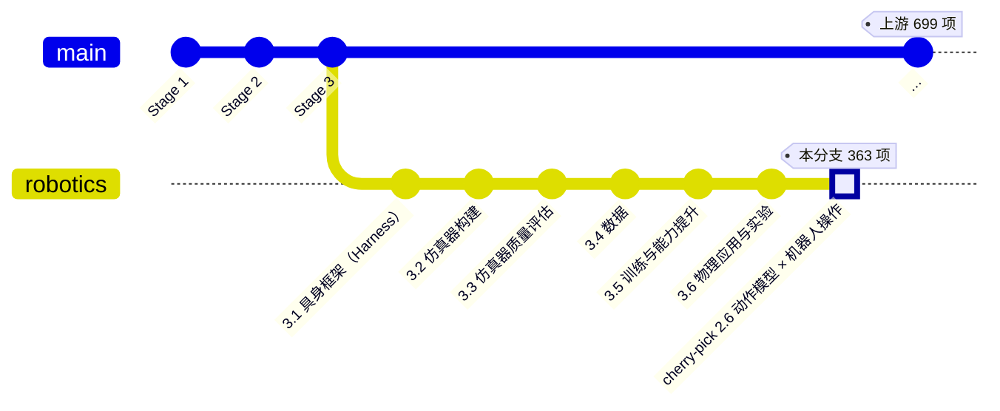
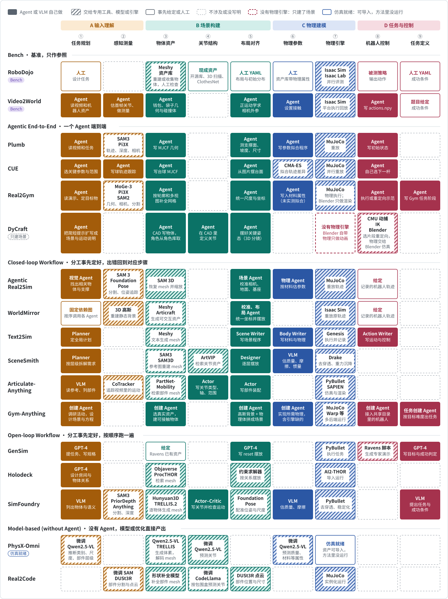
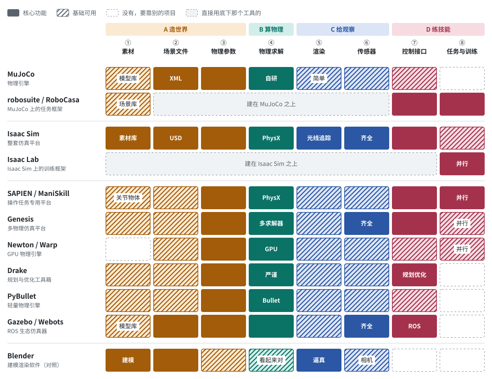
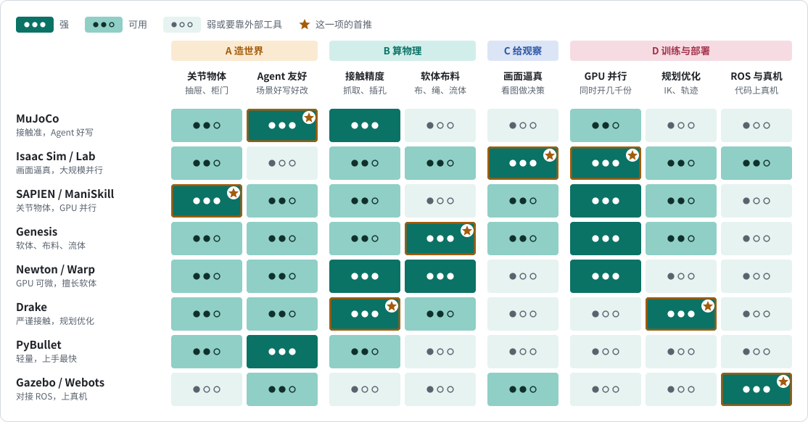

<!-- Generated by scripts/build_readme.py in jiangjin1999/awesome-multimodal-agentic-coding from data/*.yaml — edit the data upstream, not this file. -->

<div align="center">

# Awesome Multimodal Agentic Coding ⎇ Robotics

多模态智能体编程研究地图的机器人分支：Agent 用代码构建仿真、驱动机器人，并在仿真与现实中不断改进。

[](https://awesome.re) [](https://github.com/jiangjin1999/awesome-multimodal-agentic-coding) [](#contents) [](https://github.com/jiangjin1999/awesome-multimodal-agentic-coding-robotics/commits/main) [](./LICENSE)

[English](./README.md) · **简体中文** · [日本語](./README.ja.md)

</div>

```console
$ git checkout -b robotics awesome-multimodal-agentic-coding/stage-3
Switched to a new branch 'robotics'
```

<a id="branch"></a>

## ⎇ 这个分支从哪里来

本仓库是 [Awesome Multimodal Agentic Coding](https://github.com/jiangjin1999/awesome-multimodal-agentic-coding) 的机器人分支。上游是一份分三个阶段的研究地图，这里把 **Stage 3 · 打通数字世界与物理世界** 单独 checkout 成一个仓库，并从 Stage 2 cherry-pick 了 **2.6 动作模型 × 机器人操作**。

章节编号和论文锚点都继承自上游，这里的 3.1 就是上游的 3.1，指向 Stage 1、2 的链接会回到上游。所有条目都在上游编辑，再同步到这里。



<a id="contents"></a>

## 目录

- [Stage 3 · 打通数字世界与物理世界](#stage-3)
  - [3.1 具身框架（Harness）](#s3-1) (97)
  - [3.2 仿真器构建](#s3-2) (69)
  - [3.3 仿真器质量评估](#s3-3) (29)
  - [3.4 数据](#s3-4) (15)
  - [3.5 训练与能力提升](#s3-5) (87)
  - [3.6 物理应用与实验](#s3-6) (51)
    - [科学实验（AI4Science）](#s3-6-experiments) (27)
  - [仿真引擎一览](#s3-engines)
- [从 Stage 2 cherry-pick](#cherry-picked)
  - [2.6 动作模型 × 机器人操作](#s2-6) (15)
- [联系与贡献](#contact) · [引用](#citation)
- ⎇ [上游：完整的三阶段地图](https://github.com/jiangjin1999/awesome-multimodal-agentic-coding)

<a id="stage-3"></a>

## Stage 3 · 打通数字世界与物理世界

闭环延伸到仿真与现实：Agent **在真实世界中行动和观察**，依据真实观测构建仿真器，并在仿真中练习来增强自身——即 Real2Sim2Real。本阶段按研究问题组织，主线是：构建可验证的环境 → 收集交互经验 → 提升 Agent。

**入门必读:** [Code as Policies](#paper-2209-07753) · [Democratizing Robot-Use Agents](#paper-2611-01560) · [Real2Gym](#paper-2609-37089) · [Agentic RSR](#paper-2610-10479) · [Eureka](#paper-2310-12931)

<a id="s3-1"></a>

### 3.1 具身框架（Harness）

#### 工具与控制接口

<!-- mmac-record: {"id": "2611.29377", "scope": "Adjacent", "primary": "3.1", "stage": 3, "type": "paper"} -->

- <a id="paper-2611-29377"></a>`2026.11` **[Contact Harness: Enabling VLM Agents to Perform Contact-Rich Manipulation](https://arxiv.org/abs/2611.29377)** [[项目页]](https://ntumars.github.io/ContactHarness/) [[代码]](https://github.com/NTUMARS/Contact-Harness) [[数据集]](https://huggingface.co/datasets/ntumars/Contact-4)
  > 结合视觉、力觉及可用触觉判断接触状态，并在动作执行中用实时力反馈调节运动。<br>
  > 🖥️ **仿真** MuJoCo（Franka Panda） · 🦾 **真机** Rokae、Franka

<!-- mmac-record: {"id": "2611.01560", "scope": "Core", "primary": "3.1", "stage": 3, "type": "paper"} -->

- <a id="paper-2611-01560"></a>`2026.11` **[Democratizing Robot-Use Agents: A Unified Harness with Open Models](https://arxiv.org/abs/2611.01560)** [[代码]](https://github.com/Open-RUA/uni-robot-agent) [[项目页]](https://openrua.ai/uni-robot-agent)
  > 让 Qwen3.8-Flash-Next 和 GPT-6 Astra 通过统一接口调用感知与运动工具，运行几何检查，观察动作结果并调整下一步操作。<br>
  > 🖥️ **仿真** Isaac Sim（ARX X5） · 🦾 **真机** ARX AC One

<!-- mmac-record: {"id": "2611.27182", "scope": "Core", "primary": "3.1", "stage": 3, "type": "paper"} -->

- <a id="paper-2611-27182"></a>`2026.11` **[Tripwire: Robot Agents that Program Their Own Interrupts under Human Disturbance](https://arxiv.org/abs/2611.27182)**
  > 围绕冻结机器人策略编写并重写视觉中断程序，使 Agent 能在动作执行中重新决策。<br>
  > 🖥️ **仿真** MuJoCo（PandaOmron） · 🦾 **真机** UFACTORY xArm 7

<!-- mmac-record: {"id": "2611.01112", "scope": "Core", "primary": "3.1", "stage": 3, "type": "paper"} -->

- <a id="paper-2611-01112"></a>`2026.10` **[Auriga Technical Report: A Task-Agnostic Agent Harness for Zero-Shot Embodied Manipulation](https://arxiv.org/abs/2611.01112)** [[项目页]](https://auriga.stelledge.com/) [[代码]](https://github.com/lose4578/Auriga)
  > 让模型在任务信念、三维测量、轨迹预览与统一执行入口之上选择工具或编写多步 Python 程序。<br>
  > 🖥️ **仿真** Isaac Sim + MuJoCo（ARX X5、Franka Panda）

<!-- mmac-record: {"id": "2610.13862", "scope": "Adjacent", "primary": "3.1", "stage": 3, "type": "paper"} -->

- <a id="paper-2610-13862"></a>`2026.10` **[BT-Agent: Deploying Onboard Robot Agents with Behavior Trees and Multi-Fidelity Evaluation](https://arxiv.org/abs/2610.13862)**
  > 通过固定行为树 Skill 组织感知与物理动作工具，以结构化失败反馈重试或改变任务决策，本地 Guard 则监督经操作员批准的机载运动。<br>
  > 🖥️ **仿真** Habitat + MuJoCo（Boston Dynamics Spot） · 🦾 **真机** Boston Dynamics Spot

<!-- mmac-record: {"id": "2610.29702", "scope": "Adjacent", "primary": "3.1", "stage": 3, "type": "paper"} -->

- <a id="paper-2610-29702"></a>`2026.10` **[CausGround: Causal Interaction Grounding for Adaptive Embodied Planning](https://arxiv.org/abs/2610.29702)** [[项目页]](https://causground.github.io/)
  > 将 RGB 观测落地为对象级因果机制，检索动作前提和效果以引导冻结规划器选择技能，并通过仿真、录制技能回放与定性机器人演示验证。<br>
  > 🖥️ **仿真** Unity + MuJoCo（Franka Panda）

<!-- mmac-record: {"id": "2610.01939", "scope": "Core", "primary": "3.1", "stage": 3, "type": "paper"} -->

- <a id="paper-2610-01939"></a>`2026.10` **[Fewer Tokens, Better Action: GPT-6 Astra Robot Agents with 14% Higher Success Rate but 65% Fewer Tokens](https://arxiv.org/abs/2610.01939)**
  > 让 Agent 在 Python 单元中组合机器人原语、局部检查和重试，减少回传上下文，并探索小型编程模型的强化学习。<br>
  > 🖥️ **仿真** MuJoCo + SAPIEN（Franka Panda、AgileX ALOHA）

<!-- mmac-record: {"id": "2610.23479", "scope": "Core", "primary": "3.1", "stage": 3, "type": "paper"} -->

- <a id="paper-2610-23479"></a>`2026.10` **[HexaShell: A Universal Harness for Robot Coding Agents in Simulation and the Real World](https://arxiv.org/abs/2610.23479)** [[代码]](https://github.com/HexaFuture/HexaShell)
  > 让机器人编程 Agent 在每轮编写一段 Python，调用共享的运动、感知与状态工具，也可复用从历史执行记录提炼的任务 Skills。<br>
  > 🖥️ **仿真** Isaac Sim + SAPIEN + MuJoCo（ARX X5、Franka Panda） · 🦾 **真机** AgileX PiPER-X

<!-- mmac-record: {"id": "2610.02459", "scope": "Core", "primary": "3.1", "stage": 3, "type": "paper"} -->

- <a id="paper-2610-02459"></a>`2026.10` **[OpenRUA: Robot-Use Agents Are Zero-Shot Visuomotor Policies](https://arxiv.org/abs/2610.02459)** [[代码]](https://github.com/terminalworld/OpenRUA)
  > 仅向现成 Coding Agent 提供终端、ROS 2 文档与机器人工作区，检验直接编程使用原生机器人接口的零样本能力。<br>
  > 🖥️ **仿真** MuJoCo + Isaac Sim（Franka Panda）

<!-- mmac-record: {"id": "2610.06843", "scope": "Adjacent", "primary": "3.1", "stage": 3, "type": "paper"} -->

- <a id="paper-2610-06843"></a>`2026.10` **[Recursive Video In-Context Learning for Agentic Robot](https://arxiv.org/abs/2610.06843)** [[代码]](https://github.com/BWR-hhh/rvicl) [[项目页]](https://bwr-hhh.github.io/rvicl/)
  > 让机器人 Agent 按需查询分层示范视频，与实时相机对比后调整冻结 VLA 和解析动作原语的调用，同时保留底层执行框架。<br>
  > 🖥️ **仿真** MuJoCo（Franka Panda）

<!-- mmac-record: {"id": "2610.04929", "scope": "Adjacent", "primary": "3.1", "stage": 3, "type": "paper"} -->

- <a id="paper-2610-04929"></a>`2026.10` **[RobotUse: Allocating Computation, Context, and Decisions](https://arxiv.org/abs/2610.04929)** [[项目页]](https://robotuse-team.github.io/) [[代码]](https://github.com/robotuse-team/RobotUse)
  > 围绕物理动作组织计算、上下文与决策，并用持久执行手册积累机器人 Agent 的任务经验。<br>
  > 🖥️ **仿真** Isaac Lab（Franka Panda） · 🦾 **真机** Franka Panda

<!-- mmac-record: {"id": "2610.12457", "scope": "Adjacent", "primary": "3.1", "stage": 3, "type": "paper"} -->

- <a id="paper-2610-12457"></a>`2026.10` **[SpatialHarness: Test-Time Spatial Scaffolding for Fine Robotic Manipulation](https://arxiv.org/abs/2610.12457)** [[项目页]](https://emilia113.github.io/SpatialHarness/) [[数据集]](https://huggingface.co/datasets/yzy05/SpatialHarness)
  > 维持与真实执行同步的模拟场景，按任务需要渲染补充视角，为冻结的多模态机器人策略提供空间支架。<br>
  > 🖥️ **仿真** MuJoCo（Franka FR3） · 🦾 **真机** Franka FR3

<!-- mmac-record: {"id": "2610.30043", "scope": "Adjacent", "primary": "3.1", "stage": 3, "type": "paper"} -->

- <a id="paper-2610-30043"></a>`2026.10` **[TARSphere: A Robot-Oriented Full-Stack Framework for Long-Horizon Embodied Agents in Evolving Physical and Social Environments](https://arxiv.org/abs/2610.30043)** [[代码]](https://github.com/xuyicheng-zju/TARSphere) [[项目页]](https://xuyicheng-zju.github.io/TARSphere/)
  > 为冻结多模态模型提供分层可执行技能、任务记忆和执行反馈，组织长时序机器人行动及环境变化处理。<br>
  > 🖥️ **仿真** Isaac Sim（Unitree G1）

<!-- mmac-record: {"id": "2609.12541", "scope": "Core", "primary": "3.1", "stage": 3, "type": "paper"} -->

- <a id="paper-2609-12541"></a>`2026.09` **[Agent as Policy for Robotic Manipulation](https://arxiv.org/abs/2609.12541)** [[数据集]](https://huggingface.co/datasets/Agent-as-Policy/agent-as-policy) [[代码]](https://github.com/agent-as-policy-2026/agent-as-policy)
  > 让通用 Agent 持续读取视觉证据、编写程序并发出运动指令，根据物理执行结果调整下一步行动。<br>
  > 🖥️ **仿真** MuJoCo（I2RT YAM） · 🦾 **真机** I2RT YAM

<!-- mmac-record: {"id": "2609.20822", "scope": "Core", "primary": "3.1", "stage": 3, "type": "paper"} -->

- <a id="paper-2609-20822"></a>`2026.09` **[Coding Agents with an Obstacle-Aware Harness for Safe Robot Manipulation](https://arxiv.org/abs/2609.20822)**
  > 为 Code-as-policy Agent 增加视觉定位的路径检查与接触约束，并在执行遭遇障碍或未建模物理限制时，根据观测到的停止位姿重新规划后续动作。<br>
  > 🖥️ **仿真** MuJoCo（Franka Panda） · 🦾 **真机** AgileX PiPER-X

<!-- mmac-record: {"id": "2609.38078", "scope": "Adjacent", "primary": "3.1", "stage": 3, "type": "paper"} -->

- <a id="paper-2609-38078"></a>`2026.09` **[MotorMind: Scaffolding General Vision Language Models for Zero-Shot Robot Manipulation](https://arxiv.org/abs/2609.38078)**
  > 用中层动作、确定性控制和异步监测连接通用 VLM 与机械臂，考察推理频率与执行可靠性的关系。<br>
  > 🖥️ **仿真** MuJoCo（Franka Panda） · 🦾 **真机** xArm6

<!-- mmac-record: {"id": "2609.29389", "scope": "Adjacent", "primary": "3.1", "stage": 3, "type": "paper"} -->

- <a id="paper-2609-29389"></a>`2026.09` **[Robo-Harness K1: Harnessing Robot-Use Agents via Perception Augmentation](https://arxiv.org/abs/2609.29389)**
  > 把三维感知作为可调用工具提供给 Robot-Use Agent，增强几何定位能力而不重新训练视觉编码器。<br>
  > 🖥️ **仿真** MuJoCo + SAPIEN（Franka Panda、UR5e、KUKA iiwa、AgileX ALOHA）

<!-- mmac-record: {"id": "2610.14018", "scope": "Adjacent", "primary": "3.1", "stage": 3, "type": "paper"} -->

- <a id="paper-2610-14018"></a>`2026.09` **[RoboHarness: A Simple Harness Outperforms VLA and World Action Models](https://arxiv.org/abs/2610.14018)** [[代码]](https://github.com/BinceQu/RoboHarness)
  > 给 LLM Agent 提供视觉几何控制面板，研究简单工具接口能否支持零样本机器人操作。<br>
  > 🖥️ **仿真** MuJoCo + Isaac Sim（Franka Panda、Galaxea R1 Pro、ARX X5）

<!-- mmac-record: {"id": "2609.10522", "scope": "Adjacent", "primary": "3.1", "stage": 3, "type": "paper"} -->

- <a id="paper-2609-10522"></a>`2026.09` **[Show-Harness: Just a VLM Agent Can Play Robots](https://arxiv.org/abs/2609.10522)** [[项目页]](https://showlab.github.io/Show-Harness) [[代码]](https://github.com/showlab/Show-Harness) [[模型]](https://huggingface.co/showlab/Show-Harness-VLMs) [[数据集]](https://huggingface.co/datasets/showlab/Show-Harness-Data)
  > 以紧凑语义动作接口连接通用 VLM 与机器人解释器，研究将数字 Agent 式交互迁移到物理控制的条件。<br>
  > 🖥️ **仿真** Isaac Lab + SAPIEN（Franka Panda） · 🦾 **真机** Franka FR3、AgileX PiPER

<!-- mmac-record: {"id": "2609.22966", "scope": "Adjacent", "primary": "3.1", "stage": 3, "type": "paper"} -->

- <a id="paper-2609-22966"></a>`2026.09` **[Transferring the Intelligence of VLMs to Robotic Control](https://arxiv.org/abs/2609.22966)** [[项目页]](https://robodawn.top/) [[代码]](https://github.com/Hugo-AGI/RoboDawn) [[Demo]](https://robodawn.top/results)
  > RoboDawn 通过离散运动指令和上下文示范，让冻结 VLM 根据执行反馈控制机器人。<br>
  > 🖥️ **仿真** SAPIEN + Isaac Sim · 🦾 **真机** Franka、AgileX PiPER

<!-- mmac-record: {"id": "2609.29964", "scope": "Adjacent", "primary": "3.1", "stage": 3, "type": "paper"} -->

- <a id="paper-2609-29964"></a>`2026.09` **[World Action Agent: Harnessing VLMs for Robot Manipulation via World Action Rehearsal](https://arxiv.org/abs/2609.29964)**
  > 为 VLM 提供交互局部视图、可编辑的动作预演和示范提炼的技能，通过数值规划工具持续修正操控决策，而不生成策略代码。<br>
  > 🖥️ **仿真** MuJoCo（Franka Panda）

<!-- mmac-record: {"id": "chemautoagent", "scope": "Adjacent", "primary": "3.1", "stage": 3, "type": "paper"} -->

- <a id="paper-chemautoagent"></a>`2026.08` **[ChemAutoAgent: A Multi-Agent System for Evidence-Controlled Laboratory Instrument Driver Generation from Text-Based Manuals](https://www.mdpi.com/2076-3417/16/16/8291)** [[版本记录]](https://www.mdpi.com/2076-3417/16/16/8291/notes)
  > 让 Agent 从带出处的设备手册生成驱动内容，在确定性协议骨架和硬件测试中修复错误，再把可复用接口提供给后续实验 Agent。

<!-- mmac-record: {"id": "2608.03924", "scope": "Adjacent", "primary": "3.1", "stage": 3, "type": "paper"} -->

- <a id="paper-2608-03924"></a>`2026.08` **[ETA: A New Agentic Paradigm for Embodied Tasks](https://arxiv.org/abs/2608.03924)**
  > 通过 OpenETA 将观察、标记目标与运动能力接入 Codex 等数字 Agent，研究轻量接口如何支持物理任务。<br>
  > 🖥️ **仿真** MuJoCo（Franka Panda） · 🦾 **真机** UR5e

<!-- mmac-record: {"id": "2607.05369", "scope": "Adjacent", "primary": "3.1", "stage": 3, "type": "paper"} -->

- <a id="paper-2607-05369"></a>`2026.07` **[GaP: A Graph-as-Policy Multi-Agent Self-Learning Harness For Variational Automation Tasks](https://arxiv.org/abs/2607.05369)** [[项目页]](https://graph-robots.github.io/gap) [[代码]](https://github.com/graph-robots/graph-as-policy)
  > 由多 Agent 编写连接感知、规划与控制节点的计算图，以可组合机器人技能库支持可变自动化任务。<br>
  > 🖥️ **仿真** MuJoCo（Franka Panda） · 🦾 **真机** Franka

<!-- mmac-record: {"id": "2607.16636", "scope": "Adjacent", "primary": "3.1", "stage": 3, "type": "paper"} -->

- <a id="paper-2607-16636"></a>`2026.07` **[PhyAgentOS: A Self-Evolving Operating System for Embodied Agents with Decoupled Cognitive Planning and Physical Execution](https://arxiv.org/abs/2607.16636)** [[代码]](https://github.com/PhyAgentOS/PhyAgentOS)
  > 用文件化状态契约分离 Agent 推理与机器人执行，让工具调用、状态记录和经验更新能够跨运行层衔接。<br>
  > 🖥️ **仿真** MuJoCo + Isaac Sim · 🦾 **真机** Franka FR3、XLeRobot、AgileX PiPER、Dobot Nova 2、Unitree Go2、Unitree G1

<!-- mmac-record: {"id": "2607.11119", "scope": "Adjacent", "primary": "3.1", "stage": 3, "type": "paper"} -->

- <a id="paper-2607-11119"></a>`2026.07` **[VIA: Visual Interface Agent for Robot Control](https://arxiv.org/abs/2607.11119)**
  > 让视觉 Agent 在界面中调整虚拟夹爪位姿，再将航点发送给机器人控制器。<br>
  > 🖥️ **仿真** Franka Panda · 🦾 **真机** Stretch 4

<!-- mmac-record: {"id": "2605.26637", "scope": "Adjacent", "primary": "3.1", "stage": 3, "type": "paper"} -->

- <a id="paper-2605-26637"></a>`2026.05` **[Enabling Extensible Embodied Capabilities with Tools](https://arxiv.org/abs/2605.26637)**
  > 提出 Embodied Tool Protocol，将机器人感知、推理与执行能力统一为可注册、发现和调用的工具，支撑 Agent 组合现有能力。<br>
  > 🖥️ **仿真** AI2-THOR + Habitat + CoppeliaSim（Franka Panda）

<!-- mmac-record: {"id": "2512.05955", "scope": "Adjacent", "primary": "3.1", "stage": 3, "type": "paper"} -->

- <a id="paper-2512-05955"></a>`2025.12` **[SIMPACT: Simulation-Enabled Action Planning using Vision-Language Models](https://arxiv.org/abs/2512.05955)** [[项目页]](https://simpact-bot.github.io/) [[代码]](https://github.com/ShaoxiongYao/simpact)
  > 利用物理仿真的渲染轨迹修正操控动作，再将计划交给真实机器人执行。<br>
  > 🖥️ **仿真** MuJoCo + Warp + PyBullet · 🦾 **真机** Franka FR3

<!-- mmac-record: {"id": "2511.00917", "scope": "Core", "primary": "3.1", "stage": 3, "type": "paper"} -->

- <a id="paper-2511-00917"></a>`2025.11` **[MAESTRO: Orchestrating Robotics Modules with Coding Agents for Zero-Shot Generalist Robots](https://arxiv.org/abs/2511.00917)** [[代码]](https://github.com/penn-pal-lab/maestro) [[项目页]](https://maestro-robot.github.io)
  > 让 VLM 编写机器人程序来组织感知、规划和控制模块，通过视觉与执行反馈验证结果及恢复失败。<br>
  > 🦾 **真机** Franka Panda、Unitree Go2-W、AgileX PiPER

<!-- mmac-record: {"id": "2510.21302", "scope": "Adjacent", "primary": "3.1", "stage": 3, "type": "paper"} -->

- <a id="paper-2510-21302"></a>`2025.10` **[Towards Reliable Code-as-Policies: A Neuro-Symbolic Framework for Embodied Task Planning](https://arxiv.org/abs/2510.21302)**
  > 将机器人策略代码生成与符号验证结合，通过探索程序补全缺失观测并验证行动条件。<br>
  > 🖥️ **仿真** CoppeliaSim（Franka Panda） · 🦾 **真机** Franka FR3

<!-- mmac-record: {"id": "2505.07532", "scope": "Adjacent", "primary": "3.1", "stage": 3, "type": "paper"} -->

- <a id="paper-2505-07532"></a>`2025.05` **[RAI: Flexible Agent Framework for Embodied AI](https://arxiv.org/abs/2505.07532)**
  > 以模块化工具接口把语言模型、多 Agent、ROS 与仿真连接起来，为机器人 Agent 提供可复用的运行基础。<br>
  > 🖥️ **仿真** O3DE（Husarion ROSbot XL） · 🦾 **真机** Husarion ROSbot XL

<!-- mmac-record: {"id": "2503.21969", "scope": "Core", "primary": "3.1", "stage": 3, "type": "paper"} -->

- <a id="paper-2503-21969"></a>`2025.03` **[Robotic Long-Horizon Manipulation with Progressive In-Context Code Generation and Episodic Feedback](https://arxiv.org/abs/2503.21969)**
  > 用递进式上下文生成机器人程序，再由视觉报告器在每轮执行后总结结果并指导重规划。<br>
  > 🖥️ **仿真** PyBullet + MuJoCo（UR5e、Franka Panda） · 🦾 **真机** Franka

<!-- mmac-record: {"id": "2412.04455", "scope": "Adjacent", "primary": "3.1", "stage": 3, "type": "paper"} -->

- <a id="paper-2412-04455"></a>`2024.12` **[Code-as-Monitor: Constraint-aware Visual Programming for Reactive and Proactive Robotic Failure Detection](https://arxiv.org/abs/2412.04455)** [[项目页]](https://zhoues.github.io/Code-as-Monitor/)
  > 让 VLM 编写可执行的时空约束监测程序，利用视觉跟踪检查机器人执行中的失败和潜在违规。<br>
  > 🖥️ **仿真** CoppeliaSim + PyBullet + Isaac Sim（Franka Panda、UR5、Fetch） · 🦾 **真机** UR5、LEAP Hand

<!-- mmac-record: {"id": "2410.06472", "scope": "Adjacent", "primary": "3.1", "stage": 3, "type": "paper"} -->

- <a id="paper-2410-06472"></a>`2024.10` **[Enabling Novel Mission Operations and Interactions with ROSA: The Robot Operating System Agent](https://arxiv.org/abs/2410.06472)**
  > 将 ROS 查询、诊断与操作封装为语言 Agent 可调用的工具，支持不同机器人平台的自然语言任务交互。<br>
  > 🖥️ **仿真** Isaac Sim（NVIDIA Nova Carter） · 🦾 **真机** JPL EELS、Boston Dynamics Spot

<!-- mmac-record: {"id": "bounded-motion", "scope": "Adjacent", "primary": "3.1", "stage": 3, "type": "paper"} -->

- <a id="paper-bounded-motion"></a>`2024.10` **[Language-guided Manipulator Motion Planning with Bounded Task Space](https://proceedings.mlr.press/v270/oelerich25a.html)** [[项目页]](https://www.acin.tuwien.ac.at/42d2/)
  > 让语言模型根据视觉信息编写 Python 调用受约束路径规划器，再由 BoundMPC 执行平滑轨迹，连接语义推理与机器人运动约束。

<!-- mmac-record: {"id": "2312.04474", "scope": "Adjacent", "primary": "3.1", "stage": 3, "type": "paper"} -->

- <a id="paper-2312-04474"></a>`2023.12` **[Chain of Code: Reasoning with a Language Model-Augmented Code Emulator](https://arxiv.org/abs/2312.04474)** [[项目页]](https://chain-of-code.github.io) [[Demo]](https://colab.research.google.com/github/google-research/google-research/blob/master/code_as_policies/coc_demo.ipynb)
  > 用解释器执行明确的程序逻辑，并把未定义的语义计算交给语言模型模拟；机器人实验展示代码与模型调用的组合方式。<br>
  > 🦾 **真机** UR5

<!-- mmac-record: {"id": "2306.09523", "scope": "Adjacent", "primary": "3.1", "stage": 3, "type": "paper"} -->

- <a id="paper-2306-09523"></a>`2023.06` **[Tell Me Where to Go: A Composable Framework for Context-Aware Embodied Robot Navigation](https://arxiv.org/abs/2306.09523)**
  > 用生成的 Python 中间层连接语言推理、视觉环境描述和移动机器人导航接口，支持依赖上下文的导航指令。<br>
  > 🦾 **真机** Boston Dynamics Spot

<!-- mmac-record: {"id": "2305.11176", "scope": "Adjacent", "primary": "3.1", "stage": 3, "type": "paper"} -->

- <a id="paper-2305-11176"></a>`2023.05` **[Instruct2Act: Mapping Multi-modality Instructions to Robotic Actions with Large Language Model](https://arxiv.org/abs/2305.11176)** [[代码]](https://github.com/OpenGVLab/Instruct2Act)
  > 由 LLM 生成 Python 程序，调用 SAM、CLIP 与动作 API，把多模态指令组织成感知、规划和执行流程。<br>
  > 🖥️ **仿真** PyBullet（UR5）

<!-- mmac-record: {"id": "2306.17582", "scope": "Adjacent", "primary": "3.1", "stage": 3, "type": "paper"} -->

- <a id="paper-2306-17582"></a>`2023.02` **[ChatGPT for Robotics: Design Principles and Model Abilities](https://arxiv.org/abs/2306.17582)** [[项目页]](https://www.microsoft.com/en-us/research/publication/chatgpt-for-robotics-design-principles-and-model-abilities/)
  > 通过函数库、提示设计和人机对话，让 ChatGPT 为机械臂、无人机与移动机器人编写和修改任务程序。<br>
  > 🖥️ **仿真** AirSim + Habitat · 🦾 **真机** DJI Tello

<!-- mmac-record: {"id": "2209.07753", "scope": "Adjacent", "primary": "3.1", "stage": 3, "type": "paper"} -->

- <a id="paper-2209-07753"></a>`2022.09` **[Code as Policies: Language Model Programs for Embodied Control](https://arxiv.org/abs/2209.07753)** [[项目页]](https://code-as-policies.github.io) [[代码]](https://github.com/google-research/google-research/tree/master/code_as_policies) [[Demo]](https://huggingface.co/spaces/jackyliang42/code-as-policies)
  > 用语言模型递归生成 Python 策略，组合感知结果、几何计算与控制 API，是机器人 Code-as-Policy 的早期基础；程序内反馈不等于写码模型根据执行结果重写程序。<br>
  > 🖥️ **仿真** PyBullet（UR5e） · 🦾 **真机** UR5e、Everyday Robots

<!-- mmac-record: {"id": "2209.11302", "scope": "Adjacent", "primary": "3.1", "stage": 3, "type": "paper"} -->

- <a id="paper-2209-11302"></a>`2022.09` **[ProgPrompt: Generating Situated Robot Task Plans using Large Language Models](https://arxiv.org/abs/2209.11302)** [[项目页]](http://progprompt.github.io) [[代码]](https://github.com/NVlabs/progprompt-vh)
  > 用可用动作、对象和断言组织程序式提示，使语言模型生成能够检查前置条件并恢复的机器人任务计划。<br>
  > 🖥️ **仿真** Unity · 🦾 **真机** Franka Panda

#### 委派已有策略

<!-- mmac-record: {"id": "2611.03585", "scope": "Adjacent", "primary": "3.1", "stage": 3, "type": "paper"} -->

- <a id="paper-2611-03585"></a>`2026.11` **[Seeing Through the Illusion: Test-Time Scaling for World Action Models](https://arxiv.org/abs/2611.03585)**
  > 组合动作有效性、想象运动的逆动力学一致性与任务进度，为冻结世界—动作模型选择候选轨迹，执行动作块后依据新观测重规划。<br>
  > 🖥️ **仿真** MuJoCo + Isaac Lab（Franka Panda）

<!-- mmac-record: {"id": "system:the-harness-corl2026", "scope": "Adjacent", "primary": "3.1", "stage": 3, "type": "paper"} -->

- <a id="paper-system-the-harness-corl2026"></a>`2026.11` **[The Harness: One Agent Harness for Anything that Acts](https://web.eecs.umich.edu/~stellayu/publication/2026harnessCoRLL.html)** [[论文]](https://web.eecs.umich.edu/~stellayu/publication/doc/2026harnessCoRLL.pdf)
  > 把 Agent 编写的程序、有界 VLA 技能和快速反应守卫组合成共享控制层级。<br>
  > 🖥️ **仿真** Isaac Sim（ARX X5）

<!-- mmac-record: {"id": "2610.21453", "scope": "Adjacent", "primary": "3.1", "stage": 3, "type": "paper"} -->

- <a id="paper-2610-21453"></a>`2026.10` **[CarryOn: A Dual-Loop Harness for Personalized and Reliable Robot Assistance](https://arxiv.org/abs/2610.21453)** [[代码]](https://github.com/JIA-Lab-research/CarryOn) [[项目页]](https://vincent2311.github.io/Projects/CarryOn/)
  > 协调持久用户／场景记忆、冻结 VLA、几何安全过滤与视觉失败恢复，并通过离线反思修订恢复策略和参数，供后续尝试复用。<br>
  > 🖥️ **仿真** MuJoCo + Isaac Lab（Franka Panda） · 🦾 **真机** Franka FR3

<!-- mmac-record: {"id": "2610.19600", "scope": "Adjacent", "primary": "3.1", "stage": 3, "type": "paper"} -->

- <a id="paper-2610-19600"></a>`2026.10` **[Cracking Mobile Manipulation: From Failure Diagnosis to Agentic Robot System](https://arxiv.org/abs/2610.19600)** [[项目页]](https://github.com/PKU-VaLuE-Lab/Cracking-Mobile-Manipulation)
  > 围绕冻结的移动操作 VLA，以失败诊断指导视觉记忆和几何工具的编排。<br>
  > 🖥️ **仿真** MuJoCo + Isaac Sim · 🦾 **真机** Astribot S1

<!-- mmac-record: {"id": "2610.42053", "scope": "Adjacent", "primary": "3.1", "stage": 3, "type": "paper"} -->

- <a id="paper-2610-42053"></a>`2026.10` **[REA: A Routed Embodied Agent Runtime for Asynchronous Brain-Cerebellum Control](https://arxiv.org/abs/2610.42053)** [[项目页]](https://mikeeeeeeeeeeeeee.github.io/REA/)
  > 将快速机器人执行与异步模型判断、路径选择分离，在策略返回边界通过视觉结果检查协调固定代码策略和动作模型。<br>
  > 🖥️ **仿真** MuJoCo + SAPIEN + Isaac Sim（Franka Panda、AgileX ALOHA、Galaxea R1 Pro） · 🦾 **真机** Unitree G1

<!-- mmac-record: {"id": "2609.29166", "scope": "Core", "primary": "3.1", "stage": 3, "type": "paper"} -->

- <a id="paper-2609-29166"></a>`2026.09` **[HarnessPAI: An Evolving Harness for Physical AI](https://arxiv.org/abs/2609.29166)** [[项目页]](https://darwin-agent.github.io/HarnessPAI) [[代码]](https://github.com/Darwin-Agent/HarnessPAI)
  > 以可执行代码组织底层动作原语，并依据交互反馈演化机器人程序，使稳定程序还能生成下游策略训练数据。<br>
  > 🖥️ **仿真** MuJoCo（Franka Panda）

<!-- mmac-record: {"id": "2608.11246", "scope": "Adjacent", "primary": "3.1", "stage": 3, "type": "paper"} -->

- <a id="paper-2608-11246"></a>`2026.08` **[Towards the Harness of Embodied Agents](https://arxiv.org/abs/2608.11246)** [[项目页]](https://eit-hai.github.io/thea) [[代码]](https://github.com/EIT-HAI/Thea)
  > 用持久场景图和带成功、失败原因的执行返回值，将机器人能力组织为 Agent 可理解和调用的工具。<br>
  > 🦾 **真机** Astribot S1、AgileX Cobot Magic、Unitree G1

<!-- mmac-record: {"id": "2607.08448", "scope": "Adjacent", "primary": "3.1", "stage": 3, "type": "paper"} -->

- <a id="paper-2607-08448"></a>`2026.07` **[Harness VLA: Steering Frozen VLAs into Reliable Manipulation Primitives via Memory-Guided Agents](https://arxiv.org/abs/2607.08448)** [[代码]](https://github.com/RLinf/RPent)
  > 让 Coding Agent 编排冻结 VLA 与解析动作原语<br>
  > 🖥️ **仿真** MuJoCo + SAPIEN（Franka Panda、AgileX ALOHA） · 🦾 **真机** Franka

<!-- mmac-record: {"id": "2207.05608", "scope": "Adjacent", "primary": "3.1", "stage": 3, "type": "paper"} -->

- <a id="paper-2207-05608"></a>`2022.07` **[Inner Monologue: Embodied Reasoning through Planning with Language Models](https://arxiv.org/abs/2207.05608)** [[项目页]](https://innermonologue.github.io/)
  > 将感知、成功检测或人的反馈转成语言，支持机器人技能的闭环重规划。<br>
  > 🖥️ **仿真** PyBullet · 🦾 **真机** UR5e、Everyday Robots

<!-- mmac-record: {"id": "2204.01691", "scope": "Adjacent", "primary": "3.1", "stage": 3, "type": "paper"} -->

- <a id="paper-2204-01691"></a>`2022.04` **[Do As I Can, Not As I Say: Grounding Language in Robotic Affordances](https://arxiv.org/abs/2204.01691)** [[项目页]](https://say-can.github.io/) [[代码]](https://github.com/google-research/google-research/tree/master/saycan)
  > SayCan 结合语言模型的任务相关性与当前状态下的可供性评分，选择预训练机器人技能。<br>
  > 🦾 **真机** Everyday Robots

#### Agent 能力评测

<!-- mmac-record: {"id": "system:aa-robotics-sim", "scope": "Core", "primary": "3.1", "stage": 3, "type": "paper"} -->

- <a id="paper-system-aa-robotics-sim"></a>`2026.11` **[Can language models drive a humanoid robot? Introducing AA-Robotics-Sim v0.1](https://artificialanalysis.ai/articles/aa-robotics-sim)**
  > 前沿模型为仿真人形机器人编写 Python 控制代码，在指令之间查看头部相机画面，并把练习阶段写下的笔记和代码带到新场景中使用。<br>
  > 🖥️ **仿真** Isaac Sim + Isaac Lab（Unitree G1）

<!-- mmac-record: {"id": "2611.12177", "scope": "Adjacent", "primary": "3.1", "stage": 3, "type": "paper"} -->

- <a id="paper-2611-12177"></a>`2026.11` **[Embodied First Exam](https://arxiv.org/abs/2611.12177)**
  > 跨机器人形态检验通用 Agent 的具身任务能力，明确比较观测权限、重置预算和执行时钟不同的运行方式。<br>
  > 🖥️ **仿真** MuJoCo + Isaac Sim + SAPIEN

<!-- mmac-record: {"id": "2611.16009", "scope": "Adjacent", "primary": "3.1", "stage": 3, "type": "paper"} -->

- <a id="paper-2611-16009"></a>`2026.11` **[JustRUA: A Controlled Study of GPT-6 Robot-Use Agents](https://arxiv.org/abs/2611.16009)** [[项目页]](https://zefanw.github.io/JustRUA/) [[代码]](https://github.com/ZefanW/JustRUA) [[Demo]](https://huggingface.co/spaces/ZefanW/robodojo-replay-explorer)
  > 在 RoboDojo 仿真中比较完整回合历史、短动作、深度与坐标求解代码对通用 Agent 操控的影响。<br>
  > 🖥️ **仿真** Isaac Sim（ARX X5）

<!-- mmac-record: {"id": "2611.08209", "scope": "Adjacent", "primary": "3.1", "stage": 3, "type": "paper"} -->

- <a id="paper-2611-08209"></a>`2026.11` **[RoboARCade: Benchmarking Agentic Robot Control](https://arxiv.org/abs/2611.08209)** [[项目页]](http://roboarcade.org)
  > 在随机化长程 MuJoCo 任务上评测视觉机器人控制 Agent，分别比较接口、上下文示范和跨尝试文本工作流优化。<br>
  > 🖥️ **仿真** MuJoCo + Blender（Franka Panda、I2RT YAM）

<!-- mmac-record: {"id": "2611.02497", "scope": "Adjacent", "primary": "3.1", "stage": 3, "type": "paper"} -->

- <a id="paper-2611-02497"></a>`2026.11` **[RoboColosseum: Evaluating Physical Intelligence at Scale In-The-Wild](https://arxiv.org/abs/2611.02497)** [[仓库]](https://github.com/RoboColosseum) [[项目页]](https://robocolosseum.ai/)
  > 通过跨站点、条件匹配的盲测实机试验比较冻结 Agent 与 VLA，并另设适配赛道分析不同机器人上的排名变化。<br>
  > 🦾 **真机** SO-101、I2RT YAM、Franka Panda、Unitree G1

<!-- mmac-record: {"id": "2610.00854", "scope": "Adjacent", "primary": "3.1", "stage": 3, "type": "paper"} -->

- <a id="paper-2610-00854"></a>`2026.10` **[Are Frontier VLM Agents Ready to Be Robot Generalists? An Empirical Study with the Embodied Agent Arena](https://arxiv.org/abs/2610.00854)** [[项目页]](https://embodied-agent-arena.github.io/embodied-agent-arena/) [[代码]](https://github.com/embodied-agent-arena/embodied-agent-arena) [[数据集]](https://huggingface.co/datasets/uuu-Quant/Embodied-Agent-Arena)
  > 在统一预算与源任务接口下比较前沿 VLM Agent 的机器人通用性，并区分修复程序运行与完成物理任务。<br>
  > 🖥️ **仿真** MuJoCo + SAPIEN + PyBullet + CoppeliaSim + Isaac Sim

<!-- mmac-record: {"id": "2610.07594", "scope": "Adjacent", "primary": "3.1", "stage": 3, "type": "paper"} -->

- <a id="paper-2610-07594"></a>`2026.10` **[BiGym 2.0: Benchmarking Learned and Agent-Developed Policies for Humanoid Household Manipulation](https://arxiv.org/abs/2610.07594)** [[代码]](https://github.com/swirl-uk/BiGym2)
  > 在一致的机载观测和全身控制器下比较人形机器人学习策略与 Agent 开发的程序，并发布仿真中的人类 VR 示范。<br>
  > 🖥️ **仿真** MuJoCo（Unitree G1）

<!-- mmac-record: {"id": "2610.27039", "scope": "Adjacent", "primary": "3.1", "stage": 3, "type": "paper"} -->

- <a id="paper-2610-27039"></a>`2026.10` **[Embodied Playground: A Long-Horizon Agentic Robotics Benchmark for Physical, Strategic, and Spatial Reasoning](https://arxiv.org/abs/2610.27039)** [[项目页]](https://winniechen2002.github.io/Agent-bench-website/) [[代码]](https://github.com/Winniechen2002/Embodied-Playground)
  > 以长时序机器人任务评测 Agent 如何协调物理、空间和策略推理，并在执行反馈下保持任务进度。<br>
  > 🖥️ **仿真** MuJoCo + Isaac Lab + SAPIEN（Franka Panda、Franka FR3、Sharpa Wave、ALOHA）

<!-- mmac-record: {"id": "2610.16238", "scope": "Adjacent", "primary": "3.1", "stage": 3, "type": "paper"} -->

- <a id="paper-2610-16238"></a>`2026.10` **[Embodied Skill Bench: Benchmarking How Well Agents with Embodied Skills Perform on Physical Tasks](https://arxiv.org/abs/2610.16238)** [[代码]](https://github.com/HanZhi306/EmbodiedSkill-Bench) [[代码]](https://github.com/FBddcz/embodied-jev)
  > 在原生控制、仅用技能和 Agent 自主选择或修改技能三种条件下，评测具身 Skills 对物理任务的实际帮助。<br>
  > 🖥️ **仿真** MuJoCo（Franka Panda）

<!-- mmac-record: {"id": "2610.30051", "scope": "Adjacent", "primary": "3.1", "stage": 3, "type": "paper"} -->

- <a id="paper-2610-30051"></a>`2026.10` **[From Reasoning to Action: Benchmarking Frontier AI Models on LIBERO-10 Robot Manipulation Tasks](https://arxiv.org/abs/2610.30051)** [[代码]](https://github.com/IRVLUTD/LLM_LIBERO) [[项目页]](https://irvlutd.github.io/LLM-LIBERO/)
  > 在统一闭环与控制接口下比较前沿模型执行 LIBERO-10 操作任务的表现，避免把模型更换与接口更换混为一谈。<br>
  > 🖥️ **仿真** MuJoCo（Franka Panda）

<!-- mmac-record: {"id": "2610.22471", "scope": "Adjacent", "primary": "3.1", "stage": 3, "type": "paper"} -->

- <a id="paper-2610-22471"></a>`2026.10` **[Has GPT-6-Astra Achieved Embodied Intelligence?](https://arxiv.org/abs/2610.22471)** [[文章]](https://sensenova.ai/has-gpt-6-astra-achieved-embodied-intelligence) [[代码]](https://github.com/OpenSenseNova/SenseNova-RoboRSI) [[数据集]](https://huggingface.co/datasets/sensenova/SenseNova-RoboRSI-Log) [[数据集]](https://huggingface.co/datasets/sensenova/SenseNova-RoboRSI-Packages)
  > 在十二项具身基准上研究示范辅助的直接控制与 VLA 动作审查，将扩大交互预算的收益与八种真实机器人配置上的零样本试验分别评估。<br>
  > 🖥️ **仿真** Isaac Sim + MuJoCo + Habitat（ARX X5、Franka Panda） · 🦾 **真机** Franka FR3、Franka Panda、AgileX PiPER、Tianji M6S、Galaxea R1 Pro、xArm7、Unitree G1

<!-- mmac-record: {"id": "2610.34527", "scope": "Adjacent", "primary": "3.1", "stage": 3, "type": "paper"} -->

- <a id="paper-2610-34527"></a>`2026.10` **[LLM4Robot-Bench: How Far Can GPT-6 Astra Go in Robotic Manipulation? A Hierarchical, Paired Sim-Real Benchmark](https://arxiv.org/abs/2610.34527)** [[代码]](https://github.com/LLM4Robot/LLM4Robot-Bench) [[项目页]](https://llm4robot.github.io/bench/)
  > 在配对的仿真与真实双臂任务中，测量 GPT-6 Astra 在几何对齐、力调节和接触重配置中的表现，基准原名 PhysLadder。<br>
  > 🖥️ **仿真** Isaac Sim（ARX R5） · 🦾 **真机** ARX R5

<!-- mmac-record: {"id": "2610.34649", "scope": "Core", "primary": "3.1", "stage": 3, "type": "paper"} -->

- <a id="paper-2610-34649"></a>`2026.10` **[RobotAgentBench: Towards Open-world Robot Autonomy](https://arxiv.org/abs/2610.34649)** [[项目页]](https://aetherlabsai.github.io/RobotAgentBench/) [[代码]](https://github.com/AetherLabsAI/RobotAgentBench) [[数据集]](https://huggingface.co/datasets/AetherLabs-AI/RobotAgentBench-assets) [[Demo]](https://aetherlabsai.github.io/RobotAgentBench/#demo) [[模型]](https://huggingface.co/AetherLabs-AI/InternVLA-A1.5-RAB) [[数据集]](https://huggingface.co/datasets/AetherLabs-AI/RobotAgentBench-TrainingData)
  > 通过任务发现、情境推理、物理执行与恢复环节评估开放世界机器人 Agent，而不仅测试给定目标的动作成功率。<br>
  > 🖥️ **仿真** Isaac Sim（AgiBot G1） · 🦾 **真机** AgiBot G1

<!-- mmac-record: {"id": "2610.10409", "scope": "Adjacent", "primary": "3.1", "stage": 3, "type": "paper"} -->

- <a id="paper-2610-10409"></a>`2026.10` **[RobotWorld: Benchmarking Multimodal Agents for Robot Use Across Diverse Tasks and Embodiments](https://arxiv.org/abs/2610.10409)** [[代码]](https://github.com/robotworldai/robotworld) [[项目页]](https://robotworldai.github.io/)
  > 在 84 项仿真任务和多种本体上评测图像、状态驱动的机器人工具使用，区分辅助计算与可选的环境侧控制代码。<br>
  > 🖥️ **仿真** Isaac Sim + Isaac Lab + Isaac Gym + MuJoCo

<!-- mmac-record: {"id": "2610.31670", "scope": "Adjacent", "primary": "3.1", "stage": 3, "type": "paper"} -->

- <a id="paper-2610-31670"></a>`2026.10` **[Sensorimotor Alignment: A Platonic Proxy for Embodied Policy Success](https://arxiv.org/abs/2610.31670)** [[代码]](https://github.com/yunfeixie233/sensorimotor-alignment) [[项目页]](https://yunfeixie233.github.io/s2/)
  > 度量感知嵌入与已记录运动轨迹的近邻结构一致性，为昂贵闭环评测前的具身模型筛选提供离线代理指标。<br>
  > 🖥️ **仿真** SAPIEN（WidowX 250、AgileX ALOHA）

<!-- mmac-record: {"id": "2610.25287", "scope": "Adjacent", "primary": "3.1", "stage": 3, "type": "paper"} -->

- <a id="paper-2610-25287"></a>`2026.10` **[The Bitter Lesson Comes to Robotics](https://arxiv.org/abs/2610.25287)**
  > 在物理机械臂上比较通用多模态模型通过控制接口执行任务的能力，观察模型、工具与执行设置对结果的影响。<br>
  > 🖥️ **仿真** Isaac Sim（ARX X5）

<!-- mmac-record: {"id": "system:aa-robotics", "scope": "Core", "primary": "3.1", "stage": 3, "type": "paper"} -->

- <a id="paper-system-aa-robotics"></a>`2026.10` **[Welcome to the era of embodied AI: Introducing AA-Robotics v0.1](https://artificialanalysis.ai/articles/aa-robotics)**
  > 编码 Agent 编写并运行代码，通过 HTTP 接口驱动真实六轴机械臂，查看四路相机画面后提交零样本桌面任务结果。<br>
  > 🦾 **真机** Hiwonder NexArm

<!-- mmac-record: {"id": "2609.24170", "scope": "Adjacent", "primary": "3.1", "stage": 3, "type": "paper"} -->

- <a id="paper-2609-24170"></a>`2026.09` **[An Unexpected Robot Policy: Early Evaluations of GPT-6 Astra on RoboDojo and Beyond](https://arxiv.org/abs/2609.24170)**
  > 在 RoboDojo 中评测固定权重的语言模型如何利用相机画面与运动目标工具直接操控机器人。<br>
  > 🖥️ **仿真** Isaac Sim

<!-- mmac-record: {"id": "2609.33807", "scope": "Core", "primary": "3.1", "stage": 3, "type": "paper"} -->

- <a id="paper-2609-33807"></a>`2026.09` **[CodeActionBench: Evaluating Agentic Code-as-Policy for Embodied Manipulation](https://arxiv.org/abs/2609.33807)** [[项目页]](https://codeactionbench.org/) [[代码]](https://github.com/lyhkk/CodeActionBench)
  > 在 RoboTwin 2.0 双臂仿真中，Agent 执行 Python 操控程序，根据相机画面、机器人状态和接触反馈修订策略。隐藏验收器独立核对最终状态和 Agent 的完成声明。<br>
  > 🖥️ **仿真** SAPIEN（AgileX ALOHA）

<!-- mmac-record: {"id": "2609.01404", "scope": "Adjacent", "primary": "3.1", "stage": 3, "type": "paper"} -->

- <a id="paper-2609-01404"></a>`2026.09` **[Evaluating Multimodal LLMs as Generalist Vision-Language-Action Agents for Drone Control: Commanding, Approaching, Tracking and Searching](https://arxiv.org/abs/2609.01404)** [[代码]](https://github.com/naver-ai/DroneCATS) [[数据集]](https://huggingface.co/datasets/naver-ai/DroneCATS-Pilot-54K)
  > 在仿真器与真实 Tello 飞行中评测图像条件动作及指挥员—子 Agent 协作，分析延迟与到达声明失误。<br>
  > 🖥️ **仿真** AirSim + Isaac Sim · 🦾 **真机** DJI Tello

<!-- mmac-record: {"id": "2609.39507", "scope": "Adjacent", "primary": "3.1", "stage": 3, "type": "paper"} -->

- <a id="paper-2609-39507"></a>`2026.09` **[LIBERO-Agent: Evaluating General-Purpose Agents for Direct Embodied Manipulation](https://arxiv.org/abs/2609.39507)** [[代码]](https://github.com/dzj441/Libero-Agent)
  > 把 LIBERO 改造成通用 Agent 可主动检查观测、使用自己的工具并发出原生动作的交互测试环境。<br>
  > 🖥️ **仿真** MuJoCo（Franka Panda）

<!-- mmac-record: {"id": "2609.40325", "scope": "Adjacent", "primary": "3.1", "stage": 3, "type": "paper"} -->

- <a id="paper-2609-40325"></a>`2026.09` **[WorldAuditBench: Interactive 3D World Auditing with Multimodal Agents](https://arxiv.org/abs/2609.40325)** [[项目页]](https://ucsb-nlp-chang.github.io/WorldAuditBench/) [[代码]](https://github.com/UCSB-NLP-Chang/WorldAuditBench)
  > 衡量 Agent 主动探索交互世界、发现异常并提供证据的能力，覆盖物理、空间、时间与语义问题。<br>
  > 🖥️ **仿真** Unreal Engine + Three.js

<!-- mmac-record: {"id": "2608.17129", "scope": "Adjacent", "primary": "3.1", "stage": 3, "type": "paper"} -->

- <a id="paper-2608-17129"></a>`2026.08` **[MG-VQA: Manipulation Grounded Visual Question Answering with VLMs](https://arxiv.org/abs/2608.17129)** [[代码]](https://github.com/vineet2104/MG-VQA) [[数据集]](https://huggingface.co/datasets/bhatvineet/mg-vqa-bench)
  > 评估视觉语言智能体能否移动杂物、从抓取失败中恢复，并找出回答问题所需的遮挡证据。<br>
  > 🖥️ **仿真** PyBullet（Universal Robots UR5）

<!-- mmac-record: {"id": "2607.04434", "scope": "Resource", "primary": "3.1", "stage": 3, "type": "resource"} -->

- <a id="paper-2607-04434"></a>`2026.07` **[RoboDojo: A Unified Sim-and-Real Benchmark for Comprehensive Evaluation of Generalist Robot Manipulation Policies](https://arxiv.org/abs/2607.04434)** [[项目页]](http://robodojo-benchmark.com/) [[代码]](https://github.com/RoboDojo-Benchmark/RoboDojo) [[项目页]](https://robodojo-benchmark.com/) [[榜单]](https://robodojo-benchmark.com/leaderboard)
  > 提供统一仿真与实机操作评测协议，已被 CaPtain 等编程 Agent 研究用于检验跨任务和跨环境表现。

<!-- mmac-record: {"id": "2604.25788", "scope": "Resource", "primary": "3.1", "stage": 3, "type": "resource"} -->

- <a id="paper-2604-25788"></a>`2026.04` **[KinDER: A Physical Reasoning Benchmark for Robot Learning and Planning](https://arxiv.org/abs/2604.25788)** [[项目页]](https://prpl-group.com/kinder-site/) [[代码]](https://github.com/Princeton-Robot-Planning-and-Learning/kindergarden)
  > 提供可重置的物理推理任务、参数化技能与统一评测接口，已被通用 Coding Agent 求解任务—运动规划的研究直接使用。

<!-- mmac-record: {"id": "2603.22435", "scope": "Core", "primary": "3.1", "stage": 3, "type": "paper"} -->

- <a id="paper-2603-22435"></a>`2026.03` **[CaP-X: A Framework for Benchmarking and Improving Coding Agents for Robot Manipulation](https://arxiv.org/abs/2603.22435)**
  > 评测并改进编写操作代码、执行、观察结果和修复失败行为的 Agent。<br>
  > 🖥️ **仿真** MuJoCo + Isaac Sim（Franka Panda） · 🦾 **真机** Franka Panda、AgiBot G1

<!-- mmac-record: {"id": "2601.19510", "scope": "Adjacent", "primary": "3.1", "stage": 3, "type": "paper"} -->

- <a id="paper-2601-19510"></a>`2026.01` **[ALRM: Agentic LLM for Robotic Manipulation](https://arxiv.org/abs/2601.19510)**
  > 在同一 ReAct 框架下比较生成控制代码与逐步调用工具两种机器人执行模式，并提供语言多样化操作任务。<br>
  > 🖥️ **仿真** Gazebo（WidowX 250）

<!-- mmac-record: {"id": "2601.20334", "scope": "Adjacent", "primary": "3.1", "stage": 3, "type": "paper"} -->

- <a id="paper-2601-20334"></a>`2026.01` **[Demonstration-Free Robotic Control via LLM Agents](https://arxiv.org/abs/2601.20334)** [[代码]](https://github.com/robiemusketeer/faea-sim)
  > 将原用于软件工程的 Agent 框架直接接入机器人控制，在可读取特权环境状态的设置中评估免示范任务执行。<br>
  > 🖥️ **仿真** MuJoCo + SAPIEN（Franka Panda、Sawyer）

<!-- mmac-record: {"id": "2510.03827", "scope": "Resource", "primary": "3.1", "stage": 3, "type": "resource"} -->

- <a id="paper-2510-03827"></a>`2025.10` **[LIBERO-PRO: Towards Robust and Fair Evaluation of Vision-Language-Action Models Beyond Memorization](https://arxiv.org/abs/2510.03827)** [[代码]](https://github.com/Zxy-MLlab/LIBERO-PRO)
  > 通过物体、位置、指令、任务目标和环境扰动，检查机器人策略的泛化能力。<br>
  > 🖥️ **仿真** MuJoCo

<!-- mmac-record: {"id": "2402.14623", "scope": "Adjacent", "primary": "3.1", "stage": 3, "type": "paper"} -->

- <a id="paper-2402-14623"></a>`2024.02` **[RoboScript: Code Generation for Free-Form Manipulation Tasks across Real and Simulation](https://arxiv.org/abs/2402.14623)**
  > 把机器人代码生成接入 ROS、感知与运动工具，并以仿真和实机任务检验程序的可执行性与部署差距。<br>
  > 🖥️ **仿真** Gazebo（Franka Panda、UR5） · 🦾 **真机** Franka Panda、UR5

<!-- mmac-record: {"id": "2311.11183", "scope": "Adjacent", "primary": "3.1", "stage": 3, "type": "paper"} -->

- <a id="paper-2311-11183"></a>`2023.11` **[Deploying and Evaluating LLMs to Program Service Mobile Robots](https://arxiv.org/abs/2311.11183)** [[项目页]](https://amrl.cs.utexas.edu/codebotler/) [[代码]](https://github.com/ut-amrl/codebotler)
  > 提出 CodeBotler 与 RoboEval，用 Python 嵌入式领域语言生成服务机器人程序，并评测动作顺序、条件逻辑和任务执行。

<!-- mmac-record: {"id": "2306.03310", "scope": "Resource", "primary": "3.1", "stage": 3, "type": "resource"} -->

- <a id="paper-2306-03310"></a>`2023.06` **[LIBERO: Benchmarking Knowledge Transfer for Lifelong Robot Learning](https://arxiv.org/abs/2306.03310)** [[项目页]](https://libero-project.github.io)
  > 提供可重置的长期机器人学习任务、统一接口与示范，是 Code-as-Policy Agent 与后训练研究常用的执行和评测底座。

#### Skills、工具桥与运行资源

<!-- mmac-record: {"id": "reading:kanishka-rao-google-gemini-4-argon-for-robotics", "scope": "Reading", "primary": "3.1", "stage": 3, "type": "reading"} -->

- <a id="paper-reading-kanishka-rao-google-gemini-4-argon-for-robotics"></a>`2026.10` **[Kanishka Rao / Google — Gemini 4 Argon for Robotics](https://developers.googleblog.com/gemini-4-argon-for-robotics)**
  > *与本主题的关联：* 展示模型工具调用、视频世界模型引导、MuJoCo 数字孪生构建与硬件反馈修订；文中的代表性提示词和厂商案例应区分生成视频、仿真及真实机器人结果，不等同于独立验证。

<!-- mmac-record: {"id": "kinex", "scope": "Resource", "primary": "3.1", "stage": 3, "type": "resource"} -->

- <a id="paper-kinex"></a>`2026.10` **[Kinex](https://github.com/stacx-lab/kinex)**
  > 把设备、工具、技能和会话执行组织成 Coding Agent 可使用的机器人运行层，并提供仿真与实机适配入口。

<!-- mmac-record: {"id": "qwen-mhs", "scope": "Resource", "primary": "3.1", "stage": 3, "type": "resource"} -->

- <a id="paper-qwen-mhs"></a>`2026.09` **[Qwen-MM-Plugins — MHS](https://github.com/QwenLM/Qwen-MM-Plugins)** [[项目页]](https://qwenlm.github.io/qwen-mm-plugins-hub/plugins/mhs/cookbook/)
  > 将物理硬件操作封装为多模态 Agent 插件，为 Qwen 等模型提供连接现实设备的能力入口。

<!-- mmac-record: {"id": "safe-lab-agents", "scope": "Resource", "primary": "3.1", "stage": 3, "type": "resource"} -->

- <a id="paper-safe-lab-agents"></a>`2026.07` **[Safe Lab Agents](https://github.com/MaxNaeg/safe_lab_agents)** [[项目页]](https://safe-lab-agents.org/)
  > 通过宿主机 MCP 与 Python 接口，让隔离环境中的 Coding Agent 编写扫描和分析脚本、调用实验工具，并保存结构化过程记录。

<!-- mmac-record: {"id": "2505.03728", "scope": "Resource", "primary": "3.1", "stage": 3, "type": "resource"} -->

- <a id="paper-2505-03728"></a>`2025.05` **[PyRoki: A Modular Toolkit for Robot Kinematic Optimization](https://arxiv.org/abs/2505.03728)** [[项目页]](https://pyroki-toolkit.github.io) [[代码]](https://github.com/chungmin99/pyroki)
  > 以可组合的机器人运动学优化接口承接 Agent 生成的目标与程序，为部分 Coding Agent Harness 提供底层求解能力。

<!-- mmac-record: {"id": "dimos", "scope": "Resource", "primary": "3.1", "stage": 3, "type": "resource"} -->

- <a id="paper-dimos"></a>**[DimOS](https://github.com/dimensionalOS/dimos)**
  > 以 Python 模块、感知流和机器人控制接口构成 Agent 可编排的机器人软件底座，并提供 CLI 与工具调用入口。

<!-- mmac-record: {"id": "nvidia-robot-skills", "scope": "Resource", "primary": "3.1", "stage": 3, "type": "resource"} -->

- <a id="paper-nvidia-robot-skills"></a>**[NVIDIA Agent Skills — Physical AI and Robotics](https://github.com/NVIDIA/skills)**
  > 提供面向 Coding Agent 的机器人、仿真与 Isaac 工作流技能，将任务编写、数据管线、数字孪生和验证步骤组织为可调用过程知识。

<!-- mmac-record: {"id": "phys-0", "scope": "Resource", "primary": "3.1", "stage": 3, "type": "resource"} -->

- <a id="paper-phys-0"></a>**[phys-0](https://jvboid.dev/projects/phys-0)** [[代码]](https://github.com/JacobFV/chem-0) [[代码]](https://github.com/JacobFV/phys-0)
  > 用统一、带记录的工具接口连接 Coding Agent、可编辑物理场景、SO-101 机械臂和实验台观测，探索同一工作流中的虚拟与真实操作。

<!-- mmac-record: {"id": "robouse", "scope": "Resource", "primary": "3.1", "stage": 3, "type": "resource"} -->

- <a id="paper-robouse"></a>**[Robo Use](https://github.com/benchflow-ai/robouse)**
  > 通过统一的命令行和 episode 服务，让 Coding Agent 访问机器人仿真任务、提交动作并读取结果。

<!-- mmac-record: {"id": "robotics-agent-skills", "scope": "Resource", "primary": "3.1", "stage": 3, "type": "resource"} -->

- <a id="paper-robotics-agent-skills"></a>**[Robotics Agent Skills](https://github.com/arpitg1304/robotics-agent-skills)**
  > 以可复用技能文件提供 ROS 软件开发、诊断和机器人工作流知识，帮助 Coding Agent 组织工具与项目操作。

<!-- mmac-record: {"id": "ros-mcp-server", "scope": "Resource", "primary": "3.1", "stage": 3, "type": "resource"} -->

- <a id="paper-ros-mcp-server"></a>**[ROS MCP Server](https://github.com/robotmcp/ros-mcp-server)**
  > 向 Codex、Claude Code 等客户端开放 ROS 主题、服务、动作和传感图像，让 Agent 同时读取机器人状态并调用控制能力。

<!-- mmac-record: {"id": "rosclaw", "scope": "Resource", "primary": "3.1", "stage": 3, "type": "resource"} -->

- <a id="paper-rosclaw"></a>**[ROSClaw](https://github.com/ros-claw/rosclaw)**
  > 把 Codex、Claude 等 Agent 接入 ROS 工作区，通过执行回执和状态接口组织机器人任务及程序运行。

<!-- mmac-record: {"id": "vbot-lab", "scope": "Resource", "primary": "3.1", "stage": 3, "type": "resource"} -->

- <a id="paper-vbot-lab"></a>**[VBOT Lab](https://github.com/VitaDynamics/vbot-lab)**
  > 用 API、类型定义、程序样例与 Skills 为 Coding Agent 提供面向 VBOT 机器人的应用开发环境。

<!-- mmac-record: {"id": "res:webots-mcp", "scope": "Resource", "primary": "3.1", "stage": 3, "type": "resource"} -->

- <a id="paper-res-webots-mcp"></a>**[Webots MCP](https://github.com/MHasaan/webotMCP)**
  > 向Agent开放场景编辑、控制器代码、机器人动作、多视图截图、运动轨迹与接触事件；模拟器真值和反应式控制分别区别于学习式感知与规划。

*另见:* [Meituan-Robotics-0](#paper-2611-08577) · [AR-WAM](#paper-2609-23578)

<p align="right"><a href="#contents"></a></p>

<a id="s3-2"></a>

### 3.2 仿真器构建

**输入**

| 来源 | 输入数据 | 核心问题 | 常见场景 | 作品 |
|---|---|---|---|---|
| Generative | 文字描述 | 只有一段描述，能造出满足要求、物理上站得住的世界吗？ | 房间、桌面任务、物理现象 | [Holodeck](#paper-2312-09067) · [SceneSmith](#paper-2602-09153) · [GenSim](#paper-2310-01361) · [RoboGen](#paper-2311-01455) · [Text2Sim](#paper-2609-36593) · [Gym-Anything](#paper-2610-40565) |
| Sim2Sim | 资产与仿真文件 | 已有的模型或场景，能补上物理、换个引擎、扩出更多变体吗？ | 物体资产、桌面、房间 | [UniPhysGen](#paper-2607-13586) · [EmbodiedGen V2](#paper-2607-07459) · [SimFoundry](#paper-2606-28276)（扩变体阶段） |
|  | 仿真渲染画面 | 拿一段答案已知的仿真画面，能把原来的世界写回来吗？（主要用于测试和训练方法） | 物理现象、桌面、合成动态场景 | [CUE](#paper-2611-02691)（sim-to-sim 测试）· [SceneAgent](#paper-2610-34745)（合成动态场景）· [4DCodeBench](https://github.com/jiangjin1999/awesome-multimodal-agentic-coding/blob/main/README.zh-CN.md#paper-2610-03715) · [MPMWorlds](#paper-2606-01538)（后两项在 3.3） |
| Real2Sim | 单张图像 | 一张照片看不到背面、尺度和关节，能复原出可仿真的物体吗？ | 单个物体 | [DiagGen](#paper-2609-23103) · [Gen2Sim](#paper-2310-18308) · [PhysX-Omni](#paper-2605-21572) · [RoboTwin](#paper-2409-02920) |
|  | RGB-D 与 3D 扫描 | 有了带尺度的完整几何，能拆成可交互的物体和场景吗？ | 房间、桌面 | [LiteReality](#paper-2610-01863) · [SceneAgent](#paper-2610-34745) · [Lucida](#paper-2608-30821) · [GRS](#paper-2410-15536) |
|  | 无操作者视频 | 只看画面，能复原几何，甚至物体自己怎么动吗？ | 房间、物理现象、关节物体 | [GRASE](#paper-2610-21498) · [Plumb](#paper-system-plumb) · [FACT](#paper-2609-37067) · [Code as Worlds](#paper-2608-27549) |
|  | 人类操作视频 | 看人做一遍，能造出机器人可以照着练的环境吗？ | 桌面操作、实验台 | [Video2Sim2Real](#paper-2606-08828) · [Real2Gym](#paper-2609-37089) · [LabWorld](#paper-2610-36592) · [RoboSimStudio](#paper-2610-18835) |
|  | 机器人操作视频 + 轨迹 | 已知机器人做了什么动作，能把这段操作在仿真里原样重放吗？ | 桌面操作 | [WorldMirror](#paper-2610-31834) · [Agentic Real2Sim](#paper-2607-19190) · [Vid2Sid](#paper-2602-19359) |
|  | 机器人主动交互 | 自己动手试，能把摩擦、弹性这些参数测准吗？ | 桌面操作 | [CUE](#paper-2611-02691) · [D-World](#paper-2610-17114) · [Phys2Real](#paper-2510-11689) |

<picture>
  <source media="(prefers-color-scheme: dark)" srcset="https://raw.githubusercontent.com/jiangjin1999/awesome-multimodal-agentic-coding/main/assets/stage-chart/stage-chart-zh-dark.svg">
  
</picture>

全部 68 项的逐步对照（含检查与修订、变体扩增）见 [仿真器构建：全部工作逐步对照](https://github.com/jiangjin1999/awesome-multimodal-agentic-coding/blob/main/stage3/simulator-construction.zh-CN.md)。

<!-- mmac-record: {"id": "2611.10602", "scope": "Adjacent", "primary": "3.2", "stage": 3, "type": "paper"} -->

- <a id="paper-2611-10602"></a>`2026.11` **[Agentic discrete-event simulation for manufacturing system design: an open 3D simulator, a benchmark and an industrial case](https://arxiv.org/abs/2611.10602)** [[代码]](https://github.com/simulean/SimuLean)
  > SimuLean 为 Agent 提供经过验证的制造系统建模组件。<br>
  > 🖥️ **仿真** Unity

<!-- mmac-record: {"id": "2611.02691", "scope": "Core", "primary": "3.2", "stage": 3, "type": "paper"} -->

- <a id="paper-2611-02691"></a>`2026.11` **[Closing the Dynamics Gap through Self-Directed Robotic Interaction](https://arxiv.org/abs/2611.02691)** [[项目页]](https://cue-dynamics.github.io/)
  > 通过自主击球探索获取动力学证据，让 Agent 同时构建轨迹测量、拟合仿真参数并选择下一次实验。<br>
  > 🖥️ **仿真** MuJoCo

<!-- mmac-record: {"id": "2611.31002", "scope": "Core", "primary": "3.2", "stage": 3, "type": "paper"} -->

- <a id="paper-2611-31002"></a>`2026.11` **[RoboUniverse-10K: Toward the Scaling Era of Agentic Robotics via Real-to-Sim Environments](https://arxiv.org/abs/2611.31002)** [[项目页]](https://lab.einsia.ai/robo-universe/) [[代码]](https://github.com/Einsia/RoboUniverse-10K) [[数据集]](https://huggingface.co/datasets/Einsia/RoboUniverse-10K) [[模型]](https://huggingface.co/Einsia/RoboUniverse-35B-A3B)
  > 从真实机器人视频构建可重置、可判分的 Isaac Sim 任务，并根据渲染对照和物理试跑修订场景代码。<br>
  > 🖥️ **仿真** Isaac Sim（Franka Panda、AgileX PiPER） · 🦾 **真机** Franka

<!-- mmac-record: {"id": "2611.11344", "scope": "Adjacent", "primary": "3.2", "stage": 3, "type": "paper"} -->

- <a id="paper-2611-11344"></a>`2026.11` **[Spatial Harness: Grounding Spatial Reasoning in Executable World States with Physics Engines](https://arxiv.org/abs/2611.11344)** [[代码]](https://github.com/tmlr-group/Spatial-Harness)
  > 可执行代理场景将空间推理落实到明确几何状态。<br>
  > 🖥️ **仿真** MuJoCo

<!-- mmac-record: {"id": "2610.30679", "scope": "Adjacent", "primary": "3.2", "stage": 3, "type": "paper"} -->

- <a id="paper-2610-30679"></a>`2026.10` **[AgentDreamer: Agentic 3D Motion Reasoning for Text-Controllable Physics Simulation](https://arxiv.org/abs/2610.30679)** [[项目页]](http://cv.snu.ac.kr/research/AgentDreamer/)
  > 将带标注的场景几何与语言转为参数化三维运动函数，再让可微 MPM 模拟器拟合这些固定目标轨迹。<br>
  > 🖥️ **仿真** MPM

<!-- mmac-record: {"id": "2610.10479", "scope": "Core", "primary": "3.2", "stage": 3, "type": "paper"} -->

- <a id="paper-2610-10479"></a>`2026.10` **[Agentic RSR: Real-to-Sim-to-Real through Scene Reconstruction and Execution-Grounded Robot Policies](https://arxiv.org/abs/2610.10479)**
  > 把参考视频的场景修订与操作策略开发串在同一任务中，形成可从仿真迁移到真机的程序。<br>
  > 🖥️ **仿真** Blender + MuJoCo（AgileX PiPER、Franka FR3） · 🦾 **真机** AgileX PiPER、Franka FR3

<!-- mmac-record: {"id": "2610.02274", "scope": "Core", "primary": "3.2", "stage": 3, "type": "paper"} -->

- <a id="paper-2610-02274"></a>`2026.10` **[Awomo-SimDataEngine: Agentic Simulation-Ready World Generation](https://arxiv.org/abs/2610.02274)**
  > 把资产生成、单图重建、文本场景规划和可重放示范连接起来，以模块级验证和有限修订获得可仿真的世界。<br>
  > 🖥️ **仿真** Isaac Sim + MuJoCo（Franka Panda、AgileX PiPER、AgiBot G1、AgiBot G2）

<!-- mmac-record: {"id": "2610.17114", "scope": "Core", "primary": "3.2", "stage": 3, "type": "paper"} -->

- <a id="paper-2610-17114"></a>`2026.10` **[D-World: An Explicit World-Language-Action Model with Recursive Self-Improvement under Dual Control](https://arxiv.org/abs/2610.17114)**
  > 让机器人一边行动一边用真实测量校正自己编写的显式数字孪生。<br>
  > 🖥️ **仿真** MuJoCo + Blender

<!-- mmac-record: {"id": "2610.40754", "scope": "Core", "primary": "3.2", "stage": 3, "type": "paper"} -->

- <a id="paper-2610-40754"></a>`2026.10` **[DyCraft: An Agentic System for Long-Horizon 4D Scene Generation](https://arxiv.org/abs/2610.40754)** [[项目页]](https://dy-craft.github.io/) [[代码]](https://github.com/jefftan969/dycraft) [[数据集]](https://huggingface.co/datasets/jefftan969/dycraft-films)
  > 分镜与逐帧诊断引导程序修复，构建长时序动画场景。<br>
  > 🖥️ **仿真** Blender（Unitree G1）

<!-- mmac-record: {"id": "2610.21498", "scope": "Core", "primary": "3.2", "stage": 3, "type": "paper"} -->

- <a id="paper-2610-21498"></a>`2026.10` **[GRASE: Geometry-native Real-to-sim Agentic Scene Modeling from Video](https://arxiv.org/abs/2610.21498)**
  > 持续对照输入视频，逐层修订房间外壳、物体位姿和局部部件，重建可编辑静态几何。<br>
  > 🖥️ **仿真** Blender

<!-- mmac-record: {"id": "2610.40565", "scope": "Core", "primary": "3.2", "stage": 3, "type": "paper"} -->

- <a id="paper-2610-40565"></a>`2026.10` **[Gym-Anything for Robotics: Scaling physical simulations with digital agents](https://arxiv.org/abs/2610.40565)** [[项目页]](https://gym-anything.github.io/robotics) [[代码]](https://github.com/gym-anything/robotics)
  > 把仿真器本身作为 Coding Agent 任务，用独立物理审计反复修订场景、动力学和验证证据。<br>
  > 🖥️ **仿真** MuJoCo + Newton（Franka FR3、UR10e、Unitree G1）

<!-- mmac-record: {"id": "2610.36592", "scope": "Adjacent", "primary": "3.2", "stage": 3, "type": "paper"} -->

- <a id="paper-2610-36592"></a>`2026.10` **[LabWorld: Learning Interactive 4D Worlds for Scientific Experimentation](https://arxiv.org/abs/2610.36592)**
  > 从实验视频构建可编辑的资产、场景、轨迹和事件，把操作事件转换为空间时间约束。

<!-- mmac-record: {"id": "2610.33060", "scope": "Core", "primary": "3.2", "stage": 3, "type": "paper"} -->

- <a id="paper-2610-33060"></a>`2026.10` **[MARC: Mechanism-Aware Reflective Correction for Articulated Object Code Generation](https://arxiv.org/abs/2610.33060)** [[项目页]](https://demianmusk.github.io/MARC-Home/)
  > 让关节机构代码共享运动学图，用连接级数值诊断定位闭链和耦合运动错误，再按原路径重测修订。

<!-- mmac-record: {"id": "system:plumb", "scope": "Resource", "primary": "3.2", "stage": 3, "type": "resource"} -->

- <a id="paper-system-plumb"></a>`2026.10` **[Plumb: Coding Agents with 3D Perception Rebuild Physical Scenes from Video](https://yubel426.github.io/Plumb/)** [[代码]](https://github.com/Inception3D/Plumb)
  > 把视频中的跟踪、深度和相机测量交给 Coding Agent，用可重放的 MuJoCo 模型重建动态场景。

<!-- mmac-record: {"id": "2610.18835", "scope": "Core", "primary": "3.2", "stage": 3, "type": "paper"} -->

- <a id="paper-2610-18835"></a>`2026.10` **[RoboSimStudio: An Interactive Toolkit for Human and Agent Rapid Real2Sim of Robot Manipulation Tasks](https://arxiv.org/abs/2610.18835)** [[项目页]](https://robosimstudio.github.io) [[代码]](https://github.com/robosimstudio/robosimstudio)
  > 以可编辑求解器、接触模型和参数支撑视频驱动的多物理构建，并展示真实失败反推场景约束修订。<br>
  > 🖥️ **仿真** MuJoCo + Newton

<!-- mmac-record: {"id": "2610.34745", "scope": "Core", "primary": "3.2", "stage": 3, "type": "paper"} -->

- <a id="paper-2610-34745"></a>`2026.10` **[SceneAgent: An Agentic Pipeline from 3D and 4D Captures to Simulation Environments](https://arxiv.org/abs/2610.34745)** [[项目页]](https://computationalrobotics.seas.harvard.edu/SceneAgent/)
  > 把 3D/4D 采集组织成可交互仿真，利用分步视觉检查与修订统一物体重建、关节及材料行为。<br>
  > 🖥️ **仿真** Isaac Lab（Franka Panda、Sharpa Wave、Dexmate Vega） · 🦾 **真机** Franka Panda、Sharpa Wave

<!-- mmac-record: {"id": "2610.32978", "scope": "Adjacent", "primary": "3.2", "stage": 3, "type": "paper"} -->

- <a id="paper-2610-32978"></a>`2026.10` **[SceneBloom: Agentic Indoor Environment Generation with Realistic and Diverse Layouts for Embodied Learning](https://arxiv.org/abs/2610.32978)** [[代码]](https://github.com/Tinaliu0123/scenebloom) [[项目页]](https://tinaliu0123.github.io/scenebloom/)
  > 先生成带资产身份的视觉布局提案，再用关系约束把它编译为几何可行的 3D 房间。<br>
  > 🖥️ **仿真** Habitat

<!-- mmac-record: {"id": "2610.13947", "scope": "Core", "primary": "3.2", "stage": 3, "type": "paper"} -->

- <a id="paper-2610-13947"></a>`2026.10` **[Towards Physically Grounded Articulated 3D Assets: A Multi-Agent Pipeline and Benchmark](https://arxiv.org/abs/2610.13947)** [[项目页]](https://physicalvision.github.io/artisan/) [[代码]](https://github.com/physicalvision/artisan) [[数据集]](https://huggingface.co/datasets/mastercai/Artisan-Benchmark)
  > 以设计、编码和审阅 Agent 联合 MuJoCo 检查，修订能运动、站稳且保留目标功能的关节资产。<br>
  > 🖥️ **仿真** MuJoCo + SAPIEN（Franka Panda、AgileX ALOHA）

<!-- mmac-record: {"id": "2610.11322", "scope": "Core", "primary": "3.2", "stage": 3, "type": "paper"} -->

- <a id="paper-2610-11322"></a>`2026.10` **[USDCraft: Geometrically Grounded Programmatic Modeling of Articulated 3D Assets for Simulation](https://arxiv.org/abs/2610.11322)** [[项目页]](https://xingyoujun.github.io/usdcraft/) [[代码]](https://github.com/NVlabs/USDCraft)
  > 用可执行程序重建有关节的 USD 资产，把缺失的已观测表面与尚未观测的空间分开处理。<br>
  > 🖥️ **仿真** Isaac Sim · 🦾 **真机** UR7e

<!-- mmac-record: {"id": "2610.31834", "scope": "Core", "primary": "3.2", "stage": 3, "type": "paper"} -->

- <a id="paper-2610-31834"></a>`2026.10` **[WorldMirror: Agentic Real-to-Sim Generation of Interactive Worlds from In-the-Wild Robot Demonstrations](https://arxiv.org/abs/2610.31834)** [[项目页]](https://worldmirror-page.github.io/)
  > 把真实机器人视频与记录轨迹重建为相机对齐的可编辑世界，用逐阶段验证修订到原轨迹可直接重放。<br>
  > 🖥️ **仿真** Isaac Sim（Franka Panda）

<!-- mmac-record: {"id": "2611.00513", "scope": "Core", "primary": "3.2", "stage": 3, "type": "paper"} -->

- <a id="paper-2611-00513"></a>`2026.10` **[WorldSketch: Sketching World Models for Zero-Shot Mobile Manipulation](https://arxiv.org/abs/2611.00513)**
  > 从 RGB-D 和任务构造可修订的最小运动学草图，让几何规划器据此选择接触与全身运动。<br>
  > 🖥️ **仿真** MuJoCo（Franka Panda）

<!-- mmac-record: {"id": "2609.36024", "scope": "Core", "primary": "3.2", "stage": 3, "type": "paper"} -->

- <a id="paper-2609-36024"></a>`2026.09` **[CoDimRecon: Agentic Reconstruction of Sim-Ready 3D Scenes with Deformable Curves, Surfaces, and Volumes](https://arxiv.org/abs/2609.36024)** [[项目页]](https://shuzhaoxie.github.io/CoDimRecon/)
  > 用几何与生成参考指导可编辑场景重建，并分别构造可仿真的线、面、体软物体。<br>
  > 🖥️ **仿真** Blender + MuJoCo

<!-- mmac-record: {"id": "2609.18620", "scope": "Core", "primary": "3.2", "stage": 3, "type": "paper"} -->

- <a id="paper-2609-18620"></a>`2026.09` **[DeformSmith: Physics Harness-Guided Hierarchical Generation of Deformable Assets for Robot Manipulation](https://arxiv.org/abs/2609.18620)** [[项目页]](https://can-lee.github.io/DeformSmith_web/)
  > 分层建立几何、物理模型和材料，再用受约束物理探测与机器人交互修订可变形资产。<br>
  > 🖥️ **仿真** SAPIEN（RealMan RM65）

<!-- mmac-record: {"id": "2609.23103", "scope": "Core", "primary": "3.2", "stage": 3, "type": "paper"} -->

- <a id="paper-2609-23103"></a>`2026.09` **[DiagGen: Agentic Generation of Deformable Assets with Sim-based Diagnostics for Robotic Simulation](https://arxiv.org/abs/2609.23103)** [[项目页]](https://diaggen.github.io/) [[代码]](https://github.com/diaggen/diaggen)
  > 让诊断 Agent 主动抓取和扰动生成资产，把行为异常回送给负责的生成阶段。<br>
  > 🖥️ **仿真** Genesis（AIRBOT Play） · 🦾 **真机** AIRBOT Play

<!-- mmac-record: {"id": "2609.37067", "scope": "Adjacent", "primary": "3.2", "stage": 3, "type": "paper"} -->

- <a id="paper-2609-37067"></a>`2026.09` **[FACT: Fidelity-Aware Construction of Articulated Twins](https://arxiv.org/abs/2609.37067)**
  > 把关节孪生分为几何、接触和动态保真三阶段，用局部测量与仿真残差驱动 Agent 修改模型。<br>
  > 🖥️ **仿真** MuJoCo

<!-- mmac-record: {"id": "2609.05927", "scope": "Adjacent", "primary": "3.2", "stage": 3, "type": "paper"} -->

- <a id="paper-2609-05927"></a>`2026.09` **[GIF: Agentic Generation of Interactive and Functional Object Compositions for Robot Learning](https://arxiv.org/abs/2609.05927)** [[项目页]](https://fufumeichi.github.io/gif-project-page/)
  > 用图像与 3D 模型生成独立物体，再修正精细接触关系，构成可以用于机器人训练的操作场景。<br>
  > 🖥️ **仿真** MuJoCo + Isaac Sim（Franka） · 🦾 **真机** Franka

<!-- mmac-record: {"id": "2609.37089", "scope": "Core", "primary": "3.2", "stage": 3, "type": "paper"} -->

- <a id="paper-2609-37089"></a>`2026.09` **[Real2Gym: Building Gyms from Videos, Bringing Skills to Robots](https://arxiv.org/abs/2609.37089)** [[项目页]](https://real2gym.github.io/) [[代码]](https://github.com/real2gym/Real2Gym) [[代码]](https://github.com/real2gym/R2G_Agent)
  > 把人类或机器人演示变成视觉对齐、物理可执行的 Gym，并以执行结果修订场景与动作。<br>
  > 🖥️ **仿真** MuJoCo + Blender（Franka） · 🦾 **真机** Franka

<!-- mmac-record: {"id": "2609.05594", "scope": "Adjacent", "primary": "3.2", "stage": 3, "type": "paper"} -->

- <a id="paper-2609-05594"></a>`2026.09` **[SceneMosaic: Efficient and Diverse Simulation-Ready Scene Generation via Hybrid Agentic Layout Evolution](https://arxiv.org/abs/2609.05594)** [[代码]](https://github.com/rxjfighting/SceneMosaic) [[项目页]](https://rxjfighting.github.io/SceneMosaic/)
  > 先从一张图快速重建，再让 Agent 分块调整布局，组合出多个可仿真的场景。

<!-- mmac-record: {"id": "2609.36593", "scope": "Core", "primary": "3.2", "stage": 3, "type": "paper"} -->

- <a id="paper-2609-36593"></a>`2026.09` **[Text2Sim: Agentic Physics-Based Simulation Generation with Distilled Expertise](https://arxiv.org/abs/2609.36593)**
  > 把物理过程需求拆成场景、物体、动作和渲染程序，并按执行证据定向修复。<br>
  > 🖥️ **仿真** Genesis

<!-- mmac-record: {"id": "2609.33208", "scope": "Core", "primary": "3.2", "stage": 3, "type": "paper"} -->

- <a id="paper-2609-33208"></a>`2026.09` **[WorldAgent: Verification-Guided Agentic Physical World Construction](https://arxiv.org/abs/2609.33208)**
  > 将故事、实体、空间关系和镜头写成世界规格，以几何和仿真检查持续修订物理世界。<br>
  > 🖥️ **仿真** Blender

<!-- mmac-record: {"id": "2608.18840", "scope": "Adjacent", "primary": "3.2", "stage": 3, "type": "paper"} -->

- <a id="paper-2608-18840"></a>`2026.08` **[Beyond Placement and Articulation: Usage-Driven Code Scenes for Embodied Interaction](https://arxiv.org/abs/2608.18840)**
  > 用程序同时构建房间、可动资产和使用规则，让“按按钮开灯”等跨部件交互真正发生。<br>
  > 🖥️ **仿真** Blender + Isaac Sim

<!-- mmac-record: {"id": "2608.27549", "scope": "Core", "primary": "3.2", "stage": 3, "type": "paper"} -->

- <a id="paper-2608-27549"></a>`2026.08` **[Code as Worlds: Agentic Discovery of Executable World Representations for Physical Reasoning](https://arxiv.org/abs/2608.27549)** [[项目页]](https://mirros-lab.github.io/code-as-world) [[代码]](https://github.com/MirroS-Lab/Code-as-World)
  > 将文字或视频解释成可执行世界程序，通过投影与观测差异迭代修订物体、状态和外观。<br>
  > 🖥️ **仿真** MuJoCo

<!-- mmac-record: {"id": "2610.01863", "scope": "Core", "primary": "3.2", "stage": 3, "type": "paper"} -->

- <a id="paper-2610-01863"></a>`2026.08` **[LiteReality-Agent: An Agentic System for Interactable 3D Indoor Scene Reconstruction](https://arxiv.org/abs/2610.01863)** [[项目页]](https://litereality.github.io/agent/) [[代码]](https://github.com/LiteReality/LiteReality-Agent)
  > 把 RGB-D 房间重建写成可执行的 Room.py，并通过观察、编辑和检查持续完善。<br>
  > 🖥️ **仿真** Blender + MuJoCo（Franka Panda）

<!-- mmac-record: {"id": "2608.30821", "scope": "Adjacent", "primary": "3.2", "stage": 3, "type": "paper"} -->

- <a id="paper-2608-30821"></a>`2026.08` **[Lucida: Parse, Generate, and Place for Composable Real-to-Sim Scene Modeling](https://arxiv.org/abs/2608.30821)** [[项目页]](https://lucida-r2s.github.io/) [[Demo]](https://lucida-r2s.github.io/#main-result)
  > 先聚合每个物体的多视图证据，再由 GizmoAct 反复看图并编辑姿态完成场景对齐。

<!-- mmac-record: {"id": "2607.19190", "scope": "Core", "primary": "3.2", "stage": 3, "type": "paper"} -->

- <a id="paper-2607-19190"></a>`2026.07` **[Agentic Real2Sim: Physics-based World Modeling with Vision-Language Agents](https://arxiv.org/abs/2607.19190)** [[项目页]](https://agentic-real2sim.github.io/) [[代码]](https://github.com/agentic-real2sim/agentic_real2sim)
  > 由视觉语言 Agent 编排感知、物理先验与重放优化，把真实机器人交互变成可运行孪生。<br>
  > 🖥️ **仿真** MuJoCo（AIRBOT Play） · 🦾 **真机** AIRBOT Play

<!-- mmac-record: {"id": "2607.07459", "scope": "Resource", "primary": "3.2", "stage": 3, "type": "resource"} -->

- <a id="paper-2607-07459"></a>`2026.07` **[EmbodiedGen V2: An Agentic, Simulation-Ready 3D World Engine for Embodied AI](https://arxiv.org/abs/2607.07459)** [[项目页]](https://horizonrobotics.github.io/EmbodiedGen/) [[代码]](https://github.com/HorizonRobotics/EmbodiedGen) [[数据集]](https://huggingface.co/datasets/HorizonRobotics/EmbodiedGenData)
  > 以统一物理资产表示、场景图放置和有状态编辑，把任务意图变成可执行 3D 世界。

<!-- mmac-record: {"id": "2607.21522", "scope": "Adjacent", "primary": "3.2", "stage": 3, "type": "paper"} -->

- <a id="paper-2607-21522"></a>`2026.07` **[GS-Agent: Creating 4D Physical Worlds With Generative Simulation](https://arxiv.org/abs/2607.21522)** [[项目页]](https://umass-embodied-agi.github.io/gs-agent/)
  > Agent 编写物体、材料、运动与镜头程序，在物理引擎中运行并修订动态世界。<br>
  > 🖥️ **仿真** Genesis

<!-- mmac-record: {"id": "2607.01766", "scope": "Adjacent", "primary": "3.2", "stage": 3, "type": "paper"} -->

- <a id="paper-2607-01766"></a>`2026.07` **[SimWorlds: A Multi-Agent System for Dynamic 3D Scene Creation](https://arxiv.org/abs/2607.01766)** [[项目页]](https://dynsimworlds.github.io/)
  > 以固定构建阶段和场景协议约束 Blender 编程，联合渲染评审与引擎状态检查修复动态世界。<br>
  > 🖥️ **仿真** Blender

<!-- mmac-record: {"id": "2607.13586", "scope": "Adjacent", "primary": "3.2", "stage": 3, "type": "paper"} -->

- <a id="paper-2607-13586"></a>`2026.07` **[UniPhysGen: Unified Physical Grounding for Simulation-Ready 3D Assets](https://arxiv.org/abs/2607.13586)** [[代码]](https://github.com/breezexian/UniPhysGen) [[数据集]](https://huggingface.co/datasets/spatialverse/UniPhys-Bench)
  > 资产分解与物理语义学习生成可仿真的关节资产。<br>
  > 🖥️ **仿真** MuJoCo + Isaac Sim

<!-- mmac-record: {"id": "2606.14168", "scope": "Adjacent", "primary": "3.2", "stage": 3, "type": "paper"} -->

- <a id="paper-2606-14168"></a>`2026.06` **[MUSE: Agentic 3D Scene Authoring via Memory-Grounded Incremental Requirement Satisfaction](https://arxiv.org/abs/2606.14168)** [[项目页]](https://xujay111.github.io/muse_githubio/)
  > 把场景要求拆成逐项可验证的目标，在局部编辑时保护已经正确的内容。

<!-- mmac-record: {"id": "2606.04226", "scope": "Adjacent", "primary": "3.2", "stage": 3, "type": "paper"} -->

- <a id="paper-2606-04226"></a>`2026.06` **[PerceptTwin: Semantic Scene Reconstruction for Iterative LLM Planning and Verification](https://arxiv.org/abs/2606.04226)** [[项目页]](https://percept-twin.github.io/) [[代码]](https://github.com/Velythyl/PerceptTwin)
  > 把机器人感知得到的开放词汇地图转成可操作的场景，用于审查和修订任务计划。<br>
  > 🖥️ **仿真** AI2-THOR

<!-- mmac-record: {"id": "2606.28276", "scope": "Adjacent", "primary": "3.2", "stage": 3, "type": "paper"} -->

- <a id="paper-2606-28276"></a>`2026.06` **[SimFoundry: Modular and Automated Scene Generation for Policy Learning and Evaluation](https://arxiv.org/abs/2606.28276)** [[代码]](https://github.com/NVlabs/SimFoundry) [[项目页]](https://research.nvidia.com/labs/gear/simfoundry/)
  > 把一段现实视频转成可交互数字孪生，再沿物体、布局和任务三个维度生成可训练的变体。<br>
  > 🖥️ **仿真** PyBullet + Isaac Lab · 🦾 **真机** Franka Panda

<!-- mmac-record: {"id": "2606.08828", "scope": "Adjacent", "primary": "3.2", "stage": 3, "type": "paper"} -->

- <a id="paper-2606-08828"></a>`2026.06` **[Video2Sim2Real: Full-Stack Autonomous Dexterous Skill Acquisition from a Single Human Video](https://arxiv.org/abs/2606.08828)** [[项目页]](https://video2sim2real.github.io/) [[代码]](https://github.com/video2sim2real/video2sim2real)
  > 从一段人类视频构建可仿真的数字孪生，修正重定向动作，并训练灵巧操作策略迁移到实机。<br>
  > 🖥️ **仿真** Isaac Gym（Kinova Gen3、LEAP Hand） · 🦾 **真机** Kinova Gen3、LEAP Hand

<!-- mmac-record: {"id": "2605.15187", "scope": "Adjacent", "primary": "3.2", "stage": 3, "type": "paper"} -->

- <a id="paper-2605-15187"></a>`2026.05` **[Articraft: An Agentic System for Scalable Articulated 3D Asset Generation](https://arxiv.org/abs/2605.15187)** [[项目页]](https://articraft3d.github.io/) [[代码]](https://github.com/articraftresearch/Articraft)
  > 用受限 SDK 编写可执行关节资产程序，并通过结构检查与几何探针迭代修复。<br>
  > 🖥️ **仿真** Isaac Sim

<!-- mmac-record: {"id": "2605.14398", "scope": "Core", "primary": "3.2", "stage": 3, "type": "paper"} -->

- <a id="paper-2605-14398"></a>`2026.05` **[ChronoAgentic: A Code-based Multi-Agent World Simulator for Physically Grounded Simulation Construction](https://arxiv.org/abs/2605.14398)** [[项目页]](https://uwsbel.github.io/chrono-agentic-website/)
  > 从人可审阅的物理仿真计划出发，生成、执行并逐步修复独立 PyChrono 程序。<br>
  > 🖥️ **仿真** Chrono

<!-- mmac-record: {"id": "2605.09586", "scope": "Adjacent", "primary": "3.2", "stage": 3, "type": "paper"} -->

- <a id="paper-2605-09586"></a>`2026.05` **[DeformMaster: An Interactive Physics-Neural World Model for Deformable Objects from Videos](https://arxiv.org/abs/2605.09586)** [[项目页]](https://can-lee.github.io/deformmaster-web/) [[代码]](https://github.com/CAN-Lee/DeformMaster) [[数据集]](https://huggingface.co/datasets/Canlee/DeformMaster-Assets)
  > 从真实交互视频优化可执行软体动力学，将物理滚动、神经残差和高斯外观耦合。<br>
  > 🖥️ **仿真** Warp

<!-- mmac-record: {"id": "2605.21572", "scope": "Adjacent", "primary": "3.2", "stage": 3, "type": "paper"} -->

- <a id="paper-2605-21572"></a>`2026.05` **[PhysX-Omni: Unified Simulation-Ready Physical 3D Generation for Rigid, Deformable, and Articulated Objects](https://arxiv.org/abs/2605.21572)** [[项目页]](https://physx-omni.github.io/) [[代码]](https://github.com/ziangcao0312/PhysX-Omni) [[数据集]](https://huggingface.co/datasets/PhysX-Omni/PhysXVerse)
  > 以模板游程编码让 VLM 直接预测高分辨几何与物理属性，统一生成多类可仿真资产。

<!-- mmac-record: {"id": "2605.19587", "scope": "Adjacent", "primary": "3.2", "stage": 3, "type": "paper"} -->

- <a id="paper-2605-19587"></a>`2026.05` **[SceneCode: Executable World Programs for Editable Indoor Scenes with Articulated Objects](https://arxiv.org/abs/2605.19587)** [[代码]](https://github.com/wangpuyi/SceneCode) [[项目页]](https://scene-code.github.io/)
  > 把房间里的每个物体继续拆成可执行的部件程序，再编译为带关节和物理属性的场景。<br>
  > 🖥️ **仿真** Blender + MuJoCo

<!-- mmac-record: {"id": "2605.09423", "scope": "Core", "primary": "3.2", "stage": 3, "type": "paper"} -->

- <a id="paper-2605-09423"></a>`2026.05` **[SimWorld Studio: Automatic Environment Generation with Evolving Coding Agent for Embodied Agent Learning](https://arxiv.org/abs/2605.09423)** [[代码]](https://github.com/SimWorld-AI/SimWorld-Studio)
  > 让 Coding Agent 在 UE5 中持续开发任务环境，并根据学习者表现调整后续训练场景。<br>
  > 🖥️ **仿真** Unreal Engine

<!-- mmac-record: {"id": "2604.10992", "scope": "Core", "primary": "3.2", "stage": 3, "type": "paper"} -->

- <a id="paper-2604-10992"></a>`2026.04` **[ArtiCAD: Articulated CAD Assembly Design via Multi-Agent Code Generation](https://arxiv.org/abs/2604.10992)** [[项目页]](https://shui-yuan.github.io/articad/)
  > 预先约定部件连接器，再通过多 Agent 代码生成、装配和回滚构造可动 CAD。<br>
  > 🖥️ **仿真** FreeCAD

<!-- mmac-record: {"id": "2602.12311", "scope": "Core", "primary": "3.2", "stage": 3, "type": "paper"} -->

- <a id="paper-2602-12311"></a>`2026.02` **[Perceptual Self-Reflection in Agentic Physics Simulation Code Generation](https://arxiv.org/abs/2602.12311)**
  > 将渲染动画帧交给物理 Validator，使生成的仿真代码能够被诊断并自我修正。

<!-- mmac-record: {"id": "2602.10116", "scope": "Adjacent", "primary": "3.2", "stage": 3, "type": "paper"} -->

- <a id="paper-2602-10116"></a>`2026.02` **[SAGE: Scalable Agentic 3D Scene Generation for Embodied AI](https://arxiv.org/abs/2602.10116)** [[项目页]](https://research.nvidia.com/labs/dir/sage/) [[代码]](https://github.com/NVlabs/sage) [[数据集]](https://huggingface.co/datasets/nvidia/SAGE-10k)
  > 用可组合的场景工具和双重 critic，把机器人任务变为稳定的可交互 3D 场景。<br>
  > 🖥️ **仿真** Isaac Sim（Franka Panda）

<!-- mmac-record: {"id": "2602.09153", "scope": "Core", "primary": "3.2", "stage": 3, "type": "paper"} -->

- <a id="paper-2602-09153"></a>`2026.02` **[SceneSmith: Agentic Generation of Simulation-Ready Indoor Scenes](https://arxiv.org/abs/2602.09153)** [[项目页]](https://scenesmith.github.io/) [[代码]](https://github.com/nepfaff/scenesmith) [[数据集]](https://huggingface.co/datasets/nepfaff/scenesmith-example-scenes)
  > 从建筑到家具再到小物体，逐层生成可直接进入物理模拟的密集室内场景。<br>
  > 🖥️ **仿真** Drake（KUKA iiwa）

<!-- mmac-record: {"id": "2602.19359", "scope": "Adjacent", "primary": "3.2", "stage": 3, "type": "paper"} -->

- <a id="paper-2602-19359"></a>`2026.02` **[Vid2Sid: Videos Can Help Close the Sim2Real Gap](https://arxiv.org/abs/2602.19359)**
  > 由 VLM 对比配对的仿真与真实视频，提出摩擦、阻尼、刚度等物理参数的更新及理由。<br>
  > 🖥️ **仿真** MuJoCo

<!-- mmac-record: {"id": "2510.11689", "scope": "Adjacent", "primary": "3.2", "stage": 3, "type": "paper"} -->

- <a id="paper-2510-11689"></a>`2025.10` **[Phys2Real: Fusing VLM Priors with Interactive Online Adaptation for Uncertainty-Aware Sim-to-Real Manipulation](https://arxiv.org/abs/2510.11689)** [[项目页]](https://phys2real.github.io/) [[代码]](https://github.com/phys2real/phys2real)
  > 把 VLM 推断的物理参数先验与在线估计按集成不确定性融合，用于 real-to-sim-to-real 强化学习。<br>
  > 🖥️ **仿真** Isaac Lab · 🦾 **真机** UFactory xArm

<!-- mmac-record: {"id": "2509.20414", "scope": "Adjacent", "primary": "3.2", "stage": 3, "type": "paper"} -->

- <a id="paper-2509-20414"></a>`2025.09` **[SceneWeaver: All-in-One 3D Scene Synthesis with an Extensible and Self-Reflective Agent](https://arxiv.org/abs/2509.20414)** [[代码]](https://github.com/Scene-Weaver/SceneWeaver) [[项目页]](https://scene-weaver.github.io/)
  > 按当前场景最需要解决的问题选择构建工具，在渲染与几何反馈中逐步完善室内环境。<br>
  > 🖥️ **仿真** Blender

<!-- mmac-record: {"id": "2411.01775", "scope": "Adjacent", "primary": "3.2", "stage": 3, "type": "paper"} -->

- <a id="paper-2411-01775"></a>`2024.11` **[Eurekaverse: Environment Curriculum Generation via Large Language Models](https://arxiv.org/abs/2411.01775)** [[项目页]](https://eureka-research.github.io/eurekaverse/) [[代码]](https://github.com/eureka-research/eurekaverse)
  > 根据四足策略的学习表现迭代生成可执行地形代码，形成适应能力的跑酷课程。<br>
  > 🖥️ **仿真** Isaac Gym（Unitree Go1） · 🦾 **真机** Unitree Go1

<!-- mmac-record: {"id": "2410.13882", "scope": "Core", "primary": "3.2", "stage": 3, "type": "paper"} -->

- <a id="paper-2410-13882"></a>`2024.10` **[Articulate-Anything: Automatic Modeling of Articulated Objects via a Vision-Language Foundation Model](https://arxiv.org/abs/2410.13882)** [[项目页]](https://articulate-anything.github.io/) [[代码]](https://github.com/vlongle/articulate-anything)
  > 让 VLM 编写可编译为 URDF 的 Python，并对照参考与模拟运动反复修正关节资产。<br>
  > 🖥️ **仿真** PyBullet + SAPIEN + MuJoCo（Franka Panda） · 🦾 **真机** Franka Panda

<!-- mmac-record: {"id": "2410.15536", "scope": "Adjacent", "primary": "3.2", "stage": 3, "type": "paper"} -->

- <a id="paper-2410-15536"></a>`2024.10` **[GRS: Generating Robotic Simulation Tasks from Real-World Images](https://arxiv.org/abs/2410.15536)**
  > 从单张 RGB-D 图生成可运行的机器人任务与测试，再由错误路由选择修订仿真或测试。

<!-- mmac-record: {"id": "2409.17652", "scope": "Adjacent", "primary": "3.2", "stage": 3, "type": "paper"} -->

- <a id="paper-2409-17652"></a>`2024.09` **[FactorSim: Generative Simulation via Factorized Representation](https://arxiv.org/abs/2409.17652)** [[项目页]](https://cs.stanford.edu/~sunfanyun/factorsim/) [[代码]](https://github.com/sunfanyunn/FactorSim)
  > 用因子化 POMDP 限制每步需要的代码上下文，从语言规格生成完整仿真。<br>
  > 🖥️ **仿真** PyBullet

<!-- mmac-record: {"id": "2409.02920", "scope": "Adjacent", "primary": "3.2", "stage": 3, "type": "paper"} -->

- <a id="paper-2409-02920"></a>`2024.09` **[RoboTwin: Dual-Arm Robot Benchmark with Generative Digital Twins](https://arxiv.org/abs/2409.02920)** [[项目页]](https://robotwin-benchmark.github.io/early-version/) [[代码]](https://github.com/RoboTwin-Platform/RoboTwin/tree/early_version)
  > 以单张真实图像生成物体数字孪生，并围绕功能坐标系生成双臂专家轨迹程序。<br>
  > 🖥️ **仿真** SAPIEN（AgileX Cobot Magic） · 🦾 **真机** AgileX Cobot Magic

<!-- mmac-record: {"id": "2406.08474", "scope": "Adjacent", "primary": "3.2", "stage": 3, "type": "paper"} -->

- <a id="paper-2406-08474"></a>`2024.06` **[Real2Code: Reconstruct Articulated Objects via Code Generation](https://arxiv.org/abs/2406.08474)** [[项目页]](https://real2code.github.io/) [[代码]](https://github.com/MandiZhao/real2code)
  > 用部件包围盒连接视觉重建与代码生成，预测可以直接模拟的对象关节结构。<br>
  > 🖥️ **仿真** Blender + MuJoCo

<!-- mmac-record: {"id": "2405.15568", "scope": "Adjacent", "primary": "3.2", "stage": 3, "type": "paper"} -->

- <a id="paper-2405-15568"></a>`2024.05` **[OMNI-EPIC: Open-endedness via Models of human Notions of Interestingness with Environments Programmed in Code](https://arxiv.org/abs/2405.15568)** [[项目页]](https://dub.sh/omniepic) [[代码]](https://github.com/maxencefaldor/omni-epic)
  > 借助任务档案和学习反馈持续编写新的环境、奖励与成功判定代码。<br>
  > 🖥️ **仿真** PyBullet

<!-- mmac-record: {"id": "2312.09067", "scope": "Adjacent", "primary": "3.2", "stage": 3, "type": "paper"} -->

- <a id="paper-2312-09067"></a>`2023.12` **[Holodeck: Language Guided Generation of 3D Embodied AI Environments](https://arxiv.org/abs/2312.09067)** [[代码]](https://github.com/allenai/Holodeck) [[项目页]](https://yueyang1996.github.io/holodeck/)
  > 把文字里的房间需求拆成建筑结构、物体清单和空间约束，组装为可导航的室内环境。<br>
  > 🖥️ **仿真** AI2-THOR

<!-- mmac-record: {"id": "2311.01455", "scope": "Adjacent", "primary": "3.2", "stage": 3, "type": "paper"} -->

- <a id="paper-2311-01455"></a>`2023.11` **[RoboGen: Towards Unleashing Infinite Data for Automated Robot Learning via Generative Simulation](https://arxiv.org/abs/2311.01455)** [[项目页]](https://robogen-ai.github.io/) [[代码]](https://github.com/Genesis-Embodied-AI/RoboGen)
  > 让 LLM 提议任务、组合场景并选择学习算法，批量形成机器人技能训练问题。<br>
  > 🖥️ **仿真** Genesis（Franka Panda）

<!-- mmac-record: {"id": "2310.18308", "scope": "Adjacent", "primary": "3.2", "stage": 3, "type": "paper"} -->

- <a id="paper-2310-18308"></a>`2023.10` **[Gen2Sim: Scaling up Robot Learning in Simulation with Generative Models](https://arxiv.org/abs/2310.18308)** [[项目页]](https://gen2sim.github.io/) [[代码]](https://github.com/pushkalkatara/Gen2Sim)
  > 把物体图像转成带物理属性的资产，再由 LLM 生成任务分解与奖励程序。<br>
  > 🖥️ **仿真** Isaac Gym（Franka Panda）

<!-- mmac-record: {"id": "2310.01361", "scope": "Adjacent", "primary": "3.2", "stage": 3, "type": "paper"} -->

- <a id="paper-2310-01361"></a>`2023.10` **[GenSim: Generating Robotic Simulation Tasks via Large Language Models](https://arxiv.org/abs/2310.01361)** [[代码]](https://github.com/liruiw/GenSim) [[项目页]](https://liruiw.github.io/gensim) [[Demo]](https://huggingface.co/spaces/Gen-Sim/Gen-Sim)
  > 把任务描述变成可执行的机器人任务类，扩展模拟任务库与示范数据。<br>
  > 🖥️ **仿真** PyBullet（UR5e） · 🦾 **真机** xArm7

<!-- mmac-record: {"id": "res:aha-3d", "scope": "Resource", "primary": "3.2", "stage": 3, "type": "resource"} -->

- <a id="paper-res-aha-3d"></a>**[AHa-3D: Agentic Tool Use for Real2Sim with GPT-6 Astra](https://github.com/KevinXu02/aha-3d)** [[文档]](https://github.com/KevinXu02/aha-3d/blob/main/docs/GETTING_STARTED.md)
  > KevinXu02 的工作流结合几何、分割和运动工具，由 Coding Agent 编写场景并分阶段视觉核查；office 示例展示 Gallery/X-ray 修订，各模型及第三方资产独立配置。

<!-- mmac-record: {"id": "mujoco-workbench", "scope": "Resource", "primary": "3.2", "stage": 3, "type": "resource"} -->

- <a id="paper-mujoco-workbench"></a>**[mujoco-workbench](https://github.com/Hebbian-Robotics/mujoco-workbench)**
  > CLI 与 Agent Skills 支持快速构建和检查 MuJoCo 场景。

*另见:* [CoEnv](#paper-2604-05484)

<p align="right"><a href="#contents"></a></p>

<a id="s3-3"></a>

### 3.3 仿真器质量评估

| 编号 | 层级 | 核心问题 | 作品 |
|---|---|---|---|
| P0 | 可运行 | 跑得起来吗？运动是引擎算出来的吗？ | 暂无专门工作 |
| L0a | 场景：需求 | 要求里的物体、属性、关系、建法都满足了吗？ | [SceneEval](#paper-2503-14756) † · [LEGO-Eval](#paper-2511-03001) † · [SceneCritic](#paper-2604-13035) † · [Code4Scene](https://github.com/jiangjin1999/awesome-multimodal-agentic-coding/blob/main/README.zh-CN.md#paper-2609-36777) |
| L0b | 场景：参照 | 外观和几何（尺度、形状、位置）与参照一致吗？ | [IR3D-Bench](https://github.com/jiangjin1999/awesome-multimodal-agentic-coding/blob/main/README.zh-CN.md#paper-2506-23329) · [BlenderGym](https://github.com/jiangjin1999/awesome-multimodal-agentic-coding/blob/main/README.zh-CN.md#paper-2504-01786) · [BlenderWorld](https://github.com/jiangjin1999/awesome-multimodal-agentic-coding/blob/main/README.zh-CN.md#paper-system-blenderworld) · [Parametric CAD Bench v3](https://github.com/jiangjin1999/awesome-multimodal-agentic-coding/blob/main/README.zh-CN.md#paper-2611-02659) · [BVB](https://github.com/jiangjin1999/awesome-multimodal-agentic-coding/blob/main/README.zh-CN.md#paper-2609-15478) · [Frontier3DBench](https://github.com/jiangjin1999/awesome-multimodal-agentic-coding/blob/main/README.zh-CN.md#paper-2611-09017) |
| L1 | 静态合理 | 放着不动，站得住、走得通吗？ | [GREP](#paper-2611-05802) † · [SceneTeract](#paper-2603-29798) † |
| L2a | 交互：单步 | 一个动作下去，该动的能动吗？反应对吗？ | [ScIntBench](#paper-2610-37326) · [Articulated Simulation Physics](#paper-2605-19136) † · [WorldCoder-Bench](#paper-2606-01869) |
| L2b | 交互：连续 | 按任务连着做、随机或刻意找漏洞地做，状态和数值还保得住吗？ | [WorldCoder-Bench](#paper-2606-01869) · [Lab2Sim](#paper-2611-02928) |
| L3a | 动态：复现 | 在参照出现过的条件下，过程和结果与参照一致吗？（只比画面和轨迹时，手写动画也能得高分） | [ExeWorldBench](#paper-2610-15166) · [4DCodeBench](https://github.com/jiangjin1999/awesome-multimodal-agentic-coding/blob/main/README.zh-CN.md#paper-2610-03715) · [VisPhyWorld](#paper-2602-13294) · [Physics-Inspired Animations](#paper-2602-10840) · [PhyRubric](#paper-2611-13576) † · [Latent Prediction Error](#paper-2611-01815) · [Video2World](#paper-2610-04432) · [Real2Sim Benchmark](#paper-real2sim-benchmark) |
| L3b-1 | 动态：反事实 | 换个条件（斜坡更陡、球更重）重跑，结果会跟着正确变化吗？ | [PhysCodeGym](#paper-2610-17288) · [PhysCodeBench](#paper-2604-23580) · [WorldSolver](#paper-2610-08720) · [Polynomial Invariants](#paper-2609-13194) † |
| L3b-2 | 动态：定量 | 质量、摩擦等参数和实测一致吗？只给前几秒，能预测后面吗？（错参数互相抵消能凑对轨迹，但骗不过这两项） | [IRIS](#paper-2603-16432) · [Δynamics](#paper-2605-20576) · [MPMWorlds](#paper-2606-01538) |
| L4a | 下游：评测 | 同一批策略在仿真和真实世界中的表现与排名一致吗？ | [SIMPLER](#paper-2405-05941) · [YUBI-Real2Sim](#paper-2610-17521) · [X2Real](#paper-2609-27449) · [PolaRiS](#paper-2512-16881) · [H2RBench](#paper-2609-24778) · [Genie Sim Benchmark](#paper-2611-15020) |
| L4b | 下游：训练 | 在仿真中训练的策略，到真实世界还有效吗？ | 暂无评估工作 |

P0 是前提关卡，只判过不过；其余各层检查不同的失败模式，不加成总分。† 表示评估器，即主要贡献是评估工具的工作。每篇按论文主打的创新点归层，WorldCoder-Bench 同时覆盖 L2a 和 L2b。完整说明见 [仿真器质量评估：检验层级](https://github.com/jiangjin1999/awesome-multimodal-agentic-coding/blob/main/stage3/simulator-evaluation.zh-CN.md)。

<!-- mmac-record: {"id": "2611.15020", "scope": "Adjacent", "primary": "3.3", "stage": 3, "type": "paper"} -->

- <a id="paper-2611-15020"></a>`2026.11` **[Genie Sim Benchmark: Real-to-Sim Fidelity and Evaluation](https://arxiv.org/abs/2611.15020)** [[代码]](https://github.com/AgibotTech/genie_sim)
  > 通过 22 组机器人与任务的实机／仿真配对得分，以及关节运动和接触响应诊断，评估仿真器保真度。<br>
  > 🖥️ **仿真** MuJoCo + Isaac Sim（AgiBot G1、AgiBot G2、ARX X5） · 🦾 **真机** AgiBot G1、AgiBot G2、ARX X5

<!-- mmac-record: {"id": "2611.05802", "scope": "Adjacent", "primary": "3.3", "stage": 3, "type": "paper"} -->

- <a id="paper-2611-05802"></a>`2026.11` **[GREP: Grounding Generated Room Evaluation in Principles](https://arxiv.org/abs/2611.05802)**
  > 提出一个检查生成房间的评估 Agent：根据具体场景主动寻找问题，调用几何工具并选择观察视角，从物理有效性、视觉协调和日常使用逻辑三个方面给出分数与诊断报告。报告还能作为反馈，帮助生成系统修订场景。<br>
  > 🖥️ **仿真** Blender

<!-- mmac-record: {"id": "2611.02928", "scope": "Core", "primary": "3.3", "stage": 3, "type": "paper"} -->

- <a id="paper-2611-02928"></a>`2026.11` **[Lab2Sim: Turning Real-World Experiment Videos into Interactive Virtual Experiments](https://arxiv.org/abs/2611.02928)** [[项目页]](https://black1948.github.io/lab2sim) [[Demo]](https://black1948.github.io/lab2sim/#demo)
  > 逐步重放网页实验，将截图和状态与实拍视频对照，评测交互还原度，并根据独立验证器的诊断修正器材素材或状态机。

<!-- mmac-record: {"id": "2611.13576", "scope": "Adjacent", "primary": "3.3", "stage": 3, "type": "paper"} -->

- <a id="paper-2611-13576"></a>`2026.11` **[PhyRubric: Rubric-Grounded Diagnostic Evaluation of Physical Commonsense in Text-to-Video Generation](https://arxiv.org/abs/2611.13576)** [[代码]](https://github.com/chenyil6/phyRubric) [[数据集]](https://huggingface.co/datasets/kittyhy/PhyRubric-Bench) [[数据集]](https://huggingface.co/datasets/kittyhy/PhyRubric-Train) [[模型]](https://huggingface.co/kittyhy/PhyRubric-Judge)
  > 以针对描述预先制定的 rubric，逐项诊断生成视频中可见的物理常识错误。

<!-- mmac-record: {"id": "2611.01815", "scope": "Adjacent", "primary": "3.3", "stage": 3, "type": "paper"} -->

- <a id="paper-2611-01815"></a>`2026.11` **[When Does Latent Prediction Error Support Physical Surprise Claims in Video World Models?](https://arxiv.org/abs/2611.01815)** [[代码]](https://github.com/3-ml/jepa-surprise)
  > 检验视频世界模型的原生预测误差能否区分物理违规与外观变化，以及固定阈值能否迁移到新场景。<br>
  > 🖥️ **仿真** Kubric

<!-- mmac-record: {"id": "2610.15166", "scope": "Adjacent", "primary": "3.3", "stage": 3, "type": "paper"} -->

- <a id="paper-2610-15166"></a>`2026.10` **[ExeWorldBench: Benchmarking Code-Based Executable 3D World Modeling](https://arxiv.org/abs/2610.15166)** [[项目页]](https://helen1p.github.io/ExeWorldBench/) [[数据集]](https://huggingface.co/datasets/HelenPeng/ExeWorldBench)
  > 让 Coding Agent 从视觉参考或高层目标出发，编写一个能够运行的 3D 世界；任务从单个机械机制逐步扩展到多阶段联动系统和目标驱动的世界设计。它研究模型能否把对结构、运动和因果关系的理解落实为可执行产物。<br>
  > 🖥️ **仿真** Blender

<!-- mmac-record: {"id": "2610.17288", "scope": "Core", "primary": "3.3", "stage": 3, "type": "paper"} -->

- <a id="paper-2610-17288"></a>`2026.10` **[PhysCodeGym: Benchmarking Coding Agents for Physically Verifiable 4D Reconstruction](https://arxiv.org/abs/2610.17288)** [[代码]](https://github.com/ShaoShuai0605/PhysCodeGym)
  > 让 Coding Agent 观察物理过程的视频，自主编写、运行和修订 Blender 场景程序，重建刚体、液体、可变形物体及风驱动现象。除了比较重建画面，还检查程序和场景中的物理机制，并在部分任务中改变条件后重新仿真。<br>
  > 🖥️ **仿真** Blender

<!-- mmac-record: {"id": "2610.37326", "scope": "Adjacent", "primary": "3.3", "stage": 3, "type": "paper"} -->

- <a id="paper-2610-37326"></a>`2026.10` **[ScIntBench: Physical Interaction Plausibility in 3D Scene Generation](https://arxiv.org/abs/2610.37326)** [[项目页]](https://scintbench.github.io/)
  > 把文字生成的室内场景放进物理仿真，按统一协议执行推、开合和表面探测等动作，检查场景是否真的支持交互。它要揭示的是：物体摆得合理、静止时没有明显错误，并不保证动起来以后仍然可用。<br>
  > 🖥️ **仿真** Isaac Sim + Blender（Franka Panda）

<!-- mmac-record: {"id": "2610.04432", "scope": "Core", "primary": "3.3", "stage": 3, "type": "paper"} -->

- <a id="paper-2610-04432"></a>`2026.10` **[Video2World: Benchmarking Coding Agents for Interactive World Modeling from Embodied Videos](https://arxiv.org/abs/2610.04432)** [[项目页]](https://aetherlabsai.github.io/Video2World) [[代码]](https://github.com/AetherLabsAI/Video2World) [[文档]](https://github.com/AetherLabsAI/Video2World/blob/main/docs/benchmark.md) [[数据集]](https://huggingface.co/datasets/AetherLabs-AI/Video2World) [[交叉执行诊断]](https://arxiv.org/html/2610.04432#S10.SS1) [[数据来源与视频筛选]](https://arxiv.org/html/2610.04432#S8.SS1)
  > 把机器人或人类示范视频转化为一项端到端软件工程任务：Agent 既要重建模拟环境，也要编写对应的机器人行为，并根据执行反馈反复修改。最终检查空间结构、动态过程和交互任务能否在生成世界中重现。<br>
  > 🖥️ **仿真** SAPIEN + Isaac Sim + MuJoCo（Franka Panda、ARX X5、xArm7、AgiBot G1）

<!-- mmac-record: {"id": "2610.08720", "scope": "Adjacent", "primary": "3.3", "stage": 3, "type": "paper"} -->

- <a id="paper-2610-08720"></a>`2026.10` **[WorldSolver: Can LLM Agents Simulate the Physical Dynamics via Solver Generation?](https://arxiv.org/abs/2610.08720)** [[代码]](https://github.com/sirujiang/WorldSolver)
  > 把经典物理模拟问题变成编程任务：给 Agent 一个已经准备好场景和执行接口的代码框架，让它补全决定系统如何随时间演化的求解器。随后运行程序，分别检查执行成功、目标现象的再现程度和物理合理性。

<!-- mmac-record: {"id": "2610.17521", "scope": "Adjacent", "primary": "3.3", "stage": 3, "type": "paper"} -->

- <a id="paper-2610-17521"></a>`2026.10` **[YUBI-Real2Sim: 3DGS Scene Verification for Reliable Policy Evaluation](https://arxiv.org/abs/2610.17521)** [[代码]](https://github.com/airoa-org/yubi-real2sim) [[数据集]](https://huggingface.co/datasets/airoa-org/yubi-real2sim-assets) [[项目页]](https://research.airoa.io/publications/yubi-real2sim/)
  > 把真实机器人场景重建为 3D 高斯视觉场景，并接入 MuJoCo 进行策略测试；通过真实与仿真的配对实验，研究重建中的孔洞、漂浮伪影等缺陷会怎样改变策略表现和排名。重点是判断这样的数字场景能否可靠地替代部分实机评测。<br>
  > 🖥️ **仿真** MuJoCo（Franka FR3、TX-G2） · 🦾 **真机** Franka FR3、TX-G2

<!-- mmac-record: {"id": "2609.24778", "scope": "Adjacent", "primary": "3.3", "stage": 3, "type": "paper"} -->

- <a id="paper-2609-24778"></a>`2026.09` **[H2RBench: A Real-to-Sim Benchmark for Evaluating Human-to-Robot Transfer](https://arxiv.org/abs/2609.24778)** [[项目页]](https://davidz2851.github.io/h2rbench.github.io/) [[代码]](https://github.com/xiaochy/H2RBench)
  > 用四个 real-to-sim 任务比较人类示范到机器人迁移的方法，检验仿真中的排名能否预测实机排名。<br>
  > 🖥️ **仿真** Isaac Lab（Franka Panda） · 🦾 **真机** Franka Panda

<!-- mmac-record: {"id": "2609.27449", "scope": "Adjacent", "primary": "3.3", "stage": 3, "type": "paper"} -->

- <a id="paper-2609-27449"></a>`2026.09` **[X2Real: an eXtensive simulation benchmark for real-world generalist policies](https://arxiv.org/abs/2609.27449)** [[代码]](https://github.com/X-Square-Robot/x2real) [[项目页]](https://x2robot.com/en/pages/x2real)
  > 按真实硬件校准仿真画面与物理，构建 44 个长时程任务，检验仿真评分能否跟随实机评分。<br>
  > 🖥️ **仿真** Isaac Lab（Franka、ArtiXon Arm-6A、ARX R5、Quanta X1）

<!-- mmac-record: {"id": "2609.13194", "scope": "Adjacent", "primary": "3.3", "stage": 3, "type": "paper"} -->

- <a id="paper-2609-13194"></a>`2026.08` **[Diagnosing Faults in Reinforcement Learning Simulators with Canonical Polynomial Invariants](https://arxiv.org/abs/2609.13194)** [[项目页]](https://www.github.com/TesfayZ/algebraicRLtest.git)
  > 从轨迹中恢复多项式不变量，定位仿真器违反了哪条物理约束，以及由哪个参数引起。<br>
  > 🖥️ **仿真** MuJoCo

<!-- mmac-record: {"id": "2606.01538", "scope": "Adjacent", "primary": "3.3", "stage": 3, "type": "paper"} -->

- <a id="paper-2606-01538"></a>`2026.06` **[MPMWorlds: Material-Point-Method Simulations for Inferring and Extrapolating Physical Dynamics](https://arxiv.org/abs/2606.01538)**
  > 构建包含可变形体、流体和多种材料的二维 MPM 模拟数据，让模型根据一段已观测视频及不同程度的场景信息预测后续过程。它对比两条路线：生成并运行模拟程序，或者直接生成未来视频，研究两者在物理推断和长时外推上的差别。<br>
  > 🖥️ **仿真** Taichi

<!-- mmac-record: {"id": "2606.01869", "scope": "Adjacent", "primary": "3.3", "stage": 3, "type": "paper"} -->

- <a id="paper-2606-01869"></a>`2026.06` **[WorldCoder-Bench: Benchmarking Physically Grounded 3D World Synthesis](https://arxiv.org/abs/2606.01869)** [[数据集]](https://huggingface.co/datasets/shuolucs/WorldCoder-Bench)
  > 要求模型根据自然语言生成浏览器中的交互式 3D 程序，任务包括模拟、渲染和应用。其 StateProbe 评估器会实际运行程序、执行动作并检查隐藏的状态要求，用来发现画面正常但交互逻辑或状态变化错误的产物。<br>
  > 🖥️ **仿真** Three.js

<!-- mmac-record: {"id": "2605.19136", "scope": "Adjacent", "primary": "3.3", "stage": 3, "type": "paper"} -->

- <a id="paper-2605-19136"></a>`2026.05` **[Automatically Improving Simulation Physics for Articulated Objects](https://arxiv.org/abs/2605.19136)**
  > 为关节资产定义“可交互就绪度”并给出评估框架，再用 VLM 先验和仿真反馈迭代修正物理属性。<br>
  > 🖥️ **仿真** Isaac Lab（Franka Panda）

<!-- mmac-record: {"id": "2605.20576", "scope": "Adjacent", "primary": "3.3", "stage": 3, "type": "paper"} -->

- <a id="paper-2605-20576"></a>`2026.05` **[Δynamics: Language-Based Representation for Inferring Rigid-Body Dynamics From Videos](https://arxiv.org/abs/2605.20576)**
  > 训练视觉语言模型从视频运动线索中推断物体形状、初始状态、物理属性和相机参数，并以结构化文本输出完整场景配置。配置交给物理引擎重新模拟，再通过采样和搜索改进匹配，研究语言表示能否连接视频理解与刚体动力学重建。<br>
  > 🖥️ **仿真** MuJoCo + Blender

<!-- mmac-record: {"id": "2604.23580", "scope": "Adjacent", "primary": "3.3", "stage": 3, "type": "paper"} -->

- <a id="paper-2604-23580"></a>`2026.04` **[PhysCodeBench: Benchmarking Physics-Aware Symbolic Simulation of 3D Scenes via Self-Corrective Multi-Agent Refinement](https://arxiv.org/abs/2604.23580)**
  > 将自然语言描述的物理现象转化为模拟代码生成任务，检查程序是否运行、画面是否符合要求以及物理断言是否成立。论文还提出专门负责生成与物理纠错的多 Agent 流程，研究有针对性的错误修正能否提升模拟的物理准确性。<br>
  > 🖥️ **仿真** Genesis + MuJoCo

<!-- mmac-record: {"id": "2604.13035", "scope": "Adjacent", "primary": "3.3", "stage": 3, "type": "paper"} -->

- <a id="paper-2604-13035"></a>`2026.04` **[SceneCritic: A Symbolic Evaluator for 3D Indoor Scene Synthesis](https://arxiv.org/abs/2604.13035)** [[项目页]](https://lab-spell.github.io/SceneCritic) [[代码]](https://github.com/DIASENGUPTA/SceneCritic)
  > 从已有室内数据中整理空间常识和约束，建立直接检查布局与物体关系的符号评估器，指出具体哪些摆放合理、哪些关系违规。论文还比较规则、文本模型和视觉模型提供的反馈，研究不同反馈怎样影响场景修订。

<!-- mmac-record: {"id": "2603.16432", "scope": "Adjacent", "primary": "3.3", "stage": 3, "type": "paper"} -->

- <a id="paper-2603-16432"></a>`2026.03` **[IRIS: A Real-World Benchmark for Inverse Recovery and Identification of Physical Dynamic Systems from Monocular Video](https://arxiv.org/abs/2603.16432)**
  > 提供带独立物理测量和不确定性标注的真实动态视频，要求方法从视频推断系统的物理参数或支配方程。它建立统一协议，检查推断是否准确、参数能否辨认，以及恢复的模型能否解释后续时间和不同条件下的运动。

<!-- mmac-record: {"id": "2603.29798", "scope": "Adjacent", "primary": "3.3", "stage": 3, "type": "paper"} -->

- <a id="paper-2603-29798"></a>`2026.03` **[SceneTeract: Probing and Improving Agent-Aware Activity Reasoning in 3D Indoor Scenes](https://arxiv.org/abs/2603.29798)**
  > 输入一个室内场景、一项活动以及执行者的身体条件，把活动拆成针对物体的具体动作，再检查可达范围、操作空间和路径是否允许这些动作。系统返回失败原因，并利用这些验证反馈训练视觉语言模型，使其更准确判断场景能否支持活动。

<!-- mmac-record: {"id": "2602.10840", "scope": "Adjacent", "primary": "3.3", "stage": 3, "type": "paper"} -->

- <a id="paper-2602-10840"></a>`2026.02` **[Training and Benchmarking Code Generation for Physics-Inspired Animations](https://arxiv.org/abs/2602.10840)**
  > 围绕多种物理概念收集动画场景描述，训练和评测 LLM 编写可执行代码，把这些现象表现为动画。论文还让视觉语言模型检查生成视频，并把视觉奖励用于强化学习；目标是物理启发动画的表达质量，而非严格验证动力学求解。

<!-- mmac-record: {"id": "2602.13294", "scope": "Adjacent", "primary": "3.3", "stage": 3, "type": "paper"} -->

- <a id="paper-2602-13294"></a>`2026.02` **[VisPhyWorld: Probing Physical Reasoning via Code-Driven Video Reconstruction](https://arxiv.org/abs/2602.13294)** [[代码]](https://github.com/TIGER-AI-Lab/VisPhyWorld)
  > 要求多模态模型把看到的物理视频写成能够运行的模拟器代码，使其对世界的理解变成可检查、可修改的程序。配套 VisPhyBench 用受控场景比较重建的外观与运动，研究模型能否从视觉线索恢复合理的物理过程。<br>
  > 🖥️ **仿真** Three.js + P5.js

<!-- mmac-record: {"id": "2512.16881", "scope": "Adjacent", "primary": "3.3", "stage": 3, "type": "paper"} -->

- <a id="paper-2512-16881"></a>`2025.12` **[PolaRiS: Scalable Real-to-Sim Evaluations for Generalist Robot Policies](https://arxiv.org/abs/2512.16881)** [[项目页]](https://polaris-evals.github.io/) [[代码]](https://github.com/arhanjain/PolaRiS) [[数据集]](https://huggingface.co/datasets/owhan/PolaRiS-Hub)
  > 用神经重建把短视频扫描转成可交互的评测场景，并与通用策略的实机评测配对比较。<br>
  > 🖥️ **仿真** Isaac Sim（Franka Panda） · 🦾 **真机** Franka Panda

<!-- mmac-record: {"id": "2511.03001", "scope": "Adjacent", "primary": "3.3", "stage": 3, "type": "paper"} -->

- <a id="paper-2511-03001"></a>`2025.11` **[Apples on the Table? Evaluating Text-Guided 3D Scene Synthesis via Fine-Grained Constraint Verification](https://arxiv.org/abs/2511.03001)**
  > 针对文字生成 3D 场景，提供带人工约束标注和参考场景的 LEGO 数据，并提出 LEGO-Eval。评估器把一句描述拆成物体、属性和相对位置等具体要求，再调用工具逐项核对，从而说明生成场景到底满足或遗漏了什么。<br>
  > 🖥️ **仿真** AI2-THOR

<!-- mmac-record: {"id": "2503.14756", "scope": "Adjacent", "primary": "3.3", "stage": 3, "type": "paper"} -->

- <a id="paper-2503-14756"></a>`2025.03` **[SceneEval: Evaluating Semantic Coherence in Text-Conditioned 3D Indoor Scene Synthesis](https://arxiv.org/abs/2503.14756)**
  > 为文字条件的室内场景生成建立一套细粒度评估框架和标注测试集。它同时核对文字明确提出的物体、属性与关系，以及用户通常不会写出的支撑、碰撞和通行要求，提供可解释的场景质量诊断。

<!-- mmac-record: {"id": "2405.05941", "scope": "Adjacent", "primary": "3.3", "stage": 3, "type": "paper"} -->

- <a id="paper-2405-05941"></a>`2024.05` **[Evaluating Real-World Robot Manipulation Policies in Simulation](https://arxiv.org/abs/2405.05941)**
  > 针对实机策略评测昂贵且难复现的问题，构建与常见真实机器人设置对应的仿真环境，并减少视觉与控制差异。通过同一策略在仿真和实机中的配对测试，检查仿真能否反映真实表现及其对环境变化的敏感性。<br>
  > 🖥️ **仿真** SAPIEN（Google Robot、WidowX 250） · 🦾 **真机** Google Robot、WidowX 250

<!-- mmac-record: {"id": "real2sim-benchmark", "scope": "Adjacent", "primary": "3.3", "stage": 3, "type": "paper"} -->

- <a id="paper-real2sim-benchmark"></a>**[Real2Sim Benchmark](https://www.real2sim.bot/)**
  > 给 Coding Agent 真实机器人片段、相机标定和动作记录，让它重建对应的仿真场景。提交后冻结场景，再分别比较渲染结果、重放真实动作的结果和固定机器人策略的闭环表现，以检查重建世界的外观及使用价值。<br>
  > 🖥️ **仿真** Franka Panda

*另见:* [Frontier3DBench](https://github.com/jiangjin1999/awesome-multimodal-agentic-coding/blob/main/README.zh-CN.md#paper-2611-09017) · [RoboBuilder](#paper-2611-23855) · [4DCodeBench](https://github.com/jiangjin1999/awesome-multimodal-agentic-coding/blob/main/README.zh-CN.md#paper-2610-03715) · [BlenderWorld](https://github.com/jiangjin1999/awesome-multimodal-agentic-coding/blob/main/README.zh-CN.md#paper-system-blenderworld) · [BVB](https://github.com/jiangjin1999/awesome-multimodal-agentic-coding/blob/main/README.zh-CN.md#paper-2609-15478) · [Code4Scene](https://github.com/jiangjin1999/awesome-multimodal-agentic-coding/blob/main/README.zh-CN.md#paper-2609-36777) · [Parametric CAD Bench v3](https://github.com/jiangjin1999/awesome-multimodal-agentic-coding/blob/main/README.zh-CN.md#paper-2611-02659) · [IR3D-Bench](https://github.com/jiangjin1999/awesome-multimodal-agentic-coding/blob/main/README.zh-CN.md#paper-2506-23329) · [BlenderGym](https://github.com/jiangjin1999/awesome-multimodal-agentic-coding/blob/main/README.zh-CN.md#paper-2504-01786)

<p align="right"><a href="#contents"></a></p>

<a id="s3-4"></a>

### 3.4 数据

📖 **导读：**[读懂一条 DROID 数据](https://jiangjin1999.github.io/awesome-multimodal-agentic-coding/stage3/droid-data/)——一个可交互的网页，拿两条真实录制拆开看：一条数据里有什么，轨迹里的数字各是什么意思。[English](https://jiangjin1999.github.io/awesome-multimodal-agentic-coding/stage3/droid-data/index.en.html) · [日本語](https://jiangjin1999.github.io/awesome-multimodal-agentic-coding/stage3/droid-data/index.ja.html)

<table>
<thead>
<tr><th>来源</th><th>类型</th><th>画面</th><th>轨迹</th><th>作品</th></tr>
</thead>
<tbody>
<tr><td rowspan="3" align="center"><b>Real</b></td><td rowspan="2" nowrap>示范</td><td>真机多视角立体 RGB</td><td>人遥操作</td><td><a href="#paper-2403-12945">DROID</a></td></tr>
<tr><td>真机单路 RGB-D</td><td>Agent 操作真机</td><td><a href="#paper-2406-18915">Manipulate-Anything</a></td></tr>
<tr><td nowrap>人类视频</td><td>第一视角单目 RGB</td><td>人手腕部位姿与开合，不是机器人动作</td><td><a href="#paper-2611-06817">Open-HumanWAM</a></td></tr>
</tbody>
<tbody>
<tr><td rowspan="3" align="center"><b>Sim</b></td><td rowspan="2" nowrap>示范</td><td>仿真渲染 RGB</td><td>规划器、求解器，或 Agent 写的程序</td><td><a href="#paper-2307-14535">Scaling Up and Distilling Down</a> · <a href="#paper-2506-18088">RoboTwin 2.0</a> · <a href="#paper-2609-27308">EmbodiedSWE</a> · <a href="#paper-2610-07969">EmbodiedSmith</a> ↻ · <a href="#paper-2610-22362">CoDA</a> ↻</td></tr>
<tr><td>多路 RGB-D 融合的点云</td><td>规划与强化学习求解器</td><td><a href="#paper-2410-03645">GenSim2</a></td></tr>
<tr><td nowrap>示范 + 失败标签</td><td>仿真渲染的多视角 RGB</td><td>故意注入失败</td><td><a href="#paper-2607-23704">LabRobFail</a></td></tr>
</tbody>
<tbody>
<tr><td rowspan="3" align="center"><b>Real+Sim</b></td><td nowrap>示范</td><td>合成的单路头部视角视频</td><td>从视频推断的伪动作</td><td><a href="#paper-2611-05163">RoboTryOn</a></td></tr>
<tr><td nowrap>环境 + 示范</td><td>照真实视频复刻环境，渲染后改成真实外观</td><td>在复刻的环境里求解</td><td><a href="#paper-2609-35318">DexAgent</a> · <a href="#paper-2611-05320">PyRUA-DataFarm</a></td></tr>
<tr><td nowrap>环境 + 视频</td><td>照真实视频写成仿真程序，再渲染</td><td>无</td><td><a href="#paper-2611-12411">PhysOPSD</a></td></tr>
</tbody>
</table>

示范 = 画面 + 机器人动作。↻ 表示闭环：生成器根据训练反馈改写自己。

#### Real

<!-- mmac-record: {"id": "2611.06817", "scope": "Adjacent", "primary": "3.4", "stage": 3, "type": "paper"} -->

- <a id="paper-2611-06817"></a>`2026.11` **[Open-HumanWAM: An Open Recipe for Scaling Human and Robot Experience for Embodied Foundation Models](https://arxiv.org/abs/2611.06817)** [[项目页]](https://dagroup-pku.github.io/open-humanwam/) [[代码]](https://github.com/DAGroup-PKU/HumanNet/tree/Open-HumanWAM) [[数据集]](https://huggingface.co/datasets/DAGroup-PKU/Open-HumanWAM-50K) [[合集]](https://huggingface.co/collections/DAGroup-PKU/open-humanwam)
  > 整理 5 万小时第一视角人类视频，预训练世界—动作模型，再在机器人上后训练。画面：第一视角单目 RGB；轨迹：双手腕部 3D 位姿与开合度，统一到同一动作空间；标注：语言描述。<br>
  > 🖥️ **仿真** SAPIEN + Isaac Sim（AgileX ALOHA、ARX X5） · 🦾 **真机** AgileX Cobot Magic

<!-- mmac-record: {"id": "2611.17060", "scope": "Adjacent", "primary": "3.4", "stage": 3, "type": "paper"} -->

- <a id="paper-2611-17060"></a>`2026.11` **[Ropedia Xperience 2: A Gold Standard for Scaling Physical AI Environments and Behaviors](https://arxiv.org/abs/2611.17060)** [[项目页]](https://ropedia.com/xperience/2-research/) [[数据集]](https://huggingface.co/datasets/ropedia-ai/Ropedia-Xperience-2)
  > 联合采集米制三维扫描与第一视角任务记录，并示范如何将其复用于交互仿真与机器人全身轨迹生成。

<!-- mmac-record: {"id": "2406.18915", "scope": "Adjacent", "primary": "3.4", "stage": 3, "type": "paper"} -->

- <a id="paper-2406-18915"></a>`2024.06` **[Manipulate-Anything: Automating Real-World Robots using Vision-Language Models](https://arxiv.org/abs/2406.18915)** [[项目页]](https://robot-ma.github.io/) [[代码]](https://github.com/Robot-MA/manipulate-anything)
  > VLM Agent 自主操作真机、自查子任务成败，自动生成行为克隆示范。画面：真机为单个正面 RGB-D 相机，由点云重渲染出多视角（仿真中为 4 路 RGB-D）；轨迹：6 自由度夹爪位姿与开合的路点；标注：语言指令。<br>
  > 🖥️ **仿真** CoppeliaSim（Franka Panda） · 🦾 **真机** Franka Panda

<!-- mmac-record: {"id": "2403.12945", "scope": "Resource", "primary": "3.4", "stage": 3, "type": "resource"} -->

- <a id="paper-2403-12945"></a>`2024.03` **[DROID: A Large-Scale In-The-Wild Robot Manipulation Dataset](https://arxiv.org/abs/2403.12945)** [[项目页]](https://droid-dataset.github.io/) [[Demo]](https://droid-dataset.github.io/visualizer) [[硬件代码]](https://github.com/droid-dataset/droid) [[策略训练代码]](https://github.com/droid-dataset/droid_policy_learning) [[文档]](https://droid-dataset.github.io/droid/)
  > 在 564 个场景、84 类任务中遥操作 Franka，采集 7.6 万条轨迹（350 小时）。画面：两路外部、一路腕部立体相机 RGB，原始数据附相机标定、可算深度；轨迹：关节与末端状态、动作；标注：每条 3 句语言指令。<br>
  > 🦾 **真机** Franka Panda

#### Sim

<!-- mmac-record: {"id": "2610.22362", "scope": "Core", "primary": "3.4", "stage": 3, "type": "paper"} -->

- <a id="paper-2610-22362"></a>`2026.10` **[CoDA: Co-Evolution of Data Engines and Action Policies](https://arxiv.org/abs/2610.22362)** [[项目页]](https://plan-lab.github.io/projects/coda/)
  > 数据引擎与策略共同演化：把 VLM 对策略失败的诊断写成生成程序，造出针对性的环境，并转成分阶段的稠密奖励。画面：正面与腕部 RGB；轨迹：10 Hz 的 7 维末端增量与夹爪动作；另有规划器生成的示范。<br>
  > 🖥️ **仿真** MuJoCo（Franka Panda）

<!-- mmac-record: {"id": "2610.07969", "scope": "Core", "primary": "3.4", "stage": 3, "type": "paper"} -->

- <a id="paper-2610-07969"></a>`2026.10` **[EmbodiedSmith: Scaling Embodied Data through Recursive Self-Improvement Flywheel in Simulation](https://arxiv.org/abs/2610.07969)**
  > Agent 一体化生成资产、场景与任务，并让场景生成与任务生成互相修订，构成可自我改进的仿真数据引擎，覆盖移动操作、人形、灵巧手及柔性物体与流体。画面与轨迹：时间对齐的画面、本体与物体状态、控制动作；标注：执行阶段与成败记录。<br>
  > 🖥️ **仿真** Isaac Sim（Franka FR3、Sharpa Wave）

<!-- mmac-record: {"id": "2609.27308", "scope": "Core", "primary": "3.4", "stage": 3, "type": "paper"} -->

- <a id="paper-2609-27308"></a>`2026.09` **[EmbodiedSWE: Coding Agents for Long Horizon Dexterous Robotics](https://arxiv.org/abs/2609.27308)** [[代码]](https://github.com/EmbodiedSWE/EmbodiedSWE)
  > Coding Agent 在仿真中解长程灵巧任务，再把通过评分的解法按物理参数与视觉条件扩展成大量示范；用它微调的 VLA 完成了一项真机长任务。画面：外部与腕部渲染 RGB；轨迹：关节位置、夹爪状态与关节目标动作。<br>
  > 🖥️ **仿真** Isaac Lab + Newton（Franka Panda、xArm7、Kinova Gen3、Unitree G1） · 🦾 **真机** Franka Panda

<!-- mmac-record: {"id": "2607.23704", "scope": "Adjacent", "primary": "3.4", "stage": 3, "type": "paper"} -->

- <a id="paper-2607-23704"></a>`2026.07` **[LabRobFail: A Benchmark for Robotic Failure Analysis in Chemical Self-driving Laboratory](https://arxiv.org/abs/2607.23704)** [[代码]](https://github.com/Su-ISE-2001/LabRobFail) [[代码]](https://github.com/Su-ISE-2001/SciRobo)
  > 在仿真化学实验室中按控制、物理、语义三级注入失败，构建 2 万余条轨迹（70 多个任务场景、11 种失败类型），训练失败诊断 VLM。画面：同步多视角 RGB 视频；标注：任务指令、是否失败、失败时刻、类型、严重度与纠正建议。

<!-- mmac-record: {"id": "2506.18088", "scope": "Adjacent", "primary": "3.4", "stage": 3, "type": "paper"} -->

- <a id="paper-2506-18088"></a>`2025.06` **[RoboTwin 2.0: A Scalable Data Generator and Benchmark with Strong Domain Randomization for Robust Bimanual Robotic Manipulation](https://arxiv.org/abs/2506.18088)** [[代码]](https://github.com/RoboTwin-Platform/RoboTwin) [[代码]](https://github.com/robotwin-Platform/robotwin) [[代码]](https://github.com/robotwin-Platform/robotwin/) [[项目页]](https://robotwin-platform.github.io/) [[项目页]](https://robotwin-platform.github.io/doc/) [[数据集]](https://huggingface.co/datasets/TianxingChen/RoboTwin2.0)
  > MLLM 生成任务代码并在仿真中试跑修正，配合五类域随机化，为 5 种双臂机器人的 50 个任务生成 10 万余条专家轨迹。画面：头部与双腕多视角 RGB，可另导出深度与点云；轨迹：关节角与末端位姿；标注：语言指令。<br>
  > 🖥️ **仿真** SAPIEN（AgileX ALOHA、AgileX PiPER、ARX X5、Franka Panda、UR5）

<!-- mmac-record: {"id": "2410.03645", "scope": "Adjacent", "primary": "3.4", "stage": 3, "type": "paper"} -->

- <a id="paper-2410-03645"></a>`2024.10` **[GenSim2: Scaling Robot Data Generation with Multi-modal and Reasoning LLMs](https://arxiv.org/abs/2410.03645)** [[项目页]](https://gensim2.github.io/) [[代码]](https://github.com/GenSim2/gensim2)
  > LLM 编写最多 100 个铰接物体任务，规划与强化学习求解器批量生成示范，训练点云策略并零样本迁移到真机。画面：多路 RGB-D 融合成的点云；轨迹：本体状态与动作；标注：语言指令。<br>
  > 🖥️ **仿真** SAPIEN（Franka Panda） · 🦾 **真机** Franka FR3

<!-- mmac-record: {"id": "2307.14535", "scope": "Adjacent", "primary": "3.4", "stage": 3, "type": "paper"} -->

- <a id="paper-2307-14535"></a>`2023.07` **[Scaling Up and Distilling Down: Language-Guided Robot Skill Acquisition](https://arxiv.org/abs/2307.14535)** [[项目页]](https://www.cs.columbia.edu/~huy/scalingup/) [[代码]](https://github.com/columbia-ai-robotics/scalingup)
  > LLM 规划任务并写出成功判定代码，驱动采样式规划器在仿真中批量探索，再把成功轨迹蒸馏成视觉运动策略。画面：全局与腕部两路 RGB；轨迹：本体状态与末端动作；标注：语言与成败；每个任务至少 500 条成功轨迹。<br>
  > 🖥️ **仿真** MuJoCo（UR5e） · 🦾 **真机** UR5e

#### Real+Sim

<!-- mmac-record: {"id": "2611.12411", "scope": "Core", "primary": "3.4", "stage": 3, "type": "paper"} -->

- <a id="paper-2611-12411"></a>`2026.11` **[PhysOPSD: Code as Privilege for Physically Plausible Video Generation](https://arxiv.org/abs/2611.12411)** [[项目页]](https://haroldchen19.github.io/PhysOPSD-site/)
  > Coding Agent 把真实参照视频中的物理过程写成可验证的仿真程序，构建 PhysOPSD-3K，作为视频生成器后训练的特权信息。每个样本：仿真程序、不同抽象层级的渲染草图、依据执行结果写的提示词与物理参数，另有改变物理参数的配对变体。<br>
  > 🖥️ **仿真** Blender + Genesis + MuJoCo

<!-- mmac-record: {"id": "2611.05320", "scope": "Adjacent", "primary": "3.4", "stage": 3, "type": "paper"} -->

- <a id="paper-2611-05320"></a>`2026.11` **[PyRUA-DataFarm: LLM Agent as a Cost-Efficient Teleoperator for Real-Ready Robot Data](https://arxiv.org/abs/2611.05320)** [[项目页]](https://dagroup-pku.github.io/PyRUA-Lean/DataFarm) [[代码]](https://github.com/DAGroup-PKU/PyRUA-Lean/tree/DataFarm)
  > Coding Agent 接替遥操作员：依据一段真机标定录像在仿真中重建任务，写出场景、专家控制器和成功判定，再用以真实图像为条件的视频模型渲染成照片级画面。画面：头部与双腕三路同步视频；轨迹：仿真给出的精确关节动作。<br>
  > 🖥️ **仿真** SAPIEN + Isaac Sim

<!-- mmac-record: {"id": "2611.05163", "scope": "Adjacent", "primary": "3.4", "stage": 3, "type": "paper"} -->

- <a id="paper-2611-05163"></a>`2026.11` **[RoboTryOn: Synthesizing Dexterous Robot Demonstrations from Human Videos via Virtual Try-On](https://arxiv.org/abs/2611.05163)** [[项目页]](https://ryan-seungyong-lee.github.io/RoboTryOn) [[代码]](https://github.com/ryan-seungyong-lee/RoboTryOn) [[模型]](https://huggingface.co/RyanL22/RoboTryOn) [[Demo]](https://huggingface.co/spaces/RyanL22/RoboTryOn)
  > 把从机器人头部视角拍的真人示范“换装”成目标机器人视频，用带深度特征的逆动力学模型和腕部校正推断伪动作，训练策略并在两种真实机器人平台上评估。画面：单路合成的头部视角视频；轨迹：推断出的手臂与灵巧手动作。<br>
  > 🦾 **真机** OpenArm、Inspire RH56F1、Rainbow RB-Y1、WujiHand2

<!-- mmac-record: {"id": "2609.35318", "scope": "Core", "primary": "3.4", "stage": 3, "type": "paper"} -->

- <a id="paper-2609-35318"></a>`2026.09` **[DexAgent: An Agentic Human2Sim2Robot Framework for Dexterous Manipulation with Self-Evolving Tool Library](https://arxiv.org/abs/2609.35318)** [[项目页]](https://dexagent1.github.io/) [[项目页]](https://dexagent123.github.io/) [[代码]](https://github.com/dexagent1/DexAgent)
  > 从单段第一视角人类视频出发，Agent 在仿真中按物体属性重建场景、优化灵巧手轨迹，再改变物体与机器人状态批量生成数据，工具库随使用不断扩充。画面：变换视角后的仿真渲染，重贴纹理以贴近真实；轨迹：灵巧手与手臂动作。<br>
  > 🖥️ **仿真** Blender + MuJoCo + Isaac Sim（Sharpa Wave） · 🦾 **真机** I2RT YAM、Sharpa Wave

*另见:* [Contact Harness](#paper-2611-29377) · [RoboUniverse-10K](#paper-2611-31002) · [MG-VQA](#paper-2608-17129)

<p align="right"><a href="#contents"></a></p>

<a id="s3-5"></a>

### 3.5 训练与能力提升

#### 程序与策略研发

<!-- mmac-record: {"id": "2610.09588", "scope": "Core", "primary": "3.5", "stage": 3, "type": "paper"} -->

- <a id="paper-2610-09588"></a>`2026.10` **[Adaptive Code Generation for Controlling Robots](https://arxiv.org/abs/2610.09588)**
  > 在世界状态变化后热更新机器人工作流。<br>
  > 🖥️ **仿真** Gazebo

<!-- mmac-record: {"id": "2610.23288", "scope": "Core", "primary": "3.5", "stage": 3, "type": "paper"} -->

- <a id="paper-2610-23288"></a>`2026.10` **[CoEvolve: Self-Evolving Code Policies from Skills to Strategies for Humanoid Robots](https://arxiv.org/abs/2610.23288)** [[代码]](https://github.com/Innovationlzc/CoEvolve)
  > 在固定人形技能上演化团队策略。<br>
  > 🖥️ **仿真** MuJoCo（Unitree G1）

<!-- mmac-record: {"id": "2610.12369", "scope": "Core", "primary": "3.5", "stage": 3, "type": "paper"} -->

- <a id="paper-2610-12369"></a>`2026.10` **[Embodied Turing Machines: Stateful Code for Robot Recursive Self-Improvement](https://arxiv.org/abs/2610.12369)**
  > 开发带显式状态的程序并部署执行。<br>
  > 🖥️ **仿真** Isaac Sim（ARX X5）

<!-- mmac-record: {"id": "2610.36533", "scope": "Core", "primary": "3.5", "stage": 3, "type": "paper"} -->

- <a id="paper-2610-36533"></a>`2026.10` **[RoboAuto: Autonomous Robot Program Search through Multi-Level Physical Understanding](https://arxiv.org/abs/2610.36533)** [[项目页]](https://roboauto-ai.github.io/)
  > 通过分阶段物理诊断搜索程序。<br>
  > 🖥️ **仿真** MuJoCo + SAPIEN（Franka Panda、AgileX ALOHA） · 🦾 **真机** Trossen WidowX AI

<!-- mmac-record: {"id": "2610.18792", "scope": "Core", "primary": "3.5", "stage": 3, "type": "paper"} -->

- <a id="paper-2610-18792"></a>`2026.10` **[SEAR: Self-Evolving Agentic Robotics](https://arxiv.org/abs/2610.18792)**
  > 比较多种机器人自改进模式。<br>
  > 🖥️ **仿真** MuJoCo + Isaac Lab（Franka Panda） · 🦾 **真机** I2RT YAM、Flexiv、Sharpa Wave

<!-- mmac-record: {"id": "2609.30233", "scope": "Adjacent", "primary": "3.5", "stage": 3, "type": "paper"} -->

- <a id="paper-2609-30233"></a>`2026.09` **[Coding Agents for Generalized Task and Motion Planning Problems](https://arxiv.org/abs/2609.30233)** [[代码]](https://github.com/tomsilver/robocode)
  > 编写任务与运动规划求解程序。<br>
  > 🖥️ **仿真** MuJoCo（Franka Panda）

<!-- mmac-record: {"id": "2609.30594", "scope": "Core", "primary": "3.5", "stage": 3, "type": "paper"} -->

- <a id="paper-2609-30594"></a>`2026.09` **[HuGo: LLMs as Whole-Body Policy Code Designers for Humanoid Loco-Manipulation](https://arxiv.org/abs/2609.30594)** [[项目页]](https://iconlab.negarmehr.com/HuGo/)
  > 设计人形机器人的高层策略程序。<br>
  > 🖥️ **仿真** Isaac Sim（Unitree G1） · 🦾 **真机** Unitree G1

<!-- mmac-record: {"id": "2609.24145", "scope": "Adjacent", "primary": "3.5", "stage": 3, "type": "paper"} -->

- <a id="paper-2609-24145"></a>`2026.09` **[MimicAgent: Quadruped Skills via Prompt-to-Trajectory Generation](https://arxiv.org/abs/2609.24145)** [[项目页]](https://luckykantnayak.github.io/mimic-agent/) [[代码]](https://github.com/Luckykantnayak/mimicagent-humnaoid)
  > 为四足策略训练生成参考运动。<br>
  > 🖥️ **仿真** MuJoCo（Unitree Go2-W）

<!-- mmac-record: {"id": "2609.38982", "scope": "Core", "primary": "3.5", "stage": 3, "type": "paper"} -->

- <a id="paper-2609-38982"></a>`2026.09` **[SimEX: Simulation-Integrated Robotics AutoResearch](https://arxiv.org/abs/2609.38982)** [[项目页]](https://robo-simex.github.io/)
  > 结合仿真研发与少量实机反馈。<br>
  > 🖥️ **仿真** MuJoCo + Isaac Sim · 🦾 **真机** I2RT YAM

<!-- mmac-record: {"id": "2608.16978", "scope": "Core", "primary": "3.5", "stage": 3, "type": "paper"} -->

- <a id="paper-2608-16978"></a>`2026.08` **[VLCP: Vision Language Control Policy Closed-Loop Code Replanning for Robot Manipulation](https://arxiv.org/abs/2608.16978)**
  > 在同一回合内，根据执行后的视觉反馈重写机器人控制程序。<br>
  > 🖥️ **仿真** MuJoCo（Franka Panda）

<!-- mmac-record: {"id": "2608.07555", "scope": "Adjacent", "primary": "3.5", "stage": 3, "type": "paper"} -->

- <a id="paper-2608-07555"></a>`2026.08` **[You Don't Need To Stay in The Loop: An Agentic Robotics Loop for Robot-Policy Improvement](https://arxiv.org/abs/2608.07555)**
  > 组织可重复的机器人策略研发循环。<br>
  > 🖥️ **仿真** MuJoCo（Franka Panda）

<!-- mmac-record: {"id": "2606.19980", "scope": "Core", "primary": "3.5", "stage": 3, "type": "paper"} -->

- <a id="paper-2606-19980"></a>`2026.06` **[ENPIRE: Agentic Robot Policy Self-Improvement in the Real World](https://arxiv.org/abs/2606.19980)** [[项目页]](https://research.nvidia.com/labs/gear/enpire/) [[代码]](https://github.com/NVlabs/ENPIRE)
  > 利用真实试验证据研发机器人策略。<br>
  > 🖥️ **仿真** MuJoCo（Franka Panda） · 🦾 **真机** I2RT YAM

<!-- mmac-record: {"id": "2606.08610", "scope": "Core", "primary": "3.5", "stage": 3, "type": "paper"} -->

- <a id="paper-2606-08610"></a>`2026.06` **[HARBOR: A Harness Framework for Agentic Robot Reinforcement Learning](https://arxiv.org/abs/2606.08610)**
  > 把机器人 RL 研发组织为 Agent 工作环境。<br>
  > 🖥️ **仿真** Isaac Lab + SAPIEN + Genesis + MuJoCo（Shadow Hand） · 🦾 **真机** Franka、xArm UF850、Allegro Hand

<!-- mmac-record: {"id": "2606.16458", "scope": "Core", "primary": "3.5", "stage": 3, "type": "paper"} -->

- <a id="paper-2606-16458"></a>`2026.06` **[RHO: Your Coding Agent is Secretly a Roboticist](https://arxiv.org/abs/2606.16458)** [[项目页]](https://rho-robotics.github.io) [[代码]](https://github.com/KE7/HELIX)
  > 在部署前搜索可复用机器人策略代码库。<br>
  > 🖥️ **仿真** MuJoCo（Franka Panda）

<!-- mmac-record: {"id": "2604.05484", "scope": "Core", "primary": "3.5", "stage": 3, "type": "paper"} -->

- <a id="paper-2604-05484"></a>`2026.04` **[CoEnv: Code-Driven Exploration in Real-to-Sim Digital Twins for Multi-Arm Manipulation](https://arxiv.org/abs/2604.05484)** [[项目页]](https://faceong.github.io/CoEnv/) [[代码]](https://github.com/MARS-EAI/CoEnv)
  > CoEx 在从实景重建的数字孪生中改进多臂机器人程序，再部署到实机。<br>
  > 🖥️ **仿真** SAPIEN · 🦾 **真机** Franka FR3、AgileX PiPER

<!-- mmac-record: {"id": "2603.04466", "scope": "Core", "primary": "3.5", "stage": 3, "type": "paper"} -->

- <a id="paper-2603-04466"></a>`2026.03` **[Act-Observe-Rewrite: Multimodal Coding Agents as In-Context Policy Learners for Robot Manipulation](https://arxiv.org/abs/2603.04466)**
  > 依据执行与视觉反馈改写控制程序。<br>
  > 🖥️ **仿真** MuJoCo（UR5e）

<!-- mmac-record: {"id": "2508.02629", "scope": "Core", "primary": "3.5", "stage": 3, "type": "paper"} -->

- <a id="paper-2508-02629"></a>`2025.08` **[HyCodePolicy: Hybrid Language Controllers for Multimodal Monitoring and Decision in Embodied Agents](https://arxiv.org/abs/2508.02629)**
  > 结合可执行策略与多模态监控。<br>
  > 🖥️ **仿真** SAPIEN（AgileX ALOHA）

<!-- mmac-record: {"id": "2503.13660", "scope": "Adjacent", "primary": "3.5", "stage": 3, "type": "paper"} -->

- <a id="paper-2503-13660"></a>`2025.03` **[INPROVF: Leveraging Large Language Models to Repair High-level Robot Controllers from Assumption Violations](https://arxiv.org/abs/2503.13660)**
  > 用形式验证反例修复机器人控制器。

<!-- mmac-record: {"id": "2410.18893", "scope": "Adjacent", "primary": "3.5", "stage": 3, "type": "paper"} -->

- <a id="paper-2410-18893"></a>`2024.10` **[Creating and Repairing Robot Programs in Open-World Domains](https://arxiv.org/abs/2410.18893)**
  > 修复程序时复用已经完成的任务步骤。

<!-- mmac-record: {"id": "2409.01652", "scope": "Adjacent", "primary": "3.5", "stage": 3, "type": "paper"} -->

- <a id="paper-2409-01652"></a>`2024.09` **[ReKep: Spatio-Temporal Reasoning of Relational Keypoint Constraints for Robotic Manipulation](https://arxiv.org/abs/2409.01652)** [[项目页]](https://rekep-robot.github.io/) [[代码]](https://github.com/huangwl18/ReKep)
  > 用程序化几何约束指导在线操作。<br>
  > 🖥️ **仿真** Isaac Sim · 🦾 **真机** Franka

<!-- mmac-record: {"id": "2406.01967", "scope": "Adjacent", "primary": "3.5", "stage": 3, "type": "paper"} -->

- <a id="paper-2406-01967"></a>`2024.06` **[DrEureka: Language Model Guided Sim-To-Real Transfer](https://arxiv.org/abs/2406.01967)** [[项目页]](https://eureka-research.github.io/dr-eureka/) [[代码]](https://github.com/eureka-research/DrEureka)
  > 用生成奖励和域随机化支持真实迁移。<br>
  > 🖥️ **仿真** Isaac Gym（Unitree Go1、LEAP Hand） · 🦾 **真机** Unitree Go1、LEAP Hand

<!-- mmac-record: {"id": "2402.04764", "scope": "Adjacent", "primary": "3.5", "stage": 3, "type": "paper"} -->

- <a id="paper-2402-04764"></a>`2024.02` **[Code as Reward: Empowering Reinforcement Learning with VLMs](https://arxiv.org/abs/2402.04764)**
  > 把视觉任务理解编译为奖励代码。<br>
  > 🖥️ **仿真** MuJoCo（Sawyer）

<!-- mmac-record: {"id": "2310.12931", "scope": "Adjacent", "primary": "3.5", "stage": 3, "type": "paper"} -->

- <a id="paper-2310-12931"></a>`2023.10` **[Eureka: Human-Level Reward Design via Coding Large Language Models](https://arxiv.org/abs/2310.12931)** [[项目页]](https://eureka-research.github.io/) [[代码]](https://github.com/eureka-research/Eureka)
  > 用策略训练反馈搜索奖励程序。<br>
  > 🖥️ **仿真** Isaac Gym（Shadow Hand、Franka Panda、Allegro Hand、ANYmal）

<!-- mmac-record: {"id": "2309.11489", "scope": "Adjacent", "primary": "3.5", "stage": 3, "type": "paper"} -->

- <a id="paper-2309-11489"></a>`2023.09` **[Text2Reward: Reward Shaping with Language Models for Reinforcement Learning](https://arxiv.org/abs/2309.11489)** [[项目页]](https://text-to-reward.github.io/) [[代码]](https://github.com/xlang-ai/text2reward)
  > 把奖励塑形变成代码生成任务。<br>
  > 🖥️ **仿真** SAPIEN + MuJoCo（Franka Panda、Sawyer） · 🦾 **真机** Franka Panda

<!-- mmac-record: {"id": "2306.08647", "scope": "Adjacent", "primary": "3.5", "stage": 3, "type": "paper"} -->

- <a id="paper-2306-08647"></a>`2023.06` **[Language to Rewards for Robotic Skill Synthesis](https://arxiv.org/abs/2306.08647)** [[项目页]](https://language-to-reward.github.io/) [[代码]](https://github.com/google-deepmind/language_to_reward_2023)
  > 用生成奖励表达机器人技能目标。<br>
  > 🖥️ **仿真** MuJoCo（Franka Panda、Shadow Hand）

<!-- mmac-record: {"id": "autoresearch-robotics", "scope": "Resource", "primary": "3.5", "stage": 3, "type": "resource"} -->

- <a id="paper-autoresearch-robotics"></a>**[autoresearch-robotics](https://github.com/jellyheadandrew/autoresearch-robotics)**
  > 提供社区机器人 RL 研发实例。

#### 经验、记忆与技能学习

<!-- mmac-record: {"id": "2611.16872", "scope": "Core", "primary": "3.5", "stage": 3, "type": "paper"} -->

- <a id="paper-2611-16872"></a>`2026.11` **[ACE-CaP-0: Real-World Code-as-Policies in the Era of Experience](https://arxiv.org/abs/2611.16872)** [[项目页]](https://acerobotics2025.github.io/ACE-CaP/)
  > 按需请求示范和调用仿真，迭代改进可独立运行的机器人程序。<br>
  > 🦾 **真机** AgileX PIPER X

<!-- mmac-record: {"id": "reading:lance-martin-anthropic-the-components-of-agent-memory", "scope": "Reading", "primary": "3.5", "stage": 3, "type": "reading"} -->

- <a id="paper-reading-lance-martin-anthropic-the-components-of-agent-memory"></a>`2026.11` **[Lance Martin / Anthropic — The components of agent memory](https://www.anthropic.com/research/components-of-agent-memory)**
  > *主题关联：* 以选择性笔记、基于原轨迹的记忆纠错和离线整理连接经验与后续行动；Pokémon与文档案例属于署名工程观察，记忆更新区别于模型训练。

<!-- mmac-record: {"id": "2611.14432", "scope": "Core", "primary": "3.5", "stage": 3, "type": "paper"} -->

- <a id="paper-2611-14432"></a>`2026.11` **[One Policy for 100 Household Tasks: Our Solution for the 2026 BEHAVIOR Challenge](https://arxiv.org/abs/2611.14432)**
  > 将家庭任务 VLA 与任务专属的 Coding Agent 练习会话结合，并在评测前冻结会话。<br>
  > 🖥️ **仿真** Isaac Sim（Galaxea R1 Pro）

<!-- mmac-record: {"id": "2611.06768", "scope": "Core", "primary": "3.5", "stage": 3, "type": "paper"} -->

- <a id="paper-2611-06768"></a>`2026.11` **[PyRUA-REAL: Robot Exploration and Adaptive Learning through RSI in the Real World](https://arxiv.org/abs/2611.06768)** [[项目页]](https://dagroup-pku.github.io/PyRUA-Lean/real/) [[代码]](https://github.com/DAGroup-PKU/PyRUA-Lean/tree/REAL)
  > 从真实机器人探索学习可复用代码。<br>
  > 🖥️ **仿真** Isaac Sim（ARX X5） · 🦾 **真机** Franka

<!-- mmac-record: {"id": "2611.12885", "scope": "Adjacent", "primary": "3.5", "stage": 3, "type": "paper"} -->

- <a id="paper-2611-12885"></a>`2026.11` **[World In-Context Learning for Agentic Robot Manipulation](https://arxiv.org/abs/2611.12885)** [[项目页]](https://ArcheOne-AI.github.io/RoboScript) [[项目页]](https://archeone-ai.github.io/RoboScript/) [[代码]](https://github.com/ArcheOne-AI/RoboScript)
  > 利用仿真排练形成可迁移的任务记忆，基础模型参数保持冻结。<br>
  > 🖥️ **仿真** SAPIEN（AgileX ALOHA） · 🦾 **真机** AgileX PiPER

<!-- mmac-record: {"id": "2610.20474", "scope": "Core", "primary": "3.5", "stage": 3, "type": "paper"} -->

- <a id="paper-2610-20474"></a>`2026.10` **[AdaRSI: On-Demand Recursive Self-Improvement for Embodied Agents](https://arxiv.org/abs/2610.20474)**
  > 先改进机器人 Harness，再针对持续失败的执行环节按需训练专用策略。<br>
  > 🖥️ **仿真** MuJoCo · 🦾 **真机** AGIBOT A3U、SO-ARM101

<!-- mmac-record: {"id": "2610.18874", "scope": "Adjacent", "primary": "3.5", "stage": 3, "type": "paper"} -->

- <a id="paper-2610-18874"></a>`2026.10` **[ChunkAct: Action Chunking for Agentic Robotics](https://arxiv.org/abs/2610.18874)**
  > 把外部记忆编译成自主执行的动作块。<br>
  > 🖥️ **仿真** MuJoCo（Franka Panda）

<!-- mmac-record: {"id": "2610.09228", "scope": "Core", "primary": "3.5", "stage": 3, "type": "paper"} -->

- <a id="paper-2610-09228"></a>`2026.10` **[Co-Evolving Robot Orchestrators and Policies through Deployment](https://arxiv.org/abs/2610.09228)** [[项目页]](https://robo-cop.pages.dev/)
  > Robo-COP 修订机器人程序，并利用部署经验更新 VLA 策略。<br>
  > 🖥️ **仿真** Isaac Lab

<!-- mmac-record: {"id": "2610.25114", "scope": "Core", "primary": "3.5", "stage": 3, "type": "paper"} -->

- <a id="paper-2610-25114"></a>`2026.10` **[Compile Once, Run Cheap: Frozen, Portable Skills for Embodied Agents, and What Recursive Self-Improvement Adds](https://arxiv.org/abs/2610.25114)** [[代码]](https://github.com/Orillusion/embodied-skill-rsi)
  > 离线构造技能并冻结复用。<br>
  > 🖥️ **仿真** SAPIEN（AgileX ALOHA）

<!-- mmac-record: {"id": "2610.18867", "scope": "Core", "primary": "3.5", "stage": 3, "type": "paper"} -->

- <a id="paper-2610-18867"></a>`2026.10` **[EmbodiedEvo: Self-Evolving Coding Agent For Physical Intelligence](https://arxiv.org/abs/2610.18867)**
  > 将可执行技能与诊断经验分别积累。<br>
  > 🖥️ **仿真** Isaac Sim（ARX X5）

<!-- mmac-record: {"id": "2610.10498", "scope": "Core", "primary": "3.5", "stage": 3, "type": "paper"} -->

- <a id="paper-2610-10498"></a>`2026.10` **[EmbodiedRSI: Active Continual Robot Learning Through Hypothesis-Guided Co-Evolution](https://arxiv.org/abs/2610.10498)**
  > 通过显式假设选择机器人探索。<br>
  > 🖥️ **仿真** MuJoCo（Franka Panda） · 🦾 **真机** SO-101

<!-- mmac-record: {"id": "2610.29560", "scope": "Core", "primary": "3.5", "stage": 3, "type": "paper"} -->

- <a id="paper-2610-29560"></a>`2026.10` **[From VLM Planners to Robotic Agents: Self-Evolving Harnesses for History-Dependent Manipulation](https://arxiv.org/abs/2610.29560)**
  > 为依赖历史的任务改进 Harness 上下文。

<!-- mmac-record: {"id": "2610.14224", "scope": "Adjacent", "primary": "3.5", "stage": 3, "type": "paper"} -->

- <a id="paper-2610-14224"></a>`2026.10` **[Harness^2: Recursive Agent Harnessing for an Open World](https://arxiv.org/abs/2610.14224)** [[代码]](https://github.com/google-research/harness2)
  > 在任务内和跨任务层面演化 Harness。

<!-- mmac-record: {"id": "2610.23098", "scope": "Core", "primary": "3.5", "stage": 3, "type": "paper"} -->

- <a id="paper-2610-23098"></a>`2026.10` **[InstAgent: A Recursively Self-Improving Agent Operating System for Heterogeneous Robot Collaboration](https://arxiv.org/abs/2610.23098)**
  > 为异构机器人团队保留修复后的协作程序。<br>
  > 🖥️ **仿真** Habitat

<!-- mmac-record: {"id": "2610.03476", "scope": "Adjacent", "primary": "3.5", "stage": 3, "type": "paper"} -->

- <a id="paper-2610-03476"></a>`2026.10` **[MobiAgent: Dual-Loop Recursive Policy Self-Improvement for Long-Horizon Mobile Manipulation](https://arxiv.org/abs/2610.03476)** [[代码]](https://github.com/kaiknower/MobiAgent) [[项目页]](https://kaiknower.github.io/mobiagent/) [[模型]](https://huggingface.co/Liukaikai/MobiAgent)
  > 将视觉规划与反思连接到可复用动作专家，把核验后的部署轨迹转为离线技能策略更新，而不是生成控制代码的修订。<br>
  > 🖥️ **仿真** MuJoCo + Isaac Sim（Franka Panda、Galaxea R1 Pro） · 🦾 **真机** Astribot S1

<!-- mmac-record: {"id": "2610.08995", "scope": "Core", "primary": "3.5", "stage": 3, "type": "paper"} -->

- <a id="paper-2610-08995"></a>`2026.10` **[PhysEvo: Astra Can Act, Let It](https://arxiv.org/abs/2610.08995)**
  > 保持模型冻结并改进机器人工具。<br>
  > 🖥️ **仿真** Isaac Sim（ARX X5） · 🦾 **真机** AgileX PiPER

<!-- mmac-record: {"id": "2610.02204", "scope": "Adjacent", "primary": "3.5", "stage": 3, "type": "paper"} -->

- <a id="paper-2610-02204"></a>`2026.10` **[Reconstruct, Practice, Go Real: Guided Self-Improvement for Embodied Agents](https://arxiv.org/abs/2610.02204)** [[项目页]](https://rpg-robot.github.io/)
  > 利用重建练习环境改进具身 Agent。<br>
  > 🖥️ **仿真** MuJoCo

<!-- mmac-record: {"id": "2610.01178", "scope": "Core", "primary": "3.5", "stage": 3, "type": "paper"} -->

- <a id="paper-2610-01178"></a>`2026.10` **[Recova: Agent-Guided Failure Recovery for Autonomous Robotic Manipulation](https://arxiv.org/abs/2610.01178)** [[项目页]](https://www.liuisabella.com/Recova)
  > 先在数字孪生中练习恢复再执行实机任务。<br>
  > 🖥️ **仿真** MuJoCo（Franka Panda）

<!-- mmac-record: {"id": "2610.42141", "scope": "Core", "primary": "3.5", "stage": 3, "type": "paper"} -->

- <a id="paper-2610-42141"></a>`2026.10` **[RoboArchitect: Automating the Design of Robotic Agents with Persistent Memory](https://arxiv.org/abs/2610.42141)** [[代码]](https://github.com/roboarchitect-ai/RoboArchitect) [[项目页]](https://roboarchitect-ai.github.io/)
  > 演化持久记忆与机器人控制代码。<br>
  > 🖥️ **仿真** MuJoCo + SAPIEN（Franka Panda、WidowX 250、Google Robot）

<!-- mmac-record: {"id": "2610.02717", "scope": "Adjacent", "primary": "3.5", "stage": 3, "type": "paper"} -->

- <a id="paper-2610-02717"></a>`2026.10` **[RoboBridge: A Self-Evolving Embodied Agent Framework for Sim-to-Real Transfer](https://arxiv.org/abs/2610.02717)**
  > 把文字机器人技能从仿真迁移到实机，并用执行验证筛选技能修订。<br>
  > 🖥️ **仿真** MuJoCo

<!-- mmac-record: {"id": "2610.12424", "scope": "Core", "primary": "3.5", "stage": 3, "type": "paper"} -->

- <a id="paper-2610-12424"></a>`2026.10` **[RoboRSI: Stable, Efficient, and Reusable Robot Self-Evolution in Complex Real-World Environments](https://arxiv.org/abs/2610.12424)** [[文章]](https://lab.noematrix.ai/blog/2-roborsi/) [[代码]](https://github.com/nssmd/RoboRSI)
  > 沿技能层级诊断执行失败，修订并积累可复用机器人技能。<br>
  > 🖥️ **仿真** MuJoCo + SAPIEN · 🦾 **真机** WheelSingleArm M1、AgileX PiPER

<!-- mmac-record: {"id": "2610.22496", "scope": "Core", "primary": "3.5", "stage": 3, "type": "paper"} -->

- <a id="paper-2610-22496"></a>`2026.10` **[Scaling Online Exploration for Robot Agents](https://arxiv.org/abs/2610.22496)** [[代码]](https://github.com/robot-agent-exploration/rax) [[代码]](https://github.com/robot-agent-exploration/skills-lib) [[数据集]](https://huggingface.co/datasets/robot-agent-exploration/robot-session-logs) [[项目页]](https://robot-agent-exploration.com/)
  > 研究探索预算如何转化为机器人经验。<br>
  > 🖥️ **仿真** MuJoCo + Isaac Sim（Franka Panda、ARX X5、Galaxea R1 Pro） · 🦾 **真机** Franka FR3

<!-- mmac-record: {"id": "2610.02788", "scope": "Core", "primary": "3.5", "stage": 3, "type": "paper"} -->

- <a id="paper-2610-02788"></a>`2026.10` **[Skill2Real: Agentic Skill Learning for Zero-Shot Sim-to-Real Robot Manipulation](https://arxiv.org/abs/2610.02788)** [[项目页]](https://skill2real.github.io/) [[代码]](https://skill2real.github.io/assets/tasks/programs/two_cans_recovery.py)
  > 通过共享机器人 API，将经验证的分层代码技能从仿真迁移到实机。<br>
  > 🖥️ **仿真** MuJoCo（Franka Panda） · 🦾 **真机** UR5e

<!-- mmac-record: {"id": "2610.22736", "scope": "Adjacent", "primary": "3.5", "stage": 3, "type": "paper"} -->

- <a id="paper-2610-22736"></a>`2026.10` **[Spatial Memory by Agents, for Agents](https://arxiv.org/abs/2610.22736)** [[项目页]](https://ba-fa-3344.github.io/)
  > 编写供另一 Agent 使用的空间记忆。

<!-- mmac-record: {"id": "2609.39207", "scope": "Core", "primary": "3.5", "stage": 3, "type": "paper"} -->

- <a id="paper-2609-39207"></a>`2026.09` **[ASENA: Self-evolving Agents for Embodied Navigation](https://arxiv.org/abs/2609.39207)** [[项目页]](https://research.nvidia.com/labs/gear/asena)
  > 把导航修复用于后续环境。<br>
  > 🖥️ **仿真** Habitat · 🦾 **真机** Unitree G1

<!-- mmac-record: {"id": "2609.40306", "scope": "Adjacent", "primary": "3.5", "stage": 3, "type": "paper"} -->

- <a id="paper-2609-40306"></a>`2026.09` **[DynaHarness: A Dynamic Physical Harness for Self-Evolving Robot Agents](https://arxiv.org/abs/2609.40306)** [[项目页]](https://denghaoyuan123.github.io/Dynaharness_page/)
  > 用物理执行契约约束 Harness 演化。<br>
  > 🖥️ **仿真** MuJoCo（Franka Panda）

<!-- mmac-record: {"id": "2609.37359", "scope": "Core", "primary": "3.5", "stage": 3, "type": "paper"} -->

- <a id="paper-2609-37359"></a>`2026.09` **[Encore: Few-Shot Agentic Discovery of Manipulation Strategies](https://arxiv.org/abs/2609.37359)** [[项目页]](https://yifank.github.io/encore/) [[代码]](https://github.com/YIFANK/encore)
  > 从少量示范提炼操作策略，通过试跑迭代改进机器人程序。<br>
  > 🖥️ **仿真** MuJoCo + Isaac Sim · 🦾 **真机** Trossen WidowX AI

<!-- mmac-record: {"id": "2609.19138", "scope": "Adjacent", "primary": "3.5", "stage": 3, "type": "paper"} -->

- <a id="paper-2609-19138"></a>`2026.09` **[In-Context Robot Learning with VLM Agents](https://arxiv.org/abs/2609.19138)** [[项目页]](https://cheng-haha.github.io/GPT-Policy/) [[代码]](https://github.com/cheng-haha/GPT-Policy) [[数据集]](https://huggingface.co/datasets/SII-CDZ/gpt-policy-robodojo-contexts)
  > 让固定权重的视觉语言模型借助示范和执行反馈适应机器人任务。<br>
  > 🖥️ **仿真** Isaac Sim

<!-- mmac-record: {"id": "2609.39018", "scope": "Core", "primary": "3.5", "stage": 3, "type": "paper"} -->

- <a id="paper-2609-39018"></a>`2026.09` **[Make Code as Policy Great Again: Frontier Agents Write, Call, and Evolve Robot Tools](https://arxiv.org/abs/2609.39018)**
  > 让 Agent 编写并演化自己的执行工具。<br>
  > 🖥️ **仿真** Isaac Sim（ARX X5） · 🦾 **真机** AgileX PiPER-X

<!-- mmac-record: {"id": "2609.29394", "scope": "Core", "primary": "3.5", "stage": 3, "type": "paper"} -->

- <a id="paper-2609-29394"></a>`2026.09` **[RACaP: Agentic Reasoning, Acting, and Coding as Policies for Evolvable Robot Learning](https://arxiv.org/abs/2609.29394)**
  > 将在线决策与可演化机器人 API 分开。<br>
  > 🖥️ **仿真** MuJoCo（Franka Panda）

<!-- mmac-record: {"id": "2609.33378", "scope": "Adjacent", "primary": "3.5", "stage": 3, "type": "paper"} -->

- <a id="paper-2609-33378"></a>`2026.09` **[Recursive Harness Distillation across Agents for Robot Manipulation](https://arxiv.org/abs/2609.33378)**
  > 在 Agent 间迁移外部 Harness 指导。<br>
  > 🖥️ **仿真** SAPIEN（WidowX 250） · 🦾 **真机** Franka Panda

<!-- mmac-record: {"id": "2609.32862", "scope": "Core", "primary": "3.5", "stage": 3, "type": "paper"} -->

- <a id="paper-2609-32862"></a>`2026.09` **[RoboFoundry: System-as-Policy Evolution for Self-Learning Embodied Agents](https://arxiv.org/abs/2609.32862)** [[项目页]](https://jingsongliang.com/robofoundry)
  > 把机器人支持系统作为可演化策略。<br>
  > 🖥️ **仿真** MuJoCo + Habitat（Franka Panda） · 🦾 **真机** AgileX Cobot Magic、Unitree G1

<!-- mmac-record: {"id": "2609.37583", "scope": "Adjacent", "primary": "3.5", "stage": 3, "type": "paper"} -->

- <a id="paper-2609-37583"></a>`2026.09` **[RoboHarn-Evo: Evolving Hierarchical Physical Knowledge for Self-Improving Robotic Manipulation](https://arxiv.org/abs/2609.37583)** [[代码]](https://github.com/RUCKBReasoning/RoboHarn-Evo)
  > 从物理交互积累分层知识。<br>
  > 🖥️ **仿真** Isaac Sim（ARX X5） · 🦾 **真机** AgileX Cobot Magic

<!-- mmac-record: {"id": "2609.39304", "scope": "Core", "primary": "3.5", "stage": 3, "type": "paper"} -->

- <a id="paper-2609-39304"></a>`2026.09` **[Scale and Selection: What Makes Automatic Harness Evolution Work for Visual-Interface Robot Agents](https://arxiv.org/abs/2609.39304)**
  > 研究 Harness 优化中的规模与筛选。<br>
  > 🖥️ **仿真** MuJoCo（Franka Panda）

<!-- mmac-record: {"id": "2609.35432", "scope": "Core", "primary": "3.5", "stage": 3, "type": "paper"} -->

- <a id="paper-2609-35432"></a>`2026.09` **[Self-Evolving Coding Agents: From Digital Programs to Physical-World Intelligence](https://arxiv.org/abs/2609.35432)**
  > 用显式世界与策略代码改进机器人工具。<br>
  > 🖥️ **仿真** MuJoCo + Isaac Sim + SAPIEN（Franka Panda、ARX X5） · 🦾 **真机** AgileX PiPER-X

<!-- mmac-record: {"id": "2609.31760", "scope": "Core", "primary": "3.5", "stage": 3, "type": "paper"} -->

- <a id="paper-2609-31760"></a>`2026.09` **[What Stops Recursive Self-Improvement in Robotics? Lessons from 123 Rounds of Agentic Skill Discovery](https://arxiv.org/abs/2609.31760)**
  > 分析反复修改代码与技能为何仍可能无法形成累积的任务成功。<br>
  > 🖥️ **仿真** MuJoCo（Franka Panda）

<!-- mmac-record: {"id": "2608.11350", "scope": "Adjacent", "primary": "3.5", "stage": 3, "type": "paper"} -->

- <a id="paper-2608-11350"></a>`2026.08` **[Self-Evolving Embodied Agents via Skill-Harness Evolution](https://arxiv.org/abs/2608.11350)**
  > 共同演化技能与执行 Harness。

<!-- mmac-record: {"id": "2608.09410", "scope": "Core", "primary": "3.5", "stage": 3, "type": "paper"} -->

- <a id="paper-2608-09410"></a>`2026.08` **[Skills in Weights, Memory in Code: Hybrid Learning for Memory-Dependent Robot Manipulation](https://arxiv.org/abs/2608.09410)**
  > 结合学习式技能与程序化记忆。<br>
  > 🦾 **真机** SO-101

<!-- mmac-record: {"id": "2608.16590", "scope": "Core", "primary": "3.5", "stage": 3, "type": "paper"} -->

- <a id="paper-2608-16590"></a>`2026.08` **[Zetta $ζ$: An Efficient Closed-Loop Embodied Harness for Self-Evolving Physical Intelligence](https://arxiv.org/abs/2608.16590)**
  > 围绕冻结动作策略演化监控器与恢复技能。<br>
  > 🖥️ **仿真** MuJoCo（Franka Panda）

<!-- mmac-record: {"id": "2607.23784", "scope": "Adjacent", "primary": "3.5", "stage": 3, "type": "paper"} -->

- <a id="paper-2607-23784"></a>`2026.07` **[A Few Words Go a Long Way: Language Guided Robot Policy Synthesis](https://arxiv.org/abs/2607.23784)** [[项目页]](https://robo-architect.github.io/) [[代码]](https://github.com/robo-architect/architect-franka)
  > 用语言纠正改进机器人程序。<br>
  > 🦾 **真机** Franka Panda

<!-- mmac-record: {"id": "2607.00272", "scope": "Core", "primary": "3.5", "stage": 3, "type": "paper"} -->

- <a id="paper-2607-00272"></a>`2026.06` **[ASPIRE: Agentic /Skills Discovery for Robotics](https://arxiv.org/abs/2607.00272)** [[Demo]](https://research.nvidia.com/labs/gear/aspire/) [[代码]](https://github.com/NVlabs/ASPIRE)
  > 把经过验证的代码修复提炼为技能。<br>
  > 🖥️ **仿真** MuJoCo + Isaac Sim（Franka Panda、Galaxea R1 Pro） · 🦾 **真机** I2RT YAM

<!-- mmac-record: {"id": "2606.19419", "scope": "Core", "primary": "3.5", "stage": 3, "type": "paper"} -->

- <a id="paper-2606-19419"></a>`2026.06` **[Playful Agentic Robot Learning](https://arxiv.org/abs/2606.19419)** [[项目页]](https://playful-rats.github.io/) [[代码]](https://github.com/Playful-RATs/rats)
  > 把无任务探索转化为持久代码技能。<br>
  > 🖥️ **仿真** MuJoCo（Franka Panda）

<!-- mmac-record: {"id": "2605.10332", "scope": "Adjacent", "primary": "3.5", "stage": 3, "type": "paper"} -->

- <a id="paper-2605-10332"></a>`2026.05` **[EmbodiSkill: Skill-Aware Reflection for Self-Evolving Embodied Agents](https://arxiv.org/abs/2605.10332)** [[代码]](https://github.com/air-embodied-brain/EmbodiSkill)
  > 将反思对应到导致失败的具体技能。<br>
  > 🖥️ **仿真** Habitat

<!-- mmac-record: {"id": "2603.02623", "scope": "Adjacent", "primary": "3.5", "stage": 3, "type": "paper"} -->

- <a id="paper-2603-02623"></a>`2026.03` **[Uni-Skill: Building Self-Evolving Skill Repository for Generalizable Robotic Manipulation](https://arxiv.org/abs/2603.02623)**
  > 维护可持续演化的机器人技能仓库。<br>
  > 🖥️ **仿真** CoppeliaSim（Franka Panda） · 🦾 **真机** Franka

<!-- mmac-record: {"id": "2509.18597", "scope": "Core", "primary": "3.5", "stage": 3, "type": "paper"} -->

- <a id="paper-2509-18597"></a>`2025.09` **[Robotic Ultra-Long-Horizon Manipulation Skills via Human-guided Lifelong Code Generation](https://arxiv.org/abs/2509.18597)** [[项目页]](https://ghiara.github.io/LYRA/) [[代码]](https://github.com/Ghiara/LYRA)
  > 把人工纠错积累为长时序代码技能。<br>
  > 🖥️ **仿真** PyBullet + MuJoCo（UR5e、Franka Panda、Sawyer） · 🦾 **真机** Franka FR3

<!-- mmac-record: {"id": "2406.18746", "scope": "Adjacent", "primary": "3.5", "stage": 3, "type": "paper"} -->

- <a id="paper-2406-18746"></a>`2024.06` **[Lifelong Robot Library Learning: Bootstrapping Composable and Generalizable Skills for Embodied Control with Language Models](https://arxiv.org/abs/2406.18746)** [[项目页]](https://gtziafas.github.io/LRLL_project)
  > 持续积累可组合的机器人控制程序库。<br>
  > 🖥️ **仿真** PyBullet + Gazebo（UR5e） · 🦾 **真机** Kinova Jaco

<!-- mmac-record: {"id": "2406.03757", "scope": "Adjacent", "primary": "3.5", "stage": 3, "type": "paper"} -->

- <a id="paper-2406-03757"></a>`2024.06` **[RoboCoder: Robotic Learning from Basic Skills to General Tasks with Large Language Models](https://arxiv.org/abs/2406.03757)**
  > 通过复用基础技能组合复杂机器人任务。<br>
  > 🖥️ **仿真** Isaac Gym（Franka Panda、Kinova）

<!-- mmac-record: {"id": "2405.19758", "scope": "Adjacent", "primary": "3.5", "stage": 3, "type": "paper"} -->

- <a id="paper-2405-19758"></a>`2024.05` **[InterPreT: Interactive Predicate Learning from Language Feedback for Generalizable Task Planning](https://arxiv.org/abs/2405.19758)** [[项目页]](https://interpret-robot.github.io) [[代码]](https://github.com/hmz-15/interactive-predicate-learning)
  > 从语言纠正中学习可执行规划谓词。<br>
  > 🦾 **真机** Franka Panda

<!-- mmac-record: {"id": "2305.16744", "scope": "Adjacent", "primary": "3.5", "stage": 3, "type": "paper"} -->

- <a id="paper-2305-16744"></a>`2023.05` **[Demo2Code: From Summarizing Demonstrations to Synthesizing Code via Extended Chain-of-Thought](https://arxiv.org/abs/2305.16744)** [[项目页]](https://portal-cornell.github.io/demo2code/) [[代码]](https://github.com/portal-cornell/demo2code)
  > 从示范总结任务，再合成机器人程序。

<!-- mmac-record: {"id": "2305.16291", "scope": "Adjacent", "primary": "3.5", "stage": 3, "type": "paper"} -->

- <a id="paper-2305-16291"></a>`2023.05` **[Voyager: An Open-Ended Embodied Agent with Large Language Models](https://arxiv.org/abs/2305.16291)** [[项目页]](https://voyager.minedojo.org/) [[代码]](https://github.com/MineDojo/Voyager)
  > 根据结构化状态反馈和自验证，迭代积累可复用的 Minecraft 代码技能。<br>
  > 🖥️ **仿真** Minecraft

<!-- mmac-record: {"id": "res:physicalrsi", "scope": "Resource", "primary": "3.5", "stage": 3, "type": "resource"} -->

- <a id="paper-res-physicalrsi"></a>**[PhysicalRSI 1.0: Recursive Self-Harness for Scaling Embodied Skills](https://mmlab.hk/research/PhysicalRSI)** [[代码]](https://github.com/PhysicalRSI/PhysicalRSI)
  > 提供可组合技能和环境适配器，通过评测筛选与继承新的 Harness 配置。

#### Coding Agent 后训练

<!-- mmac-record: {"id": "2611.18562", "scope": "Adjacent", "primary": "3.5", "stage": 3, "type": "paper"} -->

- <a id="paper-2611-18562"></a>`2026.11` **[Training Reasoning Models in Simulation to Natively Use Real Robots](https://arxiv.org/abs/2611.18562)** [[项目页]](https://mit-han-lab.github.io/pear-blog/) [[代码]](https://github.com/mit-han-lab/pear) [[模型]](https://huggingface.co/mit-han-lab/Qwen3.8-27B-PEAR)
  > 在仿真中用强化学习后训练推理模型，使其能直接操控真实机器人。<br>
  > 🖥️ **仿真** MuJoCo + Isaac Sim + Isaac Lab（Franka、ARX） · 🦾 **真机** YAM

<!-- mmac-record: {"id": "2610.30136", "scope": "Adjacent", "primary": "3.5", "stage": 3, "type": "paper"} -->

- <a id="paper-2610-30136"></a>`2026.10` **[Agentic World Action Models](https://arxiv.org/abs/2610.30136)** [[项目页]](https://agentic-wam.github.io/) [[模型]](https://huggingface.co/miniFranka/agentic-wam-pretrain-yamego3k-soup-e1) [[代码]](https://github.com/ZhuoyangLiu2005/agentic-wam)
  > 联合建模程序、预测视频与机器人动作。<br>
  > 🖥️ **仿真** SAPIEN（AgileX ALOHA） · 🦾 **真机** I2RT YAM、Tianji、Sharpa Wave

<!-- mmac-record: {"id": "2610.28589", "scope": "Core", "primary": "3.5", "stage": 3, "type": "paper"} -->

- <a id="paper-2610-28589"></a>`2026.10` **[AgenticRoboRL: Bringing Coding-Agent Post-Training to Agentic Robotics](https://arxiv.org/abs/2610.28589)** [[代码]](https://github.com/L-CodingSpace/AgenticRoboRL) [[项目页]](https://l-codingspace.github.io/AgenticRoboRL/)
  > 跨不同 Harness 后训练机器人规划模型。<br>
  > 🖥️ **仿真** MuJoCo（Franka Panda）

<!-- mmac-record: {"id": "2610.40799", "scope": "Core", "primary": "3.5", "stage": 3, "type": "paper"} -->

- <a id="paper-2610-40799"></a>`2026.10` **[CaPtain: A Pipeline for Post-Training Code-as-Policy Robot Agents](https://arxiv.org/abs/2610.40799)** [[代码]](https://github.com/waltstephen/CaPtain) [[代码]](https://github.com/waltstephen/CaPtain-Harness) [[数据集]](https://huggingface.co/datasets/YijiaFan/CaPtain-SFT-Data) [[项目页]](https://waltstephen.github.io/captain/)
  > 训练小模型通过机器人代码行动。<br>
  > 🖥️ **仿真** MuJoCo + Isaac Sim + SAPIEN（Franka Panda、ARX X5、AgileX ALOHA、WidowX 250） · 🦾 **真机** XR1

<!-- mmac-record: {"id": "2610.36013", "scope": "Adjacent", "primary": "3.5", "stage": 3, "type": "paper"} -->

- <a id="paper-2610-36013"></a>`2026.10` **[OmniBrain-0: A Unified Agentic Model for Embodied Intelligence](https://arxiv.org/abs/2610.36013)** [[代码]](https://github.com/luo-yc17/OmniBrain-0) [[项目页]](https://public-bots.github.io/OmniBrain-0/)
  > 将操控与导航专家蒸馏为紧凑的多模态 Agent 来协调专用工具，并把 rubric 引导的执行反馈转为提醒与已验证轨迹以持续学习。<br>
  > 🖥️ **仿真** MuJoCo + SAPIEN + Habitat（Franka Panda、AgileX ALOHA）

<!-- mmac-record: {"id": "2610.35817", "scope": "Adjacent", "primary": "3.5", "stage": 3, "type": "paper"} -->

- <a id="paper-2610-35817"></a>`2026.10` **[Pretraining Knows What, Simulation Teaches How: Compositional Generalization for Agentic Robotics](https://arxiv.org/abs/2610.35817)** [[项目页]](https://zero-real.github.io/)
  > 仅凭自身在仿真中的成功轨迹，为小型开源 VLM Agent 补上运动控制能力。<br>
  > 🖥️ **仿真** Isaac Sim + Isaac Lab（I2RT YAM、Franka） · 🦾 **真机** I2RT YAM

<!-- mmac-record: {"id": "2610.41216", "scope": "Adjacent", "primary": "3.5", "stage": 3, "type": "paper"} -->

- <a id="paper-2610-41216"></a>`2026.10` **[TinyAstral: Transferring Self-Evolving Harnesses to Tiny Generalist Manipulation Agents](https://arxiv.org/abs/2610.41216)** [[项目页]](https://garfield-kh.github.io/TinyAstral/) [[代码]](https://github.com/Garfield-kh/TinyAstral) [[模型]](https://huggingface.co/kehong/TinyAstral-weights) [[数据集]](https://huggingface.co/datasets/kehong/TinyAstral-SFT)
  > 将改进后的教师 Harness 用于小模型训练。<br>
  > 🖥️ **仿真** MuJoCo + SAPIEN（Franka Panda、AgileX ALOHA、WidowX 250、Google Robot） · 🦾 **真机** SO-101

<!-- mmac-record: {"id": "2606.18363", "scope": "Adjacent", "primary": "3.5", "stage": 3, "type": "paper"} -->

- <a id="paper-2606-18363"></a>`2026.06` **[Guava: Distilling Frontier VLMs into a Compact Agent through a Robotic Manipulation Harness](https://arxiv.org/abs/2606.18363)**
  > 通过机器人 Harness 蒸馏前沿模型能力。<br>
  > 🖥️ **仿真** MuJoCo（Franka Panda） · 🦾 **真机** Franka FR3

<!-- mmac-record: {"id": "2501.04268", "scope": "Adjacent", "primary": "3.5", "stage": 3, "type": "paper"} -->

- <a id="paper-2501-04268"></a>`2025.01` **[Robotic Programmer: Video Instructed Policy Code Generation for Robotic Manipulation](https://arxiv.org/abs/2501.04268)**
  > 用真实视频合成代码监督并训练机器人编程模型。<br>
  > 🖥️ **仿真** CoppeliaSim + MuJoCo（Franka Panda） · 🦾 **真机** Franka Panda

<!-- mmac-record: {"id": "2402.16117", "scope": "Adjacent", "primary": "3.5", "stage": 3, "type": "paper"} -->

- <a id="paper-2402-16117"></a>`2024.02` **[RoboCodeX: Multimodal Code Generation for Robotic Behavior Synthesis](https://arxiv.org/abs/2402.16117)**
  > 训练多模态模型生成机器人行为程序。<br>
  > 🖥️ **仿真** Gazebo（Franka Panda、UR5） · 🦾 **真机** Franka Panda、UR5

*另见:* [BlenderFORGE](https://github.com/jiangjin1999/awesome-multimodal-agentic-coding/blob/main/README.zh-CN.md#paper-2611-10768)

<p align="right"><a href="#contents"></a></p>

<a id="s3-6"></a>

### 3.6 物理应用与实验

相关数字 Demo · [Google DeepMind — Agentic cheminformatics](https://deepmind.google/blog/agentic-cheminformatics-with-google-antigravity/)

#### 机器人交互与操作

<!-- mmac-record: {"id": "2611.08321", "scope": "Adjacent", "primary": "3.6", "stage": 3, "type": "paper"} -->

- <a id="paper-2611-08321"></a>`2026.11` **[ControlAnything: Generative UI and On-Demand Device Integration for Mixed-Reality Hand Interaction by a Coding Agent](https://arxiv.org/abs/2611.08321)** [[代码]](https://github.com/Apolotary/controlanything)
  > 生成连接手势与设备的交互接口。

<!-- mmac-record: {"id": "2611.07881", "scope": "Adjacent", "primary": "3.6", "stage": 3, "type": "paper"} -->

- <a id="paper-2611-07881"></a>`2026.11` **[TactileLab: Sim-to-Real Dexterous Robot Manipulation with Efficient Shear-Sensitive Tactile Simulation](https://arxiv.org/abs/2611.07881)** [[项目页]](https://yijionglin.github.io/tactilelab/)
  > 利用真实／仿真配对的触觉表示迁移仿真训练的操作策略。<br>
  > 🖥️ **仿真** Isaac Lab（LEAP Hand） · 🦾 **真机** LEAP Hand

<!-- mmac-record: {"id": "2611.03268", "scope": "Adjacent", "primary": "3.6", "stage": 3, "type": "paper"} -->

- <a id="paper-2611-03268"></a>`2026.11` **[VerifLM: Physically Verified Image-Edit-Guided Goal Pose Generation for Robotic Manipulation](https://arxiv.org/abs/2611.03268)** [[项目页]](https://veriflm.github.io/VerifLM-webpage/) [[代码]](https://github.com/trustworthyrobotics/VerifLM) [[Demo]](https://youtu.be/HTQgtDVdVBo)
  > 把 VLM 编辑的目标图像转成 6 自由度目标位姿，并在 MuJoCo 中检查碰撞、穿透与稳定性。<br>
  > 🖥️ **仿真** MuJoCo

<!-- mmac-record: {"id": "2610.12549", "scope": "Core", "primary": "3.6", "stage": 3, "type": "paper"} -->

- <a id="paper-2610-12549"></a>`2026.10` **[Fly-by-Code: Embodied Coding Agents for Aerial Manipulation with Active Visual and Physical Feedback](https://arxiv.org/abs/2610.12549)** [[项目页]](https://fly-by-code.github.io/)
  > 用主动观测和物理探测编写空中操作程序。<br>
  > 🖥️ **仿真** Isaac Lab

<!-- mmac-record: {"id": "2610.31841", "scope": "Core", "primary": "3.6", "stage": 3, "type": "paper"} -->

- <a id="paper-2610-31841"></a>`2026.10` **[FORCA: A Force-Aware Coding Agent for Contact-Rich Robot Manipulation](https://arxiv.org/abs/2610.31841)** [[项目页]](https://tanoom.github.io/forca/)
  > 联合视觉和力轨迹修复接触操作代码。<br>
  > 🦾 **真机** UR5e

<!-- mmac-record: {"id": "2610.20998", "scope": "Core", "primary": "3.6", "stage": 3, "type": "paper"} -->

- <a id="paper-2610-20998"></a>`2026.10` **[MoCaP: Mobile Code-as-Policies for Zero-Shot Mobile Manipulation from Passive Human Videos](https://arxiv.org/abs/2610.20998)** [[项目页]](https://mocap-7.github.io/MoCAP-page/) [[代码]](https://github.com/MoCAP-7/MoCAP)
  > 把人类视频先验用于移动机器人程序。<br>
  > 🦾 **真机** YOR

<!-- mmac-record: {"id": "2609.23133", "scope": "Core", "primary": "3.6", "stage": 3, "type": "paper"} -->

- <a id="paper-2609-23133"></a>`2026.09` **[AquaCap: A Training-Free Underwater Embodied Agent with Code-as-Policy](https://arxiv.org/abs/2609.23133)**
  > 依据执行反馈调整水下机器人程序。<br>
  > 🖥️ **仿真** Stonefish（BlueROV2、Reach Alpha 5）

<!-- mmac-record: {"id": "2609.30249", "scope": "Adjacent", "primary": "3.6", "stage": 3, "type": "paper"} -->

- <a id="paper-2609-30249"></a>`2026.09` **[RAPID: Robot Agentic Programming from Demonstrations](https://arxiv.org/abs/2609.30249)** [[项目页]](https://yuyaoliu.me/projects/rapid) [[代码]](https://github.com/nature21/RAPID)
  > 从单次视觉演示推导可复用的关系式机器人程序与验证环境。<br>
  > 🖥️ **仿真** MuJoCo（Franka FR3） · 🦾 **真机** Franka FR3

<!-- mmac-record: {"id": "2503.23875", "scope": "Core", "primary": "3.6", "stage": 3, "type": "paper"} -->

- <a id="paper-2503-23875"></a>`2025.03` **[GenSwarm: Scalable Multi-Robot Code-Policy Generation and Deployment via Language Models](https://arxiv.org/abs/2503.23875)** [[代码]](https://github.com/WindyLab/GenSwarm)
  > 生成、修订并部署多机器人程序策略。

<!-- mmac-record: {"id": "2403.07832", "scope": "Adjacent", "primary": "3.6", "stage": 3, "type": "paper"} -->

- <a id="paper-2403-07832"></a>`2024.03` **[DeliGrasp: Inferring Object Properties with LLMs for Adaptive Grasp Policies](https://arxiv.org/abs/2403.07832)** [[项目页]](https://deligrasp.github.io) [[代码]](https://github.com/deligrasp/deligrasp)
  > 把物体属性估计用于自适应抓取。<br>
  > 🦾 **真机** UR5

<!-- mmac-record: {"id": "2310.13065", "scope": "Adjacent", "primary": "3.6", "stage": 3, "type": "paper"} -->

- <a id="paper-2310-13065"></a>`2023.10` **[Creative Robot Tool Use with Large Language Models](https://arxiv.org/abs/2310.13065)** [[项目页]](https://creative-robotool.github.io/)
  > 通过程序组织机器人的物理工具使用。<br>
  > 🦾 **真机** Kinova Gen3、Unitree Go1

<!-- mmac-record: {"id": "2307.05973", "scope": "Adjacent", "primary": "3.6", "stage": 3, "type": "paper"} -->

- <a id="paper-2307-05973"></a>`2023.07` **[VoxPoser: Composable 3D Value Maps for Robotic Manipulation with Language Models](https://arxiv.org/abs/2307.05973)** [[项目页]](https://voxposer.github.io) [[代码]](https://github.com/huangwl18/VoxPoser)
  > 用代码组合三维价值图来规划操作。<br>
  > 🖥️ **仿真** SAPIEN（Franka Panda） · 🦾 **真机** Franka Panda

<!-- mmac-record: {"id": "demo:nvidia-factory-operations-blueprint", "scope": "Demo", "primary": "3.6", "stage": 3, "type": "demo"} -->

- <a id="paper-demo-nvidia-factory-operations-blueprint"></a>**[NVIDIA — Factory Operations Blueprint](https://developer.nvidia.com/blog/how-nvidia-factory-operations-blueprint-coordinates-ai-agents-to-investigate-production-issues/)**
  > 管理 Agent 编排视觉检查、时序分析与车队专家；运输在 Isaac Sim／ROS 2 中演示，真实设备接入、批准及人工返修仍属部署环节。

<a id="s3-6-experiments"></a>

#### 科学实验（AI4Science）

<!-- mmac-record: {"id": "2610.41383", "scope": "Adjacent", "primary": "3.6", "stage": 3, "type": "paper"} -->

- <a id="paper-2610-41383"></a>`2026.10` **[BioAgent: Self-Directed Skill Acquisition and Capability Growth for Long-Horizon Laboratory Protocols](https://arxiv.org/abs/2610.41383)**
  > 通过教学与实现补齐实验室技能。

<!-- mmac-record: {"id": "2610.37649", "scope": "Core", "primary": "3.6", "stage": 3, "type": "paper"} -->

- <a id="paper-2610-37649"></a>`2026.10` **[Can LLMs Uncover Hidden Physical Laws through Free Exploration?](https://arxiv.org/abs/2610.37649)** [[代码]](https://github.com/EnVision-Research/LongChang) [[项目页]](https://zhenyangcs.github.io/LongChang-website/)
  > 检验对模拟物理规律的开放探索。<br>
  > 🖥️ **仿真** MuJoCo

<!-- mmac-record: {"id": "2610.35385", "scope": "Adjacent", "primary": "3.6", "stage": 3, "type": "paper"} -->

- <a id="paper-2610-35385"></a>`2026.10` **[EmbodiedLab: Benchmarking Embodied Agents That Act to Know](https://arxiv.org/abs/2610.35385)** [[代码]](https://github.com/HexaFuture/EmbodiedLab) [[项目页]](https://hexafuture.ai/benchmarks/embodiedlab/)
  > 评测通过行动获取科学证据的 Agent。<br>
  > 🖥️ **仿真** Isaac Sim（Franka Panda）

<!-- mmac-record: {"id": "2610.41717", "scope": "Adjacent", "primary": "3.6", "stage": 3, "type": "paper"} -->

- <a id="paper-2610-41717"></a>`2026.10` **[Evaluating Instrument-Centered AI Agents for Table-Top Science Experiments](https://arxiv.org/abs/2610.41717)** [[代码]](https://github.com/caidish/instrMCP) [[代码]](https://github.com/caidish/qdevbench)
  > 通过可编程仪器工具检验实验推理。

<!-- mmac-record: {"id": "2610.23826", "scope": "Adjacent", "primary": "3.6", "stage": 3, "type": "paper"} -->

- <a id="paper-2610-23826"></a>`2026.10` **[Self-Building Labs](https://arxiv.org/abs/2610.23826)** [[项目页]](https://self-building-labs.github.io/)
  > 将实验装置纳入可编程研究对象。<br>
  > 🦾 **真机** xArm5、Opentrons OT-2

<!-- mmac-record: {"id": "2609.18435", "scope": "Adjacent", "primary": "3.6", "stage": 3, "type": "paper"} -->

- <a id="paper-2609-18435"></a>`2026.09` **[WetRobo: A Reproducible Robot Kit for Coding Agents in Biological Laboratories](https://arxiv.org/abs/2609.18435)** [[代码]](https://github.com/tsudalab/WetRobo)
  > 提供编程 Agent 可用的实验室机器人套件。<br>
  > 🖥️ **仿真** MuJoCo（AgileX PiPER） · 🦾 **真机** AgileX PiPER

<!-- mmac-record: {"id": "2608.01690", "scope": "Adjacent", "primary": "3.6", "stage": 3, "type": "paper"} -->

- <a id="paper-2608-01690"></a>`2026.08` **[ProtoAct: Turning Wet-Lab Protocols into Embodied Robotic Actions](https://arxiv.org/abs/2608.01690)**
  > 把实验协议编译为机器人动作。<br>
  > 🖥️ **仿真** Isaac Sim

<!-- mmac-record: {"id": "2607.23045", "scope": "Adjacent", "primary": "3.6", "stage": 3, "type": "paper"} -->

- <a id="paper-2607-23045"></a>`2026.07` **[Stress-testing large language model agents in a robotic chemistry laboratory](https://arxiv.org/abs/2607.23045)**
  > 在机器人实验室流程中检验编程 Agent。

<!-- mmac-record: {"id": "2606.27231", "scope": "Adjacent", "primary": "3.6", "stage": 3, "type": "paper"} -->

- <a id="paper-2606-27231"></a>`2026.06` **[A hardware-safety-gated system for LLM-written native ARTIQ control code on a trapped-ion platform](https://arxiv.org/abs/2606.27231)** [[代码]](https://gitlab.oit.duke.edu/dw346/artiq_mcp)
  > LLM Agent 通过 MCP 编写原生 ARTIQ Python 控制离子阱实验；不使用 LLM 的安全门先在仿真中按设备界限检查每个脚本，再交给硬件执行。<br>
  > 🖥️ **仿真** dax.sim

<!-- mmac-record: {"id": "2606.31763", "scope": "Adjacent", "primary": "3.6", "stage": 3, "type": "paper"} -->

- <a id="paper-2606-31763"></a>`2026.06` **[A Self-Evolving Agentic System for Automated Generation and Execution of Biological Protocols](https://arxiv.org/abs/2606.31763)**
  > 把自然语言需求转成 SOP 与液体工作站设备代码，再根据菌落 PCR、测序等湿实验结果修订协议。

<!-- mmac-record: {"id": "bespoke-instrument", "scope": "Resource", "primary": "3.6", "stage": 3, "type": "resource"} -->

- <a id="paper-bespoke-instrument"></a>`2026.05` **[AI-designed and AI-implemented control systems for bespoke scientific instrumentation: application to scanning microscopy](https://pubs.rsc.org/en/content/articlelanding/2026/dd/d6dd00177g)** [[论文]](https://www.repository.cam.ac.uk/items/cb2e6fef-94c4-4fe9-903a-aaa198da8f4f) [[代码]](https://github.com/Okarl96/shem_gui)
  > 在人类监督下开发仪器控制代码。

<!-- mmac-record: {"id": "2603.08801", "scope": "Adjacent", "primary": "3.6", "stage": 3, "type": "paper"} -->

- <a id="paper-2603-08801"></a>`2026.03` **[Large Language Model-Assisted Superconducting Qubit Experiments](https://arxiv.org/abs/2603.08801)** [[代码]](https://github.com/clelandlab/HAL)
  > 规划与开发两个 LLM 角色依据实验室知识文档，编写并运行控制超导量子比特硬件的 Python 代码。

<!-- mmac-record: {"id": "2602.15294", "scope": "Core", "primary": "3.6", "stage": 3, "type": "paper"} -->

- <a id="paper-2602-15294"></a>`2026.02` **[EAA: Automating materials characterization with vision language model agents](https://arxiv.org/abs/2602.15294)** [[代码]](https://github.com/AdvancedPhotonSource/EAA)
  > 视觉语言模型 Agent 调用仪器工具并编写 Python，在先进光子源（APS）开展 X 射线显微实验，并读取返回图像决定下一步。

<!-- mmac-record: {"id": "2601.05356", "scope": "Adjacent", "primary": "3.6", "stage": 3, "type": "paper"} -->

- <a id="paper-2601-05356"></a>`2026.01` **[PRISM: Protocol Refinement through Intelligent Simulation Modeling](https://arxiv.org/abs/2601.05356)** [[代码]](https://github.com/ramanathanlab/PRISM) [[论文]](https://pubs.rsc.org/en/content/articlelanding/2026/dd/d6dd00004e)
  > Agent 把网络检索到的实验流程转成机器人协议，先在 NVIDIA Omniverse 数字孪生中测试，根据仿真报错修订后再交给真实仪器执行。<br>
  > 🖥️ **仿真** NVIDIA Omniverse · 🦾 **真机** Opentrons OT-2、PF400

<!-- mmac-record: {"id": "2509.24978", "scope": "Core", "primary": "3.6", "stage": 3, "type": "paper"} -->

- <a id="paper-2509-24978"></a>`2025.09` **[Agentic Exploration of Physics Models](https://arxiv.org/abs/2509.24978)** [[代码]](https://github.com/MaxNaeg/SciExplorer)
  > 通过程序化数值实验探索物理模型。

<!-- mmac-record: {"id": "2509.25651", "scope": "Adjacent", "primary": "3.6", "stage": 3, "type": "paper"} -->

- <a id="paper-2509-25651"></a>`2025.09` **[AutoLabs: cognitive multi-agent systems with self-correction for autonomous chemical experimentation](https://arxiv.org/abs/2509.25651)** [[代码]](https://github.com/pnnl/autolabs)
  > 生成经过检查的实验室可执行协议。

<!-- mmac-record: {"id": "2507.01485", "scope": "Core", "primary": "3.6", "stage": 3, "type": "paper"} -->

- <a id="paper-2507-01485"></a>`2025.07` **[BioMARS: A Multi-Agent Robotic System for Autonomous Biological Experiments](https://arxiv.org/abs/2507.01485)** [[代码]](https://github.com/AlexandreQ27/BioMARS)
  > 生物学家 Agent 起草协议，技术员 Agent 编译为机器人原语代码，视觉检查 Agent 监控执行并在出错时触发重新规划。

<!-- mmac-record: {"id": "2505.17985", "scope": "Adjacent", "primary": "3.6", "stage": 3, "type": "paper"} -->

- <a id="paper-2505-17985"></a>`2025.05` **[AI-Driven Robotics for Optics](https://arxiv.org/abs/2505.17985)** [[代码]](https://github.com/sachin4594/OptSetGen)
  > 微调的 LLM 设计自由空间光路，另一 LLM 编写驱动 xArm7 摆放元件的 Python 代码，配合相机检查与基于光束的对准。<br>
  > 🦾 **真机** xArm7

<!-- mmac-record: {"id": "2505.14030", "scope": "Adjacent", "primary": "3.6", "stage": 3, "type": "paper"} -->

- <a id="paper-2505-14030"></a>`2025.05` **[AutoBio: A Simulation and Benchmark for Robotic Automation in Digital Biology Laboratory](https://arxiv.org/abs/2505.14030)** [[代码]](https://github.com/autobio-bench/AutoBio) [[数据集]](https://huggingface.co/autobio-bench)
  > 为 MuJoCo 增加螺纹、卡位与准静态液体模型，在 16 项生物实验室任务上评测机器人。<br>
  > 🖥️ **仿真** MuJoCo（UR5e、Aloha）

<!-- mmac-record: {"id": "2505.22634", "scope": "Adjacent", "primary": "3.6", "stage": 3, "type": "paper"} -->

- <a id="paper-2505-22634"></a>`2025.05` **[LabUtopia: High-Fidelity Simulation and Hierarchical Benchmark for Scientific Embodied Agents](https://arxiv.org/abs/2505.22634)** [[项目页]](https://rui-li023.github.io/labutopia-site) [[代码]](https://github.com/Rui-li023/LabUtopia) [[数据集]](https://huggingface.co/datasets/Ruinwalker/LabUtopia-Dataset)
  > 在 Isaac Sim 上构建带化学引擎和程序化实验室场景的仿真器，并提供面向科学具身 Agent 的五级任务基准。<br>
  > 🖥️ **仿真** Isaac Sim（Franka Panda、Fetch、Clearpath Ridgeback）

<!-- mmac-record: {"id": "2501.10385", "scope": "Adjacent", "primary": "3.6", "stage": 3, "type": "paper"} -->

- <a id="paper-2501-10385"></a>`2024.12` **[Evaluating large language model agents for automation of atomic force microscopy](https://www.nature.com/articles/s41467-025-64105-7)** [[论文]](https://arxiv.org/abs/2501.10385) [[代码]](https://github.com/M3RG-IITD/AILA)
  > 多 Agent LLM 框架 AILA 编写调用 Nanosurf AFM 接口的 Python 代码，运行真实显微实验；AFMBench 提供 100 项评测任务。

<!-- mmac-record: {"id": "chemagents", "scope": "Adjacent", "primary": "3.6", "stage": 3, "type": "paper"} -->

- <a id="paper-chemagents"></a>`2024.07` **[A Multiagent-Driven Robotic AI Chemist Enabling Autonomous Chemical Research On Demand](https://doi.org/10.1021/jacs.4c17738)**
  > 通过生成 API 程序协调机器人化学研究。

<!-- mmac-record: {"id": "2401.06949", "scope": "Adjacent", "primary": "3.6", "stage": 3, "type": "paper"} -->

- <a id="paper-2401-06949"></a>`2024.01` **[ORGANA: A Robotic Assistant for Automated Chemistry Experimentation and Characterization](https://arxiv.org/abs/2401.06949)** [[项目页]](https://ac-rad.github.io/organa/) [[代码]](https://github.com/ac-rad/organa)
  > 与化学家对话明确实验目标，经 CLAIRify 生成的 XDL 规划机器人流程，并将测量结果与预期对照。<br>
  > 🦾 **真机** Franka Panda

<!-- mmac-record: {"id": "2304.05332", "scope": "Adjacent", "primary": "3.6", "stage": 3, "type": "paper"} -->

- <a id="paper-2304-05332"></a>`2023.04` **[Autonomous chemical research with large language models](https://arxiv.org/abs/2304.05332)** [[代码]](https://github.com/gomesgroup/coscientist)
  > 用语言模型组织自动化化学实验。<br>
  > 🦾 **真机** Opentrons OT-2

<!-- mmac-record: {"id": "2304.10267", "scope": "Adjacent", "primary": "3.6", "stage": 3, "type": "paper"} -->

- <a id="paper-2304-10267"></a>`2023.04` **[LLMs can generate robotic scripts from goal-oriented instructions in biological laboratory automation](https://arxiv.org/abs/2304.10267)** [[代码]](https://github.com/labauto/Inagaki_2023_GPT4OT2)
  > GPT-4 根据分步或目标式指令编写 Opentrons OT-2 Python 脚本，并依据 Opentrons 模拟器报错修复。<br>
  > 🖥️ **仿真** Opentrons simulator（Opentrons OT-2）

<!-- mmac-record: {"id": "2303.14100", "scope": "Adjacent", "primary": "3.6", "stage": 3, "type": "paper"} -->

- <a id="paper-2303-14100"></a>`2023.03` **[Errors are Useful Prompts: Instruction Guided Task Programming with Verifier-Assisted Iterative Prompting](https://arxiv.org/abs/2303.14100)** [[项目页]](https://ac-rad.github.io/clairify/) [[代码]](https://github.com/ac-rad/xdl-generation)
  > CLAIRify 用 LLM 生成 XDL 化学实验计划，把校验器报错反馈回去直到计划合法，再经任务与运动规划在机械臂上执行。<br>
  > 🦾 **真机** Franka Panda

<!-- mmac-record: {"id": "xray-scientist", "scope": "Adjacent", "primary": "3.6", "stage": 3, "type": "paper"} -->

- <a id="paper-xray-scientist"></a>**[An agentic artificially intelligent X-ray scientist](https://www.nature.com/articles/s42256-026-01261-5)** [[代码]](https://github.com/zhantaochen/llm4xray)
  > 把实验 Agent 接入 X 射线仪器。

*另见:* [Lab2Sim](#paper-2611-02928) · [LabWorld](#paper-2610-36592) · [ChemAutoAgent](#paper-chemautoagent) · [LabRobFail](#paper-2607-23704) · [Safe Lab Agents](#paper-safe-lab-agents)

#### 物理设计、制造与验证

<!-- mmac-record: {"id": "2611.26503", "scope": "Core", "primary": "3.6", "stage": 3, "type": "paper"} -->

- <a id="paper-2611-26503"></a>`2026.11` **[JARVIS: An Agent That Designs, Builds, and Tests Circuit Boards on Its Own](https://arxiv.org/abs/2611.26503)**
  > 在单块电路板实验中自动设计、制造和测试，并根据实测结果校准数字孪生、修订 KiCad 设计。<br>
  > 🖥️ **仿真** OPAL-RT

<!-- mmac-record: {"id": "2611.08175", "scope": "Core", "primary": "3.6", "stage": 3, "type": "paper"} -->

- <a id="paper-2611-08175"></a>`2026.11` **[PCBRouteAgent: How Close Are LLM Agents to Becoming PCB Routing Engineers?](https://arxiv.org/abs/2611.08175)** [[项目页]](https://chip-ai-agent.github.io/research/pcbrouteagent) [[代码]](https://github.com/chip-ai-agent/PCBRouteAgent)
  > 依据 KiCad 原生执行反馈修订 PCB 布线指引，以改善电路板连通性。

<!-- mmac-record: {"id": "2611.13344", "scope": "Core", "primary": "3.6", "stage": 3, "type": "paper"} -->

- <a id="paper-2611-13344"></a>`2026.11` **[PneuGen: Task-Driven Agentic Co-Design of Soft Pneumatic Robots](https://arxiv.org/abs/2611.13344)**
  > 通过可执行设计程序与仿真批评，迭代联合设计软体气动机器人的形态及驱动。<br>
  > 🖥️ **仿真** SOFA

<!-- mmac-record: {"id": "2611.23855", "scope": "Core", "primary": "3.6", "stage": 3, "type": "paper"} -->

- <a id="paper-2611-23855"></a>`2026.11` **[RoboBuilder: Agentic Robot Co-Design with Real-world Video Feedback in the Loop](https://arxiv.org/abs/2611.23855)** [[项目页]](https://ghadinehme.com/robobuilder.github.io/) [[代码]](https://github.com/ghadinehme/RoboBuilder) [[数据集]](https://huggingface.co/datasets/DeCoDELab/RoboBuilder)
  > 联合设计机器人硬件和电机程序，在人工装配与测试后，根据真实失败视频修订设计及仿真器。<br>
  > 🖥️ **仿真** MuJoCo

<!-- mmac-record: {"id": "2610.17881", "scope": "Core", "primary": "3.6", "stage": 3, "type": "paper"} -->

- <a id="paper-2610-17881"></a>`2026.10` **[Agentic Robot Creation through Generation, Verification, and Revision](https://arxiv.org/abs/2610.17881)** [[项目页]](https://roboforge-project.github.io/)
  > 联合开发机器人形态和可执行行为。<br>
  > 🖥️ **仿真** Isaac Lab（Unitree Go2）

<!-- mmac-record: {"id": "2610.31651", "scope": "Core", "primary": "3.6", "stage": 3, "type": "paper"} -->

- <a id="paper-2610-31651"></a>`2026.10` **[BrickWright: Agentic Creation of Physically Feasible Brick Builds](https://arxiv.org/abs/2610.31651)** [[项目页]](https://avalovelace1.github.io/brickwright/) [[代码]](https://github.com/avalovelace1/brickwright)
  > 检查程序化积木设计的结构可行性。

<!-- mmac-record: {"id": "2609.08220", "scope": "Core", "primary": "3.6", "stage": 3, "type": "paper"} -->

- <a id="paper-2609-08220"></a>`2026.09` **[Bridging Language and Physics: Automated Design of Continuum Robots with Large Language Models](https://arxiv.org/abs/2609.08220)** [[代码]](https://github.com/UNITES-Lab/AID-SR)
  > 用物理反馈改进连续体机器人设计。<br>
  > 🖥️ **仿真** MuJoCo

<!-- mmac-record: {"id": "2605.17448", "scope": "Core", "primary": "3.6", "stage": 3, "type": "paper"} -->

- <a id="paper-2605-17448"></a>`2026.05` **[Self-Improving CAD Generation Agents with Finite Element Analysis as Feedback](https://arxiv.org/abs/2605.17448)** [[代码]](https://github.com/3dlg-hcvc/s2o)
  > 用视觉和有限元反馈改进 CAD 设计。<br>
  > 🖥️ **仿真** CadQuery + CalculiX

<!-- mmac-record: {"id": "2408.14307", "scope": "Adjacent", "primary": "3.6", "stage": 3, "type": "paper"} -->

- <a id="paper-2408-14307"></a>`2024.08` **[LLM-3D Print: Large Language Models To Monitor and Control 3D Printing](https://arxiv.org/abs/2408.14307)** [[代码]](https://github.com/BaratiLab/LLM-3D-Print-Large-Language-Models-To-Monitor-and-Control-3D-Printing)
  > 将打印图像反馈接入真实制造控制。<br>
  > 🦾 **真机** Creality Ender-3

<!-- mmac-record: {"id": "agentic-fdm-printing", "scope": "Resource", "primary": "3.6", "stage": 3, "type": "resource"} -->

- <a id="paper-agentic-fdm-printing"></a>**[Agentic AI for FDM 3D Printing Process Control](https://github.com/jabarkle/AgenticAI-FDM-Printing)** [[代码]](https://github.com/BaratiLab/LLM-3D-Print-Large-Language-Models-To-Monitor-and-Control-3D-Printing)
  > 记录复用式 Agent 打印工作流。

<!-- mmac-record: {"id": "ai-cad", "scope": "Resource", "primary": "3.6", "stage": 3, "type": "resource"} -->

- <a id="paper-ai-cad"></a>**[ai-cad](https://github.com/BorjaLL/ai-cad)** [[结果]](https://github.com/BorjaLL/ai-cad/blob/1ef2bf72de799006d069498d3ee146dae2e4f075/data/fits-measured.json)
  > 连接参数化 CAD 与人工打印试配。

<p align="right"><a href="#contents"></a></p>

<a id="s3-engines"></a>

### 仿真引擎一览

横着看一行，就是这个工具负责仿真器的哪些环节。覆盖程度是概括性判断，用来看清分工，不是精确评分。

<picture>
  <source media="(prefers-color-scheme: dark)" srcset="https://raw.githubusercontent.com/jiangjin1999/awesome-multimodal-agentic-coding/main/assets/engine-map/engine-map-zh-dark.svg">
  
</picture>

下面这张图比较各工具在哪方面特别强。评级是概括性判断；★ 是这一项的首推。

<picture>
  <source media="(prefers-color-scheme: dark)" srcset="https://raw.githubusercontent.com/jiangjin1999/awesome-multimodal-agentic-coding/main/assets/engine-map/engine-strengths-zh-dark.svg">
  
</picture>

<details>
<summary>工具文档与示例</summary>

[MuJoCo](https://mujoco.readthedocs.io/en/stable/overview.html) · [PyBullet](https://pybullet.org/) · [Bullet](https://github.com/bulletphysics/bullet3) · [Drake](https://drake.mit.edu/) · [Genesis](https://genesis-world.readthedocs.io/en/latest/) · [Newton](https://newton-physics.github.io/newton/) · [Warp](https://nvidia.github.io/warp/) · [Isaac Sim](https://docs.isaacsim.omniverse.nvidia.com/latest/index.html) · [Isaac Lab](https://isaac-sim.github.io/IsaacLab/) · [Isaac Gym](https://github.com/isaac-sim/IsaacGymEnvs) · [SAPIEN](https://github.com/haosulab/SAPIEN) · [ManiSkill](https://maniskill.readthedocs.io/en/latest/) · [Gazebo](https://gazebosim.org/docs/latest/getstarted/) · [Webots](https://cyberbotics.com/) · [GS-Agent 脚本示例](https://github.com/UMass-Embodied-AGI/gs-agent/tree/gh-pages/static/code)

</details>

<p align="right"><a href="#contents"></a></p>

<a id="cherry-picked"></a>

## 从 Stage 2 cherry-pick

从上游 [Stage 2 · 把模型当作工具来编排](https://github.com/jiangjin1999/awesome-multimodal-agentic-coding/blob/main/README.zh-CN.md#stage-2) 用 `git cherry-pick` 摘过来：Agent 把 VLA、已学习的策略等机器人动作模型当作工具来调用。Stage 2 的其余部分留在上游。

<a id="s2-6"></a>

### 2.6 动作模型 × 机器人操作

<!-- mmac-record: {"id": "2611.08577", "scope": "Adjacent", "primary": "2.6", "stage": 2, "type": "paper"} -->

- <a id="paper-2611-08577"></a>`2026.11` **[Meituan-Robotics-0: A Vision-Language-Action Foundation Model for Desktop Manipulation](https://arxiv.org/abs/2611.08577)** [[项目页]](https://meituan-robotics.github.io/Meituan-Robotics-0/) [[代码]](https://github.com/Meituan-Robotics/Meituan-Robotics-0) [[模型]](https://huggingface.co/MeituanRobotics/Meituan-Robotics-0) [[数据集]](https://huggingface.co/datasets/MeituanRobotics/RoboDesk)
  > 跨机器人构型训练桌面操作 VLA，并用视觉事件记忆暂停、恢复或重规划子任务。

<!-- mmac-record: {"id": "2611.05275", "scope": "Adjacent", "primary": "2.6", "stage": 2, "type": "paper"} -->

- <a id="paper-2611-05275"></a>`2026.11` **[Route Anything: A Study of Model and Policy Routing for General-Purpose AI Systems](https://arxiv.org/abs/2611.05275)** [[代码]](https://github.com/InfRec-Cardinal/route-anything) [[数据集]](https://huggingface.co/datasets/Lance1573/route-anything-data)
  > 在一致的质量—成本口径下研究异构模型和机器人策略路由；根据场景选择固定策略可减少策略推理耗时，不修改被选策略。

<!-- mmac-record: {"id": "2610.19677", "scope": "Adjacent", "primary": "2.6", "stage": 2, "type": "paper"} -->

- <a id="paper-2610-19677"></a>`2026.10` **[ACRO: Actor–Critic Rollout Orchestration](https://arxiv.org/abs/2610.19677)**
  > 为冻结 VLA 增加学习得到的 Critic 与轨迹回退 Actor，让机器人实际返回更有希望的已访问状态，再从新观测继续执行，而非重写控制代码。

<!-- mmac-record: {"id": "2610.34186", "scope": "Adjacent", "primary": "2.6", "stage": 2, "type": "paper"} -->

- <a id="paper-2610-34186"></a>`2026.10` **[HuGe: Scaling Humanoid Generalist Vision-Language-Action Models with Egocentric Experience](https://arxiv.org/abs/2610.34186)** [[代码]](https://github.com/yliu-cs/HuGe) [[项目页]](https://yliu-cs.github.io/HuGe/)
  > 将人类第一视角经验与人形机器人观测及 SONIC 动作潜变量对齐，用于分阶段 VLA 训练，并通过冻结全身控制器执行动作。

<!-- mmac-record: {"id": "2610.23334", "scope": "Adjacent", "primary": "2.6", "stage": 2, "type": "paper"} -->

- <a id="paper-2610-23334"></a>`2026.10` **[LAW: Unifying Language, Action, and World Modeling for Agentic Physical Intelligence](https://arxiv.org/abs/2610.23334)** [[代码]](https://github.com/hey-cjj/LAW) [[项目页]](https://hey-cjj.github.io/LAW-project/) [[数据集]](https://huggingface.co/datasets/KAITANG2003/LAW-RoboTwin-VLM-Training) [[代码]](https://github.com/hey-cjj/CogWAM) [[合集]](https://huggingface.co/collections/KAITANG2003/law)
  > 用共享骨干的 VLM 专家协调世界动作模型，分别负责子任务规划、动作估值与异步进度检查，根据新的视觉观测调整机器人决策。

<!-- mmac-record: {"id": "2610.12832", "scope": "Adjacent", "primary": "2.6", "stage": 2, "type": "paper"} -->

- <a id="paper-2610-12832"></a>`2026.10` **[VLMs are Native Action Models: Unleashing the Manipulation Capabilities of VLMs with Explicit Action-Space Grounding](https://arxiv.org/abs/2610.12832)** [[项目页]](https://general-robo.github.io/EASG/) [[代码]](https://github.com/General-Robo/EASG)
  > 在腕部图像上叠加以夹爪为中心的动作坐标系，让视觉语言模型直接用文本预测机械臂运动。<br>
  > 🖥️ **仿真** MuJoCo · 🦾 **真机** Universal Robots UR3、Flexiv

<!-- mmac-record: {"id": "2609.23578", "scope": "Adjacent", "primary": "2.6", "stage": 2, "type": "paper"} -->

- <a id="paper-2609-23578"></a>`2026.09` **[AR-WAM: A Visual-Conditioned Agent-Ready World Action Model for Robotic Manipulation](https://arxiv.org/abs/2609.23578)** [[项目页]](https://ar-wam.github.io/) [[代码]](https://github.com/AR-WAM/AR-WAM) [[项目页]](https://www.modelscope.cn/datasets/Jasonggg15/AR-WAM-RoboTwin-Dataset)
  > 让可替换的智能体通过目标框和技能标记调用世界动作模型，并根据执行反馈处理失败。<br>
  > 🖥️ **仿真** SAPIEN · 🦾 **真机** Astribot S1

<!-- mmac-record: {"id": "2509.19571", "scope": "Adjacent", "primary": "2.6", "stage": 2, "type": "paper"} -->

- <a id="paper-2509-19571"></a>`2025.09` **[Agentic Scene Policies: Unifying Space, Semantics, and Affordances for Robot Action](https://arxiv.org/abs/2509.19571)** [[代码]](https://github.com/montrealrobotics/agentic-scene-policies) [[项目页]](https://montrealrobotics.ca/agentic-scene-policies.github.io/)
  > 将场景接地、空间查询和视觉可供性工具与既有运动规划技能组合，失败后刷新对象地图并重试工具动作。

#### 可调用模型

<!-- mmac-record: {"id": "res:alpajudge", "scope": "Resource", "primary": "2.6", "stage": 2, "type": "resource"} -->

- <a id="paper-res-alpajudge"></a>**[AlpaJudge](https://huggingface.co/nvidia/alpajudge)** [[代码]](https://github.com/NVlabs/alpajudge)
  > 提供依赖参考答案与视觉无参考两类权重，可用于数据筛选和推理奖励；理由质量应与轨迹及碰撞指标联合报告，不等同于驾驶行为验证。

<!-- mmac-record: {"id": "res:alpamayo-2-edge", "scope": "Resource", "primary": "2.6", "stage": 2, "type": "resource"} -->

- <a id="paper-res-alpamayo-2-edge"></a>**[Alpamayo 2 Edge](https://huggingface.co/nvidia/Alpamayo2-Edge)** [[代码]](https://github.com/NVlabs/alpamayo2-edge)
  > 组合VLM骨干与扩散动作专家，公开权重和推理代码可用于轨迹生成及仿真评测；部署时延、合作方实车示范与仿真成绩分别理解。

<!-- mmac-record: {"id": "res:bridgewam", "scope": "Resource", "primary": "2.6", "stage": 2, "type": "resource"} -->

- <a id="paper-res-bridgewam"></a>**[BridgeWAM](https://arxiv.org/abs/2610.14746)** [[代码]](https://github.com/jxfang04/BridgeWAM-code) [[模型]](https://huggingface.co/BridgeWAM/bridgewam)
  > 用潜在桥接查询压缩视频专家特征，供轻量动作专家读取；默认推理不生成未来视频。在仿真和真实操控中评测，提供可复用模型能力，而非 LLM 主导的代码修复。

<!-- mmac-record: {"id": "res:gemini-robotics-2-5", "scope": "Resource", "primary": "2.6", "stage": 2, "type": "resource"} -->

- <a id="paper-res-gemini-robotics-2-5"></a>**[Gemini Robotics 2.5](https://deepmind.google/blog/gemini-robotics-2-5-accelerates-real-world-physical-intelligence/)**
  > Google报告ER／动作模型在Apollo 2工厂试点中的分工，以及Argon辅助仿真和数据开发；目前向合作伙伴开放，官方实机结果及研发描述区别于公开可复现评测。

<!-- mmac-record: {"id": "res:pi-api-beta", "scope": "Resource", "primary": "2.6", "stage": 2, "type": "resource"} -->

- <a id="paper-res-pi-api-beta"></a>**[Pi API beta](https://www.pi.website/blog/api-beta)** [[项目页]](https://www.pi.website/waitlist)
  > 开发者适配并部署动作模型，再根据真实机器人失败决定下一轮数据采集；属于需申请 beta 的开发者主导工作流，不代表 LLM 自主修复。

<!-- mmac-record: {"id": "res:vla-corrector", "scope": "Resource", "primary": "2.6", "stage": 2, "type": "resource"} -->

- <a id="paper-res-vla-corrector"></a>**[VLA-Corrector: Lightweight Detect-and-Correct Inference for Adaptive Action Horizon](https://arxiv.org/abs/2607.01804)** [[代码]](https://github.com/ZJU-OmniAI/vla-corrector)
  > 面向分块动作 VLA 的约 40M 外部纠错器，已在仿真和 AgileX PiPER 上评测；提供代码，未包含训练后的纠错器权重与演示数据。

<!-- mmac-record: {"id": "res:when-black-box-robot-policies-fail-online-sensor-diagnosis-and-repair-with-a-transparent-surrogate", "scope": "Resource", "primary": "2.6", "stage": 2, "type": "resource"} -->

- <a id="paper-res-when-black-box-robot-policies-fail-online-sensor-diagnosis-and-repair-with-a-transparent-surrogate"></a>**[When Black-Box Robot Policies Fail: Online Sensor Diagnosis and Repair with a Transparent Surrogate](https://arxiv.org/abs/2610.36852)**
  > 传感器流 + 冻结策略动作 + 健康步态参考 → 故障诊断与修复后的策略输入。MBD／PRR通过可加性代理诊断传感器故障并修复输入，无需策略梯度；验证限于仿真四足机器人，未展示LLM编排或硬件部署。

*另见:* [REA](#paper-2610-42053) · [Harness VLA](#paper-2607-08448) · [The Harness](#paper-system-the-harness-corl2026) · [CarryOn](#paper-2610-21453) · [Seeing Through the Illusion](#paper-2611-03585)

<p align="right"><a href="#contents"></a></p>

<a id="contact"></a>

## 联系与贡献

本分支由上游数据生成，推荐论文、纠错和 PR 请提交到[上游](https://github.com/jiangjin1999/awesome-multimodal-agentic-coding)。

欢迎推荐工作、指出错误或一起讨论。可以[推荐论文、工具或 Demo](https://github.com/jiangjin1999/awesome-multimodal-agentic-coding/issues/new/choose)，或阅读[贡献指南](https://github.com/jiangjin1999/awesome-multimodal-agentic-coding/blob/main/CONTRIBUTING.zh-CN.md)。也可以通过[邮件](mailto:jiangjin@stu.pku.edu.cn)或微信联系我们：


<a id="citation"></a>

## 引用

如果这个仓库对你有帮助，请引用:

```bibtex
@misc{jiang2026awesomemultimodalagenticcoding,
  author       = {Jiang, Jin},
  title        = {Awesome Multimodal Agentic Coding},
  year         = {2026},
  publisher    = {GitHub},
  howpublished = {\url{https://github.com/jiangjin1999/awesome-multimodal-agentic-coding}}
}
```

## 许可证

本仓库采用 [MIT 许可证](./LICENSE)。所链接的论文、代码、数据集和媒体遵循各自的许可证。

## 致谢

感谢 Liangcai Gao、Wenshan Wu、Haolin Yang 和 Yu Chen。

<p align="center"><sub>⎇ 同步自 <a href="https://github.com/jiangjin1999/awesome-multimodal-agentic-coding/tree/main"><code>upstream@main</code></a> · 2026-11-26</sub></p>
