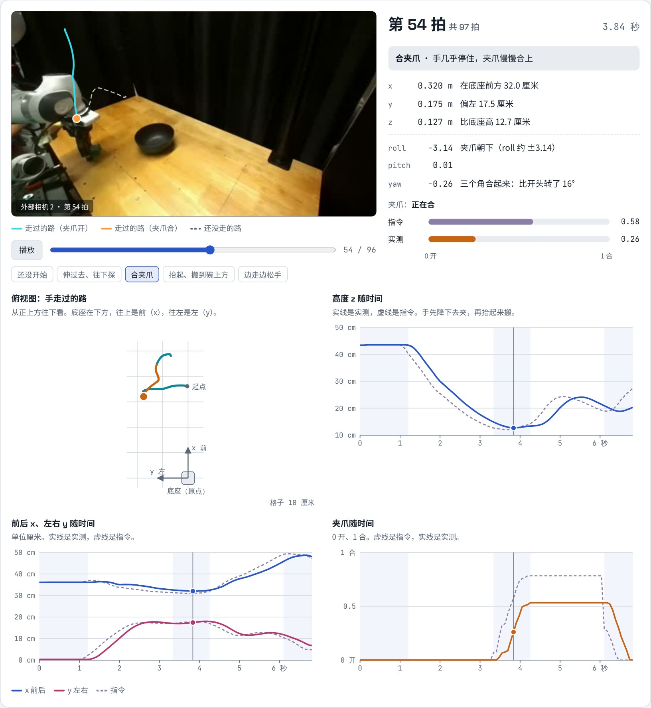
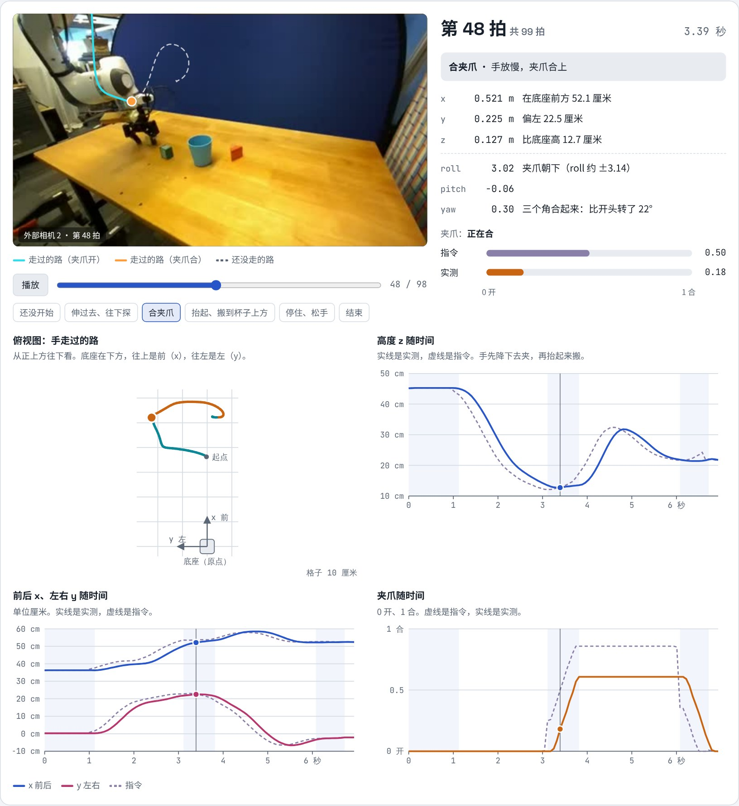
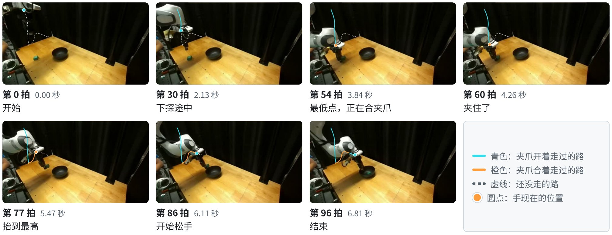
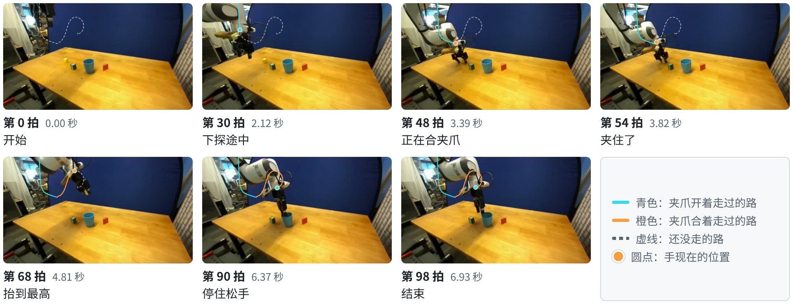

# 读懂一条 DROID 数据

[返回 3.4 数据](../README.zh-CN.md#s3-4) · [DROID 条目](../README.zh-CN.md#paper-2403-12945) · [DROID 数据集文档](https://droid-dataset.github.io/droid/the-droid-dataset)

[DROID](https://droid-dataset.github.io/) 是一个公开的机器人数据集。多家实验室的人用 VR 手柄遥控同一种机械臂（Franka），去做各种桌面小任务。每做一次任务，就录成一条数据。这一页拿两条真实数据拆开看：一条数据里有什么，那串“轨迹”数字各是什么意思。

- **案例 A**：绿方块放进黑碗 · 6.8 秒
- **案例 B**：黄方块丢进蓝杯 · 6.9 秒

## 先看这里

只有一分钟的话，记住四点：

1. **一条数据是一个文件夹。** 里面三样：轨迹（数字）、视频（画面）、说明（身份信息）。
2. **轨迹是一张表，每拍一行。** 一行最核心的是 7 个数：手在哪（x、y、z）、手朝哪（roll、pitch、yaw）、夹爪开合。
3. **每一拍记了两份。** 指令是人让手去哪，实测是手实际在哪。两份不完全一样。
4. **拿来用之前要先处理几处。** 比如去掉不算数的拍。见[用这份数据时要注意](#用这份数据时要注意)。

## 目录

每一节回答一个问题：

- [先认几个词](#先认几个词)：后面反复出现的词
- [一条数据是一个文件夹](#一条数据是一个文件夹)：一条数据里有哪些文件
- [轨迹：每一拍记一行](#轨迹每一拍记一行)：一行里的 7 个数是什么
- [一条轨迹的全貌](#一条轨迹的全貌)：整个动作从头到尾怎么走
- [挑几行出来看](#挑几行出来看)：关键时刻的真实数值
- [同一拍记了两份：指令和实测](#同一拍记了两份指令和实测)：两份差在哪，为什么
- [trajectory.h5 里一共 67 项](#trajectoryh5-里一共-67-项)：文件里还存了什么
- [两条数据放在一起比](#两条数据放在一起比)：两条数据差在哪
- [用这份数据时要注意](#用这份数据时要注意)：六个容易出错的地方
- [数据来源](#数据来源)

## 先认几个词

| 词 | 意思 |
|---|---|
| 拍（step） | 机器人记录一次。轨迹里一拍就是一行 |
| 末端位姿 | 机械臂最前头那只“手”（夹爪）的位置加朝向，共 6 个数 |
| 弧度 | 角度的另一种单位，3.14 弧度约等于 180° |
| 指令 / 实测 | 指令：人让手去的地方。实测：手实际所在的地方 |
| 双目相机 | 两个镜头并排的相机，像两只眼睛，可以算出深度。SVO 是它的原始录像文件 |
| 相机外参 / 内参 | 外参（extrinsics）：相机放在哪、朝哪。内参：镜头自身的成像参数，比如焦距 |
| `skip_action` | 标出“这一拍不算数”的记号，用数据时要去掉这些拍 |
| h5 | 一种把很多数组装进一个文件的格式，里面像文件夹一样分层 |

## 一条数据是一个文件夹

文件夹的名字就是这条数据的编号：`实验室_机器编号_日期_时间`。里面有三样东西：**轨迹**（数字）、**视频**（画面）、**说明**（这条数据的身份信息）。以案例 A 为例：

```text
AUTOLab_0d4edc83_2023_10_27_20h_20m_26s/                              # 这条数据的编号
├─ trajectory.h5  (678 KB)                                            # 轨迹：每一拍的数字（这一页的重点）
├─ metadata_AUTOLab+0d4edc83+2023-10-27-20h-20m-26s.json  (1.7 KB)    # 说明：实验室、任务、是否成功、相机编号
└─ recordings/
   ├─ MP4/22008760.mp4                                                # 外部相机 1 的画面
   ├─ MP4/24400334.mp4                                                # 外部相机 2 的画面（下面用的就是这一路）
   └─ SVO/22008760.svo, 24400334.svo                                  # 同两台相机的双目原始录像，可以算出深度
```

### 说明文件里写了什么

| 字段 | 案例 A | 案例 B | 含义 |
|---|---|---|---|
| `lab` | `AUTOLab` | `AUTOLab` | 哪个实验室录的 |
| `date` | `2023-10-27` | `2023-08-18` | 哪天录的 |
| `current_task` | `Move object into or out of container …` | `drop yellow block into blue cup` | A 只写了任务类别（把物体放进或拿出容器），B 写了具体指令（把黄方块丢进蓝杯） |
| `success` | `true` | `true` | 操作员录完按了“成功” |
| `trajectory_length` | `97` | `99` | 一共多少拍 |
| `ext1 / ext2 / wrist_cam_serial` | `22008760 / 24400334 / 18026681` | 同左 | 三台相机的编号，对应视频文件名 |
| `*_cam_extrinsics` | `6 个数` | `6 个数` | 相机放在哪、朝哪 |

### 三样东西的关系

视频告诉你“看起来发生了什么”，轨迹告诉你“机械臂具体怎么动的”，两者靠时间戳一拍对一帧。说明文件告诉你这是哪个实验室、做的什么任务、有没有成功。研究里真正用来教机器人的，主要是轨迹加视频。

完整数据集里每条还有一路**手腕相机**（装在夹爪上方）的录像，这两条案例没有下载。

## 轨迹：每一拍记一行

机器人每秒记录大约 14 次，每次叫一**拍**（step）。案例 A 一共 6.8 秒，记了 97 拍。每一拍记下机械臂那只“手”（夹爪）的状态，最核心的是 7 个数：

<table>
<thead>
<tr><th colspan="3">手在哪（米）</th><th colspan="3">手朝哪（弧度）</th><th>夹爪</th></tr>
<tr><th>x</th><th>y</th><th>z</th><th>roll</th><th>pitch</th><th>yaw</th><th>开合</th></tr>
</thead>
<tbody>
<tr><td align="center"><code>0.320</code></td><td align="center"><code>0.175</code></td><td align="center"><code>0.127</code></td><td align="center"><code>−3.14</code></td><td align="center"><code>0.01</code></td><td align="center"><code>−0.26</code></td><td align="center"><code>0.26</code></td></tr>
</tbody>
</table>

上面这一行是案例 A 第 54 拍（3.84 秒，最低点，正在合夹爪）的真实数值，夹爪那一格是实测值。整条轨迹就是很多这样的行，一行接一行。

- **位置 x、y、z**：以机器人底座为原点量出来的，单位是米。x 是往前多远，y 是往左多远（负数就是往右），z 是比底座高多少。
- **朝向 roll、pitch、yaw**：手转了多少，单位是弧度。可以拿自己的手比划：roll 像拧门把手那样转手腕，pitch 是手往上翘或往下压，yaw 是手往左右摆。DROID 里夹爪基本一直朝下，所以 roll 总在 ±3.14 附近。
- **夹爪**：0 是全开，1 是全合。

## 一条轨迹的全貌

下面两张图是原交互页面的截图，各定格在一拍上。图里的播放键、滑块和阶段按钮点不了。每张图分三块：

- **左上**：外部相机拍到的画面。线是手走过的路（用相机参数把 x、y、z 换算到画面上）：青色是夹爪开着走的，橙色是夹爪合着走的，白色虚线是还没走的路，圆点是手现在的位置。
- **右上**：这一拍那一行数字，翻译成了大白话。
- **下面四张图**：整条轨迹。俯视图（从正上方往下看，底座在下方，往上是前 x，往左是左 y），以及高度 z、前后 x 与左右 y、夹爪开合随时间的变化。实线是实测，虚线是指令，竖线是当前这一拍。深浅相间的背景对应图下表里的阶段。

### 案例 A：绿方块放进黑碗

<picture>
  <source media="(prefers-color-scheme: dark)" srcset="../assets/droid-data/panel-a-dark.jpg">
  
</picture>

这张图定格在第 54 拍，手在最低点。看这几处：

- **左上画面**：青色线从上方一路降到方块处，手是张着夹爪下来的。白色虚线是接下来要走的路。
- **俯视图**：橙色那段是夹爪合着走的，也就是夹着方块搬的那段。
- **高度图**：虚线（指令）总比实线（实测）早一点降、早一点升。
- **夹爪图**：虚线升到 0.78，实线停在 0.53。原因见[同一拍记了两份](#同一拍记了两份指令和实测)。

整个动作分五个阶段：

| 阶段 | 拍 | 发生了什么 |
|---|---|---|
| 还没开始 | 0–16 | 手停在原处没动。前 15 拍操作员还没按“允许移动”，标成了 skip_action |
| 伸过去、往下探 | 17–46 | 手从高处斜着降到方块上方 |
| 合夹爪 | 47–59 | 手几乎停住，夹爪慢慢合上 |
| 抬起、搬到碗上方 | 60–85 | 夹着方块抬高，再往前送 |
| 边走边松手 | 86–96 | 手还在往前走，夹爪已经张开，方块落进碗里 |

### 案例 B：黄方块丢进蓝杯

<picture>
  <source media="(prefers-color-scheme: dark)" srcset="../assets/droid-data/panel-b-dark.jpg">
  
</picture>

这张图定格在第 48 拍，正在合夹爪。和 A 对着看：

- **左上画面**：白色虚线绕了一个大弯，是接下来抬高、再横着搬到杯子上方的路。
- **高度图**：夹住后抬起的那个峰比 A 高。
- **夹爪图**：实线停在 0.61。最右边虚线先掉下来，实线晚一点才跟着掉。

整个动作分六个阶段：

| 阶段 | 拍 | 发生了什么 |
|---|---|---|
| 还没开始 | 0–15 | 手停在原处没动。前 13 拍操作员还没按“允许移动”，标成了 skip_action |
| 伸过去、往下探 | 16–43 | 手从高处斜着降到黄方块上方 |
| 合夹爪 | 44–53 | 手放慢，夹爪合上 |
| 抬起、搬到杯子上方 | 54–85 | 抬得比 A 高，横向移动近 30 厘米 |
| 停住、松手 | 86–94 | 手停下来再张开夹爪，和 A 不一样 |
| 结束 | 95–98 | 最后 4 拍又标成了 skip_action |

## 挑几行出来看

整条轨迹就是一张表。下面挑出几个关键时刻：先看这几拍的画面，再看同一拍的数字。位置单位是米，朝向单位是弧度，夹爪 0 开、1 合。

读表时留意两处：

- **z 高**：先降后升，最低的那一行就是夹方块的时刻。
- **夹爪指令和夹爪实测**：夹住之后两列不一样，[下一节](#同一拍记了两份指令和实测)解释。

roll 一会儿正一会儿负，不是手在来回翻，见[注意事项](#用这份数据时要注意)第 2 条。

### 案例 A（共 97 行）

<picture>
  <source media="(prefers-color-scheme: dark)" srcset="../assets/droid-data/keyframes-a-dark.jpg">
  
</picture>

| 拍 | 秒 | x 前 | y 左 | z 高 | roll | pitch | yaw | 夹爪指令 | 夹爪实测 | 这一刻 |
|--:|--:|--:|--:|--:|--:|--:|--:|--:|--:|---|
| 0 | 0.00 | 0.361 | 0.003 | 0.434 | 3.11 | 0.13 | −0.01 | 0.00 | 0.00 | 开始 |
| 30 | 2.13 | 0.351 | 0.123 | 0.282 | −3.08 | 0.07 | 0.00 | 0.00 | 0.00 | 下探途中 |
| 54 | 3.84 | 0.320 | 0.175 | 0.127 | −3.14 | 0.01 | −0.26 | 0.58 | 0.26 | 最低点，正在合夹爪 |
| 60 | 4.26 | 0.325 | 0.179 | 0.134 | −3.14 | −0.04 | −0.28 | 0.78 | 0.53 | 夹住了 |
| 77 | 5.47 | 0.404 | 0.119 | 0.241 | 3.02 | −0.25 | −0.34 | 0.78 | 0.53 | 抬到最高 |
| 86 | 6.11 | 0.458 | 0.118 | 0.209 | 3.00 | −0.34 | −0.34 | 0.28 | 0.53 | 开始松手 |
| 96 | 6.81 | 0.480 | 0.068 | 0.203 | 3.03 | −0.24 | −0.44 | 0.00 | 0.00 | 结束 |

### 案例 B（共 99 行）

<picture>
  <source media="(prefers-color-scheme: dark)" srcset="../assets/droid-data/keyframes-b-dark.jpg">
  
</picture>

| 拍 | 秒 | x 前 | y 左 | z 高 | roll | pitch | yaw | 夹爪指令 | 夹爪实测 | 这一刻 |
|--:|--:|--:|--:|--:|--:|--:|--:|--:|--:|---|
| 0 | 0.00 | 0.363 | 0.003 | 0.452 | −3.12 | 0.07 | −0.02 | 0.00 | 0.00 | 开始 |
| 30 | 2.12 | 0.399 | 0.162 | 0.255 | −3.08 | 0.09 | 0.21 | 0.00 | 0.00 | 下探途中 |
| 48 | 3.39 | 0.521 | 0.225 | 0.127 | 3.02 | −0.06 | 0.30 | 0.50 | 0.18 | 正在合夹爪 |
| 54 | 3.82 | 0.534 | 0.214 | 0.135 | 2.95 | −0.06 | 0.28 | 0.86 | 0.61 | 夹住了 |
| 68 | 4.81 | 0.585 | 0.043 | 0.318 | 2.69 | −0.30 | −0.14 | 0.86 | 0.61 | 抬到最高 |
| 90 | 6.37 | 0.523 | −0.026 | 0.214 | 2.79 | −0.04 | −0.54 | 0.13 | 0.45 | 停住松手 |
| 98 | 6.93 | 0.524 | −0.021 | 0.218 | 2.87 | 0.04 | −0.50 | 0.00 | 0.00 | 结束 |

## 同一拍记了两份：指令和实测

- **指令**（文件里 `action/…`）：操作员这一拍通过手柄让手去的地方。
- **实测**（文件里 `observation/robot_state/…`）：机器人这一拍实际所在的地方。

两份很像，但不完全一样。上面曲线图里虚线是指令，实线是实测，可以对照着看。

**位置：指令总在前面一点。** 像牵着狗散步，绳子那头的人总比狗先到。

- 案例 A：以第 30 拍为例，指令里手的高度是 23.8 厘米，实测还在 28.2 厘米，指令先到了 4 厘米。整条平均领先约 3.3 厘米。
- 案例 B：以第 25 拍为例，指令里手的高度是 27.8 厘米，实测还在 34.8 厘米，指令先到了 7 厘米（这条手移动得快，领先也更多）。整条平均领先约 3.8 厘米。

**夹爪：两份差得多。**

- 案例 A：指令最高只到 0.78，因为手柄扳机没有按到底。实测更低，停在 0.53，因为方块卡在两根手指中间，夹不到底。所以实测停在半中间，恰好说明“手里夹着东西”。松手时指令一下掉到 0.28，实测要过 0.6 秒左右才完全张开。
- 案例 B：指令最高到 0.86，实测停在 0.61，因为黄方块卡在两根手指中间。松手时指令在第 86 拍从 0.85 掉到 0.36，实测要到第 96 拍左右才完全张开，也就是要等 0.7 秒左右。

## trajectory.h5 里一共 67 项

h5 文件里像文件夹一样分层，每一项是一个数组。每一项都是“每拍一行”，所以第一维都是拍数（案例 A 是 97）。按用途分成下面几类，带 ★ 的第一类最常用。

| 类别 | 项数 | 是什么 |
|---|--:|---|
| **`observation/robot_state/…`** ★ | 10 | 机器人的**实测**状态。最常用的三项：末端位姿 `cartesian_position`（每拍 6 个数，就是上面的 x y z roll pitch yaw）、夹爪 `gripper_position`（每拍 1 个数）、7 个关节的角度 `joint_positions`。其余是关节速度和力矩。 |
| `action/…` | 8 | 这一拍发出的**指令**。同一个指令存了几种写法：末端位姿、末端速度、关节角、关节速度、夹爪开合，以及 `target_` 开头的目标值。 |
| `action/robot_state/…` | 10 | 执行完这一拍指令后读到的机器人状态，和下一拍的实测几乎一样（差不到 2 毫米）。一般用不到。 |
| `observation/camera_extrinsics/…` | 10 | 每台相机在底座坐标系里的位置和朝向（也是 6 个数）。外部相机是固定的，所以每拍都一样；手腕相机跟着手动，每拍不同。`left`/`right` 是双目相机的左右两只“眼睛”。 |
| `observation/timestamp/…` | 22 | 每一拍各个环节发生的时间（毫秒或纳秒），用来把视频帧和轨迹行对上。其中 `skip_action` 标出“这一拍不算数”的拍。 |
| `observation/controller_info/…` | 4 | 遥控手柄的状态：开没开、是否允许移动、操作员有没有按“成功”或“失败”。 |
| `observation/camera_type/…` | 3 | 相机种类：0 是手腕相机，1 是外部相机。 |

<details><summary>展开全部 67 项（名字与形状，以案例 A 为例）</summary>

| 名字 | 形状 |
|---|---|
| `action/cartesian_position` | 97 × 6 |
| `action/cartesian_velocity` | 97 × 6 |
| `action/gripper_position` | 97 |
| `action/gripper_velocity` | 97 |
| `action/joint_position` | 97 × 7 |
| `action/joint_velocity` | 97 × 7 |
| `action/robot_state/cartesian_position` | 97 × 6 |
| `action/robot_state/gripper_position` | 97 |
| `action/robot_state/joint_positions` | 97 × 7 |
| `action/robot_state/joint_torques_computed` | 97 × 7 |
| `action/robot_state/joint_velocities` | 97 × 7 |
| `action/robot_state/motor_torques_measured` | 97 × 7 |
| `action/robot_state/prev_command_successful` | 97 |
| `action/robot_state/prev_controller_latency_ms` | 97 |
| `action/robot_state/prev_joint_torques_computed` | 97 × 7 |
| `action/robot_state/prev_joint_torques_computed_safened` | 97 × 7 |
| `action/target_cartesian_position` | 97 × 6 |
| `action/target_gripper_position` | 97 |
| `observation/camera_extrinsics/18026681_left` | 97 × 6 |
| `observation/camera_extrinsics/18026681_left_gripper_offset` | 97 × 6 |
| `observation/camera_extrinsics/18026681_right` | 97 × 6 |
| `observation/camera_extrinsics/18026681_right_gripper_offset` | 97 × 6 |
| `observation/camera_extrinsics/20120598_left` | 97 × 6 |
| `observation/camera_extrinsics/20120598_right` | 97 × 6 |
| `observation/camera_extrinsics/22008760_left` | 97 × 6 |
| `observation/camera_extrinsics/22008760_right` | 97 × 6 |
| `observation/camera_extrinsics/24400334_left` | 97 × 6 |
| `observation/camera_extrinsics/24400334_right` | 97 × 6 |
| `observation/camera_type/18026681` | 97 |
| `observation/camera_type/22008760` | 97 |
| `observation/camera_type/24400334` | 97 |
| `observation/controller_info/controller_on` | 97 |
| `observation/controller_info/failure` | 97 |
| `observation/controller_info/movement_enabled` | 97 |
| `observation/controller_info/success` | 97 |
| `observation/robot_state/cartesian_position` | 97 × 6 |
| `observation/robot_state/gripper_position` | 97 |
| `observation/robot_state/joint_positions` | 97 × 7 |
| `observation/robot_state/joint_torques_computed` | 97 × 7 |
| `observation/robot_state/joint_velocities` | 97 × 7 |
| `observation/robot_state/motor_torques_measured` | 97 × 7 |
| `observation/robot_state/prev_command_successful` | 97 |
| `observation/robot_state/prev_controller_latency_ms` | 97 |
| `observation/robot_state/prev_joint_torques_computed` | 97 × 7 |
| `observation/robot_state/prev_joint_torques_computed_safened` | 97 × 7 |
| `observation/timestamp/cameras/18026681_estimated_capture` | 97 |
| `observation/timestamp/cameras/18026681_frame_received` | 97 |
| `observation/timestamp/cameras/18026681_read_end` | 97 |
| `observation/timestamp/cameras/18026681_read_start` | 97 |
| `observation/timestamp/cameras/22008760_estimated_capture` | 97 |
| `observation/timestamp/cameras/22008760_frame_received` | 97 |
| `observation/timestamp/cameras/22008760_read_end` | 97 |
| `observation/timestamp/cameras/22008760_read_start` | 97 |
| `observation/timestamp/cameras/24400334_estimated_capture` | 97 |
| `observation/timestamp/cameras/24400334_frame_received` | 97 |
| `observation/timestamp/cameras/24400334_read_end` | 97 |
| `observation/timestamp/cameras/24400334_read_start` | 97 |
| `observation/timestamp/control/control_start` | 97 |
| `observation/timestamp/control/policy_start` | 97 |
| `observation/timestamp/control/sleep_start` | 97 |
| `observation/timestamp/control/step_end` | 97 |
| `observation/timestamp/control/step_start` | 97 |
| `observation/timestamp/robot_state/read_end` | 97 |
| `observation/timestamp/robot_state/read_start` | 97 |
| `observation/timestamp/robot_state/robot_timestamp_nanos` | 97 |
| `observation/timestamp/robot_state/robot_timestamp_seconds` | 97 |
| `observation/timestamp/skip_action` | 97 |

</details>

## 两条数据放在一起比

两条来自同一个实验室、同一台机械臂、同样的相机摆位，结构完全一样。差别都在“人怎么做的”上：

| | 案例 A · 绿方块放进黑碗 | 案例 B · 黄方块丢进蓝杯 |
|---|---|---|
| **任务描述** | 只有任务类别：“把物体放进或拿出容器” | 有具体指令：“drop yellow block into blue cup” |
| **长度** | 97 拍 · 6.8 秒 | 99 拍 · 6.9 秒 |
| **手一共走了** | 69 厘米 | 97 厘米 |
| **不算数的拍** | 开头 15 拍 | 开头 13 拍，结尾 4 拍 |
| **夹住后实测开合** | 0.53 | 0.61（物体宽度不同，停的位置也不同） |
| **怎么松手** | 手还在往前走就松开，方块是“甩”进碗里的 | 手先停住，再张开夹爪 |

最后一行说明，同样是“放进去”，不同的人、不同的时候做法不一样。这些细节只有看轨迹才看得出来。

## 用这份数据时要注意

1. **坐标都是相对底座的。** x 前、y 左、z 上，单位米；角度单位是弧度。换一台摆放位置不同的机器人，要先换算。
2. **roll 会在 ±3.14 之间跳。** 夹爪朝下时 roll 接近 180°。179° 和 −179° 其实只差 2°，写成数字却差了 6.28。案例 A 里这样跳了 4 次，比如第 19 拍 +3.14，第 20 拍变成 −3.12。直接对数字求平均或插值会出错，要先换成别的写法（比如四元数）。
3. **skip_action 的拍要去掉。** 那几拍操作员还没按“允许移动”（或已经松开），手不动，记下来的指令也不算数。
4. **夹爪方向可能和你的工具相反。** DROID 里 0 开、1 合；[uni-robot-agent](../README.zh-CN.md#paper-2611-01560) 里 0 合、1 开。拿 DROID 的数据去喂 Harness 时要先翻过来。
5. **节拍不完全均匀。** 名义上每秒 15 拍，实际是 66 到 76 毫秒一拍，平均约 14 拍每秒。视频也是每拍一帧，要按时间戳对齐，不能假设刚好整齐。
6. **指令和实测别混用。** 想知道“手实际去了哪”用实测；想模仿“人当时想让手去哪”用指令。两者平均差 3 厘米左右，夹爪差得更多。

## 数据来源

- 数据：DROID 原始格式（trajectory.h5 + 视频 + 说明文件）。案例 A：`AUTOLab_0d4edc83_2023_10_27_20h_20m_26s`；案例 B：`AUTOLab_84bd5053_2023_08_18_12h_06m_13s`。
- 画面来自外部相机 2（编号 24400334）的左眼。画面上的线和点，是用数据里的相机位置和相机内参，把每拍的 x、y、z 投到画面上算出来的。
- 阶段划分是看画面和曲线人工标的。

[↑ 返回 3.4 数据](../README.zh-CN.md#s3-4)
