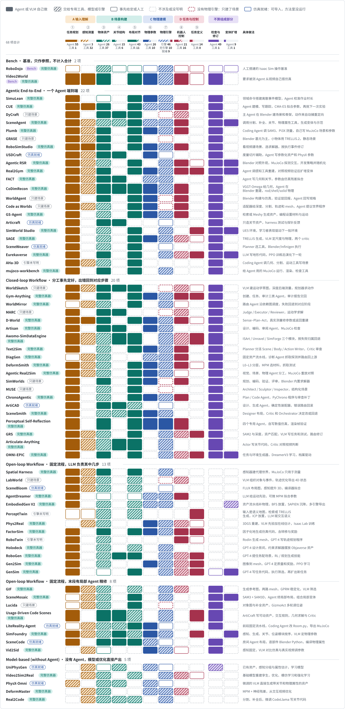

# 仿真器构建：全部工作逐步对照

[English](simulator-construction.md) · **简体中文**

[3.2 仿真器构建](../README.zh-CN.md#s3-2) 全部 68 项工作的逐步对照。

<picture>
  <source media="(prefers-color-scheme: dark)" srcset="../assets/stage-chart/stage-full-zh-dark.svg">
  
</picture>
