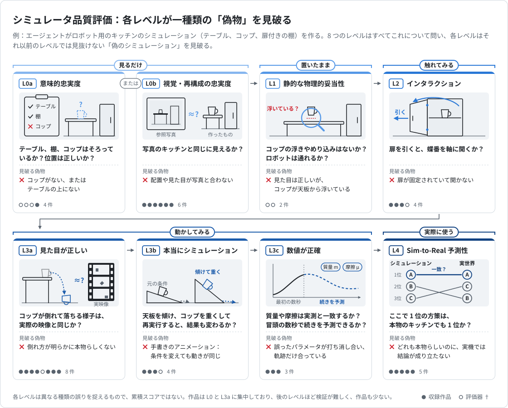

# シミュレータ品質評価：検証レベル

[English](simulator-evaluation.md) · [简体中文](simulator-evaluation.zh-CN.md) · **日本語**

> [!NOTE]
> この日本語版は機械支援翻訳です。論文タイトルは原文のままです。誤りを見つけた場合は Issue でお知らせください。

[3.3 シミュレータ品質評価](../README.ja.md#s3-3) の作品を「検証レベル」ごとに整理したものです。各作品の手法の詳細は [Stage 3 ガイド（英語）](README.md#section-3) を参照してください。

<picture>
  <source media="(prefers-color-scheme: dark)" srcset="../assets/eval-ladder/eval-ladder-ja-dark.svg">
  
</picture>

## 目次

- [概要](#概要)
- [L0a 意味的忠実度](#l0a-意味的忠実度)
- [L0b 視覚・再構成の忠実度](#l0b-視覚再構成の忠実度)
- [L1 静的な物理的妥当性](#l1-静的な物理的妥当性)
- [L2 インタラクションの妥当性](#l2-インタラクションの妥当性)
- [L3 動力学の忠実度](#l3-動力学の忠実度)
- [L4 Sim-to-Real 予測性](#l4-sim-to-real-予測性)
- [考察](#考察)
- [用語の出典](#用語の出典)

## 概要

| 番号 | レベル | 中心となる問い | 英語の用語 |
|---|---|---|---|
| L0a | 意味的忠実度 | 要件に書かれたことを満たしているか？ | Semantic Fidelity |
| L0b | 視覚・再構成の忠実度 | 参照と同じに見えるか？ | Visual / Reconstruction Fidelity |
| L1 | 静的な物理的妥当性 | 静止した状態で、倒れず、通り抜けられるか？ | Static Physical Plausibility |
| L2 | インタラクションの妥当性 | 押したり開けたりしたとき、正しく反応するか？ | Interaction Plausibility |
| L3a | 動態：見た目が正しい | 動きは本物らしく見えるか？ | Motion Fidelity |
| L3b | 動態：本当にシミュレーション | 動きは物理で計算されたものか、書き込まれたものか？ | Model Verification |
| L3c | 動態：数値が正確 | 数値は現実世界と合っているか？ | Validation & System Identification |
| L4 | Sim-to-Real 予測性 | 評価や学習に使ったとき、結論は現実世界でも成り立つか？ | Sim-to-Real Predictivity |

```
  要件駆動：L0a 意味的忠実度 ─┐
                              ├─→ L1 静的 → L2 インタラクション → L3 動力学 → L4 下流
  参照駆動：L0b 視覚的忠実度 ─┘   (静止)    (触れる)              (時間発展)   (実際に使う)
```

L0a と L0b は並列の出発点です。各レベルは異なる失敗モードを検査するもので、累積スコアではありません。† は評価器（主な貢献が評価ツールである作品）を示します。

## L0a 意味的忠実度

**検証内容：** 文章の要件と常識的な要件を、物体・属性・関係の制約に分解し、一つずつ照合する。\
**限界：** 物理的な性質には触れない。

| 作品 | 何を検証するか |
|---|---|
| [SceneEval](../README.ja.md#paper-2503-14756) † | 文章中の物体・属性・関係と、支持・衝突・通行などの暗黙の要件 |
| [Apples on the Table?（LEGO-Eval）](../README.ja.md#paper-2511-03001) † | 説明を細かな制約に分解し、ツールを使って一つずつ照合 |
| [SceneCritic](../README.ja.md#paper-2604-13035) † | 記号化したシーンを読み取り、データ由来の空間常識に照らして縮尺・向き・重なりを検査 |
| [Code4Scene](../README.ja.md#paper-2609-36777) | エージェントが構築・編集した 3D シーンの要件充足度、完全性、静的妥当性 |

## L0b 視覚・再構成の忠実度

**検証内容：** 目標の画像・動画・シーン・図面と比べる。レンダリングの類似度は「似ているか」を、ネイティブの幾何や構造の一致は「構造が正しいか」を問う。\
**限界：** 見た目が同じでも、衝突形状・質量・関節が正しいとは限らない。

| 作品 | 何を検証するか |
|---|---|
| [IR3D-Bench](../README.ja.md#paper-2506-23329) | 画像をプログラムによるシーンとして再構成したときの位置、数、空間関係、外観 |
| [BlenderGym](../README.ja.md#paper-2504-01786) | 目標に合わせた Blender プログラムの修正を、多視点の画像指標と 3D 距離で評価 |
| [BlenderWorld](../README.ja.md#paper-system-blenderworld) | 実物の参照に基づく 3D 制作を、再レンダリングとネイティブシーンの検査で評価 |
| [Parametric CAD Bench v3](../README.ja.md#paper-2611-02659) | レンダリング画像ではなく、ネイティブのパラメトリック形状と工学仕様 |
| [BVB](../README.ja.md#paper-2609-15478) | 動画の内容を Blender プログラムで再構成し、再構成の類似度と質問応答での情報保持を比較 |
| [Frontier3DBench](../README.ja.md#paper-2611-09017) | Blender と Unreal にまたがる物体・シーン・インタラクティブな世界の制作 |

## L1 静的な物理的妥当性

**検証内容：** 物理を動かさずに、幾何計算でめり込み・支持・到達可能性・通行可能性を確かめる。\
**限界：** 静止状態で問題がなくても、動かしたときに正しいとは限らない。

| 作品 | 何を検証するか |
|---|---|
| [GREP](../README.ja.md#paper-2611-05802) † | 部屋ごとに検査項目を生成し、物理的妥当性・視覚的調和・日常的な使い勝手を確認 |
| [SceneTeract](../README.ja.md#paper-2603-29798) † | 利用者の条件（たとえば車いす利用者）に応じて、ある活動を完了できるかを確認 |

## L2 インタラクションの妥当性

**検証内容：** 世界に操作を加え、物理的な反応が妥当か、プログラムの状態が仕様どおりに変わるかを見る。\
**限界：** 扉が開き、状態が正しくても、質量や減衰が正しいとは限らない。

| 作品 | 何を検証するか |
|---|---|
| [ScIntBench](../README.ja.md#paper-2610-37326) | 生成シーンに押す・開閉する・表面を探るといった操作を統一的に加え、反応の妥当性を確認 |
| [WorldCoder-Bench](../README.ja.md#paper-2606-01869) | 既定の操作を実行した後の実行時状態を読み取り、許容誤差付きの隠しアサーション（保存則を含む）で照合 |
| [Lab2Sim](../README.ja.md#paper-2611-02928) | Web 上の実験を一歩ずつ再生し、実際の実験映像とスクリーンショットや状態を照合 |
| [Automatically Improving Simulation Physics for Articulated Objects](../README.ja.md#paper-2605-19136) † | 関節付きアセットの「インタラクション準備度」を定義し、安定性と人の判断との一致度を評価 |

## L3 動力学の忠実度

「小球が坂を転がり落ち、箱にぶつかる」を例にとると、三つの下位の問いは順に難しくなります。

| 下位の問い | 検証方法 | 何にだまされうるか |
|---|---|---|
| **L3a 動態：見た目が正しい** | フレームごとに位置・オプティカルフロー・マスクを比較する、または VLM が評価する | 手書きのキーフレームアニメーション |
| **L3b 動態：本当にシミュレーション** | 条件を変えて（坂をより急に、球をより重く）再実行する。物理アサーション、保存則の検査 | 実際に介入していれば、だますのは難しい |
| **L3c 動態：数値が正確** | 独立に測定したパラメータと比較する。最初の数秒だけから続きを予測させる | パラメータの相互補償で軌跡はだませるが、外挿と実測はだませない |

既存のエンジンを使う場合、物理法則はエンジンが担うので、確かめるべきはエージェントが本当にエンジンに計算させたか、正しいモデルを選んだかです。ソルバーを自作する場合は、法則そのものも確かめる必要があります。

### L3a 動態：見た目が正しい

| 作品 | 何を検証するか |
|---|---|
| [ExeWorldBench](../README.ja.md#paper-2610-15166) | コードで実行可能な 3D 世界を生成し、主にレンダリングされたフレームから構造・動き・因果を評価 |
| [4DCodeBench](../README.ja.md#paper-2610-03715) | 参照動画から実行可能な 4D シーンを再構成し、外観・動き・幾何を比較。キーフレームも許容 |
| [VisPhyWorld](../README.ja.md#paper-2602-13294) | 物理現象の動画をシミュレータのコードに書き直し、画面と動きを比較 |
| [Physics-Inspired Animations](../README.ja.md#paper-2602-10840) | 物理現象を表すアニメーションのコードを生成し、VLM が動画を確認 |
| [PhyRubric](../README.ja.md#paper-2611-13576) † | 事前に定めたルーブリックで、生成動画の物理常識の誤りを診断 |
| [Latent Prediction Error and Physical Surprise](../README.ja.md#paper-2611-01815) | 動画世界モデルの予測誤差で、物理法則違反と外観の変化を区別できるか |
| [Video2World](../README.ja.md#paper-2610-04432) | 実際のデモ動画から環境を再構成して振る舞いを記述し、幾何と物体の軌跡を比較。デモのタスクを再現できるかも確認 |
| [Real2Sim Benchmark](../README.ja.md#paper-real2sim-benchmark) | 再構成シーンを固定し、レンダリング、実際の動作の再生、固定方策による閉ループの結果を比較。動作が確認された参照シーンはまだない |

### L3b 動態：本当にシミュレーション

| 作品 | 何を検証するか |
|---|---|
| [PhysCodeGym](../README.ja.md#paper-2610-17288) | 動きが物理メカニズムから生じることを求め、反実仮想的な介入の後に再シミュレーション |
| [PhysCodeBench](../README.ja.md#paper-2604-23580) | 視覚指標に加え、専門家による物理アサーションと保存則の検査でシミュレーションコードを検証 |
| [WorldSolver](../README.ja.md#paper-2610-08720) | シーンとフレームワークは与え、エージェントにはソルバーだけを書かせて、実行・イベント・物理的振る舞いを確認 |
| [Polynomial Invariants for Simulator Faults](../README.ja.md#paper-2609-13194) † | 軌跡から多項式不変量を復元し、破られた物理制約と誤ったパラメータを特定。注入した故障で検証 |

### L3c 動態：数値が正確

| 作品 | 何を検証するか |
|---|---|
| [IRIS](../README.ja.md#paper-2603-16432) | 独立に測定され不確かさの付いた実際のパラメータと比較し、同定可能性と外挿も確認 |
| [Δynamics](../README.ja.md#paper-2605-20576) | パラメータ設定だけを出力させてエンジンで再生し、真値があればパラメータ誤差を比較 |
| [MPMWorlds](../README.ja.md#paper-2606-01538) | 最初の約 2.5 秒を見せて MPM プログラムを生成させ、続きを予測。比較は動画空間のみ |

## L4 Sim-to-Real 予測性

**検証内容：** 評価や学習に使ったとき、結論が現実世界で成り立つか。成功と失敗の差を含む実際の結果（たとえば複数の方策の実機成績）との対照が必要。\
**限界：** 評価の順位が正確でも、学習に使えるとは限らない。学習は最適化を繰り返し、シミュレーションの誤差を積極的に突く（simulator exploitation、[2605.29032](https://arxiv.org/abs/2605.29032)）。

| 作品 | 何を検証するか |
|---|---|
| [SIMPLER](../README.ja.md#paper-2405-05941) | 同じ方策をシミュレーションと実機で動かし、成績と順位を比較（Pearson、MMRV） |
| [YUBI-Real2Sim](../README.ja.md#paper-2610-17521) | 再構成背景のアーティファクトだけを変え、視覚スコアでは方策の順位の崩れを予測できないことを示す |
| [X2Real](../README.ja.md#paper-2609-27449) | 実機のハードウェアに合わせて画面と物理を較正し、シミュレーションと実機のスコアの線形相関は 0.84 |
| [PolaRiS](../README.ja.md#paper-2512-16881) | 短い動画スキャンから評価シーンを再構成し、汎用方策の実機評価と対にして比較 |
| [H2RBench](../README.ja.md#paper-2609-24778) | 人からロボットへの転移手法について、シミュレーションと実機の順位を比較（Pearson 0.89、MMRV 0.06） |

既存の作品はいずれも評価用途を検証しています。学習用途は通常、手法論文の学習実験として現れます（[SimFoundry](../README.ja.md#paper-2606-28276)、[Video2Sim2Real](../README.ja.md#paper-2606-08828)、[Phys2Real](../README.ja.md#paper-2510-11689) など）。共通のプロトコルで異なるシミュレータを横並びに比較した作品はまだありません。

## 考察

- **偏った分布：** 作品は L0 と L3a に集中しています。メカニズム、パラメータ、下流での有用性を検証する作品は少なく、L4 は今のところ評価用途しか検証しておらず、評価器もまだありません。
- **未解決の問い：** どの下位レベルの検査が上位レベルの失敗を予測できるか？ YUBI-Real2Sim は反例を示しています：視覚品質は方策の順位を予測しません。

## 用語の出典

レベル名は以下の文献の既存の用語を借りています。それらを階層にまとめたのは本リポジトリによる整理です。

- 忠実度の分類：Alexander et al., [From Gaming to Training](https://www.cs.uky.edu/~sgware/reading/papers/alexander2005gaming.pdf)（2005）；[The Interaction Fidelity Model](https://arxiv.org/abs/2402.16665)
- V&V（L3b、L3c）：[NAFEMS: Verification and Validation](https://www.nafems.org/training/learning-hub/introduction-to-simulation-credibility/verification-and-validation)；Roache；Roy & Oberkampf
- シーン生成と身体性シミュレーション（L0a、L1）：[3D Scene Generation: A Survey](https://arxiv.org/abs/2505.05474)；[3D Generation for Embodied AI and Robotic Simulation: A Survey](https://arxiv.org/abs/2604.26509)；[SceneEval](https://arxiv.org/abs/2503.14756)
- シミュレーションと実機の一致（L4）：[SIMPLER](https://arxiv.org/abs/2405.05941)；[BWM](https://arxiv.org/abs/2607.29302)
