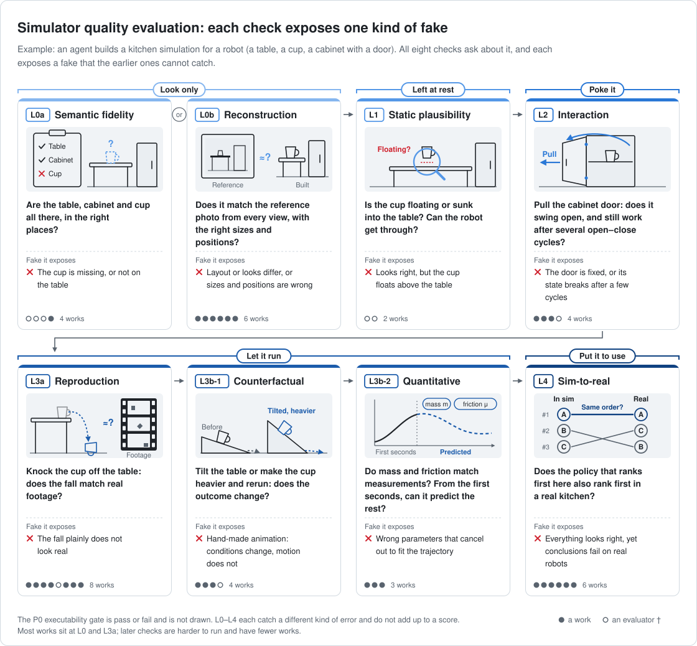

# Simulator Quality Evaluation: A Fidelity Ladder

**English** · [简体中文](simulator-evaluation.zh-CN.md)

Works from [3.3 Simulator quality evaluation](../README.md#s3-3), organized by fidelity level; method details are in the [Stage 3 guide](README.md#section-3).

<picture>
  <source media="(prefers-color-scheme: dark)" srcset="../assets/eval-ladder/eval-ladder-en-dark.svg">
  
</picture>

## Contents

- [Overview](#overview)
- [P0 Executability and integrity](#p0-executability-and-integrity)
- [L0 Scene fidelity: semantic and reconstruction](#l0-scene-fidelity-semantic-and-reconstruction)
- [L1 Static plausibility](#l1-static-plausibility)
- [L2 Interaction plausibility: single-step and sequential](#l2-interaction-plausibility-single-step-and-sequential)
- [L3 Dynamics fidelity: reproduction and generalization](#l3-dynamics-fidelity-reproduction-and-generalization)
- [L4 Sim-to-real predictivity: evaluation and training](#l4-sim-to-real-predictivity-evaluation-and-training)
- [Scoring principles across levels](#scoring-principles-across-levels)
- [Observations](#observations)
- [Terminology sources](#terminology-sources)

## Overview

Each level's name spells out the dimensions it contains; dimensions are numbered a / b, and split further as -1 / -2 where needed.

| No. | Name | Core question |
|---|---|---|
| P0 | Executability and integrity | Does it run? Is the motion computed by the engine? |
| L0 | Scene fidelity: semantic and reconstruction | Is everything required there? Does it match the reference? |
| L0a | Semantic fidelity | Are the objects, attributes, relations and construction methods in the requirements all satisfied? |
| L0b | Reconstruction fidelity | Do appearance (L0b-1) and geometry (L0b-2) match the reference? |
| L1 | Static plausibility | Left at rest, does it stand stably and can things get through? |
| L2 | Interaction plausibility: single-step and sequential | Act on it: is the response plausible? |
| L2a | Single-step | After one action: can what should move actually move (L2a-1)? Is the response right (L2a-2)? |
| L2b | Sequential | Through task sequences (L2b-1) and random or deliberately adversarial actions (L2b-2), do state and numbers hold up? |
| L3 | Dynamics fidelity: reproduction and generalization | Left to evolve on its own, are the process and the outcome right? |
| L3a | Reproduction (motion fidelity) | Under conditions seen in the reference, do the process and outcome match it? |
| L3b | Generalization | When conditions change, does the result change correctly (L3b-1)? Are the parameters and extrapolations accurate (L3b-2)? |
| L4 | Sim-to-real predictivity: evaluation and training | Used for evaluation (L4a) or training (L4b), do the conclusions hold in the real world? |

```
  P0 Executability (gate)
     │
     ▼
  L0 scene → L1 static → L2 interaction → L3 dynamics → L4 downstream
  (look only)  (at rest)    (poked)          (evolving)     (put to use)
```

- **P0 is a gate, judged pass or fail**; L0–L4 each check a different failure mode and do not add up to a total score.
- **L0a and L0b are parallel starting points**: written requirements lean on L0a, and reference images, videos or scenes lean on L0b; both can apply at once.
- Within a level, **a / b are parallel dimensions**; where -1 / -2 have an order, check them in number order (for example, L3b-1 before L3b-2).
- † marks evaluators (works whose main contribution is an evaluation tool).

**Evaluation note (not a level):** Before evaluating, confirm that the interface and embodiment under test (action space, sensors, controller) match the reference; otherwise failures are wrongly charged to the simulator.

## P0 Executability and integrity

**Checks:** It loads and runs; motion is computed by a physics engine or solver rather than driven by scripts, weld constraints, keyframe animation or time-triggered switches.\
**Exposes:** Scenes that can be viewed but not run; "fake simulations" that pass scripts off as physics.\
**How:** Load and run tests; static inspection of the scene files for constraints, external drivers and animation scripts.\
**Limit:** Shows only that results come from physical computation, not that the computation is correct.

No work yet has this as its main contribution; the counterfactual tests in [L3b-1](#l3b-1-counterfactual) can reveal script-driven motion indirectly, from behavior.

## L0 Scene fidelity: semantic and reconstruction

| Dimension | Core question | Exposes | How |
|---|---|---|---|
| **L0a Semantic** | Are the objects, attributes, relations and construction methods in the requirements all satisfied? | Missing items, wrong relations | Checklist assertions, scene-graph checks, VLM question answering |
| **L0b-1 Reconstruction: appearance** | From every viewpoint, does the rendering look like the reference? | Layout, proportions or materials drift from the reference | Per-view image metrics, mask IoU |
| **L0b-2 Reconstruction: geometry** | Are scale, shape and position right, including position relative to the actor (such as a robot)? | The image matches but sizes or positions are wrong (for example, the camera was tilted to fit the scene) | Depth error, Chamfer distance, pose error |

**Limit:** Looking alike and sitting in the right place do not make colliders, masses or joints correct.

### L0a Semantic fidelity

| Work | What it checks |
|---|---|
| [SceneEval](../README.md#paper-2503-14756) † | Objects, attributes and relations in the text, plus implicit support, collision and navigability |
| [Apples on the Table? (LEGO-Eval)](../README.md#paper-2511-03001) † | Fine-grained constraints from the description, verified one by one with tools |
| [SceneCritic](../README.md#paper-2604-13035) † | Symbolic scenes checked for scale, orientation and overlap against spatial commonsense from data |
| [Code4Scene](../README.md#paper-2609-36777) | Requirement satisfaction, completeness and static validity of agent-built and edited 3D scenes |

### L0b Reconstruction fidelity

Most of these works check both appearance (L0b-1) and geometry (L0b-2).

| Work | What it checks |
|---|---|
| [IR3D-Bench](../README.md#paper-2506-23329) | Localization, counts, spatial relations and appearance after reconstructing images as programmatic scenes |
| [BlenderGym](../README.md#paper-2504-01786) | Blender program edits that match a target, scored by multi-view image metrics and 3D distances |
| [BlenderWorld](../README.md#paper-system-blenderworld) | 3D creation from real references, using re-rendering and native scene checks |
| [Parametric CAD Bench v3](../README.md#paper-2611-02659) | Native parametric geometry against engineering specifications, not renderings |
| [BVB](../README.md#paper-2609-15478) | Video content rebuilt as Blender programs, by reconstruction similarity and retained QA information |
| [Frontier3DBench](../README.md#paper-2611-09017) | Object, scene and interactive-world creation across Blender and Unreal |

## L1 Static plausibility

**Checks:** With no action applied: no interpenetration, objects supported, stable after settling, navigable and reachable.\
**Exposes:** Floating, interpenetration, objects that slide as soon as they are placed.\
**How:** Penetration detection, zero-action settling, reachability and navigability checks.\
**Limit:** Fine at rest does not mean correct when touched or in motion.

| Work | What it checks |
|---|---|
| [GREP](../README.md#paper-2611-05802) † | Room-specific checks covering physical validity, visual harmony and everyday usability |
| [SceneTeract](../README.md#paper-2603-29798) † | Whether an activity is feasible for a given user (for example, a wheelchair user) |

## L2 Interaction plausibility: single-step and sequential

| Dimension | Core question | Exposes | How |
|---|---|---|---|
| **L2a-1 Single-step: structure** | Can the parts that should move actually move? Are they separate parts with correct joints? | The whole cabinet is one rigid mesh | Part and degree-of-freedom checks |
| **L2a-2 Single-step: response** | After one action, are the motion and force response plausible? Do objects block contact? | The door opens, but a hand passes through objects | Push, pull, press and pinch probes; state assertions |
| **L2b-1 Sequential: task sequences** | Through a task sequence (open the door → put something in → close it → open it again), does the state persist? | Each step happens to work, but after several steps state is lost or objects pass through and fall | Multi-step task scripts, invariant assertions |
| **L2b-2 Sequential: stress testing** | Under random or deliberately adversarial actions, does anything impossible happen? | Loopholes a policy can exploit: objects launched through interpenetration, objects that stick, numerical blow-up | Random and adversarial stress tests; energy and velocity checks; NaN rate |

**Limit:** A door that opens, correct state and surviving stress tests do not mean mass and damping are correct.

| Work | Dimension | What it checks |
|---|---|---|
| [ScIntBench](../README.md#paper-2610-37326) | L2a | Standard pushes, openings and surface probes on generated scenes, checking whether interactions are plausible |
| [Automatically Improving Simulation Physics for Articulated Objects](../README.md#paper-2605-19136) † | L2a | Interaction-readiness of articulated assets, evaluated on stability and agreement with human judgments |
| [WorldCoder-Bench](../README.md#paper-2606-01869) | L2a, L2b-1 | Runtime state after scripted actions, against hidden assertions with tolerances (including conservation laws) |
| [Lab2Sim](../README.md#paper-2611-02928) | L2b-1 | Step-by-step replay of web experiments, with screenshots and state compared against real experiment footage |

L2b-2 has no dedicated work yet.

## L3 Dynamics fidelity: reproduction and generalization

Take "a ball rolls down a ramp and hits a box":

| Dimension | How | What can fool it |
|---|---|---|
| **L3a Reproduction** | Under conditions seen in the reference, compare positions, optical flow, masks and outcomes frame by frame; without a reference, a VLM judges physical commonsense | Hand-written keyframe animation |
| **L3b-1 Generalization: counterfactual** | Rerun with changed conditions (a steeper ramp, a heavier ball); physical assertions and conservation checks | Hard to fool, provided interventions are actually run |
| **L3b-2 Generalization: quantitative** | Compare with independently measured parameters; predict what follows from the first seconds; test with unseen actions | Compensating parameters fool trajectories, not extrapolation or measurements |

Within L3b, check L3b-1 before L3b-2: first confirm that physics really produces the result, then ask how accurate it is. With an existing engine, the engine supplies the physical laws, so the check is whether the agent actually let the engine compute and chose the right model; when the agent writes its own solver, the laws themselves must be checked too.

### L3a Reproduction

| Work | What it checks |
|---|---|
| [ExeWorldBench](../README.md#paper-2610-15166) | Code-built runnable 3D worlds, judged mainly from rendered frames on structure, motion and causality |
| [4DCodeBench](../README.md#paper-2610-03715) | Executable 4D scenes rebuilt from reference videos, compared on appearance, motion and geometry; keyframes allowed |
| [VisPhyWorld](../README.md#paper-2602-13294) | Physical videos rewritten as simulator code, compared on frames and motion |
| [Physics-Inspired Animations](../README.md#paper-2602-10840) | Animation code depicting physical phenomena, checked by a VLM |
| [PhyRubric](../README.md#paper-2611-13576) † | Physical-commonsense errors in generated videos, diagnosed with pre-specified rubrics |
| [Latent Prediction Error and Physical Surprise](../README.md#paper-2611-01815) | Whether video world models' prediction error separates physical violations from appearance changes |
| [Video2World](../README.md#paper-2610-04432) | Environments and behaviors rebuilt from real demonstration videos, compared on geometry and object trajectories, with whether the demonstrated task can be reproduced |
| [Real2Sim Benchmark](../README.md#paper-real2sim-benchmark) | A frozen reconstructed scene compared by rendering, real-action replay and fixed-policy closed loop; a known-working reference scene is still missing |

### L3b-1 Counterfactual

| Work | What it checks |
|---|---|
| [PhysCodeGym](../README.md#paper-2610-17288) | Motion must come from physical mechanisms; scenes are re-simulated after counterfactual interventions |
| [PhysCodeBench](../README.md#paper-2604-23580) | Expert physical assertions and conservation checks beyond visual metrics |
| [WorldSolver](../README.md#paper-2610-08720) | Solver code written within a given scene and framework, checked for execution, events and physical behavior |
| [Polynomial Invariants for Simulator Faults](../README.md#paper-2609-13194) † | Polynomial invariants recovered from trajectories locate the violated physical constraint and faulty parameter; validated on injected faults |

### L3b-2 Quantitative

| Work | What it checks |
|---|---|
| [IRIS](../README.md#paper-2603-16432) | Recovered parameters against independent measurements with uncertainty, plus identifiability and extrapolation |
| [Δynamics](../README.md#paper-2605-20576) | Parameter configurations replayed by an engine, with parameter error where ground truth exists |
| [MPMWorlds](../README.md#paper-2606-01538) | MPM programs generated from a ~2.5 s prefix to predict what follows, compared in video space only |

## L4 Sim-to-real predictivity: evaluation and training

| Dimension | Core question | Exposes | How |
|---|---|---|---|
| **L4a Evaluation** | Do the same policies perform and rank the same in simulation and in the real world? | Every detail looks realistic, yet the ranking flips | Rank correlation (Pearson, MMRV, Kendall τ) |
| **L4b Training** | Do policies trained in simulation still work in the real world? | Training exploits simulator errors (simulator exploitation, [2605.29032](https://arxiv.org/abs/2605.29032)) | Real-robot success after training in simulation |

**Limit:** Accurate rankings do not make a simulator usable for training: training optimizes repeatedly and actively exploits simulator errors. Both need real outcomes that include successes and failures, such as several policies' real-robot results.

| Work | Dimension | What it checks |
|---|---|---|
| [SIMPLER](../README.md#paper-2405-05941) | L4a | The same policies in simulation and on real robots, compared on performance and ranking (Pearson, MMRV) |
| [YUBI-Real2Sim](../README.md#paper-2610-17521) | L4a | Only reconstruction artifacts vary; visual scores fail to predict policy-ranking failures |
| [X2Real](../README.md#paper-2609-27449) | L4a | Visuals and physics calibrated to real hardware; simulated and real scores correlate at 0.84 |
| [PolaRiS](../README.md#paper-2512-16881) | L4a | Evaluation scenes reconstructed from short video scans, paired with real evaluations of generalist policies |
| [H2RBench](../README.md#paper-2609-24778) | L4a | Simulated versus real rankings of human-to-robot transfer methods (Pearson 0.89, MMRV 0.06) |
| [Genie Sim Benchmark](../README.md#paper-2611-15020) | L4a | Real and simulated stage scores for 22 robot–task pairs across 16 tasks (Pearson 0.97), plus joint-motion and contact-response diagnostics |

No evaluation work covers L4b yet. Training use usually appears as experiments in method papers, such as [SimFoundry](../README.md#paper-2606-28276), [Video2Sim2Real](../README.md#paper-2606-08828) and [Phys2Real](../README.md#paper-2510-11689); no work compares different simulators under a common protocol.

## Scoring principles across levels

Two principles are not levels of their own; they set how every level is scored:

- **Evidence zones:** Parts visible in the reference are scored for accuracy; inferred parts (back sides, interiors, parameters of objects never touched) are scored only for plausibility.
- **Range scoring:** Where the reference cannot pin a quantity down, the simulator should give a range rather than a single value; scoring checks whether the range contains the real outcome (coverage) and how narrow it is (sharpness).

## Observations

- **Uneven coverage:** Of the 37 works collected, L0 holds 10 and L3a holds 8; few works check mechanisms, parameters or downstream use. L2b-2 (stress testing) and L4b (training) have no dedicated work yet, and P0 has not been formalized on its own.
- **Open question:** Which lower-level checks predict higher-level failures? YUBI-Real2Sim is a counterexample: visual quality does not predict policy rankings.

## Terminology sources

Level and dimension names borrow existing terms from the works below; combining them into levels is this repository's synthesis.

- Fidelity taxonomies (L0, L2): Alexander et al., [From Gaming to Training](https://www.cs.uky.edu/~sgware/reading/papers/alexander2005gaming.pdf) (2005); [The Interaction Fidelity Model](https://arxiv.org/abs/2402.16665)
- V&V (L3b): L3b-1 counterfactual corresponds to Verification in V&V ("are the equations solved right?"), and L3b-2 quantitative to Validation and system identification ("are the right equations chosen?"). [NAFEMS: Verification and Validation](https://www.nafems.org/training/learning-hub/introduction-to-simulation-credibility/verification-and-validation); Roache; Roy & Oberkampf
- Scene generation and embodied simulation (L0a, L1): [3D Scene Generation: A Survey](https://arxiv.org/abs/2505.05474); [3D Generation for Embodied AI and Robotic Simulation: A Survey](https://arxiv.org/abs/2604.26509); [SceneEval](https://arxiv.org/abs/2503.14756)
- Sim–real agreement (L4): [SIMPLER](https://arxiv.org/abs/2405.05941); [BWM](https://arxiv.org/abs/2607.29302)
