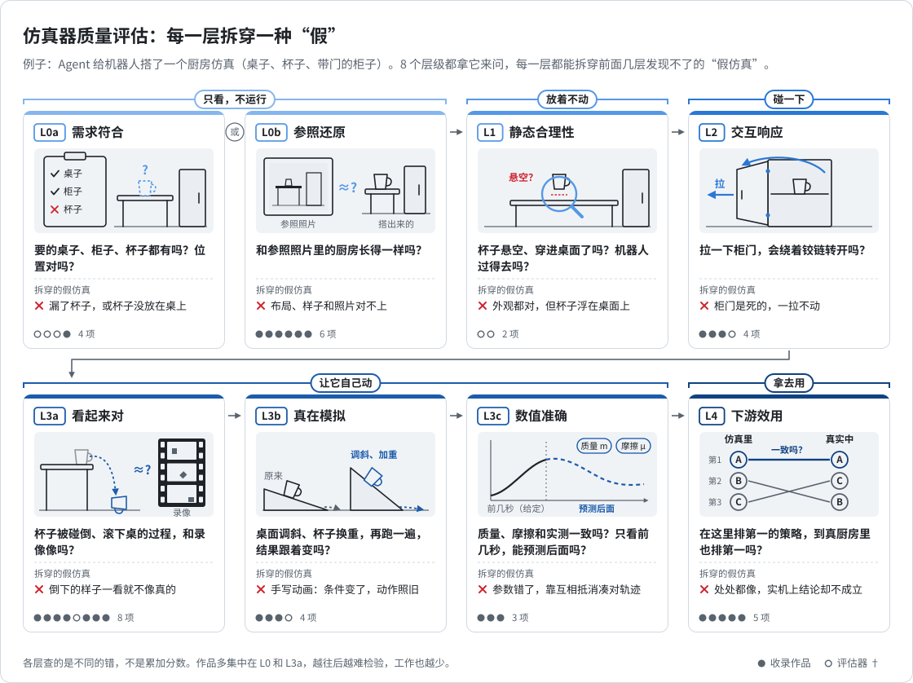

# 仿真器质量评估：检验层级

[English](simulator-evaluation.md) · **简体中文**

按“检验层级”整理 [3.3 仿真器质量评估](../README.zh-CN.md#s3-3) 的工作；各篇的方法细节见 [Stage 3 导读](README.zh-CN.md#section-3)。

<picture>
  <source media="(prefers-color-scheme: dark)" srcset="../assets/eval-ladder/eval-ladder-zh-dark.svg">
  
</picture>

## 目录

- [总览](#总览)
- [L0a 需求符合](#l0a-需求符合)
- [L0b 参照还原](#l0b-参照还原)
- [L1 静态合理性](#l1-静态合理性)
- [L2 交互响应](#l2-交互响应)
- [L3 动力学保真](#l3-动力学保真)
- [L4 下游效用](#l4-下游效用)
- [观察](#观察)
- [术语来源](#术语来源)

## 总览

| 编号 | 层级 | 核心问题 | 英文术语 |
|---|---|---|---|
| L0a | 需求符合 | 做到了要求里说的吗？ | Semantic Fidelity |
| L0b | 参照还原 | 和参照看起来一样吗？ | Visual / Reconstruction Fidelity |
| L1 | 静态合理性 | 放着不动时，站得住、走得通吗？ | Static Physical Plausibility |
| L2 | 交互响应 | 推一下、开一下，反应对吗？ | Interaction Plausibility |
| L3a | 动态：看起来对 | 动起来的过程和参照视频一样吗？ | Motion Fidelity |
| L3b | 动态：真在模拟 | 换个条件重跑，结果会跟着正确变化吗？ | Model Verification |
| L3c | 动态：数值准确 | 参数和真实一致吗？只看前几秒，能预测后面吗？ | Validation & System Identification |
| L4 | 下游效用 | 拿去评测或训练，结论在真实世界成立吗？ | Sim-to-Real Predictivity |

```
  规范驱动：L0a 需求符合 ─┐
                          ├─→ L1 静态合理性 → L2 交互响应 → L3 动力学保真 → L4 下游效用
  参照驱动：L0b 参照还原 ─┘     (不动)          (被动一下)      (自己演化)       (拿去干活)
```

L0a、L0b 是平行起点；各层检查不同的失败模式，不是累积分数。† 表示评估器（主要贡献是评估工具）。

## L0a 需求符合

**检查：** 把文字需求和常识要求拆成物体、属性、关系等约束，逐条核对。\
**局限：** 不涉及任何物理性质。

| 作品 | 检查什么 |
|---|---|
| [SceneEval](../README.zh-CN.md#paper-2503-14756) † | 文字中的物体、属性、关系，以及支撑、碰撞、通行等隐式要求 |
| [Apples on the Table?（LEGO-Eval）](../README.zh-CN.md#paper-2511-03001) † | 把描述拆成细粒度约束，调用工具逐项核对 |
| [SceneCritic](../README.zh-CN.md#paper-2604-13035) † | 读取符号化场景，按数据中的空间常识检查尺度、朝向、重叠 |
| [Code4Scene](../README.zh-CN.md#paper-2609-36777) | Agent 构建和编辑 3D 场景的需求满足度、完整性与静态有效性 |

## L0b 参照还原

**检查：** 与目标图像、视频、场景或图纸比较；渲染相似回答“像不像”，原生几何和结构一致回答“结构对不对”。\
**局限：** 看起来一致，不代表碰撞体、质量、关节正确。

| 作品 | 检查什么 |
|---|---|
| [IR3D-Bench](../README.zh-CN.md#paper-2506-23329) | 图像重建为程序化场景后的定位、数量、空间关系与外观 |
| [BlenderGym](../README.zh-CN.md#paper-2504-01786) | 修改 Blender 程序匹配目标，用多视角图像指标和三维距离评估 |
| [BlenderWorld](../README.zh-CN.md#paper-system-blenderworld) | 依据真实参照创作 3D，结合重新渲染与原生场景检查 |
| [Parametric CAD Bench v3](../README.zh-CN.md#paper-2611-02659) | 原生参数化几何与工程规格，而不是渲染图 |
| [BVB](../README.zh-CN.md#paper-2609-15478) | 用 Blender 程序重建视频内容，比较重建相似度与问答信息保留 |
| [Frontier3DBench](../README.zh-CN.md#paper-2611-09017) | 跨 Blender 与 Unreal 的物体、场景和交互世界创作 |

## L1 静态合理性

**检查：** 不运行物理，用几何计算检查穿模、支撑、可达、通行。\
**局限：** 放着没问题，不代表动起来也对。

| 作品 | 检查什么 |
|---|---|
| [GREP](../README.zh-CN.md#paper-2611-05802) † | 针对具体房间生成检查项，覆盖物理有效性、视觉协调和日常使用逻辑 |
| [SceneTeract](../README.zh-CN.md#paper-2603-29798) † | 按使用者条件（如轮椅用户）检查一项活动能否完成 |

## L2 交互响应

**检查：** 对世界施加动作，看物理响应是否合理，或程序状态是否按约定变化。\
**局限：** 门能打开、状态正确，不代表质量和阻尼正确。

| 作品 | 检查什么 |
|---|---|
| [ScIntBench](../README.zh-CN.md#paper-2610-37326) | 对生成场景统一执行推、开合、表面探测，检查交互是否合理 |
| [WorldCoder-Bench](../README.zh-CN.md#paper-2606-01869) | 执行预设动作后读取运行时状态，用带容差的隐藏断言（含守恒律）核对 |
| [Lab2Sim](../README.zh-CN.md#paper-2611-02928) | 逐步重放网页实验，与真实实验录像对照截图和状态 |
| [Automatically Improving Simulation Physics for Articulated Objects](../README.zh-CN.md#paper-2605-19136) † | 定义关节资产的“可交互就绪度”并评估稳定性、与人工判断的一致性 |

## L3 动力学保真

以“小球滚下斜坡，撞上箱子”为例，三个子问题依次变难：

| 子问题 | 怎么检 | 能被什么骗过 |
|---|---|---|
| **L3a 动态：看起来对** | 逐帧比较位置、光流、掩码，或由 VLM 评审 | 手写的关键帧动画 |
| **L3b 动态：真在模拟** | 改变条件（斜坡更陡、球更重）后重跑；物理断言、守恒检查 | 很难骗过，前提是真的做了干预 |
| **L3c 动态：数值准确** | 与独立测量的参数比较；只给前几秒，预测后续 | 参数互相补偿能骗过轨迹，骗不过外推和实测 |

用现成引擎时，物理规律由引擎负责，要检查的是 Agent 有没有真的交给引擎去算、选对了模型；自己写求解器时，规律本身也要检查。

### L3a 动态：看起来对

| 作品 | 检查什么 |
|---|---|
| [ExeWorldBench](../README.zh-CN.md#paper-2610-15166) | 代码生成可运行的 3D 世界，主要根据渲染帧评审结构、运动与因果 |
| [4DCodeBench](../README.zh-CN.md#paper-2610-03715) | 从参考视频重建可执行 4D 场景，比较外观、运动与几何；允许关键帧 |
| [VisPhyWorld](../README.zh-CN.md#paper-2602-13294) | 把物理视频写成模拟器代码，比较画面与运动 |
| [Physics-Inspired Animations](../README.zh-CN.md#paper-2602-10840) | 生成表现物理现象的动画代码，由 VLM 检查视频 |
| [PhyRubric](../README.zh-CN.md#paper-2611-13576) † | 用预先制定的 rubric 诊断生成视频中的物理常识错误 |
| [Latent Prediction Error and Physical Surprise](../README.zh-CN.md#paper-2611-01815) | 视频世界模型的预测误差能否区分物理违规与外观变化 |
| [Video2World](../README.zh-CN.md#paper-2610-04432) | 从真实示范视频重建环境并编写行为，比较几何与物体轨迹，并检查示范任务能否复现 |
| [Real2Sim Benchmark](../README.zh-CN.md#paper-real2sim-benchmark) | 冻结重建场景后，比较渲染、真实动作重放与固定策略闭环的结果；尚缺已知可用的参照场景 |

### L3b 动态：真在模拟

| 作品 | 检查什么 |
|---|---|
| [PhysCodeGym](../README.zh-CN.md#paper-2610-17288) | 要求运动由物理机制产生，并在反事实干预后重新仿真 |
| [PhysCodeBench](../README.zh-CN.md#paper-2604-23580) | 在视觉指标之外，用专家物理断言和守恒检查验证模拟代码 |
| [WorldSolver](../README.zh-CN.md#paper-2610-08720) | 场景和框架给定，只让 Agent 写求解器，检查运行、事件与物理行为 |
| [Polynomial Invariants for Simulator Faults](../README.zh-CN.md#paper-2609-13194) † | 从轨迹恢复多项式不变量，定位被违反的物理约束及出错参数；在注入故障上验证 |

### L3c 动态：数值准确

| 作品 | 检查什么 |
|---|---|
| [IRIS](../README.zh-CN.md#paper-2603-16432) | 与独立测量、附不确定性的真实参数比较，并检查可辨识性与外推 |
| [Δynamics](../README.zh-CN.md#paper-2605-20576) | 只输出参数配置由引擎重放，有真值时比较参数误差 |
| [MPMWorlds](../README.zh-CN.md#paper-2606-01538) | 看前约 2.5 秒，生成 MPM 程序预测后续；只在视频空间比较 |

## L4 下游效用

**检查：** 拿去评测或训练，结论在真实世界是否成立；需要包含成败差异的真实结果作对照，例如多个策略的实机成绩。\
**局限：** 评测排得准，不代表能用于训练：训练会反复优化并主动利用仿真误差（simulator exploitation，[2605.29032](https://arxiv.org/abs/2605.29032)）。

| 作品 | 检查什么 |
|---|---|
| [SIMPLER](../README.zh-CN.md#paper-2405-05941) | 同一批策略在仿真与实机上运行，比较表现与排名（Pearson、MMRV） |
| [YUBI-Real2Sim](../README.zh-CN.md#paper-2610-17521) | 只改变重建背景伪影，发现视觉分数无法预测策略排名的失败 |
| [X2Real](../README.zh-CN.md#paper-2609-27449) | 按真实硬件校准画面与物理，仿真与实机评分线性相关 0.84 |
| [PolaRiS](../README.zh-CN.md#paper-2512-16881) | 从短视频扫描重建评测场景，与通用策略的实机评测配对比较 |
| [H2RBench](../README.zh-CN.md#paper-2609-24778) | 人类到机器人迁移方法的仿真排名与实机排名比较（Pearson 0.89，MMRV 0.06） |

现有工作检验的都是评测用途。训练用途通常以方法论文中的训练实验出现，如 [SimFoundry](../README.zh-CN.md#paper-2606-28276)、[Video2Sim2Real](../README.zh-CN.md#paper-2606-08828)、[Phys2Real](../README.zh-CN.md#paper-2510-11689)，尚无在统一协议下横向比较不同仿真器的工作。

## 观察

- **分布不均：** 工作集中在 L0 与 L3a；检验机制、参数与下游效用的工作偏少；L4 目前只检验评测用途，也还没有评估器。
- **开放问题：** 哪些低层检查能预测高层失败？YUBI-Real2Sim 给出了反例：视觉质量不能预测策略排名。

## 术语来源

层级名称借用以下文献中的已有术语，组合成分层是本仓库的整理。

- 保真度分类：Alexander et al., [From Gaming to Training](https://www.cs.uky.edu/~sgware/reading/papers/alexander2005gaming.pdf)（2005）；[The Interaction Fidelity Model](https://arxiv.org/abs/2402.16665)
- V&V（L3b、L3c）：[NAFEMS: Verification and Validation](https://www.nafems.org/training/learning-hub/introduction-to-simulation-credibility/verification-and-validation)；Roache；Roy & Oberkampf
- 场景生成与具身仿真（L0a、L1）：[3D Scene Generation: A Survey](https://arxiv.org/abs/2505.05474)；[3D Generation for Embodied AI and Robotic Simulation: A Survey](https://arxiv.org/abs/2604.26509)；[SceneEval](https://arxiv.org/abs/2503.14756)
- 仿真—实机一致性（L4）：[SIMPLER](https://arxiv.org/abs/2405.05941)；[BWM](https://arxiv.org/abs/2607.29302)
