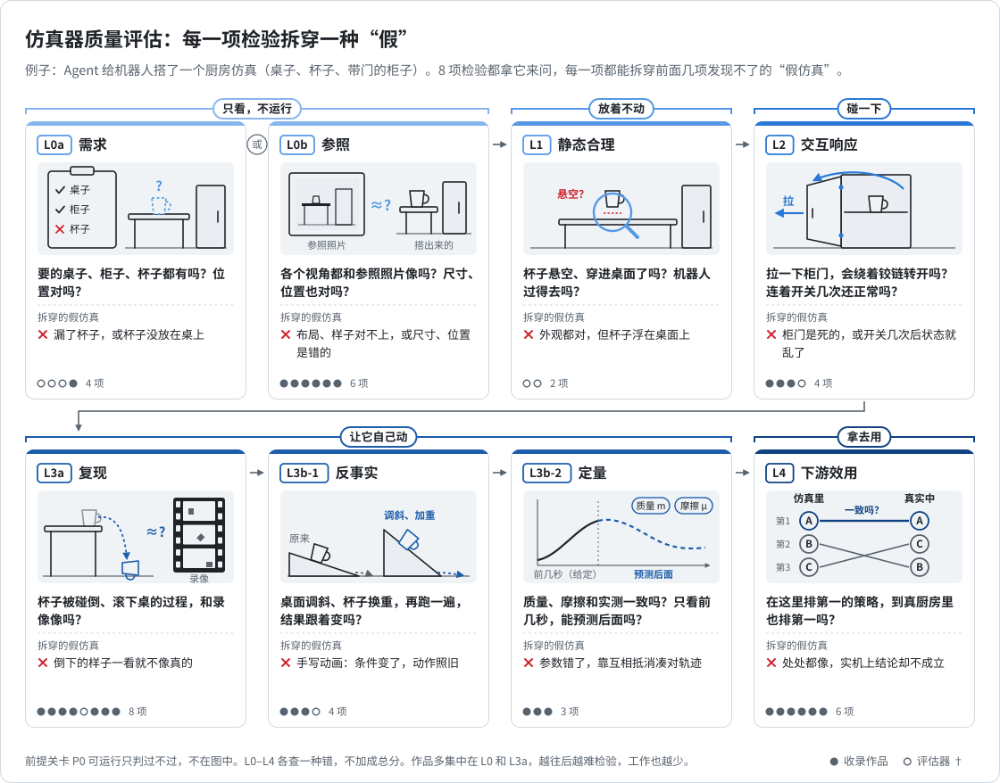

# 仿真器质量评估：检验层级

[English](simulator-evaluation.md) · **简体中文**

按“检验层级”整理 [3.3 仿真器质量评估](../README.zh-CN.md#s3-3) 的工作；各篇的方法细节见 [Stage 3 导读](README.zh-CN.md#section-3)。

<picture>
  <source media="(prefers-color-scheme: dark)" srcset="../assets/eval-ladder/eval-ladder-zh-dark.svg">
  
</picture>

## 目录

- [总览](#总览)
- [P0 可运行](#p0-可运行)
- [L0 场景保真：需求与参照](#l0-场景保真需求与参照)
- [L1 静态合理](#l1-静态合理)
- [L2 交互响应：单步与连续](#l2-交互响应单步与连续)
- [L3 动态保真：复现与外推](#l3-动态保真复现与外推)
- [L4 下游效用：评测与训练](#l4-下游效用评测与训练)
- [贯穿各层的打分原则](#贯穿各层的打分原则)
- [观察](#观察)
- [术语来源](#术语来源)

## 总览

每一层的名字写出它包含的维度；维度编号为 a / b，需要再细分时用 -1 / -2 展开。括号里是英文术语。

| 编号 | 名称 | 核心问题 |
|---|---|---|
| P0 | 可运行（Executability & Integrity） | 跑得起来吗？运动是引擎算出来的吗？ |
| L0 | 场景保真：需求与参照（Scene Fidelity — Semantic & Reconstruction） | 该有的都有吗？和参照一样吗？ |
| L0a | 需求（Semantic Fidelity） | 要求里的物体、属性、关系、建法都满足了吗？ |
| L0b | 参照（Reconstruction Fidelity） | 外观（L0b-1）和几何（L0b-2）与参照一致吗？ |
| L1 | 静态合理（Static Plausibility） | 放着不动，站得住、走得通吗？ |
| L2 | 交互响应：单步与连续（Interaction Plausibility — Single-step & Sequential） | 对它施加动作，反应合理吗？ |
| L2a | 单步 | 一个动作下去：该动的能动吗（L2a-1）？反应对吗（L2a-2）？ |
| L2b | 连续 | 按任务连着做（L2b-1）、随机或刻意找漏洞地做（L2b-2），状态和数值还保得住吗？ |
| L3 | 动态保真：复现与外推（Dynamics Fidelity — Reproduction & Generalization） | 让它自己演化，过程和结果对吗？ |
| L3a | 复现（Motion Fidelity） | 在参照出现过的条件下，过程和结果与参照一致吗？ |
| L3b | 外推 | 条件变了结果跟着正确变化吗（L3b-1）？参数和外推结果准吗（L3b-2）？ |
| L4 | 下游效用：评测与训练（Sim-to-Real Predictivity — Evaluation & Training） | 拿去评测（L4a）、拿去训练（L4b），结论在真实世界成立吗？ |

```
  P0 可运行（前提关卡）
     │
     ▼
  L0 场景保真 → L1 静态合理 → L2 交互响应 → L3 动态保真 → L4 下游效用
   (只看)        (放着不动)     (碰一下)        (让它自己动)   (拿去用)
```

- **P0 是前提关卡，只判过不过**；L0–L4 各自检查不同的失败模式，不加成总分。
- **L0a、L0b 是平行起点**：给的是文字需求时以 L0a 为主，给的是参照图像、视频或场景时以 L0b 为主，两者可以同时适用。
- 同一层内，**a / b 是并列的维度**；-1 / -2 若有先后，按编号顺序检查（例如 L3b-1 先于 L3b-2）。
- † 表示评估器（主要贡献是评估工具）。

**评测说明（不计入层级）：** 评测前须先确认被测接口与本体（动作空间、传感器、控制器）与参照一致，否则失败会被错算到仿真器头上。

## P0 可运行

**检查：** 能加载、能运行；运动由物理引擎或求解器算出，而不是由脚本、焊接约束、关键帧动画或按时刻触发的开关驱动。\
**拆穿：** 能看不能跑的场景；用脚本冒充物理的“假仿真”。\
**怎么检查：** 加载与运行测试；静态检查场景文件中的约束、外部驱动和动画脚本。\
**局限：** 只说明结果来自物理计算，不说明算得对。

目前没有以此为主要贡献的工作；[L3b-1](#l3b-1-反事实) 的反事实检验能从行为上间接发现脚本驱动。

## L0 场景保真：需求与参照

| 维度 | 核心问题 | 拆穿 | 怎么检查 |
|---|---|---|---|
| **L0a 需求** | 要求里的物体、属性、关系、建法都满足了吗？ | 缺项、关系错 | 清单断言、场景图核对、VLM 问答 |
| **L0b-1 参照：外观** | 从每个视角看，渲染和参照像不像？ | 布局、比例、材质偏离参照 | 逐视角图像指标、掩码 IoU |
| **L0b-2 参照：几何** | 尺度、形状、位置对不对，包括相对操作主体（如机器人）的位置？ | 画面对得上，尺寸或位置却是错的（例如为迁就场景把相机调歪） | 深度误差、Chamfer 距离、位姿误差 |

**局限：** 看起来一致、位置也对，不代表碰撞体、质量、关节正确。

### L0a 需求

| 作品 | 检查什么 |
|---|---|
| [SceneEval](../README.zh-CN.md#paper-2503-14756) † | 文字中的物体、属性、关系，以及支撑、碰撞、通行等隐式要求 |
| [Apples on the Table?（LEGO-Eval）](../README.zh-CN.md#paper-2511-03001) † | 把描述拆成细粒度约束，调用工具逐项核对 |
| [SceneCritic](../README.zh-CN.md#paper-2604-13035) † | 读取符号化场景，按数据中的空间常识检查尺度、朝向、重叠 |
| [Code4Scene](../README.zh-CN.md#paper-2609-36777) | Agent 构建和编辑 3D 场景的需求满足度、完整性与静态有效性 |

### L0b 参照

这些作品大多同时检查外观（L0b-1）和几何（L0b-2）。

| 作品 | 检查什么 |
|---|---|
| [IR3D-Bench](../README.zh-CN.md#paper-2506-23329) | 图像重建为程序化场景后的定位、数量、空间关系与外观 |
| [BlenderGym](../README.zh-CN.md#paper-2504-01786) | 修改 Blender 程序匹配目标，用多视角图像指标和三维距离评估 |
| [BlenderWorld](../README.zh-CN.md#paper-system-blenderworld) | 依据真实参照创作 3D，结合重新渲染与原生场景检查 |
| [Parametric CAD Bench v3](../README.zh-CN.md#paper-2611-02659) | 原生参数化几何与工程规格，而不是渲染图 |
| [BVB](../README.zh-CN.md#paper-2609-15478) | 用 Blender 程序重建视频内容，比较重建相似度与问答信息保留 |
| [Frontier3DBench](../README.zh-CN.md#paper-2611-09017) | 跨 Blender 与 Unreal 的物体、场景和交互世界创作 |

## L1 静态合理

**检查：** 不施加动作时，是否不穿模、有支撑、静置后稳定、走得通、够得着。\
**拆穿：** 悬空、穿模、一放就滑。\
**怎么检查：** 穿透检测、零动作沉降、可达与通行检查。\
**局限：** 放着没问题，不代表碰了、动起来也对。

| 作品 | 检查什么 |
|---|---|
| [GREP](../README.zh-CN.md#paper-2611-05802) † | 针对具体房间生成检查项，覆盖物理有效性、视觉协调和日常使用逻辑 |
| [SceneTeract](../README.zh-CN.md#paper-2603-29798) † | 按使用者条件（如轮椅用户）检查一项活动能否完成 |

## L2 交互响应：单步与连续

| 维度 | 核心问题 | 拆穿 | 怎么检查 |
|---|---|---|---|
| **L2a-1 单步：结构** | 该能动的部件能动吗？是独立部件、关节正确吗？ | 整个柜子是一块死网格 | 部件与自由度检查 |
| **L2a-2 单步：反应** | 一个动作下去，运动和受力反应合理吗？挡得住吗？ | 门能打开，手却能穿过物体 | 推、拉、按、捏等探测；状态断言 |
| **L2b-1 连续：任务序列** | 按任务连续操作（开门 → 放入 → 关门 → 再打开），状态还在吗？ | 单步凑效，多步后状态丢失、物体穿模掉落 | 多步任务脚本、不变量断言 |
| **L2b-2 连续：压测** | 在随机或刻意找漏洞的动作下，会出现不可能的事吗？ | 可被策略利用的漏洞：靠穿模把物体弹起、物体被粘住、数值爆炸 | 随机与对抗压测；能量、速度检查；NaN 率 |

**局限：** 门能打开、状态正确、压测不崩，不代表质量和阻尼正确。

| 作品 | 维度 | 检查什么 |
|---|---|---|
| [ScIntBench](../README.zh-CN.md#paper-2610-37326) | L2a | 对生成场景统一执行推、开合、表面探测，检查交互是否合理 |
| [Automatically Improving Simulation Physics for Articulated Objects](../README.zh-CN.md#paper-2605-19136) † | L2a | 定义关节资产的“可交互就绪度”并评估稳定性、与人工判断的一致性 |
| [WorldCoder-Bench](../README.zh-CN.md#paper-2606-01869) | L2a、L2b-1 | 执行预设动作后读取运行时状态，用带容差的隐藏断言（含守恒律）核对 |
| [Lab2Sim](../README.zh-CN.md#paper-2611-02928) | L2b-1 | 逐步重放网页实验，与真实实验录像对照截图和状态 |

L2b-2 目前没有专门工作。

## L3 动态保真：复现与外推

以“小球滚下斜坡，撞上箱子”为例：

| 维度 | 怎么检 | 能被什么骗过 |
|---|---|---|
| **L3a 复现** | 在参照出现过的条件下，逐帧比较位置、光流、掩码与结果；无参照时由 VLM 评审是否符合物理常识 | 手写的关键帧动画 |
| **L3b-1 外推：反事实** | 改变条件（斜坡更陡、球更重）后重跑；物理断言、守恒检查 | 很难骗过，前提是真的做了干预 |
| **L3b-2 外推：定量** | 与独立测量的参数比较；只给前几秒，预测后续；换成没见过的动作检验 | 参数互相补偿能骗过轨迹，骗不过外推和实测 |

L3b 内先查 L3b-1，再查 L3b-2：先确认结果真由物理算出，再看算得准不准。用现成引擎时，物理规律由引擎负责，要检查的是 Agent 有没有真的交给引擎去算、选对了模型；自己写求解器时，规律本身也要检查。

### L3a 复现

| 作品 | 检查什么 |
|---|---|
| [ExeWorldBench](../README.zh-CN.md#paper-2610-15166) | 代码生成可运行的 3D 世界，主要根据渲染帧评审结构、运动与因果 |
| [4DCodeBench](../README.zh-CN.md#paper-2610-03715) | 从参考视频重建可执行 4D 场景，比较外观、运动与几何；允许关键帧 |
| [VisPhyWorld](../README.zh-CN.md#paper-2602-13294) | 把物理视频写成模拟器代码，比较画面与运动 |
| [Physics-Inspired Animations](../README.zh-CN.md#paper-2602-10840) | 生成表现物理现象的动画代码，由 VLM 检查视频 |
| [PhyRubric](../README.zh-CN.md#paper-2611-13576) † | 用预先制定的 rubric 诊断生成视频中的物理常识错误 |
| [Latent Prediction Error and Physical Surprise](../README.zh-CN.md#paper-2611-01815) | 视频世界模型的预测误差能否区分物理违规与外观变化 |
| [Video2World](../README.zh-CN.md#paper-2610-04432) | 从真实示范视频重建环境并编写行为，比较几何与物体轨迹，并检查示范任务能否复现 |
| [Real2Sim Benchmark](../README.zh-CN.md#paper-real2sim-benchmark) | 冻结重建场景后，比较渲染、真实动作重放与固定策略闭环的结果；尚缺已知可用的参照场景 |

### L3b-1 反事实

| 作品 | 检查什么 |
|---|---|
| [PhysCodeGym](../README.zh-CN.md#paper-2610-17288) | 要求运动由物理机制产生，并在反事实干预后重新仿真 |
| [PhysCodeBench](../README.zh-CN.md#paper-2604-23580) | 在视觉指标之外，用专家物理断言和守恒检查验证模拟代码 |
| [WorldSolver](../README.zh-CN.md#paper-2610-08720) | 场景和框架给定，只让 Agent 写求解器，检查运行、事件与物理行为 |
| [Polynomial Invariants for Simulator Faults](../README.zh-CN.md#paper-2609-13194) † | 从轨迹恢复多项式不变量，定位被违反的物理约束及出错参数；在注入故障上验证 |

### L3b-2 定量

| 作品 | 检查什么 |
|---|---|
| [IRIS](../README.zh-CN.md#paper-2603-16432) | 与独立测量、附不确定性的真实参数比较，并检查可辨识性与外推 |
| [Δynamics](../README.zh-CN.md#paper-2605-20576) | 只输出参数配置由引擎重放，有真值时比较参数误差 |
| [MPMWorlds](../README.zh-CN.md#paper-2606-01538) | 看前约 2.5 秒，生成 MPM 程序预测后续；只在视频空间比较 |

## L4 下游效用：评测与训练

| 维度 | 核心问题 | 拆穿 | 怎么检查 |
|---|---|---|---|
| **L4a 评测** | 同一批策略在仿真和真实世界中的表现与排名一致吗？ | 局部都很逼真，排名却颠倒 | 排名相关性（Pearson、MMRV、Kendall τ） |
| **L4b 训练** | 在仿真中训练得到的策略，在真实世界中还有效吗？ | 训练过程利用仿真误差（simulator exploitation，[2605.29032](https://arxiv.org/abs/2605.29032)） | 仿真训练后的实机成功率 |

**局限：** 评测排得准，不代表能用于训练：训练会反复优化并主动利用仿真误差。两者都需要包含成败差异的真实结果作对照，例如多个策略的实机成绩。

| 作品 | 维度 | 检查什么 |
|---|---|---|
| [SIMPLER](../README.zh-CN.md#paper-2405-05941) | L4a | 同一批策略在仿真与实机上运行，比较表现与排名（Pearson、MMRV） |
| [YUBI-Real2Sim](../README.zh-CN.md#paper-2610-17521) | L4a | 只改变重建背景伪影，发现视觉分数无法预测策略排名的失败 |
| [X2Real](../README.zh-CN.md#paper-2609-27449) | L4a | 按真实硬件校准画面与物理，仿真与实机评分线性相关 0.84 |
| [PolaRiS](../README.zh-CN.md#paper-2512-16881) | L4a | 从短视频扫描重建评测场景，与通用策略的实机评测配对比较 |
| [H2RBench](../README.zh-CN.md#paper-2609-24778) | L4a | 人类到机器人迁移方法的仿真排名与实机排名比较（Pearson 0.89，MMRV 0.06） |
| [Genie Sim Benchmark](../README.zh-CN.md#paper-2611-15020) | L4a | 16 项任务、22 组机器人—任务配对的实机与仿真分阶段得分比较（Pearson 0.97），另诊断关节运动与接触响应 |

L4b 目前没有评估工作；训练用途通常以方法论文中的训练实验出现，如 [SimFoundry](../README.zh-CN.md#paper-2606-28276)、[Video2Sim2Real](../README.zh-CN.md#paper-2606-08828)、[Phys2Real](../README.zh-CN.md#paper-2510-11689)，尚无在统一协议下横向比较不同仿真器的工作。

## 贯穿各层的打分原则

两条原则不单独成层，而是规定每一层怎么打分：

- **证据分区：** 参照里看得到的部分比准确度，推断补全的部分（背面、内部、没被碰过的物体的参数）只比合理性。
- **范围打分：** 参照定不死的部分，仿真器应给出范围而不只是一个值；打分看范围能否包住真实结果（覆盖），以及范围够不够窄（锐度）。

## 观察

- **分布不均：** 收录的 37 项工作中，L0 有 10 项，L3a 有 8 项；检验机制、参数与下游效用的工作偏少。L2b-2（压测）与 L4b（训练）目前没有专门工作，P0 也还没有被单独形式化。
- **开放问题：** 哪些低层检查能预测高层失败？YUBI-Real2Sim 给出了反例：视觉质量不能预测策略排名。

## 术语来源

层级与维度名称借用以下文献中的已有术语，组合成分层是本仓库的整理。

- 保真度分类（L0、L2）：Alexander et al., [From Gaming to Training](https://www.cs.uky.edu/~sgware/reading/papers/alexander2005gaming.pdf)（2005）；[The Interaction Fidelity Model](https://arxiv.org/abs/2402.16665)
- V&V（L3b）：L3b-1 反事实对应 V&V 中的 Verification（“方程解对了吗”），L3b-2 定量对应 Validation 与系统辨识（“方程选对了吗”）。[NAFEMS: Verification and Validation](https://www.nafems.org/training/learning-hub/introduction-to-simulation-credibility/verification-and-validation)；Roache；Roy & Oberkampf
- 场景生成与具身仿真（L0a、L1）：[3D Scene Generation: A Survey](https://arxiv.org/abs/2505.05474)；[3D Generation for Embodied AI and Robotic Simulation: A Survey](https://arxiv.org/abs/2604.26509)；[SceneEval](https://arxiv.org/abs/2503.14756)
- 仿真—实机一致性（L4）：[SIMPLER](https://arxiv.org/abs/2405.05941)；[BWM](https://arxiv.org/abs/2607.29302)
